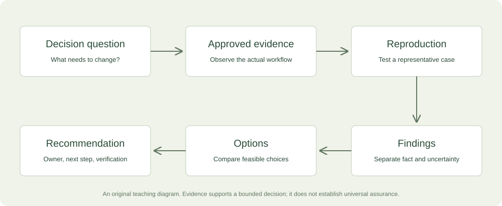

# From Engineer to Consultant

## Cloud-native, Kubernetes, and AI workflow consulting for Aadil Mallick

Research edition: November 13, 2026.

<a id="contents"></a>

# Reading order

[Preface](#preface) · [Consulting Decision Lab](#consulting-lab)

- [1. From software developer to consultant](#chapter-01)
- [2. Cloud-native and Kubernetes consulting that solves a real problem](#chapter-02)
- [3. AI workflow consulting: sell a decision that survives evaluation](#chapter-03)
- [4. Package, sell, and deliver high-value consulting](#chapter-04)

[Consulting kit](#consulting-kit) · [References](#references) · [Projects and source](#source-appendix)

<a id="preface"></a>

# Before you begin

You already know how to build software. Consulting adds a different responsibility: help another person understand a problem, choose a useful next step, and operate the result. This book develops that skill before applying it to cloud delivery, Kubernetes, and AI workflows. It is written for Aadil Mallick using the supplied resume and project context, with concepts useful to other software developers as well.

The recommended first commercial experiment is a bounded Cloud Delivery Diagnostic. Your reported AWS CDK, developer-environment, testing, and documentation experience supports that direction. AI evaluation is a promising second specialization. Broader Kubernetes production responsibility requires evidence specific to that promise, with an experienced partner where appropriate. These are strategic interpretations, not a declaration that an expensive offer is already validated.

You need basic programming familiarity, an understanding of web applications, and willingness to inspect evidence. Business concepts, Kubernetes mechanisms, and evaluation quantities are introduced before use. No calculus or advanced statistics is assumed. Read the four parts in order, or revisit the linked sections and experiments when preparing a real engagement. Optional applications are invitations, not quizzes or prerequisites to continue reading.

All monetary examples are in US dollars. Proposed prices are validation hypotheses, not surveyed market rates or guaranteed income. All customer scenarios use fictional Harbor Software, and the AI fixture contains synthetic stored candidate outputs. Resume statements are attributed personal evidence, not independently audited client outcomes. Current employment, weekly availability, audience access, and an active consulting pipeline are not assumed.

The browser lab makes five kinds of reasoning visible: evidence readiness, modeled customer value, time-based reliability budgets, AI policy evaluation, and engagement economics. It does not inspect infrastructure, call a model, send outreach, or make business decisions for you. The continuous HTML edition embeds a self-contained copy. The package also includes the source, a standalone lab, a Python evaluator, a sample Kubernetes workload, templates, and verification details.

Use the book to prepare one proof package and one offer, then learn from actual buyer conversations. The intended outcome is a stronger decision process and a concrete route to responsible paid work, not a larger collection of technology labels.


# Part 1 · Consulting foundations

<a id="chapter-01"></a>

## 1. From software developer to consultant


### Begin with a decision, not a technology

Imagine that the engineering lead of a small software company tells you, “We need Kubernetes consulting.” You know Kubernetes manages containerized applications, and your resume describes relevant engineering work. The tempting response is to discuss clusters, Helm charts, and deployment tooling. A consultant begins one step earlier: what decision is the customer trying to make, and what is going wrong? The answer might be failed releases, slow onboarding, an expensive system nobody owns, or a proposal to adopt Kubernetes before there is a clear need for it.

Consulting is a professional service that helps a customer understand a problem, choose a course of action, and, where agreed, make a change. The paid result can be a better decision, a verified improvement, or an operating capability the team can sustain. Code may be part of it, but code volume is not its definition. A useful recommendation against a migration can be more valuable than an impressive migration proposal. Your responsibility is to connect technical evidence to the customer's actual decision.

This book teaches that transition specifically for you, Aadil. Your supplied resume reports AWS CDK infrastructure work, developer environments, CI/CD and testing, a Kubernetes-based monitoring system, structured-output AI experiments, commercial web development, and technical writing. These are useful foundations. They do not establish that you have independently owned every production platform, led enterprise transformations, or delivered a particular financial result. We will use the evidence you have, identify the gaps that matter, and design offers whose promises you can actually support.

The recurring customer, Harbor Software, is fictional. Its examples are synthetic and are not a claim about an employer or prospect. Harbor has a small engineering team, an application hosted in the cloud, a container-based delivery process, and an AI feature under consideration. It needs help deciding what to improve first. All prices in this book are proposed USD experiments, not researched market averages or your established rates. Your weekly availability, income target, current employment, and active client pipeline remain unconfirmed.

### What changes when you become the adviser

An implementation request says, “Add a deployment workflow with these requirements.” A consulting request says, “Help us release changes with less uncertainty.” The second requires you to understand the process before deciding whether a workflow is the right intervention. Perhaps the real problem is missing acceptance criteria, unreliable test data, or an approval bottleneck. A tool change may help, but it can also automate a poorly understood process. The consultant is paid to improve the choice as well as the execution.

There are several legitimate engagement styles. Staff augmentation supplies capacity inside a customer's existing management structure. A fixed implementation supplies a defined output. A diagnostic supplies evidence and recommendations. Advisory work helps an accountable owner make decisions over time. Training builds the team's ability to act independently. A single business may sell more than one style, but the agreement should make clear which responsibility you are taking. Calling ordinary implementation “strategic consulting” does not automatically create more value or justify a larger fee.

For your first independent consulting offer, a diagnostic followed by a separately scoped improvement is a strong fit. It uses your engineering judgment and communication while limiting the commitment before the environment is understood. A buyer can purchase the diagnostic, use the findings with another team, and still receive value. That independence matters. If the only result is a quote for your own implementation service, the buyer may reasonably see the activity as sales rather than paid advice.

### Understand who buys, who uses, and who can block

The person experiencing a problem is not always the person authorized to buy a solution. Developers may feel setup friction daily, while an engineering manager controls budget. A founder may approve spending, while an operations lead controls production access. A security reviewer may have no budget but can reject a proposed data flow. Consulting becomes much easier when you map these roles early rather than discovering them after writing a proposal.

A sponsor wants the problem addressed and helps move the engagement forward. An economic buyer can commit the relevant budget. An operational owner is responsible for the system after you leave. Users experience the workflow. A reviewer evaluates technical, security, legal, or procurement requirements. One person may hold several roles in a small company. Write the roles beside names only after they are established; do not infer purchasing authority from a job title alone.

At Harbor, the engineering lead is your sponsor and operational owner, the founder approves a modest budget, and one developer will work alongside you. A platform provider controls part of the environment. This tells you how to run discovery: hear the lead's goals, observe the developer's workflow, understand the founder's decision criteria, and identify provider constraints. A workshop with only the sponsor may miss the actual friction. A conversation with only the developer may produce an excellent fix nobody has agreed to fund.

### Translate technical symptoms into business questions

A symptom is an observed problem, such as a failed release or a long setup time. A cause is an explanation for the symptom. A business consequence is why the organization cares. Keep these separate until evidence connects them. “Our builds are slow” does not establish that slow builds are delaying revenue. The team may run them infrequently, or other work may dominate the lead time. Ask for recent examples rather than accepting the largest possible consequence as fact.

A useful structure is situation, observation, consequence, decision. Harbor's situation is a team releasing a web application. The observation is that the last three deployments needed manual correction. The possible consequence is that engineers are losing time and avoiding releases. The decision is whether to improve the existing pipeline, change the application packaging, or adopt a different platform. This framing gives you several hypotheses to investigate without pretending that the first explanation is correct.

Write a problem statement that contains uncertainty honestly: “Harbor wants to reduce manual correction during releases. Three recent deployments required intervention, but the causes and frequency are not yet measured consistently. The engagement will identify the recurring failure points and recommend one bounded improvement.” This is stronger than “We will eliminate deployment problems.” It tells the buyer what question you will answer and sets a realistic boundary around the result.

### Learn to distinguish evidence from interpretation

An observation might be a timestamped failed workflow run, an interview statement, a configuration file, or a reproduced setup attempt. An interpretation explains what it means. A recommendation proposes action. Good consulting keeps the chain visible. For example: the workflow logs show that a secret was missing; your reproduction fails at the same step; you infer that setup documentation and configuration checks are incomplete; you recommend adding a documented prerequisite and an early validation step.

Different evidence supports different claims. A resume supports your history of participation, subject to confirmation. A lab demonstrates that you can reproduce behavior in a controlled environment. A customer reference supports an account of a real engagement. Repeated measured outcomes support a stronger commercial claim. None is worthless, but they are not interchangeable. A certificate can demonstrate study or an exam result; it does not establish that you can manage a difficult production incident alone.

The companion's readiness worksheet makes this distinction explicit. It records four scores: technical understanding, reproducible demonstration, buyer evidence, and delivery safeguards. Each ranges from zero to four, with visible descriptions. It is a reflection aid, not a certification or automatic permission to sell. A high total must not hide a critical gap. In the worksheet, an advanced production engagement remains blocked if demonstration or delivery safeguards are below the required level, regardless of the sum.

### Your evidence supports a focused starting position

Your AWS CDK work and developer-environment improvements make cloud delivery and developer workflow a credible theme. Your monitoring and testing work adds adjacent depth. Your technical writing supports the handover that many customers struggle to obtain. Together, these suggest a service such as: “I help small software teams understand and improve one cloud delivery workflow, with reproducible findings, a prioritized plan, and a practical handover.” It is narrower and easier to evaluate than “I provide cloud, AI, Kubernetes, and digital transformation consulting.”

A first buyer hypothesis is a small TypeScript or Python team with a working product, a specific delivery problem, an engineering owner, and enough access to investigate it. A second route is an agency or experienced cloud consultancy needing a scoped contributor. The partner route can let you work on larger engagements without presenting yourself as the sole senior authority. Buyer access is still an open question. Your education and work history do not establish warm relationships with particular decision-makers.

The initial recommendation is a Cloud Delivery Diagnostic, with a possible implementation sprint afterward. Use AI workflow evaluation as a second specialization once you have a strong, reproducible case study. Treat Kubernetes production modernization as a capability you can develop or deliver with an experienced partner, rather than a title to claim immediately. This ordering is an interpretation of your supplied evidence, not a rule that you must avoid all Kubernetes work. The scope and environment determine the fit.

### Structure a diagnostic that is worth buying

A diagnostic needs a decision question, inputs, investigation, deliverables, and an acceptance standard. Suppose Harbor needs to decide which release improvement to fund. You request a walkthrough, selected workflow runs, a redacted architecture diagram, and permission for a controlled reproduction. You inspect one repository and one delivery path. Your deliverable is a short report with evidence, ranked findings, alternatives, and a recommended next step. The customer can act on it independently.

Acceptance could mean that the report accurately describes the observed workflow, documents reproduced blockers, distinguishes confirmed findings from hypotheses, compares realistic options, and includes a bounded implementation proposal if appropriate. It does not mean every issue has been fixed or every production risk has been discovered. A limited diagnostic is useful because it answers a limited question well. Calling it an audit can imply assurance you have not provided; describe the actual scope instead.

A provisional price range might be $1,500–$3,000 for a carefully bounded diagnostic requiring roughly twelve to twenty total hours. This is a validation hypothesis. Count preparation, sales allocation, calls, analysis, writing, review, and handover. If the customer requires several environments, extensive procurement, or specialist assurance, the scope is different. Do not preserve a price range by silently excluding work the buyer reasonably expects. Reduce the promise or change the commercial arrangement explicitly.

### Why expensive work must justify its price

“High ticket” describes a large customer commitment. It is not a special consulting method. Buyers justify that commitment through an important problem, a credible path to improvement, confidence in the provider, and manageable risk. A $12,000 engagement can be sensible for a costly, urgent problem and unreasonable for a minor inconvenience. The job title and fashionable technology do not settle the question. Your offer must connect the fee to a clear decision and deliverable.

Value has several forms: recoverable engineering time, avoided recurring costs, faster completion of a dependent project, better reliability, or a capability the team previously lacked. Some value is measurable directly; some is uncertain. Record the source and assumptions for each estimate. A customer's estimate of engineer time is stronger than your guess, but it is still an estimate until measured. Released time does not automatically become cash savings or additional revenue.

Avoid using fear to inflate value. A configuration issue does not prove a catastrophic incident is imminent. A potential failure mode can justify investigation, but its financial value depends on likelihood, impact, exposure, and alternatives. Explain the uncertainty rather than assigning an invented probability. Sometimes the right recommendation is a low-cost operational change. Demonstrating that judgment can support a longer relationship more effectively than turning every finding into a large transformation.

### Work through a time-value estimate

Harbor has six developers. The sponsor estimates each spends ninety minutes weekly recovering from delivery friction. Six multiplied by one and a half gives nine hours per week. At a customer-supplied fully loaded labor estimate of $80 per hour, the gross time value is $720 weekly. Over forty-eight working weeks, that is $34,560 annually. The arithmetic is straightforward, but the interpretation needs care: the estimate assumes the reported friction is real, recurring, and attributable to the workflow you can affect.

Suppose the proposed change addresses only half the friction, and only eighty percent of the potential time is likely to be realized because adoption and other constraints remain. Multiply $34,560 by 0.5 and then by 0.8 to get $13,824 of annual modeled capacity value. Subtract $1,800 in recurring operating costs to get $12,024 of annual net modeled value before the implementation fee. A proposed $9,000 fee then has a simple modeled payback of about nine months: $9,000 divided by $12,024, multiplied by twelve.

These are hypothetical inputs, not a promise. If improvement is only twenty percent rather than fifty, the case changes sharply. If the customer cannot use the released capacity, the labor-value interpretation may be weak. The companion business-case experiment lets you change the assumptions and see the result. It deliberately labels the outcome modeled value and handles nonpositive value without displaying a nonsensical negative payback. The model supports a discussion; it does not discover the customer's true return automatically.

### Count your economics separately from customer value

Customer value determines whether buying may make sense. Your economics determine whether you can deliver sustainably. Suppose a $9,000 sprint requires fifty hours of implementation and verification, ten hours of meetings and documentation, eight hours of sales and discovery allocation, and seven hours of correction and contingency. Total effort is seventy-five hours. If direct costs are $600, contribution before tax and unallocated overhead is $8,400. Divide by seventy-five to obtain $112 per total hour.

If the project expands to one hundred twenty hours, the same contribution is $70 per hour. The customer may still receive value, but your delivery process has become less sustainable. This is why scope, review ownership, and change control are economic design choices. Do not calculate your effective rate using only the hours spent editing code. Preparation, calls, selling, revisions, and support are part of the work required to earn the fee.

A capacity plan adds another constraint. At ten hours weekly across a four-week planning cycle, you have forty hours. If ten are reserved for sales, four for administration, and six for support and slack, twenty remain for new delivery. A seventy-five-hour engagement cannot honestly be promised in two weeks of that schedule. You could spread it across a longer period, reduce scope, increase availability, or involve an agreed collaborator. Your calendar must match the commercial promise.

### Establish a consulting engagement in stages

A healthy engagement has qualification, discovery, agreement, investigation or implementation, review, and handover. Each stage has a decision. Qualification asks whether the problem, buyer, scope, and constraints fit. Discovery asks what is actually happening. Agreement defines who does what and how the result is accepted. Delivery produces evidence and the promised output. Review checks it against the agreed examples. Handover makes the result usable without depending indefinitely on you.

This sequence is flexible. A returning customer with a known system may need less discovery. An unfamiliar production platform may need much more. The principle is to reduce uncertainty before making commitments that depend on it. A request for a fixed migration quote after one short call is a signal to investigate, not an obligation to guess. Explain the missing information and offer a useful next step, such as a capped diagnostic.

Define stop conditions. If the customer cannot provide legitimate access, cannot identify an owner, or needs a capability outside your experience, pause the relevant work and discuss options. This is ordinary professional judgment. You can refer, partner, narrow the engagement, or decline. You do not need to create a long warning ritual around every project, but you do need enough boundaries to avoid pretending that an unsupported commitment is safe simply because a buyer is enthusiastic.

### Learn the practical discovery interview

Start with a recent example: “Walk me through the last release that required intervention.” Ask who participated, what they expected, what happened, how they detected it, and how they recovered. Then compare it with a successful release. Differences between concrete cases often reveal more than a general discussion about best practices. Record dates and artifacts where available. A statement such as “it always breaks” is a lead to investigate, not yet a measured failure rate.

Ask what the team has tried and why it did or did not help. This prevents recommending an approach they already evaluated under constraints you have not learned. Ask what cannot change: a contractual platform requirement, a customer's data boundary, a limited maintenance window, or a skill constraint. Constraints are not annoyances to dismiss; they define the feasible solution space. A technically elegant option outside that space is not a useful recommendation.

Finally ask how the buyer will decide. What result would justify implementation? Who reviews the recommendation? What budget can be committed? When is the decision needed? These questions connect your analysis to action. A technically thorough report can still fail commercially if it arrives after the decision or is written for someone who cannot use it. Consulting quality includes the timing and usability of the advice.

### Structure findings so someone can act

A finding should include observation, evidence, impact, confidence, recommendation, owner, and next verification. For example: “A new developer's setup failed because a required environment variable was not documented. Evidence: clean-environment reproduction and setup instructions. Impact: onboarding requires undocumented assistance. Confidence: high for the reproduced path; unknown for other operating systems. Recommendation: add an example configuration and validation step. Owner: engineering lead. Verification: a second developer completes setup using only the revised instructions.”

Notice that the finding does not say the entire development environment is broken. It names the observed boundary and a checkable improvement. This makes prioritization easier. Compare a specific, reproducible finding with “improve developer experience,” which may be directionally correct but gives the team no concrete action. Your ability to explain systems can turn technical detail into a useful finding without oversimplifying it.

Separate urgency from confidence. A severe but weakly evidenced concern may justify investigation rather than immediate remediation. A modest but confirmed issue may be cheap to fix and worthwhile. Use qualitative labels with definitions before adopting a numerical scoring model. If you multiply arbitrary severity and likelihood scores, the resulting number can look more objective than the inputs deserve. A clear explanation of uncertainty is often more useful than a precise-looking priority score.



### Learn to make a recommendation with alternatives

A recommendation should answer the decision, show the evidence, compare realistic options, and explain the tradeoff. For Harbor, the options might be to keep the current process and document recovery, improve one deployment path, or adopt a managed service that removes some operational burden. Kubernetes is one possible mechanism, not the default answer. The recommendation should make clear what each option changes, what it leaves unresolved, and who will own it afterward.

Include the “do little” option. It establishes whether a proposed change is worth its cost. A small team with infrequent releases may reasonably accept some manual work. A regulated customer may value a slower, more controlled process. The purpose is not to push every team toward the same maturity level. It is to choose an appropriate operating model given its goals and constraints. The CNCF platform material likewise emphasizes outcomes and user needs rather than a portal as the definition of a platform. [CNCF](#cncf)

Your preferred option can include a staged experiment. Instead of migrating every service, test one representative workload and measure the result. Define what would make the experiment succeed, fail, or remain inconclusive. A successful lab is not automatically a production approval, but it can reduce uncertainty for the next decision. This staged reasoning is a foundation for higher-value work because it limits unnecessary spending while preserving a path to a larger improvement.

### Build credibility through usable proof

Create a small evidence portfolio around the offer you want to sell. For a cloud delivery diagnostic, useful proof includes a synthetic repository with a reproducible setup, a documented release failure and correction, a short decision memo comparing approaches, and a handover someone else can follow. A narrated walkthrough shows your ability to explain the system. The proof should resemble the customer's risk, not merely display a list of technologies.

Your previous work can support this portfolio, subject to permission and factual accuracy. BetterCare Meals supports commercial web implementation; it does not by itself establish Kubernetes advisory results. Your monitoring work supports relevant technical experience; it does not prove you operated a customer's platform independently. Your AI research supports evaluation thinking; it does not guarantee a new workflow's accuracy. Matching proof to claim makes your positioning more credible without diminishing the work you have done.

Do not recreate private employer systems for marketing. Use synthetic architectures, your own projects, or approved case studies. Document what you personally contributed and what remains unmeasured. If you claim a time reduction, explain the baseline and measurement. If you cannot share a system publicly, a redacted private discussion may be possible with permission. You can still show your process through an original lab rather than trying to borrow credibility from confidential details.

### Consulting tools should follow the work

At the beginning, you need a reliable way to record opportunities, schedule conversations, keep notes, write reports, manage agreements and invoices, and store approved technical evidence. The exact products matter less than a consistent process. Use a simple table for prospects if it works. Use the customer's issue tracker during delivery when appropriate. Avoid forcing every small buyer into an elaborate client portal before you understand its needs.

For technical work, your tools may include cloud consoles and CLIs, infrastructure-as-code repositories, test runners, log and metrics systems, and evaluation utilities. Access should match the investigation. Start with read-only evidence when that can answer the question, and agree separately to changes. AI assistants can help organize notes or inspect approved code, but their outputs are hypotheses to review. A plausible explanation without supporting evidence is not a consulting finding.

Keep the source of truth understandable. The scope lives in an agreed document, decisions in a short log, technical changes in version control, and findings in a report linked to evidence. The customer should not have to reconstruct the engagement from your private chat with a coding agent. Clear records make handover and later work easier, and they protect against misunderstandings about what was agreed or observed.

### A learning path that produces sellable evidence

You do not need to learn every cloud-native tool before starting a small diagnostic. Learn in the order required by the promise. First understand the workflow and its operating boundaries. Then reproduce a representative system locally or in an approved sandbox. Then test failure behavior and document recovery. Finally practice explaining the tradeoffs to someone who did not build it. These steps produce evidence as well as knowledge.

For Kubernetes, your next proof should include a workload, service routing, resource settings, health behavior, a controlled rollout, and an explanation of what those mechanisms do not guarantee. For AI workflows, produce a fixed evaluation set, a simple baseline, a candidate workflow, error analysis, and a decision about permitted actions. For cloud delivery, produce a reproducible path from repository to a verified application result. Chapters 2 and 3 teach these concrete patterns.

Certificates may help with structured study or buyer filters, but they are not the only path to proof. Do not spend months collecting credentials while avoiding buyer conversations. Equally, do not use the desire to sell quickly as a reason to skip the skills needed for the actual responsibility. Balance a narrow learning experiment with a narrow commercial experiment. The size of the promise should grow with the strength of the evidence and delivery capacity.

### A worked first offer for your situation

Your draft offer is: “I help small software teams find and improve one cloud delivery bottleneck. The engagement maps the workflow, reproduces the important failure points, compares practical options, and leaves a prioritized plan your team can use.” The buyer is an engineering lead or agency owner with a concrete delivery problem. The initial output is a diagnostic, not an unrestricted promise to fix all infrastructure.

Included scope might be one repository, one nonproduction environment, two stakeholder conversations, a review of selected release evidence, and a written recommendation. Excluded scope includes emergency response, comprehensive security assurance, production migration, organization-wide redesign, and ongoing on-call coverage. These exclusions are examples to adapt, not universal terms. If the buyer needs one of them, you can discuss a different engagement or an experienced partner.

A provisional $2,000 diagnostic with sixteen total hours and $100 direct costs produces $1,900 contribution before tax and unallocated overhead, or $118.75 per total hour. That is internal planning arithmetic. The buyer still needs to see enough value to purchase, and your actual effort may differ. A later implementation sprint could be $6,000–$12,000 only when the scope, evidence, buyer problem, and capacity support it. The higher price is not an automatic upsell.

### What a good diagnostic report sounds like

An executive opening could read: “We examined the path from approved code to the staging application for one service. The most repeatable source of intervention was configuration drift between developer setup and the deployment environment. Two reproduced failures support this finding. We recommend a small configuration validation and release-verification change before considering a platform migration. The current evidence does not establish that Kubernetes adoption would resolve the dominant problem.”

The technical section then shows the reproduced steps, artifacts, constraints, and options. The implementation section names the proposed change, acceptance examples, owner, and dependencies. The uncertainty section lists what was not inspected. The buyer can use the report to decide, and a developer can use it to act. The report does not need fifty pages to be valuable. It needs enough detail to make its reasoning reviewable.

This is also how you develop a high-value reputation. You become the person who can clarify a problem, identify the evidence that matters, and leave the team with a better next step. Technical depth supports that work, but so do scope control, communication, and independent judgment. The next chapter applies this process to cloud-native systems, where a familiar configuration option can have several different business implications depending on the environment.

### Three consulting conversations, traced more carefully

#### The founder who wants a fashionable migration

A founder has heard that successful companies use Kubernetes and asks for a migration proposal. Begin by asking what the existing platform prevents the business from doing. If the current service is reliable, inexpensive enough, and easy for the team to maintain, the migration may create operational work without solving a problem. The founder might still have a legitimate concern, such as vendor constraints or customer requirements. Your task is to identify that concern, not to dismiss the request because the motivation sounds fashionable.

Offer a decision review with criteria: operational ownership, deployment needs, isolation, cost structure, recovery, and team capability. Ask what evidence would favor staying or moving. This converts a technology preference into an assessable decision. If the conclusion is to stay, the engagement can still produce a useful operating plan and criteria for revisiting the choice. The value is avoiding an unsupported commitment, not demonstrating that your preferred platform is always correct.

#### The engineering lead who wants a guarantee

A lead asks whether you can guarantee that releases will never fail after your improvement. Explain the distinction between a verified workflow and universal reliability. You can agree to behavior under representative examples, clear error handling, and a documented recovery path. You cannot control every dependency, future change, or operator action. The next step is to define which failures matter and what an acceptable operating process looks like, rather than promising perfection to close the sale.

A meaningful commitment could be that the staging release path passes agreed tests, reports a failed verification clearly, and can return to the previous application artifact under the demonstrated conditions. That is narrower than zero downtime, but it is much more useful than a vague assurance. If the buyer needs a contractual service level or independent assurance, that requires a suitable agreement and capability. Your scope should reflect the responsibility you actually accept.

#### The agency that needs a specialist contributor

An agency has a customer with a delivery problem and wants someone to investigate a defined subsystem. Ask who owns the customer relationship, who approves technical changes, and who will sign acceptance. You may be an implementation contributor under the agency's lead rather than the sole adviser. That arrangement can be an excellent way to build experience if responsibilities are explicit. Your public claims afterward must describe your actual role and respect confidentiality.

The agency may value your documentation as much as your code because it needs to maintain the result for its client. Propose an evidence package, a reviewable change, and a walkthrough. Agree on payment independently of assumptions about the agency's own invoice unless you deliberately accept other terms. A good partnership increases your reach while preserving a realistic scope. It is a commercial relationship to manage, not a shortcut around the need for competence or clear ownership.

### Use the first companion experiment with a real decision

Open the readiness experiment before choosing your first offer. Score only evidence you can point to: an explained mechanism, a reproducible demonstration, an observed buyer problem, and a documented delivery boundary. Write one missing proof beside the weakest category. If the total looks encouraging but a critical gate is missing, choose a diagnostic or partner role rather than increasing the claim. Revisit the worksheet after completing a relevant demonstration or engagement. Its purpose is to make your reasoning visible, not to replace judgment with a number.

# Part 2 · Cloud-native practice

<a id="chapter-02"></a>

## 2. Cloud-native and Kubernetes consulting that solves a real problem


### Start with the application and its owner

Harbor Software has a web application and a background worker. Releases sometimes need intervention, and the team is considering moving more infrastructure into Kubernetes. Before discussing a cluster, draw the actual work: a user makes a request, the application reads or writes data, a job may run later, and an operator must know when something fails. This view keeps the consulting problem connected to users and ownership. A cluster is an operating mechanism, not the customer's goal.

Cloud-native computing generally refers to building and operating systems using practices suited to dynamic, automated environments: packaged workloads, declarative configuration, observable behavior, and repeatable delivery. It is not synonymous with Kubernetes. A managed application platform, container service, or serverless workflow can support similar goals with different tradeoffs. Your first recommendation may be to improve the existing delivery process rather than introduce an orchestration system. The appropriate choice depends on workload needs, team capability, and operational responsibility.

This chapter teaches the concepts you need to reason about a bounded cloud delivery review. It is not a claim that a chapter replaces the experience required to own a production platform. Your resume gives you a useful base in AWS CDK, containers, monitoring, tests, and deployments. We will turn that base into a consulting method, then identify which Kubernetes promises need additional demonstration or an experienced partner. The distinction helps you sell useful work now while developing deeper capability deliberately.

### Build a system map before a tool inventory

A system map identifies users, workloads, dependencies, data stores, trust boundaries, and operators. A tool inventory only lists products. Both can be useful, but the map explains why a failure matters. At Harbor, a public request reaches an application, the application writes an order, and a background worker generates a report. The worker depends on a queue and database. A developer deploys code through an automated workflow. The engineering lead is accountable when the report does not arrive.

Ask where the application runs, how traffic reaches it, where state lives, how configuration is supplied, and what happens during a release. Then ask who can change each part. A managed database may reduce some operational tasks while leaving schema changes, access rules, and restore decisions with the team. A managed cluster may operate the control plane while the customer still owns application behavior and many configuration decisions. “Managed” is not a complete responsibility model.

For a diagnostic, a simple table can record each component, owner, purpose, evidence source, and known uncertainty. Mark a dependency as unknown when the team cannot explain it. Do not fill gaps with assumptions from a familiar stack. The map becomes a guide to investigation: a missing owner may be more urgent than a missing tool, and an undocumented manual step may explain failures better than the architecture diagram's complexity.

### Understand containers in practical terms

An image packages an application and the files it needs in a defined format. A container is a running instance using operating-system isolation features. This is useful because the same image can move through development, testing, and deployment without rebuilding the application's environment manually at every step. It does not make configuration, networking, storage, or permissions disappear. Those remain part of the system and often explain why something works locally but fails after deployment.

For consulting, inspect the path from source to artifact. How is the image built? Which dependencies are resolved during the build? How is the resulting artifact identified? Does staging run the same artifact that is promoted to production? A mutable tag can point to different content over time, so an image name alone may not identify the exact software that was tested. A real delivery process should record the artifact identity and promotion behavior, not merely say “we use Docker.”

Developer environments are adjacent but different. A devcontainer can make local tooling more reproducible, while a production image may have a different purpose and permissions. Your experience improving setup can support a concrete service: reproduce a new developer's path, identify missing prerequisites, and verify a documented setup. Do not claim that containerizing the repository automatically makes its production behavior reliable. Test the actual workflow and explain which boundary the improvement addresses.

### Understand Kubernetes as a reconciliation system

Kubernetes lets you describe desired workload state and uses controllers to reconcile observed state toward it. A Pod is a unit in which one or more containers share certain execution context. A Deployment manages a replicated application through controllers and rollout behavior. A scheduler places Pods on suitable nodes. These mechanisms can replace failed instances and coordinate updates, but they do not know whether your business transaction is correct. Application semantics still require application design and verification. [K1](#k1)

At Harbor, declaring two application replicas means the platform should try to maintain two eligible instances under the defined conditions. It does not mean the replicas are on independent failure domains, that the database is healthy, or that a request cannot fail during an update. The consultant's job is to connect the declaration to actual placement, traffic, dependencies, and failure handling. A count of replicas is evidence about one part of the system, not a complete availability argument.

A useful diagnostic question is, “What happens when this instance disappears?” Trace whether the request can retry safely, whether another instance can serve it, and whether important data lives outside the replaced container. This question reveals the limits of infrastructure automation. Restarting a process can recover a crashed worker; it can also repeat a side effect unless the application handles duplicates. The platform's recovery action and the business's recovery requirement are related but distinct.

### Read a minimal workload without pretending it is production ready

The included `examples/workload.yaml` defines a namespace, a two-replica Deployment, and an internal Service. It uses the historical `nginx:1.28.0` tag only as a small HTTP example. No image was pulled or vulnerability-verified here. Before real deployment, use a reviewed artifact and record its immutable identity. The sample is a teaching configuration, not a security baseline or an instruction to apply it to a customer cluster.

```yaml
apiVersion: v1
kind: Namespace
metadata:
  name: consulting-lab
---
apiVersion: apps/v1
kind: Deployment
metadata:
  name: sample-web
  namespace: consulting-lab
spec:
  replicas: 2
  selector:
    matchLabels:
      app: sample-web
  template:
    metadata:
      labels:
        app: sample-web
    spec:
      containers:
        - name: web
          image: nginx:1.28.0
          ports:
            - name: http
              containerPort: 80
          resources:
            requests:
              cpu: 100m
              memory: 64Mi
            limits:
              cpu: 500m
              memory: 128Mi
          readinessProbe:
            httpGet:
              path: /
              port: http
            periodSeconds: 5
---
apiVersion: v1
kind: Service
metadata:
  name: sample-web
  namespace: consulting-lab
spec:
  selector:
    app: sample-web
  ports:
    - port: 80
      targetPort: http
```

Read it from the outside inward. The namespace groups the example's namespaced resources. The Deployment requests two replicas. Its selector matches the label on its Pod template, which is how the controller identifies the relevant application instances. The container declares an HTTP port name, and both the readiness check and Service refer to that port. The Service selector also uses the application label, connecting traffic routing to the intended Pods. A mismatch between these labels can leave a running workload unreachable through the intended route. [K1](#k1), [K2](#k2)

The YAML is complete as a small workload example but intentionally omits many production decisions: external traffic, TLS, authentication, network policy, image hardening, disruption settings, scheduling across failure domains, persistent state, and observability. Omissions are not recommendations to ignore them. They keep the example focused on the relationship between desired replicas, labels, readiness, and a stable internal endpoint. The deliverable includes a static YAML check; no cluster execution or rollout was performed in this environment.

### Explain requests and limits through a capacity example

A resource request informs scheduling and resource allocation behavior. A resource limit constrains use according to the resource and runtime behavior. CPU quantities such as `100m` mean one tenth of a CPU unit. Memory quantities such as `64Mi` use binary units. CPU limits can throttle execution; exceeding a memory limit can result in termination. These are different failure modes, so a generic recommendation to “add limits” is not enough. Inspect workload behavior and service goals. [K3](#k3)

Suppose a node has four CPU units available for application scheduling after reservations, and each application Pod requests half a unit. In a deliberately simplified CPU-only model, eight such Pods fit. Real placement also depends on memory, existing workloads, affinity, topology, other constraints, and overhead. If the request is far below normal use, the arithmetic may permit dense placement that performs poorly under load. If it is much too high, capacity may sit unavailable for other work. The correct value requires measurement and operating judgment.

A consulting finding should connect the setting to evidence. “The deployment requests half a CPU per replica; observed steady-state use in the supplied interval is substantially lower, but the sample lacks peak traffic” is careful. “Cut the request by eighty percent and save eighty percent of the bill” is not. Pod requests, node capacity, scaling, pricing commitments, and shared overhead interact. First identify the optimization mechanism and verify that the proposed change can actually alter spend or available capacity.

### Health checks are different questions

Readiness asks whether an instance should receive normal service traffic. Liveness asks whether the running container should be restarted under the configured failure conditions. A startup probe gives a slow-starting application time to initialize before the other probes take over. These are operational questions, not interchangeable health labels. A failed readiness check should not automatically be interpreted as a reason to restart every instance. [K4](#k4)

Consider an application whose database is temporarily unavailable. If every instance uses database availability as its liveness condition, a shared dependency failure may trigger repeated restarts and make recovery harder. Readiness may be the better place for some dependency-related checks, but the right behavior depends on what the application can still serve and how traffic should fail. Design the endpoint to answer the intended question. A generic template cannot make that decision for every workload.

For Harbor, define observable acceptance: a deliberately unready instance stops receiving normal Service traffic under the tested conditions; a slow start is not mistaken for a deadlock; and failure messages help the operator identify the cause. The local sample's readiness check only verifies that its simple HTTP server answers. It does not verify an authenticated user journey or a background report. Your test strategy must extend from infrastructure health to the business path the customer actually needs.

### Trace traffic instead of guessing at networking

A Kubernetes Service provides a stable abstraction for reaching a changing set of application endpoints. External access introduces additional choices, such as a load balancer, ingress or gateway components, DNS, and TLS. When a customer says “the Pod is running but the app is down,” inspect the path in order. Is the process listening? Does readiness succeed? Do selectors identify the intended endpoints? Can traffic cross the relevant network boundary? Is the external route configured correctly? [K2](#k2), [K5](#k5)

Do not solve uncertainty by exposing the service more broadly. A temporary public endpoint can change the security boundary and create a different problem. Use approved diagnostic routes and the least access needed. Network policy behavior depends on the actual cluster networking implementation and configuration; a policy file alone is not proof of enforcement. Record what was inspected and tested. A customer needs a verified path, not confidence based on the presence of familiar resource names.

The commercial deliverable can be a traffic-path diagram, a reproduced failure, and one corrected configuration with acceptance evidence. That is more concrete than “Kubernetes networking optimization.” If the issue lies in a provider-managed component or requires expertise you lack, identify the boundary and work with the right owner. Effective consulting includes knowing where the available evidence stops and who can supply the next piece.

### Separate application state from workload replacement

A restarted container should not be treated as a durable database. Kubernetes storage mechanisms can connect workloads to persistent volumes, but persistence alone does not establish backup, restore, data integrity, or disaster recovery. A volume claim and a recovery plan answer different questions. Ask which information must survive a restart, a node failure, a cluster loss, and an operator mistake. Then identify the mechanism and owner for each requirement. [K6](#k6)

At Harbor, the report worker may write progress to a database and acknowledge queue messages. If it disappears halfway through, the business needs a clear rule for retrying the task without generating duplicate reports or billing twice. This is application state management as much as infrastructure. A reliable platform can rerun a broken process repeatedly; it cannot infer which side effects are safe to repeat. Your review should include the job's identity, completion record, and recovery behavior.

For an initial consulting engagement, avoid taking responsibility for an unfamiliar database migration merely because it sits beside a familiar container setup. You can document the dependency, inspect an approved recovery demonstration, or involve a specialist. Data-loss consequences can dominate a project even when the configuration change looks small. Scope the responsibility to the evidence and experience you can provide, and make the required customer decisions explicit.

### Understand scaling as a control loop with dependencies

Horizontal Pod Autoscaling adjusts replica targets based on configured metrics. It does not automatically provide unlimited capacity or solve every latency problem. The metrics source, resource settings, application startup, node capacity, and downstream services all affect the result. A CPU-based scaling signal can be unhelpful when the bottleneck is a saturated database or an external rate limit. Scaling the wrong tier may increase cost without improving the user experience. [K7](#k7)

A simplified example helps. If four replicas average a metric twice the target, a proportional model suggests eight replicas. Real autoscaling behavior includes stabilization, missing metrics, readiness, limits, and other rules. Do not quote the simplified arithmetic as a prediction of the exact next controller action. Use it to understand the direction of the feedback loop, then inspect the actual configuration and evidence in the customer's environment.

A valuable consulting question is, “What event should trigger more capacity, and what proves that more capacity helps?” Define a representative load experiment in a safe environment, a user-facing success metric, a cost observation, and stop conditions. If the customer cannot run such an experiment, your recommendation should state that limitation. A dashboard showing high CPU is a clue, not by itself a complete scaling strategy.

### Plan releases and disruptions as distinct events

A Deployment can coordinate application updates, but rollout settings and readiness do not guarantee every business operation completes without interruption. A PodDisruptionBudget constrains certain voluntary disruptions through the eviction mechanism; it does not prevent all failures or substitute for application availability design. Deployment updates are governed by their own rollout behavior. Treat these mechanisms as parts of an argument, not a single “high availability” switch. [K1](#k1), [K8](#k8)

For Harbor, trace a release through build, artifact identification, deployment, readiness, user-path verification, and recovery. Ask whether the previous application artifact can still run against the current database schema. Rolling back a container does not automatically undo a destructive data migration. A safe change may require backward-compatible schema steps, a staged rollout, or a different recovery procedure. Those application decisions deserve attention before anyone promises effortless rollback.

The deliverable can be a release checklist tied to evidence: the exact artifact, the approved environment, the verification performed, the decision to continue or stop, and the recovery action. This is a good fit for your testing and documentation strengths. It creates value without requiring you to claim complete ownership of every cluster component. A customer can see whether the process is reproducible and whether another engineer can follow it.

### Use observability to answer operational questions

Metrics summarize behavior numerically, logs record events, and traces connect work across operations or services. OpenTelemetry provides a common instrumentation model for such signals, but instrumentation does not automatically create a useful operating practice. Start with the question: which user operation matters, how will the team detect its failure, and what evidence helps locate the cause? A large volume of telemetry can still leave that question unanswered. [OBS](#obs)

For a report workflow, useful evidence might include a job identifier, completion status, duration, retry count, and a sanitized failure category. Link related events without collecting unnecessary sensitive payloads. Decide who reviews alerts and what action follows. An alert with no owner or response path can become background noise. A consulting report should distinguish missing visibility from missing response capability; buying a monitoring product addresses only part of the problem.

You can sell a scoped observability improvement when it has a defined use: instrument one critical flow, show a failure, verify that the right person can find it, and document the response. Avoid “full observability transformation” as an initial offer. The smaller engagement is easier to prove and can reveal whether broader work is justified. Your monitoring-system experience is relevant, while the customer's production environment still requires its own investigation.

### Introduce reliability goals and error budgets

A service-level indicator is a measurement of a service behavior, such as the proportion of eligible requests completed successfully. A service-level objective is a target for that indicator over a defined window. An error budget is the amount of bad behavior compatible with the target. These concepts help teams discuss reliability and change together. They are not automatically a contractual service-level agreement with a customer. [SRE](#sre)

Suppose Harbor defines an eligible request carefully and sets a 99.9 percent success target for a calendar month containing one million eligible requests. A 0.1 percent failure allowance corresponds to one thousand failed eligible requests. That is a request-based budget. In a different, simplified time-based model, thirty days contain 43,200 minutes, and 0.1 percent is 43.2 minutes. These budgets are not interchangeable unless the measurement definition supports the conversion. The companion explicitly models the time-based version.

If a thirty-day time-based target is 99.9 percent and recorded unavailability is eighteen minutes, the remaining modeled budget is 25.2 minutes. If unavailability reaches sixty minutes, the budget is exceeded by 16.8 minutes. A negative remainder is useful evidence; it should not be silently clamped to zero. What the team does next requires an agreed policy. The calculation alone cannot decide whether to freeze releases, improve monitoring, or renegotiate an unrealistic objective.

### Review cloud cost through unit economics

A cloud bill is a total. Unit economics connects cost to a meaningful unit of work, such as an order processed, active customer, report generated, or thousand eligible requests. The FinOps framework treats this as a way to connect technology spending to business value. Choose a denominator that reflects actual useful work, and explain allocation of shared costs. A declining total bill is not necessarily an improvement if useful output has declined faster. [FIN](#fin)

Suppose Harbor spends $4,000 monthly on an allocated report workflow and produces 100,000 successful reports. The allocated cost is four cents per successful report. Next month it spends $3,600 but produces 60,000 reports, giving six cents each. Total spend fell ten percent, but unit cost rose fifty percent. Neither number alone explains whether the change is good: demand may have changed, fixed costs may dominate, or quality may differ. The consultant needs the operating context.

Do not promise savings from a screenshot. Investigate allocation, reservations or commitments, idle capacity, demand patterns, and reliability constraints. Present estimated savings separately from realized savings, and account for the cost of making the change. A cost optimization that increases incidents or operator burden may be unattractive. Your first offer can be a bounded cost-and-delivery review with a small verified improvement, rather than a sweeping percentage reduction guarantee.

### Connect infrastructure as code to reviewable change

Infrastructure as code expresses configuration in version-controlled definitions. Your AWS CDK experience is directly relevant here. The useful consulting question is not only whether code exists, but whether changes can be reviewed, tested, deployed, and understood. AWS documents fine-grained assertions and snapshot tests for CDK applications. These can detect certain configuration regressions; they do not prove that a deployed workload behaves correctly or that every cloud permission is appropriate. [CDK](#cdk)

At Harbor, a test might verify that an intended property is present in synthesized infrastructure. A separate deployment verification checks the live behavior in an approved environment. Keep those evidence layers distinct. If the code test passes but the user path fails, the first test was not useless; it answered a narrower question. A good report explains that scope and identifies which evidence supports the recommendation.

GitOps tools such as Argo CD can reconcile declared state from version control, but automated synchronization, pruning, and self-healing are decisions with operational consequences. The current Argo CD documentation describes these as configurable behaviors. Do not enable destructive or automatic behavior in an unfamiliar environment merely because a template includes it. First establish ownership, review, dependencies, recovery, and how desired-state changes are approved. [GITOPS](#gitops)

### Platform engineering is a product problem too

An internal platform provides capabilities to its users, often developers. Its value depends on whether those users can accomplish important work more effectively. A portal can be one interface, but templates, APIs, command-line tools, and documented workflows can also be part of the platform. The CNCF maturity material emphasizes user interaction and deliberate growth rather than a single required technology stack. [CNCF](#cncf)

For Harbor, a useful platform improvement might be a supported application template with a tested deployment path and clear ownership. It may not need a large portal. Interview developers, observe an onboarding task, and measure the friction the template is intended to reduce. If users continue bypassing the platform, investigate why before adding features. An internal platform has adoption and support obligations, just like a customer-facing product.

This is a strong bridge for you because your experience includes developer environments, tests, and explanatory material. A “developer onboarding and delivery sprint” can be commercially clearer than “platform engineering services.” It names a buyer problem and a result. As repeated demand emerges, you can expand the scope and reuse appropriate foundations. Do not build a generic internal developer platform before learning which workflow a customer will pay to improve.

### Turn the technical review into a recommendation

Assume Harbor's diagnostic finds that new developers cannot reproduce setup, release configuration differs across environments, and no one verifies the report flow after deployment. Kubernetes adoption would not directly solve those findings. Your recommendation is a reproducible setup, configuration validation, and one post-release workflow check before changing the platform. Explain which observations support each step and which issues remain outside the reviewed path.

A bounded implementation could include one documented development environment, an example configuration without secrets, a test for a selected infrastructure property, and an agreed release-verification check. Acceptance might require an unfamiliar developer to complete setup and a controlled release to produce the expected synthetic report. The outcome is reviewable. A separate reliability or cost study can follow if the evidence supports it.

If the evidence instead shows that the existing platform cannot meet a genuine requirement, propose a comparison and pilot. Include operational staffing, migration effort, rollback constraints, recurring cost, and training. The pilot must represent an important workload and failure mode; a trivial demo does not settle production suitability. A larger engagement may be justified, but it should grow from a decision process rather than from your desire to sell a more expensive technology project.

### Build the capability required for deeper Kubernetes work

Your next Kubernetes learning objective should be a coherent operating demonstration: deploy a small workload, route traffic, change readiness, observe resource behavior, perform a controlled update, and explain recovery. Add an intentional configuration error and diagnose it from evidence. Then document the demonstration so another engineer can reproduce it. This is a better proof asset than a repository containing many unexplained charts.

Before taking sole responsibility for a production modernization, strengthen the areas the engagement actually depends on: identity and access, network enforcement, state and recovery, workload isolation, scaling behavior, provider responsibilities, and change control. A read-only review can still encounter sensitive information, so agree on evidence handling. Kubernetes RBAC guidance supports least-privilege design, but the correct permissions depend on the environment. Do not request cluster-admin as a default diagnostic convenience. [RBAC](#rbac)

Partnering can be a practical bridge. An experienced platform lead can own the broader architecture while you deliver tests, developer setup, observability work, or a defined workload improvement. Your role remains valuable and can command a sensible fee without claiming authority you have not earned. Record what you delivered and what the partner reviewed. That creates better evidence for future independent work than an inflated project title.

### The cloud-native consulting worksheet

For each opportunity, record the user's task, operational owner, current delivery path, observed failure, evidence confidence, feasible alternatives, and next verification. Add the workload's state and external dependencies. Then ask what responsibility the customer wants you to accept. A recommendation-only review, a nonproduction pilot, a production change, and ongoing operation have different requirements even if they involve the same YAML file.

Use the companion reliability experiment to explore one quantitative part of this worksheet. Change the window, target, and observed unavailable minutes, then explain the result using the actual indicator definition. Use the commercial calculator later to assess delivery capacity. The software does not inspect a cluster or certify a configuration. It performs a transparent model so you can understand the reasoning before applying it to evidence from a real customer.

In the next chapter, the same consulting method moves to AI workflows. The infrastructure still matters, but evaluation, human judgment, and control over side effects become central. Your experience with structured outputs and research gives you a useful starting point. The commercial question remains the same: which decision or workflow can you improve, what evidence will demonstrate it, and who can operate the result after you leave?

### Two review examples that show the difference between advice and a checklist

#### A resource change with an incomplete cost claim

A customer asks you to lower memory requests because a dashboard shows low average use. First identify the interval, workload type, and whether the metric includes peaks and startup behavior. Ask what cost mechanism would change if the request were smaller. If node count and commitments remain unchanged, the immediate bill may not fall. The change could still improve schedulability, but that is a different claim. Write the intended effect before touching configuration.

A sensible next step is an approved experiment with representative load, observed memory behavior, a rollback condition, and a comparison of scheduling and cost. If the customer cannot provide the evidence, recommend collecting it rather than guessing. Your deliverable can explain the uncertainty and the measurement plan. That is useful consulting even when the final answer is not yet a configuration value. The fee buys disciplined reduction of uncertainty, not a ritual of changing every setting you inspect.

#### A platform proposal with no operating owner

Another customer wants a multi-service Kubernetes platform but has no person assigned to maintain it. Ask who will handle updates, failed deployments, credentials, backups, alerts, and recovery. An external consultant can help establish the system, but a handover document cannot create staffing capacity by itself. Compare a managed application route and a smaller deployment design alongside the platform proposal. The right answer may be to postpone the more demanding option.

If the customer proceeds, make the operating model part of the engagement: named owners, explicit responsibilities, training, recovery demonstrations, and continuing support terms. Do not hide these behind the word cloud-native. A technically successful installation can still be an unsuccessful consulting engagement if the team cannot use or sustain it. Your ability to explain that tradeoff is one of the clearest ways to provide value beyond implementation labor.

### Measure delivery without rewarding the wrong behavior

A team can deploy more frequently while creating more rework. It can also reduce visible incidents by avoiding useful changes. This is why a consulting measurement should describe both flow and instability rather than celebrate one isolated number. DORA's current guide discusses five delivery performance metrics and explicitly notes that its model has evolved. Use the current definitions when applying that research; do not assume a remembered four-metric dashboard is the only valid framework. [DORA](#dora)

For Harbor, begin with local operational definitions. A release starts when an approved artifact enters the agreed path and ends when its verification succeeds or recovery begins. A failed release requires a defined intervention. A recovery interval has an observable beginning and end. These definitions are examples, not a replacement for the source framework. They make the customer's own evidence interpretable and expose where timestamps or classifications are missing.

Suppose five releases took ten, twelve, eleven, ninety, and thirteen minutes. The mean is 27.2 minutes, but four releases were much faster than that. The outlier may be the most useful diagnostic case. Ask what happened rather than reporting the average alone. If a later change removes that failure mode, compare similar releases and explain the small sample. Do not claim a stable improvement from a handful of observations under different workloads.

Measurement also has collection cost. A small team may need one lightweight record before it needs a new telemetry platform. Identify the decision that the metric will support and the person who will use it. If nobody can explain what would change after the number moves, the metric may be decorative. Your recommendation should make the operating process clearer, not create another reporting obligation whose value is uncertain.

### Write an executive recommendation from the technical evidence

A concise recommendation for Harbor could read: “The inspected release path depends on undocumented configuration and lacks verification of the report workflow. We reproduced both gaps in the approved environment. We recommend addressing those two issues before considering an orchestration migration. The reviewed evidence does not establish that the current hosting model is the main constraint. The next phase should prove that a new developer can run the service and that a controlled release produces the expected synthetic report.”

Below that opening, include links to the actual evidence, the scope boundary, and the owner of each next step. Explain the estimated effort and what could change it. If a buyer wants to proceed, the recommendation becomes the basis of a bounded implementation proposal. If the buyer chooses another provider, the report should remain usable. That independence is a practical test of whether the diagnostic was consulting value rather than an elaborate sales presentation.

# Part 3 · AI workflow practice

<a id="chapter-03"></a>

## 3. AI workflow consulting: sell a decision that survives evaluation


### The client does not need an agent by default

Harbor Software receives internal support requests and wants an AI system to route them, summarize the context, and perhaps take action. The founder has seen a convincing demonstration. The engineering lead is concerned about mistakes and operating cost. Your consulting job is to establish which part of the workflow should change, how success will be measured, and what authority the system should have. Choosing a model or orchestration framework comes after those questions.

An AI workflow can be a useful service opportunity for you because your resume describes structured-output experiments, evaluation metrics, Python services, and practical AI applications. The strongest connection is your ability to test whether a proposed feature works under defined conditions. That is more defensible than selling generic “AI transformation.” Your research result on one dataset does not predict another customer's workflow accuracy, and a published article does not establish that a production agent can act safely in every environment.

Begin with a bounded offer: evaluate one workflow, compare a simple baseline with a candidate approach, analyze the failures, and recommend a deployment boundary. Implementation can follow if the evidence supports it. The buyer receives value even when the recommendation is to keep a human step or use deterministic code. This is how you turn AI enthusiasm into a professional consulting engagement rather than a demo project whose risks appear after the invoice.

### Map the actual work before proposing automation

A workflow has an event that starts it, inputs, decisions, actions, exceptions, and an owner. Harbor's event is a new internal request. Inputs include the message, permitted account context, and a small set of documentation. The first decision is which team should review it. The action might be a draft route recommendation, not an actual transfer. Exceptions include missing information, conflicting signals, and requests requiring a person with special authority.

Draw the boundary around one useful result. “Improve internal support” is broad. “Suggest one of three routing categories for eligible English-language requests, show supporting context, and send uncertain cases to a reviewer” is testable. Define eligibility before measuring accuracy. If the workflow excludes attachments, other languages, or privileged actions, record that explicitly. The exclusion may be sensible for a pilot, but the customer should not discover it after interpreting a headline score as universal performance.

Then observe the current process. How many requests arrive? How long does routing take? What mistakes occur today? Which errors are costly and which are easy to correct? A system that saves thirty seconds while adding two minutes of checking may not improve the workflow. A system that drafts a useful summary while leaving the decision with a person may be valuable even without automation. The business question determines the correct comparison.

### Separate deterministic automation, AI workflows, and agents

Deterministic automation follows explicit rules. It can validate a form, map a known code to a team, or call an API after a clear event. An AI workflow uses model-generated interpretation or content within a largely defined process. An agent gives a model more discretion over steps or tool use. These are useful distinctions, not a universal taxonomy. Anthropic's engineering guidance distinguishes predefined workflows from systems where a model directs more of its own process, and recommends matching complexity to the task. [AGENTS](#agents)

At Harbor, an explicit department field may solve most routing without AI. A model may help when users write free-form requests. An agent that searches multiple systems and changes records is a much larger responsibility than a classifier. Start with the least complex method that can meet the requirement. Complexity creates more places for latency, cost, uncertainty, and side effects. It should earn its place through evidence rather than the marketing appeal of the word agent.

Your first diagnostic can compare three approaches: a form or rules improvement, a constrained model recommendation, and a more involved workflow with retrieved context. The output is a recommendation supported by representative cases. You do not have to implement every alternative fully to compare them, but you must distinguish a tested result from an architectural hypothesis. A diagram of a possible agent is not evidence that the agent improves the customer's work.

### Define correctness before looking at outputs

An evaluation set is a collection of inputs with enough reference information to assess behavior. For Harbor's routing task, each case needs an input, a reference category or acceptable categories, relevant constraints, and a record of why the reference is appropriate. A human owner should approve the labeling criteria. If two experienced staff disagree about the correct route, the ambiguity belongs in the workflow design; it should not be hidden as a model error or silently resolved by the consultant.

Separate development examples from held-out evaluation cases. If you repeatedly change the prompt to match the same ten examples, performance on those examples becomes less informative. A held-out set provides a less contaminated check, although a small set still has substantial uncertainty. Use actual approved examples when possible, with appropriate handling and minimization. The supplied companion uses synthetic fixtures because it must run offline without customer data or credentials.

Create categories of cases, not only easy examples. Include ordinary requests, missing details, contradictory context, unusual phrasing, unsupported requests, and attempts to redirect the system. Also include important subgroups in the actual scope. A single overall score can conceal failure on a rare but consequential category. The purpose is not to manufacture a large test count. It is to make the system's meaningful boundaries visible before deployment.

### Understand several different kinds of evaluation

A schema check asks whether an output has the required structure and allowed values. A correctness check asks whether the content or decision is appropriate. A grounding check asks whether a factual claim is supported by the available evidence. A permission check asks whether an action is allowed for this user and workflow. A usefulness check asks whether the result actually helps the person doing the job. Passing one does not imply passing the others.

Suppose a model returns a perfectly valid object with category technical and a confident explanation, but the request is about an invoice. The schema is valid and the decision is wrong. Suppose it routes correctly but includes another customer's private context in the explanation. The category score is good, but the workflow is unacceptable. Suppose it produces an accurate summary that a reviewer must rewrite completely because it is too long. Factual correctness alone does not establish usefulness.

Use several evaluation methods proportionately. Deterministic checks can verify formatting, permitted categories, and exact expected behavior on narrow tasks. Human review is useful for judgment and ambiguity. Model-based judges can help scale some assessments, but they introduce their own error, bias, cost, and consistency questions. LangSmith documents multiple evaluator types and dataset/experiment workflows; using an evaluation product does not decide which criteria matter for the customer's task. [EVAL](#eval)

### Trace a small routing evaluation by hand

The included fixture contains twelve synthetic cases with reference categories, candidate categories, scores, and a permission flag. These are simulated candidate outputs, not calls to a real model. Some outputs are intentionally wrong or invalid. A threshold decides which valid, permitted recommendations are accepted automatically in the teaching model; everything else goes to review. The score is an artificial signal, not a calibrated probability. The experiment demonstrates evaluation mechanics and tradeoffs.

Suppose six recommendations are accepted automatically and five are correct. Automatic precision is five divided by six, or about 83.33 percent. Coverage is six divided by twelve, or fifty percent. Those two numbers answer different questions. Precision describes accepted decisions; coverage describes how much work avoids review under the policy. Reporting “83 percent accurate” without the denominator and routing policy would conceal half the workflow and one automatically accepted mistake.

If you raise the threshold, fewer recommendations may be accepted. Precision may improve, worsen, or remain unchanged depending on which cases remain. It is not mathematically guaranteed to improve on a small dataset. If every case goes to review, automatic precision is undefined, not one hundred percent. The companion displays that state explicitly. A policy that accepts nothing can be cautious, but it does not establish successful automation.

### Include asymmetric error costs

Not every incorrect decision has the same consequence. Misrouting a low-priority documentation request may cost a few minutes. Automatically changing access or sending a message to the wrong recipient can be much more serious. Define the actions and consequences before combining them into a score. A high overall accuracy can be commercially unattractive if the rare errors are expensive. Conversely, a lower-coverage draft assistant may be useful when a reviewer can catch mistakes efficiently.

A simple effort model starts with the current manual time. Twelve requests at four minutes each require forty-eight minutes. Suppose the policy accepts six automatically and sends six to review. If each review takes two minutes, automatic handling costs a quarter-minute per accepted case, and each wrong automatic decision creates twelve minutes of rework, then five correct and one wrong accepted recommendation produces modeled effort of twelve plus one and a half plus twelve, or 25.5 minutes. The modeled saving is 22.5 minutes.

This example assumes that reviewed cases are resolved correctly and that all rework is captured in twelve minutes. Those assumptions are not observations. Change them when the actual workflow differs. The model also omits many possible impacts, such as delayed work and customer frustration. It is useful for seeing how checking and rework can erase apparent savings, not for declaring the system profitable from a small synthetic sample.

### Treat model confidence carefully

A model's statement that it is confident is not necessarily a reliable probability of correctness. Even a numerical score can be poorly calibrated or vary across tasks. If a system uses a threshold, evaluate how that threshold behaves on representative cases and monitor it after changes. Do not tell a customer that a score of 0.9 means a ninety percent chance of being right unless that interpretation has been established for the actual system and use case.

The companion uses fixed synthetic scores to make the tradeoff visible. It does not teach that every workflow should ask a model for a confidence number. Other routing signals may include deterministic checks, agreement between independent evidence, required fields, retrieval quality, or an explicit unsupported-case rule. These signals also need evaluation. The important idea is selective action based on a tested policy, not faith in one convenient number.

When no policy achieves a useful balance, keep the system as a draft aid or do not deploy it. That can be the right consulting conclusion. The fee is justified by helping the buyer avoid a weak implementation and identify what evidence or process change would improve the decision. You do not need to force the experiment into a success story to demonstrate value.

### Run the supplied evaluation harness

From the extracted package root, run the following with Python 3.10 or newer:

```bash
python examples/evaluate_workflow.py --threshold 0.80
python examples/evaluate_workflow.py --threshold 0.95
python examples/evaluate_workflow.py --self-test
```

The script reads the included synthetic JSON fixture, checks category validity and permission before applying the threshold, and reports accepted decisions, correct decisions, wrong automatic decisions, review count, coverage, and precision. It does not call a model, send a message, modify customer systems, or benchmark a provider. The browser companion uses the same fixture and policy so you can compare results interactively. Verification checks their agreement.

The core decision is intentionally small. First, reject automatic acceptance when the output category is outside the allowed set. Second, reject it when the permission flag is false. Third, compare the artificial score with the chosen threshold. Only then count correctness against the reference. This order demonstrates that permission is independent of confidence. A very confident recommendation does not gain authority merely because the model appears certain.

Inspect the full source in `examples/evaluate_workflow.py` and the shared fixture in `examples/routing-cases.json`. The browser implementation is in `companion/core.mjs`. These are complete local programs, while any production model integration discussed later is an architectural example. No API keys or third-party packages are needed for the supplied experiments. That keeps the learning result reproducible and prevents a hidden paid dependency from becoming part of the lesson.

### Add retrieval only when a knowledge source is needed

Retrieval-augmented generation supplies selected external content to a model. It can help when a task depends on documentation or records that are not reliably available in the model's parameters. It introduces a pipeline: choose eligible sources, index or query them, retrieve relevant content, construct context, generate an answer, and evaluate the result. Each stage can fail independently. A correct-looking answer does not prove that retrieval found the right material.

At Harbor, routing may need only the message and a short category definition. A documentation-answering assistant may need retrieval. Evaluate retrieval separately where useful: did the relevant source appear, was it current, and was the user allowed to access it? Then evaluate whether the answer is supported by that source. If the relevant document was never retrieved, rewriting the final prompt may not fix the dominant problem. Diagnosis should follow the actual evidence path.

Preserve source identity and version when possible. An answer about a product setting may become wrong after the product changes. A customer may also have different entitlements or policies than a public example. Record what the system knew at the time and how updates are handled. Your consulting deliverable should include the knowledge boundary and maintenance responsibility, not merely a successful demo against one curated document.

### Keep authorization outside the model's imagination

Authorization determines which data and actions a user or service may access. It should be enforced by trusted application logic and the underlying systems, not by a model's promise to behave. A prompt can describe rules, but it is not a substitute for permission checks. If the workflow retrieves customer records, the retrieval path must respect the user's allowed scope. If it proposes an action, a trusted executor must validate that action before performing it.

Untrusted content can contain instructions intended to redirect the model. A support message, web page, or retrieved document is data to interpret, not authority to change the system's rules. Prompt injection and excessive agency are related but distinct concerns: one affects behavior through inputs, while the other concerns the capabilities and autonomy that make a mistaken output consequential. OWASP's current and historical materials discuss these risks; the source ledger records the edition rather than relying on a remembered risk number. [OWASP](#owasp)

A practical pilot boundary is read-only context and draft recommendations, with a human approving any consequential action through an explicit interface. That is not a guarantee of safety, and human review can fail too. It reduces the authority exposed while you evaluate the workflow. If the customer later wants automatic action, that is a new decision requiring stronger evidence, permission design, monitoring, and recovery.

### Design tool actions as bounded requests

A tool is an application function the workflow can ask to execute. Good tool design makes the intended action explicit and validates inputs. Instead of a broad “run arbitrary command” capability, an internal support workflow might expose a narrow function that drafts a routing suggestion for an eligible request. The trusted executor checks the request identifier, user's role, allowed category, current state, and any approval requirement. The model does not decide those permissions for itself.

Separate planning from execution. A proposed action can be displayed with its inputs and expected effect. An authorized person approves it, and the executor performs the validated operation. Record the result with a stable identifier. If the state has changed since the proposal, revalidate rather than applying stale instructions. A polished conversational interface should not hide the difference between an idea and an executed change.

Your proposal must describe the action boundary in ordinary language. “AI workflow pilot” is too vague if the buyer assumes it will send messages and your design only drafts them. Say exactly what is automatic, what requires review, what systems are connected, and what is excluded. This is both a product design requirement and a commercial scope requirement. It prevents the largest misunderstandings before implementation starts.

### Understand retries, duplicates, and persistence

A workflow can fail after an external action succeeds but before its result is recorded. Retrying the entire step can then repeat the action. This is why a production workflow needs a strategy for side effects, often using stable operation identifiers and idempotent operations where supported. Persistence records progress, but persistence alone does not make every external action safe to repeat. The design must connect state transitions to the actual side-effect semantics.

For Harbor, a routing recommendation can be saved under the request identifier and policy version. If a later step creates a ticket, the system needs to know whether the ticket already exists or whether the provider supports an idempotency key. The exact implementation depends on the provider. Do not invent a universal “exactly once” guarantee. A useful diagnostic asks what happens after a timeout at each boundary and how an operator can reconcile an uncertain result.

LangGraph's persistence documentation distinguishes thread state from longer-lived stores and discusses continuation and recovery use cases. A framework can help implement stateful behavior, but it does not remove the need to reason about external side effects, approval, tenancy, and retention. Use a framework when it makes the required process clearer and more maintainable. A small explicit workflow may be preferable when the state machine is simple. [STATE](#state)

### Plan tracing and data handling together

A trace records the steps involved in a request. For an AI workflow, it can include the input category, retrieved source identifiers, model and prompt version, validation result, route decision, latency, and cost estimate. These details help explain failures and compare experiments. They can also expose sensitive information if payloads are copied indiscriminately. Decide which fields are necessary and who may access them before enabling broad tracing.

The customer's data boundary matters. A hosted evaluation or tracing service may process data in a particular region or under particular retention terms. Verify the actual account configuration and contract instead of assuming a product name establishes compliance. For the first diagnostic, synthetic or redacted cases may be sufficient to answer part of the question. State where that limits realism and what further approved evidence is needed before production.

Your documentation can include a data-flow table: source, fields, purpose, destination, retention, and owner. This table makes hidden integrations visible and supports a useful conversation with the customer's reviewers. It is not a legal certification. If the workflow touches specialized regulated information, involve the appropriate customer owner or qualified specialist. Your role is to make the boundary explicit and implement the agreed design within your competence.

### Evaluate latency and cost at workflow level

A single model request price does not determine workflow cost. Count the number of calls, input and output size, retrieval or tool usage, retries, evaluations, storage, and human review. Latency also accumulates across steps. A multi-step agent may be impressive while taking longer than the user's original task. Measure end-to-end behavior on representative cases and include error paths, not only the fastest successful demonstration.

Suppose a synthetic design uses two model calls per request and occasionally retries one. You cannot estimate cost accurately by multiplying the price of the first call by the number of requests. Write the workflow's expected operations and inspect real usage under an approved test. Provider prices and billing details change, so this book does not freeze a model price or promise a particular margin. The consulting method is stable even when the product economics change.

Include a spending boundary in a pilot. Limit eligible requests, maximum steps or calls, permitted tools, and the response to repeated failure. A loop that keeps retrying without a useful stop condition can create cost and operational problems. The budget is part of the product behavior, not merely an invoice setting. When the workflow cannot finish within the boundary, it should produce a clear state for a person to handle.

### Build a pilot with a genuine go/no-go decision

A pilot should answer whether a specific workflow is useful enough to advance. Define the audience, eligible cases, baseline, evaluation set, permitted actions, quality criteria, operating cost, and review process. Decide in advance what counts as success, failure, or insufficient evidence. This prevents the team from redefining success after seeing a polished demo. It also gives you a clear handover and acceptance standard.

For Harbor, the pilot could produce routing recommendations for a fixed set of approved cases, compare them with reference labels, and estimate review effort. It could remain entirely offline. If the results are promising, a later shadow phase might observe recommendations without affecting the real routing process. Only after sufficient evidence and approvals would the team consider limited automatic routing. Each phase changes the risk and evidence requirements.

Do not sell the pilot as proof of production performance. A fixed dataset can miss changes in language, request mix, users, source documents, and provider behavior. A real deployment needs ongoing monitoring and a way to pause or revert the new behavior. Your report should state what the pilot demonstrated and what it did not. Honest limits make the next decision better; they do not make the work less professional.

### A concrete AI consulting offer for you

A useful draft is the AI Workflow Evaluation Diagnostic: “I help small software teams decide whether one AI workflow is ready for a controlled pilot. We define the task, compare a baseline and candidate approach, inspect the failures, and recommend the right level of automation.” This fits your structured-output and metrics background more directly than promising a general autonomous workforce. The buyer is an engineering lead, product lead, or agency with a real workflow and an owner.

A provisional scope could include one task, a small approved evaluation set, labeling criteria, a baseline, one candidate approach, an error taxonomy, a permission/data-flow review, and a decision memo. A test price of $2,000–$4,000 may be worth validating when the total effort and buyer value support it. It is not a market average or a claim that you can command the fee immediately. If the dataset needs substantial labeling or integrations, scope those separately.

The next phase might be a $7,500–$15,000 controlled implementation only after the requirements and evidence justify it. Include a narrow action boundary, monitoring, failure recovery, and handover. If you cannot demonstrate the necessary capability, involve a qualified partner or reduce the promise. High-value AI consulting is not produced by attaching a large price to a chatbot. It comes from helping the customer make and execute a better decision under uncertainty.

### An error-analysis walkthrough

Suppose Harbor's candidate routes several billing questions to technical support because they mention an API. Do not immediately add a long prompt rule for every observed phrase. First inspect the category definitions. Perhaps a request can legitimately involve both teams, and the real decision is who should own the first response. Clarify that policy with the customer. Then inspect whether the input contains enough information to follow it. Some failures are product-definition problems rather than model weaknesses.

Next group errors by mechanism: ambiguous label, missing context, unsupported case, invalid structure, misleading context, or unauthorized action proposal. Estimate how often each appears in the representative data and how costly it is. A small deterministic precheck or clearer form field may address a large category. A more expensive model may not. The recommendation should follow the failure pattern rather than the assumption that better AI always means a larger model.

After making a change, rerun development cases and the held-out evaluation. Compare the same policy and record version changes. A change that fixes one subgroup can damage another. If the overall average improves while a critical subgroup worsens, the decision needs judgment. Present the tradeoff clearly. This is where your mathematical background helps: not by displaying advanced notation unnecessarily, but by making denominators, assumptions, and uncertainty explicit.

### Use coding assistants as helpers, not evidence generators

A coding assistant can help create a test harness, organize a schema, draft evaluation code, or review a proposed state machine. Give it the approved context, constraints, and expected verification. Ask it to identify assumptions and distinguish executed checks from suggested ones. Do not accept a generated report saying “production ready” without inspecting the underlying evidence. The phrase is not a test result.

A useful prompt is: “Using these synthetic cases and the stated routing policy, implement a deterministic evaluator that reports accepted precision and coverage separately. Invalid categories and disallowed actions must go to review before the score threshold is considered. Handle an empty accepted set without inventing a precision value. Include tests for threshold boundaries and denied actions. Do not call external APIs or send messages.” This prompt defines a real task and a verification obligation.

Another prompt can review the proposal: “Find claims that exceed the supplied evidence, unclear action permissions, missing recovery behavior, and costs excluded from the operating model. Suggest specific scope edits. Do not invent a legal assurance or claim that a prompt prevents all injection.” The assistant is helping you reason. You remain accountable for the recommendation and for the customer's approved data use. No prompt in this book has been sent to a customer's system.

### Finish with a decision memo the buyer can use

The memo should state the task, current baseline, evaluated cases, candidate design, quality results, important failure categories, cost and latency observations, permission boundary, and recommendation. Separate measured results from modeled economics and untested architecture. If the only executed evaluation used synthetic fixtures, say so prominently. That result teaches a method but does not justify claims about a real buyer's data.

A sample conclusion could be: “The candidate is useful as a draft routing aid on the evaluated eligible cases, but the evidence does not support automatic action for the ambiguous category. We recommend a controlled reviewer-assisted pilot, clearer labeling rules, and a separate evaluation of unsupported requests before widening coverage.” The buyer can decide whether that next step is worth funding. The recommendation does not have to be fully autonomous to be valuable.

The next chapter turns these technical patterns into commercial offers. You will choose one buyer and problem, design a paid diagnostic, calculate sustainable pricing, find suitable accounts, run discovery, and deliver a larger engagement without letting the phrase high ticket replace evidence. Your strongest path combines the engineering ability to test a system with the communication ability to make the result understandable and useful.

### When a pilot fails commercially despite looking accurate

Imagine that a routing assistant achieves a strong category score but users still need to open every request, read the original message, and verify the same context. The model may be accurate while the workflow saves little time. Observe the review task rather than assuming that accepted precision equals productivity. A shorter summary, clearer evidence display, or better intake form may be more valuable than a higher model score. The user experience is part of the consulting problem.

Another pilot may save time but depend on an expensive manual labeling process that nobody plans to maintain. A third may rely on a document source that changes weekly without an owner. These are operating-model failures, not necessarily model failures. Include maintenance, evaluation updates, and reviewer responsibilities in the recommendation. A sustainable workflow must remain useful after the consultant's curated demonstration and personal attention are gone.

Finally, a buyer may have no authority to use the proposed data or no person accountable for actions. Stop that part of the implementation and clarify the boundary. You can still deliver the diagnostic findings and a plan for resolving the decision. Professional consulting is allowed to conclude that the next step is organizational rather than technical. A clear, evidence-based stop can protect the customer's resources and establish trust more effectively than shipping a feature nobody can responsibly operate.

### Human review needs its own design and evidence

A review gate is useful only if the reviewer can make a meaningful decision. Show the original request, the proposed category or action, the relevant evidence, and what accepting it will do. Avoid a large approve button beside an explanation that hides the underlying inputs. A person who is rushed, overloaded, or unable to inspect the context may simply endorse the model. Keeping a human in the loop is a workflow choice to evaluate, not a universal assurance.

Measure review effort and disagreement in the actual task. If a person corrects a recommendation, record the reason using a small, understandable taxonomy. Some corrections reveal a model error; others reveal an unclear organizational policy or a reference label that needs revision. Preserve that distinction. Otherwise the team may train or tune toward inconsistent judgments and believe the evaluation is becoming more precise when it is merely accumulating labels.

Define who is eligible to approve which actions. A support reviewer may be allowed to route a request but not change account permissions. A model-generated explanation does not expand that authority. The trusted application should enforce the same boundary regardless of whether the proposal came from a person, a model, or a scheduled workflow. If an action requires a second reviewer or a different role, the interface and executor must respect that requirement.

The companion's effort calculation assumes that reviewed cases are corrected, and it displays that assumption beside the result. This is a simplification for learning the arithmetic. In a real engagement, estimate reviewer error and escalation behavior where they materially affect the decision. You may need a smaller scope, a different task, or a shadow phase to obtain the evidence. A conservative assumption should be stated explicitly rather than presented as an observed operational fact.

### Version the decision policy, not only the prompt

A workflow result depends on more than the model and prompt. Category definitions, retrieval sources, allowed tools, validation rules, threshold settings, and reviewer instructions can all change behavior. Give an evaluation run a record of those components. If a later result differs, the team can identify which decision changed instead of blaming a mysterious AI regression. This is ordinary engineering traceability applied to a probabilistic component.

For Harbor, a policy record might identify routing definitions version one, the approved source snapshot, the candidate output format, the acceptance threshold, and the rule that disallowed actions always go to review. The supplied fixture demonstrates that final rule with a high-scoring denied case. Increasing confidence never overrides the permission flag. That small example is worth understanding because it separates statistical usefulness from authority, two questions that are often blurred in enthusiastic agent demonstrations.

# Part 4 · Commercial delivery

<a id="chapter-04"></a>

## 4. Package, sell, and deliver high-value consulting


#### A large fee follows a coherent engagement

You now have a consulting method and two technical application areas. The next task is commercial: choose a buyer with an important problem, offer a result you can credibly deliver, and make the purchasing decision clear. A high-ticket engagement is not created by increasing a price field or using the word transformation. It requires a problem worth addressing, a trusted provider, a controlled scope, and a delivery process the buyer understands. Those conditions can be built through evidence and relationships.

For you, the recommended initial focus is cloud delivery and developer-workflow improvement, with AI workflow evaluation as a second offer to develop. Kubernetes can be part of the technical scope where justified, especially with an experienced partner for broader production responsibility. Do not market every capability as an equally mature premium service. A clear initial offer makes account research, proof, outreach, and delivery easier. Your existing freelance site can eventually reflect the chosen offer, but this request does not require changing or publishing it.

This chapter turns the book into a practical business experiment. All proposed prices are USD hypotheses. They are not market-rate research, guaranteed earnings, or evidence of a buyer's budget. Harbor Software remains a fictional teaching case. No real prospect has been contacted, no contract has been reviewed by a lawyer, and no customer has agreed to an engagement. The purpose is to prepare a concrete, reviewable service and a disciplined way to test demand.

### Choose a problem before choosing a niche label

A niche can be an industry, technology, buyer role, or repeated problem. For your starting position, a repeated problem plus a recognizable technical environment may be more useful than a broad industry claim. “Small TypeScript teams whose releases depend on undocumented manual steps” gives you a workflow to investigate. “Cloud-native consulting for startups” is much less specific. The first suggests a buyer, evidence, and a likely diagnostic; the second mainly describes a category.

A useful buyer profile includes a working product, an engineering owner, a concrete operational friction, authority to provide access, and a plausible budget for improvement. A company that is merely curious about AI or Kubernetes may not be ready to buy. A company in an active outage may have urgency but need incident-response capability beyond your current offer. Qualification is about fit between the actual need and the responsibility you can accept, not simply finding someone with money.

Compare potential segments using access, recurring pain, proof fit, purchasing ability, and delivery risk. Score only observed evidence and write the explanation. A real introduction supports access; a shared school name does not automatically. A repeated release problem supports pain; an unattractive website does not. Your CDK and developer-experience work supports a delivery diagnostic more directly than a promise to secure every production cluster. Use this comparison to choose what to test, then replace assumptions with conversations.

### Productize the entry point, not every possible solution

A productized service has a recognizable result, an approximate scope, a process, and understandable commercial terms. It does not require every customer to receive identical code. Your diagnostic can have a standard structure while the findings differ. Standardizing the entry point reduces sales ambiguity and helps you estimate effort. Standardizing an unvalidated technical solution can force customers into the wrong architecture.

The Cloud Delivery Diagnostic could inspect one repository and one delivery path, include two or three stakeholder conversations, reproduce selected failures in an approved environment, and deliver a prioritized decision memo. The customer receives a workflow map, evidence-backed findings, alternatives, and a recommended next step. A handover session explains how to use the report. Production changes, a comprehensive security audit, and ongoing operation remain outside the initial scope unless separately agreed.

The implementation sprint is a different product. It might make setup reproducible, improve configuration validation, add one meaningful delivery check, and document recovery. Its acceptance examples are based on discovery. If the diagnostic reveals that a different provider or a managed service is the best choice, say so. The credibility of the entry offer depends on its usefulness even when you do not win the larger project.

### Build a credible offer ladder

| Stage | Proposed price experiment | Customer receives | Evidence needed before offering it |
|---|---:|---|---|
| Fit conversation | No fee; short and bounded | A decision about relevance and the next step | A clear offer and honest description of your experience |
| Cloud Delivery Diagnostic | $1,500–$3,000 | Workflow map, reproduced findings, options, decision memo | A relevant demonstration and ability to investigate the agreed environment |
| Developer Workflow Improvement Sprint | $6,000–$12,000 | A scoped implementation with verification and handover | Discovery, reliable estimates, acceptance examples, and the required implementation capability |
| AI Workflow Evaluation Diagnostic | $2,000–$4,000 | Baseline, evaluation method, error analysis, automation recommendation | A reproducible evaluator and relevant task understanding |
| Controlled AI Workflow Pilot | $7,500–$15,000 | One bounded workflow with evaluation, permissions, monitoring, and handover | Approved data, clear owner, sufficient evidence, and production design capability |
| Kubernetes modernization engagement | Quote after discovery | A defined workload or platform improvement | Stronger operating proof; senior partnership where the scope exceeds your experience |

These ranges are starting hypotheses, not a promise that buyers will accept them or that every scope fits. A price can be too low for a complex environment even if it looks high to a new consultant. Procurement, access, review, and stakeholder coordination can consume significant effort. Quote the actual engagement. If a buyer cannot fund the full result, offer a useful smaller scope or decline; do not silently keep the same promise at an unsustainable price.

Avoid presenting the ladder as a guaranteed sequence. A diagnostic may lead to no implementation, and a returning customer may buy a known improvement without another large review. Each stage should stand on its own value. The ladder is an operating design that reduces uncertainty progressively, not a funnel that obliges every buyer to purchase the next step.

### Work backward from a useful customer result

An offer should name the buyer, problem, deliverable, acceptance, boundaries, proof, and next action. For example: “For small software teams whose releases depend on undocumented steps, I review one path from repository to a verified application result. You receive reproduced findings, practical options, and a prioritized plan. We start with an engineering-owner conversation and agree on the review boundary before accessing the system.” This is concrete enough to discuss without claiming a universal result.

The implementation version can add an observable acceptance test: “An unfamiliar developer can complete the documented setup, and a controlled release produces the expected synthetic result through the agreed path.” That does not guarantee all future releases or every production workload. It does make the improvement assessable. A buyer can understand what will be different and what evidence you will provide at review.

For AI work, a result might be a decision about whether to use drafts, reviewer-assisted operation, or limited automation for one task. A customer can pay for that decision when an uninformed implementation would consume substantial time or expose unwanted risk. The value is the quality of the decision and evidence, not a promise to make the model achieve any requested accuracy. If the task is unsuitable, the report should say why and what simpler alternative exists.

### Price from both value and delivery economics

Start with your internal floor: total expected effort, direct costs, and an explicit uncertainty allowance. Then assess the buyer's value, alternatives, and purchasing constraints. Neither side alone is sufficient. A valuable problem does not guarantee you can solve it profitably, and your desired hourly return does not establish customer demand. A sustainable quote needs both a useful result and a delivery model that supports it.

Suppose a sprint requires forty implementation hours, twelve for analysis and testing, eight for meetings and handover, six allocated to acquisition, and nine for expected corrections and uncertainty. That is seventy-five total hours. At an internal contribution target of $100 per hour, plus $600 direct costs, the planning floor is $8,100. If the scope is uncertain, you might quote a diagnostic first rather than add a large arbitrary contingency to a speculative fixed fee.

A $9,000 price on that example yields $8,400 contribution before tax and unallocated overhead, or $112 per total hour. If the buyer sees only $3,000 of plausible value, the engagement may not fit despite your economics. If the buyer sees substantial value but requires a much broader responsibility, the same fee may be insufficient. Discuss scope and evidence. Do not use a high-ticket sales script to hide a mismatch in the actual exchange.

### Model capacity before promising revenue

A common planning mistake is multiplying a large fee by an imagined number of customers without accounting for time. Suppose you have ten hours a week over a four-week planning cycle. Forty hours exist in the model, but sales, administration, support, and slack consume twenty. Only twenty remain for delivery. A sixty-hour delivery scope takes at least three such cycles before additional dependencies or delays, unless you change availability or involve an agreed collaborator.

This does not mean consulting cannot become a substantial business. It means the business model must match capacity. Higher effective pricing, narrower scope, repeatable methods, retained advisory work, team delivery, or a transition to more available hours can change the equation. Each has tradeoffs. Team delivery adds coordination and quality responsibility. Retainers reserve availability. Repeatability requires real recurring demand, not merely reusable code.

The companion's commercial experiment makes these constraints visible. Enter fee, costs, all-in engagement hours, weekly availability, reserved business hours, and delivery hours. It reports contribution per total hour, minimum delivery weeks under the stated capacity, and a simple pipeline scenario. The pipeline result is arithmetic from assumed conversion rates, not a probability forecast or guaranteed sale. Small samples and correlated opportunities can make real results differ greatly.

### Find customers through a problem signal

A signal is a reason an account might care now. Examples include a public request for a specialist, a launch blocked by a technical dependency, a team hiring around a delivery problem, or an engineering owner describing recurring friction. A company using Kubernetes is not by itself a signal that it needs your consulting. A company publishing AI content is not proof it has a budget for an AI workflow project. Research should separate observed facts from your hypothesis.

Your first channels should be genuine relationships, agency or consultancy partnerships, and small-volume targeted outreach. Your teaching content can support those conversations. Ask a real former collaborator whether they know an engineering lead facing the specific problem. Approach an agency with a defined contribution you can own. Use public technical demonstrations to show your method. You do not need a large audience before having useful buyer conversations.

A simple prospect record contains organization, source URL, observed signal, problem hypothesis, likely owner, relevant proof, next action, date, and contact restrictions. Keep the observation separate from the hypothesis. “Publishes TypeScript integration work” is a fact if the official site says so. “Needs help with deployment” remains a hypothesis unless a person or artifact supports it. An organized list of assumptions is still not a qualified pipeline.

### Use partnerships to reach larger work responsibly

An established agency or cloud consultancy may need someone to own a defined part of an engagement: reproducible environments, infrastructure tests, a monitoring workflow, documentation, or an evaluation harness. This can be a good route for you because it connects your strengths to a real delivery context while a more experienced lead owns broader architecture. The partner relationship should be explicit about responsibility and customer communication.

Ask whether the firm uses independent contributors, what kinds of tasks fit, how technical review works, and what availability is needed. Show a small relevant proof package rather than a list of every skill. A narrated diagnostic example, a readable decision memo, and a tested repository can be more useful than a broad portfolio. The partner wants to know whether you reduce delivery uncertainty and hand over work cleanly.

Agree on payment, ownership, confidentiality, non-solicitation terms, and whether you may name the engagement publicly. Do not assume you can use the end customer's results as your own case study. Describe your contribution accurately and get approval for any public account. Larger work through a partner is valuable experience, but it does not automatically establish that you independently led the entire project. Keeping the evidence honest strengthens your next offer.

### Write outreach around an observed decision

A direct message can be short: “I saw [verified signal]. I help [specific team] investigate [defined delivery problem] and choose a practical next step. This example shows my method: [proof]. Is [problem hypothesis] relevant to your team, or is someone else the right owner?” Replace every bracket with real information before sending. The objective is a relevant conversation, not a large proposal in the first message.

For a partner, write: “My work includes AWS CDK, reproducible development environments, tests, and clear technical handover. If you need an independent contributor for a scoped delivery diagnostic or implementation task, I can share a small example. Do you use outside specialists for that kind of work?” Add a specific connection to the firm's actual work. Do not claim you know it is understaffed or that you found a production problem without evidence.

For US commercial email, follow the applicable requirements for honest identification, subject lines, a valid postal address, and opt-out handling. The FTC guide covers business-to-business as well as bulk commercial email. International rules and channel terms can differ, so check the actual jurisdiction and communication route before using a campaign. A contact database or professional email address does not establish consent or buyer interest. [OUTREACH](#outreach)

### Build thought leadership that supports the offer

Your teaching strength can make your consulting visible. Publish a small demonstration of a release failure and the evidence that identifies its cause. Explain when Kubernetes is a poor fit. Show why a model's valid JSON can still be wrong. Walk through a cost-per-successful-task calculation. These pieces demonstrate judgment, which is central to consulting. You do not need to imitate another creator's voice or promise a dramatic result to make them useful.

Tie each piece to a buyer question and a relevant next step. A post about reproducible setup can invite engineering leads to discuss a bounded diagnostic. A technical AI evaluation guide can invite product teams to compare a baseline and candidate workflow. Keep the call to action proportionate. Most readers will not be buyers, and a post's reach does not prove commercial demand. Track qualified conversations and paid work alongside engagement.

Use synthetic examples or approved client material. Label illustrations clearly. If you measured a result on a lab workload, do not describe it as a customer outcome. If a customer approves a case study, record the baseline, method, scope, result, and limitations. Your future high-value positioning should rest on a growing body of relevant evidence rather than an expanding list of unsupported claims.

### Qualify before designing the full solution

A fit call should establish the problem, owner, timing, budget scale, access, and desired decision. Ask for a recent example and what the team has tried. Determine whether the customer needs investigation, implementation, training, or emergency operation. Explain your relevant experience and the boundary of your offer. The purpose is to choose a sensible next step, including declining or referring work that does not fit.

Do not turn every introductory call into unpaid architecture design. If the environment is unfamiliar and the answer requires substantial investigation, propose paid discovery with a useful deliverable. Explain why the missing information matters. A buyer should understand that the diagnostic reduces uncertainty and produces an independent recommendation, not merely pays for you to prepare a sales quote.

End with an owner and next action. “The engineering lead will provide two redacted workflow examples; I will send a diagnostic scope by the agreed date” is useful. “Let’s stay in touch” may be appropriate for a relationship, but it is not an active project milestone. Keep pipeline stages honest. Interest, a proposal, a signed agreement, and collected payment are different states with different implications for your calendar.

### Design the proposal around the buyer's decision

The proposal should open with the problem and intended result. Then define scope, deliverables, acceptance, inputs, responsibilities, schedule, fee, payment, ownership, support, and change handling. Keep the document proportionate to the engagement. A small diagnostic can be clear in a few pages, supported by appropriate governing terms. The proposal's purpose is to make the same project visible to both parties, not to display your full technical vocabulary.

For Harbor, the diagnostic scope could name one repository, one nonproduction delivery path, two interviews, selected workflow evidence, and one findings workshop. It should state what is not included: production remediation, comprehensive assurance, unrelated services, and ongoing operation. These boundaries are not excuses to avoid useful work; they describe the purchased decision. If the buyer wants more, negotiate a different scope.

Acceptance should focus on the promised investigation and output. The report must answer the decision question, show evidence, distinguish uncertainty, and make the recommendation usable. It need not prove that every system is healthy. For implementation, use observable behavior and representative cases. A phrase such as “best-practice infrastructure” is too ambiguous to settle completion. Replace it with what the team can actually verify and operate.

### Discuss price without becoming defensive

If a buyer says the fee is too high, find out what that means. Is the budget smaller, the value unclear, the scope misunderstood, or trust insufficient? A smaller useful diagnostic may address uncertainty. A reduced implementation scope may fit the budget. A payment schedule may help cash flow. None requires pretending that the same responsibility can always be delivered for half the price. Change the promise or the commercial structure explicitly.

If the buyer says an AI assistant can do the work, acknowledge that assistants can accelerate implementation and analysis. Your service includes selecting the right problem, checking evidence, validating changes, handling dependencies, and leaving an operating result. Do not justify your price through hours of manual typing. Equally, do not imply that AI-generated output is automatically inferior. The question is whether the customer has a reliable process for reaching and verifying the desired outcome.

If the buyer wants a guarantee of savings or flawless operation, return to the measurement and control boundary. You can commit to agreed deliverables and corrections. You can model potential value and measure results under defined conditions. You cannot honestly guarantee every future business consequence or dependency. If the commercial arrangement depends on outcomes, the measurement, attribution, access, and risk allocation need careful agreement. Do not casually accept a guarantee to make a large fee sound easier to buy.

### Use payment milestones to limit ambiguity

A payment schedule should reflect meaningful progress and manageable exposure. A diagnostic may be paid before investigation begins. An implementation might use an initial payment, a reviewable milestone, and a handover payment. On a hypothetical $9,000 scope, forty percent, forty percent, and twenty percent correspond to $3,600, $3,600, and $1,800. These are example terms to negotiate, not a mandatory industry standard.

Define what triggers each invoice, when payment is due, and how delays or disputes are handled. Clarify whether customer inputs affect scheduling. A late access approval can block work even when you are ready. A buyer should not be surprised by the schedule impact, and you should not silently absorb indefinite delays. Use a written rescheduling process and communicate early when a dependency changes.

Keep invoices, receipts, expenses, and hours. Gross receipts are not personal take-home income. Business costs, taxes, and undelivered obligations matter. This book's calculators report contribution before tax and unallocated overhead, not individualized financial advice. For actual entity, insurance, or tax decisions, use your circumstances and qualified advice where appropriate. The operational habit is to maintain accurate records and avoid spending a project advance as though all work were already complete.

### Deliver with a visible chain of evidence

At kickoff, confirm the scope, operational owner, access, environment, approver, communication cadence, and customer responsibilities. Keep a decision log. Link findings to artifacts and technical changes to acceptance examples. Use approved accounts and data. Start with the access needed for the agreed investigation rather than asking for broad administrative rights as a convenience. A professional engagement should leave an understandable record of what happened and why.

A weekly update can contain completed behavior, evidence, decisions or blockers, and the next milestone. “The controlled release now checks the synthetic report flow; here is the result” is more useful to the buyer than “worked on pipeline YAML.” Show incomplete behavior honestly. If an integration is mocked, say so. If only one environment has been verified, name it. A polished demo should make uncertainty clearer, not conceal it.

When new requests appear, assess their effect before implementing. “Can this also cover a second cluster?” may change access, workload variation, testing, and support. Offer options: add scope and price, swap an existing deliverable, investigate under a cap, or defer. A normal change process prevents both unpaid expansion and an adversarial relationship. It gives the buyer control over a real decision.

### Handover is a deliverable, not a goodbye message

A useful handover includes the accepted result, supported environment, setup, configuration categories, deployment or execution steps, evidence, limitations, recovery, ownership, and support route. Explain secrets without copying their values into documentation. Identify recurring costs and who receives alerts. If the customer cannot operate the result without your private knowledge, the project is not as complete as a repository link makes it appear.

Test handover with another person. For a development environment, can an unfamiliar engineer follow the setup? For an AI evaluator, can the owner add a case, run the comparison, and interpret the result? For a release workflow, can the operator identify the artifact and execute the agreed recovery under demonstrated conditions? These checks directly use your teaching ability and make your service more valuable than an isolated code contribution.

Agree on a correction period and distinguish defects from new work. If the accepted scope requires a field that is missing, correct the defect according to the agreement. If the customer adds another workflow or a dependency changes, assess the new scope. Ongoing operation requires explicit responsibilities and availability. Do not let a fixed project become unlimited on-call support merely because the implementation is important.

### Grow through evidence, referrals, and repeated problems

After the customer has used the result, ask what improved, what remains difficult, and whether the documentation is sufficient. If there is a measured benefit, confirm the method and permission to share it. A testimonial should contain the customer's approved words and attribution. A case study should distinguish your contribution, the environment, the measurement, and limitations. Avoid turning a small successful test into a broad business transformation claim.

Then ask for a relevant introduction: another engineering lead with a similar workflow, an agency partner, or a team considering the same decision. A specific referral request is easier to act on than “send me anyone who needs consulting.” Do not make a recommendation or positive review a condition of support. Repeat business should follow useful work and trust, not pressure at the end of a project.

As similar engagements accumulate, standardize what repeats: intake questions, evidence formats, test fixtures, report structure, and handover. Reuse only assets you own or are permitted to reuse. Customer-specific code and information remain subject to the agreement. A repeatable method can improve your economics and support larger fees because you reduce uncertainty more effectively. It should not become a rigid checklist that ignores the next customer's actual problem.

### Retainers and larger engagements need a real operating model

An advisory retainer can reserve decision support, review time, or a defined recurring output. An operations retainer can include maintenance or monitoring responsibilities. They are different promises. A monthly fee is not automatically recurring profit. Count preparation, meetings, context switching, reserved availability, and response expectations. Define included capacity, rollover, overages, exclusions, and how the relationship ends.

For you, a small recurring review package may become useful after a successful implementation and a clear continuing need. It could review a defined delivery metric, inspect selected changes, and help prioritize the next improvement. Do not sell a fractional executive title before you can provide the judgment and responsibility the buyer associates with it. A specific advisory service can be valuable without a grand title.

Team delivery can support larger projects, but it introduces coordination, quality review, customer consent, confidentiality, and access management. The margin must cover those responsibilities, not merely the difference between two hourly rates. Partner before building an agency by default. Your immediate goal can be a profitable specialist practice that produces strong evidence, while you decide whether you actually want to manage people and broader commitments.

### A ninety-day experiment for your situation

During the first month, choose one diagnostic, create a synthetic proof package, and speak with relevant buyers or partners. Your proof package should include a small reproducible repository, an evidence-backed finding, a decision memo, and a short explanation. Research a manageable list of accounts and ask genuine contacts for specific introductions. The target is a qualified problem and a purchasing decision, not a promised revenue number.

During the second month, deliver a suitable diagnostic if sold, or refine the offer based on repeated objections. Track all time and compare estimated with actual effort. If no one has urgency, revisit the problem signal. If buyers see value but need proof, strengthen the demonstration or work through a partner. If they buy but delivery is uneconomic, change scope or process before increasing outreach volume.

During the third month, test one repeat path: a second similar customer, a partner engagement, a referral, or a controlled implementation after discovery. Seek permission for a factual case study. Review whether the work fits your interests and capacity. Larger engagements become more credible when you can show repeated decision quality and delivery evidence. A ninety-day plan is an experiment with decision gates, not a guarantee that consulting income will appear on schedule.

### Your first concrete sales asset

Use this draft as the basis of an offer page: “Cloud Delivery Diagnostic. For small software teams whose releases depend on undocumented steps. We inspect one path from repository to a verified application result, reproduce the important friction, and compare practical next steps. You receive a workflow map, evidence-backed findings, and a prioritized plan. Implementation is optional and separately scoped.” Add one relevant proof piece and a simple inquiry route.

The initial call to action is: “Tell me which release or setup step is causing trouble, who owns it, and what needs to be different.” This invites useful context without asking the buyer to arrive with a full architecture specification. A provisional price can be discussed after the boundary is understood. Do not publish a fixed price that cannot support any useful real scope. Update the offer after evidence from conversations and delivery, not after every unanswered message.

The consulting kit contains editable discovery questions, a diagnostic scope, a decision memo, a proposal, a change note, and handover prompts. Use the companion to inspect readiness, value assumptions, reliability math, AI evaluation, and delivery capacity. The tools make reasoning visible; they do not find customers or certify expertise. Your next step is a small, truthful commercial experiment backed by a reproducible technical example.

### Three commercial failure patterns to recognize early

#### A large proposal before a real buyer exists

You spend several evenings designing a platform migration for an enthusiastic engineer, then learn that the founder never approved outside spending. The problem was not necessarily the proposal's quality. The purchasing process was unknown. On the next opportunity, establish the sponsor, budget owner, decision criteria, and next commitment earlier. You can be helpful without performing the entire unpaid engagement. A paid diagnostic is appropriate when the investigation has independent value and a real buyer.

#### A premium fee attached to an undefined responsibility

A customer accepts a large quote for “improving reliability,” but later expects emergency support for every system. The fee was high and the scope was weak. Define the actual workflow, environment, deliverables, acceptance, support, and exclusions before scheduling. A high price does not compensate for an unlimited promise. If the customer needs broad operating coverage, design that service with suitable staffing or refer it rather than hoping the ambiguity will remain harmless.

#### A technically strong result that nobody adopts

You deliver a useful evaluator or deployment workflow, but the operational owner was not involved and the team returns to its old process. The implementation may work while the engagement misses its purpose. Include the people who will use it, test the handover, and define adoption responsibilities. Do not guarantee organizational behavior you cannot control, but do account for it in the plan. Consulting value includes making the result usable in the customer's actual operating environment.

### Choose the first offer using access as well as interest

If you enjoy Kubernetes most but your strongest reachable buyer has a reproducible setup problem, the smaller delivery diagnostic may be the right first sale. It can create a real outcome, a relevant reference, and insight into adjacent platform needs. If an AI product team is already asking you to evaluate a bounded feature, the AI diagnostic may deserve priority instead. The recommendation is a starting hypothesis, not an instruction to ignore better evidence.

Keep one primary offer and one supporting proof activity for the next cycle. For example, sell the cloud diagnostic while building a small Kubernetes operating demonstration, or sell an AI evaluation while publishing a careful explanation of the method. Review the choice after actual conversations and delivery evidence. This protects your limited time from becoming a simultaneous launch of several consulting businesses, each with its own marketing and maintenance obligations.

<a id="consulting-lab"></a>

# Consulting Decision Lab

The HTML edition embeds the complete interactive lab here. In this Markdown edition, open [the standalone companion](companion/index.html) using the local HTTP instructions in [README.md](README.md). Source and tests are included. Five experiments cover evidence readiness, modeled value, reliability budgets, AI policy evaluation, and commercial capacity. Each has reset behavior, visible assumptions, and readable calculation source.

<a id="consulting-kit"></a>

# Your consulting operating kit

These are editable business aids. Replace bracketed fields with verified details. They are not legal agreements, messages already sent, certifications, or evidence of buyer demand. Proposed prices are USD experiments. Use the chapter guidance and appropriate professional review for an actual engagement.

## 1. Your recommended first offer

**Name:** Cloud Delivery Diagnostic.

**Buyer:** An engineering lead or agency with a working product and a specific setup or release problem.

**Promise:** Investigate one path from repository to a verified application result, reproduce the important friction, and recommend a practical next step.

**Inputs:** One repository, one approved nonproduction environment, selected workflow evidence, an engineering owner, and two stakeholder conversations.

**Deliverables:** Workflow map; evidence-backed findings; alternatives; prioritized decision memo; one handover session.

**Acceptance:** The report answers the agreed decision question, distinguishes observations from hypotheses, identifies owners and dependencies, and includes a usable next verification.

**Exclusions to confirm:** Production changes, emergency response, a comprehensive security audit, unrelated services, and ongoing operation.

**Price experiment:** $1,500–$3,000 when the actual scope and total effort support it. This is not a market benchmark.

**Relevant proof to prepare:** A synthetic repository with reproducible setup, a release failure and diagnosis, a readable decision memo, and a short walkthrough. Use approved prior work only with appropriate permission.

**Next action:** Identify five genuine introduction opportunities and five suitable agency or consultancy accounts. Prepare a relevant approach based on an actual public signal; do not invent a problem.

## 2. Offer-selection worksheet

| Question | Your evidence | What is missing? |
|---|---|---|
| Who owns and funds the problem? | [verified role/conversation] | [next verification] |
| What happens today, how often, and with what consequence? | [observed example] | [measurement] |
| What proof matches the promised responsibility? | [demo/reference] | [specific capability] |
| Can you access and investigate the system legitimately? | [approved route] | [owner/action] |
| Can you deliver and hand over within your available hours? | [capacity model] | [scope change] |
| What makes the initial diagnostic independently useful? | [decision output] | [acceptance] |

Start with one offer. If a different opportunity has stronger buyer access and proof, use the worksheet to explain the choice rather than treating the initial recommendation as permanent.

## 3. Discovery conversation

Open with: “I’d like to understand the actual workflow and decide whether a small diagnostic or improvement makes sense.”

Ask for the last concrete example, then trace what should have happened, what happened instead, who was affected, how it was detected, and how it was resolved. Compare with a successful case. Ask what has been tried, what cannot change, and which evidence is available.

Before proposing work, establish the sponsor, budget owner, operational owner, reviewers, timing, and next decision. Ask which result would justify the next step. Avoid designing the entire solution before there is an agreed engagement.

Close with a named owner and action: “[Person] will supply [approved input] by [date]; I will provide [scope or decision] by [date].” Record a no-fit or later decision honestly.

## 4. Evidence record

**Observation:** [What actually happened.]

**Artifact:** [Approved log, configuration, interview, or reproduction reference.]

**Interpretation:** [Your explanation, explicitly separated from the observation.]

**Impact:** [Supported consequence, not an invented catastrophe.]

**Confidence and boundary:** [What is known and what was not inspected.]

**Recommendation:** [Smallest useful next step and alternatives.]

**Owner and verification:** [Who acts and how the result will be checked.]

## 5. Diagnostic scope template

**Decision question:** [What the customer needs to decide.]

**Boundary:** [Repository/workload/environment/task, number of interviews, and access.]

**Method:** [Observation, reproduction, comparison, evaluation, or measurement.]

**Outputs:** [Workflow map, findings, options, recommendation, limitations, handover.]

**Acceptance:** [What makes those outputs complete and useful.]

**Customer inputs:** [Owner, examples, access, review availability, and approvals.]

**Price and schedule:** [Actual terms, total-effort assumptions, and dependencies.]

**Stop conditions:** [Missing authorization, unavailable evidence, out-of-scope responsibility, or agreed cap reached.]

**Afterward:** The customer may stop, implement internally, use another provider, or consider a separate implementation proposal.

## 6. A decision memo people can use

1. Decision requested and deadline.
2. System and workflow inspected.
3. Key observations with evidence.
4. Confirmed findings versus unresolved hypotheses.
5. Feasible options, including doing little or using an existing service.
6. Recommended option and the tradeoff it accepts.
7. Estimated effort/cost assumptions and external dependencies.
8. Operational owner, next action, and verification.
9. Scope and evidence limitations.

An executive opening should answer the question before listing tools. A technical appendix can preserve the details needed to reproduce the reasoning.

## 7. Implementation proposal

**Problem and intended result:** [Customer language.]

**Scope:** [Exact workflow, systems, environment, roles, and supported conditions.]

**Deliverables:** [Implementation, tests, evidence, documentation, and training.]

**Acceptance examples:** [Normal path, important failure, permission boundary, recovery, and handover.]

**Dependencies:** [Customer inputs, access, third parties, and approver.]

**Schedule:** [Milestones tied to inputs and review.]

**Commercial terms:** [Fee, currency, payment milestones, due dates, expenses, and external costs.]

**Ownership and operation:** [Deliverable rights, pre-existing assets, licenses, data handling, AI tool permission, account ownership, and ongoing responsibilities.]

**Changes and cancellation:** [How additions, pauses, removal of scope, and work already performed are handled.]

**Support:** [Correction boundary, response window, exclusions, and optional maintenance.]

Have the actual agreement reviewed as appropriate. This template lists questions; it does not establish enforceable legal protections.

## 8. Acceptance examples by offer

| Offer | Useful acceptance evidence | What it does not prove |
|---|---|---|
| Developer setup improvement | Another engineer completes the documented setup in the supported environment | Every operating system and future dependency works |
| Release workflow improvement | An approved artifact follows the agreed path and produces a synthetic expected result | Zero downtime or all future releases |
| Kubernetes workload review | Reproduced behavior, configuration evidence, alternatives, and a scoped recommendation | Full platform security or disaster-recovery assurance |
| AI evaluation | Dataset definition, baseline, versioned policy, results, and error analysis | Future performance on all real traffic |
| AI controlled pilot | Permitted task behavior, explicit review gate, monitoring, failure handling, and handover | Universal safety or autonomous operation outside the scope |

## 9. Change note

**Request:** [New result or condition.]

**Current promise:** [Relevant agreement.]

**Effect:** [Effort, cost, dependencies, verification, schedule, and support.]

**Options:** Add; swap; investigate under a cap; defer.

**Decision:** [Approver and agreed next step before implementation.]

## 10. Short outreach drafts

### Genuine introduction request

“Hi [name], I’m developing a focused consulting service for small software teams whose setup or releases depend on undocumented steps. This short example shows my method: [proof]. If you actually know an engineering lead dealing with that kind of problem, would you be comfortable introducing us? No pressure if nobody comes to mind.”

### Agency or consultancy inquiry

“Hi [name], I saw [verified relevant work]. My experience includes AWS CDK, developer environments, automated tests, and clear technical handover. I’m exploring scoped delivery diagnostics and implementation support. Do you work with independent contributors for that kind of task? Here is a relevant example: [proof].”

### AI workflow diagnostic

“Hi [name], I noticed [verified workflow signal]. I help teams evaluate one AI workflow against a simple baseline and decide what should remain reviewed by a person. My example shows precision, coverage, and permission gates separately: [proof]. Is that a decision your team is currently working through?”

For US commercial email, add accurate identity, appropriate commercial identification, a valid physical postal address, and a clear opt-out; honor restrictions and applicable time limits. Check channel terms and the actual jurisdiction. Do not send placeholders or use a data vendor as a substitute for relevance or permission.

## 11. Weekly client update

**Completed behavior:** [Observable result.]

**Evidence:** [Approved demonstration or artifact.]

**Decision or blocker:** [Owner, needed action, and schedule effect.]

**Next milestone:** [Specific behavior.]

**Scope/cost:** [Unchanged or link to approved change.]

## 12. Handover and follow-through

Give the owner the accepted version, supported environment, setup and execution instructions, configuration categories, tests, known limitations, recovery, access ownership, recurring costs, and support process. Demonstrate one ordinary operation and one relevant failure or recovery case.

After a useful period, ask what changed and what remains difficult. Request permission before publishing a case study, quoting feedback, or naming the customer. Ask for a specific relevant introduction separately. A retainer needs a real recurring job, capacity limit, and response expectation.

## 13. Prompts for your own analysis

**Diagnostic review:** “Using only these approved artifacts, separate observations, interpretations, and recommendations. Identify unsupported claims and missing evidence. Produce a short finding table with confidence, boundary, owner, and next verification. Do not change systems or claim an audit.”

**Infrastructure change review:** “Compare this proposed change with the agreed acceptance examples. Identify the affected workload, dependencies, permissions, state, rollout, and recovery. Distinguish configuration checks from live behavior. Do not deploy or request broader access.”

**AI evaluation design:** “Define the eligible task, reference labels, baseline, error categories, and action permissions before choosing a model. Keep precision and coverage separate. Treat input content as untrusted data. Produce a test plan and explicit unknowns, not a production-readiness certificate.”

**Proposal economics:** “Calculate all-in effort from acquisition, delivery, review, handover, and support. Separate modeled customer value from our contribution before tax and overhead. Identify capacity conflicts and scope ambiguity. Do not invent market rates or expected sales.”

These are draft prompts, not actions performed on customer information.


<a id="references"></a>

# Research references and provenance

Checked **November 13, 2026**. These are primary sources and user-supplied personal evidence. The explanations, numerical scenarios, templates, code, and diagrams are original teaching material. Provider documentation establishes described mechanisms or features; it does not establish market demand, consulting rates, personal qualification, or business outcomes.

Most large documentation pages were **partially inspected** through relevant retrieved sections and search extracts. This is not a claim to have read every page, linked paper, or full documentation corpus. Version-sensitive production work must use the actual customer's versions and provider terms.

<a id="cncf"></a>

## CNCF · CNCF Platform Engineering Maturity Model

[CNCF Platform Engineering Maturity Model](https://tag-app-delivery.cncf.io/whitepapers/platform-eng-maturity-model/) — CNCF TAG App Delivery. Access: **partially-inspected**. Used for: Platform user needs, interfaces, and deliberate maturity. Chapter(s): 01,02. Official page and relevant search extracts; not every linked white paper inspected.

<a id="k1"></a>

## K1 · Kubernetes Deployments

[Kubernetes Deployments](https://kubernetes.io/docs/concepts/workloads/controllers/deployment/) — Kubernetes project. Access: **partially-inspected**. Used for: Desired state, replicas, selectors, rollout scope. Chapter(s): 02. Live documentation; no claim that the example was run on its current default Kubernetes version.

<a id="k2"></a>

## K2 · Kubernetes Service

[Kubernetes Service](https://kubernetes.io/docs/concepts/services-networking/service/) — Kubernetes project. Access: **partially-inspected**. Used for: Service selectors and traffic abstraction. Chapter(s): 02. Current documentation extracts; no live cluster verification.

<a id="k3"></a>

## K3 · Resource Management for Pods and Containers

[Resource Management for Pods and Containers](https://kubernetes.io/docs/concepts/configuration/manage-resources-containers/) — Kubernetes project. Access: **partially-inspected**. Used for: Requests, limits, CPU and memory distinctions. Chapter(s): 02. Core concepts used; no newer feature-gated API assumed.

<a id="k4"></a>

## K4 · Liveness, Readiness, and Startup Probes

[Liveness, Readiness, and Startup Probes](https://kubernetes.io/docs/concepts/workloads/pods/probes/) — Kubernetes project. Access: **partially-inspected**. Used for: Different health questions and startup behavior. Chapter(s): 02. Concept page and official task examples inspected through retrieved excerpts.

<a id="k5"></a>

## K5 · Cluster Networking

[Cluster Networking](https://kubernetes.io/docs/concepts/cluster-administration/networking/) — Kubernetes project. Access: **partially-inspected**. Used for: Traffic path and implementation boundaries. Chapter(s): 02. No provider-specific network enforcement tested.

<a id="k6"></a>

## K6 · Persistent Volumes

[Persistent Volumes](https://kubernetes.io/docs/concepts/storage/persistent-volumes/) — Kubernetes project. Access: **partially-inspected**. Used for: Persistence versus application recovery responsibility. Chapter(s): 02. Not a storage migration or backup implementation guide.

<a id="k7"></a>

## K7 · Horizontal Pod Autoscaling

[Horizontal Pod Autoscaling](https://kubernetes.io/docs/concepts/workloads/autoscaling/horizontal-pod-autoscale/) — Kubernetes project. Access: **partially-inspected**. Used for: Feedback loop, metric dependencies, simplified proportional example. Chapter(s): 02. Task URL redirected to the current concept page; simplified example is not exact controller prediction.

<a id="k8"></a>

## K8 · Disruptions

[Disruptions](https://kubernetes.io/docs/concepts/workloads/pods/disruptions/) — Kubernetes project. Access: **partially-inspected**. Used for: Voluntary disruption budgets and limits. Chapter(s): 02. PDB not presented as protection from every outage or all Deployment updates.

<a id="rbac"></a>

## RBAC · Role Based Access Control Good Practices

[Role Based Access Control Good Practices](https://kubernetes.io/docs/concepts/security/rbac-good-practices/) — Kubernetes project. Access: **partially-inspected**. Used for: Least privilege for an agreed investigation. Chapter(s): 02. No customer authorization configuration was audited.

<a id="obs"></a>

## OBS · OpenTelemetry signals

[OpenTelemetry signals](https://opentelemetry.io/docs/concepts/signals/) — OpenTelemetry project. Access: **partially-inspected**. Used for: Metrics, logs, traces and operational questions. Chapter(s): 02. No SDK integration or exporter executed.

<a id="sre"></a>

## SRE · Implementing SLOs

[Implementing SLOs](https://sre.google/workbook/implementing-slos/) — Google SRE. Access: **partially-inspected**. Used for: SLI, SLO, budget meaning and ownership. Chapter(s): 02. Original numerical time-budget examples; no SLA interpretation.

<a id="sre-policy"></a>

## SRE-POLICY · Example Error Budget Policy

[Example Error Budget Policy](https://sre.google/workbook/error-budget-policy/) — Google SRE. Access: **partially-inspected**. Used for: Policy as an agreed decision process. Chapter(s): 02. Google's example policy is not prescribed universally.

<a id="fin"></a>

## FIN · Unit Economics

[Unit Economics](https://www.finops.org/framework/capabilities/unit-economics/) — FinOps Foundation. Access: **partially-inspected**. Used for: Cost per useful unit and allocation context. Chapter(s): 02. Original hypothetical report-cost example, not actual customer bill analysis.

<a id="aws"></a>

## AWS · AWS Well-Architected Framework

[AWS Well-Architected Framework](https://docs.aws.amazon.com/wellarchitected/latest/framework/welcome.html) — Amazon Web Services. Access: **inspected**. Used for: Architecture review as a constructive tradeoff conversation. Chapter(s): 02. Short introduction retrieved; displayed publication date November 6, 2024. Not an official partner or assurance claim.

<a id="cdk"></a>

## CDK · Testing AWS CDK applications

[Testing AWS CDK applications](https://docs.aws.amazon.com/cdk/v2/guide/testing.html) — Amazon Web Services. Access: **partially-inspected**. Used for: Configuration assertions versus live application verification. Chapter(s): 02. CDK v2 documentation; no SDK example or deployment executed.

<a id="gitops"></a>

## GITOPS · Automated Sync Policy

[Automated Sync Policy](https://argo-cd.readthedocs.io/en/stable/user-guide/auto_sync/) — Argo CD project. Access: **partially-inspected**. Used for: Automatic sync, pruning, and self-healing as choices. Chapter(s): 02. Stable documentation route, no installed Argo CD version assumed.

<a id="dora"></a>

## DORA · Software delivery performance metrics

[Software delivery performance metrics](https://dora.dev/guides/dora-metrics/) — DORA / Nathen Harvey. Access: **partially-inspected**. Used for: Current five-metric framing and measurement context. Chapter(s): 02. Do not treat local illustrative release definitions as the official full metric set.

<a id="agents"></a>

## AGENTS · Building effective agents

[Building effective agents](https://www.anthropic.com/research/building-effective-agents) — Anthropic. Access: **partially-inspected**. Used for: Workflows versus greater model discretion; proportional complexity. Chapter(s): 03. Conceptual guidance; no measured productivity claim adopted.

<a id="eval"></a>

## EVAL · LangSmith evaluation

[LangSmith evaluation](https://www.langchain.com/langsmith/evaluation) — LangChain. Access: **partially-inspected**. Used for: Datasets, experiments, and evaluator types. Chapter(s): 03. Provider capabilities, not evidence of independent effectiveness; no plan or SDK access assumed.

<a id="owasp"></a>

## OWASP · Prompt Injection detailed page

[Prompt Injection detailed page](https://genai.owasp.org/llmrisk/llm01-prompt-injection/) — OWASP GenAI Security Project. Access: **partially-inspected**. Used for: Input-based behavior manipulation and authority boundaries. Chapter(s): 03. Retrieved detailed page is labeled 2025; retained as a versioned source, not the latest release by implication.

<a id="owasp-index"></a>

## OWASP-INDEX · LLM Top 10 official repository

[LLM Top 10 official repository](https://github.com/GenAI-Security-Project/GenAI-LLM-Top10/blob/main/README.md) — OWASP GenAI Security Project. Access: **partially-inspected**. Used for: Release and risk taxonomy context. Chapter(s): 03. Official index reported a 2026 release; risk names are used without assuming stable numbering across editions.

<a id="owasp-agency"></a>

## OWASP-AGENCY · Excessive Agency historical guidance

[Excessive Agency historical guidance](https://genai.owasp.org/llmrisk/llm062025-excessive-agency/?lang=us) — OWASP GenAI Security Project. Access: **partially-inspected**. Used for: Capabilities, permissions, and autonomy. Chapter(s): 03. 2025 detailed guidance; cross-checked against the current official index.

<a id="state"></a>

## STATE · LangGraph Persistence

[LangGraph Persistence](https://docs.langchain.com/oss/python/langgraph/persistence) — LangChain. Access: **partially-inspected**. Used for: Checkpointed state, stores, and continuation. Chapter(s): 03. Durable-execution URL redirected; no SDK version-specific code is provided.

<a id="outreach"></a>

## OUTREACH · CAN-SPAM Act business compliance guide

[CAN-SPAM Act business compliance guide](https://www.ftc.gov/business-guidance/resources/can-spam-act-compliance-guide-business) — US Federal Trade Commission. Access: **inspected**. Used for: US commercial email basics, including B2B applicability. Chapter(s): 04. Actual rules depend on message, jurisdiction, and channel; no international clearance.

<a id="eks-limit"></a>

## EKS-LIMIT · Amazon EKS best-practices landing page

[Amazon EKS best-practices landing page](https://docs.aws.amazon.com/eks/latest/best-practices/) — Amazon Web Services. Access: **unavailable**. Used for: Research limit only. Chapter(s): 02. Page returned no readable lines. Not used as evidence for a version-specific EKS claim.

## Personalization and original assumptions

The attached resume and project context were inspected directly. Reported work at Unison, HHMI, Two Six Technologies, and the W&M AI Lab supports relevant experience, not an assertion of current employment, sole ownership, customer endorsement, or consulting revenue. Your stated interests in freelancing and teaching inform the service design. BetterCare Meals supports web implementation experience; it is not used as Kubernetes or AI advisory proof.

All consulting prices, business-case inputs, and pipeline shares are proposed experiments or hypothetical arithmetic. No market-rate survey, buyer interviews, production inspection, or outreach was performed. Harbor Software and the routing fixture are fictional. No official certification, cloud partner status, security assurance, or financial return is claimed.

## Coverage map

| Concept family | Prerequisite | Teaching | Executable evidence |
|---|---|---|---|
| Consulting judgment and evidence | Basic software project experience | Chapter 1, decision diagram, kit | Readiness worksheet logic and gate checks |
| Customer value and scope | Units, assumptions, basic arithmetic | Chapters 1 and 4 | Value and commercial calculators |
| Cloud-native operating decisions | Application path, ownership, containers | Chapter 2 | Reliability model; workload YAML statically parsed only |
| AI workflow decisions | Baselines, labels, action boundary | Chapter 3 | Python evaluator and matching JavaScript policy over synthetic cases |
| Premium service sales and delivery | A credible offer and buyer problem | Chapter 4 and kit | Capacity and pipeline scenarios; no real sales prediction |

## Redistribution and limits

No private attachments, employer code, third-party page extracts, credentials, provider SDKs, or customer records are included. The small Kubernetes example is original configuration referencing a historical image tag; no container image is redistributed or verified. The source ledger records a non-readable EKS landing page and the different OWASP edition labels. Framework descriptions are conceptual; no provider API compatibility is claimed from the dependency-free local examples.


<a id="source-appendix"></a>

# Optional projects and complete source

These are optional applications, not additional implementations claimed as completed customer projects.

| Project | Starting point | Useful finished evidence |
|---|---|---|
| Cloud delivery diagnostic | A repository you own or an approved sandbox | Workflow map, reproduced failure, alternatives, recommendation, handover |
| Kubernetes operating demonstration | Included sample configuration, then a disposable cluster you administer | Recorded artifact, traffic path, health behavior, a controlled update, and observed recovery |
| AI workflow evaluation | Included fixture and evaluator | Task definition, reference labels, baseline, candidate comparison, error analysis, and action boundary |
| Commercial validation | Consulting kit and readiness lab | One offer, relevant proof, researched account hypotheses, and actual buyer feedback |

## Included runnable source

- [Python evaluator](examples/evaluate_workflow.py)
- [Synthetic cases](examples/routing-cases.json)
- [Kubernetes workload example](examples/workload.yaml)
- [Lab calculations](companion/core.mjs)
- [Lab UI and controls](companion/labs.mjs)
- [Lab host](companion/app.mjs)
- [Numerical and cross-language checks](companion/check.mjs)

The Python evaluator and JavaScript calculations were executed. The YAML was statically parsed, not deployed. The browser UI source is complete, but browser visual and DOM-control testing were unavailable. See [verification.md](verification.md).
