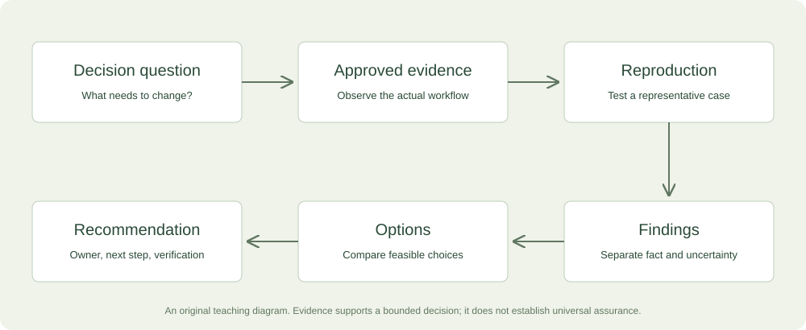

# 1. From software developer to consultant

[Contents](../README.md) · [Next: cloud and Kubernetes](02-cloud-native-kubernetes-and-platform-consulting.md)

## Begin with a decision, not a technology

Imagine that the engineering lead of a small software company tells you, “We need Kubernetes consulting.” You know Kubernetes manages containerized applications, and your resume describes relevant engineering work. The tempting response is to discuss clusters, Helm charts, and deployment tooling. A consultant begins one step earlier: what decision is the customer trying to make, and what is going wrong? The answer might be failed releases, slow onboarding, an expensive system nobody owns, or a proposal to adopt Kubernetes before there is a clear need for it.

Consulting is a professional service that helps a customer understand a problem, choose a course of action, and, where agreed, make a change. The paid result can be a better decision, a verified improvement, or an operating capability the team can sustain. Code may be part of it, but code volume is not its definition. A useful recommendation against a migration can be more valuable than an impressive migration proposal. Your responsibility is to connect technical evidence to the customer's actual decision.

This book teaches that transition specifically for you, Aadil. Your supplied resume reports AWS CDK infrastructure work, developer environments, CI/CD and testing, a Kubernetes-based monitoring system, structured-output AI experiments, commercial web development, and technical writing. These are useful foundations. They do not establish that you have independently owned every production platform, led enterprise transformations, or delivered a particular financial result. We will use the evidence you have, identify the gaps that matter, and design offers whose promises you can actually support.

The recurring customer, Harbor Software, is fictional. Its examples are synthetic and are not a claim about an employer or prospect. Harbor has a small engineering team, an application hosted in the cloud, a container-based delivery process, and an AI feature under consideration. It needs help deciding what to improve first. All prices in this book are proposed USD experiments, not researched market averages or your established rates. Your weekly availability, income target, current employment, and active client pipeline remain unconfirmed.

## What changes when you become the adviser

An implementation request says, “Add a deployment workflow with these requirements.” A consulting request says, “Help us release changes with less uncertainty.” The second requires you to understand the process before deciding whether a workflow is the right intervention. Perhaps the real problem is missing acceptance criteria, unreliable test data, or an approval bottleneck. A tool change may help, but it can also automate a poorly understood process. The consultant is paid to improve the choice as well as the execution.

There are several legitimate engagement styles. Staff augmentation supplies capacity inside a customer's existing management structure. A fixed implementation supplies a defined output. A diagnostic supplies evidence and recommendations. Advisory work helps an accountable owner make decisions over time. Training builds the team's ability to act independently. A single business may sell more than one style, but the agreement should make clear which responsibility you are taking. Calling ordinary implementation “strategic consulting” does not automatically create more value or justify a larger fee.

For your first independent consulting offer, a diagnostic followed by a separately scoped improvement is a strong fit. It uses your engineering judgment and communication while limiting the commitment before the environment is understood. A buyer can purchase the diagnostic, use the findings with another team, and still receive value. That independence matters. If the only result is a quote for your own implementation service, the buyer may reasonably see the activity as sales rather than paid advice.

## Understand who buys, who uses, and who can block

The person experiencing a problem is not always the person authorized to buy a solution. Developers may feel setup friction daily, while an engineering manager controls budget. A founder may approve spending, while an operations lead controls production access. A security reviewer may have no budget but can reject a proposed data flow. Consulting becomes much easier when you map these roles early rather than discovering them after writing a proposal.

A sponsor wants the problem addressed and helps move the engagement forward. An economic buyer can commit the relevant budget. An operational owner is responsible for the system after you leave. Users experience the workflow. A reviewer evaluates technical, security, legal, or procurement requirements. One person may hold several roles in a small company. Write the roles beside names only after they are established; do not infer purchasing authority from a job title alone.

At Harbor, the engineering lead is your sponsor and operational owner, the founder approves a modest budget, and one developer will work alongside you. A platform provider controls part of the environment. This tells you how to run discovery: hear the lead's goals, observe the developer's workflow, understand the founder's decision criteria, and identify provider constraints. A workshop with only the sponsor may miss the actual friction. A conversation with only the developer may produce an excellent fix nobody has agreed to fund.

## Translate technical symptoms into business questions

A symptom is an observed problem, such as a failed release or a long setup time. A cause is an explanation for the symptom. A business consequence is why the organization cares. Keep these separate until evidence connects them. “Our builds are slow” does not establish that slow builds are delaying revenue. The team may run them infrequently, or other work may dominate the lead time. Ask for recent examples rather than accepting the largest possible consequence as fact.

A useful structure is situation, observation, consequence, decision. Harbor's situation is a team releasing a web application. The observation is that the last three deployments needed manual correction. The possible consequence is that engineers are losing time and avoiding releases. The decision is whether to improve the existing pipeline, change the application packaging, or adopt a different platform. This framing gives you several hypotheses to investigate without pretending that the first explanation is correct.

Write a problem statement that contains uncertainty honestly: “Harbor wants to reduce manual correction during releases. Three recent deployments required intervention, but the causes and frequency are not yet measured consistently. The engagement will identify the recurring failure points and recommend one bounded improvement.” This is stronger than “We will eliminate deployment problems.” It tells the buyer what question you will answer and sets a realistic boundary around the result.

## Learn to distinguish evidence from interpretation

An observation might be a timestamped failed workflow run, an interview statement, a configuration file, or a reproduced setup attempt. An interpretation explains what it means. A recommendation proposes action. Good consulting keeps the chain visible. For example: the workflow logs show that a secret was missing; your reproduction fails at the same step; you infer that setup documentation and configuration checks are incomplete; you recommend adding a documented prerequisite and an early validation step.

Different evidence supports different claims. A resume supports your history of participation, subject to confirmation. A lab demonstrates that you can reproduce behavior in a controlled environment. A customer reference supports an account of a real engagement. Repeated measured outcomes support a stronger commercial claim. None is worthless, but they are not interchangeable. A certificate can demonstrate study or an exam result; it does not establish that you can manage a difficult production incident alone.

The companion's readiness worksheet makes this distinction explicit. It records four scores: technical understanding, reproducible demonstration, buyer evidence, and delivery safeguards. Each ranges from zero to four, with visible descriptions. It is a reflection aid, not a certification or automatic permission to sell. A high total must not hide a critical gap. In the worksheet, an advanced production engagement remains blocked if demonstration or delivery safeguards are below the required level, regardless of the sum.

## Your evidence supports a focused starting position

Your AWS CDK work and developer-environment improvements make cloud delivery and developer workflow a credible theme. Your monitoring and testing work adds adjacent depth. Your technical writing supports the handover that many customers struggle to obtain. Together, these suggest a service such as: “I help small software teams understand and improve one cloud delivery workflow, with reproducible findings, a prioritized plan, and a practical handover.” It is narrower and easier to evaluate than “I provide cloud, AI, Kubernetes, and digital transformation consulting.”

A first buyer hypothesis is a small TypeScript or Python team with a working product, a specific delivery problem, an engineering owner, and enough access to investigate it. A second route is an agency or experienced cloud consultancy needing a scoped contributor. The partner route can let you work on larger engagements without presenting yourself as the sole senior authority. Buyer access is still an open question. Your education and work history do not establish warm relationships with particular decision-makers.

The initial recommendation is a Cloud Delivery Diagnostic, with a possible implementation sprint afterward. Use AI workflow evaluation as a second specialization once you have a strong, reproducible case study. Treat Kubernetes production modernization as a capability you can develop or deliver with an experienced partner, rather than a title to claim immediately. This ordering is an interpretation of your supplied evidence, not a rule that you must avoid all Kubernetes work. The scope and environment determine the fit.

## Structure a diagnostic that is worth buying

A diagnostic needs a decision question, inputs, investigation, deliverables, and an acceptance standard. Suppose Harbor needs to decide which release improvement to fund. You request a walkthrough, selected workflow runs, a redacted architecture diagram, and permission for a controlled reproduction. You inspect one repository and one delivery path. Your deliverable is a short report with evidence, ranked findings, alternatives, and a recommended next step. The customer can act on it independently.

Acceptance could mean that the report accurately describes the observed workflow, documents reproduced blockers, distinguishes confirmed findings from hypotheses, compares realistic options, and includes a bounded implementation proposal if appropriate. It does not mean every issue has been fixed or every production risk has been discovered. A limited diagnostic is useful because it answers a limited question well. Calling it an audit can imply assurance you have not provided; describe the actual scope instead.

A provisional price range might be $1,500–$3,000 for a carefully bounded diagnostic requiring roughly twelve to twenty total hours. This is a validation hypothesis. Count preparation, sales allocation, calls, analysis, writing, review, and handover. If the customer requires several environments, extensive procurement, or specialist assurance, the scope is different. Do not preserve a price range by silently excluding work the buyer reasonably expects. Reduce the promise or change the commercial arrangement explicitly.

## Why expensive work must justify its price

“High ticket” describes a large customer commitment. It is not a special consulting method. Buyers justify that commitment through an important problem, a credible path to improvement, confidence in the provider, and manageable risk. A $12,000 engagement can be sensible for a costly, urgent problem and unreasonable for a minor inconvenience. The job title and fashionable technology do not settle the question. Your offer must connect the fee to a clear decision and deliverable.

Value has several forms: recoverable engineering time, avoided recurring costs, faster completion of a dependent project, better reliability, or a capability the team previously lacked. Some value is measurable directly; some is uncertain. Record the source and assumptions for each estimate. A customer's estimate of engineer time is stronger than your guess, but it is still an estimate until measured. Released time does not automatically become cash savings or additional revenue.

Avoid using fear to inflate value. A configuration issue does not prove a catastrophic incident is imminent. A potential failure mode can justify investigation, but its financial value depends on likelihood, impact, exposure, and alternatives. Explain the uncertainty rather than assigning an invented probability. Sometimes the right recommendation is a low-cost operational change. Demonstrating that judgment can support a longer relationship more effectively than turning every finding into a large transformation.

## Work through a time-value estimate

Harbor has six developers. The sponsor estimates each spends ninety minutes weekly recovering from delivery friction. Six multiplied by one and a half gives nine hours per week. At a customer-supplied fully loaded labor estimate of $80 per hour, the gross time value is $720 weekly. Over forty-eight working weeks, that is $34,560 annually. The arithmetic is straightforward, but the interpretation needs care: the estimate assumes the reported friction is real, recurring, and attributable to the workflow you can affect.

Suppose the proposed change addresses only half the friction, and only eighty percent of the potential time is likely to be realized because adoption and other constraints remain. Multiply $34,560 by 0.5 and then by 0.8 to get $13,824 of annual modeled capacity value. Subtract $1,800 in recurring operating costs to get $12,024 of annual net modeled value before the implementation fee. A proposed $9,000 fee then has a simple modeled payback of about nine months: $9,000 divided by $12,024, multiplied by twelve.

These are hypothetical inputs, not a promise. If improvement is only twenty percent rather than fifty, the case changes sharply. If the customer cannot use the released capacity, the labor-value interpretation may be weak. The companion business-case experiment lets you change the assumptions and see the result. It deliberately labels the outcome modeled value and handles nonpositive value without displaying a nonsensical negative payback. The model supports a discussion; it does not discover the customer's true return automatically.

## Count your economics separately from customer value

Customer value determines whether buying may make sense. Your economics determine whether you can deliver sustainably. Suppose a $9,000 sprint requires fifty hours of implementation and verification, ten hours of meetings and documentation, eight hours of sales and discovery allocation, and seven hours of correction and contingency. Total effort is seventy-five hours. If direct costs are $600, contribution before tax and unallocated overhead is $8,400. Divide by seventy-five to obtain $112 per total hour.

If the project expands to one hundred twenty hours, the same contribution is $70 per hour. The customer may still receive value, but your delivery process has become less sustainable. This is why scope, review ownership, and change control are economic design choices. Do not calculate your effective rate using only the hours spent editing code. Preparation, calls, selling, revisions, and support are part of the work required to earn the fee.

A capacity plan adds another constraint. At ten hours weekly across a four-week planning cycle, you have forty hours. If ten are reserved for sales, four for administration, and six for support and slack, twenty remain for new delivery. A seventy-five-hour engagement cannot honestly be promised in two weeks of that schedule. You could spread it across a longer period, reduce scope, increase availability, or involve an agreed collaborator. Your calendar must match the commercial promise.

## Establish a consulting engagement in stages

A healthy engagement has qualification, discovery, agreement, investigation or implementation, review, and handover. Each stage has a decision. Qualification asks whether the problem, buyer, scope, and constraints fit. Discovery asks what is actually happening. Agreement defines who does what and how the result is accepted. Delivery produces evidence and the promised output. Review checks it against the agreed examples. Handover makes the result usable without depending indefinitely on you.

This sequence is flexible. A returning customer with a known system may need less discovery. An unfamiliar production platform may need much more. The principle is to reduce uncertainty before making commitments that depend on it. A request for a fixed migration quote after one short call is a signal to investigate, not an obligation to guess. Explain the missing information and offer a useful next step, such as a capped diagnostic.

Define stop conditions. If the customer cannot provide legitimate access, cannot identify an owner, or needs a capability outside your experience, pause the relevant work and discuss options. This is ordinary professional judgment. You can refer, partner, narrow the engagement, or decline. You do not need to create a long warning ritual around every project, but you do need enough boundaries to avoid pretending that an unsupported commitment is safe simply because a buyer is enthusiastic.

## Learn the practical discovery interview

Start with a recent example: “Walk me through the last release that required intervention.” Ask who participated, what they expected, what happened, how they detected it, and how they recovered. Then compare it with a successful release. Differences between concrete cases often reveal more than a general discussion about best practices. Record dates and artifacts where available. A statement such as “it always breaks” is a lead to investigate, not yet a measured failure rate.

Ask what the team has tried and why it did or did not help. This prevents recommending an approach they already evaluated under constraints you have not learned. Ask what cannot change: a contractual platform requirement, a customer's data boundary, a limited maintenance window, or a skill constraint. Constraints are not annoyances to dismiss; they define the feasible solution space. A technically elegant option outside that space is not a useful recommendation.

Finally ask how the buyer will decide. What result would justify implementation? Who reviews the recommendation? What budget can be committed? When is the decision needed? These questions connect your analysis to action. A technically thorough report can still fail commercially if it arrives after the decision or is written for someone who cannot use it. Consulting quality includes the timing and usability of the advice.

## Structure findings so someone can act

A finding should include observation, evidence, impact, confidence, recommendation, owner, and next verification. For example: “A new developer's setup failed because a required environment variable was not documented. Evidence: clean-environment reproduction and setup instructions. Impact: onboarding requires undocumented assistance. Confidence: high for the reproduced path; unknown for other operating systems. Recommendation: add an example configuration and validation step. Owner: engineering lead. Verification: a second developer completes setup using only the revised instructions.”

Notice that the finding does not say the entire development environment is broken. It names the observed boundary and a checkable improvement. This makes prioritization easier. Compare a specific, reproducible finding with “improve developer experience,” which may be directionally correct but gives the team no concrete action. Your ability to explain systems can turn technical detail into a useful finding without oversimplifying it.

Separate urgency from confidence. A severe but weakly evidenced concern may justify investigation rather than immediate remediation. A modest but confirmed issue may be cheap to fix and worthwhile. Use qualitative labels with definitions before adopting a numerical scoring model. If you multiply arbitrary severity and likelihood scores, the resulting number can look more objective than the inputs deserve. A clear explanation of uncertainty is often more useful than a precise-looking priority score.

## Learn to make a recommendation with alternatives

A recommendation should answer the decision, show the evidence, compare realistic options, and explain the tradeoff. For Harbor, the options might be to keep the current process and document recovery, improve one deployment path, or adopt a managed service that removes some operational burden. Kubernetes is one possible mechanism, not the default answer. The recommendation should make clear what each option changes, what it leaves unresolved, and who will own it afterward.

Include the “do little” option. It establishes whether a proposed change is worth its cost. A small team with infrequent releases may reasonably accept some manual work. A regulated customer may value a slower, more controlled process. The purpose is not to push every team toward the same maturity level. It is to choose an appropriate operating model given its goals and constraints. The CNCF platform material likewise emphasizes outcomes and user needs rather than a portal as the definition of a platform. [CNCF](../references.md#cncf)

Your preferred option can include a staged experiment. Instead of migrating every service, test one representative workload and measure the result. Define what would make the experiment succeed, fail, or remain inconclusive. A successful lab is not automatically a production approval, but it can reduce uncertainty for the next decision. This staged reasoning is a foundation for higher-value work because it limits unnecessary spending while preserving a path to a larger improvement.

## Build credibility through usable proof

Create a small evidence portfolio around the offer you want to sell. For a cloud delivery diagnostic, useful proof includes a synthetic repository with a reproducible setup, a documented release failure and correction, a short decision memo comparing approaches, and a handover someone else can follow. A narrated walkthrough shows your ability to explain the system. The proof should resemble the customer's risk, not merely display a list of technologies.

Your previous work can support this portfolio, subject to permission and factual accuracy. BetterCare Meals supports commercial web implementation; it does not by itself establish Kubernetes advisory results. Your monitoring work supports relevant technical experience; it does not prove you operated a customer's platform independently. Your AI research supports evaluation thinking; it does not guarantee a new workflow's accuracy. Matching proof to claim makes your positioning more credible without diminishing the work you have done.

Do not recreate private employer systems for marketing. Use synthetic architectures, your own projects, or approved case studies. Document what you personally contributed and what remains unmeasured. If you claim a time reduction, explain the baseline and measurement. If you cannot share a system publicly, a redacted private discussion may be possible with permission. You can still show your process through an original lab rather than trying to borrow credibility from confidential details.

## Consulting tools should follow the work

At the beginning, you need a reliable way to record opportunities, schedule conversations, keep notes, write reports, manage agreements and invoices, and store approved technical evidence. The exact products matter less than a consistent process. Use a simple table for prospects if it works. Use the customer's issue tracker during delivery when appropriate. Avoid forcing every small buyer into an elaborate client portal before you understand its needs.

For technical work, your tools may include cloud consoles and CLIs, infrastructure-as-code repositories, test runners, log and metrics systems, and evaluation utilities. Access should match the investigation. Start with read-only evidence when that can answer the question, and agree separately to changes. AI assistants can help organize notes or inspect approved code, but their outputs are hypotheses to review. A plausible explanation without supporting evidence is not a consulting finding.

Keep the source of truth understandable. The scope lives in an agreed document, decisions in a short log, technical changes in version control, and findings in a report linked to evidence. The customer should not have to reconstruct the engagement from your private chat with a coding agent. Clear records make handover and later work easier, and they protect against misunderstandings about what was agreed or observed.

## A learning path that produces sellable evidence

You do not need to learn every cloud-native tool before starting a small diagnostic. Learn in the order required by the promise. First understand the workflow and its operating boundaries. Then reproduce a representative system locally or in an approved sandbox. Then test failure behavior and document recovery. Finally practice explaining the tradeoffs to someone who did not build it. These steps produce evidence as well as knowledge.

For Kubernetes, your next proof should include a workload, service routing, resource settings, health behavior, a controlled rollout, and an explanation of what those mechanisms do not guarantee. For AI workflows, produce a fixed evaluation set, a simple baseline, a candidate workflow, error analysis, and a decision about permitted actions. For cloud delivery, produce a reproducible path from repository to a verified application result. Chapters 2 and 3 teach these concrete patterns.

Certificates may help with structured study or buyer filters, but they are not the only path to proof. Do not spend months collecting credentials while avoiding buyer conversations. Equally, do not use the desire to sell quickly as a reason to skip the skills needed for the actual responsibility. Balance a narrow learning experiment with a narrow commercial experiment. The size of the promise should grow with the strength of the evidence and delivery capacity.

## A worked first offer for your situation

Your draft offer is: “I help small software teams find and improve one cloud delivery bottleneck. The engagement maps the workflow, reproduces the important failure points, compares practical options, and leaves a prioritized plan your team can use.” The buyer is an engineering lead or agency owner with a concrete delivery problem. The initial output is a diagnostic, not an unrestricted promise to fix all infrastructure.

Included scope might be one repository, one nonproduction environment, two stakeholder conversations, a review of selected release evidence, and a written recommendation. Excluded scope includes emergency response, comprehensive security assurance, production migration, organization-wide redesign, and ongoing on-call coverage. These exclusions are examples to adapt, not universal terms. If the buyer needs one of them, you can discuss a different engagement or an experienced partner.

A provisional $2,000 diagnostic with sixteen total hours and $100 direct costs produces $1,900 contribution before tax and unallocated overhead, or $118.75 per total hour. That is internal planning arithmetic. The buyer still needs to see enough value to purchase, and your actual effort may differ. A later implementation sprint could be $6,000–$12,000 only when the scope, evidence, buyer problem, and capacity support it. The higher price is not an automatic upsell.

## What a good diagnostic report sounds like

An executive opening could read: “We examined the path from approved code to the staging application for one service. The most repeatable source of intervention was configuration drift between developer setup and the deployment environment. Two reproduced failures support this finding. We recommend a small configuration validation and release-verification change before considering a platform migration. The current evidence does not establish that Kubernetes adoption would resolve the dominant problem.”

The technical section then shows the reproduced steps, artifacts, constraints, and options. The implementation section names the proposed change, acceptance examples, owner, and dependencies. The uncertainty section lists what was not inspected. The buyer can use the report to decide, and a developer can use it to act. The report does not need fifty pages to be valuable. It needs enough detail to make its reasoning reviewable.

This is also how you develop a high-value reputation. You become the person who can clarify a problem, identify the evidence that matters, and leave the team with a better next step. Technical depth supports that work, but so do scope control, communication, and independent judgment. The next chapter applies this process to cloud-native systems, where a familiar configuration option can have several different business implications depending on the environment.

## Three consulting conversations, traced more carefully

### The founder who wants a fashionable migration

A founder has heard that successful companies use Kubernetes and asks for a migration proposal. Begin by asking what the existing platform prevents the business from doing. If the current service is reliable, inexpensive enough, and easy for the team to maintain, the migration may create operational work without solving a problem. The founder might still have a legitimate concern, such as vendor constraints or customer requirements. Your task is to identify that concern, not to dismiss the request because the motivation sounds fashionable.

Offer a decision review with criteria: operational ownership, deployment needs, isolation, cost structure, recovery, and team capability. Ask what evidence would favor staying or moving. This converts a technology preference into an assessable decision. If the conclusion is to stay, the engagement can still produce a useful operating plan and criteria for revisiting the choice. The value is avoiding an unsupported commitment, not demonstrating that your preferred platform is always correct.

### The engineering lead who wants a guarantee

A lead asks whether you can guarantee that releases will never fail after your improvement. Explain the distinction between a verified workflow and universal reliability. You can agree to behavior under representative examples, clear error handling, and a documented recovery path. You cannot control every dependency, future change, or operator action. The next step is to define which failures matter and what an acceptable operating process looks like, rather than promising perfection to close the sale.

A meaningful commitment could be that the staging release path passes agreed tests, reports a failed verification clearly, and can return to the previous application artifact under the demonstrated conditions. That is narrower than zero downtime, but it is much more useful than a vague assurance. If the buyer needs a contractual service level or independent assurance, that requires a suitable agreement and capability. Your scope should reflect the responsibility you actually accept.

### The agency that needs a specialist contributor

An agency has a customer with a delivery problem and wants someone to investigate a defined subsystem. Ask who owns the customer relationship, who approves technical changes, and who will sign acceptance. You may be an implementation contributor under the agency's lead rather than the sole adviser. That arrangement can be an excellent way to build experience if responsibilities are explicit. Your public claims afterward must describe your actual role and respect confidentiality.

The agency may value your documentation as much as your code because it needs to maintain the result for its client. Propose an evidence package, a reviewable change, and a walkthrough. Agree on payment independently of assumptions about the agency's own invoice unless you deliberately accept other terms. A good partnership increases your reach while preserving a realistic scope. It is a commercial relationship to manage, not a shortcut around the need for competence or clear ownership.

## Use the first companion experiment with a real decision

Open the readiness experiment before choosing your first offer. Score only evidence you can point to: an explained mechanism, a reproducible demonstration, an observed buyer problem, and a documented delivery boundary. Write one missing proof beside the weakest category. If the total looks encouraging but a critical gate is missing, choose a diagnostic or partner role rather than increasing the claim. Revisit the worksheet after completing a relevant demonstration or engagement. Its purpose is to make your reasoning visible, not to replace judgment with a number.
