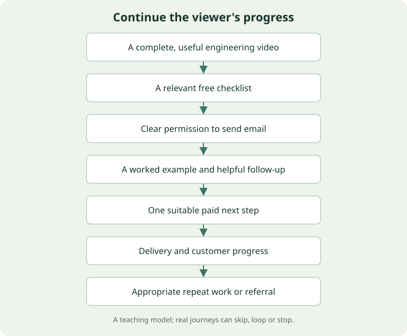

# The Useful Creator

Aadil’s complete software and AI YouTube curriculum: from a first useful video to a sustainable creator business

## Preface

This course is for a developer who wants to become an effective teacher, video maker and business owner through YouTube. You do not need a studio, an existing audience, or professional editing experience. You do need to practice showing a useful result, explaining its reasoning, and learning from how real viewers respond.

Aadil, your useful starting intersection is **building small tools and explaining what makes them work**. The curriculum tests a practical AI-engineering channel against browser-extension teaching and ML intuition-to-code. This is a recommendation inferred from accessible project context, not a diagnosis of market demand. The course gives you 72 original premises and a way to choose among them rather than asking you to launch three channels simultaneously.

Your confirmed constraints shape the assignments: 8–10 hours each week, screen recordings, your own narration and occasional face-to-camera. The daily playbook uses an 8.5 hour baseline and one complete core video every two weeks. Its first 90 days target six videos and a dependable process, with a useful free artifact and one possible paid offer. At eight hours, shorten scope or cadence; at ten, preserve buffer. The calendar does not promise prominence, subscribers or revenue.

The revenue target is treated as a design problem with visible assumptions. One mature model reaches $10,000 monthly gross through a combination of ads, notes, community, tutoring and scoped engineering audits. Costs and owner capacity matter as much as gross. The modeled workload exceeds your initial hours, so the early plan starts smaller. You will learn how to change the business instead of relying on an earnings claim.

Each lesson teaches the reason for a technique before its procedure, develops a worked example and identifies likely mistakes. Practice creates real artifacts; there are no compulsory quizzes. A recurring synthetic bookmark-to-study tool keeps examples coherent without exposing employer or client information. The companion makes score weights, conversion denominators, production time and business constraints interactive. It is a learning model, not a prediction engine.

Use the course actively. Read the first three chapters, record a thirty-second sample, and continue through the production chapters while making a small lesson. Revisit the business chapters before launching an offer. Use the daily plan as a starting calendar and change it when your time records reveal a conflict. The notes and scripts are tools you can adapt, not rules requiring a particular creative identity.

Research is dated 13 November 2026. Primary documentation supports current product and platform claims; public creator materials support clearly bounded observations. Full creator video playback, private analytics, vendor performance tests and the original project-generated files were not available. The source ledger records those limits. The readable book, Markdown chapters, templates and working practice labs are the curriculum requested now; a separate personal strategy report remains for your later prompt.

## Contents

- [1. 01 — Choose a viewer, a problem, and a channel you can sustain](#chapter-01)
- [2. 02 — Find demand and build a library of ideas](#chapter-02)
- [3. 03 — Make a clear promise: titles, thumbnails, and creator studies](#chapter-03)
- [4. 04 — Script videos that make engineering understandable](#chapter-04)
- [5. 05 — Record clear screens, clean speech, and occasional camera segments](#chapter-05)
- [6. 06 — Edit useful videos and build an AI-assisted production workflow](#chapter-06)
- [7. 07 — Publish, interpret the evidence, and improve the next video](#chapter-07)
- [8. 08 — Turn a useful channel into a useful business](#chapter-08)
- [9. 09 — Work toward $10,000 a month with honest economics](#chapter-09)
- [10. 10 — Turn the course into a daily practice and a sustainable operating system](#chapter-10)
- [References and further learning](#references)

---

## 01 — Choose a viewer, a problem, and a channel you can sustain

[1. A niche is a repeated exchange of value](#chapter-01-section-1) · [2. Separate what is established from what remains unknown](#chapter-01-section-2) · [3. Three channel concepts that fit your starting point](#chapter-01-section-3) · [4. A fourth direction to keep as a controlled experiment](#chapter-01-section-7) · [5. Compare hypotheses without disguising judgment as data](#chapter-01-section-8) · [6. Recommended starting architecture](#chapter-01-section-9) · [7. Define the viewer so the script can make decisions](#chapter-01-section-10) · [8. Research conversations without turning them into a sales performance](#chapter-01-section-11) · [9. Build the first pilot around an existing strength](#chapter-01-section-12) · [10. Set boundaries that make consistency possible](#chapter-01-section-13) · [11. Decide what evidence would change your mind](#chapter-01-section-14) · [12. Make a breadth rule before the first tempting tangent](#chapter-01-section-15) · [13. Your first decision document](#chapter-01-section-16)

The first difficult decision is not which camera to buy. It is deciding why a particular person should spend eight minutes with you rather than opening another tab. You can know software engineering, machine learning, cloud systems, browser APIs, music, and learning science while still giving a stranger no clear reason to subscribe. A channel becomes understandable when those abilities serve a recurring viewer problem. This chapter turns your breadth into a focused, testable promise without pretending that a branding exercise can predict success.

You need no prior experience making videos. You do need to distinguish a fact about your background from a hypothesis about an audience. Your public portfolio and project conversations show a combination of building and explaining: browser utilities, full-stack applications, AI experimentation, technical writing, and an interest in education. Those are starting assets. They do not establish that a specific audience wants a particular product. The proposed positioning below is an inference from those assets, with tests that can overturn it. See the [project evidence note](research/project-profile.md) for what was actually accessible.

### 1. A niche is a repeated exchange of value

Imagine three viewers encountering the same video titled “My thoughts on AI.” One wants a summary of this week's news, another wants help fixing an API response, and a third wants to understand gradient descent. The title offers a subject but leaves each viewer guessing about the result. A small channel usually cannot rely on familiarity with its host to fill that gap. It needs a concrete promise that makes sense before the viewer knows the creator.

A useful niche contains a viewer, a situation, a desired change, and a distinctive method. For example: “I help JavaScript developers turn fragile AI demos into useful browser and web tools by showing the code, the failure, and the fix.” The viewer is a developer who already knows some JavaScript. The situation is a demo that almost works. The desired change is a tool that can handle real inputs. The method is visible engineering and explanation. Each part limits what belongs on the channel, which makes your next idea easier to choose.

This is narrower than “AI tools” but broader than one product or model. If a particular assistant changes its interface, the audience still needs to understand inputs, validate outputs, test behavior, and ship software. That is the difference between a durable viewer problem and a temporary keyword. Temporary keywords can introduce the durable problem, but they should not become the whole promise.

Narrowness has a cost. A focused browser-extension video may interest fewer people than a dramatic announcement about artificial intelligence. Its viewers may, however, be more likely to need your notes, mentorship, or engineering help. Broad reach and business fit are separate dimensions. Do not reject a topic merely because a larger channel could get more views in a different category. Ask whether the viewers who do arrive are the people you intend to keep serving.

Your channel's first goal is to become easy to recommend in one sentence. A viewer should be able to say, “Watch Aadil if you can make an AI demo but want to understand and finish it.” That sentence is more useful than listing twelve technologies. You can later widen the subject range when the audience's reasons for returning are clearer.

### 2. Separate what is established from what remains unknown

Your existing tools and explanatory work support a project-based teaching approach. They make it possible to create original demonstrations from work you own rather than relying entirely on stock footage or reactions to announcements. They also create a practical commercial bridge: people learning to build a useful tool can plausibly need a checklist, worked notes, a bounded review, or a workshop. This is a proposed relationship, not proof that those people will pay.

Several facts remain unknown. We do not have channel analytics, evidence that a particular thumbnail style works for you, current product sales, or a measured audience preference between ML and browser engineering. We also do not have a full equipment inventory. The curriculum therefore assumes a phone or webcam, a computer capable of basic screen recording, your own voice, and a willingness to use face-to-camera briefly. You confirmed eight to ten hours a week. These assumptions make the plan actionable while keeping the unverified parts visible.

Do not introduce yourself as the ultimate authority on all of AI. A credible alternative is a careful practitioner who builds a small thing, tests it, explains what broke, and identifies what remains uncertain. Expertise can be specific. You can confidently teach a workflow you reproduced while admitting that you have not evaluated every model or every deployment pattern. Viewers benefit from seeing where the evidence stops.

Keep public claims close to demonstrable evidence. “Here is the extension I built, here is its behavior, and here is the repository” is stronger than a vague claim about being an exceptional engineer. If you use a résumé achievement or client result in a video, verify that it is current, accurate, and appropriate to share. Employer experience does not imply permission to show internal code. Rebuild examples with synthetic inputs and your own assets.

There is also an emotional reason to separate facts from assumptions. An underperforming first upload does not refute your ability to teach. It may show that the subject was unfamiliar, the title was unclear, the introduction was slow, or distribution was limited. A written hypothesis lets you investigate the specific failure instead of treating a view count as a judgment of your identity.

### 3. Three channel concepts that fit your starting point

#### Concept A: Build AI Tools You Can Explain

**Proposed promise:** “Practical AI engineering for developers: build a useful small tool, see where it fails, and understand how to make it reliable.” The initial viewer knows basic JavaScript or Python, has tried a coding assistant or model API, and is frustrated when an impressive demo fails outside the happy path. The channel's language should assume programming familiarity while introducing AI terminology locally. Do not require an advanced ML course before the viewer can benefit.

The recurring format is a result, a failure, and an engineering decision. A video might open with an extension that turns a selected passage into study questions. It then shows an invented answer, a missing field, or an input that exceeds a limit. You explain one fix, demonstrate the improved behavior, and give the viewer a small artifact to use. The original project is the setting; the learning outcome is the reason to watch.

Three example series are “The Demo Broke,” “One Useful AI Workflow,” and “Tools Under a Fair Test.” The first teaches debugging and evaluation, the second teaches implementation, and the third compares assistants or models on an explicit task. A comparison should publish its inputs, conditions, date, scoring method, and limitations. It should not turn one convenient run into a universal ranking. Viewers can return for your judgment even as vendors change.

This concept fits your intersection of full-stack work, AI experiments, and teaching. Its main danger is drift into a general news channel. Each attractive announcement creates pressure to abandon the project library and chase speed. Apply a gate: cover a new tool only if you can show how it changes a task your viewer already cares about. “New tool released” is insufficient; “this new workflow changes how I test extension code” is a possible premise.

The natural business path begins with a free build-and-test checklist or small repository. Paid notes add worked examples and debugging explanations. Mentorship helps a learner finish an original project. An engineering audit serves the smaller group with a real product or team problem. These are different levels of support, not five unrelated businesses. A community becomes sensible only after repeated requests for ongoing feedback.

#### Concept B: Browser Tool Workshop

**Proposed promise:** “Build small browser tools that solve real workflow problems.” The initial viewer is a JavaScript developer, student, or technically curious freelancer who wants to ship a first useful extension. The commercial viewer may be a small business with a repetitive browser workflow, but the video itself should clearly choose which audience it addresses. A beginner tutorial and a buyer's case study can share a project while requiring different explanations.

The recurring format is especially tangible: show an annoying task, build a narrow browser feature, and demonstrate the before-and-after. For example, turn manually copied video timestamps into organized study notes, add an approved snippet picker, or create a recorder with clearly explained browser permissions. Your own existing utilities supply subject material, but each episode should rebuild only the part necessary for the viewer's outcome.

This is probably your clearest immediate demonstration of differentiated experience. It connects directly to extension services and bounded mentorship. Its limitation is topic breadth: a specialist extension tutorial can have a smaller potential audience than a general programming story. That does not automatically make it commercially weaker. A small group of viewers with a concrete problem can produce better conversations than a large group seeking entertainment alone.

The main production hazard is showing too much code. A twenty-minute tour of every file is rarely the best first encounter. Make the mental model visible: popup, content script, background work, storage, and permissions only as required by the example. Use a diagram and one focused failure. A viewer who understands one boundary can often continue independently; a viewer who watches you type every line may still lack the model.

The business path is direct: free extension planning checklist, paid project workbook, four-session mentorship, then a scoped workflow diagnostic or implementation offer. Avoid promising extensions that work on arbitrary websites forever. The video and the offer should acknowledge maintenance and supported scope. The channel's proof should be an observable workflow improvement, measured on your own synthetic demonstration where necessary.

#### Concept C: Machine Learning You Can Build

**Proposed promise:** “Understand machine-learning ideas by implementing and testing small models.” The initial viewer knows basic Python and has seen ML terminology but cannot explain what the code is doing. The distinctive method is intuition, a tiny numerical example, and a working implementation. Your interest in mathematics and first-principles explanation makes this personally coherent.

Possible series include “One Gradient at a Time,” “The Smallest Working Model,” and “Why This Model Failed.” A video could use four observations to explain a train/test split, animate one weight update, or show why a classifier with high accuracy misses a rare positive class. The ambition is comprehension, not a tour of every equation in a paper. Longer companion notes can carry derivations that would overload the main video.

This concept can support tutoring, problem-solving workshops, and carefully structured notes. It may develop slower than a tool-news format because demonstrations and diagrams take time. That is an operational limitation, not evidence that the niche is inferior. A well-explained concept can remain useful after a tool interface changes. Balance evergreen value against the work needed to make the explanation accurate and visually clear.

The main hazard is confusing depth with completeness. If a video promises an intuitive explanation of backpropagation, it does not need to teach all of linear algebra first. Introduce the specific prerequisite locally, use a small example, and provide an optional deeper lesson. Conversely, do not use beautiful animation to hide a missing logical step. The learner must see why the update changes the result.

The business path should sell added structure, feedback, and applications rather than hiding every essential step behind payment. A free video should fulfill its promise. A paid workbook can add more examples, complete solutions, editable diagrams, and guidance through a larger project. Tutoring can then address a learner's individual misunderstanding. Trust grows when the viewer can already accomplish something useful without purchasing.

### 4. A fourth direction to keep as a controlled experiment

Your interest in learning and your existing music-related utilities suggest a possible “Build Better Learning Tools” direction. It could explore study systems, practice dashboards, note workflows, and the engineering behind them. This is a plausible future bridge between software and education. It is not automatically a strong initial niche because the audience can split between people who want to code the tool and people who merely want to use it.

Test that ambiguity explicitly. “I built a music-practice dashboard” could attract musicians, developers, or general productivity viewers for different reasons. A developer-oriented version should explain one technical decision and how to reuse it. A musician-oriented version should focus on practice outcomes and treat the implementation as background. Combining both equally in the same first video often makes the promise harder to read.

Keep this fourth direction in an experiment folder rather than launching another channel immediately. If you later observe that educators repeatedly ask for workflow help, a focused education-tools series might belong within the practical-engineering channel. If nontechnical learners dominate the demand, a separate audience proposition may become justified. The decision should follow observed overlap, not your desire to preserve every interest in the first banner.

### 5. Compare hypotheses without disguising judgment as data

A scorecard helps make your assumptions discussable. It cannot calculate the objectively best niche. Choose five criteria: evidence you can show, access to viewers, enjoyment of repeated production, business alignment, and production simplicity. Score each from one to five, where five is stronger. Write one sentence of evidence beside every score. If you cannot explain a score, it is an impression and should be labeled that way.

For a starting illustration, give practical AI engineering scores of four, three, five, five, and three. Give extension engineering five, three, four, five, and four. Give ML teaching four, three, five, four, and two. These are author judgments, not market measurements. If you weight proof and production simplicity highly, extensions may lead. If sustained interest and future topic range matter more, practical AI engineering may lead. Small changes in assumptions should be visible.

Do not convert a one-point difference into certainty. A weighted score of 4.1 versus 4.0 is not a statistically significant finding. The inputs were your opinions, not repeated observations. The scorecard's useful output is the uncertainty it reveals: perhaps you do not know whether you can make ML diagrams quickly, or whether extension viewers want mentorship. Turn those uncertainties into cheap tests.

Use the [niche experiment in the companion](companion/index.html#niche) to change weights and see how the ranking moves. Enter your own scores rather than treating the defaults as a diagnosis. If the preferred concept changes whenever a weight moves slightly, the decision is fragile. Pick a reversible pilot rather than spending weeks naming a permanent brand. The companion stores no business evidence and cannot forecast earnings.

A useful decision rule is to choose the hypothesis with enough proof, enough interest, and the cheapest informative next experiment. You are not selecting the topic you must teach for the rest of your life. You are selecting the first coherent group of videos from which you can learn. That framing reduces the pressure to identify a perfect niche before you have made a single upload.

### 6. Recommended starting architecture

Start one personal channel with a practical-engineering promise. Use browser and web tools as the visible examples, and teach AI concepts when they explain a problem in those tools. This gives you a recognizable project setting, a durable audience need, and room for the mathematical explanation you enjoy. It also allows you to demonstrate existing strengths without pretending that every topic is equally mature.

Use three initial content pillars. The first is shipping a useful tool. The second is debugging and evaluating AI behavior. The third is understanding the concept behind one engineering decision. A pillar is a recurring viewer benefit, not a technology list. “Python,” “React,” and “Claude” are ingredients. “Make this workflow dependable” is a benefit that can use any of them.

For the first six videos, give the pillars a connected sequence. Begin with a visible browser tool, examine a failure in its AI output, explain the missing concept, build an improved version, compare two approaches fairly, then publish a retrospective that demonstrates what you changed. The same synthetic project reduces setup costs and gives returning viewers a reason to continue. Each episode must still work independently for a new viewer.

Do not announce that the channel covers software, AI, ML, productivity, freelancing, music, career advice, and everything you learn. That describes your interests but creates a large prediction problem for subscribers. A person who loved a debugging lesson cannot tell whether the next upload will help them. You can enjoy many subjects privately while making a public sequence with a consistent purpose.

Revisit the architecture after six completed videos and a set of relevant viewer conversations. You may discover that extension fundamentals outperform model comparisons in both engagement and qualified inquiries. That would justify narrowing further. You may discover strong repeated interest in the mathematical explanations. That could justify expanding the ML pillar. The original recommendation is a starting hypothesis that should become more specific with evidence.

### 7. Define the viewer so the script can make decisions

Write a viewer brief in ordinary language. “Maya is a junior developer who can build a React form and call an API. She used a coding assistant to create an extension, but she cannot explain why the background work stops or why an AI response is missing fields. She wants one reliable project she can demonstrate without copying a tutorial.” Maya is fictional. Her purpose is to make decisions about the explanation, not to stereotype every future viewer.

Now decide what Maya already understands. She can open a terminal, read a function, and work with a JSON-like object. She may not understand schema validation, evaluation sets, extension permission boundaries, or background lifecycle. A video can teach one of those ideas locally. It should not simultaneously assume she is an expert and explain what a variable is. Consistency of assumed knowledge is part of pacing.

Write the before-and-after in observable terms. Before the video, Maya has a demo that accepts any model output. After the video, she can validate one response, display a useful error, and explain the difference between a correct shape and a truthful answer. That final distinction matters: an object can have the right fields and still contain unsupported information. The video must show the remaining limitation rather than implying validation solves all reliability problems.

Then choose the viewing situation. Is Maya searching for a fix while coding, browsing after work, or evaluating a tool before using it? A search-oriented lesson can name the specific obstacle directly. A browse-oriented story may lead with an unexpected result before introducing the technique. The same teaching outcome can support different packaging, but the introduction must honor the expectation created by that packaging.

Finally, decide the next step. If the video is a focused debugging lesson, a relevant continuation might be the next test case or a free checklist. A generic invitation to buy unrelated notes interrupts the viewer's progress. The best commercial step usually continues the work the viewer already started. Funnel design begins here, long before the sales page.

### 8. Research conversations without turning them into a sales performance

You do not need to interview a hundred people before making a video. You need enough contact with the intended audience to stop relying entirely on your own memory. Begin with people who have recently attempted the task. Ask what they tried, where they got stuck, what they searched, and what they did afterward. Recent behavior is more informative than an enthusiastic answer to “Would you watch my channel?”

A useful prompt is: “Tell me about the last time you tried to add AI to a project. What worked in the demo, and what became difficult when you changed the input?” Let the person describe the sequence. If they mention a missing concept, ask how they attempted to learn it. If they mention paying for help, ask what they purchased and why. Do not lead them toward your preferred product.

Record anonymized patterns, not private transcripts by default. One person might say that the code looked correct but failed after refresh. Another might say that a tutorial skipped the explanation of message passing. A third might struggle with evaluating model outputs. Group the underlying tasks and uncertainties. Those groups become video premises. Keep a distinction between repeated problems and a single interesting anecdote.

Five conversations are an early qualitative sample, not proof of market size. Their value is discovering language, constraints, and missing steps. A person who says they would love a workshop has not bought one. A person who asks for a specific worked example provides a stronger content signal, but even that does not guarantee viewing. Treat each stage as evidence about a different question.

When inviting a conversation, keep it respectful and specific. A draft could read: “I'm developing tutorials for developers who have tried building a small AI tool. If you have recently attempted one, I would value fifteen minutes about what became confusing. There is no sales presentation.” This is a sample for you to adapt and send if appropriate; no message has been sent by creating this curriculum. Avoid mass outreach to unrelated people.

### 9. Build the first pilot around an existing strength

Choose a small bookmark-to-study tool as the recurring synthetic example. Its input is a few short notes you wrote yourself. Its output is a structured study outline with links back to those notes. This avoids depending on copied transcripts or a large live service. You can demonstrate the workflow, deliberately break one condition, and explain a measured improvement without requiring an elaborate application.

The pilot's title hypothesis could be “Your AI Study Tool Works—Until This Input.” Its thumbnail might show one clean result beside a highlighted unsupported claim, with a short label such as “Wrong source.” Its first fifteen seconds should show the failure and the final improved behavior. These are proposed creative choices, not tested winners. Chapter three teaches how to improve them through promise clarity and real experiments.

The learning outcome is small: distinguish an output that looks organized from an output supported by the supplied notes. Do not promise to eliminate all hallucinations. Show a short input, a plausible unsupported answer, and one check that catches the specific problem. Then explain what the check cannot catch. A narrow honest result can be more useful than an impressive but undefined claim of reliability.

The artifact might be a one-page “AI output review checklist” with three questions: Does the output match the expected structure? Can each important claim be traced to an input? What happens when the evidence is missing? The free artifact should be usable without buying anything. Later paid notes could include additional failure cases and worked solutions. You do not need to build the paid product before testing whether viewers care about the problem.

The pilot is successful as a learning project if you finish a coherent video within the time budget, make the code readable, explain the limitation accurately, and obtain useful reactions from a few intended viewers. Audience performance adds another layer of evidence. Avoid declaring a strategic victory because friends were kind, or a strategic failure because a first upload received few impressions.

### 10. Set boundaries that make consistency possible

Eight to ten hours a week is enough to develop a useful practice, but it is not enough to run a daily news operation, make elaborate animation, teach unlimited students, and deliver multiple client projects simultaneously. Time is a design constraint. The course starts with one six-to-ten-minute video every two weeks, then adjusts only when the actual workflow supports it. The first month will include unfamiliar setup work.

Give a video a scope ceiling. One viewer problem, one working demonstration, one core explanation, one relevant next step. If the outline needs five major prerequisite lessons, split the premise. If the demo requires an unbuilt application, reduce it to a small test fixture. If the edit needs complex motion graphics to make sense, try a clear static diagram first. Constraints can improve the explanation by forcing you to identify the central relationship.

Keep a separate improvement goal for each production cycle. One cycle might focus on clean audio. The next might improve the first thirty seconds. Another might make code labels readable on a phone. Trying to change every skill at once makes it hard to learn what helped. The course teaches the full process, but you can practice it with one deliberate improvement at a time.

Protect recovery time. You can read comments without checking analytics every hour. You can skip an optional Short if the long video or your job needs attention. You can use a short maintenance week after an unusually demanding project. Consistency means returning to a workable process over many cycles. It does not require removing every buffer from your schedule.

### 11. Decide what evidence would change your mind

Before the pilot, write three reasons you might narrow to extension engineering. Examples are stronger repeated questions about browser APIs, more qualified mentorship requests from extension learners, and significantly lower production time for equally clear teaching. Write three reasons you might move toward ML intuition: viewers repeatedly return for the conceptual segments, learners report a specific understanding gain, and you enjoy preparing those explanations enough to sustain them.

Do not use a single view count as the decision rule. A news topic can receive a temporary burst while producing little interest in the rest of the channel. A small tutorial can bring a useful learner every week. Compare videos at similar ages and consider traffic source, promise, production cost, and the quality of viewer feedback. Chapter seven develops that analysis carefully.

Some evidence should lead to a packaging change rather than a niche change. If intended viewers want the problem solved but cannot understand the title, improve the title. If they click and leave during a long autobiography, fix the opening. If they watch but repeatedly ask for a missing prerequisite, improve the lesson structure. Repositioning the whole channel is a large intervention; diagnose the narrower bottleneck first.

Other evidence should lead to a business change. If people love the free explanation but do not need ongoing support, a recurring community may be a poor fit. If many ask for personalized project help, a bounded mentorship package may fit better than a large prerecorded course. The audience promise and the monetization form can evolve separately. A good video does not obligate you to sell every possible product.

### 12. Make a breadth rule before the first tempting tangent

Suppose you have just learned an interesting music-practice technique and want to make a video about it. Run it through three questions. Does the same developer want this result? Can the video use the same build-test-explain method? Will the next relevant video still make sense to that viewer? If all three answers are yes, the topic may be a useful application. If the video serves an entirely different audience, save the idea rather than forcing it into the initial sequence.

For example, building a browser-based practice timer can fit an engineering channel if the lesson is about keeping a useful tool reliable when a tab loses focus. The target viewer is still a developer, and the musical setting makes the project distinctive. A lesson about advanced piano fingering probably serves a different viewer. Both ideas can be valuable; the decision concerns which promise this particular channel is making now.

Apply the same rule to career and freelancing topics. “How I scoped this extension so maintenance stayed manageable” can teach a practical engineering decision and connect to your service expertise. “Everything you need to know about negotiating a salary” has a different promise and requires its own evidence. Early coherence comes from repeating a viewer benefit, not from refusing to discuss anything beyond one framework.

Keep a parking-lot document with the tangent, intended viewer, possible bridge, and minimum evidence required. This preserves your curiosity without turning every curiosity into an immediate production obligation. Review that document once a month. Some ideas will become episodes; others will remain useful private learning. A sustainable channel needs a selection mechanism because your ability to discover topics will usually grow faster than your available filming time.

### 13. Your first decision document

Create a one-page channel brief with the following completed statements. “My first viewer already knows…” identifies prerequisites. “They are trying to…” names the task. “They get stuck when…” names the obstacle. “My videos show…” describes the method. “After one video they can…” makes the outcome observable. “The next useful step is…” connects the lesson to another video or artifact. Write short answers before designing a logo.

For the recommended hypothesis, the answers might be: basic JavaScript or Python; build a useful AI-powered tool; the demo fails on different inputs; the failure, the code, and one tested improvement; explain and fix one reliability problem; use a checklist and continue to a related build. This brief should guide the first six videos. It is specific enough to exclude unrelated content while leaving several original series possible.

Add a personal constraint statement: “I have eight to ten hours weekly. I record my screen and use my own voice, with brief face-to-camera sections when they help trust or orientation. I start with a two-week release cycle. I will not sell unlimited access to myself.” This prevents the strategy from quietly depending on a schedule you never agreed to follow.

Then add a review date after six completed core videos. At that review, compare what you expected with what actually happened. Which production step consumed the most time? Which viewer problem generated the clearest response? Which topics led to meaningful next steps? What would you repeat if you could only make one more video? These are prompts for judgment, not an exam you must pass to keep learning.

The chapter's practical deliverable is a chosen pilot hypothesis, not a permanent identity. You have three serious options, a recommended starting intersection, an original example to film, and a method for changing direction responsibly. The next chapter turns that promise into a supply of ideas grounded in viewer demand rather than a list of technologies you feel obliged to cover.

[Return to contents](#contents)

---

## 02 — Find demand and build a library of ideas

[1. A topic is not yet an idea](#chapter-02-section-1) · [2. Build three problem maps before choosing three channels](#chapter-02-section-2) · [3. Understand the three kinds of demand](#chapter-02-section-3) · [4. Research without becoming a full time researcher](#chapter-02-section-4) · [5. Read competitor evidence carefully](#chapter-02-section-5) · [6. Use a scorecard that rewards evidence](#chapter-02-section-6) · [7. Turn one problem into a content cluster](#chapter-02-section-7) · [8. Seventy two original video ideas](#chapter-02-section-8) · [9. Select a first twelve video season](#chapter-02-section-12) · [10. Write a one page brief before committing](#chapter-02-section-13) · [11. Develop ideas with AI without outsourcing judgment](#chapter-02-section-14) · [12. Keep the backlog healthy](#chapter-02-section-15) · [13. Application project and acceptance checks](#chapter-02-section-16)

Your first production decision is also your most consequential: which problem deserves a video? A polished explanation of a problem nobody in your intended audience currently cares about has a weak starting position. A plain but useful demonstration of a painful problem has something real to improve. This chapter teaches you to find that second kind of opportunity, turn it into a testable promise, and maintain enough ideas that publishing never depends on inspiration arriving on Tuesday.

The prerequisite is the audience decision from Chapter 1. The working audience here is developers who know some Python or TypeScript and want to build useful AI powered browser or web tools while understanding what makes them reliable. Your browser extensions, fullstack projects, technical notes, and first principles ML writing make that a credible starting hypothesis. Credible does not mean proven demand. This chapter establishes the process that tests it.

By the end, you will have three audience problem maps, a ranked backlog, a first twelve video sequence, and a method for choosing next week's video in under an hour. The companion's [idea scorecard](companion/index.html#idea-score) lets you change priorities and see how rankings move. Its scores are decision aids, not forecasts of views.

### 1. A topic is not yet an idea

“AI tools” is a topic. “Developers are accepting generated tests that pass without checking the behavior they care about” describes a problem. “I gave an AI coding assistant a deliberately broken browser extension, then tested whether its fix actually worked” is an idea. The final sentence contains a viewer, a conflict, an observable method, and a possible outcome. Those ingredients give the viewer a reason to choose your video over another tab.

Treat an idea as a small contract. The viewer brings time and attention; you promise a useful change in understanding, ability, or judgment. Write the contract before you write the script: “After watching, a developer can distinguish valid structured output from correct application behavior and can add one test that catches the difference.” You can inspect whether you have fulfilled that contract. You cannot inspect whether you have fulfilled “talk about AI.”

Begin with the moment before the video is needed. A learner has a generated JSON object, but the application displays the wrong answer. A freelancer has a client request for an AI assistant but cannot estimate its running cost. A developer has a working extension that loses its state when its background process stops. These moments are more useful than broad demographic descriptions because they suggest what to show on screen and what the next useful product might be.

Now separate the problem from your preferred solution. If you love neural networks, you may translate every audience complaint into “they need an ML fundamentals course.” Sometimes they need a five line validation function or a clearer mental model of asynchronous work. Start with the smallest satisfying intervention. You can earn permission to teach deeper material after the learner sees why it matters.

### 2. Build three problem maps before choosing three channels

The user asked for at least three channel concepts. That does not make launching three channels at once a good experiment. Three separate feeds split your learning, publishing capacity, and social proof. Use three concept lanes to compare opportunities, then select one audience promise for the first twelve long videos. Keep the alternatives available if evidence points elsewhere.

| Concept lane | Viewer situation | Distinctive proof you can develop | Likely natural next step |
| --- | --- | --- | --- |
| Practical AI engineering for builders | “The demo works, but can I trust it in a real tool?” | Reproducible tests, failure cases, cost and latency measurements | Evaluation checklist, implementation workshop, scoped consulting |
| Browser tools that solve everyday problems | “I want to ship an extension or small web utility.” | Your own extensions, architecture walkthroughs, debugging sessions | Starter kit, technical notes, code review or tutoring |
| ML intuition turned into working code | “I can call a library, but do not understand the model.” | Your first principles writing, small numerical examples, readable notebooks | Guided notes, tutoring, project study group |

These are original positioning proposals inferred from your public work, rather than a claim that any one will produce a particular revenue. Your [portfolio](https://aadilmallick.com/) establishes the intersection of fullstack and AI/ML work; the project descriptions are evidence of topics you can investigate, not proof of enterprise results. The [tools page](https://aadilmallick.com/tools) supplies concrete demonstration material. Verify the current behavior of a project before filming it.

For each lane, write five rows in a problem map. A row contains the viewer's words, the triggering event, the current workaround, the cost of remaining stuck, and what satisfying evidence would look like. For example: “My generated extension keeps forgetting its settings; it happens after I close and reopen the browser; I reload it until it works; I cannot publish it confidently; I need a visible reproduction and a fix that survives a restart.” This row is already closer to a strong video than a page of keywords.

Do not assume the most financially valuable viewer is always the best first viewer. An experienced engineering manager may have purchasing power but expect evidence you have not developed yet. A TypeScript developer building a first extension may be easier to help accurately and may buy useful notes. Start where your demonstrated competence meets a problem you can solve repeatedly. Your authority can expand through the public evidence you create.

### 3. Understand the three kinds of demand

Search demand starts with an explicit question: “Chrome extension storage not persisting.” The viewer already wants a solution. Your job is to make the fit obvious and get to the useful answer. Search demand is well suited to early authority building, although some questions have a small audience or are answered quickly without producing lasting interest in the channel.

Browse demand starts with a latent concern or curiosity: “This extension worked until I closed the browser.” A viewer did not type the problem but recognizes its significance. The packaging has to make the consequence understandable without assuming prior context. This can reach more people than a narrow error message, but the content must fulfill the wider promise.

Relationship demand starts with trust in you: “I want to see how Aadil approaches this.” It supports updates, live sessions, and more exploratory work. A new channel has relatively little relationship demand, so “my thoughts on the latest model” asks strangers to care before you have demonstrated why they should. Give them a useful experiment first. Personal perspective becomes more valuable when attached to observed work.

YouTube describes Search as matching the query and engagement for that query, while recommendations consider the viewer and the content's relevance and performance. That supports choosing the viewer situation before optimizing metadata. It does not imply that you can mechanically manufacture distribution with keywords. [YouTube performance FAQ](https://support.google.com/youtube/answer/141805?hl=en).

An early portfolio might contain six solution oriented videos, four experiment or comparison videos, and two deeper explanations. Those are curriculum recommendations, not platform requirements. At your starting capacity of eight to ten hours a week, twelve videos can be a roughly six month season, not a requirement for the first ninety days. The baseline ninety day plan is six long videos, with additional output only after your measured workflow becomes faster. The mix gives you different discovery opportunities while keeping the same viewer. The extension tutorial, AI code test, and ML explanation belong together only if the same person can reasonably want all three.

### 4. Research without becoming a full time researcher

Allocate a recurring forty five minute research block. Spend fifteen minutes collecting audience problems, fifteen examining existing solutions, and fifteen converting observations into briefs. A time limit prevents research from becoming a pleasant substitute for finishing videos. Save unresolved questions instead of opening twenty more tabs.

Start with direct evidence you already encounter: questions on your own tutorials, issues in your own repositories, tutoring questions you have permission to generalize, and difficulties from your own building process. Strip private details and use synthetic data. A real problem does not require exposing a real customer's environment. Record what failed, why it matters, and whether a small independent demonstration can reproduce it.

Use YouTube search next. Type the problem in ordinary language, then one technical variation. Examine results for fit, age, scope, and the skill level assumed. The presence of existing videos is not a reason to stop; it establishes that someone has invested in addressing the problem. Your opening may be narrower, more current, more testable, easier to follow, or connected to a concrete tool.

Inspect comments as qualitative research, not a representative survey. A comment saying “please explain deployment” tells you one visible viewer asked. It does not tell you how many silent viewers need it. Save an anonymized paraphrase and the public source link for your own research. Look for repeated obstacles across independent places, and avoid treating emotionally vivid complaints as necessarily common.

The current official Studio route is **Insights → Research** on desktop. Its documented filters include content type, upload date, subscriber count, duration, channel age, outlier score, and what your viewers watched elsewhere. Older accounts or rollout states may still expose a Trends surface; YouTube's older help page explicitly flags changes beginning July 2026. Use whichever your account actually shows. [Research content and find trends](https://support.google.com/youtube/answer/17232321), [Trends rollout note](https://support.google.com/youtube/answer/11962757?hl=en).

If a new channel has limited audience data, do not interpret an empty audience report as zero demand. Use the platform's broader results, direct questions, and your initial publishing tests. Native research is an observation tool; it cannot tell you whether you can deliver a convincing demonstration or whether its viewers will buy your notes.

### 5. Read competitor evidence carefully

Record the title, publication date, duration, broad format, visible premise, and public view count at the time you inspect a result. Keep your observation date. Public numbers change, and videos of different ages have had different opportunities to accumulate views. Avoid comparing a two year evergreen tutorial with yesterday's news as if they ran the same experiment.

For a manual relative performance proxy, choose a video's public views and divide by the median views of a reasonable set of recent, comparable videos on that same channel. If the selected video has 24,000 views and the comparable median is 8,000, the proxy is three. Median means the middle value after ordering the observations; it is less distorted by one giant hit than an average. This is your approximation, not a reconstruction of YouTube's native outlier formula.

Exclude incomparable livestream archives, Shorts, and unusually old uploads when making that small comparison. Write down every exclusion so you do not secretly choose a comparison set that supports your favorite idea. A three times result may reflect a topic, an unusually strong title, a collaboration, outside promotion, or something you cannot see. It identifies a candidate worth studying; it does not identify a cause.

Look at misses as well as hits. If a creator has five AI tool comparisons and only one attracted broad attention, ask what differentiates its viewer problem. Do not copy the single title and conclude that all comparisons work. A useful research set includes at least a few ordinary performers from the same creator. Learning only from winners produces a distorted sense of how reliably a format succeeds.

### 6. Use a scorecard that rewards evidence

Rate each candidate from one to five on six dimensions: audience pain, observed demand, proof you can show, fit with the channel promise, useful next step, and production feasibility. A five in proof means you can already reproduce the relevant behavior. A one means the idea relies on a claim you have not checked. Feasibility is high when you can finish within the weekly capacity, not when the idea sounds impressive.

Use this starting formula: weighted score equals three times pain plus two times demand plus three times proof plus two times fit plus two times useful next step plus feasibility. The highest possible result is sixty five. These weights are an editorial preference for useful, demonstrable work. They have no statistical relationship to expected views. Change them when your actual constraint changes.

Consider three candidates. “The ten best AI tools” scores pain two, demand four, proof two, fit three, next step two, feasibility three. Its result is thirty three. “I tested whether generated extension code survives a restart” scores four, three, five, five, four, four. Its result is fifty five. “Build a transformer from scratch over eight hours” scores four, three, two, three, four, one, yielding thirty nine. The second idea wins because you can show a specific, valuable result within your capacity.

If your enthusiasm disagrees with the score, inspect the assumptions. You may have underrated personal motivation, or overestimated demand from a few popular videos. Add a short note rather than gaming every score until your favorite wins. A scorecard should expose reasoning to future review. It should not let a spreadsheet pretend to know what only publishing can reveal.

Maintain a separate evidence grade: **A** for repeated direct questions plus a working reproduction; **B** for several plausible public signals and a feasible demonstration; **C** for your untested hypothesis. A high score with grade C is an experiment, not your safest next upload. Keep a mix: mostly well supported ideas, with room for a small number of ambitious tests.

### 7. Turn one problem into a content cluster

Suppose you choose “AI generated extension code works once but fails later.” Make the primary video a clear experiment: build a tiny extension, run a lifecycle test, inspect the failure, and show the corrected design. Its main promise is reliability. The free supporting resource is the test checklist. The technical notes product can contain the broader architecture patterns, if you actually develop and maintain them.

The same research can support a short explanation of why background work can stop, a follow up on persistent storage, and a deeper tutorial on separating interface state from durable data. These are not four copies of the same video. Each answers a different question at a useful level. Avoid stretching one small lesson into a month merely to fill the calendar.

Create the sequence in dependency order. Show the failure before you teach the abstraction. Explain what must survive before comparing storage mechanisms. Teach how to verify persistence before discussing automated testing. This order gives viewers reasons to continue into the next video because each one resolves a problem created or clarified by the previous one.

Do not turn every cluster into a serialized course that requires episode one. A viewer should understand the current video's problem without homework. Use a twenty second recap and link the prerequisite for those who want more. Your library can be coherent without making discovery feel like joining a class halfway through a semester.

### 8. Seventy two original video ideas

These are proposed working premises, not reports of tests already performed. Difficulty refers to production and demonstration complexity: **L** means a focused demonstration; **M** requires a tested small project; **H** requires substantial evaluation, visual teaching, or multiple environments. Business intent describes the relevant next step, not permission to sell before the resource exists. The three lanes should be tested on paper before choosing your initial channel promise.

#### Lane A: practical AI engineering for developers

| # | Working title or premise | Viewer and pillar | Difficulty | Relevant next step |
| --- | --- | --- | --- | --- |
| 1 | The AI returned valid JSON. My app was still wrong. | App builders; output evaluation | M | Validation checklist |
| 2 | I gave a coding agent five failing extension tests | TypeScript developers; AI code review | M | Test harness notes |
| 3 | A prompt change broke yesterday's working feature | AI app builders; regression testing | M | Evaluation template |
| 4 | RAG versus a plain search box on the same small dataset | Web developers; architecture judgment | H | Decision worksheet |
| 5 | I measured the hidden latency in my AI note taker | Product builders; performance | M | Profiling notes |
| 6 | Can a small model finish this narrow developer task? | Cost conscious builders; model choice | H | Benchmark worksheet |
| 7 | Stop calling the model when ordinary code will do | Python developers; system design | L | Automation recipes |
| 8 | My coding agent fixed the symptom and missed the bug | Developers; debugging judgment | M | Review checklist |
| 9 | What I log when an AI feature gives a bad answer | Early AI builders; observability | M | Logging starter |
| 10 | An AI feature needs an off switch: build the fallback | App builders; reliability | M | Architecture workshop |
| 11 | I built the same tiny feature manually and with AI | Working developers; measured workflow | M | Process notes |
| 12 | Why my AI comparison uses the same tasks every time | Tool shoppers; evaluation literacy | L | Public test protocol |
| 13 | The difference between a schema and a useful answer | Fullstack developers; correctness | L | Coding notes |
| 14 | Turn a vague AI request into an acceptance test | Freelancers; requirements | L | Scoping worksheet |
| 15 | I made my note extractor show its evidence | AI product builders; trust | M | Source tracing template |
| 16 | A tiny dataset is enough to reveal this failure | Developers; evaluation design | M | Dataset worksheet |
| 17 | Before you add an agent, draw the boring workflow | Solo builders; automation boundaries | L | System design notes |
| 18 | I retried a failed AI request and doubled the bill | AI developers; retry behavior | M | Reliability checklist |
| 19 | A developer's guide to judging AI tool demos | Tool users; critical evaluation | L | Newsletter |
| 20 | Which tasks should never enter my AI demo dataset? | Builders; data handling | L | Synthetic data guide |
| 21 | Can an AI assistant explain code it cannot run? | Learners; evidence and limitations | M | Debugging notes |
| 22 | My AI feature got better after I removed a prompt | App builders; simplification | M | Architecture walkthrough |
| 23 | I tested an AI summary against the actual source | Knowledge tool builders; accuracy | M | Summary evaluation sheet |
| 24 | A useful AI code review starts before the first prompt | Developers; development workflow | L | Review workshop |

#### Lane B: browser extension and small web tool engineering

| # | Working title or premise | Viewer and pillar | Difficulty | Relevant next step |
| --- | --- | --- | --- | --- |
| 25 | Build a timestamp bookmarker that survives a restart | Extension learners; durable state | M | Extension notes |
| 26 | My extension worked until its background work stopped | JavaScript developers; lifecycle | M | Debugging checklist |
| 27 | Screen recording in the browser: what actually gets saved? | Web developers; media fundamentals | M | Media API notes |
| 28 | A screen recorder can fail before recording starts | Browser builders; permissions and errors | M | Failure matrix |
| 29 | Save a useful file offline, then turn the network off | Web developers; offline behavior | M | PWA starter notes |
| 30 | The small tool I would build before a SaaS dashboard | Solo developers; scope control | L | Scoping template |
| 31 | One keyboard shortcut, one real productivity problem | Extension beginners; focused UX | L | Starter project |
| 32 | Build an import/export feature users can trust | App builders; data portability | M | Implementation notes |
| 33 | Your extension popup is not a database | Beginners; state architecture | L | Technical notes |
| 34 | I tested my extension with an empty storage state | Developers; edge cases | L | Test checklist |
| 35 | A local only tool still needs a threat model | Browser developers; responsible design | M | Design worksheet |
| 36 | Why I made this tiny tool without a framework | Web developers; tradeoffs | L | Vanilla TypeScript notes |
| 37 | Turning a browser API into a reusable TypeScript class | Intermediate developers; abstraction | M | Code patterns pack |
| 38 | A download button that explains failure | UI developers; usable error handling | L | UX checklist |
| 39 | I redesigned my bookmarker around one user task | Tool builders; product thinking | M | Product teardown |
| 40 | How I would test a screen recorder before sharing it | Developers; media testing | M | Release checklist |
| 41 | Browser permissions: ask at the moment they make sense | Extension developers; permission UX | M | Review session |
| 42 | I moved this tool's state out of the interface | JavaScript developers; architecture | M | Notes product |
| 43 | Build a tiny tool that works with keyboard only | Frontend developers; accessibility | M | Accessibility worksheet |
| 44 | My first extension release checklist, demonstrated | Shipping learners; release process | M | Checklist download |
| 45 | A real bug from my own tool, reproduced from zero | Developers; debugging | M | Tutoring |
| 46 | One tool, three storage requirements, different choices | App builders; requirements | M | Architecture notes |
| 47 | When a browser utility should stay a utility | Side project builders; product scope | L | Newsletter |
| 48 | From a support question to a tested extension fix | Builders; feedback loop | M | Code review service |

#### Lane C: ML intuition to working code

| # | Working title or premise | Viewer and pillar | Difficulty | Relevant next step |
| --- | --- | --- | --- | --- |
| 49 | One neuron, one prediction, every number explained | Python learners; ML foundations | M | Worked notes |
| 50 | Gradient descent with four points and a visible mistake | Developers; optimization | M | Notebook |
| 51 | Why a model can be accurate and still be useless | ML beginners; evaluation | M | Metrics worksheet |
| 52 | I changed one label and watched the boundary move | Learners; model behavior | M | Interactive notebook |
| 53 | Train/test leakage using a tiny fake dataset | Developers; evaluation reliability | M | Data checklist |
| 54 | A confusion matrix that answers a real product question | ML learners; metrics | L | Digital notes |
| 55 | What a learning rate actually changes | Python learners; optimization | M | Visual worksheet |
| 56 | From a handwritten derivative to a training step | Math curious developers; gradients | H | Tutoring |
| 57 | Why we standardize features, shown with two scales | Beginners; preprocessing | M | Notebook |
| 58 | A decision tree I can explain without a library | Developers; interpretable ML | M | Notes product |
| 59 | Overfitting is easier to see on twelve examples | Learners; generalization | M | Experiment workbook |
| 60 | Build a baseline before training something impressive | AI learners; scientific judgment | L | Project guide |
| 61 | Embeddings are useful before you understand every equation | App builders; representation | M | Follow up lesson |
| 62 | When cosine similarity gives a surprising neighbor | AI builders; retrieval judgment | H | Evaluation worksheet |
| 63 | A neural network does not understand your column names | Beginners; data representation | L | Technical notes |
| 64 | One batch, one loss, one update, no hidden steps | Python learners; training loop | M | Guided notebook |
| 65 | I broke a training loop in three different ways | ML developers; debugging | H | Tutoring |
| 66 | Why a random seed does not answer every reproducibility question | ML learners; experiments | M | Research notebook |
| 67 | The smallest ML project worth explaining to a client | Freelance developers; communication | M | Scoping worksheet |
| 68 | Read this plot before celebrating model accuracy | Beginners; error analysis | L | Study notes |
| 69 | I translated my neural net article into a visual lesson | Your readers; teaching | M | Article and notes |
| 70 | A model's confident answer can be wrong | AI learners; uncertainty | M | Evaluation guide |
| 71 | Three ways to explain the same gradient | Math learners; intuition | H | Tutoring |
| 72 | From notebook to a tiny browser demo: the missing decisions | ML and web builders; productization | H | Workshop waitlist |

These premises deliberately avoid promising salaries, universal time savings, or “best model” rankings you cannot support. They make technical work visible. Replace an outcome driven title with a neutral experiment title if the result has not happened. You earn a claim by running the test, not by needing a more clickable sentence.

### 9. Select a first twelve video season

For the recommended practical AI engineering lane, choose ideas 1, 2, 8, 14, 25, 26, 3, 13, 23, 17, 40, and 72 as a candidate season. This mixes AI evaluation with your stronger concrete browser project evidence. It also gives the learner an arc: define correctness, reproduce failures, build a reliable tool, then judge more complex systems. Review feasibility before committing to the last two.

The first video should make the channel's promise unmistakable. “The AI returned valid JSON. My app was still wrong” can show a synthetic note extraction output that satisfies its shape but assigns a quote to the wrong source. The viewer sees the bug, learns the distinction between format and meaning, and leaves with one test. You do not need a broad introduction to the channel first.

The second should demonstrate that your first video's rigor is a repeatable habit. A small set of extension tests gives you an observable protocol, while the third can explore a missed bug. When the sixth video discusses a browser lifecycle issue, connect it explicitly to the same audience concern: generated code needs systems understanding. That connection prevents the channel from feeling like an unrelated collection of interests.

For a browser engineering season, start with ideas 25, 33, 34, 26, 32, 38, 41, 44, 27, 28, 40, and 48. For an ML teaching season, start with 49, 50, 55, 64, 59, 53, 54, 51, 60, 57, 58, and 69. Choose one as the main promise rather than interleaving three entirely different beginner sequences.

### 10. Write a one page brief before committing

A brief is the bridge between research and scripting. Give it a working title, intended viewer, problem, promised result, required proof, opening demonstration, three teaching beats, useful next action, production limit, and stop condition. A stop condition states what would make the premise invalid. For an AI benchmark, it might be “I cannot create a fair task set within two hours,” which signals that the current video is too broad.

Here is a complete brief in prose. The viewer is a TypeScript developer building a note extraction feature. The problem is that valid structured data can still contain a source error. The promise is to add a small evaluation that catches one meaningful failure. The proof is a synthetic dataset with expected sources, the generated output, and a failing assertion before the fix. The opening shows the wrong source highlighted beside valid JSON. The body explains shape, behavior, and test design. The ending offers the demonstrated checklist and a follow up on regression tests. Total production allowance is ten hours. No reliability percentage is promised from a tiny dataset.

This brief does two things a topic list cannot. It defines the evidence you need before recording, and it makes the editing target visible. If a section does not help the viewer understand or reproduce the evaluation, it probably belongs in a different video or in the downloadable notes. You can still include personality, but it should help the viewer remain oriented.

### 11. Develop ideas with AI without outsourcing judgment

An assistant is useful for generating alternative audience questions, finding missing assumptions, and turning a vague premise into several testable versions. Give it your actual audience, available evidence, and capacity. A prompt that says “give me viral AI video ideas” supplies almost none of the constraints that make a useful idea yours.

Use a prompt such as: “I teach TypeScript developers to ship reliable AI browser tools. I can demonstrate a timestamp bookmarker, a screen recorder, and a synthetic note extractor. Generate twelve specific viewer problems. For each, give a claim I can test in one afternoon, the evidence needed, one misconception, and a relevant free worksheet. Do not invent results, audience statistics, income, or current product capabilities. Flag where primary documentation is required.” This is a prompt for your later work, not a research action already performed.

Then select three suggestions and challenge them. Ask what a skeptical developer would say, what would make the result misleading, and whether the same question can be answered more clearly without AI. Check documentation directly and run the technical demonstration yourself. A language model can generate plausible premises that collapse under testing. Catching that before filming is an advantage of your engineering background.

### 12. Keep the backlog healthy

Maintain five states: inbox, researched, demonstrable, scripted, and published. Do not fill the scripted column with thirty videos whose topics will become stale. Keep a larger inbox and a small ready queue. Two demonstrable evergreen ideas and one timely candidate are a useful starting buffer for a solo creator with a job.

Once a month, retire ideas that no longer fit. An idea can be interesting and still attract a different audience from the one you are building. Save it in an archive with a reason rather than repeatedly reconsidering it. This reduces the emotional cost of saying no. Your backlog exists to reduce decisions, not create a permanent collection of obligations.

After each release, add actual audience language to the next brief. A comment asking “How would this work with multiple tabs?” is a concrete possible extension. If several viewers misunderstand the same term, clarify it in the next video rather than assuming they need a separate hour long course. Small, direct follow ups can teach you more than a large speculative series.

### 13. Application project and acceptance checks

Set aside two sessions. In the first, write fifteen problem rows across the three lanes and collect ten public observations with dates and direct links. In the second, score twelve ideas, reproduce the evidence for your top two, and write a complete brief for one. You are producing a usable editorial decision, not trying to prove that your first niche choice is permanent.

A finished backlog has a named viewer for every ready idea; a visible result the viewer will receive; a feasible demonstration; a production limit; an appropriate next step; and a note distinguishing observed demand from your hypothesis. A brief fails review if its title requires a result you have not obtained, if the viewer changes halfway through, or if its product pitch solves a different problem from the lesson.

Use the companion's [idea scorecard](companion/index.html#idea-score) to compare a safe evergreen tutorial with an ambitious experiment. Change feasibility and proof scores, then explain why the ranking changed. The meaningful learning is the tradeoff you can articulate. No calculated score can substitute for the next published video and the response it receives.

The handoff to Chapter 3 is a single sentence: “This specific viewer should choose this specific promise because I can show this specific proof.” With that sentence, titles and thumbnails become a communication problem you can solve. Without it, packaging work tends to become decoration around a vague topic.

[Return to contents](#contents)

---

## 03 — Make a clear promise: titles, thumbnails, and creator studies

[1. The viewer has a decision problem](#chapter-03-section-1) · [2. Separate subject, stakes, and mechanism](#chapter-03-section-2) · [3. Reverse engineer creators with an evidence ladder](#chapter-03-section-3) · [4. Fireship: a repeatable promise and a larger learning path](#chapter-03-section-4) · [5. 3Blue1Brown: make the invisible mechanism inspectable](#chapter-03-section-5) · [6. StatQuest: organize difficulty so the learner can stay oriented](#chapter-03-section-6) · [7. Corey Schafer: solve a named implementation problem](#chapter-03-section-7) · [8. Andrej Karpathy: a substantial artifact can anchor a series](#chapter-03-section-8) · [9. Matt Wolfe: connect recurring discovery to a useful destination](#chapter-03-section-9) · [10. Create your own synthesis](#chapter-03-section-10) · [11. Draft titles in three deliberate families](#chapter-03-section-11) · [12. Design thumbnails as small information displays](#chapter-03-section-12) · [13. Build one thumbnail step by step](#chapter-03-section-13) · [14. Align the first thirty seconds with the package](#chapter-03-section-14) · [15. Use native tests when they are available](#chapter-03-section-15) · [16. Diagnose packaging without blaming every result on it](#chapter-03-section-16) · [17. A forty five minute creator teardown routine](#chapter-03-section-17) · [18. Three complete packaging briefs for your channel concepts](#chapter-03-section-18) · [19. Budget creative work so it remains repeatable](#chapter-03-section-19) · [20. Application project and review standard](#chapter-03-section-20)

A developer scrolling through YouTube does not see your research notebook, careful tests, or hours of editing. They see a small image and a short line of text among many alternatives. Packaging is the work of making the right promise understandable before the video begins. It earns a chance for the lesson to do its job. It cannot compensate indefinitely for a lesson that does not deliver.

The prerequisite is a completed idea brief from Chapter 2: a specific viewer, problem, result, and proof. In this chapter, you will turn that brief into three distinct packages, design a readable thumbnail, evaluate promise accuracy, and study six creators without copying their identity or inventing an explanation for their success. The [packaging lab](companion/index.html#packaging) provides a place to compare your title, thumbnail message, and opening proof.

Our recurring example is a synthetic AI note extractor that returns data with a valid shape but assigns a statement to the wrong source. The lesson is about checking meaning as well as format. The useful next step is an evaluation checklist. Every packaging decision should point to that same lesson.

### 1. The viewer has a decision problem

Imagine three tabs. One says “Structured Outputs Tutorial.” Another says “I Tested an AI Note Extractor.” The third says “The AI Returned Valid JSON. My App Was Still Wrong.” None is automatically superior. The first may match a specific search; the second invites interest in an experiment; the third reveals a tension between an apparently good result and an actual failure. Choose based on the viewer's situation and the evidence in your video.

The viewer is implicitly asking four questions. Is this relevant to me? What will I receive? Why should I trust that the video can deliver it? Is it worth the time compared with the other options? Your title and thumbnail share responsibility for answering those questions. The opening then confirms the interpretation the package created.

This creates a chain: **promise → evidence → explanation → useful next step**. If the package implies a universal benchmark but the video contains one casual test, the chain breaks at evidence. If the video opens with two minutes of background unrelated to the shown failure, the chain breaks at confirmation. If the ending advertises a generic community without connecting to the lesson, the final step feels imposed.

Think of packaging as an interface to the content. An effective interface makes the intended action and result legible. It does not require misleading urgency. “You are doing AI wrong” may provoke curiosity, but it gives a developer little information about the lesson. “Your JSON schema cannot catch this source error” is narrower, easier to demonstrate, and more likely to attract someone who wants the work you actually do.

### 2. Separate subject, stakes, and mechanism

The subject is what the video covers. The stakes explain why it matters. The mechanism is how the viewer will learn or see the result. For the note extractor, the subject is output evaluation, the stakes are a plausible but incorrect answer in an application, and the mechanism is a failing test with a visible source comparison.

Write each separately before drafting titles. Subject only: “AI evaluation.” Subject plus stakes: “Your AI answer can look correct and still be wrong.” Subject plus mechanism: “I tested a note extractor against its sources.” All three: “My AI notes looked right until I checked the source.” The final version is a promising working title only if the experiment actually produced that finding.

This separation helps you generate distinct alternatives. If all three titles are synonyms of “best AI tools,” you are testing wording, not a different viewer motivation. One package could emphasize a concrete failure, another the developer's decision, and a third the before and after result. Different does not mean dishonest. All versions must describe the same actual video.

Avoid unsupported numerical specificity. “Saved 10 hours a week” implies a measured recurring result. If you timed one task once, say what you measured and keep the title proportional. “I timed one debugging task with and without an agent” is less grand, but it establishes a testable promise. Credibility compounds when your audience learns that your titles survive inspection.

### 3. Reverse engineer creators with an evidence ladder

Studying a successful creator is useful. Claiming to know why they succeeded from a few public examples is unreliable. We can observe formats, published resources, visible product paths, and the creator's own accounts. We usually cannot see retention curves, audience cohorts, rejected ideas, production staff effort, or the counterfactual performance of a different title.

Use four evidence labels. **Observed** means directly visible in the inspected source. **Creator reported** means the creator describes their own process or result; it may be informative without independent verification. **Inferred** means a plausible interpretation of what the format does for a viewer. **Untested adaptation** means a proposal for your channel that needs publishing evidence.

The studies below use official websites, written lessons, public video titles and descriptions, and first person posts inspected for this course on November 13, 2026. Full video playback and private analytics were not performed or accessed. Consequently, no exact cutting rhythm, thumbnail visual, or retention result is asserted as an observation. The practical teardown procedure later in this chapter tells you how to add those observations yourself.

This limitation matters especially with Fireship. It is tempting to reduce the channel to fast cuts and jokes, then imitate those visible features. A beginner trying to learn a new API may need more screen time to read code. The transferable question is what the format accomplishes for its audience, and how you can accomplish an appropriate version for yours.

### 4. Fireship: a repeatable promise and a larger learning path

The public video [Python in 100 Seconds](https://www.youtube.com/watch?v=x7X9w_GIm1s) makes a constrained explanation promise in its title. Its description identifies programming topics and links toward a paid learning offering. The current official [Fireship site](https://fireship.dev/) positions its teaching around developers and the JavaScript ecosystem, with course access and an email path. These are observable packaging and business path facts; they do not reveal conversion rates or the source of channel growth.

The inference worth testing is that a recognizable series reduces the viewer's uncertainty about what they will receive. A viewer encountering “100 Seconds” can understand the intended scope quickly. Your adaptation could be “One Failure, One Fix” or “Build, Break, Explain.” Those are working series names to test, not recommendations to copy Fireship's branding, word patterns, music, or visual assets.

For you, the stronger adaptation is a constraint on evidence. A series could always show one working tool, one failure case, and one test that verifies the fix. That repetition gives you an editorial system. It also makes the value legible to viewers who are tired of broad AI excitement without reproducible work.

Do not copy density before you can preserve comprehension. A very short video can be an orientation, while a deeper follow up carries implementation. Your short explanation of browser storage need not contain every lifecycle detail. It should clearly distinguish “you now know why this happens” from “you can now build a production ready extension.” The value of the format is a clear contract, not an arbitrary duration.

### 5. 3Blue1Brown: make the invisible mechanism inspectable

The official written lesson [But what is a Neural Network?](https://www.3blue1brown.com/lessons/neural-networks/) begins from recognizing handwritten digits and connects a visible example to the model's internal quantities. The [neural network collection](https://www.3blue1brown.com/?topic=neural-networks) presents a sequence of related explanations. This course inspected the written material and index, not the performance of the associated videos.

The adaptation is to anchor an abstract idea in one state the viewer can inspect. For your gradient lesson, show four points and one line before introducing a formula. For structured output, show the source, generated field, and expected field before naming evaluation categories. The viewer should be able to point to the object your sentence refers to.

You do not need a custom animation engine to make this work. A diagram with three labeled states, revealed as the explanation advances, can be sufficient. Keep the same colors for the same concepts across the lesson. If the expected source is blue and the generated source is orange, preserve that mapping through the code, table, and final comparison.

The caution is production cost. An exceptional animation can take much longer than the underlying lesson requires. Begin with simple diagrams that resolve actual confusion. Develop a more elaborate visual vocabulary only after repeated videos reveal which relationships viewers struggle to understand. Visual explanation is a teaching method before it is an aesthetic.

### 6. StatQuest: organize difficulty so the learner can stay oriented

The official [StatQuest video index](https://statquest.org/video-index/) groups topics and describes a progression from simpler ideas to more complicated ones. Its [live learning page](https://live.statquest.org/) presents a concept, code, and interpretation sequence. These public structures provide evidence of a teaching and product organization; they do not establish how much revenue or audience growth any component produces.

Your adaptation is to keep an explicit explanation boundary. In a confusion matrix lesson, define the actual and predicted categories, work through a small table, and only then discuss the metric you care about. “Precision” should not arrive as unexplained vocabulary. If a prerequisite is needed, teach the practical part locally before using it.

Make a viewer feel capable without pretending the subject has no difficulty. Say, “There are three quantities here; we will change one at a time,” then do exactly that. The calm structure becomes part of the promise. A learner may return because your videos make hard material tractable, even if they are not the fastest explanation on the platform.

For marketing, an ordered notes collection can extend the same teaching approach. If the free lesson explains one calculation completely, the paid notes can offer additional worked cases, project integration, and a durable reference. Avoid deliberately withholding the key explanation to force a purchase. The free video should fulfill its own stated promise.

### 7. Corey Schafer: solve a named implementation problem

The public title and description of [Python Tutorial: Generators](https://www.youtube.com/watch?v=bD05uGo_sVI) identify what the subject is, why to use it, and the kinds of benefits the lesson addresses. The description points toward code and support paths. The official [site](https://coreyms.com/) describes a programming tutorial and resource hub. No detailed playback or private audience data was inspected.

Your adaptation is to make the implementation outcome explicit. “Extension storage explained” can become “Save extension settings and prove they survive a restart.” The second version tells a learner what successful completion looks like. The code and verification steps should remain available after the video so a viewer can use the lesson at their own pace.

This style is valuable for your notes and tutoring path because a person with a concrete implementation problem can identify the next missing piece. A complete tutorial can lead naturally to a review session or a structured collection of related recipes. The business connection is an inference about fit, not evidence that this creator's support model will transfer to you.

Avoid equating fewer cuts with lower effort. A clear screen tutorial requires readable code, a tested sequence, and careful explanation of why each step exists. The absence of decorative editing makes mistakes in teaching more visible. Your preparation must carry the lesson even when the camera work is simple.

### 8. Andrej Karpathy: a substantial artifact can anchor a series

The official [Neural Networks: Zero to Hero syllabus](https://karpathy.ai/zero-to-hero.html) describes a progression of implementation lessons, states prerequisites, and links associated material. It provides a concrete example of organizing depth around artifacts that grow over time. The inspected syllabus does not establish that a long format, a particular upload interval, or a particular production style caused the series' audience response.

Your adaptation should match your current authority and capacity. Instead of promising to reproduce an entire frontier model curriculum, build one small model or tool over a coherent sequence. A browser demo backed by a small notebook can connect your math interest and fullstack skill. Each installment should still satisfy a standalone problem so viewers discovering the third lesson are not stranded.

The transferable discipline is explicit prerequisites. A title such as “Build a neural network from scratch” can attract learners at very different levels. State the actual starting knowledge and show the smallest useful example early. If the lesson requires derivatives, explain the specific derivative intuition needed before using it in an update.

Do not adopt another creator's duration as a badge of seriousness. A long video is appropriate when the work benefits from continuity and you can maintain orientation. Your first experiments may be eight to fifteen minutes with a complete notebook for those who want depth. The objective is a useful artifact and understandable reasoning, not a heroic runtime.

### 9. Matt Wolfe: connect recurring discovery to a useful destination

In the first person post [Introducing Future Tools](https://mattwolfe.com/introducing-future-tools), Wolfe describes noticing that tool walkthroughs resonated and building a tool directory. A later [build in public update](https://mattwolfe.com/build-in-public-update-everything-went-insane) describes news, tutorials, and challenges as intended content types. The current [official home page](https://mattwolfe.com/) connects videos, a tool directory, a podcast, and email. Historical posts are self reports, not forecasts for a new creator today.

Your adaptation is a narrower useful destination. Rather than recreate a large AI tools directory, maintain a small public testing notebook for tools you have actually used in a defined developer workflow. The video explains the result; the page preserves tasks, assumptions, limitations, and updates. The email list tells interested developers when a meaningful test or guide changes.

This can reduce dependence on novelty because the value is your evaluation method. A new model becomes relevant when it may change a real decision: does it handle a particular task, improve reliability, or reduce cost under your conditions? “There is a new tool” is weaker positioning than “here is what changed for this specific kind of builder.”

The caution is maintenance burden. A directory, podcast, newsletter, community, and channel are five operating commitments. Begin with a channel and one owned destination. Add a format only when its purpose and capacity are clear. Borrow the connection between useful discovery and a useful resource, not the entire business footprint.

### 10. Create your own synthesis

Combine the functions, not the surface identities. From Fireship, take a recognizable bounded promise. From visual ML teaching, take inspectable intermediate states. From careful tutorial creators, take runnable artifacts and explicit prerequisites. From tool discovery businesses, take a destination that preserves usefulness after the video. Your resulting format can feel coherent without resembling any one source.

A proposed signature for your first season is: “A working tool, a real failure, an explanation, and a verification.” Open with the failure, show the system boundary, make one correction, and prove what changed. End with a useful resource connected to that exact problem. The signature should be flexible enough for a browser extension, a small AI feature, or an ML demonstration while retaining the same viewer concern.

Treat this as an untested adaptation. After six videos, inspect whether viewers describe the channel in similar terms, whether they continue into related videos, and whether the production process fits your life. You may discover that the ML explanations attract the most engaged learners, or that browser debugging creates the clearest commercial opportunities. The framework gives you something specific to evaluate.

### 11. Draft titles in three deliberate families

The solution family names a task or obstacle: “Test an AI note extractor against its sources.” It works when the viewer already recognizes the task. Put the most identifying information near the beginning so the title remains useful when truncated. Avoid attaching a stack of unrelated keywords merely because a tool suggests them.

The tension family exposes an unexpected relationship: “The JSON passed. The answer failed.” It creates a question that the opening must resolve. Use it when the contradiction is real and important to the target viewer. A vague contradiction such as “Everything changed” asks for attention without explaining relevance.

The experiment family makes the method appealing: “I gave my AI note extractor six source tests.” It fits your evidence based positioning. The video must explain why those tests matter and what their limits are. Six synthetic tests can demonstrate a failure category; they cannot establish universal reliability. Keep that distinction visible in the title, opening, and conclusion.

Write ten rough titles, select three genuinely different promises, then read them aloud without the thumbnail. Ask whether a viewer could correctly predict what the video contains. Next pair each with a thumbnail message. Eliminate combinations that repeat the same words while leaving the result unclear.

For the recurring example, package A is “The AI Returned Valid JSON. My App Was Still Wrong,” paired with “WRONG SOURCE” and a two column source comparison. Package B is “Test AI Notes Against Their Sources,” paired with a small failed assertion and a highlighted citation. Package C is “I Gave My AI Note Extractor Six Tests,” paired with six simple test indicators and one visible failure. All three require the actual demonstration to match.

### 12. Design thumbnails as small information displays

A thumbnail is not a miniature slide deck. On a phone, fine code and dense diagrams become texture. Decide the one relationship the image must communicate: wrong source, lost state, slow response, before and after, or competing choices. Remove elements that do not help recognize that relationship at a small size.

Start with a two value composition: one focal element against a quieter background. Then introduce one accent color that identifies the important failure or change. For the note extractor, show a large source card and a large extracted note card, with one inconsistent field highlighted. The image should still communicate a mismatch if the text is unreadable.

Use a real screenshot only when its relevant detail can survive cropping and enlargement. Hide sensitive data and replace it with synthetic material before capture. A screenshot full of tiny code creates an impression of technicality without explaining the video. Crop to the assertion, field, or result that carries the story.

Text is optional. If you use it, make it a short message that adds to the title. “WRONG SOURCE” is useful if the title emphasizes valid JSON. “VALID JSON” repeated beside a title already saying valid JSON spends scarce space on duplication. There is no universal word count that guarantees performance; readability and meaning are the relevant checks.

Faces are optional too. Use your face when the expression or demonstration adds information, or when you want to build recognition through an on camera channel. Do not add an exaggerated reaction because other thumbnails use one. A developer comparing two technical approaches may find a legible outcome more relevant than a generic surprised face.

Create a simple reusable template with a quiet background, one screenshot region, one optional face region, and a consistent type style. Save the editable original and exported image separately. The template should save layout decisions without making every video look identical. Change the central visual story to match the actual problem.

### 13. Build one thumbnail step by step

First, write the visual sentence: “The extracted note points to the wrong source even though its JSON is valid.” Then identify the objects: the note, source A, source B, and the pointer. You do not need all four at equal size. The note and incorrect source relationship are the focal information; everything else can be simplified.

Second, create a clean synthetic screenshot. Use short text that resembles a plausible developer note without borrowing private material. Show the expected source as one card and the actual assigned source as another. Avoid fake product interfaces that imply a tool produced a result you did not observe. If a diagram is illustrative, keep it visually distinct from the actual recorded output.

Third, crop aggressively. The viewer does not need the entire browser window, toolbar, sidebar, and operating system taskbar. Keep enough interface context to recognize the result, then enlarge the important field. A thumbnail can be editorially simplified while remaining accurate. Do not change numbers or error states merely to intensify the story.

Fourth, apply hierarchy. Make the incorrect source field largest, the label second, and the surrounding context quiet. Use contrast in brightness as well as color so the message remains legible for viewers with different color perception. Test in grayscale. If everything has equal contrast, nothing becomes the focal point.

Fifth, inspect at a small size beside two plausible competing packages. Do not evaluate only on a large design canvas. At small size, check whether you can identify the key object in a second and read the text without effort. Ask a friend what they expect the video to show, without explaining it first. Their interpretation is evidence about clarity, not a forecast of click through rate.

### 14. Align the first thirty seconds with the package

The opening is where the viewer verifies the promise. For package A, begin with the valid output and the incorrect source side by side. Say: “This passes my schema check. This note still belongs to the wrong source. I will show the test that catches it and the limit of what that test proves.” Now the video has demonstrated the contradiction before asking for trust.

For package B, begin with the test and the problem it prevents: “If your app creates notes from documents, checking that the JSON parses is only the first layer. Here is a source error that slips through, and here is the smallest test I would add.” The opening is more instructional because the title offered a task.

For package C, explain the experiment immediately: “I used six synthetic cases to check whether this extractor preserves source attribution. Five are straightforward; one contains a deliberate ambiguity.” The viewer needs to understand why the test set exists before the result becomes meaningful. Do not imply that six cases settle the performance of all AI note tools.

Notice that the same underlying lesson can support different openings. This is why packaging work should happen before recording. If you change the title from a tutorial promise to a dramatic experiment after editing, the introduction may no longer fit. The title, thumbnail, and first demonstration should describe the same experience.

### 15. Use native tests when they are available

As inspected for this course, YouTube's official desktop Studio testing feature supports up to three titles, thumbnails, or combinations when advanced features are enabled. It excludes Shorts and certain restricted or ineligible video states. Tests can run up to two weeks and use watch time based results rather than a simple click winner. Changing the title or thumbnail during a test stops it. Check your account and current help page before use. [A/B test titles and thumbnails](https://support.google.com/youtube/answer/16391400?hl=en).

This changes the practical recommendation from older courses that discuss thumbnail only testing. When the feature is present, choose whether your question concerns title, image, or the whole package. Testing combinations can compare complete creative approaches, while testing one variable can produce a more focused interpretation. You cannot learn which component caused a difference when both changed together.

Do not keep interrupting a test because one version looks ahead after a few hours. Low traffic may produce no decisive result. An inconclusive outcome is information about the strength of the current evidence, not proof that the alternatives are identical. Choose the clearest accurate version and spend the next production block on another useful video.

If the feature is unavailable, use qualitative clarity checks and carefully documented changes. A manual before and after swap is not a clean randomized experiment: the audience, traffic source, and age of the video can change at the same time. Record the change and outcome as an observation. Avoid claiming a precise lift caused by the new thumbnail.

### 16. Diagnose packaging without blaming every result on it

A weak click rate can reflect the package, the audience seeing it, or the relevance of the topic to that audience. A strong click rate with weak viewing can reflect a mismatch between expectation and delivery. A narrow tutorial can serve its intended audience well while reaching relatively few people. Inspect the whole promise chain before deciding what to change.

YouTube's CTR documentation emphasizes that registered impressions are a subset of exposure and that traffic sources affect the metric. It advises against reacting to tiny changes or insufficient data. For this course, that means you should compare like with like and resist using a universal threshold as a verdict. [Impressions and click through rate FAQ](https://support.google.com/youtube/answer/7628154?hl=en).

Imagine a video receives 500 registered impressions and 30 impression derived views. That is six percent. A later window adds 5,000 impressions and 200 views, or four percent. The lower rate may accompany a much larger number of relevant viewers. If the audience broadened, the aggregate percentage alone cannot tell you that the new package got worse.

Another video gets a high rate among people who already know you but attracts little outside interest. A more dramatic title may increase curiosity while reducing the match to your lesson. If the first thirty seconds then loses viewers, improving click rate was not a complete success. Your business also depends on attracting people whose problems your resources and services can actually solve.

### 17. A forty five minute creator teardown routine

Choose one relevant video and two ordinary performers from the same creator, not three greatest hits. Spend the first five minutes writing what you expect from each title and image. Record observations without explaining causes. A phrase such as “thumbnail shows one error state” is an observation; “this is why it went viral” is a causal claim you cannot establish from the image.

Watch the selected video once for the learner experience. Then inspect its first minute and one explanatory sequence more slowly. Record when the central result appears, how prerequisites are introduced, what the viewer sees while each major claim is spoken, and where the video moves from problem to mechanism to application. Measure actual timestamps rather than recalling an impression of speed.

Next, count the production demands relevant to your own capacity. Does the sequence require custom animation, location shooting, many examples, or simply a carefully prepared screen recording? Identify one function to borrow and one feature to avoid. For example, borrow showing the result early; avoid building an elaborate animation you cannot maintain weekly.

Finally, write an adaptation brief for your own premise. “My next video will show the failed assertion in the first fifteen seconds, keep one diagram visible during the explanation, and finish with the test rerun.” This is actionable. “Make it more like Fireship” is too vague to test and encourages imitation without understanding.

Do one teardown each week for six weeks, rotating among a concise developer explainer, a deep visual lesson, a screen tutorial, and a tool evaluation. Keep the study time bounded. You learn most when the observation changes a video you actually finish.

### 18. Three complete packaging briefs for your channel concepts

For practical AI engineering, use the source attribution experiment. The viewer is a developer integrating generated notes. The title emphasizes a valid output with an incorrect result. The image shows the mismatched source. The opening demonstrates it. The lesson teaches one semantic check. The free resource is the demonstrated evaluation worksheet, and the paid path is a broader implementation guide only if the viewer needs it.

For browser engineering, use “My Extension Worked Until I Closed the Browser.” The image shows a setting present before restart and absent afterward, using a real reproduced state. The opening repeats the failure without a long introduction. The body explains where the state lived, why that lifetime was insufficient, and how to verify a durable alternative. The download is a release checklist. A natural paid path is extension notes or a scoped code review.

For ML teaching, use “Gradient Descent With Four Points and One Bad Guess.” The image shows the starting line and a corrected direction, with a clear label rather than a wall of algebra. The opening makes the prediction error visible. The body introduces loss, slope, and one update in that order. The resource is the notebook with intermediate values. The paid path is tutoring or a collection of worked notes for learners who want more examples.

Each brief contains one audience and one central promise. They can share your voice and rigorous teaching method while revealing which lane feels natural to produce. Compare the clarity and feasibility before deciding which becomes the first season.

### 19. Budget creative work so it remains repeatable

At eight to ten hours a week, packaging cannot become an unlimited design project. Reserve thirty minutes for rough title families, thirty minutes for thumbnail sketches, and another thirty minutes for the chosen export and opening alignment. This is a starting allocation within a two week production cycle, not a quality ceiling. If one unclear screenshot consumes the entire allowance, reconsider the visual sentence before adding more decoration. The problem may be that the idea has no visible evidence yet.

Keep a small reusable library of your own arrows, source cards, test results, and typography settings. Review it after each release and keep only elements that improved comprehension. The purpose is to make the next accurate package easier to create. A visually consistent channel can still use different compositions when the underlying promise changes.

### 20. Application project and review standard

Take your top brief from Chapter 2. Create three titles in different families, three thumbnail sketches, and a twenty to thirty second opening for each package. Select one based on accuracy, relevance, small size clarity, and the evidence you can show. Save the other packages for a possible native test rather than immediately making three polished exports.

Your package passes review when a person in the intended audience can describe the expected lesson without your explanation, the key visual remains understandable at small size, the title does not overstate the demonstration, and the opening delivers visible confirmation promptly. It fails when a dramatic claim requires evidence absent from the video, when the thumbnail is unreadable without zooming, or when the product pitch belongs to a different audience.

Use the [packaging lab](companion/index.html#packaging) to keep the promise, proof, and first scene together while you revise. The lab helps organize judgment; it does not score your likelihood of becoming popular. Once the package is coherent, Chapter 4 turns it into a script and teaching sequence you can actually record.

[Return to contents](#contents)

---

## 04 — Script videos that make engineering understandable

[The problem: your knowledge is not yet a viewing experience](#chapter-04-section-1) · [Begin with a promise and a proof](#chapter-04-section-2) · [Understand the viewer's information budget](#chapter-04-section-3) · [Build a sequence of questions with actual answers](#chapter-04-section-4) · [An eight-minute teaching script, with a production plan](#chapter-04-section-5) · [Turn the script into an editable document](#chapter-04-section-15) · [Write for speech, not for an article](#chapter-04-section-16) · [Code demonstrations need a teaching environment](#chapter-04-section-17) · [Use AI as an editorial assistant with bounded tasks](#chapter-04-section-18) · [Design retention around progress, not interruptions](#chapter-04-section-19) · [Adapt the method to your other channel directions](#chapter-04-section-20) · [Rehearse, revise, and define done](#chapter-04-section-21) · [Focused learning resources](#chapter-04-section-22)

[Course home](README.md) · [Previous: Packaging](#chapter-03) · [Next: Filming](#chapter-05)

### The problem: your knowledge is not yet a viewing experience

Imagine that you have built an extension that turns selected video notes into study cards. The code works, you have interesting opinions about AI, and you can explain the architecture. You record yourself opening the editor, installing dependencies, describing the files, and eventually running the extension. The result is accurate, yet a new viewer has little reason to stay through the setup. They do not yet know what the extension does, why its design matters, or which part of the explanation will help them. You have recorded your development process. You have not yet designed their learning process.

A script connects the viewer's starting problem to a satisfying result. Its purpose is to decide what a viewer needs to see, understand, feel curious about, and do next. It can be a word-for-word document, a sequence of speaking points, or a two-column plan containing narration and visuals. The format matters less than the decisions it contains. For your channel, a dependable script makes a small engineering project understandable without hiding the uncertainty that makes real engineering interesting.

This chapter assumes you already have a viewer hypothesis, an idea, and a truthful working title. It does not assume you are a confident performer. By the end, you will have a usable script, a shot plan, a fact-check record, and a repeatable method for explaining code. Your background in technical writing and first-principles explanations is useful here. The adjustment is to write for an ear and a small screen, where the viewer cannot easily reread a dense paragraph while new information continues arriving.

Our recurring project is an **AI bookmark-to-study extension**. In the teaching example, a user supplies a small, permitted text excerpt and a timestamp, the system proposes study cards, and deterministic checks reject invalid card structure. This chapter does not provide a production extension or assert that any model is accurate. Its subject is how to explain and demonstrate such a project honestly. Use synthetic notes for the demonstration so the recording is reproducible and does not require copying someone else's transcript.

### Begin with a promise and a proof

Write the viewer's change in one sentence: “After watching, a junior developer can explain why checking AI output structure is different from checking whether its claims are true.” This is narrower than “understand AI agents.” It gives the video a finish line. A viewer who reaches it has learned something useful even if they never download your code or buy your notes.

Then decide what would count as visible proof. A claim such as “validation catches errors” can be shown through a deliberately malformed response failing a test. A claim such as “this saves time” needs an actual timed comparison with a stated procedure. A claim such as “this is the best model” needs an evaluation design strong enough to support that conclusion, which is usually much more work than a small channel can justify. When evidence is expensive, narrow the claim. “Here is what happened on my ten example inputs” is often more useful and more defensible than a universal ranking.

The promise and proof should agree with the packaging. If the title promises “I stopped my AI extension from inventing study cards,” a schema validation demonstration alone does not establish that invention has stopped. A schema can reject a missing field while accepting a beautifully formatted false statement. Either expand the implementation and evaluation or change the title to “My AI extension kept breaking—this check caught the easy failures.” The script is where you discover that a compelling title has become technically misleading.

Use a short evidence brief before drafting narration:

| Decision | Worked example |
| --- | --- |
| Viewer | Developer comfortable with functions and JSON, new to AI application reliability |
| Starting frustration | A demo works once, then breaks when the model returns a different shape |
| Promise | Separate structure checks from truth checks and implement the first boundary |
| Proof | Known malformed response is rejected; plausible false response still passes |
| Boundary | This is a teaching prototype using supplied text, not production learning advice |
| Useful next action | Try the same two failure cases against their own output format |

This table is a creative constraint, not a form to publish. It prevents three common scripting errors: explaining a technology before a problem exists, promising a result the demonstration cannot support, and ending with an unrelated product pitch. It also tells you what research you still need. If you cannot explain a boundary in plain language, investigate it before you perform confidence on camera.

### Understand the viewer's information budget

New information has a cost. A viewer learning an unfamiliar architecture must remember the components, connect them to the demonstration, read code, and follow your narration. Increasing speaking speed increases the rate at which you ask them to do that work. Fast editing can make a familiar idea lively; it can also make a new idea impossible to understand.

Treat each explanation as a sequence of small changes to a shared mental model. First show an input. Next show an output. Then show a failure. Finally introduce the smallest mechanism that addresses that failure. For the extension, begin with a supplied sentence and one study card. Only after that introduce the model boundary, the proposed output, and the validator. The viewer now has concrete objects to attach the architecture to.

The useful unit is a **beat**: one meaningful step in the viewer's understanding. “A model returns text” is one beat. “We ask it for fields named question, answer, and source timestamp” is another. “It can still put the wrong claim inside those fields” is a third. These may fit in fifteen seconds or require a minute. There is no universal rule that a cut must happen every few seconds. Cut or change the visual when it helps the viewer follow a beat, see evidence, or notice a contrast.

Avoid presenting new code and a different conceptual explanation at the same time. If you show a schema, talk about its fields. If you need to explain hallucination, replace the schema with a concrete false card and highlight the unsupported statement. The viewer should not have to decide whether to read the screen or listen to a competing sentence. Captions support comprehension and access, but they do not eliminate competing visual demands.

For a mathematical topic, use the same principle. Start an ML explanation with three labeled examples and one prediction before showing a loss function. Explain what the prediction error means on those examples. Introduce the formula only when it compresses a relationship the viewer has already seen. Your applied mathematics background can make this a strength, provided the video establishes the prerequisites rather than assuming the audience shares them.

### Build a sequence of questions with actual answers

A useful engineering story has a goal, an obstacle, an attempt, an observation, and a decision. This structure works because engineering itself involves uncertainty. You do not need manufactured drama. “I assumed a correct JSON shape meant a correct card; this counterexample showed why that was wrong” contains enough tension.

List the questions a viewer will naturally ask in order. For the extension these might be: What does the finished thing do? What breaks? Why does it break? What can we check? What remains uncertain? When should I use this? Each section should answer its current question before opening the next. An unresolved question can create curiosity, but stacking five unanswered questions creates confusion.

Use transitions that carry a reason. “Now let's talk about validation” names the next section. “The card looks fine, but the renderer crashes because one field is missing; we need a check before the UI trusts this response” explains why the next section exists. The second transition helps both retention and understanding because the viewer knows what problem the mechanism will solve.

The first thirty seconds deserve deliberate work because they establish whether the clicked promise is being fulfilled. They are not a magic performance threshold. A practical opening for your channel can contain a visible result, a specific failure, and the question the video resolves. Skip a long biography, logo animation, and a summary of everything you plan to cover. If credentials matter, introduce the relevant experience in a sentence when it helps interpret the evidence.

Write three openings before choosing one. A result-first opening shows the extension creating cards, then shows a wrong card. A problem-first opening shows the crash and explains its cost. A curiosity-first opening asks why a perfectly valid object can still be a bad study aid. Read each aloud. Choose the one that reaches the video's real issue fastest while remaining clear to the intended viewer. Novel wording is less important than an understandable reason to watch.

### An eight-minute teaching script, with a production plan

The following is an original worked script for a video tentatively titled **“Valid JSON Can Still Be Wrong: Fixing My AI Study Tool.”** The timestamps are an editing plan, not a claim that the words will land at exact times. At roughly 130–150 spoken words per minute, pauses and demonstrations make an eight-minute finished video plausible. Rehearse it and revise the timing to match your delivery. The staged failures are labeled as test cases; do not imply they were spontaneous model outputs.

#### 0:00–0:35 — A visible contradiction

**Visual:** A simple study-card preview appears beside the supplied note: “A binary search needs a sorted collection.” Show a staged card with an unsupported answer, clearly labeled “deliberate test case.”

**Narration:** “This card has every field my app asked for. It has a question, an answer, and a source timestamp. It is also wrong. I am building a small tool that turns my notes into study cards, and my first instinct was to solve reliability by making the model return tidy JSON. That helps, but this example shows the boundary. In the next few minutes, we will catch a broken response, then watch a different bad response pass the same check. By the end, you will know what validation protects and what it cannot promise.”

**Why this works:** The contradiction is visible before the abstract term becomes important. The opening promises understanding rather than an unrealistic guarantee of perfect AI. The deliberate test label protects the distinction between an engineered counterexample and empirical model behavior.

#### 0:35–1:20 — Establish the smallest system

**Visual:** Three boxes: supplied note → proposed card → user preview. Highlight each as it is mentioned. Keep the architecture small; omit account systems and storage.

**Narration:** “Here is the whole teaching prototype. I supply a short note and the point in the source where I wrote it down. A model proposes one card. My application decides whether that response is acceptable to show. The important word is ‘proposes.’ I am treating this response like data from an outside service, not like trusted code. A card needs a question, an answer, and a source reference. For this example, the note is synthetic and only one sentence long, so we can inspect every claim ourselves. A real transcript introduces more ambiguity, permission questions, and evaluation work.”

**Production note:** Keep a static readable diagram for the final sentence. Do not animate every word. The viewer needs a moment to understand that the application and the model perform different jobs.

#### 1:20–2:10 — Show a failure that structure checking can catch

**Visual:** Display a response that lacks the answer field. Show the UI's expected fields beside the actual object. Use one colored outline around the omission.

**Narration:** “First, I send the app a known bad response with the answer missing. I wrote this fixture deliberately so the test is repeatable. Without a boundary check, the rest of the app discovers the problem later. Maybe the card is blank. Maybe another function crashes. Either way, the user sees a failure that our program could have caught earlier. A structure check asks a limited question: does this value have the fields and types that the application expects? It does not need to understand binary search to notice that the answer is absent. This is the easy class of failure, and easy failures are worth catching consistently.”

**Teaching note:** “Fixture” means a prepared example used for a test. Define it verbally if this term is unfamiliar to your chosen audience. Otherwise, replace it with “saved test input.”

#### 2:10–3:05 — Explain the boundary before displaying implementation

**Visual:** Return to the three-box diagram. Insert a gate between proposed card and preview. Show green “accepted structure” and red “rejected structure” paths.

**Narration:** “I put the check here, before the response enters the card interface. The check returns either a usable card or an explicit error that the UI can explain. This matters because a failed check is a normal outcome of dealing with external data. It should not become an unexplained blank screen. If the answer is missing, I can show ‘The generated response was incomplete—try again or edit your note.’ I also log the kind of failure so I can investigate it. I avoid putting private note text into a public log. The design is small: validate first, handle failure, then let the interface use the accepted data.”

**Production note:** The finished project should determine the exact code shown. Do not display a fabricated API call because it looks plausible. Record your real implementation after testing it, and explain only the lines relevant to this boundary.

#### 3:05–3:55 — Demonstrate the first result

**Visual:** Run the missing-answer fixture. Show the failed check and the user-facing error. Then run a structurally complete fixture and show it reaching preview.

**Narration:** “Now the incomplete response stops at the boundary. The renderer receives an error state instead of pretending that an answer exists. Here is a complete response: it gets through. That is already an improvement. We moved an avoidable failure into a controlled path, and we can test that behavior without asking a model to make the same mistake again. But notice exactly what the green result says: accepted structure. It does not say ‘verified learning material.’ If I label this result simply ‘valid,’ it becomes easy for me, and eventually the user, to assume more than the test has established.”

**Teaching note:** Hold the two result labels side by side. The contrast carries the lesson. A flashy transition would add little here.

#### 3:55–5:00 — Let a bad answer pass

**Visual:** Run the deliberately false fixture from the opening. Show the check pass, then underline the unsupported answer against the supplied note.

**Narration:** “Now I send our original counterexample through the same check. It passes. That is the correct behavior for this check, because all the required fields exist and contain the expected types. The answer's meaning is outside the question we programmed it to ask. A JSON schema is like checking that a form has a name and date in the right boxes; it does not establish that the story written on the form is true. In this tiny example, we can compare the claim with the note ourselves. In a larger application, we need a separate approach to grounding, evaluation, and review. Adding another model to judge the first one may help in some designs, but it creates another fallible component, not a proof.”

**Production note:** This is the conceptual payoff. Slow down. Use no music under the key distinction if the track competes with speech. Let the viewer read the relevant sentence instead of zooming while they are trying to compare it.

#### 5:00–6:00 — Make the useful next design decision

**Visual:** Show a preview with the source excerpt beside the proposed answer and an “edit before saving” action. Label this “prototype design choice.”

**Narration:** “For my prototype, the next useful choice is to keep the source excerpt visible and require review before saving the card. That does not make every error obvious, but it makes the claim inspectable and avoids presenting generated notes as automatically trustworthy. I can also build a small evaluation set: straightforward notes, ambiguous notes, notes with two similar concepts, and notes that do not contain enough information. For each, I record what a useful card would need to preserve. Then I test changes against the same examples. This takes more work than a dramatic demo, but it tells me whether a change improves the particular task I care about.”

**Teaching note:** State which of these features actually exists in your recorded prototype. If the review interface is only a mockup, label it visibly. Never let a polished mockup masquerade as completed functionality.

#### 6:00–7:05 — Translate the lesson into a reusable engineering pattern

**Visual:** Two rows: “Can the application use it?” and “Should the learner trust it?” Show separate evidence under each.

**Narration:** “There are two different acceptance questions. First: can my program safely work with this response? Field checks and deterministic tests help answer that. Second: is this response appropriate and correct enough for its purpose? That needs evidence about meaning and consequences. The acceptable error rate for a playful study prototype is not automatically acceptable for medical education or a hiring decision. For your own app, write the questions separately. Decide which failures are cheap to detect in code, which need a task-specific evaluation, and which need a person. If the system cannot meet the task's standard, reducing the scope is a valid engineering decision.”

**Production note:** This section broadens the takeaway without changing the video's subject. Avoid inserting a complete lecture about every AI failure mode. Link to a future evaluation video if you make one.

#### 7:05–8:00 — Close the promise and invite the next useful action

**Visual:** Replay the missing-field rejection and the false-card acceptance. End on a short checklist and a related-video space.

**Narration:** “Our boundary check caught the missing answer, and our false answer still passed. Both results make sense once we name the question being checked. That is the change I want you to take into your next AI project: describe exactly what each green check means. If you want to try this, take one output format from your own app and make two saved inputs: one with a broken structure and one with a believable wrong claim. See which checks catch each one. I have included the small checklist and example fixtures with the project notes. The next step is evaluating the meaning of the cards across a consistent set of notes; that is the next video in this series.”

**CTA note:** A call to action is the next requested behavior. If the actual next video does not yet exist, change the final sentence. If you link a lead magnet, tell the viewer what it contains and whether an email address is required. Do not imply a free file is immediately available when it is still a plan.

### Turn the script into an editable document

The script above separates narration from explanation for learning purposes. Your production document can be shorter. Use five columns: beat, spoken idea, visual evidence, asset needed, and status. A status can be “tested,” “needs recording,” or “claim needs source.” This turns an intimidating blank page into a sequence of concrete production tasks.

For example, the first failure beat needs a saved missing-answer fixture, a screen recording of the check, and a readable error state. If the error UI has not been implemented, that becomes visible before filming day. The conceptual payoff needs a saved false fixture and a close view of the supplied note. Your editor should not have to invent evidence that the filming plan failed to collect.

Keep a separate **claim ledger**. Write the claim, the evidence, the date or tool version where relevant, and the limitation. For an AI-tool review, the ledger might say “On this exact input, the tool produced these fields; captured with this model/version and settings; not a benchmark.” For a general programming lesson, it may point to official documentation and a runnable example. The ledger is not the narration. It is your defense against turning a confident phrase into an unsupported assertion.

When the script changes, review the promise again. Suppose the build reveals that your chosen API already supports schema-constrained output. The video may become about the remaining semantic boundary rather than writing a parser. That is a legitimate revision. Preserve the lesson the evidence can support instead of forcing the footage to fit your first headline.

### Write for speech, not for an article

Read a paragraph aloud before polishing it visually. Spoken sentences need clear subjects, concrete verbs, and short enough clauses that you can deliver them in one comfortable breath. “The implementation of validation facilitates the mitigation of undesirable output” becomes “This check catches a missing answer before the UI tries to use it.” The second sentence is easier to say and ties the mechanism to a visible consequence.

Replace vague references with named objects. In writing, “this” may refer to a preceding sentence that a reader can revisit. In video, the viewer may be looking at code and miss the antecedent. Say “this field check” or “the proposed answer” when ambiguity is possible. Repetition of an important noun can improve clarity; repetition of an entire explanation usually does not.

Use the **example–explanation–transfer** pattern. First show the missing-answer fixture. Explain why the UI cannot use it. Then tell the viewer how the same boundary applies to another external response. This sequence helps the abstraction feel earned. Starting with “all untrusted inputs require validation” may be correct, but the concrete failure gives the advice meaning.

Keep your natural vocabulary and humor. A joke can release tension after a difficult explanation or make a failure memorable. It should not replace the explanation, depend on belittling beginners, or imply that every viewer knows a meme. Fireship's compressed humor is a format choice you can study; it is not a requirement to perform the same voice. Your durable advantage can be a calm, precise explanation with one well-chosen joke and a real test.

For your first ten videos, script the opening, transitions, technical claims, and ending word for word. Use bullet points for demonstrations you understand well. This hybrid prevents rambling while preserving an engaged performance. If you discover you become stiff when reading, record one thought at a time from a cue, then check whether the meaning survived. Smoothness is useful; clarity and honesty are essential.

### Code demonstrations need a teaching environment

Your development workspace and your teaching workspace serve different purposes. A developer may need six terminals, a file tree, logs, and several tabs. A viewer needs the current input, the few lines responsible for the behavior, and the result. Prepare a separate branch or copy for the demonstration. Keep an exact record of what changed so the video's simplification does not misrepresent the runnable project.

Choose a readable font size before recording. Rather than trusting the editor's zoom number, export a short sample and view it on a phone. Can you read the identifier that matters without pausing? If not, reduce the amount of code on screen, crop the relevant region, or use a prepared code card. A cropped ten-line example with visible input and output usually teaches more than a tiny entire file.

Do not read every symbol aloud. Explain the line's purpose, then point out syntax only when it is part of the lesson. “This branch handles a rejected response” is useful once the audience knows conditionals. If the audience is a complete beginner, establish the conditional locally before using it. Audience definition determines the appropriate level of explanation.

Show expected output alongside the relevant action. A typing montage can compress setup, but it should not carry a reasoning step. When you skip installation or repetitive boilerplate, say so and provide the actual setup instructions with the project. If a command takes several minutes, cut the wait and show the result with a truthful “after installation” transition. Speeding up a wait is fine; hiding a failure that changes your conclusion is not.

Prepare rollback points. Save a clean starting state, a state with the first change, and the final state. If the demo fails on camera, stop and diagnose rather than trying to rescue the take while narrating. You may later show the failure if it teaches something. You do not owe viewers every minute of troubleshooting, but you do owe them an accurate account of the behavior you claim.

### Use AI as an editorial assistant with bounded tasks

An AI assistant can help identify missing prerequisites, generate alternative openings, simplify a sentence, and check whether a script contradicts its promise. It cannot establish that your experiment ran or that your claims are true. Give it the actual evidence and ask for bounded criticism. A request to “write a viral video” tends to reward exaggerated language and familiar patterns; a request to find unsupported claims is easier to inspect.

Try this prompt with whichever assistant you already use:

> Review this engineering-video script for a viewer who understands functions and JSON but is new to AI applications. The promise is: [state one outcome]. My demonstrated evidence is: [list actual tests and observations]. Identify missing prerequisites, unsupported claims, confusing transitions, and places where narration competes with the visual. Quote the specific sentence, explain the problem, and suggest a precise revision. Do not invent test results, performance numbers, APIs, credentials, or sources. Preserve my voice. Return the five highest-impact revisions first.

This is a suggested prompt, not a tool action performed by the course. Replace the bracketed fields before using it. Avoid supplying private customer material or employer code to a cloud tool unless your actual permissions allow that use. For the worked extension, synthetic notes are sufficient and remove a source of unnecessary complexity.

Then ask for three openings with different structures, but supply your claim ledger. Evaluate the output against the promise rather than selecting the most dramatic phrase. If an assistant writes “this one trick fixes hallucinations,” discard or rewrite it because your experiment demonstrates a narrower result. AI-generated certainty is still your responsibility when you publish it.

Use automated transcription as a diagnostic after a rehearsal. Read the transcript without the visuals. Is the logic clear? Then watch the silent video. Does the screen communicate what is being discussed? Neither view alone should replace the complete experience, but the two inspections reveal different weaknesses. A confusing transcript often indicates a scripting issue; a silent video containing only tiny code often indicates a visual planning issue.

### Design retention around progress, not interruptions

Retention is continued viewing, but the audience's underlying reason to continue is that the experience remains worthwhile. Each section should deliver something and make the next step meaningful. In the sample video, the first test delivers a concrete improvement; the second test reveals its boundary; the final section offers a reusable decision method. The viewer receives value throughout, so the ending is not holding the only answer hostage.

An open loop is an unanswered question the viewer has a reason to care about. “In a moment, this valid card will fail in a different way” can work if the video resolves it soon and the setup is clear. “Watch until the end for a secret” offers little specific value and can feel manipulative. Curiosity should arise from the problem, not from repeated commands to keep watching.

Pattern changes can help attention. Switch from your face to a diagram when moving from motivation to mechanism. Zoom into a field when explaining the missing answer. Return to your face for the judgment call. These changes carry meaning. Random zooms, sound effects, and stock footage every few seconds can consume editing time while making the lesson harder to follow. Use the simplest visual that supports the current idea.

Leave breathing room around unfamiliar concepts. A brief pause after “structure does not establish truth” gives the viewer a chance to connect the words to the two results. Cutting every gap may shorten the video while reducing comprehension. Your goal is a worthwhile viewing experience at an appropriate pace, not the maximum number of words per minute.

Do not write toward a universal retention percentage. Different traffic sources, topics, lengths, and viewer intentions produce different behavior. Compare relevant videos and inspect the actual moment where viewers leave. If a steep drop follows a long setup, the next script can move the result earlier. If viewers rewatch a dense code segment, it may be useful, confusing, or both; pair the graph with comments and the content itself before deciding.

### Adapt the method to your other channel directions

For a pure ML lesson, the promise might be “explain overfitting using one small dataset.” Start with a model performing well on examples it has already seen and poorly on held-out examples. Define training and test data before discussing generalization. Use a small table and a simple graph. The story is the mismatch between apparent success and the behavior that matters. Your mathematics background supports a deeper follow-up, but the first video need not contain every derivation.

For an AI-tool review, the promise might be “decide whether this tool is useful for debugging a small TypeScript project.” Choose tasks before trying the tools. Keep prompts, starting repository, time limits, and scoring criteria consistent enough that the comparison is interpretable. Show one success and one failure. State the date, plan, and configuration. The story is a decision under specified conditions, not an eternal winner.

For a freelancing case study, the promise might be “understand how to scope a browser extension before quoting a client.” Use a synthetic brief, list assumptions, identify unknowns, and show how the scope changes after clarification. The video can naturally lead to a paid audit later because viewers have seen the value of the process. A fictional brief must be labeled; do not invent client results or revenue.

For tutoring content, the promise can be a specific misconception resolved. Explain why a student might believe the mistaken idea, then work through a counterexample. Avoid making the learner the joke. The distinction between a respectful teacher and an impatient expert is visible in how you explain the error. That tone attracts the kind of audience who may eventually trust you with a learning product or a session.

### Rehearse, revise, and define done

Run one rehearsal without trying to get a publishable take. Time each section and mark where you stumble, repeat yourself, or need a visual that does not exist. A stumble may be a performance issue, but repeated stumbling at the same sentence often means the sentence is poorly written. Rewrite it in the words you naturally use when explaining the idea to one person.

Use a production timebox appropriate to your initial small video every two weeks: roughly twenty minutes for the evidence brief, thirty for the beat outline, sixty to ninety for drafting, thirty for read-aloud revision, and twenty for the shot list. These are planning assumptions, not industry benchmarks. A first script will take longer. Track where the time goes and simplify the video's scope before assuming you need to work faster.

A script is ready when the promised outcome is clear, every material claim has evidence or an explicit limit, the opening demonstrates relevance, the core explanation has a concrete example, the visuals exist or have a collection plan, and the final action is both useful and available. It need not contain the cleverest possible phrasing. Excessive polishing before a rehearsal can make the document prettier without improving the eventual video.

Your application project for this chapter is to script one six-to-ten-minute video around a single engineering boundary. You may use the extension example, but substitute your own tested behavior and observations. Deliver the promise, evidence brief, script, claim ledger, and shot list. The practical acceptance check is that a colleague can read the script and identify what the viewer learns, what evidence supports it, and what footage you must record. No quiz is required.

Open the [companion](companion/index.html) and use the **script** experiment to estimate spoken duration from your word count and planned demonstration pauses. Change the speaking rate rather than forcing your voice to match a number. The estimate is a planning model; your rehearsal is the final timing evidence. Once the script is filmable, move to the filming chapter and collect the material your explanation actually needs.

### Focused learning resources

YouTube's [audience-retention guidance](https://support.google.com/youtube/answer/9314415) explains the platform's retention report; use the next chapter's production process to create the footage, then the growth chapter to interpret the results. Platform reporting is evidence about viewing behavior, not a substitute for judging whether the explanation is true and understandable.

For the teaching craft, study your own strongest technical article as an adaptation exercise: keep its central example, convert paragraphs into spoken sentences, and replace each abstract paragraph with a concrete screen action or diagram where possible. This uses work you understand and can verify, which is a better starting point than asking an assistant to invent an impressive topic outside your experience.

The next chapter turns this document into clean recordings. You now know what the camera, microphone, screen capture, and editor must communicate; that makes equipment choices much easier to evaluate.

[Return to contents](#contents)

---

## 05 — Record clear screens, clean speech, and occasional camera segments

[A dependable recording station is a system](#chapter-05-section-1) · [Learn the five parts of the recording chain](#chapter-05-section-2) · [Start with what you own and upgrade the real bottleneck](#chapter-05-section-3) · [Make the room help the microphone](#chapter-05-section-4) · [Understand levels before adding filters](#chapter-05-section-5) · [Prepare a teaching desktop](#chapter-05-section-6) · [Configure OBS from a small known baseline](#chapter-05-section-7) · [Choose a resilient recording container](#chapter-05-section-8) · [Keep narration separate from application sound](#chapter-05-section-9) · [Record in short blocks with useful edit handles](#chapter-05-section-10) · [Add your face where it serves the lesson](#chapter-05-section-11) · [Synchronize a separate camera and microphone](#chapter-05-section-12) · [Run a complete thirty-second acceptance test](#chapter-05-section-13) · [Diagnose common recording failures by stage](#chapter-05-section-14) · [Use a two-week production rhythm](#chapter-05-section-15) · [Organize and back up the useful material](#chapter-05-section-16) · [Application project and learning route](#chapter-05-section-17)

[Course home](README.md) · [Previous: Scripting](#chapter-04) · [Next: Editing](#chapter-06)

### A dependable recording station is a system

Your channel can begin with screen recordings and a small amount of face-to-camera footage. That fits your stated preference and your available eight to ten hours a week. You do not need to become a cinematic filmmaker before explaining a useful engineering idea. You need a system that repeatedly captures readable evidence and understandable speech without consuming the time you need for research, scripting, and the rest of your life.

Consider two recordings of the same extension. In the first, the screen is technically sharp but the code is tiny, a notification covers the result, and the microphone sounds distant. In the second, the relevant input and output fill the frame, the speech is close and consistent, and the cursor moves deliberately. The second recording makes the lesson easier to understand even if it uses a less expensive camera. Production quality matters through its effect on the viewer's task.

This chapter teaches a Windows-first workflow using OBS Studio for screen capture, an existing phone or webcam for occasional camera segments, and a separate editing stage. The exact controls depend on your installed versions and hardware. The procedures below are a recommended teaching baseline, not a claim that OBS, a camera app, or an editor was installed or operated on your computer while this curriculum was written. Current official documentation was inspected on November 13, 2026; test your actual setup before trusting it with a full recording.

Your first milestone is a thirty-second test that survives the complete path: capture, playback, editor import, export, and phone viewing. That small end-to-end test is more valuable than configuring every advanced recording option. It reveals the failures that matter while the cost of repeating the recording is low.

### Learn the five parts of the recording chain

The chain has a source, a capture process, a stored file, an editing process, and a delivered file. The source is what you intend to show or hear: your application, your voice, and perhaps your face. Capture converts those into digital media. The stored recording holds the result. Editing changes the sequence and presentation. Delivery creates a file suited to the audience's viewing environment.

A failure can enter at any stage. A tiny source font stays tiny in a high-resolution recording. A clipped microphone signal is damaged before an audio filter sees it. A file can play normally in one application yet lack a track in another. A clean local export can look softer after the platform processes it. Naming the stage helps you diagnose the problem without buying equipment or changing random settings.

Start with the viewer's delivered frame. Most of your first long videos can use a horizontal 16:9 frame at 1920 by 1080 pixels and 30 frames per second. These are course planning choices for spoken software demonstrations, not universal YouTube requirements. A frame is one image in the sequence. Resolution describes its pixel dimensions; frame rate describes how many images appear per second. More pixels can preserve detail, but they do not fix an overcrowded screen. More frames can make rapid movement smoother, but they add processing and storage requirements you may not need.

Use one consistent frame rate across the main screen recording, camera segment, and editing timeline when possible. If a phone offers 29.97 rather than exactly 30, understand which option your editor uses instead of assuming a mismatch is impossible. The first test will reveal whether your chosen combination causes a practical problem. For a static code explanation, consistent settings and readable composition matter more than chasing the highest available number.

### Start with what you own and upgrade the real bottleneck

Make a small inventory: computer, existing headphones, a microphone you can use, phone or webcam, a stable surface, and available daylight. Do not turn the first week into a buying project. Record the same paragraph with your available microphones in the same room and listen with headphones. The best available choice is the one whose speech is clearest in your actual space and position.

If spending becomes useful, use budget envelopes rather than assuming a particular product is necessary. A starter envelope might allocate roughly $50–$150 to a microphone and support, $20–$60 to a phone support, and $30–$100 to a small light. These are illustrative planning limits, not verified current product prices or a purchase recommendation. The upgrade order is usually room and placement first, then a microphone if needed, then support and lighting. A dedicated camera can wait until you have published enough to identify a specific limitation.

A USB microphone can simplify a desk setup because it connects directly to the computer. An XLR microphone usually requires an audio interface and adds configuration. Neither connector guarantees a pleasant recording. A lavalier microphone can be convenient for camera segments, but clothing friction can ruin a take. A headset microphone can be visually plain and still make a clear first video. Evaluate the result, not the category's reputation.

Keep one primary workflow for the first six videos. Constantly changing microphones, capture applications, and editors makes it hard to tell whether the improvement came from skill or equipment. Once you have a stable baseline, change one component, repeat the same short test, and compare. The discipline resembles a useful engineering experiment: control what you can, observe the result, and keep a record.

### Make the room help the microphone

Your microphone records the room as well as your voice. A bare wall, desk, and floor reflect sound, causing a hollow or distant quality. A closer microphone reduces the amount of room relative to direct speech, and soft furnishings can reduce some reflections. You do not need to build a soundproof studio. You need a manageable place to speak clearly for short blocks.

Choose a quiet time, close an unnecessary door, move away from a loud appliance, and listen for the computer fan under realistic load. A machine may be quiet when idle but loud while an AI demo or screen encoder runs. Do not block cooling vents to reduce noise. Move the microphone, reduce unnecessary background tasks, or record narration separately if the computer's workload makes clean live commentary difficult.

Place a desk microphone close enough that your voice is prominent, often around a hand span away as a starting experiment. The appropriate distance depends on the microphone. Angle it slightly away from the direct stream of air from your mouth to reduce bursts on letters such as p and b. Use a pop filter or windscreen if needed, then test. Speak across the microphone's correct pickup side; some desk microphones collect sound from the front rather than the top.

Record ten seconds of room tone: remain in position without speaking or touching the desk. Then record a normal sentence, a quieter sentence, and an enthusiastic sentence. Listen for hum, echo, mouth noise, clipping, and inconsistent distance. The quiet section helps you hear what the microphone hears when you are not talking; it is also useful material for smoothing edits later.

If the recording sounds hollow, move closer and try a different room position before applying aggressive processing. If it sounds boomy, increase the distance slightly or adjust the angle. If typing and desk impacts dominate, isolate the microphone from the desk or record the demonstration and narration separately. If clothing makes scratching sounds, reposition the lavalier. Each adjustment should address an audible problem you can name.

### Understand levels before adding filters

Digital audio has a maximum level. When a signal exceeds that limit, its peaks can be clipped, creating distortion. Lowering the volume afterward makes the distorted signal quieter; it does not recreate the missing waveform. Set the recording level while speaking the loudest sentence you expect to deliver, not while whispering a microphone test.

In OBS, watch the meter for the actual microphone source. A practical conservative starting point is ordinary speech peaking roughly between −12 and −6 dBFS, with louder emphasis still below 0 dBFS. Here dBFS means decibels relative to the digital maximum, so zero is the ceiling, not silence. This range is a course starting suggestion rather than a platform requirement. Adjust based on the full recording chain and listen to the result. OBS's [audio-mixer guide](https://obsproject.com/kb/audio-mixer-guide) explains the meter and clipping indicators.

Avoid fixing a distant microphone by turning up gain indefinitely. Gain raises room noise as well as speech. First improve placement, then set the input gain. Also check whether Windows or the microphone's own software applies automatic gain or noise processing. Multiple automatic systems can produce pumping, sudden volume changes, or an unnatural voice.

Begin with a clean raw signal and light processing. A noise suppressor can reduce steady noise; an expander can make quiet background sound less prominent; a compressor can reduce the difference between loud and quiet speech; a limiter can catch excessive output peaks. These tools solve different problems. OBS lists them in its [filter guide](https://obsproject.com/kb/filters-guide). Do not copy a complicated filter chain without comparing the unprocessed result.

For an initial teaching recording, leave most processing for editing so you can revise it. If you use a live limiter, remember that it does not repair distortion that happened earlier at the microphone or interface. A noise gate set too aggressively may remove the beginnings or endings of words. The warning sign is speech that sounds unnaturally chopped when you speak softly. Back off the setting and solve more of the noise problem physically.

### Prepare a teaching desktop

Before opening OBS, prepare the environment viewers will see. Use a separate browser profile or a clean set of tabs. Disable notifications, close personal messages, hide bookmarks and account details that are irrelevant, and use synthetic data. A demonstration should not expose employer code, customer information, credentials, private calendar items, or a terminal history containing secrets. This is a practical recording preparation step, not a reason to postpone making videos.

Use a project state you can reproduce. For the bookmark-to-study extension, keep the synthetic source note, the missing-field fixture, the false-answer fixture, and the clean result in named files. Record a brief note about which application state produces each shot. That preparation prevents the screen recording from turning into a live debugging session and ensures that the staged test cases remain truthful.

Set the editor font and terminal text to a size readable in the delivered frame. Hide panels that do not contribute to the current explanation. If a code file needs more width than the frame allows, simplify the view or show a focused excerpt. Do not rely on viewers using a large monitor. Your phone-viewing test is the practical standard for whether a critical identifier can be read.

Choose a consistent cursor size and move it deliberately. Avoid circling the pointer while searching for a button. Put the pointer near the relevant object, pause, perform the action, then pause again. Those small handles give the editor clean places to cut. If the cursor is irrelevant to a static diagram, move it away from the text rather than leaving it over the concept you want viewers to read.

Arrange desktop windows around a planned shot. One shot might show the supplied note and card preview. Another might show the validator and test output. The entire desktop does not need to remain visible across every shot. You are making a lesson from evidence, and you can record focused evidence in several takes.

### Configure OBS from a small known baseline

Download OBS only from the [official project site](https://obsproject.com/). Run its Auto-Configuration Wizard for recording rather than streaming if that is your task. The wizard is a starting point, not a substitute for testing. OBS's [quick-start guide](https://obsproject.com/kb/quick-start-guide/) explains scenes, sources, audio selection, and the need for a short recording test.

Create a scene collection named for your channel and a simple scene called “Screen.” A scene is a composition; a source is an input placed inside it. For example, your application window is one source and a webcam can be another. Start with the screen alone. Add the camera later after you have verified the screen and audio path.

Use Window Capture when you want a particular application rather than everything on a display. OBS's [Window Capture documentation](https://obsproject.com/kb/window-capture-sources) explains that source's scope. Window capture reduces accidental exposure from other windows, but it is not an absolute privacy guarantee: the selected application itself can still reveal private content, and source matching can behave differently when windows change. Inspect the actual preview before each take.

In the video settings, choose the intended canvas and output resolution, starting with 1920 by 1080 and 30 fps if your machine handles it. The canvas is your composition space; output resolution is the stored video's dimensions. If you capture a higher-resolution display and shrink it, inspect whether the text remains readable. You may be better served by resizing the application and increasing its font than by recording the whole monitor.

Choose a local recording folder with adequate free space. Keep active recording files on a reliable local drive rather than relying on continuous synchronization during capture. A synced folder can be useful for backup later, but simultaneous recording and synchronization add another variable to troubleshooting. Record a minute, measure the resulting file size, and estimate the space you need with a comfortable margin.

For compatibility, H.264 video with AAC audio is a sensible initial test combination. Your hardware may provide a suitable encoder; use the wizard or documented options rather than forcing a setting from someone else's computer. A hardware encoder can reduce some CPU load, but availability and quality depend on the device. If recording performance fails, reduce complexity before assuming the software is broken.

### Choose a resilient recording container

A **codec** describes how media is encoded; a **container** holds video, audio tracks, and related metadata. “H.264 in MP4” names both. Confusing the two makes troubleshooting difficult because changing the container does not necessarily change the video encoding or quality.

Older advice often says to record MKV and remux afterward. That remains a useful fallback. OBS also offers Hybrid MP4 in versions supporting it; the official [Hybrid MP4 guide](https://obsproject.com/kb/hybrid-mp4) explains its recoverability and compatibility design. For this course, try Hybrid MP4 with H.264/AAC if available, import the test into your editor, and keep it if the path works. If it does not, record MKV and use OBS's remux function to produce an editing-friendly file.

Remuxing changes how existing streams are packaged; it is different from re-encoding the picture. Keep the original recording until the edited result and backup are secure. The [standard recording guide](https://obsproject.com/kb/standard-recording-output-guide) documents MKV and the remux workflow. Do not choose ordinary non-resilient MP4 solely because the extension looks familiar without understanding the risk of an interrupted recording.

The important decision is the tested path, not loyalty to a container. Your editor, codec, operating system, and installed version determine practical compatibility. A two-minute test can show whether audio tracks appear correctly and whether seeking is smooth. If a format works in a player but not the editor, that is a compatibility observation you can act on; it is not evidence that the recording contains no useful media.

### Keep narration separate from application sound

If you record your voice and application audio into one mixed track, a notification or loud effect may be difficult to remove without damaging speech. Separate tracks preserve options. A simple setup is track 1 containing a safety mix, track 2 containing only the microphone, and track 3 containing only application or desktop audio when needed. Disable desktop audio entirely if the demonstration does not require it.

OBS's [multiple-audio-track guide](https://obsproject.com/kb/multiple-audio-track-recording-guide) explains track assignment and notes that ordinary players often play only one track at a time. Enable the tracks in the recording settings and assign the sources in Advanced Audio Properties. Then import a test and listen to each track separately. A moving meter alone does not prove the intended track was written to the file.

Record a three-part test: speak while the application is silent, trigger application sound while silent yourself, and then do both. In the editor, microphone-only material should appear where expected, application-only material should appear on its own track, and the mix should contain both. If you hear an echo, check whether the microphone is captured twice, whether monitoring is feeding back, or whether speakers are being recorded acoustically.

Headphones simplify monitoring because application sound is less likely to reenter the microphone. Avoid monitoring your own voice with noticeable delay if it disrupts your delivery. You can use a short playback test instead. Do not wear headphones merely because creators often do; use them when they solve a recording or checking problem.

For your first tutorial, a very simple strategy is to record silent screen actions and add narration afterward. This avoids typing noise and lets you explain at a controlled pace. The tradeoff is synchronization: you must align the words and actions in editing. Live narration can feel more natural but makes mistakes harder to separate. Try one thirty-second segment both ways and choose the method that produces clarity with less total effort.

### Record in short blocks with useful edit handles

You do not need one perfect uninterrupted take. Record one beat or section at a time, usually thirty to ninety seconds for a prepared explanation. Leave a brief quiet pause before and after the spoken line. If you make a mistake, pause and restart from the beginning of the sentence or thought rather than trying to splice individual syllables later.

Say the take identifier out loud before the usable material: “Section two, missing answer, take two.” This makes the recording searchable by ear and transcription. You can also write a quick marker in your shot list. A clap creates a visible waveform spike, but do not repeatedly clap close to a sensitive microphone at high gain. The goal is an identifiable point, not a loud sound.

Capture the result before recording a long explanation. If the extension's final state is working, record that proof shot immediately. Then collect the failure cases and process shots. You are less likely to finish a session with all the setup footage and none of the payoff. This order also reveals whether your planned script still matches the current project.

Record clean plates when useful: a few seconds of the empty interface, the final result, or the diagram with no cursor movement. The editor can hold these while narration explains a point. A clean plate is just a stable shot that provides room to adjust timing. It is especially useful when you narrate separately and need an extra second without repeating an action.

For a code demonstration, pause after pressing Run so the viewer can see the output before you begin the next thought. If a response takes time, record enough to establish the wait and the completed result. You can trim the middle with an honest transition. Do not speed up a tool comparison in a way that implies a faster real response time than you observed.

After each important take, check that a file exists and play a few seconds. At the end of the session, review the beginning, middle, and end of the longest recording. This is not a complete quality review, but it catches obvious missing audio or frozen capture while the environment is still set up and a retake is cheap.

### Add your face where it serves the lesson

Occasional camera segments can build familiarity and communicate judgment. You might appear for a fifteen-second introduction, a transition explaining a design decision, and the final invitation. The rest of the video can focus on the screen. You do not need a face overlay covering code for eight minutes to establish a human presence.

Use the phone or webcam you already have. Put it on a stable support close to eye level, clean the lens, and frame a medium shot with a small amount of space above your head. Look at the lens for the sentence addressed to the viewer. If you look at your own preview, your gaze will be slightly off. This is normal; you can reduce it by minimizing the preview once framing is set.

Choose a plain, relevant background and some distance from the wall when the room permits. A clean desk or shelf is enough. Do not spend hours arranging a symbolic creator set before you know whether viewers can hear you. Watch the background for mirrors, windows, name badges, papers, and screens that reveal things you did not intend to include.

Use soft daylight from roughly in front and to one side, or a diffused light in a similar position. Avoid placing a bright window directly behind you unless you know how to balance exposure. Turn off competing lights if they make your face alternate between orange and blue tones. Exposure determines overall brightness; white balance affects color neutrality. A stable, natural-looking face is a sufficient starting target.

If your phone supports focus and exposure lock, test locking them after you are seated so they do not change while you gesture. If it records HDR by default, consider a standard SDR recording mode for the first workflow to avoid unexpected color-management differences in editing. The exact controls vary by phone, so consult your device's current documentation rather than assuming the same menu exists everywhere.

### Synchronize a separate camera and microphone

If the phone records camera footage while the computer records clean narration, both devices have their own timing. Begin with a visible hand clap at a comfortable level while both are recording. The clap produces a visible contact moment and an audible spike. In editing, align the two, then mute the less useful audio track after checking the sync.

Check synchronization near the end of a longer segment as well as at the beginning. Devices can drift over time, especially with variable-frame-rate footage or inconsistent recording conditions. Short camera sections reduce the practical cost. If the lips look increasingly out of sync, split at a natural pause and realign, or use the editor's supported synchronization tools. Do not assume moving the entire clip once fixes gradual drift.

For occasional face-to-camera sentences, recording the clean microphone with the camera software may simplify the chain if your equipment supports it. The important question is whether the resulting file has good audio, usable video, and consistent sync. Test the simplest approach first, then add complexity only to solve a specific problem.

When recording separate narration, match the delivery to the intended visual. Speak the words while looking at the script's beat plan or the rough screen sequence. If the narration describes a button before it appears, note that alignment for the edit. Do not rush speech to match an accidental capture speed; the editor can often trim or hold a shot more naturally than you can speak unnaturally fast.

### Run a complete thirty-second acceptance test

Record a short segment containing your actual working conditions: a line of code at the chosen font size, an application interaction, normal speech, one emphasized sentence, and a brief camera shot if used. Include application audio only if it is part of the real video. Do not test with a silent desktop and then assume a GPU-heavy demonstration will behave the same way.

Play the recording locally with headphones. Confirm that the intended microphone is present, that both stereo channels behave sensibly, and that nothing distorts. Import it into the editor you intend to use. Verify that the frame dimensions, frame rate, and separate tracks are what you expected. Make a simple cut and export using your planned delivery settings. Then view the exported file on a phone.

Your acceptance questions are practical: Can I understand every word without turning the volume to an extreme? Can I read the specific code and result the lesson depends on? Does the screen move smoothly enough for the demonstration? Is the camera in sync? Does the export contain private or irrelevant information? Does the file open in the intended editor? If one answer fails, fix that stage before a full session.

Save the successful test settings in a small recording note. Include the date, OBS version, encoder, container, resolution, frame rate, microphone, input level, and any filters. This is a personal reproducibility record, not material you need to put on screen. When a future update changes behavior, you can compare against a known successful configuration.

Use the [companion](companion/index.html) **production** experiment to explore how recording time, retakes, editing effort, and reusable setup affect your available hours. The calculator is a planning model, not a prediction of how quickly you should work. Your first actual session supplies the useful measurements.

### Diagnose common recording failures by stage

**Black or frozen screen capture:** Check that the intended window is open, that the source is visible and not hidden behind another full-frame source, and that the preview changes when the application changes. Try the source's documented capture-method options if necessary. Certain protected content cannot be captured, and you should not build a workflow around bypassing protection. A simple window or display test helps distinguish source configuration from an application-specific limitation.

**No microphone in the recording:** Confirm the correct device in Windows and OBS, check that it is not muted, and verify track assignment. A meter moving on another source does not establish that the microphone was recorded. Open the file in the editor and inspect the intended isolated track. If the microphone is present only in the safety mix, correct the assignment before the real take.

**Echo or doubled voice:** Look for duplicate microphone sources, desktop monitoring feeding back into the mix, or a camera microphone being captured alongside the main microphone. Mute one source at a time during a short test. A hollow, phasey sound often means two similar signals are arriving at slightly different times; more noise reduction is unlikely to solve that routing problem.

**Stutter or dropped frames:** Test while the real application is running. Close unnecessary workloads, reduce capture complexity, lower frame rate or output resolution if appropriate, and try a supported encoder. Keep the source readable after any reduction. If narration and application load conflict, record them separately. Do not keep repeating a long take with unchanged settings and hope the next file will be smooth.

**Audio crackles or robotic voice:** Compare raw and processed recordings. Excessive suppression or multiple enhancement systems can create artifacts. Check the device connection and sample-rate consistency, and try a simpler signal path. A mildly audible room can be less distracting than speech damaged by aggressive cleanup. Preserve raw recordings so you can revisit processing later.

**Camera brightness changes mid-sentence:** Check automatic exposure and changing light from windows or the monitor. Stabilize the lighting, test exposure lock where available, and avoid placing rapidly changing screen content as the main light on your face. If the image remains inconsistent, record the brief face segment separately under simpler conditions.

**Good local playback, bad editor import:** Check codec/container compatibility and whether the recording uses an unusual audio format. Try the tested remux path, preserve the original, and consult the editor's current documentation. Converting a copy can solve a compatibility problem, but re-encoding may affect quality and timing; inspect the result rather than deleting the original immediately.

### Use a two-week production rhythm

With an eight-and-a-half-hour weekly baseline, treat one six-to-ten-minute long video every two weeks as the initial production unit. A recording session should fit into that larger seventeen-hour envelope alongside research, scripting, editing, publishing, and review. Your first setup session may take two hours; the reusable routine should become shorter over time. The goal is reliability, not proving you can record on a punishing schedule.

A practical capture session might use fifteen minutes to prepare the desktop and microphone, ten for the acceptance test, thirty to forty-five for focused screen blocks, fifteen for occasional camera segments, and ten for review and backup. These are planning allowances, not performance standards. If the project requires more footage than this, simplify the explanation or split the topic rather than silently expanding the week's workload.

Batch compatible tasks. Record all clean screen results while the demo environment is stable. Record face segments together under the same lighting. Record replacement narration in a quiet block after the rough cut shows exactly what is missing. Batching saves setup time, but avoid recording several complete unvalidated videos in one marathon. You want feedback on the first finished workflow before multiplying its mistakes.

Keep an optional derived Short truly optional. If the long video contains a self-contained thirty-to-sixty-second insight, record a clean extra line that supplies context for a vertical edit. Do not let a separate Short concept double the filming session. A small number of consistently useful long videos can teach you more than a daily output target you cannot sustain.

### Organize and back up the useful material

Use a predictable folder per video: brief, script, screen, camera, audio, project, exports, and rights. Give takes meaningful names or keep a take log if the recorder generates timestamps. A file named with the date and section is easier to recover than “final-final-new.” Keep the original recordings, the editing project, the final export, the thumbnail source, and the claim ledger together.

Make a second copy after the session and verify a sample opens from that copy. A second file in the same folder is not much protection against a drive problem. You can use your existing backup arrangement; you do not need a new subscription solely for the first video. Keep active editing storage and backup responsibilities clear so that cleanup does not accidentally remove the only source media.

Record what rights or permissions support any non-original media. Your own screen recordings of a synthetic project reduce this burden. If you use music, stock footage, or a supplied logo, save the license or permission details relevant to your actual usage and plan. “Downloaded from the internet” is not a useful rights record. The editing chapter covers a simple asset ledger.

After a video is complete, note the reusable setup: scene collection, microphone position, lighting position, export preset, and any problem that required a fix. Update the routine when evidence supports an improvement. This turns production knowledge into an asset that compounds across uploads instead of a collection of settings you relearn every time.

### Application project and learning route

Create a private ninety-second teaching sample showing the extension's missing-field test or another small project you understand. Include twenty seconds of clear narration, readable input and output, one deliberate screen action, and an optional ten-second camera introduction. You do not need to publish it. Its purpose is to prove the capture-to-export path and reveal your first practical bottleneck.

The sample is complete when the final exported file has clear speech, readable evidence on a phone, no unintended private information, correct synchronization, and an organized source folder with a second copy. Write one paragraph stating what you changed after the first test and why. This builds a repeatable production habit without making perfection the entry fee for the course.

Use OBS's [quick-start guide](https://obsproject.com/kb/quick-start-guide/) for the initial setup, the [sources guide](https://obsproject.com/kb/sources-guide) when choosing inputs, and the linked track and container documentation for the specific path you use. Read the relevant section, perform a short test, and return to your actual video. Spending several weeks watching equipment tutorials without recording a sample will not establish the skill you need.

Your next task is to turn the recorded blocks into a coherent finished lesson. The editing chapter begins with organization and a rough cut, then adds the limited polish and AI assistance that help you publish consistently within your real schedule.

[Return to contents](#contents)

---

## 06 — Edit useful videos and build an AI-assisted production workflow

[Editing is the design of the final explanation](#chapter-06-section-1) · [Choose an editor by the work you need to finish](#chapter-06-section-2) · [Prepare the project before cutting](#chapter-06-section-3) · [A first edit you can complete in one sitting](#chapter-06-section-4) · [Pass one: assemble the argument](#chapter-06-section-5) · [Pass two: align narration with evidence](#chapter-06-section-6) · [Make code readable without turning it into a light show](#chapter-06-section-7) · [Pass three: shape the sound](#chapter-06-section-8) · [Pass four: make the picture consistent](#chapter-06-section-9) · [Captions, labels, and accessible explanations](#chapter-06-section-10) · [A researched map of modern AI production tools](#chapter-06-section-11) · [Evaluate tools with a small, repeatable trial](#chapter-06-section-12) · [Use AI assistance without outsourcing the editorial judgment](#chapter-06-section-13) · [Current AI disclosure and rights boundaries](#chapter-06-section-14) · [Export a file that preserves the work](#chapter-06-section-15) · [Derive a Short that remains useful on its own](#chapter-06-section-16) · [Build a reusable edit and protect your schedule](#chapter-06-section-17) · [Your first complete editing project](#chapter-06-section-18)

[Course home](README.md) · [Previous: Filming](#chapter-05) · [Next: Publishing and growth](#chapter-07)

### Editing is the design of the final explanation

You have recorded a good project demonstration, a few narration mistakes, a camera introduction, and several useful test cases. They are raw material. Editing decides what the viewer encounters, in what order, and for how long. Its first job is to make the promised lesson understandable. Color effects, animated captions, and AI-generated footage come after that job, and some videos will not need them at all.

For your first six long videos, use a deliberately small visual vocabulary: readable screen evidence, clean narration, occasional face-to-camera judgment, a few labels, and simple diagrams. That is enough to explain an engineering project well. Your eight-to-ten-hour weekly capacity makes it especially important to learn the small set of editing actions that produce most of the result before exploring every page of a professional editor.

This chapter uses DaVinci Resolve as the free-first learning path on Windows. The official site identified Resolve 21 during research on November 13, 2026, while several official training books remained labeled Resolve 20. That difference is a version note, not an instruction to install an older release. Use the training for concepts and verify any changed control in your installed version. The course does not claim that Resolve or the other tools below were installed or operated on your device. [Blackmagic Design training](https://www.blackmagicdesign.com/products/davinciresolve/training)

The end product is a six-to-ten-minute video that tells the truth, sounds consistent, displays readable evidence, contains corrected captions, and fits a repeatable production routine. The optional Short is a derivative of a complete insight, not an obligation to run a second production line. We will also build a method for evaluating modern AI tools so that a growing subscription stack does not become a substitute for editing skill.

### Choose an editor by the work you need to finish

An editor is a workspace for arranging media over time. A timeline represents that time from left to right. Video tracks hold pictures, overlays, and labels; audio tracks hold narration, application sound, music, and effects. The viewer sees the composite picture and hears the mix. Learning this model makes the interface less mysterious: you are placing evidence and speech along a shared clock.

DaVinci Resolve provides a capable general editing path and room to learn audio and color. Its complexity can slow a first session, so keep the initial task narrow. Learn import, timeline creation, selection, split, trim, ripple delete, zoom, text, audio level adjustment, and export. A ripple operation closes or opens timeline space as an edit changes duration. You do not need advanced compositing to remove a retake or highlight a field.

If Resolve performs poorly on your actual hardware or feels like too much interface for the first sample, use a simpler editor you can reliably export from. Microsoft's [Clipchamp help and learning](https://support.microsoft.com/en-us/clipchamp/) is a current official starting point for a simpler Windows-oriented option. The tradeoff is not moral or professional status: a simpler tool may finish straightforward videos faster, while a larger editor offers more control as the work becomes complex. Test one representative sample instead of comparing feature lists indefinitely.

If you already pay for Adobe Premiere and can use it comfortably, staying with it may save time. Adobe documents [text-based editing and trimming](https://www.adobe.com/products/premiere/editing-and-trimming.html). You do not need to switch because another creator uses a different editor. Use one main editor for the first six videos and evaluate a change only when you can name a concrete limitation and measure the cost of migration.

Do not choose by the number of AI features. Choose by whether the tool can preserve your readable code, handle your audio tracks, support accurate captions, and produce the final file without recurring problems. A thirty-second test project containing real screen capture, your microphone track, and one camera shot is a much better comparison than a promotional demo.

### Prepare the project before cutting

Use the folder structure from the filming chapter. Keep original recordings unchanged in source folders. The editor project is usually a set of instructions referencing those files, not a replacement for them. Moving or renaming media after import can break links. If you need to reorganize, do it deliberately and learn the editor's relinking process rather than treating a missing-media warning as destroyed footage.

Create a project with a meaningful video identifier and set the intended timeline resolution and frame rate before substantial editing. For the course baseline, that is a horizontal 1920-by-1080, 30-fps SDR timeline if your source and tested workflow match it. A timeline is the working sequence; an export is the delivered file created from it. Keeping those concepts separate prevents the common assumption that changing an export setting automatically repairs a mismatched source or timeline.

Import the screen, camera, and audio files into distinct media bins. A bin is an organizational collection within the project. Name or label the useful takes based on the shot list: opening result, missing-answer failure, accepted structure, false-card pass, review interface, and closing. You can organize without watching every second of every clip, but inspect the critical result shots before investing in a long edit.

Duplicate the initial timeline or save a version before major structural changes. Use meaningful version names such as “rough explanation,” “evidence placed,” and “final mix.” Autosave is useful, but a deliberate milestone makes it easier to return to an earlier narrative when a later experiment fails. Export a project backup after the editing session according to the editor's supported workflow and keep it with the video folder.

Write the video's promise at the top of your edit note. For the recurring example: “A developer understands what structural validation catches and why it does not prove a study card is true.” When deciding whether to keep a beautiful but irrelevant sequence, return to that sentence. The timeline should make the promise easier to fulfill, not accumulate every asset you recorded.

### A first edit you can complete in one sitting

Use the ninety-second sample rather than your entire first project for this guided pass. Allow thirty to sixty minutes while learning. The point is to perform the complete sequence once, not to master the interface. Keep the [official Resolve manual](https://documents.blackmagicdesign.com/UserManuals/DaVinci_Resolve_21.1_Reference_Manual.pdf) available for your installed version. The current manual's setup sections were checked for project settings and keyboard customization; this course does not claim a full manual audit. If you use a custom keyboard preset, identify commands by their names and tooltips rather than assuming a tutorial's shortcuts match yours.

1. Create a new project with a unique practice name. Open the bottom-right project-settings gear and review Master Settings. Set the intended resolution and frame rate before building the sample sequence, then save.
2. Go to the Edit workspace. Import the sample media into the Media Pool and drag the main recording onto a new timeline. Play it once and confirm the intended audio is present.
3. Locate the start and end of a retake. Use the blade/split tool to separate that interval, return to selection, and select the unwanted segment. Apply Ripple Delete so later material closes the gap. Play across the join.
4. Place your result shot on a video track above the narration. Trim its edges so it appears during the sentence describing the result. Keep the useful narration underneath and mute unwanted sound from the overlay.
5. Add a basic text label, set its wording and size in the available text controls, and place it where it does not cover the proof. Adjust the narration level, then save.
6. Open Deliver, choose your tested export settings, set a new output filename, add the job to the render queue, and start the render. Open the exported file outside the editor.

These actions expose the core relationships. Splitting creates separate editable segments without deleting the original recording. Ripple deletion changes timing, which is why you immediately review the join. An upper video track can cover the main picture while leaving narration audible; the track's position and its sound are separate choices. A render job describes the export, while starting the queue actually creates it. If a step fails, you now know which relationship to inspect instead of treating the entire application as mysterious.

Make two intentional mistakes in the practice copy so you can recognize them later. Move the result shot five seconds early and listen to how confusing the explanation becomes. Restore it, then make the label large enough to cover the answer field and see why readable evidence matters more than decoration. Undo each change before the final export. These are optional small experiments, not a requirement to demonstrate mastery before continuing.

When the sample works, write down the commands that felt slow and learn only those shortcuts. Open Keyboard Customization and search the command name if you need to see or change its mapping. Learning three actions you use fifty times is more useful than memorizing a page of rarely used key combinations. Keep the first successful sample as a reference and use a fresh project for the real video.

### Pass one: assemble the argument

Build a rough sequence before adding polish. Put the best narration and essential evidence in the order of the script. Remove obvious retakes, dead time, unrelated tangents, and repeated explanations. Keep enough pauses for the new idea to land. At this stage, a basic cut is usually sufficient. A cut moves directly from one shot to the next; a dissolve blends them over time. Use a dissolve when it communicates a transition, not to conceal every edit.

In the extension video, the rough sequence should show the false card, introduce the small system, demonstrate a missing field, insert the structural boundary, run the two test cases, explain the remaining semantic problem, and give the next action. If that sequence is confusing without music, the problem is probably the explanation or missing evidence. Decorative polish is unlikely to solve it.

Listen to the rough cut without watching. Does each sentence follow logically? Does “this” have a clear referent? Are you introducing a term before explaining it? If a sentence says the app “verifies the response,” decide whether it means structure or meaning. Editing is another opportunity to remove an overclaim that slipped through the script. Record a replacement line rather than trying to repair the distinction with a tiny disclaimer viewers may miss.

Then watch without sound. Can you identify the result and follow the sequence of visual changes? A viewer cannot fully learn the lesson without narration, but the pictures should relate to the ideas rather than function as unrelated decoration. If the same tiny code file remains on screen during three different concepts, plan a close view, diagram, or comparison that carries each concept more clearly.

Do not judge a rough cut against a highly polished creator's final video. Judge whether it contains a coherent explanation. The first pass is complete when every necessary beat exists in the right order and the biggest missing material is identified. Make a short pickup list: one replacement sentence, one missing output shot, one static diagram. Collect those specific items before getting lost in fonts and animation.

### Pass two: align narration with evidence

Put the relevant evidence on screen when the narration names it. If you say “the answer field is missing,” the missing field comparison should already be visible or appear at that moment. Do not require viewers to remember an earlier shot while reading unrelated code. This alignment is especially important for engineering audiences because the visual often contains the actual proof.

Use B-roll deliberately. B-roll is supplementary imagery placed over the main audio or primary scene. On your channel, useful B-roll is often your own application, a close view of a test result, a diagram, or a short relevant screen action. It does not have to be cinematic footage of a laptop. Generic AI-generated computers may make the video look busy while providing no evidence about the program you are explaining.

When moving between your face and a screen, let the speech continue naturally if the visual change supports the same thought. An L-cut keeps the previous shot's audio under the next picture; a J-cut introduces the next audio before its picture. You do not need to memorize the names to use the idea. The reason to overlap is continuity: the viewer follows the sentence while their attention moves to the relevant evidence.

Hold a readable result long enough to inspect. The exact time depends on complexity, not a universal rule. For a one-line error, a few seconds may be enough. For two cards compared with a source excerpt, the viewer needs longer. Read the material yourself at a normal pace and allow margin. If the hold feels slow, simplify the amount of text rather than racing past an essential proof shot.

Use freeze frames or a still capture when motion is irrelevant and extra reading time helps. Label the state accurately if needed. If you are showing a mockup of a planned review interface, say “prototype design” or “mockup” visibly and in narration. Editing should preserve the distinction between something that ran, something you intentionally staged, and something you propose to build.

### Make code readable without turning it into a light show

Crop to the code that matters, but preserve enough context to avoid misleading the viewer. A ten-line excerpt can focus attention; omitting the condition that changes its meaning can distort the explanation. Keep the full runnable example or relevant source available with the project when the video intentionally skips setup. If no code is being distributed, state that the screen is an explanatory excerpt.

Use restrained highlighting. A box around the answer field, a subtle dimming of unrelated lines, or a single arrow can guide attention. Add the highlight when the narration reaches that concept, then remove it when its job is done. Five simultaneous arrows force the viewer to decide which one matters. Consistent colors can help distinguish input, check, and output, but do not rely on color alone; label the roles too.

Animate zooms only when they help orientation. Begin with enough context to show where the relevant code lives, move toward the detail, then hold still while explaining it. Constant motion makes reading difficult. If the source is only 1080p and you enlarge it heavily, the text may soften; prepare a higher-resolution source or a clean explanatory card rather than using sharpen filters to recover information that was never captured.

For a mathematical explanation, build the equation in understandable stages. Show the example's numbers, identify what each represents, then show the compact formula. An animation that writes every symbol without explaining the relationship can look educational while leaving the viewer lost. The same editing principle applies to architecture diagrams: reveal the component when it becomes necessary, and keep the surrounding model stable enough to follow.

Create two or three reusable visual elements after the first finished video: a source-versus-output comparison, a code highlight, and a result label. Reuse them to establish familiarity and reduce editing time. Do not create a large motion graphics package before you know which elements your lessons actually need. The reusable system should emerge from observed work, not become a separate project that delays publishing.

### Pass three: shape the sound

Speech is the primary information channel for most of your videos. Start by making the narration consistent. Remove unusable takes and distracting accidental noise, reduce abrupt level changes between sections, and add small fades where edits create clicks. Listen at a comfortable volume through headphones, then through ordinary speakers. A mix that works only through expensive headphones may fail your audience's everyday viewing conditions.

Use the raw track as the reference. If you apply noise reduction or AI enhancement, compare processed and original versions at similar loudness. Louder often feels better even when it is more distorted, so a fair comparison matters. Listen particularly to consonants, quiet word endings, breaths, and technical terms. Excessive processing can make speech sound watery or robotic. A small amount of room sound is often preferable to damaged words.

Compression reduces differences between louder and quieter material; it does not make unclear speech meaningful. Equalization changes the balance of frequency ranges; it does not remove every room reflection. A limiter controls excessive output peaks; it does not repair clipped source audio. Learn one tool at a time against a named problem. Resolve's [Fairlight overview](https://www.blackmagicdesign.com/products/davinciresolve/fairlight) is an official route into its audio workspace, and the training page provides dedicated audio lessons.

For a starting delivery practice, aim for speech that feels consistent with similar videos at a normal player setting and leaves peak headroom. You may use an integrated loudness target around −14 to −16 LUFS and a true-peak ceiling around −1 dBTP as a practical experiment, not a YouTube upload requirement. LUFS estimates perceived loudness over time; true peak estimates peaks that can appear during reconstruction. The exact target is less important than clear, undistorted, consistent speech. Check with a meter and your ears rather than assuming normalization makes every mix good.

Add music only if it improves the experience. Keep it low enough that the words remain effortless to understand, reduce it further under dense explanations, and consider no music during important comparisons. A tutorial can be engaging without a continuous soundtrack. If you use sound effects, make them purposeful and gentle. A surprising loud effect can be more disruptive than the edit it is meant to emphasize.

### Pass four: make the picture consistent

Color correction aims for a coherent, believable picture; grading applies a deliberate style. Your initial camera clips need correction more than a dramatic style. Match exposure and white balance across adjacent shots so your face does not jump from orange to blue. Keep skin and screen content natural enough that the viewer focuses on the explanation. Resolve's [color overview](https://www.blackmagicdesign.com/products/davinciresolve/color) provides the official entry point; advanced grading is optional for this course.

Do not apply a cinematic lookup table to a code screen merely because it looks attractive on camera footage. A lookup table maps colors to other colors and may reduce the clarity of interface text or change the meaning of highlighted states. Your test result's green and red labels should remain legible, and text should retain sufficient contrast. A screen tutorial has different visual needs from a travel montage.

If a phone clip looks washed out or unusually contrasty, inspect its recording color format and the editor's interpretation before adjusting sliders at random. HDR source in an SDR workflow can require appropriate color management. The filming chapter's standard SDR baseline reduces this complexity for early videos. When you deliberately choose HDR later, learn the complete capture-to-delivery path and test it rather than mixing formats casually.

Keep framing consistent across face segments. A small crop can align two takes, but avoid extreme enlargement that makes one look visibly softer. Cover an unavoidable jump cut with relevant screen evidence when it serves the sentence. Do not add unrelated stock footage just to hide the fact that you edited. Viewers generally understand that an explanation is assembled; they need continuity and clarity, not the illusion of a single flawless take.

### Captions, labels, and accessible explanations

Captions transcribe speech and relevant sound information so that the content is accessible without relying entirely on hearing. On-screen labels identify a concept or object. They have different jobs. A label reading “structure accepted” can remain concise while the caption contains the full spoken explanation. Filling the frame with both a dense subtitle paragraph and a dense code example can overwhelm the viewer.

Generate a transcript if your tool supports it, then correct it manually. Technical terms, names, identifiers, and similar-sounding words need special attention. A caption that changes “cannot” to “can” reverses meaning. Search the transcript for important phrases such as schema, timestamp, JSON, and your chosen tool names. Correct punctuation and timing so clauses remain understandable. Automatic output is a draft, not completed accessibility work.

When possible, provide a separate caption track for long videos so viewers can control it. Burned-in captions can be useful for a Short or an intentional visual style, but they are less flexible. Keep text inside safe areas away from interface overlays and test on a phone. Use a readable typeface, adequate contrast, and short units of text. Do not use color alone to indicate success or failure.

Describe the meaningful visual evidence in speech. “This response is rejected because the answer is missing” communicates more than “look at this.” If a diagram's arrows carry the argument, explain the relationship verbally. This improves accessibility and helps viewers who momentarily look away. It also reveals whether your own understanding depends on an unexplained visual shortcut.

### A researched map of modern AI production tools

The following map describes current documented capabilities, not comparative benchmark results. Plans, quotas, regions, model availability, and feature names can change. Check the official page and test your own representative material before subscribing. The recommended initial stack remains small: OBS, one editor, your own voice, and optional transcription or audio cleanup. Add a tool when measured savings justify its cost and complexity.

| Need | Current official option | Appropriate first test |
| --- | --- | --- |
| Transcript-based rough cuts and speech cleanup | [Descript features](https://www.descript.com/features) documents text-oriented editing, Studio Sound, captions, and Underlord assistance | Edit a two-minute explanation; inspect every removed phrase and technical caption |
| Text-based editing inside a full editor | [Adobe Premiere editing](https://www.adobe.com/products/premiere/editing-and-trimming.html) documents transcript-driven editing | Compare a rough cut with your manual version using identical source footage |
| Extending a shot or ambient audio | [Premiere Generative Extend](https://helpx.adobe.com/premiere/desktop/edit-projects/edit-with-generative-ai/generative-extend-overview.html) documents cloud generation and limitations | Try a non-evidentiary transition; inspect generated frames and avoid altering a result shot |
| Remote interviews and conversation editing | [Riverside's editor](https://riverside.com/video-editor) describes text editing and speaker tracks | Record a short consented interview and check each exported track |
| Candidate clips, captions, and reframing | [OpusClip](https://www.opus.pro/) advertises automated clipping and reframing | Generate candidates from a finished lesson, then judge context and code readability yourself |
| Optional visual illustration | [Runway generative-video guide](https://help.runwayml.com/hc/en-us/articles/37425232841875-Getting-Started-with-Generative-Video) introduces generated footage | Produce one clearly illustrative shot; do not treat it as evidence of a working application |
| Speech repair after recording | [Adobe Podcast Enhance Speech FAQ](https://helpx.adobe.com/podcast/adobe-podcast-faq.html) describes AI audio enhancement and its limitations | Compare a short noisy sample with raw audio at matched loudness |
| Advanced AI inside Resolve | [Resolve Studio](https://www.blackmagicdesign.com/products/davinciresolve/studio) describes additional Neural Engine tools | Identify the exact paid feature you need; first try the manual or free alternative |

Descript is worth investigating when long spoken material and retakes dominate your editing time. A text view can make structural editing intuitive, but code demonstrations require visual inspection: deleting a phrase may leave a screen action without its explanation. Underlord or another editing assistant should propose changes you can review; it should not be treated as a reliable judge of technical truth. Check the [current plan limits](https://www.descript.com/pricing) before relying on a feature in a weekly budget.

Riverside is more relevant once you regularly record remote conversations than for your first solo screen tutorial. OpusClip is more relevant when you have finished long videos with several self-contained moments than when you need help finding a good core idea. A tool's strongest use case may be adjacent to your current bottleneck. Waiting until the use case exists can save both money and workflow fragmentation.

Generative footage is optional for an engineering channel. The most valuable footage is usually the actual system behaving under a known input. A generated shot can illustrate an abstract metaphor or add a transition, but it cannot prove a benchmark, a user outcome, or a completed feature. If you use generated media, keep the evidence shots distinct and disclose meaningful realistic alterations when required. The AI policy section below explains the current boundary.

### Evaluate tools with a small, repeatable trial

Choose a real two-minute source segment containing your voice, a technical term, a code screen, a pause, and a retake. Save it as your production test fixture. Edit it manually once and record active work time. Then use one candidate tool on the same material. Do not compare a polished promotional example with your first uncertain manual attempt; compare the work your actual channel needs.

Measure total time, including upload, generation, review, correction, export, and moving files between applications. Suppose a manual edit takes forty minutes. The AI tool produces a draft in five, but upload takes three, review takes twelve, caption corrections take eight, and export takes four. Total active or waiting time relevant to your schedule is thirty-two minutes, an eight-minute improvement for that sample. If the tool introduces an error you fail to catch, time saved is not the only outcome that matters.

Estimate monthly value cautiously. If you finish two long videos a month and a tool saves thirty minutes per video, it saves about one hour. A $30 monthly subscription then costs about $30 per hour saved before considering quality, storage, or cancellation friction. This is an illustrative calculation, not a quoted price for a named product. If the same tool reliably saves three hours a month, the decision changes. Your own measured usage matters more than a large advertised percentage.

Use a simple evaluation card: task, source sample, plan and date, manual time, assisted time, errors introduced, corrections needed, export constraints, and whether you would use it again. Test only one or two tools at a time. A month of constant tool trials can consume the hours the tools were supposed to save. Finish a video with the baseline workflow before adding another application.

Watch for hidden costs: watermarks, export resolution, transcription allowances, generation credits, storage limits, supported languages, commercial-use terms, and the ability to download your work. A “free” draft that cannot produce your required export may still be useful for experimentation, but it is not your completed production path. Confirm the exact feature in the plan you intend to use rather than inferring access from a landing page.

### Use AI assistance without outsourcing the editorial judgment

Safe, useful assistance often begins with a bounded request. Ask for candidate chapter headings, a list of repeated phrases, or possible clip boundaries. Supply the actual transcript and tell the tool what cannot change. The more precise the input and acceptance criteria, the easier it is to inspect the output. A request for “make this viral” rewards a different objective from a request for “preserve the argument and remove the duplicated explanation.”

Try this editorial prompt:

> Review this transcript and shot log for a six-to-ten-minute software-engineering lesson. The viewer should understand [specific outcome]. Preserve every caveat about staged tests, model limits, and unimplemented features. Suggest a tighter order and identify repeated material. For each suggested cut, give the start and end phrase, the reason, and any visual or logical dependency that must be repaired. Do not invent footage, statistics, source claims, or test results. Return suggestions for human review rather than claiming an edit was executed.

For a Short candidate, use a different prompt:

> Find up to three self-contained moments in this finished lesson that a new viewer could understand in thirty to sixty seconds. Each must contain a clear problem and useful resolution. Quote the candidate's opening and closing lines, explain missing context, and suggest one honest context sentence if needed. Reject candidates that depend on reading a wide code screen or that remove a material limitation. Do not predict virality or fabricate a score.

These are suggested prompts, not tools run by this curriculum. Replace the bracketed outcome. Treat the result as an edit proposal. A model can miss that a pronoun refers to a visual or that removing “in this test” turns a narrow observation into a universal claim. You remain the person who knows what happened and what the footage establishes.

Use your own voice as the default. AI voice replacement or cloning can help a specific repair, accessibility need, or localization workflow, but it creates additional review and consent obligations. Do not clone another creator or a guest without their permission. If you repair your own sentence synthetically, verify pronunciation and meaning and keep a record of the edit. The ease of generating speech is not a reason to make your technical authority appear stronger than the evidence supports.

### Current AI disclosure and rights boundaries

YouTube's current [GenAI disclosure guidance](https://support.google.com/youtube/answer/14328491) requires disclosure for realistic, meaningful generated or altered content. It lists examples such as making a real person appear to do something they did not do or generating a realistic event. It also lists ordinary production assistance, caption creation, and audio repair among examples that generally do not need disclosure. Use the current “AI use” upload setting and inspect the guidance for your actual media. Tool use and disclosure are separate decisions.

For your channel, a generated diagram explaining a fictional flow differs from a fabricated screen recording presented as a real tool result. Even where a platform label is not required, explain a staged fixture or mockup when that distinction affects the lesson. This is an editorial trust decision. Your audience should be able to tell what ran, what was intentionally constructed, and what remains an idea.

Maintain a small asset ledger with the asset name, origin, usage permission or license, date accessed, attribution requirement, and where it appears. Include music and sound effects as well as images. YouTube's [Audio Library guidance](https://support.google.com/youtube/answer/3376882) is an official starting point for finding music and checking attribution conditions. Do not assume every track on an unrelated “copyright free” channel is safe to reuse.

Use your own diagrams, original screen captures, and synthetic examples wherever they serve the lesson. This reduces both rights complexity and the temptation to use decorative material that does not explain anything. When a third-party screenshot is necessary for a review, use only what supports the analysis and consider the applicable permissions and context. This course does not provide a legal determination about a particular asset.

### Export a file that preserves the work

Create the export only after the narrative, evidence, sound, and captions pass review. Use the editor's supported delivery settings for the chosen timeline. A practical baseline for 1080p, standard-frame-rate SDR material is MP4 with H.264 video and AAC audio at 48 kHz, matching the recorded frame rate. YouTube's [upload encoding recommendations](https://support.google.com/youtube/answer/1722171) provide reference bitrates, including 8 Mbps for standard-frame-rate 1080p. Dense screen detail may justify testing a higher quality setting; inspect the result rather than assuming a larger file is always better.

Export to a new file with a clear version name. Do not overwrite your only previous final export until the new one has been checked. Play the exported file, not just the editor preview. Look at the opening, each critical test result, the transitions around pickups, and the ending. Listen for missing tracks, sudden volume changes, and accidental doubled audio. A successful render means a file was created; it does not prove the right material is in it.

Watch the export on a phone. Check code readability, caption placement, and whether the comparison still makes sense at a small size. If a viewer must pause and zoom to read a single field central to your argument, improve the framing. If the entire lesson depends on a dense table, consider providing the table as a companion resource and showing only the relevant rows in the video.

When you later upload privately or unlisted as part of your own publishing workflow, allow processing to complete and inspect the processed version before making it public. Platform encoding can change the appearance. The course does not perform an upload or publish for you. The next chapter supplies the publishing procedure, metadata, and review sequence.

### Derive a Short that remains useful on its own

A Short should deliver a complete small idea to a viewer who has not watched the long video. For the extension example, “valid structure does not prove a true answer” can work if you show the source, the passing check, and the false claim clearly. A random thirty-second middle section beginning “so this is why it works” lacks the setup needed to understand it.

Create a vertical sequence and recompose the evidence rather than blindly cropping the center of the long video. Wide code is often unsuitable for a narrow frame. Replace it with a focused field comparison, readable label, and short result. Keep your face only if it helps; it should not occupy the space needed to read the proof. Correct captions and keep them clear of platform overlays.

If you use an automatic clipper, treat its selections as candidates. Inspect whether it removed “deliberate test case,” “in this experiment,” or another material limitation. Reframing that follows your face may lose the code. A high internal “viral” score is a vendor output, not evidence that a clip will perform. Publish only a version whose meaning survives the new context.

Connect to the long video when the next step is useful, but let the Short stand as a worthwhile lesson. An invitation such as “the full build explains the two checks” is more specific than “follow for more.” With your initial biweekly cadence, the Short remains optional. If it adds hours without useful audience learning or business evidence, preserve the long-video process first.

### Build a reusable edit and protect your schedule

After finishing the first two videos, create a template containing your normal track layout, a few labels, a code-highlight style, a simple comparison layout, and your export preset. Keep the template empty of old claims and result footage so you do not accidentally carry evidence from another video into a new one. A template should save mechanical work while leaving the explanation specific.

Use editing passes as stopping rules. Pass one establishes the argument. Pass two aligns evidence. Pass three fixes sound. Pass four makes the picture consistent. The final review checks truth, readability, captions, rights, and export. If a later decorative idea does not solve a named problem, put it on a future experiment list. This prevents an eight-minute lesson from becoming a forty-hour animation project.

For the first biweekly video, an editing allowance of four to six hours may be realistic while you learn. That is a planning assumption inside the two-week budget, not a productivity standard. After several videos, measure which actions repeat. If three hours are spent searching for B-roll, use more direct screen evidence. If cleanup dominates, fix the recording setup. If captions take too long, improve your technical-term dictionary or transcription path. The bottleneck may be upstream.

Do not increase publishing frequency merely because one edit went quickly. Demonstrate several complete videos below roughly five production hours each, with quality and energy intact, before considering a weekly long video. Faster editing can create room for better research or rest as well as more output. Sustainable consistency is a system you can repeat during an ordinary week, not only during a burst of motivation.

### Your first complete editing project

Edit the ninety-second sample from the filming chapter first. Make a clean explanation with at least one readable result, one intentional cut, balanced speech, a corrected caption segment, and an exported file. Record the active time spent on organization, rough cut, evidence, sound, captions, and export. This gives you a baseline before a long video multiplies the work.

Then edit the first six-to-ten-minute lesson from your real script. The acceptance check is concrete: the promised outcome is fulfilled, staged and proposed elements are labeled, no caption changes technical meaning, the critical evidence is readable on a phone, audio is consistent, the export opens, and source/project files are organized. Ask one target viewer what they understood and where they became lost. Their explanation is more useful than a vague “looks professional.”

Use the [companion](companion/index.html) **production** experiment to compare the time cost of your manual workflow with one AI-assisted alternative. Enter your measured minutes, not an advertised percentage. Keep the tool only if the total workflow becomes better at a cost you accept. The broader income model belongs in the economics chapter; production tools should earn their place through actual utility.

For continued learning, use the [official Resolve training library](https://www.blackmagicdesign.com/products/davinciresolve/training) in task order: introductory editing, the relevant audio basics, basic color correction, then delivery. Work on the provided practice files when useful, but return to your own footage promptly. You do not need to complete every certification or advanced compositing lesson to publish a clear software video.

The next chapter moves from a finished file to a published experiment. You now have the production skills to create something worth assessing; analytics will help you decide what to improve in the next idea, script, and edit.

[Return to contents](#contents)

---

## 07 — Publish, interpret the evidence, and improve the next video

[1. Growth is a sequence of viewer decisions](#chapter-07-section-1) · [2. Make publication a repeatable release procedure](#chapter-07-section-2) · [3. Keep a release record small enough to maintain](#chapter-07-section-3) · [4. Define the denominator before interpreting a rate](#chapter-07-section-4) · [5. Traffic mix can change the headline rate](#chapter-07-section-5) · [6. Read retention as a map of moments](#chapter-07-section-6) · [7. Estimate watch time from a curve to understand tradeoffs](#chapter-07-section-7) · [8. Small samples require modest conclusions](#chapter-07-section-8) · [9. Track active audience and return behavior](#chapter-07-section-9) · [10. Distinguish views, engagement, and eligibility](#chapter-07-section-10) · [11. Give Shorts a specific supporting job](#chapter-07-section-11) · [12. Distribute where the problem already exists](#chapter-07-section-12) · [13. Build collaborations around useful shared work](#chapter-07-section-13) · [14. Run six learning experiments over ninety days](#chapter-07-section-14) · [15. Use a weekly review with three outputs](#chapter-07-section-15) · [16. Work through a synthetic six video season](#chapter-07-section-16) · [17. Diagnose common patterns with competing hypotheses](#chapter-07-section-17) · [18. Decide when to continue, simplify, or change the promise](#chapter-07-section-18) · [19. Keep trust when correcting and updating](#chapter-07-section-19) · [20. Application project and readiness standard](#chapter-07-section-20)

Your first six videos are both useful teaching artifacts and experiments in serving an audience. Their performance will be noisy. A small channel can receive a few unusual traffic bursts, have several viewers from one community, or see little distribution before it has enough material to establish a recognizable promise. You need a review method that learns from those outcomes without turning every fluctuation into a crisis.

The prerequisite is one finished video from Chapters 4–6, with the package defined in Chapter 3. This chapter teaches a publication procedure, the meaning and limits of core metrics, a small set of growth experiments, and a ninety day interpretation plan. The [analytics lab](companion/index.html#analytics) uses synthetic inputs to explore rates and retention. It is an educational calculator, not a connection to your channel or a prediction engine.

The baseline is six long videos in ninety days, approximately one every two weeks, within eight to ten hours per week. Up to eight is a stretch only if measured production becomes faster. Shorts, posts, and distribution are supporting work inside that capacity. They should not consume the time required to finish the main lesson.

### 1. Growth is a sequence of viewer decisions

Think of a viewer moving through several decisions: notice the package, choose to watch, understand the opening, continue through the explanation, use the result, return for something related, and perhaps take a business next step. A metric observes part of that sequence. No single number captures the whole relationship.

This matters because optimizing one decision can harm another. A sensational title can increase curiosity while attracting people who do not want a technical lesson. A very long explanation can increase total watch time among a few committed learners while being an awkward introduction for others. A direct service pitch can generate a valuable inquiry while reducing the number of viewers who continue to another video. You need a purpose for each upload.

YouTube describes its system in terms of finding relevant, satisfying content for viewers. It also notes that topic interest, competition, and seasonality affect opportunity. The practical implication is to improve the viewer experience and the fit of the topic, while recognizing that strong metrics do not guarantee broad distribution. [Search and discovery tips](https://support.google.com/youtube/answer/11914225?hl=en).

Before uploading, choose the main learning objective. For example, video one tests whether developers recognize the valid JSON versus correct answer problem. Video two tests whether the same viewers want a reproducible extension test. A learning objective makes modest data useful because you know what you were trying to discover. “Get as many views as possible” gives you little guidance when the outcome is mixed.

### 2. Make publication a repeatable release procedure

Export the final file, watch it from beginning to end once, and check it on headphones and an ordinary speaker. Verify that code is readable, the demonstration result matches the narration, no private information appears, captions handle technical words correctly, and the final call to action leads to the intended resource. The correct time to catch a broken download is before a viewer asks for it.

Use a private or unlisted upload for your own review before scheduling or making it public. Check processing quality rather than assuming the first available playback is the final resolution. Review the thumbnail at small size and confirm the first thirty seconds fulfills its promise. Set a realistic release time that leaves you available for a short check, not a magical time claimed to unlock recommendations.

YouTube Studio's official upload flow covers details, visibility, captions, checks, and video elements. Account capabilities and restrictions can vary, so follow the controls actually available to you. Upload checks do not replace your own review of rights, accuracy, or privacy. [Upload YouTube videos](https://support.google.com/youtube/answer/57407?hl=en).

Write the description for a person first. Begin with the result and the relevant resource. Then include source code or notes, chapters when useful, direct primary documentation, relevant disclosures, and a concise explanation of limitations. Avoid a long block of unrelated keywords. A viewer who wants to reproduce the demonstration should find the required files without searching through your entire business catalog.

For the source attribution video, the first resource should be the demonstrated evaluation worksheet. The broader notes product can appear as a secondary optional path. Do not place freelancing, tutoring, a community, five affiliates, and three social channels at equal prominence. A useful next action should be easy to recognize.

### 3. Keep a release record small enough to maintain

Create one row per long video with publication date, format, target viewer, problem, duration, main package, production hours, and the hypothesis being tested. Add a link to the final source and a short note about any external distribution. This record lets you distinguish a video that grew through search from one watched by a community you already knew.

At seven days and again at twenty eight days, capture the same limited observations: views, registered impressions, impression CTR, watch time, average viewing measure shown in Studio, thirty second retention when available, traffic mix, relevant audience signals, resource visits, and useful inquiries. Not every metric will be available immediately or for every account. Record unavailable values as unavailable rather than zero.

Keep raw observations separate from conclusions. “The opening retained fewer viewers than my recent similar length videos” is an observation. “The opening needs a clearer result demonstration” is a hypothesis. “I will show the failed assertion before the background explanation next time” is an action. This separation prevents a plausible story from becoming an unsupported fact in your notes.

Do not build a complex dashboard before you have enough releases to use it. A simple table and ten sentence review are enough. The work of growing is still choosing, making, publishing, and improving useful videos. Measurement should direct that work rather than absorb it.

### 4. Define the denominator before interpreting a rate

A rate is a numerator divided by a denominator. “Five percent clicked” is incomplete until you know five percent of what. For impression CTR, the denominator is registered impressions and the numerator is views attributed to those impressions. Total video views can include other sources, so dividing all views by impressions can produce the wrong figure. [Impressions and CTR FAQ](https://support.google.com/youtube/answer/7628154?hl=en).

Suppose Studio shows 2,000 registered impressions and 100 views from those impressions. The rate is 100 divided by 2,000, or 0.05, which is five percent. If another 40 views arrive through sources outside that counted impression relationship, total views are 140. Dividing 140 by 2,000 gives seven percent, but that is not the defined impression CTR.

The same discipline applies to your business. If 30 people visit a resource page and six opt in, the page conversion is six divided by 30, or twenty percent. If the video has 1,000 views, six divided by 1,000 is 0.6 percent, an observed video view to opt in ratio. Those are different stages and different diagnostic questions. The first concerns the page and visitor fit; the second combines the video's audience, call to action, click behavior, page, and tracking coverage.

Always write counts beside percentages. A fifty percent conversion from two visitors is one person. A ten percent conversion from five hundred visitors is fifty. The smaller percentage may represent much stronger practical evidence and a larger business outcome. Rates without counts can make weak data sound more persuasive than it is.

### 5. Traffic mix can change the headline rate

Imagine an initial group of 200 registered impressions on a channel related surface produces 20 impression derived views: ten percent. A later expansion adds 1,800 impressions in broader Browse contexts and 72 views: four percent. Combined, the video has 2,000 impressions and 92 impression derived views, or 4.6 percent. The headline rate fell while the video gained many more viewers.

This is arithmetic, not a claim about how your next upload will be distributed. Its lesson is that aggregate rates combine groups with different behavior. Before declaring a package worse, inspect whether the composition changed. A rate from a narrow familiar audience is not directly comparable with a rate from a broad unfamiliar audience.

You can see the same issue when comparing two videos. Video A has a high share of Search traffic from people already needing the tutorial. Video B receives more Browse exposure from people deciding whether the problem matters. Their click and viewing patterns answer different questions. Compare within source and format when you have enough data, while retaining the whole video outcome as the practical result.

Do not oversegment tiny data. If splitting by source leaves three views in each group, the apparent precision is mostly a reporting artifact. Use the traffic breakdown as context and wait for more observations. Sometimes the honest conclusion is that you cannot distinguish a packaging problem from a distribution difference yet.

### 6. Read retention as a map of moments

Audience retention connects parts of the video to viewing behavior. YouTube identifies introductions, top moments, spikes, and dips when sufficient data is available; some highlights require a video at least sixty seconds long with at least one hundred views. Processing can take time. A spike can indicate rewatching or confusion, while a dip can reflect skipping or leaving. Inspect the actual segment before assigning a reason. [Measure key moments for audience retention](https://support.google.com/youtube/answer/9314415?hl=en).

For a synthetic eight minute video, imagine one hundred starting viewers. Seventy remain after thirty seconds, sixty after two minutes, fifty after four, forty after six, and thirty at the end. The declining curve is not a list of personal failures. It is a map of where you can inspect whether expectations, clarity, pace, or audience fit changed.

At thirty seconds, ask whether the promised result appeared and whether a stranger could understand why it matters. At a two minute dip, check for an installation sequence with tiny text. At a later spike, see whether the numerical example was useful enough to repeat or too fast to follow. The same shape can have different causes, so combine the chart with a viewing review and audience questions.

Take an editing action that preserves learning. If viewers leave during repetitive setup, move common setup into a linked resource and retain the steps essential to the demonstration. If they rewatch an equation, hold the intermediate state longer and explain one symbol at a time. Cutting faster is one possible intervention, not the universal answer to every retention problem.

### 7. Estimate watch time from a curve to understand tradeoffs

Consider a simplified four minute lesson. At minute zero, retention is one hundred percent; at minute one, seventy percent; at minute two, fifty percent; at minute three, forty percent; at minute four, thirty percent. Approximate each one minute interval using the average of its endpoints. The first interval contributes 0.85 minutes per starting view, the second 0.60, the third 0.45, and the fourth 0.35.

Add them: 0.85 plus 0.60 plus 0.45 plus 0.35 equals 2.25 minutes per starting view in this simplified model. This is the area under a piecewise straight retention curve. It is an educational approximation; Studio's reported averages may use different view definitions, filtering, and finer time data. Use the calculation to reason about shape, not to override platform reports.

Now improve the first minute endpoint from seventy to eighty percent while keeping later endpoints unchanged. The first interval becomes 0.90 and the second 0.65; the total becomes 2.35 minutes. The improvement is 0.10 minutes, or six seconds, per starting view. An opening improvement can help, but the rest of the lesson still determines much of the outcome.

Alternatively, remove a minute of repetition and make a three minute lesson with a coherent arc. Its percentage viewed might increase while total minutes decrease. Which version is better depends on whether the viewer received the intended value, how the new package performs, and what the video is meant to accomplish. There is no single ideal length to target independently of the lesson. [YouTube recommendations guidance](https://support.google.com/youtube/answer/16559651?hl=en).

Use the [analytics lab](companion/index.html#analytics) to change inputs and compare outcomes. Treat its retention illustration as a simplified model. Real viewers can skip, repeat, join from timestamps, or watch in different contexts, so an actual retention chart need not behave like a smooth one way funnel.

### 8. Small samples require modest conclusions

Suppose video one receives 100 registered impressions and six impression derived views. Video two receives 100 and eight. The observed rates are six and eight percent. The difference is two people. It is not strong evidence that the second package is a reliable improvement. Different people, times, topics, and traffic sources create additional uncertainty beyond the small counts.

For intuition, a simple independent Bernoulli model gives an approximate standard error of the observed proportion: the square root of p times one minus p divided by n. With p equal to 0.06 and n equal to 100, multiply 0.06 by 0.94 to get 0.0564; divide by 100 to get 0.000564; take the square root to get about 0.0237, or 2.37 percentage points. A rough two standard error span would already be several percentage points wide.

This calculation is not a valid universal confidence interval for YouTube's recommendation traffic. Impressions are not necessarily independent, viewers and contexts differ, and selection changes. Its purpose is to make the instability of tiny samples concrete. Do not present a calculator's precise decimal output as more certainty than the model deserves.

At a thousand observations with the same p, the approximate standard error falls because the denominator grew. More data helps, but it still does not eliminate confounding. A large manual before and after title change can remain ambiguous if a major external mention happened at the same time. Native tests help with a narrower question, while repeated publishing helps establish patterns across situations.

### 9. Track active audience and return behavior

Subscribers are useful, but the count is not the same as a current active audience. YouTube's Audience documentation describes a rolling twenty eight day monthly audience and separates new, casual, and regular viewers. “Regular” is a long horizon behavior category, requiring watching in more than six months of the preceding year. A new ninety day channel should not expect to satisfy that category quickly. [Understand your YouTube audience](https://support.google.com/youtube/answer/9314416?hl=en).

For your first season, look for simpler evidence of continuity. Do viewers ask a follow up question that matches another video you plan to make? Do related videos receive traffic from your library? Do some people return for another implementation problem? Are email readers using the resources? These are signs of a coherent relationship, even before the channel has a large subscriber base.

Avoid treating every new viewer as a future loyal fan. A person can find one error fix useful and never need your other videos. That is still a valid service. Your editorial task is to build enough related material that someone with a broader version of the same problem has a reason to continue.

If a viral curiosity video brings many viewers who do not want the engineering content, consider it a different audience experiment. It may be worth developing, but it does not automatically validate your notes or consulting funnel. Scale the relationship that fits your intended business and sustainable production, not just the largest isolated number.

### 10. Distinguish views, engagement, and eligibility

As inspected for this edition, YouTube's current Content performance documentation states that from August 24, 2026, views are counted when playback starts across formats. It distinguishes gross views from engaged metrics used for earnings and qualified metrics used for program eligibility. Do not treat a dashboard view count as interchangeable with monetization eligibility. Check the Earn area and the current program documentation for your account. [Content performance definitions](https://support.google.com/youtube/answer/12220281?hl=en).

Chapter 9 contains the dated monetization rules and revenue scenarios. Keep that policy reference separate from your weekly creative decisions. The useful early question is whether you can repeatedly attract and help the intended viewer. Ad revenue eligibility matters, but an educational service or useful digital product may be validated before advertising becomes a material income source.

When comparing old educational resources, check which definition their screenshots use. A course made before a measurement change may discuss a different numerator. Preserve the original label in your release record, and note definition changes rather than forcing unlike periods into a single trend line. Good measurement includes knowing when the measuring instrument changed.

### 11. Give Shorts a specific supporting job

A Short can demonstrate one surprising result, clarify one misconception, or invite a relevant viewer into a deeper lesson. It should be satisfying on its own. A vertical clip that begins halfway through a sentence and withholds the explanation may generate little trust even if it is easy to extract from the long video.

For your note extractor, a useful Short shows valid JSON beside the source error and states the distinction in plain language. The related long video teaches the test. For the extension, a Short shows a setting disappearing after restart, then names the lifetime issue. It does not need to reproduce the complete repair in a compressed unreadable code montage.

YouTube supports adding a related video from your own channel to a Short when advanced feature access is available; the selected video must be public or unlisted and eligible. That creates a possible viewing path. It does not guarantee that people who enjoy a Short will want a longer tutorial. [Add a related video to Shorts](https://support.google.com/youtube/answer/14075157?hl=en).

Measure Shorts separately from long videos. Compare their engaged viewing behavior and audience overlap where available, not just gross views. Start with no more than one purposeful Short per long video if it fits your production allowance. If the extra editing delays the next core lesson, reduce it. A supporting format has failed its operational job when it consumes the main format's capacity without a clear learning benefit.

### 12. Distribute where the problem already exists

Begin with destinations you control and communities where you already have legitimate participation. Add the relevant video to a project page, article, or documentation section where it solves a real reader question. If someone reads your neural network article, a visual companion lesson is a natural resource. If someone installs your extension, a short guide to a difficult feature can help them succeed.

When posting in a community, read its rules and contribute a useful answer in the post itself. Explain the problem, show the key result, and offer the video as optional depth when allowed. Do not drop the same promotional sentence into unrelated discussions. The goal is to serve the people already facing the issue and learn their language, not to collect clicks from any source.

A distribution post for the extension test might say that you reproduced a settings loss after restart, explain the cause at a useful level, and link the small test example. The video can be included if the community permits it. This post is a resource, not merely an announcement that you uploaded. The same research can also become a short written case study on your own site.

Record external distribution in the release row. If a tutorial receives a burst from your existing audience, that is useful but different evidence from organic discovery among strangers. Neither source is morally better; they answer different questions about reach and demand. Do not credit a thumbnail change for a traffic increase caused by a popular community link.

### 13. Build collaborations around useful shared work

Your most plausible early collaborators are adjacent builders, educators, open source maintainers, and people who solve a complementary part of the same problem. A small developer who understands accessibility can improve your extension release lesson. A data educator can help contrast application validation with model evaluation. The audience overlap matters more than a large unrelated following.

Before contacting anyone yourself, prepare a concrete proposal: the viewer problem, what each person contributes, the artifact produced, time required, and how credit and links will work. An example is “We test a tiny screen recorder on keyboard navigation and explain three failures.” That is easier to assess than “Let us collab sometime.” This course provides the process; no outreach has been sent.

Do not promise results you cannot control, such as a number of subscribers or clients. Offer a useful contribution and a respectful production plan. If you are unknown, publish a small independent demonstration first so the potential collaborator can inspect your work. Evidence makes the request less dependent on your self description.

A collaboration should still fit the channel promise. If you invite an expert on an unrelated topic solely because they are popular, the resulting viewers may not want your other material. Use collaborations to deepen a relevant relationship, and treat distribution gains as an additional possible outcome.

### 14. Run six learning experiments over ninety days

The first pair of releases tests problem recognition. Video one demonstrates valid data with an incorrect source; video two demonstrates generated extension code under a restart test. Keep the production style fairly similar. Observe which questions viewers ask and whether the practical reliability promise is understandable. Do not infer a permanent niche winner from two unequal topics.

The second pair tests explanation clarity. In video three, show the result before introducing terminology. In video four, use a stable three state diagram to explain a browser lifetime problem. Your question is whether the new teaching structure seems to resolve confusion found in the earlier releases. Compare similar segments and qualitative questions, while acknowledging that the topics changed too.

The third pair tests the path into a useful resource. Use one closely matched worksheet per video and a clear, brief call to action after delivering value. Observe page visits, opt ins, and the questions new readers ask. The experiment is whether the resource solves a continuation problem, not whether a large number of viewers can be persuaded into a generic email list.

This is a sequence of practical learning cycles, not a controlled scientific comparison across all six uploads. Too many variables change to isolate precise causal effects. The structure still helps because each pair has a limited question and a documented next action. Chapter 10 translates this sequence into daily work blocks.

### 15. Use a weekly review with three outputs

Spend about thirty minutes once a week, not every time you feel anxious about a number. First, inspect whether anything is broken: unreadable upload, wrong resource link, meaningful factual error, or caption mistake. Fix material problems promptly. Then review the planned learning question and the available observations.

Write one thing to retain, one thing to change, and one question to investigate. “Retain the visible test result before the explanation; change the small code font during setup; investigate whether viewers need a storage prerequisite” is a complete review. It connects evidence to production and prevents a long list of vague improvement goals.

Choose the next idea using Chapter 2's backlog and the new evidence. If a video attracted questions about implementation, a follow up may be more useful than another broad comparison. If the audience found the title appealing but did not understand the lesson, improve the promise and teaching match before changing your entire niche.

End the review by scheduling one concrete action in the next production block. It might be recording a clearer opening, reproducing a requested edge case, or simplifying a diagram. Stop after the decision is made. Refreshing the dashboard does not add evidence to the next video.

### 16. Work through a synthetic six video season

The following numbers are invented for instruction. They are neither forecasts nor benchmarks. Assume comparable twenty eight day observation windows and no advertising. “Resource visits” means tracked landing page visits, which may undercount or include repeated people. Production hours are actual time recorded by the hypothetical creator.

| Video | Views | Production hours | Main traffic context | Resource visits | Confirmed opt ins | Useful inquiries |
| --- | --- | --- | --- | --- | --- | --- |
| Valid JSON, wrong source | 420 | 17 | Mixed Search and Browse | 18 | 5 | 1 |
| Agent extension tests | 980 | 19 | Browse plus a relevant community | 36 | 9 | 2 |
| Extension restart failure | 610 | 15 | Search | 31 | 10 | 2 |
| Three states in browser storage | 350 | 13 | Search and library navigation | 22 | 8 | 1 |
| AI summary source test | 1,800 | 18 | Browse | 40 | 7 | 0 |
| Screen recorder release test | 730 | 16 | Search and project page | 45 | 13 | 3 |

The largest video has 1,800 views but only seven opt ins and no useful inquiries in the measured window. The screen recorder video has fewer views but more resource use and inquiries. It would be premature to declare the second “better” without knowing the goal. The high reach video may introduce new people who return later; the specific tutorial may serve higher intent learners immediately.

Now calculate opt ins per tracked resource visit. The first video is five divided by eighteen, about 27.8 percent. The fifth is seven divided by forty, 17.5 percent. Those are small samples, so the difference should prompt inspection rather than certainty. Check whether the resources were equally relevant, whether visitors came from similar places, and whether the page functioned correctly.

Calculate total production time: seventeen plus nineteen plus fifteen plus thirteen plus eighteen plus sixteen equals ninety eight hours. Across roughly thirteen weeks, that is about 7.5 hours per week before other business tasks. This is close enough to the planned capacity that adding several weekly Shorts or a live community could create overload. The next decision may be to simplify production rather than increase cadence.

The evidence supports making another focused browser reliability lesson, keeping some AI evaluation experiments, and improving the resource fit for broad discovery videos. It does not support projecting the best video's result onto every future release. A good review makes a modest, useful next decision from incomplete evidence.

### 17. Diagnose common patterns with competing hypotheses

**Very few impressions:** possible explanations include a narrow problem, a young library, limited initial interest, weak packaging, or competition. Review the audience problem and title clarity, publish the next relevant video, and distribute helpfully where appropriate. Do not assume a hidden punishment. One upload is too little evidence to identify the cause.

**Clicks but a sharp opening drop:** possible explanations include a mismatch between package and content, delayed proof, unclear audio, confusing terminology, or the wrong audience. Watch the opening as a stranger and compare it with the promised experience. Fix technical faults immediately and test one teaching change next time.

**Strong viewing but little resource use:** the lesson may be self sufficient, the resource may be unnecessary, the call to action may be unclear, or the audience may not want the broader offer. This is not automatically a marketing failure. Ask whether the resource solves a real next problem. Do not manufacture missing value in the video just to create demand for a download.

**Many subscribers but little return viewing:** the initial topic or format may differ from the main channel promise, or viewers may have subscribed casually. Inspect which videos attracted them and whether the next uploads addressed the same viewer situation. Subscriber count alone cannot determine whether the relationship is deepening.

**Useful inquiries but exhaustion:** the channel may be generating a commercially relevant audience while the delivery model is too demanding. Reduce scope, raise clarity in service boundaries, and protect production capacity. Growth that makes the next useful video impossible is operationally fragile, even if this month's revenue looks encouraging.

### 18. Decide when to continue, simplify, or change the promise

After six releases, review the whole pattern before changing the channel identity. Continue the current promise when you can name a recurring viewer problem, viewers ask relevant follow ups, and the production process is becoming more manageable. Simplify when the problem is useful but the format exceeds your capacity. A clear screen demonstration may serve the audience better than a delayed animation heavy production.

Change the promise when repeated work reveals that the intended audience is different from the people you can consistently help, or when you cannot produce convincing evidence for the planned subjects. Write what you learned before making the change. For example, “Browser extension debugging generated specific implementation questions, while broad AI news produced little useful discussion” is a reason to narrow toward browser tools. “One video had fewer views than I hoped” is too weak a reason to abandon a coherent season.

Keep a small amount of exploration inside the next season. A stable channel promise does not require repeating one idea forever. It requires making the relationship between new experiments and the viewer's ongoing needs understandable.

### 19. Keep trust when correcting and updating

Technical videos age. APIs change, interfaces move, and a tool may behave differently after an update. State the recording or test date for version sensitive demonstrations and retain a source page or repository note that can be updated. Distinguish an old interface from a wrong concept. Sometimes a short written correction is sufficient; sometimes a replacement demonstration is needed.

If you find a material error, explain what was wrong, who is affected, and the corrected behavior. Use the description and an appropriate visible comment or follow up, and consider replacing the video when the central promise is no longer accurate. Do not quietly leave a misleading implementation just because it continues to receive views.

For AI tool comparisons, record tasks, versions or model identifiers when visible, settings, date, and limitations. Retest before asserting that an old conclusion still applies. If access changes or a tool is unavailable, say that. Your value is the reliability of your method and explanation, not the appearance that you are never mistaken.

### 20. Application project and readiness standard

Prepare a release record for your next video before publication. Write the hypothesis, the exact intended audience, the useful next action, and the dates for seven and twenty eight day reviews. After release, fill counts and observations without forcing a conclusion. If a metric is unavailable, explain what you can inspect instead.

Use the [analytics lab](companion/index.html#analytics) to reproduce the denominator and traffic mix examples. Explain why a lower aggregate click rate can accompany more viewers, why six versus eight clicks is weak comparative evidence, and why resource conversion and video view to opt in ratios answer different questions. These are optional practice tasks with a practical purpose: preventing costly misinterpretations.

You are ready to proceed when you can make one defensible next production decision from a mixed result, name at least two alternative explanations for a weak metric, and keep the review inside the weekly time budget. Chapter 8 then designs the resource and offer path in detail. The objective is a useful audience relationship that can support products and services, with measurement serving that relationship rather than replacing it.

[Return to contents](#contents)

---

## 08 — Turn a useful channel into a useful business

[Start with your existing proof](#chapter-08-section-1) · [A funnel is a sequence of decisions](#chapter-08-section-2) · [Design backward from one paid problem](#chapter-08-section-3) · [Build a lead magnet that earns its place](#chapter-08-section-4) · [Write a landing page with one job](#chapter-08-section-5) · [Implement the smallest reliable system](#chapter-08-section-6) · [Connect the video without interrupting its value](#chapter-08-section-7) · [A seven-message welcome sequence, with actual copy](#chapter-08-section-8) · [Segment by need with minimal complexity](#chapter-08-section-16) · [Turn notes into a product someone can evaluate](#chapter-08-section-17) · [Make tutoring a bounded learning service](#chapter-08-section-18) · [Scope a freelance audit around a decision](#chapter-08-section-19) · [Earn the right to start a community](#chapter-08-section-20) · [Attribute revenue without counting the same person twice](#chapter-08-section-21) · [Diagnose the bottleneck before adding tools](#chapter-08-section-22) · [Preserve trust as the system becomes commercial](#chapter-08-section-23) · [Your first funnel project](#chapter-08-section-24)

**Central problem:** Someone finishes your tutorial, appreciates it, and leaves. You helped them once, but neither of you has an obvious way to continue. A marketing funnel supplies that next step. The useful version helps a particular viewer make progress; its commercial result follows from solving the next problem well.

**Prerequisites:** You have chosen one audience, can demonstrate a small working project, and understand the video promise and production process from Chapters 1–7. You do not need an audience of a particular size to design a proposed offer. You do need evidence of demand before treating that offer as a business.

**Outcome:** You will be able to connect one engineering video to an appropriate free resource, a permission-based email relationship, and one bounded paid offer. You will understand how coding notes, tutoring, freelance work, and a paid community differ, and when each creates more obligations than its revenue justifies. Use the [funnel laboratory](companion/index.html#funnel) alongside this chapter.

### Start with your existing proof

Your portfolio gives you a more concrete starting point than a generic AI news channel: it presents full-stack and AI/ML work, browser extensions, and public teaching. Its listed projects include YouTube Bookmarker and Loolite. The products page presents coding notebooks. These are self-described public assets, not independently audited sales or outcomes. They support a channel that teaches developers how to ship small tools and understand the engineering involved. They do not establish willingness to buy any proposed new offer. [Portfolio](https://aadilmallick.com/), [tools](https://aadilmallick.com/tools), [notebooks](https://aadilmallick.com/products).

Imagine the video “I built a browser extension that turns video timestamps into a study workflow.” The viewer learns something complete: capture a timestamp, save a note, display the saved result, and understand a failure case. The natural follow-up is a checklist that helps the viewer build their own small extension. A generic “make money with AI” ebook would attract a different motivation. Even if it collected more addresses, it would teach you less about the people who want your engineering help.

The recurring example here is a **proposed** offer family called *Ship a Small Developer Tool*. The free resource is an extension launch checklist. The entry product is an annotated engineering notebook. The personal service is a project review or tutoring session. The higher-value service is a bounded architecture or implementation audit, offered only for work you are qualified to assess. A community is a later option. Names, prices, and deliverables in worked examples are drafts to validate, not claims that these products already exist.

### A funnel is a sequence of decisions

The word “funnel” describes how fewer people continue through successive steps. It does not mean every viewer ought to buy. A developer may enjoy the free video, save the checklist, and never purchase. That can still be a successful relationship. The funnel is healthy when each step has a clear purpose and people can stop without being tricked.

Start with five decisions. First, does the video solve a problem I recognize? Second, is the free resource relevant enough to request? Third, do the follow-up messages deserve attention? Fourth, does a paid option solve a problem I still have? Fifth, does the experience justify returning or recommending it? A drop at one step has several possible causes. Low purchasing could mean poor fit, insufficient trust, a confusing product page, an unaffordable price, or a perfectly satisfied audience that does not need more help.

This diagram is a teaching model. Real paths loop. Someone might book a review directly after a tutorial, or return to your shop months after joining the list. Keep a simple primary path so the message is understandable, while allowing people to choose what they need. Your public video should stand on its own; withholding the crucial fix to force an email signup makes the lesson worse.

### Design backward from one paid problem

Begin with a proposed buyer situation rather than a product format. “I sell notes” names a file. “I help a React developer understand why their extension loses state after a reload” names a situation in which an explanation, worked example, or review could be valuable. The paid result must be specific enough that you can describe what is included and what a reasonable buyer should not expect.

Consider four situations:

| Viewer situation | Appropriate next help | Evidence to seek before building |
| --- | --- | --- |
| Understands the video but wants a reusable reference | Annotated notes with examples and troubleshooting | Requests for a reference; sample users can find an answer |
| Gets stuck applying the concept to a personal project | Bounded tutoring or project review | Repeated obstacles; willingness to book a defined session |
| Has an existing tool and needs an external assessment | Fixed-scope engineering audit | A qualified client can describe a decision the audit would inform |
| Wants continuing feedback and peers over several projects | Small cohort or community | Repeated attendance and a recurring need, beyond enthusiasm for a group |

The same person may move through several situations, but do not force a ladder on them. Someone who buys notes may prefer independent work forever. Someone who needs a business audit may have no interest in a student community. Create different doors only after you see those different needs.

For your first commercial experiment, choose **one** of the first three rows. A narrow paid review can teach you the questions people ask. A notebook can then encode repeated explanations. This order often reduces speculative production, but it is a course recommendation, not a universal law. If your existing notes already receive specific purchase requests, test that product first.

### Build a lead magnet that earns its place

A lead magnet is a free resource offered in exchange for an explicit email relationship. The exchange must be understandable. “Get my free checklist and a weekly practical engineering email” is clearer than a button that hides the ongoing subscription. You can provide a freely accessible version without an email gate as well; collecting addresses is not always worth the friction.

For this channel, draft a two-page *Small Browser Tool Launch Checklist*. Page one covers the smallest demonstrable outcome: input, state, output, and recovery. Page two covers the path to a usable release: permissions, reproducible setup, empty states, failure messages, keyboard access, and a record of known limitations. For the AI bookmark-to-study pilot, add a small output-review box: expected structure, traceable source claims, and behavior when evidence is missing. That aligns the extension artifact with the AI-output checklist proposed elsewhere in this course; choose one version that matches the actual episode. Do not call it a security certification or a guarantee of store approval. It is a practical checklist informed by your own projects.

Each item needs an action and a visible result. “Test persistence” is too vague. “Create a note, reload the page, reopen the tool, and confirm that the saved text and timestamp remain” is usable. “Handle errors” becomes “Disable the network or use an invalid input; the interface explains what failed and offers a recovery path.” The viewer can now perform the check without needing your interpretation.

Include a miniature completed example. A synthetic bookmark record might contain a video identifier, a timestamp, and a note. The checklist shows a successful save, then a reload, then the same record restored. It also shows a deliberately invalid timestamp and the message the user receives. This makes the free resource an extension of the lesson rather than a decorative PDF.

Keep scope small enough to finish in one focused session. A 120-page “ultimate AI guide” creates an enormous update obligation and makes it hard to understand what attracted a subscriber. A two-page checklist can answer a precise question: does the audience want help shipping small tools responsibly? If many people request it but ask only about general AI news, your positioning or call to action may be attracting the wrong intent.

Give the resource a version and an update date. Put code-specific assumptions in the resource: browser tested, example repository commit if applicable, and known missing features. The version is a service to the reader, not a suggestion that you must update every week. Retire or revise resources when their core instructions stop working. A free resource can still damage trust if it repeatedly sends people into broken setup steps.

### Write a landing page with one job

A landing page should help a relevant viewer decide whether to request the resource. It needs less navigation than your portfolio because the visitor already has a specific context. Use the same language as the video. If the video is about a timestamp extension, the page should immediately mention that kind of project, not present a broad consultancy homepage.

Here is a complete draft of the central page copy. The resource and claims must be true before you publish it:

> **Finish your small browser tool with fewer avoidable mistakes**
>
> Get the two-page checklist used in this channel's extension walkthroughs. It helps you check the path from one working demo to a tool another person can actually use.
>
> Inside: a concrete persistence test, an error-state walkthrough, a permissions review prompt, a release checklist, and one completed bookmark example.
>
> For developers who can build a small JavaScript interface and want a clear finishing process. It is a practical project aid; it does not promise store approval, production security, or a job outcome.
>
> **Email address**
>
> **Send me the checklist**
>
> By signing up, you request the checklist and a short welcome series about building small developer tools, followed by a practical engineering email about once a week. You can unsubscribe whenever you want. Your address will be used for these messages and handled as described in the privacy notice.
>
> Want the video first? Return to the complete walkthrough.

Notice the order. The headline names a task, the description makes the artifact tangible, the audience line helps people self-select, and the expectation statement explains follow-up. A screenshot or readable preview of the checklist is more useful than invented testimonials. If you have no testimonials, leave them out. Your own working demonstration is valid evidence; another person's endorsement requires that person's real experience and permission.

The thank-you page should say what happens next: check the inbox, confirm the address if confirmation is enabled, and open the resource. Offer a direct recovery route if delivery fails. Do not immediately present four purchases. One optional next video is enough while the new subscriber is still trying to obtain the promised file.

### Implement the smallest reliable system

You need a resource, a form, a delivery method, a way to contact subscribers who opted in, and a place to fulfill a purchase. You do not need a custom application for each part. Your development skills can become a distraction if you spend three weeks building a storefront before testing whether anyone wants the notes.

As researched on November 13, 2026, Kit's free offering includes forms, landing pages, broadcasts, and tagging; its current pricing separates unlimited sequences and visual automations into a paid tier. Therefore the welcome series below is a communication design, not a promise that every step is automated on the free plan. Start with supported manual broadcasts or a smaller welcome flow, or pay only when the automation solves a real workload. Recheck the current plan before committing. [Kit pricing](https://kit.com/pricing), [Kit free-plan details](https://help.kit.com/en/articles/16627071-the-kit-free-plan).

Use one email platform rather than simultaneously operating three. If your existing shop already delivers files reliably, test it before adding another checkout. Gumroad and Lemon Squeezy are options to compare for digital delivery, fees, buyer experience, supported products, payout country, and tax handling. Their fees have qualifications beyond the main headline, so use the official detail pages and your actual checkout statement. A merchant-of-record service addresses responsibilities for the sales it processes; it does not eliminate your own income-tax or broader business obligations. [Gumroad fee details](https://gumroad.com/help/article/66-gumroads-fees), [Lemon Squeezy fee details](https://docs.lemonsqueezy.com/help/getting-started/fees).

Perform the entire path using your own test address and the platform's test facilities when available. Submit the form on a phone. Confirm the delivered file opens. Follow the purchase route without making an unnecessary live charge. Check the receipt, download instructions, unsubscribe route, and recovery message. A beautiful page is irrelevant if the file link requires permissions the buyer does not have.

Keep a small operational record: resource version, form location, sender address, subscription expectation, product file, support route, and date last checked. This is enough to diagnose a broken path. Never put secrets, private customer data, or your employer's material into a public tutorial or lead magnet. Use synthetic project data when demonstrating the setup.

### Connect the video without interrupting its value

Place the invitation after a meaningful result. In an eight-minute video, the first natural moment might be after the viewer sees a note survive a reload. Say: “If you want to run these checks on your own extension, I put the two-page checklist below. The rest of this video shows the failure case and the fix.” This makes the resource relevant while preserving the video's promised completion.

At the end, choose the next step that best serves the viewer. If the next video explains extension state, recommend that video. If the viewer is ready to build, mention the checklist. A spoken stack of “subscribe, like, join Discord, buy my notes, book a call, and follow every account” creates competition between actions. Each action also makes it harder to interpret results.

Check your channel's feature access before assuming a link works. YouTube currently treats long-form description/comment links differently from URLs typed in Shorts descriptions and comments, which are non-clickable. Advanced features are needed for clickable external links in the relevant locations. A Short can point to its related video or the channel profile route where available; inspect the actual experience on mobile. [YouTube's link-location guide](https://support.google.com/youtube/answer/13748639).

Use descriptive link labels such as “Free browser-tool launch checklist.” An unlabeled list of shortened links asks for trust before establishing the destination. A clear description also makes attribution simpler: this video points to this resource for this audience. Keep the link current when a resource moves, and periodically check your most-viewed older videos.

### A seven-message welcome sequence, with actual copy

The purpose of a welcome sequence is to deliver what someone requested, help them use it, and make an appropriate offer legible. The following is a complete example of message bodies and subject lines. It is **draft copy for the proposed resource and offers**, not messages that were sent. Before use, create the promised artifacts, replace descriptive link labels with real tested links, and add your platform's accurate sender, postal-address, and unsubscribe footer. Do not invent those details.

Use a generous schedule: immediate delivery, then roughly days 2, 4, 6, 9, 12, and 15. This spacing is a starting design to test, not an evidence-based universal optimum. Stop or change promotional messages after a purchase so the buyer is not repeatedly urged to buy what they already have. A reply may deserve a personal answer rather than another automated message.

#### Message 1: deliver and set expectations

**Subject: Your small browser tool checklist**

Here is the checklist you requested: **Open the Small Browser Tool Launch Checklist**.

Start with the persistence check. Create one item, reload the interface, and confirm that the same item returns. If the test fails, write down which step lost the data before changing any code. That observation is more useful than trying several storage APIs at random.

The next few emails will show how to use the checklist on a small extension. After that, I plan to send a practical engineering email about once a week. Some messages will introduce my paid notes or personal project help. You can unsubscribe through the link below whenever the emails stop being useful.

If you reply, tell me the smallest tool you are trying to finish and the one part that currently gets stuck. A sentence is enough. Please leave out private code, credentials, and employer information.

— Aadil

#### Message 2: produce one small win

**Subject: The reload test catches more than you think**

Today, try the checklist with one record rather than a complete project.

Save a bookmark with a timestamp and a note. Reload. Reopen the display. If the record disappears, separate three questions: did the save happen, did loading happen, and did the interface render the loaded value? These are different steps, so collect an observation at each boundary.

In the walkthrough, I show the saved record before changing the rendering code. That makes it possible to identify whether the failure is storage or display. **Watch the persistence walkthrough** if that distinction is the part you need.

You do not need a larger framework to do this investigation. Start with the smallest reproducible case, record what happened, and add complexity after the basic path works. If you fixed the problem, keep your before-and-after notes; they will make the next debugging session easier.

— Aadil

#### Message 3: teach a tradeoff

**Subject: A working demo still needs an empty state**

A tool often looks fine because its creator already has data saved. A new user begins with nothing.

Open your project with no records. What do they see? A blank panel leaves the person to guess whether the tool is broken. A useful empty state names the next action: “No bookmarks yet. Save a timestamp from a video to create your first one.” Then make that action possible.

The checklist includes a second pass for invalid input and unavailable data. Try one of those cases today. You are checking whether the interface helps a person recover, not whether every failure can be prevented.

This is also how I choose what to explain in the channel: one concrete behavior, the reason it matters, and an example you can inspect. **See the error-state example** when you want to take the next step.

— Aadil

#### Message 4: learn from the reader

**Subject: Which part of shipping a tool is hardest for you?**

You have seen the basic checks. I would like to make the next lessons more useful.

Which of these is closest to your situation: understanding the code, deciding what to build, debugging something that almost works, or finishing the release? You can reply with one phrase and a little context. I will read the replies, though I cannot promise individual debugging for every project by email.

I am considering an annotated notebook that explains the decisions behind a small browser tool, with worked examples and a troubleshooting section. If that would help, tell me what an ordinary tutorial leaves unexplained. This is a research question, not a promise of an upcoming release date.

No need to share a repository to answer. A description of the decision or error is enough. Your reply will help me choose the next free lesson as well as whether the notebook is worth making.

— Aadil

#### Message 5: present the product honestly

**Subject: A reference for the steps you keep looking up**

If you want a reusable reference beside the videos, the proposed *Ship a Small Developer Tool* notebook is designed for that job.

Its planned scope is one complete example, annotated decisions, persistence and error-state checks, and a troubleshooting map. The public product page should show a sample section, the tested setup, exactly what files are included, the price, and the support and refund terms before you decide.

**Preview the notebook** when the finished product page is available. If the sample does not match your project or level, continue with the free walkthroughs. The notebook is optional; you do not need it to complete the channel's public examples.

If you already bought the relevant notes, this message should be replaced with an onboarding tip that helps you find the appropriate section. Paying customers deserve help using the product, not another version of the same sales pitch.

— Aadil

#### Message 6: explain personal help and its boundaries

**Subject: When a project review is the right next step**

Sometimes the missing piece is feedback on your specific reasoning. A proposed project-review session would focus on one defined obstacle in a small web or browser tool.

Before booking, the page should ask what you are building, what you have tried, what outcome you want from the session, and whether the material is yours to share. I would then confirm whether the problem fits my experience. A session is not a promise to finish an entire product or provide unlimited support afterward.

**Read the review scope** if that sounds useful once booking is open. If you need a complete implementation or a specialist audit outside my competence, I should say so rather than sell an unsuitable session.

You can also reply with the category of problem you are facing. Please send a minimal description first, without secrets or confidential files. That makes it easier to determine the right kind of help.

— Aadil

#### Message 7: establish the ongoing relationship

**Subject: What comes next in practical AI engineering**

The welcome series ends here. The next regular emails will continue the channel's promise: build a small useful tool, understand why it works, and test where it fails.

My plan is to connect browser and web projects to AI engineering when the AI component serves a real purpose. A demo can be exciting and still need evaluation, a fallback, or a clearer explanation of its limits. That is the work I want to show.

**Choose your next walkthrough** from the project list. If you prefer only product updates or a different topic, use preferences if that option is available. The unsubscribe link always remains available.

Thanks for spending part of your learning time here. If a lesson helped you finish something, I would enjoy hearing what changed. Share only what you have permission to share, and tell me separately if I may quote your feedback publicly.

— Aadil

These messages illustrate different jobs: delivery, activation, deeper teaching, research, product explanation, service qualification, and continuing expectations. Do not turn every message into a pitch. Do not imply a planned product is available. For a live launch, replace the planning-language version with accurate finished-product facts; until then, ask for research feedback or invite a clearly labeled waitlist.

### Segment by need with minimal complexity

Segmentation means sending different messages to people with different stated needs. Begin with one optional preference: “building a tool,” “learning the fundamentals,” or “looking for project feedback.” A simple reply can supply this information before you invest in elaborate automation. You are learning which lesson is relevant, not trying to infer private characteristics.

Two rules prevent most beginner mistakes. First, a purchaser should enter onboarding for that product instead of continuing the same offer sequence. Second, a person who unsubscribes from marketing should stop receiving marketing even if they remain entitled to receipts or necessary product access messages. Keep those categories operationally separate using your provider's documented features.

Email opens alone are an imperfect proxy for attention because tracking can be affected by mail software and privacy features. A reply explaining a problem, a click on the promised resource, completion feedback, or a purchase with low subsequent confusion provides different evidence. Do not score people as uninterested solely because an open tracker did not fire.

Keep the initial tag system comprehensible to future you. “Source: extension-checklist,” “Interest: project-review,” and “Customer: notes-v1” are easier to maintain than twenty inferred engagement levels. Document how each tag is assigned and removed. When a rule becomes difficult to explain in one sentence, simplify the flow before adding another platform.

### Turn notes into a product someone can evaluate

Raw personal notes record what made sense to you at a particular moment. A paid learning product has to establish context for someone else. Your existing notebooks are an asset, but their suitability for this audience should be assessed with an actual sample. Do not rename a broad collection as a specialist extension guide without doing the instructional work.

Choose one buyer task and curate around it. For a browser-tool notebook, include a prerequisite page, tested environment, a minimal complete example, explanations of decisions, expected outputs, deliberate failure cases, and a troubleshooting index. Explain what the reader must already know. Link to the matching free videos so the formats support each other rather than duplicate pages of transcript.

A useful sample could show one complete persistence example, including an error and its diagnosis. It should demonstrate the product's teaching quality, not just its cover. Ask three suitable readers to find a specific answer using the sample. Watch where they search and what remains ambiguous. “Looks great” is weaker evidence than “I could identify which function loaded the saved state and fix my own case.”

State the update promise carefully. “Includes the current files and corrections to this edition” is manageable. “Lifetime updates to every AI tool” creates a liability you cannot estimate. Give the product a version, list what is tested, and explain what happens when an external API changes. A paid PDF is not a service-level agreement for every future dependency.

If you test willingness to pay before completing the product, use a clearly labeled preorder with an achievable delivery date and a clear cancellation/refund path. Never imply that an unfinished file is ready for immediate use. For a first experiment, a small finished product often produces cleaner learning than a complicated presale.

### Make tutoring a bounded learning service

Tutoring sells attention and feedback. It should help the learner understand a problem rather than quietly becoming an unlimited coding service. A proposed 60-minute session might include a short intake, review of one minimal example, guided debugging, and a written next-step note. Charge and scope should reflect the preparation and follow-up as well as the live hour.

Use an intake that asks: what is the goal, what is already understood, what is the specific obstacle, what has been tried, and what would make this session useful? Ask for a minimal reproducible case only when needed. Avoid accepting large private repositories by default. If you cannot assess the topic competently, decline or refer to a suitable specialist.

During the session, establish the state before changing code. Have the learner describe the expected behavior, inspect the actual result, and choose a hypothesis. Demonstrate one diagnostic step, then give the learner room to perform the next one. Finish with the reasoning that transferred, not only the code that now happens to run.

A written boundary might say: “One scheduled session about one agreed project problem, with up to fifteen minutes of preparation and a concise follow-up note. Further implementation or sessions require a separate agreement.” This is proposed business copy, not a legal contract. It makes the offer easier to understand and protects the time you need for videos.

Tutoring and graded coursework need particular care: help someone learn and follow the rules of their institution or assessment. Do not promise to impersonate a learner or complete prohibited work. This boundary also improves the channel's reputation as a place to understand engineering rather than bypass it.

### Scope a freelance audit around a decision

An audit is not a vague promise to “make your app better.” It should help a client make a defined decision. For example: “Review the onboarding and data-flow design of one small extension and identify the three most consequential usability or reliability issues.” If security or regulated requirements are involved, do not present yourself as a specialist without appropriate competence and scope.

Define inputs, process, deliverables, exclusions, timing, revision boundaries, and acceptance. Inputs might be a demo, a short architecture description, and a specific question. Deliverables might be a prioritized written report, a walkthrough call, and an optional small patch only if explicitly included. Exclusions could include a full penetration test, unlimited revisions, legal compliance certification, or maintaining the product afterward.

The commercial value comes from the decision the review informs, not the number of pages. A client deciding whether to invest another month in an extension may value a focused diagnosis. A beginner who needs syntax help may be better served by tutoring. Separate those situations in your page and intake rather than upselling everyone to the highest price.

Here is a research conversation opener the learner can choose to use after obtaining appropriate permission to contact someone: “I am studying how developers finish small browser tools. What part of your last project delayed release? What did you try, and what did that cost in time or rework? If an outside review had been available, what decision would you have needed it to support?” Ask about real past behavior before describing your proposed offer.

End a qualified inquiry with a written scope and price. A friendly call is not enough to establish what you will deliver. Use a suitable agreement for actual client work, and have professional advice where the stakes require it. The course does not create or send any contract, proposal, or outreach on your behalf.

### Earn the right to start a community

A community is a recurring service. The members are buying a reason to return: feedback, structured progress, peers with similar goals, or access to useful live work. A chat server full of unrelated links is not automatically that service. Before charging monthly, test a small recurring activity such as a project clinic or four-week build group.

For your audience, the strongest proposed recurring promise is “finish and explain one small tool with peer feedback,” rather than “get access to me.” Define what happens every week: one office hour, one project-feedback thread, one reference walkthrough, and a clear response window. State what you do not provide, including unlimited private debugging. Recurring access without limits can consume all available production time.

Recruit a small founding group only after repeated demand appears. A practical course gate is several sessions with returning participants, specific requests for continuing help, and a service plan you can deliver in a fixed weekly time box. This gate is a decision aid, not a claim that a particular number guarantees success. Charge only after the offer and cancellation terms are clear.

Skool and Circle are examples of paid community platforms. The current Skool page lists different monthly fees and transaction percentages by plan; Circle's pricing has plan-specific features and billing qualifications. Compare the total cost at your actual revenue, accessibility, member experience, export options, payment support, and moderation requirements. A cheaper headline price does not necessarily mean a cheaper business. You can validate the recurring activity using existing meeting and communication tools before choosing a permanent platform. [Skool pricing](https://www.skool.com/pricing), [Circle pricing](https://circle.so/pricing).

Track activation: did a new member attend or post a useful project question in their first week? Track renewal and cancellation reasons. Someone may leave because they completed their goal, not because the service failed. Design a respectful exit and preserve access according to the terms you promised. Treat community retention as evidence about continuing value rather than a reason to manufacture dependency.

### Attribute revenue without counting the same person twice

Attribution asks which touchpoints contributed to an outcome. It is not perfect causal proof. A buyer may discover you through a Short, watch three long videos, join a list, and purchase from an email on another device. A single last-click label does not describe that whole relationship.

Begin with descriptive campaign parameters on links where supported: source “youtube,” medium “video,” campaign “extension-launch,” and content identifying the episode. Use a consistent naming convention. Never put personal data or email addresses in these parameters. Store campaign information only through tools and practices appropriate for your audience and applicable requirements.

Record monthly totals in separate columns: relevant video views, unique landing visits, confirmed new subscribers, unique qualified inquiries, purchases, refunds, and delivery workload. If the same person buys notes and a review, those are two legitimate transactions but one person. Report revenue by transaction and people by a deduplicated count. Do not add “60 note buyers plus 10 tutoring customers” and call it 70 unique customers without checking overlap.

Suppose a video receives 10,000 views, its page gets 200 unique visits, and 60 people confirm subscription. The visit-to-view ratio is 2%, and the subscriber-to-visit conversion is 30%. The subscriber-to-view ratio is 0.6%. These are different denominators. If three of those sixty subscribers buy a $49 notebook, that cohort's observed subscriber-to-buyer rate is 5% over the stated observation window, and gross product revenue is $147 before adjustments.

These small figures are a worked example, not a benchmark. Three buyers do not establish a stable 5% rate. Annotate the dates, traffic source, offer version, and window. If you improve the page and compare a different audience next month, you changed more than the page. Keep causal claims modest and use the evidence to choose the next useful investigation.

### Diagnose the bottleneck before adding tools

If a useful video receives few relevant views, the funnel has little evidence to work with. Improve topic choice and packaging before rebuilding the checkout. If views are relevant but visits are scarce, inspect whether the invitation matches the problem and whether the link works on mobile. If visits happen but confirmations do not, inspect clarity, form friction, expectations, and delivery reliability.

If subscribers read but do not buy, ask whether the paid result is distinct from the free lesson and whether there is evidence of a remaining problem. A complete free tutorial can satisfy people, which is good. It may support a different commercial model, such as an optional reference or carefully qualified services, rather than an expensive course nobody needs.

If purchases happen but support volume is high, growth can make the business worse. Investigate setup confusion, missing prerequisites, vague promises, file access, and product quality before increasing traffic. Support questions can become product fixes and free videos. Do not publish a customer's details or quote their message without permission.

An AI assistant can help categorize anonymized feedback, but verify its categories against the original messages you are allowed to process. A useful prompt is: “Group these synthetic or appropriately anonymized product questions by the underlying task. Separate setup failures, missing explanations, and requests outside the product scope. Give examples, uncertainties, and one proposed correction per category. Do not invent customer quotes or infer personal characteristics.” This is a learner workflow, not a claim that private customer messages were processed here.

### Preserve trust as the system becomes commercial

When you recommend a tool with a material relationship, make that relationship easy to understand. U.S. FTC guidance addresses payment, free products, and other connections and emphasizes disclosures with the endorsement itself. For video, an audible and visible explanation can help people notice it. YouTube also has its own paid-promotion setting for relevant relationships. Use the platform setting and the appropriate disclosure; do not assume one replaces every obligation. [FTC influencer guidance](https://www.ftc.gov/business-guidance/resources/disclosures-101-social-media-influencers), [YouTube paid-promotion guidance](https://support.google.com/youtube/answer/154235).

For commercial email in the United States, the FTC guide covers truthful identification and subject lines, a valid postal address, an easy opt-out, and honoring opt-outs. Other jurisdictions and your provider may impose additional requirements. Use an explicit opt-in relationship as your operating design, check the rules that apply to your audience, and obtain appropriate advice when necessary. Do not copy a fabricated address into a footer. [FTC commercial-email guide](https://www.ftc.gov/business-guidance/resources/can-spam-act-compliance-guide-business).

Trust also depends on editorial choices. Show when a sponsored tool failed your test. Explain when an affiliate alternative is unnecessary. Disclose when a product is yours. Correct substantive mistakes in older videos and linked products. A channel about AI tools is especially vulnerable to exaggerated capability claims, so make the demonstrated task and its limitations visible.

### Your first funnel project

Create one complete private draft before announcing anything. Choose a video about a small tool, write the checklist, prepare the landing page, and map one welcome message. Then ask a few appropriate test readers to complete the path using the test setup. Watch whether they understand what they receive, what email they are requesting, and where to get help. Revise the parts that confuse them.

Next, validate one paid offer with real demand evidence. Show a sample of the notes or a clear review scope. Ask what a person would use it for and what remains unclear. If nobody needs the offer, preserve the learning and revise the problem definition. Do not interpret every polite compliment as a sale waiting to happen.

Your deliverable from this chapter is a one-page funnel map plus a working test path: video promise, free resource, explicit email expectation, one appropriate offer, fulfillment, support, and measurement. The [funnel laboratory](companion/index.html#funnel) lets you vary illustrative conversion rates and see how each denominator affects the result. It cannot predict your conversion rate. Chapter 9 adds money and time so you can decide whether the proposed system can be sustained.

[Return to contents](#contents)

---

## 09 — Work toward $10,000 a month with honest economics

[Define the target before optimizing for it](#chapter-09-section-1) · [Learn the money vocabulary through one sale](#chapter-09-section-2) · [Understand what YouTube eligibility does and does not mean](#chapter-09-section-3) · [Separate RPM from the advertiser's price](#chapter-09-section-4) · [Calculate the ad-only path](#chapter-09-section-5) · [A diversified $10,000 gross-revenue model](#chapter-09-section-6) · [Convert the headline into a pre-tax business result](#chapter-09-section-7) · [Inspect real platform costs without shopping by headline](#chapter-09-section-8) · [Demand arithmetic: where do sixty notebook orders come from?](#chapter-09-section-9) · [Demand arithmetic: services have different constraints](#chapter-09-section-10) · [Recurring revenue is a stock with leakage](#chapter-09-section-11) · [Capacity turns the target into a real calendar](#chapter-09-section-12) · [Build a capacity-constrained first offer mix](#chapter-09-section-13) · [Stress-test the model before believing it](#chapter-09-section-14) · [Measure effective hourly return without devaluing learning](#chapter-09-section-15) · [Keep cash timing separate from monthly revenue](#chapter-09-section-16) · [Sponsorships and affiliates are optional, with editorial costs](#chapter-09-section-17) · [Use policy and originality as business design inputs](#chapter-09-section-18) · [Establish milestone gates instead of a guaranteed timeline](#chapter-09-section-19) · [Your economics project](#chapter-09-section-20)

**Central problem:** A channel can gain views while losing money or consuming more time than its creator can sustain. Conversely, a small, well-matched audience can support useful paid work before advertising becomes meaningful. To plan sensibly, you need a model that connects attention, customer outcomes, revenue, cost, and capacity.

**Prerequisites:** You understand the channel's audience and the proposed funnel from Chapter 8. You can multiply a price by a quantity. This chapter introduces every additional business quantity before using it. You do not need accounting expertise, and the examples are planning models rather than personal tax or investment advice.

**Outcome:** You will be able to distinguish a $10,000 gross-revenue month from $10,000 in spendable personal income, calculate what a proposed offer mix requires, identify its weakest assumptions, and choose a workload that fits your initial 8–10 hours per week. Use the [economics laboratory](companion/index.html#economics) to vary assumptions. Its arithmetic illustrates relationships; it does not forecast your results.

### Define the target before optimizing for it

“Earn $10,000 per month through YouTube” has several meanings. It could mean $10,000 paid by YouTube itself. It could mean $10,000 of gross business revenue from videos, notes, tutoring, community membership, and client work combined. It could mean $10,000 left after business expenses. It could mean $10,000 available personally after taxes and other obligations. These are different targets with different requirements.

This course treats your requested goal as a **YouTube-led business generating an illustrative $10,000 in monthly gross revenue**, then shows the deductions and workload. This is a planning interpretation, not a guarantee that the goal is attainable on a particular schedule. If your eventual requirement is $10,000 of personal take-home income, the gross business target must be calculated from your actual costs and circumstances instead.

The most useful initial objective is smaller and observable: make good videos consistently, attract people who want the kind of help you can provide, and validate one paid offer without sacrificing the channel. Your first ninety days target a production system and six long videos as a minimum, roughly one every two weeks. Eight is a stretch if production becomes manageable. Neither count promises views, subscribers, or revenue.

Your public work provides possible proof for small-tool teaching and related services; it does not establish existing YouTube revenue or a conversion rate. Use the [project profile](research/project-profile.md) to separate known experience from proposed offers. A mature revenue model is a way to expose the work ahead, not a claim about your current business.

### Learn the money vocabulary through one sale

Suppose a viewer buys a proposed notebook for $49. That price is the start of the calculation, not the amount you can safely spend. A payment or platform fee may be deducted. The order could later be refunded. The customer might need support. The business also pays for tools, hosting, or other operations. Applicable sales taxes may be added or included depending on the selling arrangement; taxes collected for remittance should not be treated as your income.

Use these definitions consistently:

| Term | Meaning in this course | Why it matters |
| --- | --- | --- |
| Gross revenue | Sales and platform earnings before business deductions, excluding tax collected for others | Makes the target comparable |
| Refunds and chargebacks | Money reversed after a sale | A booked sale may not remain revenue |
| Transaction/platform fees | Charges tied to selling or receiving money | A higher selling price does not all reach you |
| Cash operating costs | Tools, hosting, contractors, and similar business spending | Creates the difference between sales and cash surplus |
| Pre-tax operating surplus | Revenue less modeled refunds, fees, and cash operating costs | Still precedes personal tax obligations and any valuation of your labor |
| Owner labor | Your time creating and delivering the work | A business can have positive cash flow and poor hourly economics |
| Cash received | Money that actually reaches the business account in the period | Payout timing differs from when a sale is recorded |

These are teaching definitions. Your accountant may use more precise categories or a particular accounting basis. Keep records that let a qualified professional reconcile them. Do not call the pre-tax surplus “take-home” or “profit after everything.” Doing so hides the remaining obligations and makes comparison with a salary misleading.

For a small illustration, assume the $49 sale has a hypothetical 8% fee and a $0.50 fixed charge. The fee is $3.92 plus $0.50, or $4.42. The amount before refunds and operating costs is $44.58. These are invented teaching assumptions, not a quote from a seller platform. The lesson is to inspect the fee base and fixed component before predicting what a product earns.

### Understand what YouTube eligibility does and does not mean

As checked on November 13, 2026, expanded YPP in eligible regions allows application with 500 subscribers, three qualifying public uploads in ninety days, and either 3,000 qualified watch hours in twelve months or 3 million qualified Shorts views in ninety days. This earlier access concerns features such as fan funding, subject to individual requirements. Current ads/Premium entry is 1,000 subscribers plus 4,000 qualified watch hours in twelve months, or 10 million qualified Shorts views in ninety days. Meeting numbers leads to a review; it is not automatic acceptance or a revenue promise. [Expanded YPP overview](https://support.google.com/youtube/answer/13429240).

**The course crosses an announced policy change.** YouTube's official changes page says that from February 1, 2027, new ads/Premium entrants need 1,000 subscribers plus 8,000 qualified watch hours in 365 days or 20 million qualified Shorts views in ninety days. Existing YPP status is not affected by that entry change. The page also announces updated terms to accept by January 31, 2027 to continue the associated monetization, and a 10-million-qualified-Shorts-views/ninety-day minimum for monthly Shorts-pool earnings from the effective date. Earlier-access eligibility is described as unchanged. Recheck the official page and your own Earn tab before applying; do not rush low-quality uploads to chase a date. [Announced YPP changes](https://support.google.com/youtube/answer/12843009).

Qualified hours and views are program-specific quantities. For example, Shorts Feed watch hours do not count toward the long-form hour threshold. Public headline view counts are not a substitute for the qualification shown in Studio. Additional account, policy, country, and feature conditions apply. Use the channel's Earn tab as the operational status source. [YPP eligibility details](https://support.google.com/youtube/answer/72851).

Advertising eligibility therefore belongs in your plan, but should not determine every editorial choice. A useful channel can validate tutoring or a relevant notebook through its audience before ads are a substantial revenue stream. That does not remove the need for appropriate business setup, platform compliance, or real demand. It means a subscriber threshold is not the same as the first point at which your expertise can help a customer.

### Separate RPM from the advertiser's price

CPM concerns what advertisers pay per thousand ad impressions before the creator revenue share. RPM is a creator-facing revenue-per-thousand-view metric. YouTube's reported RPM can combine several revenue sources, and its denominator differs between Videos and Shorts. It does not capture all external services and product sales. Therefore a headline CPM is not your earnings rate, and channel RPM should not be added to its included revenue components again. [YouTube revenue-metric definitions](https://support.google.com/youtube/answer/9314357).

For the models below, define a narrower quantity explicitly: **ad-only revenue per thousand relevant long-form views**, after YouTube's share and before your business costs. We use hypothetical values to explore sensitivity. These values are not researched forecasts for your niche. In your own business, estimate this rate from the same date range and same video class: ad revenue divided by the matching view count, multiplied by one thousand. Avoid mixing Shorts totals with long-form ad revenue.

Suppose that hypothetical rate is $5. One thousand relevant views then correspond to $5 of ad revenue in the model. Ten thousand correspond to $50. Two hundred thousand correspond to $1,000. This arithmetic does not mean every view receives an ad, or that the rate stays constant. It summarizes a period using a clearly stated denominator.

Rates can change with the audience, geography, season, ad availability, content suitability, and other conditions. Before you have your own observations, use a wide sensitivity range and avoid spending against projected earnings. A public screenshot from another creator does not reveal whether their audience, formats, or revenue mix match yours. Even your own strong month may not represent the next one.

### Calculate the ad-only path

The equation is:

**Required views = target ad revenue ÷ ad-only revenue per thousand views × 1,000.**

Take a $10,000 target and the hypothetical $5 rate. Divide $10,000 by $5 to get 2,000 units of one thousand views. Multiply by 1,000 to obtain 2,000,000 views in the month. The intermediate unit matters: the first result is thousands of views, not individual views.

| Hypothetical ad-only rate | Monthly views for $10,000 ad revenue |
| --- | ---: |
| $2 per 1,000 views | 5,000,000 |
| $5 per 1,000 views | 2,000,000 |
| $10 per 1,000 views | 1,000,000 |
| $20 per 1,000 views | 500,000 |

These are scenarios, not typical niche rates. The table's purpose is to show how exposed an ad-only plan is to the revenue rate and the volume of attention required. It says nothing about how quickly you can obtain that volume. More videos do not produce a fixed number of views each, and existing videos may continue contributing unevenly over time.

If a plan divides two million monthly views by four new uploads and concludes that each must get 500,000, it is simplifying the catalog to those uploads. That can be a useful burden-of-proof question, but it is not how a real library necessarily behaves. Older videos can matter, and new videos can be distributed over very different lifetimes. Track monthly library contribution and per-video lifetime performance separately.

When the assumed rate is zero, the ad-only target cannot be reached through that rate: division is undefined rather than an enormous finite answer. A useful calculator should say so. When the channel is not eligible or ads are not earning, plan ad revenue as zero rather than pretending a future rate already exists.

### A diversified $10,000 gross-revenue model

Here is the shared mature-business scenario used throughout the course. It is deliberately concrete so you can challenge it. It is **not** the ninety-day target, a promise of customer demand, or a recommendation to start all five streams at once.

| Stream | Hypothetical monthly activity | Gross revenue |
| --- | --- | ---: |
| Platform ads | 200,000 relevant views at $5 ad-only revenue per thousand | $1,000 |
| Coding notes | 60 orders at $49 | $2,940 |
| Community | 40 paying members at $39 | $1,560 |
| Tutoring | 10 sessions at $150 | $1,500 |
| Engineering audits | 2 engagements at $1,500 | $3,000 |
| **Total** | Five distinct revenue lines | **$10,000** |

Add it in intermediate steps. Ads plus notes give $3,940. Community brings the total to $5,500. Tutoring brings it to $7,000. Audits bring it to $10,000. This exact sum is useful for learning, but real revenue is irregular. Sessions are rescheduled, clients arrive unevenly, recurring payments fail, and ad estimates can be adjusted.

The revenue lines are distinct transactions. The people may overlap. A person can buy a notebook and book a session, producing both transactions; do not count them as two unique people. Community members are a stock of active paying relationships at a point in time, while notebook orders and tutoring sessions are flows over the month. Adding “40 members” to “60 orders” does not produce a meaningful count of new customers.

The model also combines different kinds of work. Ads depend on an eligible audience. Notes require useful teaching and support. Tutoring requires appointments. Audits require qualified clients and competent delivery. Community requires recurring value. Diversification can reduce dependence on a single source, while increasing coordination cost. A simpler mix may be better until one stream works reliably.

### Convert the headline into a pre-tax business result

Now apply explicit, hypothetical deductions. Assume a 5% refund allowance on notes, which is $147, and a 5% allowance on community billings, which is $78. The total refund allowance is $225. This is a planning reserve, not a claim that your refunds will be 5%. It does not assume that tutoring and audits can never be refunded; their zero allowance in this worked example must be replaced if experience or contract terms justify another assumption.

Use a simplified fee allowance of 7% of the $9,000 non-ad gross revenue, or $630. This is deliberately an illustrative blended allowance, applied to gross sales before refunds for conservative simplicity. It is **not** a rate quoted by a real platform. Real fees can include fixed charges, tax-inclusive fee bases, international payments, subscriptions, payout fees, and different treatment of refunds. Model each actual platform when choosing a stack. [Gumroad fee details](https://gumroad.com/help/article/66-gumroads-fees), [Lemon Squeezy fee details](https://docs.lemonsqueezy.com/help/getting-started/fees).

Assume $150 for tools, $500 for a defined amount of contractor work, and $50 for hosting and related operations. These cash operating costs total $700. The calculation is:

| Step | Amount remaining |
| --- | ---: |
| Gross revenue | $10,000 |
| Less $225 modeled refunds | $9,775 |
| Less $630 fee allowance | $9,145 |
| Less $700 cash operating costs | **$8,445** |

The $8,445 is a pre-tax operating surplus under this simplified model. It excludes income taxes, any applicable owner benefits or other obligations, and a salary or opportunity cost for your own time. It also does not prove that the contractor allowance can buy a particular result. Obtain actual scope and quotes before relying on outsourcing.

If your personal goal is $10,000 available after all obligations, this $10,000-gross scenario does not meet it. A more appropriate next calculation uses your actual situation with qualified tax and accounting advice. The course intentionally avoids inventing a universal tax percentage or a legal business structure for you.

### Inspect real platform costs without shopping by headline

An entry product makes fixed fees visible. At $9, a $0.50 fixed fee alone is about 5.6% of the price. At $49, it is about 1.0%. That does not prove the higher price is better: value, demand, refund risk, and fit still matter. It shows why comparing only percentage rates can mislead you.

Gumroad's pricing headline and its detailed fee documentation should be read together; the fee-help page distinguishes direct sales, payment processing, and marketplace sales. Lemon Squeezy's fee documentation includes additional charges for some transaction types and payouts. Do not copy one attractive headline into every row of a forecast. Use the exact arrangement, buyer location mix, payment method, currency, refund treatment, and product eligibility that apply to your store. [Gumroad pricing](https://gumroad.com/pricing), [Lemon Squeezy pricing](https://www.lemonsqueezy.com/pricing).

Community plans provide a useful break-even illustration. At the prices shown on the current Skool page, the monthly fixed-fee difference between its listed plans is $90, while the listed transaction-rate difference is 7.1 percentage points. Under a deliberately simplified comparison using only those two costs, divide $90 by 0.071 to obtain about $1,267.61 in monthly community revenue. Above that amount, the lower transaction percentage offsets the higher fixed fee; below it, the lower fixed fee wins. Recheck pricing and other conditions before buying. [Skool pricing](https://www.skool.com/pricing).

That is a cost comparison, not a recommendation to launch a group. If you have no recurring activity people value, even the cheaper plan costs more than the revenue it supports. The correct first question is whether the product deserves to exist. Cost optimization becomes useful after you understand the demand and service obligation.

### Demand arithmetic: where do sixty notebook orders come from?

Start with a conversion chain that has defined denominators and a time window. Suppose a mature channel has 200,000 relevant monthly video views. Suppose 2% of those view events produce unique landing-page visits after deduplication within your measurement convention. That gives 4,000 visits. Suppose 30% confirm subscription, producing 1,200 new confirmed subscribers. Suppose 5% of that cohort buys the notebook within the chosen observation window. That produces sixty orders if each buyer places one order.

The multiplication is 200,000 × 0.02 × 0.30 × 0.05 = 60. Gross notes revenue is then 60 × $49 = $2,940. Each percentage is a hypothetical assumption. The chain is useful because it shows the dependencies; it does not establish that your audience will behave this way.

There are important simplifications. Views are events, while landing visitors are people or browser identifiers under a particular analytics definition. Someone can watch several videos before visiting. Some buyers come from the existing email list, not the new subscriber cohort. Some subscribe in one month and buy later. Therefore do not treat the chain as a literal accounting reconciliation unless you actually track a consistent cohort and attribution rule.

For planning, keep two views of the business. The acquisition view asks how new viewers become interested subscribers and customers over time. The operating view records the sales and cash actually occurring this month, including older relationships. Both matter, but mixing their denominators makes a forecast appear more precise than it is.

If the observed purchase rate is 1% instead of the modeled 5%, the same acquisition chain yields twelve orders and $588 gross. That one change reduces notes revenue by $2,352. Before buying more software, ask whether the product, audience, evidence, or offer needs improvement. A spreadsheet cannot manufacture a 5% rate merely because the revenue target requires it.

### Demand arithmetic: services have different constraints

Two $1,500 audits require two qualified clients willing to pay for a defined decision and a provider able to deliver. They do not follow automatically from the notebook conversion rate. A client may come directly from an engineering case study, a referral, an existing relationship, or a video. Each source has a different level of intent.

For a transparent illustrative chain, suppose a month produces twelve qualified audit inquiries. Eight proceed to a useful scope discussion, and two become paid engagements. The inquiry-to-engagement rate is 2/12, about 16.7%. The discussion-to-engagement rate is 2/8, or 25%. Neither is a benchmark. The model requires inquiries that actually fit the offer; general “can you help me code?” messages are not automatically qualified audit leads.

Define a qualified inquiry in advance: a person has a relevant project, authority or permission to share the necessary material, a decision the review can inform, an appropriate budget, and a timeline you can serve. Avoid collecting sensitive documents before fit is established. A video that demonstrates a careful diagnostic process can provide useful proof, but cannot replace scope or competence.

Tutoring likewise has a schedule. Ten sessions might come from ten different learners or repeat bookings by fewer people. Report ten sessions as ten sessions. If each live hour requires preparation and follow-up, revenue per session is not revenue per total working hour. Record cancellations, no-shows, rescheduling, and any refunds separately so you understand the true workload.

Do not turn a fixed-scope audit into an unlimited implementation contract to save a sale. If the client needs a different service, write a new scope and price. You want a business whose promises remain deliverable as demand increases. More inquiries are useful only if you can qualify and serve them without disrupting your core work and content schedule.

### Recurring revenue is a stock with leakage

Forty members at $39 produce $1,560 of monthly gross recurring billings in the simplified scenario. That does not mean you acquire forty new members every month. It means forty members are paying during the period under the stated billing convention. A real ledger also needs joining dates, cancellations, failed payments, refunds, and annual-plan treatment if you offer annual billing.

Churn describes departures relative to a defined starting group. If you begin with forty members and four leave during the month, a simple member-churn measure is 4/40, or 10%. If four new people join, you end at forty despite acquiring four members. If ten join while four leave, you end at forty-six. Growth requires additions to exceed departures under that convention.

This arithmetic explains why a paid group is not passive income. You must provide continuing value and help suitable new members find the group. A member leaving after finishing their project can be a good outcome; the business still needs to account for it. Do not keep someone paying through confusing cancellation or guilt. A respected former member may be a valuable referral source.

A crude lifetime approximation is one divided by a constant monthly churn rate. At 10%, this suggests ten months. Multiplying by $39 gives $390 in gross billings per member under restrictive assumptions. This is **not** a reliable early forecast: churn may change by cohort, there may be a trial or annual plan, and gross billings omit fees and delivery costs. Use actual cohort observations before spending money to acquire members based on a projected lifetime value.

The safer starting decision is operational. Can you deliver a defined recurring activity in a fixed time box, do people return voluntarily, and do they describe a continuing problem it solves? Validate those conditions before treating forty paying members as an input you can simply type into the target model.

### Capacity turns the target into a real calendar

Your starting constraint is 8–10 hours a week. Using 4.33 weeks per month gives approximately 34.6–43.3 hours per month. This is the total available for learning production, researching, making videos, managing the audience, and delivering paid work. It is not forty hours for content plus extra evenings for customers.

Now examine an illustrative mature version of the $10,000 scenario:

| Activity | Assumed monthly time |
| --- | ---: |
| Four videos at six hours each | 24 hours |
| Ten tutoring sessions, including fifteen minutes preparation and six minutes follow-up each | 13.5 hours |
| Two audits, five hours delivery plus one hour scoping/admin each | 12 hours |
| Community sessions, moderation, and preparation | 8 hours |
| Notebook updates and product support | 4 hours |
| General administration and business measurement | 6 hours |
| **Total** | **67.5 hours** |

Sixty-seven and a half hours is about 15.6 hours a week. The video assumption is a mature workflow scenario; a beginner may take considerably longer than six hours per video. Even before accounting for variability, the model exceeds your initial capacity. The correct response is to simplify, increase available time by a deliberate decision, improve the workflow based on observed bottlenecks, or change the economics. It is not to silently work twice the planned hours.

The $500 contractor allowance in the cost model does not automatically remove a fixed number of hours. Someone must brief, transfer assets, review, and request corrections. Outsourcing a documented repetitive task may help. Outsourcing a script whose argument you have not clarified can add coordination and reduce technical accuracy. Measure net time saved after review, not just the hours the contractor reports.

### Build a capacity-constrained first offer mix

For the first ninety days, preserve the two-week video cycle. Chapter 10 budgets seventeen hours per complete cycle, including research, packaging, production, feedback, and learning or recovery buffer. Six cycles consume 102 hours across twelve production weeks, averaging 8.5 hours weekly in those weeks. The remaining six days are for consolidation. At an eight-hour commitment, reduce scope or cadence because the baseline is already half an hour over; at ten hours, only about one and a half hours weekly remain beyond that baseline. Do not treat time reserved for learning and recovery as spare capacity you can sell indefinitely.

Begin with one lead magnet and one offer. A possible experiment is four paid review sessions per month once qualified demand exists. At $150 each that is $600 gross, with perhaps six total hours including preparation and administration under a stated scope. Six hours per month average about 1.4 hours weekly, so even this small service nearly fills the extra allowance at a ten-hour commitment and does not fit the baseline 8.5-hour schedule without a deliberate tradeoff. This is a proposed test price and capacity, not a recommendation to charge before you have demonstrated fit or a forecast of sales.

Alternatively, curate a small existing notes product and observe whether relevant viewers find its sample useful. Twenty $49 orders would be $980 gross before deductions. That quantity is a scenario, not a ninety-day expectation. If there are no sales, the time can still produce information about positioning, the sample, or whether this audience needs a different resource.

Avoid launching community, tutoring, audits, notes, affiliates, and sponsorships simultaneously. It makes the causes of failure difficult to identify and creates obligations before production is stable. Add the second stream when the first is deliverable, demand is real, and the calendar has room. If a high-value client project appears, explicitly reduce or buffer content work rather than pretending the schedule is unchanged.

Your initial plan should therefore optimize for a repeatable publishing process and useful demand evidence. The $10,000 model remains a later design problem. There is no deadline by which the channel must produce it, and a weak early video does not mean the goal has been disproved. The meaningful question is what the next experiment can establish.

### Stress-test the model before believing it

A base case is a set of assumptions you are currently considering. A downside case asks what happens when important assumptions disappoint. An upside case asks what improved performance would require. None is a probability distribution unless you have data and a defensible statistical model. Labeling columns “conservative” and “realistic” does not make them so.

Here is a downside scenario derived from the same offer prices: 100,000 views at a hypothetical $3 ad-only rate produce $300; twenty notebook orders produce $980; twenty-five community members produce $975; six tutoring sessions produce $900; one audit produces $1,500. The sum is $4,655 gross. Fixed obligations and delivery work do not necessarily fall by the same percentage.

That scenario reveals several risks. A single missing $1,500 audit materially changes the month. Community can decline while retaining a recurring service burden. The channel may have an audience without stable ad earnings. Notes revenue depends strongly on a relatively small number of orders. Diversification reduces one kind of dependence while leaving other concentration risks.

Change one input at a time in the [economics laboratory](companion/index.html#economics). First reduce the ad rate while holding views constant. Then halve notes orders. Then remove an audit. Observe which change most affects gross and which affects hours. Finally combine changes as a stress case. This teaches sensitivity; it does not prove those inputs are independent or that the combined case has a known probability.

Set a rule for decisions under uncertainty. For example: do not subscribe to a new recurring tool based solely on a projected customer; do not commit to more sessions than your calendar can deliver; and do not expand an offer whose support cost remains unknown. These are course operating recommendations intended to keep experiments interpretable, not universal financial prescriptions.

### Measure effective hourly return without devaluing learning

If the illustrative mature model leaves $8,445 before personal taxes and owner labor, divide by 67.5 hours to obtain about $125.11 per owner hour on that narrow cash-surplus basis. This attractive number is not a wage equivalent. It omits earlier unpaid production, variability, business risk, benefits, and any hours accidentally left out. It can be useful for comparing two internal scenarios, provided the same boundaries are used.

Track two kinds of time. Delivery time supports an existing customer obligation. Development time builds a video, a resource, a skill, or a future offer. Both are work. A notebook that required forty hours before its first sale has different early economics from a notebook that is already complete and needs an hour of support. Decide whether you are studying one month's operations or the cumulative investment in the product.

Early learning time is not automatically a failure because its immediate hourly return is low. Your first edit may take twelve hours while a later edit takes four. What matters is whether the learning produces a repeatable capability and whether the cost remains acceptable to you. Record the bottleneck so you can improve it rather than assuming repetition alone will make you faster.

Do not price services solely by comparing your hourly surplus to your job. A fixed-scope service has acquisition, scoping, scheduling, and risk. Price also needs to match the value and buyer situation. At the same time, do not use a high aspirational rate to avoid establishing competence. A small clearly defined pilot with honest expectations can teach more than a premium offer without proof.

### Keep cash timing separate from monthly revenue

Suppose an audit is agreed in one month, delivered in the next, and paid after that. A sales pipeline may show the opportunity, a revenue record may recognize it under a chosen accounting method, and your bank balance may still be zero. These are different views. Do not make a purchase because an unsigned inquiry appears in a spreadsheet.

Use a simple operational status sequence: inquiry, fit confirmed, scope agreed, payment due or received under the arrangement, work in progress, delivered, and any remaining follow-up. Keep actual invoices and payment records in an appropriate private system. The public course examples use synthetic numbers; your customer information should not be copied into public videos or shared templates.

Digital products can have payout delays, reserves, refunds, or chargebacks. Recurring billing can fail. Platform ad estimates and finalized payouts can differ. Keep enough operational visibility to know which money is available and which remains uncertain. The appropriate reserve depends on your circumstances; this course does not prescribe a personal emergency-fund or tax-reserve percentage.

A monthly reconciliation should match orders to refunds, fees, and payouts, then explain differences in timing. If an export and dashboard disagree, investigate the date range, tax treatment, currency, and gross/net definitions before declaring either wrong. A spreadsheet with consistent labels is more useful than a complicated dashboard whose totals cannot be traced.

### Sponsorships and affiliates are optional, with editorial costs

Sponsorships can be relevant to a technical audience, but they create obligations and potential conflicts. A sponsor might request a demonstration, a publication date, review rights, usage rights, exclusivity, or performance reporting. Each term changes the work. A payment figure without those terms is not enough to evaluate the opportunity.

Begin with a media-kit draft that states the audience, content formats, relevant examples, and observed metrics from your own channel. Do not inflate reach with unrelated Short views or copy another creator's conversion claims. If you have little data, say so. A carefully demonstrated niche problem can be more relevant to a fitting sponsor than a broad audience count, but that is a hypothesis to validate with actual partners.

Protect the right to explain limitations and factual findings. A tool review loses its educational purpose if the commercial agreement requires praise regardless of results. Keep paid segments distinct enough that viewers understand the relationship, and use the appropriate disclosures and platform settings. The disclosure practices are introduced in Chapter 8; consult its linked official guidance for actual publishing decisions.

Affiliate income likewise depends on real audience need, program terms, reversals, attribution windows, and payout conditions. Do not include it in the base target until you have evidence. Recommending a tool because it has a large commission can weaken the audience fit that supports the rest of your business. An honest recommendation to use a free tool can be the correct editorial decision.

### Use policy and originality as business design inputs

YouTube's monetization policy addresses repetitive, generic, mass-produced material and reused content without sufficient original value. Its 2025 terminology update uses “inauthentic content”; it is not a blanket statement that every use of AI is prohibited. Your operating response should be to produce original demonstrations, explanations, experiments, and meaningful variation rather than template-driven output assembled only for volume. [YouTube monetization policies](https://support.google.com/youtube/answer/1311392).

This is commercially sensible for your positioning as well. A viewer considering paid notes or a project review needs evidence of your judgment. A narrated screen test, a failed approach, and an explained fix reveal judgment. A synthetic voice reciting a tool's marketing page reveals much less. AI can assist outlining, caption correction, editing, and visual preparation while you remain responsible for accuracy and the final teaching.

Keep provenance for media, code, and demonstrations. Obtain rights or use material appropriately, avoid showing confidential work, and identify synthetic examples. Monetization approval is separate from copyright permission, product truthfulness, and customer satisfaction. Passing one check does not establish the others.

When a policy changes, update the affected lesson or resource, not your entire identity. Keep a dated policy-review note around meaningful decisions such as applying for YPP, launching a paid group, or accepting a sponsorship. The announced February 2027 change is exactly why a sustainable business should rely on demonstrated audience value rather than a single memorized threshold.

### Establish milestone gates instead of a guaranteed timeline

Use gates that describe evidence and capability. The first gate is production: six completed long videos over the first ninety days, with a repeatable workflow and recorded time costs. The second is audience fit: repeated relevant questions and returning interest around a coherent problem. The third is offer fit: people understand a sample or scope, some appropriate buyers pay, and delivery meets the promise.

The fourth gate is repeatability: useful results across more than one video, more than one customer, and more than one billing period, with support and refund records that you understand. The fifth is capacity: adding demand does not require breaking your schedule or lowering quality. The sixth is resilience: the business can tolerate a weaker month or a missing revenue stream without immediate operational collapse.

These gates do not need identical numerical thresholds for every channel. One complex audit and a low-priced notebook have different evidence needs. Write down the observation you want before the experiment, then review the result honestly. “Ten people said they liked the idea” and “three suitable customers paid, used it, and explained what changed” support different conclusions.

Do not set “$10,000 by day ninety” as the acceptance test for learning YouTube. That turns a long, uncertain business-development process into a misleading binary outcome. A more useful ninety-day result is a body of videos, a measured production process, an evidence-backed positioning decision, and a validated next commercial experiment. Continue, narrow, or change direction based on that evidence.

### Your economics project

Create a one-page model with three columns: observed, assumed, and unknown. Observed values come from your records. Assumed values are clearly labeled scenarios. Unknown values require an experiment. For each revenue stream, list quantity, price, timing, fees, refunds, delivery hours, and the evidence that could justify using it in a plan.

Run the shared $10,000 scenario in the [economics laboratory](companion/index.html#economics), then reduce it to fit 8–10 hours per week. Remove streams before squeezing all tasks into unrealistic estimates. If you choose one notebook and a few bounded reviews, the modeled gross revenue will likely be lower. That is an honest consequence of the current design, and it gives you a manageable starting system.

Finally, write a monthly decision note: which assumption most affected the result, what you learned from real customers or viewers, what took longer than expected, and which single experiment comes next. Keep personal obligations and tax decisions with the appropriate private records and professional advice. Chapter 10 turns this economics model into a daily and weekly operating plan so the goal is supported by a calendar you can actually follow.

[Return to contents](#contents)

---

## 10 — Turn the course into a daily practice and a sustainable operating system

[1. Start with a time budget that adds up](#chapter-10-section-1) · [2. The two-week production loop](#chapter-10-section-2) · [3. Days 1–14: establish the smallest complete workflow](#chapter-10-section-3) · [4. Days 15–28: repeat with one deliberate improvement](#chapter-10-section-4) · [5. Days 29–42: connect content to a useful free artifact](#chapter-10-section-5) · [6. Days 43–56: test a repeatable series](#chapter-10-section-6) · [7. Days 57–70: validate one paid-help hypothesis](#chapter-10-section-7) · [8. Days 71–84: produce a capstone and evaluate the channel hypothesis](#chapter-10-section-8) · [9. Days 85–90: decide the next twelve weeks](#chapter-10-section-9) · [10. A daily action can be small and still be meaningful](#chapter-10-section-10) · [11. Use learning resources at the moment they solve a problem](#chapter-10-section-11) · [12. Build a review ritual that produces decisions](#chapter-10-section-12) · [13. Run the business within the same capacity constraint](#chapter-10-section-13) · [14. Plan beyond ninety days without inventing a growth curve](#chapter-10-section-14) · [15. The capstone package and its acceptance criteria](#chapter-10-section-15) · [16. Recover after an interrupted cycle](#chapter-10-section-16) · [17. Your reusable operating page](#chapter-10-section-17)

Knowing how titles, editing, and funnels work does not automatically produce finished videos. A creator can spend an entire evening studying thumbnails and still have no demonstration ready to record. This final chapter connects the previous lessons to a realistic calendar. It uses your confirmed eight-to-ten-hour weekly commitment and your preference for screen recordings with occasional face-to-camera. The initial release pace is one useful long video every two weeks, supported by focused practice rather than daily uploads.

The first ninety days are a skill-building and audience-validation period. The concrete output target is six complete core videos, a functioning personal production process, a small useful free artifact, and evidence about what intended viewers want next. Eight videos are a stretch option only if your measured production time and other obligations allow it. There is no subscriber, view, or revenue result that this curriculum can promise on that schedule. The $10,000 scenario in chapter nine describes a possible mature business configuration, not a ninety-day expectation.

### 1. Start with a time budget that adds up

Reserve eight and a half hours a week before adding optional tasks. A workable pattern is sixty minutes Monday, seventy-five Tuesday, sixty Wednesday, seventy-five Thursday, thirty Friday, one hundred fifty Saturday, and sixty Sunday. Those blocks total 510 minutes, or 8.5 hours. Your actual days can differ. Preserve the total and a longer recording or editing block rather than treating the suggested weekday names as requirements.

Two weeks provide seventeen hours. An initial cycle can allocate two hours to viewer listening and topic selection, three to research and a working demonstration, two and a half to packaging and scripting, one and a half to recording, four to editing, one to publishing and accessibility, one to feedback, and two to learning or recovery buffer. The total is seventeen hours. These are planning allowances, not measured claims about how quickly you already work.

The budget makes tradeoffs visible. If your demonstration takes six hours, something else must change. You can reduce the feature, simplify the edit, use the buffer, or move the release. You cannot preserve the same plan by silently adding an unlimited late-night session. A schedule is useful when it reveals a conflict early enough to make a deliberate decision.

Record actual time for the first three cycles using broad categories. A timer that requires complicated bookkeeping becomes another project. At the end of a work block, write the category, minutes, concrete output, and next action. “Editing, seventy-five minutes, completed the first explanation and removed dead pauses; next align the second diagram” is sufficient. Do not confuse time spent with progress made; the output phrase matters.

If a category consistently exceeds its allowance, diagnose it before increasing cadence. Research may be expanding because the premise is too broad. Recording may be slow because the script is written as an essay rather than speech. Editing may be slow because the visual plan was never decided. More discipline cannot compensate for a process that requires repeated structural decisions at the most expensive stage.

### 2. The two-week production loop

The first week creates a clear promise and a reproducible result. Monday is for listening: collect real questions and choose one. Tuesday is for research and a tiny demonstration. Wednesday is for a rough title, thumbnail sketch, and first fifteen seconds. Thursday is for testing the demonstration and explaining the central idea aloud. Friday is a short scope review. Saturday develops the script and shot list. Sunday rehearses a small sample and resolves the weakest explanation.

The second week turns that plan into a finished lesson. Monday records the core screen demonstration. Tuesday records narration and a short face-to-camera opening or closing if useful. Wednesday builds a rough assembly. Thursday removes confusion and adds essential diagrams or code highlights. Friday checks sound and captions. Saturday finishes the export, thumbnail, description, and upload review. Sunday publishes if ready, records the production lesson, and prepares the next listening question.

There is no requirement to narrate and operate the computer perfectly at the same time. For a technical explanation, separate clean screen footage from narration when that reduces mistakes. You can record a short live discovery moment, then explain the result in a controlled voiceover. Label staged fixtures and reconstructions clearly when their nature matters. The goal is an accurate and understandable lesson, not a performance of effortless coding.

Keep the publication decision conditional on quality. The video should fulfill its promise, have intelligible audio, show readable code, identify meaningful limitations, and avoid exposing private data. If an export fails or an important claim is unsupported, use the buffer. A missed self-imposed date is inconvenient; publishing a misleading explanation can create lasting confusion. The solution is to reduce future scope, not to normalize an impossible calendar.

Every cycle ends with one process change. If your audio is clean and your opening is weak, the next cycle practices opening faster. If your scripts work but editing takes too long, simplify the visual language. Avoid adding five new tools after each upload. Improvements become easier to evaluate when they address the specific bottleneck you observed.

### 3. Days 1–14: establish the smallest complete workflow

Your first day creates the channel brief from chapter one. Write the viewer, problem, promise, three pillars, and time constraint. Choose practical AI engineering through useful browser or web tools as the working hypothesis, or record why one of the alternatives currently has stronger evidence. Save three original video premises. Do not spend the entire first day choosing a permanent channel name.

On day two, read the most relevant demand and packaging sections and collect ten real viewer questions from appropriate public discussions or conversations. Summarize their language without copying private messages or mass harvesting personal information. On day three, make a thirty-second screen-and-voice test. Listen with headphones and ordinary speakers. Check that the cursor, font, and application state are understandable. Chapter five explains how to repair the problems you hear and see.

Day four is a minimal editing exercise. Import the test, remove a pause, add one clear label, balance the audio, and export it. This exercise should expose the full path before you depend on it for a real upload. Day five chooses the first premise and reduces it to one outcome. Day six builds the tiny synthetic demonstration. Day seven outlines the video and tests the promise with a few intended viewers if they are available.

During the second week, write spoken narration, record in small sections, and assemble the first video. Keep face-to-camera brief and purposeful: a clear greeting and result can be enough. Your core value is the explanation and demonstration. Do not postpone the first lesson until you have a studio set, a cinematic introduction, or a complex animated identity.

The first video's quality gate is intentionally basic. The result appears early. The explanation has no unexplained prerequisite essential to the outcome. The sound is comfortable. The code is readable. The claim matches the evidence. The ending directs the viewer to one useful next step. The upload may be simple, but it should be complete. An elaborate thumbnail cannot rescue a lesson that never delivers the promised result.

### 4. Days 15–28: repeat with one deliberate improvement

Begin the second cycle by collecting reactions to the first video's actual promise. A useful question is, “At what point did you stop understanding what I was doing?” Another is, “What would you try next after watching?” These questions produce more actionable information than asking whether the person liked the video. Let an intended viewer respond without defending every editorial choice.

Do not interpret a small early sample as a stable channel average. If the video has few impressions, acknowledge that limitation. Use available qualitative feedback and the production experience to improve the second upload. If viewers understood the demonstration but found the opening slow, address the opening. If they did not understand the central concept, simplify the example before adding more visual effects.

The second video should be adjacent to the first. For example, if the pilot showed that valid-looking AI output can be unsupported, the next video could explain how to create a small set of test cases. It should stand alone while allowing the first viewer to continue naturally. A series is useful when each episode resolves a real next problem, not merely because the titles contain numbers.

Use the second cycle to stabilize your project folders and reusable editing elements. Create an original title card, a readable code-label style, a caption convention, and a clean export preset. Reuse only what improves clarity. A template that adds thirty seconds of unrelated branding to every lesson is an obstacle disguised as efficiency.

By day twenty-eight, you should have two finished core videos and a record of actual production time. You may still have little audience data. That is enough to decide whether your workflow is sustainable at the chosen scope. If every video requires twice the budget, reduce the demonstration and visual complexity before assuming you must work twice as long.

### 5. Days 29–42: connect content to a useful free artifact

The third cycle adds a small continuation for the viewer. Build a one-page checklist, a tiny annotated repository, or a short worked worksheet tied to the recurring problem. For the practical AI channel, a checklist for reviewing structured output is a coherent choice. For an extension-focused channel, a permissions-and-message-flow planning sheet may fit better. For ML teaching, use a worked numerical example with an editable version.

The artifact should earn its existence by helping the viewer take the next step. A fifty-page generic document is not necessarily more valuable than one page used during an actual task. Write instructions, a completed example, and a clear boundary. If the artifact assumes a prerequisite, say so. Test the download and open it on another device or browser profile before linking it.

You can initially distribute the artifact without creating a complicated funnel. If you collect email addresses, follow the consent and delivery principles in chapter eight. The learner should know what they receive and what future messages to expect. Verify any chosen service's current features; a free plan may deliver a download while lacking the automation described in a paid-plan tutorial.

The third video demonstrates the problem that makes the artifact useful. Mention it after providing meaningful value, using one clear call to action. “The checklist I used is below if you want to test your own outputs” continues the lesson. A long interruption listing every future product creates unnecessary friction. The artifact is a service to the viewer and an early demand test, not a substitute for a good video.

By day forty-two, you should have three complete videos, one tested free artifact, and a rough idea of which questions repeat. There is no minimum email-list size required to keep learning. If nobody downloads the artifact, investigate whether the video reached relevant viewers, whether the offer was clear, and whether the artifact solved the next problem. Do not immediately rebuild the entire channel.

### 6. Days 43–56: test a repeatable series

The fourth cycle turns the strongest early problem into a recognizable format. A series such as “The Demo Broke” can follow the same structure: show the failure, explain the missing idea, make one change, retest, and state the remaining limitation. Repetition helps your production process and helps a viewer predict the value of another episode. Reuse the structure while changing the substantive engineering problem.

Select a problem adjacent to the first three videos. If those videos concern AI outputs and extension workflows, a fair comparison of two validation approaches can fit. A random reaction to unrelated news would test a different audience proposition. Early experiments should be different enough to teach you something while remaining connected enough to interpret.

This cycle can include your first optional derivative Short. Extract one understandable before-and-after moment and edit it for a small vertical screen. It must have its own complete point. A cropped fragment with unreadable code is not useful merely because it is short. Add a related-video path where the platform makes it available and appropriate. Chapter seven explains why Shorts views should be interpreted separately from long-video engagement.

Keep the derivative work within an explicit allowance, such as thirty to forty-five minutes. If reframing, captions, and the hook require a complete new production, save it for later. The long video remains the core learning artifact. A creator who has not stabilized one format can lose substantial time trying to master every distribution surface simultaneously.

By day fifty-six, you have four core videos and a first repeatable format. Review whether the series actually reduces planning time. If it does not, identify which choices remain unresolved. Perhaps the format is merely a name while every episode still needs a new scope, visual language, and audience. A useful series makes those recurring decisions easier without making the teaching repetitive.

### 7. Days 57–70: validate one paid-help hypothesis

The fifth cycle explores whether viewers need a product or personal help. Choose one offer rather than launching a notes shop, tutoring package, client service, and community together. A bounded project review or a small worked-notes pack is easier to validate than a recurring membership with undefined support. Your proposed offer should address a problem already visible in conversations or content responses.

Write the offer in terms of deliverables and boundaries. “One sixty-minute review of your browser-tool project, a written list of the three highest-priority issues, and one bounded follow-up question within seven days” is more understandable than “unlimited mentorship.” Chapter eight budgets preparation and a short follow-up separately; scheduling overhead may require a larger total allowance. The exact price is a test choice discussed there. Do not imply that a suggested price is a verified market rate or that the course has established willingness to pay.

If you have no relevant audience yet, spend the offer block learning rather than pretending the funnel is ready. Talk with appropriate people, test the language, and see what they have already attempted. You can develop a sample deliverable using your own project. A small number of relevant conversations can improve the offer even before a public launch becomes sensible.

The fifth video should still fulfill a free educational promise. It can naturally reveal when personalized help is useful, but it should not become an advertisement replacing the lesson. For example, a debugging video can show a systematic review process, then briefly explain that a bounded review is available for someone applying it to a different project. The free viewer should leave with a usable method.

By day seventy, the desired evidence is clarity: one specific offer hypothesis, an example of its deliverable, estimated delivery time, and some indication of whether the intended buyer recognizes the problem. A first paid customer is a useful possible outcome, not a promised milestone. If there is no demand signal, preserve the learning and avoid building a large product on optimism alone.

### 8. Days 71–84: produce a capstone and evaluate the channel hypothesis

The sixth core video should integrate what you learned without becoming an unstructured diary. Return to the recurring tool and demonstrate a meaningful improvement. Show an initial failure, the reasoning behind the changes, and the final behavior on an input that matters. Use your strongest script structure, cleanest recording process, and simplest effective edit. This is a capstone because it combines the skills, not because it must be the longest video.

The accompanying artifact can be the improved checklist or a small project guide. If you have actual viewer questions, answer the recurring ones within the demonstration. If you do not, use your research and explain the example honestly. Avoid inventing audience demand to make the channel appear more established. Accuracy about the channel's stage is part of trust.

Before publishing, compare the capstone with your first test recording. Listen to the audio, inspect code size, and compare how quickly each shows its result. Improvement is often easier to see in those concrete elements than in a volatile view count. Write what became more reliable in your process and what still requires deliberate practice.

Use the post-publication review to compare the three channel hypotheses from chapter one. Did practical AI engineering remain coherent? Did extension-specific questions produce the best conversations? Did the conceptual ML segments attract repeat interest? Combine quantitative evidence where available with production time, teaching fit, and audience language. Do not force a precise ranking from six heterogeneous uploads.

By day eighty-four, the output target is six finished long videos and a completed production record. If you have fewer because scope repeatedly grew, document that honestly and revise the next cycle. A lower output count with clear diagnosis is more useful than pretending the schedule succeeded. The calendar is an instrument for making decisions, not a reason to misreport progress.

### 9. Days 85–90: decide the next twelve weeks

Reserve the last six days for consolidation. Audit links, check that the free artifact still works, tidy your source records, and identify videos needing factual updates. Review your revenue model only with actual data where available. If ads are unavailable, set ad revenue to zero. If no product has sold, do not substitute the scenario conversion rate and call it a result.

Choose the next three video premises before choosing a new tool. Each premise should name the viewer problem, proof you can show, central explanation, and next useful step. Keep one proven format and one controlled experiment. This balance lets you improve a working process while continuing to learn about demand. Do not change the niche, visual style, cadence, and offer simultaneously unless the existing evidence clearly demands a larger reset.

Evaluate whether your time commitment still fits. A small paid service may have consumed hours previously available for editing. A family or work obligation may require a slower release cycle. Update the schedule openly. The purpose of YouTube is to support a sustainable business and creative practice, not to create an invisible second full-time job through a series of uncounted commitments.

If you began on Monday, 16 November 2026, the ninety-day plan crosses into February 2027. Chapter nine distinguishes the current YouTube monetization requirements from announced changes effective 1 February 2027. Recheck the official Earn area when relevant. Do not rush low-quality uploads to chase a threshold or assume that completing this course automatically confers eligibility. Platform revenue is only one possible part of the business.

Your final ninety-day decision should fit on one page: continue or narrow the audience promise; maintain or change cadence; repeat the best format; improve one production weakness; keep, change, or pause the offer; and identify the next review date. That document becomes the input to a future personalized strategy report, which you have deliberately deferred until after this curriculum.

### 10. A daily action can be small and still be meaningful

Some days you will have only fifteen minutes. Use a task with a visible finish: rewrite the first three sentences, test one audio clip, enlarge one code view, verify one source, or identify the single confusing transition in a rough cut. These tasks move a video forward. Browsing production tools for fifteen minutes may feel productive while leaving the next action unchanged.

Keep a “small tasks” list attached to the current video. Avoid a giant general backlog that creates a new prioritization problem every evening. A useful entry contains a verb and an object: “Record the missing error-state screen,” “Replace the unreadable terminal shot,” or “Verify the current feature name.” The list should make it easy to resume, especially when your main workday has already required substantial concentration.

On a low-energy day, choose maintenance rather than forced performance. Back up the project, organize recorded takes, review captions, or prepare the recording scene. On a high-energy day, do the cognitively demanding work: choose the premise, design the example, or explain the central concept. Matching task type to energy can improve consistency without increasing total hours.

Rest can also be a scheduled action. A plan with seven demanding workdays may be less sustainable than one with a short Friday review and a flexible Sunday block. You can preserve a daily connection to the project through a five-minute next-action note while keeping some days light. The goal is reliable progress over months, not proving dedication through exhaustion.

### 11. Use learning resources at the moment they solve a problem

The course contains a researched resource library, but you do not need to consume it all before recording. Learn the minimum required to complete the next stage. Before your first recording, use the OBS setup and audio sections. Before your first edit, complete a small exercise with the official editor training. Before a thumbnail test, read the current YouTube testing documentation. This ties learning to an observable use.

A learning block should produce an artifact. After a scripting lesson, rewrite an opening. After an audio tutorial, make a cleaner test recording. After a color-management lesson, compare an export with the source. If you cannot identify what changed in your work, the block may have been general exposure rather than deliberate practice. Exposure has value, but it should not consume every available production hour.

Limit active tool learning to one major editor and one recording workflow initially. You can understand what alternatives offer without moving your whole project between them. Switching tools often restarts the beginner stage. Change when there is a clear unmet need and a realistic migration plan, not merely because a new tutorial makes another application look effortless.

AI tools can help summarize your own transcript, propose alternative structures, and identify unclear language. They cannot verify every engineering claim or know what your actual viewer understood. Use the editorial prompts in the production lessons, then inspect their suggestions against your evidence and promise. An assistant should reduce a specific bottleneck, not multiply drafts faster than you can evaluate them.

### 12. Build a review ritual that produces decisions

Set one weekly review block. First record what shipped or materially advanced. Then compare actual time with the plan. Next inspect a small number of relevant signals, such as whether intended viewers understood the outcome and where the introduction lost clarity. Finally choose the single change for the next cycle. End with the next concrete action so you do not restart planning from scratch.

Use separate views for production, audience, and business. Production asks whether you can make the video at the required quality within your time. Audience asks whether relevant people choose and value it. Business asks whether a useful next step creates sustainable revenue after costs and delivery time. A strong result in one category does not automatically solve the others. Clear teaching can still have unclear packaging; high views can still lead to an unsuitable offer.

Write observations before interpretations. “Three viewers asked for an example of message passing” is an observation. “The channel should become exclusively about extensions” is an interpretation. The interpretation may be sensible, but it needs more support. This habit protects you from overreacting to whichever comment you read most recently.

When data is thin, say “insufficient evidence” and choose the cheapest useful next test. You can still decide to make another adjacent video because it is easy to produce and tests a repeated question. Uncertainty does not require paralysis. It requires avoiding claims stronger than the evidence while continuing to learn through concrete work.

### 13. Run the business within the same capacity constraint

The mature diversified model in chapter nine includes notes, a community, tutoring, audits, and ads. It intentionally exposes the work required to earn the illustrated gross revenue. Do not import all those streams into your initial eight-and-a-half-hour week. Content creation already uses most of that capacity. Start with one small offer and measure the true delivery burden before adding another.

If a tutoring session takes ninety minutes including preparation and follow-up, two sessions consume three hours. That leaves only five and a half hours of an 8.5-hour week for content and administration. You may need a monthly video cadence, a smaller offer, group delivery, or more available time. This is arithmetic, not a failure of motivation. The schedule experiment in the companion lets you inspect the conflict before accepting commitments.

A notes product has different constraints. Creating and maintaining it may take substantial initial effort, while each additional sale may require less delivery time than a session. That does not make it passive. Questions, corrections, refunds, updates, and support still exist. Track them. A community adds a recurring expectation of participation, which can become more demanding than its price suggests.

Before hiring an editor, stabilize a format and document the handoff. Otherwise you may pay someone to discover decisions you have not made. Provide the audience brief, script, footage, reference style, essential accuracy notes, and clear revision scope. A contractor can reduce editing time while adding briefing and review work. The economics calculator should include both the cash cost and your remaining management hours.

### 14. Plan beyond ninety days without inventing a growth curve

For months four through six, focus on repeating the best audience problem and improving one validated offer. A reasonable process target is another six to twelve long videos depending on measured time, not an automatic doubling of output. Reuse successful explanatory patterns while continuing to research demand. If your first library remains incoherent, solve the promise before increasing production speed.

For months seven through twelve, deepen the series that produces both audience value and business fit. You might create a small workshop after repeated requests, improve a notes pack from real questions, or specialize a service around the most common project failure. A paid community should wait for repeated demand for ongoing interaction and your ability to host it well. Membership is a delivery model, not a badge of creator legitimacy.

At each stage, use evidence gates. Continue a topic when viewers can describe its value and you can sustain production. Expand an offer when buyers complete it and support remains manageable. Add automation when the manual process is understood and repeated. Hire when the task is stable and the margin can support it. These gates are more useful than a calendar that assigns a subscriber milestone to every month.

Some channels will take much longer than a year to establish meaningful revenue. Some will never reach the illustrated target. The transferable outcome is a set of skills: selecting useful problems, explaining them clearly, producing original evidence, editing for comprehension, interpreting audience signals, and delivering offers responsibly. Those skills can also support technical writing, freelance demonstrations, workshops, and professional communication.

### 15. The capstone package and its acceptance criteria

Your capstone is a complete viewer journey built around one original technical problem. It includes a channel brief, a researched premise, three title-and-thumbnail options, a spoken script, a tested demonstration, raw recordings, an edited video, captions, a description, one next-step artifact, and a short review. The files belong to you; there is no need to submit them to a grading system or purchase a service.

Evaluate the promise first. Could an intended viewer say what they expect before clicking? Does the first section show that the expectation will be fulfilled? Does the ending actually deliver the stated outcome? A video can be visually polished while failing this basic contract. If the promise is wrong, change the premise or the teaching before spending more time on decoration.

Evaluate the explanation next. Every essential prerequisite is introduced. The example has intermediate steps. The code and diagrams agree with the narration. Errors and limitations are described accurately. The viewer can distinguish a demonstrated result from a speculative claim. For AI content, include the test conditions and avoid presenting one output as evidence of universal behavior.

Evaluate the production and business path last. Sound is intelligible, important text is readable, edits help orientation, and the export is complete. The free artifact works. The next step is relevant and accurately described. If an offer exists, its price, boundaries, delivery, and support expectations are clear. The review records actual time and evidence rather than declaring success because the package looks professional.

### 16. Recover after an interrupted cycle

An interruption does not require restarting the entire ninety-day plan. Open the current video's brief and identify its last verified state. Perhaps the demonstration works but narration is missing; perhaps the edit is complete but a factual claim needs checking. Write that state before looking at new ideas. The next useful action follows from what remains, not from the date printed beside the original calendar.

If a week disappears, move the remaining tasks together instead of compressing them into one exhausted evening. Preserve the quality gate and remove optional work first. A derivative Short, extra animation, or second offer experiment can wait. If the premise has become outdated during the interruption, reassess it before editing the old footage. A durable viewer problem may survive while a tool-specific screenshot needs replacement.

After two disrupted cycles, change the plan itself. Try one video every three weeks, a smaller demonstration, or a shorter standard format. Record the choice and why it fits the hours you actually have. Do not leave an unrealistic schedule in place merely because it once looked motivating. A process you can resume repeatedly is more useful than one you can execute only during unusually quiet weeks.

### 17. Your reusable operating page

Keep one operating page with the current audience promise, next three videos, current video's next action, this cycle's improvement goal, available hours, and review date. This is enough structure to resume work after a demanding week. A complicated dashboard can become another product to maintain. Use the templates in this package, then remove fields you do not use.

At the top, write the sentence that ties the system together: “I help developers build, test, and understand useful small tools.” Under it, write your current exception rule: a topic belongs only when it serves that viewer and method. Under that, record the next demonstrable result. These statements should be more visible than the subscriber count because they guide today's decisions.

When you return to ask for the separate report, bring the channel brief, a few video links if available, your time record, the strongest repeated questions, and any real funnel data. The report can then recommend a narrower direction from evidence. Until then, the curriculum gives you a complete way to start: choose one viewer problem, make one honest useful video, offer one relevant continuation, and improve the specific part the evidence identifies.

[Return to contents](#contents)

## References and further learning

The following ledgers record access limits; a cited index is not a claim that all linked material was consumed.

### Learn the next skill when you need it

Research date: 13 November 2026. These are learning paths, not a list of subscriptions to buy. Access states and versions are documented in the [production](research/sources-production.md), [growth](research/sources-growth.md) and [business](research/sources-business.md) ledgers. External video lessons and books were not all watched/read; indexes are identified as such there. Use official sources first when an interface or policy differs.

| Your immediate problem | Resource | What to do with it | Initial time allowance |
| --- | --- | --- | --- |
| Record a clean screen sample | [OBS Quick Start](https://obsproject.com/kb/quick-start-guide/) | Follow setup, choose sources, record 30 seconds and replay | 45–60 min |
| Understand sources and readable capture | [OBS Sources Guide](https://obsproject.com/kb/sources-guide) | Capture a dedicated window; compare with full display | 30 min |
| Prevent a bad recording/container choice | [OBS Hybrid MP4](https://obsproject.com/kb/hybrid-mp4) | Test import/export compatibility before a long session | 20 min |
| Separate microphone and application sound | [OBS multiple audio tracks](https://obsproject.com/kb/multiple-audio-track-recording-guide) | Record and inspect isolated tracks in your editor | 30 min |
| Finish a first edit | [Blackmagic official training](https://www.blackmagicdesign.com/products/davinciresolve/training) | Use introductory editing lessons and practice files, then edit your own short sample | 2–3 h over several blocks |
| Improve dialogue | [Fairlight overview](https://www.blackmagicdesign.com/products/davinciresolve/fairlight) and training | Fix a named problem; compare before/after at matched loudness | 45 min |
| Need a simpler Windows editor | [Clipchamp help](https://support.microsoft.com/en-us/clipchamp/) | Make the same short test and verify export rather than switching your whole project | 45 min |
| Understand title/thumbnail experiments | [YouTube native A/B tests](https://support.google.com/youtube/answer/16391400?hl=en) | Check eligibility; design meaningfully different honest packages | 30 min |
| Find audience problems | [Studio Research documentation](https://support.google.com/youtube/answer/17232321) | Build one brief with a viewer problem, supporting evidence and proof plan | 45 min |
| Read retention without inventing causes | [Audience retention documentation](https://support.google.com/youtube/answer/9314415?hl=en) | Inspect context at one dip; list competing explanations | 30 min |
| Understand an abstract ML concept visually | [3Blue1Brown neural-network lesson](https://www.3blue1brown.com/lessons/neural-networks/) | Study a written example; create your own intermediate states | 45 min |
| Design a prerequisite sequence | [StatQuest index](https://statquest.org/video-index/) and [Karpathy syllabus](https://karpathy.ai/zero-to-hero.html) | Inspect organization, then narrow your own standalone learning outcome | 30 min |
| Connect free and paid educational resources | [Fireship official site](https://fireship.dev/) | Inspect visible paths; propose a simpler next step for your audience | 20 min |
| Apply for monetization later | [YPP overview](https://support.google.com/youtube/answer/72851), [announced changes](https://support.google.com/youtube/answer/12843009) | Verify date, location, qualifying metrics and account requirements in Earn | At the actual decision |

These are proposed study allowances, not measured completion times. Do one practical task per block. Do not attempt every linked certification before your first upload.

## A small production stack and optional AI trials

Start with your current computer and phone/webcam, a quiet recording space, OBS, one editor and native Studio analytics. Use your own narration and actual tool demonstrations. A better microphone or paid editor should solve an observed problem, rather than become a prerequisite invented by shopping.

| Category | Research starting points | Decision rule |
| --- | --- | --- |
| Transcript editing and cleanup | [Descript](https://www.descript.com/features), [Premiere](https://www.adobe.com/products/premiere/editing-and-trimming.html) | Trial the same two-minute source; include visual repairs after transcript cuts |
| Remote recording | [Riverside](https://riverside.com/video-editor) | Useful when interviews are actually part of your format; verify track export |
| Candidate Shorts | [OpusClip](https://www.opus.pro/) | Treat outputs as candidates; inspect standalone meaning and code readability |
| Speech repair | [Adobe Podcast FAQ](https://helpx.adobe.com/podcast/adobe-podcast-faq.html) | Compare technical words and voice character at matched loudness |
| Optional generated illustrations | [Runway guide](https://help.runwayml.com/hc/en-us/articles/37425232841875-Getting-Started-with-Generative-Video) | Use for clearly illustrative media, preserving real demonstration evidence |
| Paid AI within the editor | [Resolve Studio](https://www.blackmagicdesign.com/products/davinciresolve/studio) | Identify a specific need and compare the free/manual route first |

Capabilities above come from vendor material, not an independent performance ranking. Check current plans, commercial rights and quotas. Chapter 06 teaches a measured trial that includes preparation, generation, review and correction; the production lab computes net time savings. Keep the tool only when the complete workflow improves at an acceptable cost.

For an email/store/community service, use chapter 08's official-source comparison and its manual-first validation. You do not need all of Kit, a store, Skool, a scheduling system and a CRM on day one. First identify one useful artifact, a clear consented delivery path and a deliverable offer.

### Project evidence and personalization

Inspected on 13 November 2026. This is an evidence note, not the separate requested-later report.

| Resource | Access | Relevant evidence and limits |
| --- | --- | --- |
| Matching project chat: Generate Side Hustle Ideas | Read complete two-turn history | User explicitly values teaching and freelancing and prefers bounded products over a broad SaaS business. Previous assistant findings remain secondary context. Original generated context document is unavailable here. |
| Matching project chat: Freelancing Guide Creation | Read complete two-turn history | User names web development, Chrome extensions, DevOps/cloud consulting and technical writing as intended offers. Prior guide and private deployed site were not audited. |
| [Portfolio](https://aadilmallick.com/) | Inspected extracted page text | Self-described full-stack and AI/ML work, explanatory articles and small browser projects support a build-and-teach positioning. Claims of skill level and aggregate project counts are not independent evidence of market demand. |
| [About](https://aadilmallick.com/about) | Inspected extracted page text | Interest in education, music and learning; some student-era biography is older than the linked résumé. Original .html route failed; canonical navigation route worked. |
| [Tools](https://aadilmallick.com/tools) | Inspected extracted page text | Own extensions, recording utilities and learning tools provide possible original demonstration subjects. Their code and security were not audited. |
| [Coding notebooks](https://aadilmallick.com/products) | Index-only / limited extracted content | Product page title supports an existing notes-product direction. Pricing, contents, conversion, availability and purchases not verified. |
| [Résumé index](https://aadilmallick.notion.site/Resume-Aadil-Mallick-d74ee18d708a4b0cb7c3a38bd11d2c62) | Inspected index and linked PDFs | Newer linked résumés take precedence over older student statement for course assumptions. |
| [AI résumé](https://fg9lr93u3r.ufs.sh/f/M1jaWQTyrQtbbk5hOpn4HhdRWpwUj082rPqgJcBb7YEIFmoS) | Both pages extracted | Self-reported recent CS/applied-mathematics degree, engineering, structured-output research and technical education experience. No independent verification of metrics or employer endorsement. |
| [SWE résumé](https://fg9lr93u3r.ufs.sh/f/M1jaWQTyrQtbQPF4XSYFOeoVZIbSJXEWz1wUnu2yp0H9xlN5) | Both pages extracted | Extension delivery and application-development background support initial project choices. Résumé metrics are historical and unverified, so they are not used as current marketing claims. |
| [YouTube Bookmarker listing](https://chromewebstore.google.com/detail/youtube-bookmarker/afkamhoafddblohdfjldodabchpgfofg) | Page accessed | A real public distribution surface. This curriculum does not require or repeat a live user/rating count. |

**Inference:** Aadil has more distinctive starting material in useful tools plus careful explanation than in general AI news. **Unknowns:** existing YouTube analytics, actual video-making ability, audience access, sales history, current product quality, preferred language, available camera/microphone, and independently measured demand. The course starts from zero channel traction without asserting the user has zero real subscribers.

User confirmed 8–10 hours per week and screen recordings with occasional face-to-camera during this chat. No further personal data is necessary for the course. Never publish résumé contact details or work/client material merely because they were accessible in research.

### Growth, packaging, and creator research ledger

Access date: **November 13, 2026**. Primary sources only are used for source dependent claims in Chapters 2, 3, and 7. Browser text extraction was used. No full video playback, private analytics, account experiments, creator revenue verification, or outreach was performed. Original recommendations, invented example datasets, calculations, score weights, and adaptation proposals are identified as instructional work rather than measured creator outcomes.

## Official YouTube documentation

| ID | Source and publisher | Access state and inspected coverage | Used in |
| --- | --- | --- | --- |
| G01 | [Research content and find trends — YouTube Help](https://support.google.com/youtube/answer/17232321) | Inspected current research route and creator filters; no account session executed | 02 |
| G02 | [Explore trends on YouTube — YouTube Help](https://support.google.com/youtube/answer/11962757?hl=en) | Inspected rollout note and legacy Trends description; followed updated documentation | 02 |
| G03 | [YouTube performance FAQ — YouTube Help](https://support.google.com/youtube/answer/141805?hl=en) | Partially inspected discovery, Search, metadata, and tags sections | 02 |
| G04 | [A/B test titles and thumbnails — YouTube Help](https://support.google.com/youtube/answer/16391400?hl=en) | Inspected eligibility, workflow, result categories, and timing; no live test run | 03 |
| G05 | [Impressions and CTR FAQ — YouTube Help](https://support.google.com/youtube/answer/7628154?hl=en) | Inspected definition, traffic mix and small sample cautions | 03, 07 |
| G06 | [Measure key moments for audience retention — YouTube Help](https://support.google.com/youtube/answer/9314415?hl=en) | Inspected key moments, processing, availability and interpretation | 07 |
| G07 | [Understand your audience — YouTube Help](https://support.google.com/youtube/answer/9314416?hl=en) | Inspected rolling audience and new, casual, regular, returning definitions | 07 |
| G08 | [Content performance — YouTube Help](https://support.google.com/youtube/answer/12220281?hl=en) | Inspected August 24, 2026 measurement note and reporting surfaces; policy thresholds deferred to Chapter 9 | 07 |
| G09 | [Good to know about recommendations — YouTube Help](https://support.google.com/youtube/answer/16559651?hl=en) | Inspected length, cross format viewing and audience context; no causal experiment inferred | 07 |
| G10 | [Upload YouTube videos — YouTube Help](https://support.google.com/youtube/answer/57407?hl=en) | Partially inspected upload details, settings and elements; no video uploaded | 07 |
| G11 | [Add a related video to Shorts — YouTube Help](https://support.google.com/youtube/answer/14075157?hl=en) | Inspected eligibility, selection and viewer path; no account mutation | 07 |
| G12 | [Search and discovery tips — YouTube Help](https://support.google.com/youtube/answer/11914225?hl=en) | Inspected public guidance on viewer fit and external opportunity factors | 07 |

Documentation describes current published behavior, not a guarantee that every account has the same rollout state or every result will follow the same pattern. The course distinguishes gross views, engagement measures, and eligibility measures rather than importing old dashboard definitions uncritically. The independent retention area and rate examples are simplified synthetic models.

## Creator primary sources

| ID | Source | Access state and what it establishes | Used in |
| --- | --- | --- | --- |
| C01 | [Python in 100 Seconds — Fireship](https://www.youtube.com/watch?v=x7X9w_GIm1s) | Partially inspected title, public description, publication metadata and resource path; no playback analysis | 03 |
| C02 | [Fireship official site](https://fireship.dev/) | Inspected public positioning and visible course/email paths; fireship.io redirected here | 03 |
| C03 | [But what is a Neural Network? — 3Blue1Brown](https://www.3blue1brown.com/lessons/neural-networks/) | Partially inspected written lesson example and visual explanation text; no animation execution or video playback | 03 |
| C04 | [Neural network collection — 3Blue1Brown](https://www.3blue1brown.com/?topic=neural-networks) | Index only; inspected topic sequence and lesson links | 03 |
| C05 | [Video index — StatQuest](https://statquest.org/video-index/) | Index only; inspected grouping and stated basic to complex organization | 03 |
| C06 | [StatQuest live learning](https://live.statquest.org/) | Inspected public concept/code/interpretation structure; events and participation not verified | 03 |
| C07 | [Python Tutorial: Generators — Corey Schafer](https://www.youtube.com/watch?v=bD05uGo_sVI) | Partially inspected title, description, code/support paths; no playback | 03 |
| C08 | [Corey Schafer official site](https://coreyms.com/) | Inspected current public resource hub description; site marked under rework | 03 |
| C09 | [Neural Networks: Zero to Hero — Andrej Karpathy](https://karpathy.ai/zero-to-hero.html) | Syllabus inspected; prerequisite and artifact sequence; linked videos not played | 03 |
| C10 | [Introducing Future Tools — Matt Wolfe, December 22, 2022](https://mattwolfe.com/introducing-future-tools) | Historical first person narrative inspected; creator reported observations, no independent causal verification | 03 |
| C11 | [Build in public update — Matt Wolfe, April 28, 2023](https://mattwolfe.com/build-in-public-update-everything-went-insane) | Partially inspected content plans and ecosystem narrative; no revenue figures used | 03 |
| C12 | [Matt Wolfe official home](https://mattwolfe.com/) | Inspected visible links among video, directory, podcast and email; no newsletter count used | 03 |

The creator studies explicitly separate observation, creator report, inference, and an untested adaptation. No claim is made that a visible format caused growth, that a creator currently earns a particular amount, or that replicating a format reproduces its audience. Only original brief examples are distributed; thumbnails, video footage, transcripts and paid materials are not copied into this package.

## Personalization sources used in these chapters

| ID | Source | Access state | Use |
| --- | --- | --- | --- |
| P01 | [Aadil Mallick portfolio](https://aadilmallick.com/) | Inspected self described skills, article and project summaries; technical claims not independently audited | Topic fit and example selection |
| P02 | [Aadil Mallick tools](https://aadilmallick.com/tools) | Inspected public project descriptions; installations and present function not tested | Browser utility ideas |
| P03 | [Digital coding notebooks](https://aadilmallick.com/products) | Inspected brief public product category description; sales and availability not verified | Relevant product path hypothesis |

Root project profile research provides further personal context. Chapter 2's seventy two premises are original proposed projects and have not been filmed or technically executed as part of course authoring. Learners should reproduce the result and consult current technical documentation before making a result driven claim.

### Production and editing source ledger

Research date: **November 13, 2026**, using the user's America/New_York date context. Authoring scope: chapters 04–06. These are primary documentation and vendor capability pages. Vendor descriptions establish advertised capabilities, not independent evidence of output quality, time saved, virality, legal suitability, or business results.

## Access and verification conventions

- **Inspected:** the short relevant guide or rendered page section was read through the browsing tool.
- **Partially inspected:** relevant rendered extracts or search-result text were inspected; a long page, whole manual, or every linked lesson was not read in full.
- **Index only:** the available item is a learning index rather than proof of completion of its linked training.
- **Unavailable:** the tool could not retrieve readable material; an available official alternative is identified where useful.

No recording software, camera, microphone, paid account, or cloud editor was installed, configured, operated, or benchmarked as part of this research. The chapter procedures are authored learning instructions and recommended starting choices. Tool results, interfaces, pricing, quotas, availability, and plan entitlements must be checked at the time of use. No media assets were copied from the sources into this course.

## Source records

| ID | Source, publisher, direct link | Access state and inspected coverage | Relevant chapters and use | Version/date notes |
| --- | --- | --- | --- | --- |
| PROD-01 | [OBS Studio official home](https://obsproject.com/), OBS Project | Inspected home page: download routes and broad capability summary | 05, official acquisition route | Home identified 33.0.1, October 29; installed learner version unknown |
| PROD-02 | [Quick Start Guide](https://obsproject.com/kb/quick-start-guide/), OBS Project | Inspected wizard, sources, audio, short-test sequence | 05, basic setup model | Published 2021-08-25; live page checked |
| PROD-03 | [Sources Guide](https://obsproject.com/kb/sources-guide), OBS Project | Partially inspected source-type list | 05, source selection reference | Live documentation; OS differences matter |
| PROD-04 | [Window Capture Sources](https://obsproject.com/kb/window-capture-sources), OBS Project | Inspected Windows scope, options, and caveats | 05, window versus display capture | Page dated 2022-01-11; live content checked |
| PROD-05 | [Audio Mixer Guide](https://obsproject.com/kb/audio-mixer-guide), OBS Project | Inspected meter zones, clipping, source components | 05, level interpretation | Page dated 2026-04-03 |
| PROD-06 | [Filters Guide](https://obsproject.com/kb/filters-guide), OBS Project | Inspected audio filter purposes | 05, distinction among processing functions | Page dated 2022-01-11 |
| PROD-07 | [Standard Recording Output Guide](https://obsproject.com/kb/standard-recording-output-guide), OBS Project | Inspected recording container and remux workflow | 05, fallback MKV workflow | Page dated 2023-05-26; does not supersede newer Hybrid MP4 guidance |
| PROD-08 | [Multiple Audio Track Recording Guide](https://obsproject.com/kb/multiple-audio-track-recording-guide), OBS Project | Inspected assignment and enabled-track procedure | 05, isolated microphone/application test | Page dated 2023-07-14 |
| PROD-09 | [Hybrid MP4 & Hybrid MOV Formats](https://obsproject.com/kb/hybrid-mp4), OBS Project | Inspected overview, codec table, recoverability, compatibility caveats | 05, current recording-container choice | Hybrid MP4 introduced in 30.2; Hybrid MOV in 32.0 |
| PROD-10 | [DaVinci Resolve overview](https://www.blackmagicdesign.com/products/davinciresolve), Blackmagic Design | Partially inspected version header and free/Studio distinction | 06, free-first editor path | Live site identified Resolve 21; no software executed |
| PROD-11 | [DaVinci Resolve training](https://www.blackmagicdesign.com/products/davinciresolve/training), Blackmagic Design | Index only with inspected introductory editing/audio descriptions and training-book titles | 06, learner resource sequence | Live product header 21; listed books include Beginner's/Editor's/Fairlight guides for 20; books not read in full |
| PROD-12 | [Resolve Edit overview](https://www.blackmagicdesign.com/products/davinciresolve/edit), Blackmagic Design | Partially inspected edit workspace and available operations | 06, editing reference | Product 21 live site; exact UI can vary |
| PROD-13 | [Resolve Fairlight overview](https://www.blackmagicdesign.com/products/davinciresolve/fairlight), Blackmagic Design | Partially inspected audio-workspace overview | 06, audio learning route | Product 21 live site; core versus Studio feature distinctions require checking |
| PROD-14 | [Resolve Color overview](https://www.blackmagicdesign.com/products/davinciresolve/color), Blackmagic Design | Partially inspected correction-workspace overview | 06, color learning route | Product 21 live site |
| PROD-15 | [Resolve Studio overview](https://www.blackmagicdesign.com/products/davinciresolve/studio), Blackmagic Design | Partially inspected Neural Engine section and Studio distinction | 06, optional paid AI category | Do not infer that Studio capabilities are free; fluctuating sale/list prices intentionally not quoted |
| PROD-16 | [Clipchamp help and learning](https://support.microsoft.com/en-us/clipchamp/), Microsoft | Index only; current official help entry point | 06, simpler-editor alternative | Learner account and feature access unverified |
| PROD-17 | [Professional video editing and trimming](https://www.adobe.com/products/premiere/editing-and-trimming.html), Adobe | Partially inspected text-based editing capability | 06, existing paid-editor alternative | Live product page; no installed version or plan assumed |
| PROD-18 | [Generative Extend overview](https://helpx.adobe.com/premiere/desktop/edit-projects/edit-with-generative-ai/generative-extend-overview.html), Adobe | Partially inspected cloud processing and media-extension description | 06, optional generated transition example | Internet/plan/credit requirements can change; no tool run |
| PROD-19 | [Descript features](https://www.descript.com/features), Descript | Partially inspected feature list: Underlord, Studio Sound, captions, text-oriented editing | 06, transcript-first tool category | Vendor capability claims; not quality benchmarks |
| PROD-20 | [Descript pricing](https://www.descript.com/pricing), Descript | Partially inspected current plan page | 06, source for checking limits at purchase time | No prices or entitlement guarantees hard-coded |
| PROD-21 | [Riverside editor](https://riverside.com/video-editor), Riverside | Partially inspected transcript editing, speaker tracks, and AI assistance | 06, remote-conversation workflow | Old riverside.fm URLs can redirect; use current official page |
| PROD-22 | [OpusClip official site](https://www.opus.pro/), OpusClip | Partially inspected clipping, captions, reframing capability summary | 06, candidate-clip assistance | Marketing success/virality claims excluded from course assertions |
| PROD-23 | [Getting Started with Generative Video](https://help.runwayml.com/hc/en-us/articles/37425232841875-Getting-Started-with-Generative-Video), Runway | Inspected access, modes, generation and iteration overview | 06, optional illustrative media category | Live guide described Gen-4.5; no specific output quality claimed |
| PROD-24 | [Adobe Podcast FAQ](https://helpx.adobe.com/podcast/adobe-podcast-faq.html), Adobe | Inspected Enhance Speech limitations and general capability | 06, audio-repair category | Updated April 15, 2026; plan quotas not assumed |
| PROD-25 | [Adobe Podcast technical requirements](https://helpx.adobe.com/podcast/technical-requirements.html), Adobe | Partially inspected browser and import/export constraints | 06, optional compatibility reference | Updated August 4, 2025; actual learner plan unknown |
| PROD-26 | [Disclosing use of GenAI content](https://support.google.com/youtube/answer/14328491), YouTube Help | Inspected realistic alteration rule, AI-use setting, production-assistance examples | 06, current disclosure distinction | Live guidance checked; policy can change |
| PROD-27 | [Use music and sound effects from Audio Library](https://support.google.com/youtube/answer/3376882), YouTube Help | Inspected library and attribution sections | 06, official music resource and attribution check | Live rules checked; individual track license still matters |
| PROD-28 | [Recommended upload encoding settings](https://support.google.com/youtube/answer/1722171), YouTube Help | Inspected H.264/MP4, audio sample rate, matching frame rate, SDR bitrate table | 06, delivery reference | 1080p standard-frame-rate table lists 8 Mbps; course treats as reference not magic quality guarantee |
| PROD-29 | [Measure key moments for audience retention](https://support.google.com/youtube/answer/9314415), YouTube Help | Inspected intros, dips, spikes, and interpretation cautions | 04, relation between script decisions and viewer evidence | Reporting can require sufficient data and processing time |
| PROD-30 | [Resolve 21.1 Reference Manual](https://documents.blackmagicdesign.com/UserManuals/DaVinci_Resolve_21.1_Reference_Manual.pdf), Blackmagic Design | Partially inspected indexed excerpts, setup chapters 4 and 6: project-settings gear, Master Settings, command search and panel-specific shortcuts | 06, small first-edit lab and version-aware command lookup | Full manual not read; no editor operation claimed |

## Unavailable or limited retrievals

- The Adobe Podcast [Enhance Speech landing page](https://podcast.adobe.com/en/enhance-speech) returned no readable page lines on direct opening. Search supplied a limited official feature excerpt; the readable official FAQ and requirements above were used to check the underlying capability. Chapter 06 now links the FAQ for evidence.
- A direct request to the old www.riverside.fm pricing URL returned an error. The course does not quote a Riverside price or claim plan access. Its current editor page was readable.
- Resolve 21.1 reference manual and Studio feature PDFs appeared in official search results; the manual's setup excerpts were partially inspected, but the PDFs were not read in full and are not treated as a comprehensive manual audit. The course relies on concise current official references and teaches an original general editing method.

## Coverage and evidence matrix

| Concept family | Worked course treatment | Learner application | Companion relationship | Verification performed here |
| --- | --- | --- | --- | --- |
| Promise, evidence, spoken explanation | Original eight-minute extension script with labeled staged failures | Script, claim ledger, shot list | Script-duration model | Wording and logic review; source-backed retention reference |
| Readable evidence capture | Original screen preparation and complete thirty-second test | Ninety-second teaching sample | Production time model | Documentation inspection; capture not executed |
| Audio chain, tracks, container | Stage-based diagnosis and isolated-track test | Import and inspect microphone/application tracks | Production time model | Official OBS guides read; hardware untested |
| Editing sequence and comprehension | Four-pass edit with explicit proof alignment | Finished six-to-ten-minute lesson | Production time model | Static authoring review; editor unexecuted |
| AI tool selection | Bounded two-minute comparison and total-cost arithmetic | One tool trial with correction time | Production time model | Capability links checked; no comparative product benchmark |
| Captions, export, rights, disclosure | Specific review workflow and current primary references | Corrected captions and tested export | Shared production workflow | Policy and export docs inspected; learner media untested |

## Authorship and rights

The extension teaching script, fixtures described in prose, numerical time-cost examples, shot procedures, and educational explanations are original course material. No vendor video, image, manual, transcript, software binary, music, or training-project download is redistributed. External links are learning references. The proposed AI prompts are suggestions for the learner and are not claims that a tool performed those actions.

## Chapter-depth check

Measured using PowerShell whitespace splitting after the final authoring pass: chapter 04 **5,573 words**, chapter 05 **5,294 words**, chapter 06 **6,155 words**. These are **word counts, not token counts**. A named tokenizer was unavailable in the checked bundled Python/Node environment, so the conservative 5,000-word proxy was used. Root integration may remeasure after edits. Length alone does not certify pedagogy; the chapters were also reviewed for concrete worked examples, prerequisite definitions, real procedures, limitations, and project applicability.

### Business and monetization source ledger

Access date: **November 13, 2026**. These sources support Chapters 8–9. They were accessed through the web tool's extracted page text, with relevant sections inspected. No account was created, product was purchased, message was sent, checkout was completed, or private customer data was processed. The chapter copy and financial models are original instructional examples.

“Inspected” below means the named relevant text was available and reviewed. It does not mean every linked article, video, legal document, or vendor application was inspected. Pricing and program rules can change; the course records a dated research state. The proposed services, resource names, conversion rates, refunds, time budgets, and revenue scenarios are course recommendations or hypothetical inputs, not source-reported results.

| ID | Primary source | Access and inspected coverage | Used in |
| --- | --- | --- | --- |
| B01 | [Aadil Mallick portfolio](https://aadilmallick.com/) | Inspected extracted homepage: self-described specialization, featured projects, featured teaching. Not an independent credentials or revenue audit. | 8: relevance of small-tool teaching |
| B02 | [Aadil's tools](https://aadilmallick.com/tools) | Inspected extracted tools list. Did not run listed tools or independently verify user/rating counts; chapters do not rely on those counts. | 8: examples of existing proof |
| B03 | [Coding notebooks](https://aadilmallick.com/products) | Partially inspected: extraction exposed a product-page introduction, not complete product files, checkout, pricing, or customer evidence. | 8: existing product direction, with validation still needed |
| B04 | [Expanded YouTube Partner Program](https://support.google.com/youtube/answer/13429240) | Inspected eligibility, earlier-access versus ads/Premium distinction, and review conditions. Current thresholds recorded as of access date. | 9: current program distinctions |
| B05 | [YPP overview and eligibility](https://support.google.com/youtube/answer/72851) | Inspected current eligibility, account requirements, Shorts Feed hours exclusion, and announced-change banner. Followed official changes link. | 9: operational eligibility caveats |
| B06 | [Changes to the YouTube Partner Program](https://support.google.com/youtube/answer/12843009) | Inspected effective February 1, 2027 changes, new-entry thresholds, existing-partner distinction, terms deadline, and Shorts earnings minimum. Kept future-effective rules separate from current rules. | 9: course period crosses an announced change |
| B07 | [Understand ad revenue analytics](https://support.google.com/youtube/answer/9314357) | Inspected RPM/CPM definitions, revenue inclusion/exclusion, and differing Videos/Shorts denominators. Course's “ad-only revenue per thousand” is explicitly a separate planning quantity. | 9: avoid CPM/RPM double counting |
| B08 | [Channel monetization policies](https://support.google.com/youtube/answer/1311392) | Inspected original-value requirements, 2025 terminology update, repetitive/generic/AI-template examples, and reused-content distinction. Not a monetization approval for any future channel. | 9: original technical demonstrations |
| B09 | [Sharing links with audiences](https://support.google.com/youtube/answer/13748639) | Inspected location table and advanced-features requirement; did not operate the user's channel. | 8: choose an actually usable call-to-action route |
| B10 | [YouTube branded-content disclosure](https://support.google.com/youtube/answer/154235) | Inspected official search-exposed paid-promotion requirement and label description. Relevant guidance only; not a legal determination about a specific deal. | 8: platform disclosure step |
| B11 | [FTC influencer disclosures](https://www.ftc.gov/business-guidance/resources/disclosures-101-social-media-influencers) | Inspected material connections, placement, video disclosures, and truthful endorsement guidance. U.S. guidance; applicability elsewhere not assessed. | 8: understandable commercial relationships |
| B12 | [FTC commercial-email guide](https://www.ftc.gov/business-guidance/resources/can-spam-act-compliance-guide-business) | Inspected identification, subject lines, address, opt-out, and honoring opt-outs. High-level teaching only; no individual legal analysis. | 8: footer and subscription operation |
| B13 | [Kit pricing](https://kit.com/pricing) | Inspected free landing pages/forms/broadcasts and distinction for unlimited paid sequences/automations. Did not test the application. Avoids assuming old free-tier automation allowances. | 8: free-first manual versus automated implementation |
| B14 | [Kit free-plan help](https://help.kit.com/en/articles/16627071-the-kit-free-plan) | Partially inspected through official search result text: current included features and paid-plan distinction. Pricing page independently opened. | 8: cross-check plan assumptions |
| B15 | [Gumroad fee help](https://gumroad.com/help/article/66-gumroads-fees) | Inspected direct/marketplace fee distinction and processing qualifications. Main headline alone is not used as an all-in fee estimate. | 8–9: use actual fee bases |
| B16 | [Gumroad pricing](https://gumroad.com/pricing) | Partially inspected through official search result text: direct-sale headline and merchant-of-record direction. Fee details separately opened. | 9: headline/detail comparison |
| B17 | [Lemon Squeezy fee help](https://docs.lemonsqueezy.com/help/getting-started/fees) | Inspected platform fee base, additional transaction-type charges, payout fees, and example. Course uses its own synthetic figures rather than copying the vendor example. | 8–9: qualified costs |
| B18 | [Lemon Squeezy pricing](https://www.lemonsqueezy.com/pricing) | Partially inspected through official search result text: ecommerce headline, added-fee qualification, and merchant-of-record description. No checkout tested. | 9: headline/detail comparison |
| B19 | [Skool pricing](https://www.skool.com/pricing) | Inspected displayed monthly plan prices and transaction percentages. Simplified plan break-even calculation is independently derived and excludes any unmodeled differences. | 8–9: community platform selection |
| B20 | [Circle pricing](https://circle.so/pricing) | Inspected plan feature overview, billing qualification, and transaction-fee table. No universal best-platform claim or purchase recommendation. | 8: compare recurring service platforms |

## Evidence boundaries and arithmetic verification

The exact $10,000 scenario, hypothetical $5 ad-only rate, fee/refund allowances, conversion chain, downside case, and labor budget are invented teaching scenarios. No source claims that Aadil has these results or that these inputs are typical. Examples were checked with local JavaScript arithmetic; details are reported to the integrating author for the final verification report.

Email bodies and landing-page copy are proposed learner artifacts. They use descriptive link labels until real resources are created and tested. They do not contain fabricated URLs, sender email addresses, postal addresses, testimonials, or customer claims. Necessary real operational details must be supplied before any live use.

The source pages remain external references. No full source extraction, copyrighted video, vendor screenshot, customer record, or private project material is redistributed here.
