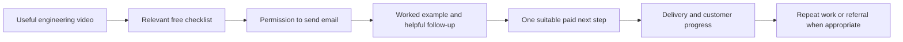

# 08 — Turn a useful channel into a useful business

**Central problem:** Someone finishes your tutorial, appreciates it, and leaves. You helped them once, but neither of you has an obvious way to continue. A marketing funnel supplies that next step. The useful version helps a particular viewer make progress; its commercial result follows from solving the next problem well.

**Prerequisites:** You have chosen one audience, can demonstrate a small working project, and understand the video promise and production process from Chapters 1–7. You do not need an audience of a particular size to design a proposed offer. You do need evidence of demand before treating that offer as a business.

**Outcome:** You will be able to connect one engineering video to an appropriate free resource, a permission-based email relationship, and one bounded paid offer. You will understand how coding notes, tutoring, freelance work, and a paid community differ, and when each creates more obligations than its revenue justifies. Use the [funnel laboratory](../companion/index.html#funnel) alongside this chapter.

## Start with your existing proof

Your portfolio gives you a more concrete starting point than a generic AI news channel: it presents full-stack and AI/ML work, browser extensions, and public teaching. Its listed projects include YouTube Bookmarker and Loolite. The products page presents coding notebooks. These are self-described public assets, not independently audited sales or outcomes. They support a channel that teaches developers how to ship small tools and understand the engineering involved. They do not establish willingness to buy any proposed new offer. [Portfolio](https://aadilmallick.com/), [tools](https://aadilmallick.com/tools), [notebooks](https://aadilmallick.com/products).

Imagine the video “I built a browser extension that turns video timestamps into a study workflow.” The viewer learns something complete: capture a timestamp, save a note, display the saved result, and understand a failure case. The natural follow-up is a checklist that helps the viewer build their own small extension. A generic “make money with AI” ebook would attract a different motivation. Even if it collected more addresses, it would teach you less about the people who want your engineering help.

The recurring example here is a **proposed** offer family called *Ship a Small Developer Tool*. The free resource is an extension launch checklist. The entry product is an annotated engineering notebook. The personal service is a project review or tutoring session. The higher-value service is a bounded architecture or implementation audit, offered only for work you are qualified to assess. A community is a later option. Names, prices, and deliverables in worked examples are drafts to validate, not claims that these products already exist.

## A funnel is a sequence of decisions

The word “funnel” describes how fewer people continue through successive steps. It does not mean every viewer ought to buy. A developer may enjoy the free video, save the checklist, and never purchase. That can still be a successful relationship. The funnel is healthy when each step has a clear purpose and people can stop without being tricked.

Start with five decisions. First, does the video solve a problem I recognize? Second, is the free resource relevant enough to request? Third, do the follow-up messages deserve attention? Fourth, does a paid option solve a problem I still have? Fifth, does the experience justify returning or recommending it? A drop at one step has several possible causes. Low purchasing could mean poor fit, insufficient trust, a confusing product page, an unaffordable price, or a perfectly satisfied audience that does not need more help.

This diagram is a teaching model. Real paths loop. Someone might book a review directly after a tutorial, or return to your shop months after joining the list. Keep a simple primary path so the message is understandable, while allowing people to choose what they need. Your public video should stand on its own; withholding the crucial fix to force an email signup makes the lesson worse.

## Design backward from one paid problem

Begin with a proposed buyer situation rather than a product format. “I sell notes” names a file. “I help a React developer understand why their extension loses state after a reload” names a situation in which an explanation, worked example, or review could be valuable. The paid result must be specific enough that you can describe what is included and what a reasonable buyer should not expect.

Consider four situations:

| Viewer situation | Appropriate next help | Evidence to seek before building |
| --- | --- | --- |
| Understands the video but wants a reusable reference | Annotated notes with examples and troubleshooting | Requests for a reference; sample users can find an answer |
| Gets stuck applying the concept to a personal project | Bounded tutoring or project review | Repeated obstacles; willingness to book a defined session |
| Has an existing tool and needs an external assessment | Fixed-scope engineering audit | A qualified client can describe a decision the audit would inform |
| Wants continuing feedback and peers over several projects | Small cohort or community | Repeated attendance and a recurring need, beyond enthusiasm for a group |

The same person may move through several situations, but do not force a ladder on them. Someone who buys notes may prefer independent work forever. Someone who needs a business audit may have no interest in a student community. Create different doors only after you see those different needs.

For your first commercial experiment, choose **one** of the first three rows. A narrow paid review can teach you the questions people ask. A notebook can then encode repeated explanations. This order often reduces speculative production, but it is a course recommendation, not a universal law. If your existing notes already receive specific purchase requests, test that product first.

## Build a lead magnet that earns its place

A lead magnet is a free resource offered in exchange for an explicit email relationship. The exchange must be understandable. “Get my free checklist and a weekly practical engineering email” is clearer than a button that hides the ongoing subscription. You can provide a freely accessible version without an email gate as well; collecting addresses is not always worth the friction.

For this channel, draft a two-page *Small Browser Tool Launch Checklist*. Page one covers the smallest demonstrable outcome: input, state, output, and recovery. Page two covers the path to a usable release: permissions, reproducible setup, empty states, failure messages, keyboard access, and a record of known limitations. For the AI bookmark-to-study pilot, add a small output-review box: expected structure, traceable source claims, and behavior when evidence is missing. That aligns the extension artifact with the AI-output checklist proposed elsewhere in this course; choose one version that matches the actual episode. Do not call it a security certification or a guarantee of store approval. It is a practical checklist informed by your own projects.

Each item needs an action and a visible result. “Test persistence” is too vague. “Create a note, reload the page, reopen the tool, and confirm that the saved text and timestamp remain” is usable. “Handle errors” becomes “Disable the network or use an invalid input; the interface explains what failed and offers a recovery path.” The viewer can now perform the check without needing your interpretation.

Include a miniature completed example. A synthetic bookmark record might contain a video identifier, a timestamp, and a note. The checklist shows a successful save, then a reload, then the same record restored. It also shows a deliberately invalid timestamp and the message the user receives. This makes the free resource an extension of the lesson rather than a decorative PDF.

Keep scope small enough to finish in one focused session. A 120-page “ultimate AI guide” creates an enormous update obligation and makes it hard to understand what attracted a subscriber. A two-page checklist can answer a precise question: does the audience want help shipping small tools responsibly? If many people request it but ask only about general AI news, your positioning or call to action may be attracting the wrong intent.

Give the resource a version and an update date. Put code-specific assumptions in the resource: browser tested, example repository commit if applicable, and known missing features. The version is a service to the reader, not a suggestion that you must update every week. Retire or revise resources when their core instructions stop working. A free resource can still damage trust if it repeatedly sends people into broken setup steps.

## Write a landing page with one job

A landing page should help a relevant viewer decide whether to request the resource. It needs less navigation than your portfolio because the visitor already has a specific context. Use the same language as the video. If the video is about a timestamp extension, the page should immediately mention that kind of project, not present a broad consultancy homepage.

Here is a complete draft of the central page copy. The resource and claims must be true before you publish it:

> **Finish your small browser tool with fewer avoidable mistakes**
>
> Get the two-page checklist used in this channel's extension walkthroughs. It helps you check the path from one working demo to a tool another person can actually use.
>
> Inside: a concrete persistence test, an error-state walkthrough, a permissions review prompt, a release checklist, and one completed bookmark example.
>
> For developers who can build a small JavaScript interface and want a clear finishing process. It is a practical project aid; it does not promise store approval, production security, or a job outcome.
>
> **Email address**
>
> **Send me the checklist**
>
> By signing up, you request the checklist and a short welcome series about building small developer tools, followed by a practical engineering email about once a week. You can unsubscribe whenever you want. Your address will be used for these messages and handled as described in the privacy notice.
>
> Want the video first? Return to the complete walkthrough.

Notice the order. The headline names a task, the description makes the artifact tangible, the audience line helps people self-select, and the expectation statement explains follow-up. A screenshot or readable preview of the checklist is more useful than invented testimonials. If you have no testimonials, leave them out. Your own working demonstration is valid evidence; another person's endorsement requires that person's real experience and permission.

The thank-you page should say what happens next: check the inbox, confirm the address if confirmation is enabled, and open the resource. Offer a direct recovery route if delivery fails. Do not immediately present four purchases. One optional next video is enough while the new subscriber is still trying to obtain the promised file.

## Implement the smallest reliable system

You need a resource, a form, a delivery method, a way to contact subscribers who opted in, and a place to fulfill a purchase. You do not need a custom application for each part. Your development skills can become a distraction if you spend three weeks building a storefront before testing whether anyone wants the notes.

As researched on November 13, 2026, Kit's free offering includes forms, landing pages, broadcasts, and tagging; its current pricing separates unlimited sequences and visual automations into a paid tier. Therefore the welcome series below is a communication design, not a promise that every step is automated on the free plan. Start with supported manual broadcasts or a smaller welcome flow, or pay only when the automation solves a real workload. Recheck the current plan before committing. [Kit pricing](https://kit.com/pricing), [Kit free-plan details](https://help.kit.com/en/articles/16627071-the-kit-free-plan).

Use one email platform rather than simultaneously operating three. If your existing shop already delivers files reliably, test it before adding another checkout. Gumroad and Lemon Squeezy are options to compare for digital delivery, fees, buyer experience, supported products, payout country, and tax handling. Their fees have qualifications beyond the main headline, so use the official detail pages and your actual checkout statement. A merchant-of-record service addresses responsibilities for the sales it processes; it does not eliminate your own income-tax or broader business obligations. [Gumroad fee details](https://gumroad.com/help/article/66-gumroads-fees), [Lemon Squeezy fee details](https://docs.lemonsqueezy.com/help/getting-started/fees).

Perform the entire path using your own test address and the platform's test facilities when available. Submit the form on a phone. Confirm the delivered file opens. Follow the purchase route without making an unnecessary live charge. Check the receipt, download instructions, unsubscribe route, and recovery message. A beautiful page is irrelevant if the file link requires permissions the buyer does not have.

Keep a small operational record: resource version, form location, sender address, subscription expectation, product file, support route, and date last checked. This is enough to diagnose a broken path. Never put secrets, private customer data, or your employer's material into a public tutorial or lead magnet. Use synthetic project data when demonstrating the setup.

## Connect the video without interrupting its value

Place the invitation after a meaningful result. In an eight-minute video, the first natural moment might be after the viewer sees a note survive a reload. Say: “If you want to run these checks on your own extension, I put the two-page checklist below. The rest of this video shows the failure case and the fix.” This makes the resource relevant while preserving the video's promised completion.

At the end, choose the next step that best serves the viewer. If the next video explains extension state, recommend that video. If the viewer is ready to build, mention the checklist. A spoken stack of “subscribe, like, join Discord, buy my notes, book a call, and follow every account” creates competition between actions. Each action also makes it harder to interpret results.

Check your channel's feature access before assuming a link works. YouTube currently treats long-form description/comment links differently from URLs typed in Shorts descriptions and comments, which are non-clickable. Advanced features are needed for clickable external links in the relevant locations. A Short can point to its related video or the channel profile route where available; inspect the actual experience on mobile. [YouTube's link-location guide](https://support.google.com/youtube/answer/13748639).

Use descriptive link labels such as “Free browser-tool launch checklist.” An unlabeled list of shortened links asks for trust before establishing the destination. A clear description also makes attribution simpler: this video points to this resource for this audience. Keep the link current when a resource moves, and periodically check your most-viewed older videos.

## A seven-message welcome sequence, with actual copy

The purpose of a welcome sequence is to deliver what someone requested, help them use it, and make an appropriate offer legible. The following is a complete example of message bodies and subject lines. It is **draft copy for the proposed resource and offers**, not messages that were sent. Before use, create the promised artifacts, replace descriptive link labels with real tested links, and add your platform's accurate sender, postal-address, and unsubscribe footer. Do not invent those details.

Use a generous schedule: immediate delivery, then roughly days 2, 4, 6, 9, 12, and 15. This spacing is a starting design to test, not an evidence-based universal optimum. Stop or change promotional messages after a purchase so the buyer is not repeatedly urged to buy what they already have. A reply may deserve a personal answer rather than another automated message.

### Message 1: deliver and set expectations

**Subject: Your small browser tool checklist**

Here is the checklist you requested: **Open the Small Browser Tool Launch Checklist**.

Start with the persistence check. Create one item, reload the interface, and confirm that the same item returns. If the test fails, write down which step lost the data before changing any code. That observation is more useful than trying several storage APIs at random.

The next few emails will show how to use the checklist on a small extension. After that, I plan to send a practical engineering email about once a week. Some messages will introduce my paid notes or personal project help. You can unsubscribe through the link below whenever the emails stop being useful.

If you reply, tell me the smallest tool you are trying to finish and the one part that currently gets stuck. A sentence is enough. Please leave out private code, credentials, and employer information.

— Aadil

### Message 2: produce one small win

**Subject: The reload test catches more than you think**

Today, try the checklist with one record rather than a complete project.

Save a bookmark with a timestamp and a note. Reload. Reopen the display. If the record disappears, separate three questions: did the save happen, did loading happen, and did the interface render the loaded value? These are different steps, so collect an observation at each boundary.

In the walkthrough, I show the saved record before changing the rendering code. That makes it possible to identify whether the failure is storage or display. **Watch the persistence walkthrough** if that distinction is the part you need.

You do not need a larger framework to do this investigation. Start with the smallest reproducible case, record what happened, and add complexity after the basic path works. If you fixed the problem, keep your before-and-after notes; they will make the next debugging session easier.

— Aadil

### Message 3: teach a tradeoff

**Subject: A working demo still needs an empty state**

A tool often looks fine because its creator already has data saved. A new user begins with nothing.

Open your project with no records. What do they see? A blank panel leaves the person to guess whether the tool is broken. A useful empty state names the next action: “No bookmarks yet. Save a timestamp from a video to create your first one.” Then make that action possible.

The checklist includes a second pass for invalid input and unavailable data. Try one of those cases today. You are checking whether the interface helps a person recover, not whether every failure can be prevented.

This is also how I choose what to explain in the channel: one concrete behavior, the reason it matters, and an example you can inspect. **See the error-state example** when you want to take the next step.

— Aadil

### Message 4: learn from the reader

**Subject: Which part of shipping a tool is hardest for you?**

You have seen the basic checks. I would like to make the next lessons more useful.

Which of these is closest to your situation: understanding the code, deciding what to build, debugging something that almost works, or finishing the release? You can reply with one phrase and a little context. I will read the replies, though I cannot promise individual debugging for every project by email.

I am considering an annotated notebook that explains the decisions behind a small browser tool, with worked examples and a troubleshooting section. If that would help, tell me what an ordinary tutorial leaves unexplained. This is a research question, not a promise of an upcoming release date.

No need to share a repository to answer. A description of the decision or error is enough. Your reply will help me choose the next free lesson as well as whether the notebook is worth making.

— Aadil

### Message 5: present the product honestly

**Subject: A reference for the steps you keep looking up**

If you want a reusable reference beside the videos, the proposed *Ship a Small Developer Tool* notebook is designed for that job.

Its planned scope is one complete example, annotated decisions, persistence and error-state checks, and a troubleshooting map. The public product page should show a sample section, the tested setup, exactly what files are included, the price, and the support and refund terms before you decide.

**Preview the notebook** when the finished product page is available. If the sample does not match your project or level, continue with the free walkthroughs. The notebook is optional; you do not need it to complete the channel's public examples.

If you already bought the relevant notes, this message should be replaced with an onboarding tip that helps you find the appropriate section. Paying customers deserve help using the product, not another version of the same sales pitch.

— Aadil

### Message 6: explain personal help and its boundaries

**Subject: When a project review is the right next step**

Sometimes the missing piece is feedback on your specific reasoning. A proposed project-review session would focus on one defined obstacle in a small web or browser tool.

Before booking, the page should ask what you are building, what you have tried, what outcome you want from the session, and whether the material is yours to share. I would then confirm whether the problem fits my experience. A session is not a promise to finish an entire product or provide unlimited support afterward.

**Read the review scope** if that sounds useful once booking is open. If you need a complete implementation or a specialist audit outside my competence, I should say so rather than sell an unsuitable session.

You can also reply with the category of problem you are facing. Please send a minimal description first, without secrets or confidential files. That makes it easier to determine the right kind of help.

— Aadil

### Message 7: establish the ongoing relationship

**Subject: What comes next in practical AI engineering**

The welcome series ends here. The next regular emails will continue the channel's promise: build a small useful tool, understand why it works, and test where it fails.

My plan is to connect browser and web projects to AI engineering when the AI component serves a real purpose. A demo can be exciting and still need evaluation, a fallback, or a clearer explanation of its limits. That is the work I want to show.

**Choose your next walkthrough** from the project list. If you prefer only product updates or a different topic, use preferences if that option is available. The unsubscribe link always remains available.

Thanks for spending part of your learning time here. If a lesson helped you finish something, I would enjoy hearing what changed. Share only what you have permission to share, and tell me separately if I may quote your feedback publicly.

— Aadil

These messages illustrate different jobs: delivery, activation, deeper teaching, research, product explanation, service qualification, and continuing expectations. Do not turn every message into a pitch. Do not imply a planned product is available. For a live launch, replace the planning-language version with accurate finished-product facts; until then, ask for research feedback or invite a clearly labeled waitlist.

## Segment by need with minimal complexity

Segmentation means sending different messages to people with different stated needs. Begin with one optional preference: “building a tool,” “learning the fundamentals,” or “looking for project feedback.” A simple reply can supply this information before you invest in elaborate automation. You are learning which lesson is relevant, not trying to infer private characteristics.

Two rules prevent most beginner mistakes. First, a purchaser should enter onboarding for that product instead of continuing the same offer sequence. Second, a person who unsubscribes from marketing should stop receiving marketing even if they remain entitled to receipts or necessary product access messages. Keep those categories operationally separate using your provider's documented features.

Email opens alone are an imperfect proxy for attention because tracking can be affected by mail software and privacy features. A reply explaining a problem, a click on the promised resource, completion feedback, or a purchase with low subsequent confusion provides different evidence. Do not score people as uninterested solely because an open tracker did not fire.

Keep the initial tag system comprehensible to future you. “Source: extension-checklist,” “Interest: project-review,” and “Customer: notes-v1” are easier to maintain than twenty inferred engagement levels. Document how each tag is assigned and removed. When a rule becomes difficult to explain in one sentence, simplify the flow before adding another platform.

## Turn notes into a product someone can evaluate

Raw personal notes record what made sense to you at a particular moment. A paid learning product has to establish context for someone else. Your existing notebooks are an asset, but their suitability for this audience should be assessed with an actual sample. Do not rename a broad collection as a specialist extension guide without doing the instructional work.

Choose one buyer task and curate around it. For a browser-tool notebook, include a prerequisite page, tested environment, a minimal complete example, explanations of decisions, expected outputs, deliberate failure cases, and a troubleshooting index. Explain what the reader must already know. Link to the matching free videos so the formats support each other rather than duplicate pages of transcript.

A useful sample could show one complete persistence example, including an error and its diagnosis. It should demonstrate the product's teaching quality, not just its cover. Ask three suitable readers to find a specific answer using the sample. Watch where they search and what remains ambiguous. “Looks great” is weaker evidence than “I could identify which function loaded the saved state and fix my own case.”

State the update promise carefully. “Includes the current files and corrections to this edition” is manageable. “Lifetime updates to every AI tool” creates a liability you cannot estimate. Give the product a version, list what is tested, and explain what happens when an external API changes. A paid PDF is not a service-level agreement for every future dependency.

If you test willingness to pay before completing the product, use a clearly labeled preorder with an achievable delivery date and a clear cancellation/refund path. Never imply that an unfinished file is ready for immediate use. For a first experiment, a small finished product often produces cleaner learning than a complicated presale.

## Make tutoring a bounded learning service

Tutoring sells attention and feedback. It should help the learner understand a problem rather than quietly becoming an unlimited coding service. A proposed 60-minute session might include a short intake, review of one minimal example, guided debugging, and a written next-step note. Charge and scope should reflect the preparation and follow-up as well as the live hour.

Use an intake that asks: what is the goal, what is already understood, what is the specific obstacle, what has been tried, and what would make this session useful? Ask for a minimal reproducible case only when needed. Avoid accepting large private repositories by default. If you cannot assess the topic competently, decline or refer to a suitable specialist.

During the session, establish the state before changing code. Have the learner describe the expected behavior, inspect the actual result, and choose a hypothesis. Demonstrate one diagnostic step, then give the learner room to perform the next one. Finish with the reasoning that transferred, not only the code that now happens to run.

A written boundary might say: “One scheduled session about one agreed project problem, with up to fifteen minutes of preparation and a concise follow-up note. Further implementation or sessions require a separate agreement.” This is proposed business copy, not a legal contract. It makes the offer easier to understand and protects the time you need for videos.

Tutoring and graded coursework need particular care: help someone learn and follow the rules of their institution or assessment. Do not promise to impersonate a learner or complete prohibited work. This boundary also improves the channel's reputation as a place to understand engineering rather than bypass it.

## Scope a freelance audit around a decision

An audit is not a vague promise to “make your app better.” It should help a client make a defined decision. For example: “Review the onboarding and data-flow design of one small extension and identify the three most consequential usability or reliability issues.” If security or regulated requirements are involved, do not present yourself as a specialist without appropriate competence and scope.

Define inputs, process, deliverables, exclusions, timing, revision boundaries, and acceptance. Inputs might be a demo, a short architecture description, and a specific question. Deliverables might be a prioritized written report, a walkthrough call, and an optional small patch only if explicitly included. Exclusions could include a full penetration test, unlimited revisions, legal compliance certification, or maintaining the product afterward.

The commercial value comes from the decision the review informs, not the number of pages. A client deciding whether to invest another month in an extension may value a focused diagnosis. A beginner who needs syntax help may be better served by tutoring. Separate those situations in your page and intake rather than upselling everyone to the highest price.

Here is a research conversation opener the learner can choose to use after obtaining appropriate permission to contact someone: “I am studying how developers finish small browser tools. What part of your last project delayed release? What did you try, and what did that cost in time or rework? If an outside review had been available, what decision would you have needed it to support?” Ask about real past behavior before describing your proposed offer.

End a qualified inquiry with a written scope and price. A friendly call is not enough to establish what you will deliver. Use a suitable agreement for actual client work, and have professional advice where the stakes require it. The course does not create or send any contract, proposal, or outreach on your behalf.

## Earn the right to start a community

A community is a recurring service. The members are buying a reason to return: feedback, structured progress, peers with similar goals, or access to useful live work. A chat server full of unrelated links is not automatically that service. Before charging monthly, test a small recurring activity such as a project clinic or four-week build group.

For your audience, the strongest proposed recurring promise is “finish and explain one small tool with peer feedback,” rather than “get access to me.” Define what happens every week: one office hour, one project-feedback thread, one reference walkthrough, and a clear response window. State what you do not provide, including unlimited private debugging. Recurring access without limits can consume all available production time.

Recruit a small founding group only after repeated demand appears. A practical course gate is several sessions with returning participants, specific requests for continuing help, and a service plan you can deliver in a fixed weekly time box. This gate is a decision aid, not a claim that a particular number guarantees success. Charge only after the offer and cancellation terms are clear.

Skool and Circle are examples of paid community platforms. The current Skool page lists different monthly fees and transaction percentages by plan; Circle's pricing has plan-specific features and billing qualifications. Compare the total cost at your actual revenue, accessibility, member experience, export options, payment support, and moderation requirements. A cheaper headline price does not necessarily mean a cheaper business. You can validate the recurring activity using existing meeting and communication tools before choosing a permanent platform. [Skool pricing](https://www.skool.com/pricing), [Circle pricing](https://circle.so/pricing).

Track activation: did a new member attend or post a useful project question in their first week? Track renewal and cancellation reasons. Someone may leave because they completed their goal, not because the service failed. Design a respectful exit and preserve access according to the terms you promised. Treat community retention as evidence about continuing value rather than a reason to manufacture dependency.

## Attribute revenue without counting the same person twice

Attribution asks which touchpoints contributed to an outcome. It is not perfect causal proof. A buyer may discover you through a Short, watch three long videos, join a list, and purchase from an email on another device. A single last-click label does not describe that whole relationship.

Begin with descriptive campaign parameters on links where supported: source “youtube,” medium “video,” campaign “extension-launch,” and content identifying the episode. Use a consistent naming convention. Never put personal data or email addresses in these parameters. Store campaign information only through tools and practices appropriate for your audience and applicable requirements.

Record monthly totals in separate columns: relevant video views, unique landing visits, confirmed new subscribers, unique qualified inquiries, purchases, refunds, and delivery workload. If the same person buys notes and a review, those are two legitimate transactions but one person. Report revenue by transaction and people by a deduplicated count. Do not add “60 note buyers plus 10 tutoring customers” and call it 70 unique customers without checking overlap.

Suppose a video receives 10,000 views, its page gets 200 unique visits, and 60 people confirm subscription. The visit-to-view ratio is 2%, and the subscriber-to-visit conversion is 30%. The subscriber-to-view ratio is 0.6%. These are different denominators. If three of those sixty subscribers buy a $49 notebook, that cohort's observed subscriber-to-buyer rate is 5% over the stated observation window, and gross product revenue is $147 before adjustments.

These small figures are a worked example, not a benchmark. Three buyers do not establish a stable 5% rate. Annotate the dates, traffic source, offer version, and window. If you improve the page and compare a different audience next month, you changed more than the page. Keep causal claims modest and use the evidence to choose the next useful investigation.

## Diagnose the bottleneck before adding tools

If a useful video receives few relevant views, the funnel has little evidence to work with. Improve topic choice and packaging before rebuilding the checkout. If views are relevant but visits are scarce, inspect whether the invitation matches the problem and whether the link works on mobile. If visits happen but confirmations do not, inspect clarity, form friction, expectations, and delivery reliability.

If subscribers read but do not buy, ask whether the paid result is distinct from the free lesson and whether there is evidence of a remaining problem. A complete free tutorial can satisfy people, which is good. It may support a different commercial model, such as an optional reference or carefully qualified services, rather than an expensive course nobody needs.

If purchases happen but support volume is high, growth can make the business worse. Investigate setup confusion, missing prerequisites, vague promises, file access, and product quality before increasing traffic. Support questions can become product fixes and free videos. Do not publish a customer's details or quote their message without permission.

An AI assistant can help categorize anonymized feedback, but verify its categories against the original messages you are allowed to process. A useful prompt is: “Group these synthetic or appropriately anonymized product questions by the underlying task. Separate setup failures, missing explanations, and requests outside the product scope. Give examples, uncertainties, and one proposed correction per category. Do not invent customer quotes or infer personal characteristics.” This is a learner workflow, not a claim that private customer messages were processed here.

## Preserve trust as the system becomes commercial

When you recommend a tool with a material relationship, make that relationship easy to understand. U.S. FTC guidance addresses payment, free products, and other connections and emphasizes disclosures with the endorsement itself. For video, an audible and visible explanation can help people notice it. YouTube also has its own paid-promotion setting for relevant relationships. Use the platform setting and the appropriate disclosure; do not assume one replaces every obligation. [FTC influencer guidance](https://www.ftc.gov/business-guidance/resources/disclosures-101-social-media-influencers), [YouTube paid-promotion guidance](https://support.google.com/youtube/answer/154235).

For commercial email in the United States, the FTC guide covers truthful identification and subject lines, a valid postal address, an easy opt-out, and honoring opt-outs. Other jurisdictions and your provider may impose additional requirements. Use an explicit opt-in relationship as your operating design, check the rules that apply to your audience, and obtain appropriate advice when necessary. Do not copy a fabricated address into a footer. [FTC commercial-email guide](https://www.ftc.gov/business-guidance/resources/can-spam-act-compliance-guide-business).

Trust also depends on editorial choices. Show when a sponsored tool failed your test. Explain when an affiliate alternative is unnecessary. Disclose when a product is yours. Correct substantive mistakes in older videos and linked products. A channel about AI tools is especially vulnerable to exaggerated capability claims, so make the demonstrated task and its limitations visible.

## Your first funnel project

Create one complete private draft before announcing anything. Choose a video about a small tool, write the checklist, prepare the landing page, and map one welcome message. Then ask a few appropriate test readers to complete the path using the test setup. Watch whether they understand what they receive, what email they are requesting, and where to get help. Revise the parts that confuse them.

Next, validate one paid offer with real demand evidence. Show a sample of the notes or a clear review scope. Ask what a person would use it for and what remains unclear. If nobody needs the offer, preserve the learning and revise the problem definition. Do not interpret every polite compliment as a sale waiting to happen.

Your deliverable from this chapter is a one-page funnel map plus a working test path: video promise, free resource, explicit email expectation, one appropriate offer, fulfillment, support, and measurement. The [funnel laboratory](../companion/index.html#funnel) lets you vary illustrative conversion rates and see how each denominator affects the result. It cannot predict your conversion rate. Chapter 9 adds money and time so you can decide whether the proposed system can be sustained.
