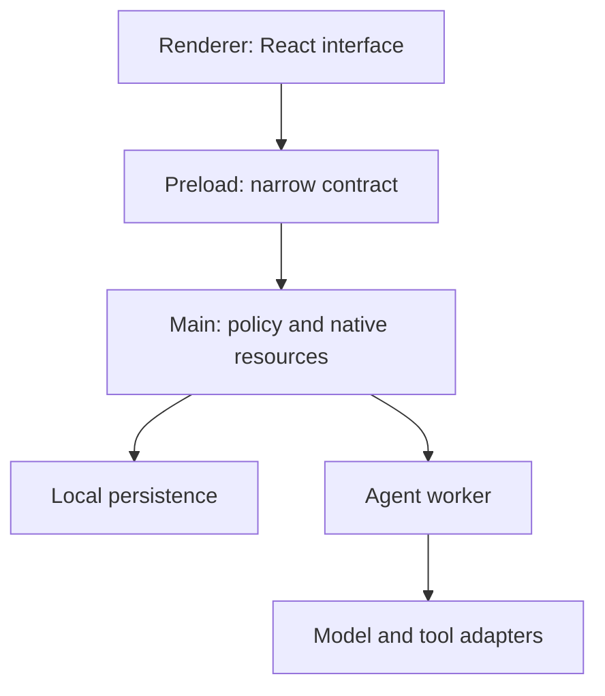

# 01 — From a web page to a desktop application

[Course index](../README.md) · [Next chapter](02-ipc-security-and-native-integration.md)

**Planned workload: 100 hours.** Explanation and experiments 15; scaffold and editor configuration 15; TypeScript and React shell implementation 30; lifecycle and filesystem investigation 15; alternative-stack comparison 10; integration and documentation 15. These blocks include implementation time, not just reading time.

## 1. The problem Electron solves

A browser application can display a beautiful interface, but a desktop agent must also own windows, access user-selected files, preserve work without a network connection, integrate with the operating system and install updates. Browser security deliberately restricts many of those capabilities. Electron combines a browser-based interface with a privileged application process. That combination is useful because an experienced web developer can reuse HTML, CSS, JavaScript and component libraries while gaining a controlled route to desktop functionality.

The phrase “controlled route” is essential. Giving every rendered string direct access to the filesystem would make an agent's response a potential route to native execution. The architecture must separate presentation from authority. Start by understanding that separation; a polished component library cannot compensate for a missing boundary.

Atlas Desk will be our recurring application. It begins as a window with a conversation list and a text composer. Later it gains local storage, identity, paid features, agent tools and installers. We will keep the domain model independent of the UI framework so that the same conversation rules can be tested without launching a desktop window.

Electron is a reasonable choice when browser expertise, complex rich interfaces and a consistent rendering engine matter. It has costs: application size, multiple processes, memory consumption and responsibility for updating the embedded runtime. Tauri, native Swift or .NET, Qt and a browser application are meaningful alternatives. The right decision depends on required integrations, team expertise, rendering needs and operating-system constraints rather than the smallest possible hello-world download.

## 2. The process model, one responsibility at a time

The **main process** owns the application lifecycle and native resources. A **renderer** displays a window's web interface. A **preload script** exposes selected application operations into that renderer. A **utility process** can host work that should not block or destabilize the main process. These are separate execution contexts; importing the same filename in two of them does not create shared mutable memory.

Consider a hotel. The renderer is a guest-facing desk, the main process is the building manager and the preload contract is the list of requests the desk is allowed to make. The analogy breaks down if it suggests the desk is inherently trustworthy. A renderer can process imported Markdown, remote content and other attacker-controlled input. It must be treated as a caller whose requests need validation.



The Electron process guide documents the architecture; our responsibility assignment is a course design built on it. See [Electron process model](https://www.electronjs.org/docs/latest/tutorial/process-model). Do not interpret “utility process” as an operating-system sandbox. It is a crash and scheduling boundary; a process may still have the user's filesystem permissions.

A click on “Open workspace” follows a specific path. React asks the preload API to choose a workspace. The main process opens an OS dialog. The main process records the selected root, creates an opaque workspace identifier and returns a safe display name. The UI can now request a listing for that identifier. It does not receive a general-purpose function named `executeAnything`.

This organization also explains performance. A slow render may make one window feel frozen. A long synchronous loop in the main process can stop the whole application from responding to window and operating-system events. Moving CPU work to another process can help responsiveness, but only after you establish a bounded message protocol.

## 3. JavaScript prerequisites that matter on desktop

An event loop runs queued JavaScript callbacks. `async` and `await` let you suspend a function while waiting for a promise; they do not automatically move CPU work to another thread. If a function parses an enormous document before returning a promise, the parsing still occupies its current thread.

Run this complete experiment as `node event-loop.mjs`:

```js
// event-loop.mjs
const started = performance.now();
setTimeout(() => {
  console.log('timer after', Math.round(performance.now() - started), 'ms');
}, 0);

const deadline = performance.now() + 80;
while (performance.now() < deadline) {
  // Deliberately busy for a small demonstration only.
}
console.log('loop finished');
```

The loop message appears first; the timer runs after the synchronous work finishes. Exact milliseconds vary. In an application, replace the busy loop with indexing thousands of files and the symptom becomes a frozen window. A promise around that loop does not solve the problem. A worker, utility process, streaming algorithm or smaller batches may solve it.

An **event listener** remains registered until removed or until its owner is destroyed. Desktop applications run for hours, so listeners that would be harmless on a short-lived web page can accumulate. Associate every subscription with an owner and a cleanup function. In React, an effect returning a cleanup function is one way to express this lifetime.

An exception thrown inside an asynchronous event handler is not necessarily caught by a caller that registered the handler hours earlier. Catch errors near the operation, translate them into a stable application result and log a redacted diagnostic. Do not swallow errors with an empty catch block. A user needs to know whether a message was saved, a payment is pending or a tool stopped halfway through.

Finally, values crossing process boundaries are serialized. Functions, class instances and filesystem handles do not behave like ordinary local references. Prefer small plain objects with explicit identifiers. A `Date` can be represented as a timestamp string; a tool invocation can be represented as a tagged object. This makes persistence, logging and testing easier too.

## 4. TypeScript as a communication tool

TypeScript helps describe what your code expects, but its types disappear at runtime. A malicious renderer can still send malformed data. Use TypeScript for developer understanding and runtime validation for trust boundaries.

This intentionally small TypeScript fragment defines the domain vocabulary:

```ts
// Domain contract fragment; no Electron imports belong here.
export type RunState =
  | { kind: 'idle' }
  | { kind: 'running'; runId: string; startedAt: number }
  | { kind: 'awaiting-approval'; runId: string; proposalId: string }
  | { kind: 'completed'; runId: string }
  | { kind: 'failed'; runId: string; message: string };

export function canSubmit(state: RunState): boolean {
  return state.kind === 'idle' ||
    state.kind === 'completed' || state.kind === 'failed';
}
```

The `kind` property is a discriminant. Checking it narrows the other properties available in that branch. This prevents a component from casually reading a `proposalId` from an idle state. The function is pure: its return value depends only on its argument. Such functions are cheap to test and easy to reuse.

Start with `strict: true`. Turn on checks that catch unused variables and unchecked array assumptions when your codebase can support them. Avoid silencing the compiler with `as any` at a boundary; write a decoder that accepts `unknown` and produces a validated value. `unknown` says “we have not established the shape.” `any` says “stop checking,” which is a very different instruction.

Use separate configurations for Node-capable code and browser code. A renderer project that accidentally sees every Node global may compile an import that cannot run securely. Build tooling can bundle dependencies, but bundling is not permission. A dependency requiring `node:fs` still belongs on a privileged side of the architecture.

For error results, prefer a discriminated union such as `{ok: true, value}` or `{ok: false, code}`. Return user-safe error codes across IPC. Keep native stack traces in protected diagnostics. Stable error codes allow the interface to explain retryable failures without guessing from English exception messages.

## 5. Choosing a modern build stack

“Electron with Vite” and “Electron Forge” are not opposites. Vite transforms and bundles source code; Forge coordinates packaging, installer creation and release tasks. React handles the interface; TypeScript checks source contracts. Each tool has a different job.

| Route | Useful when | Main responsibility you retain |
|---|---|---|
| Forge + Vite + React + TypeScript | A cohesive build and release pipeline is desirable | Keep each process build and installer configuration explicit |
| electron-vite + electron-builder | You prefer that ecosystem's build conventions and target support | Match builder artifacts with the correct updater |
| Forge + webpack | Existing webpack tooling or plugins matter | Manage its configuration and build performance |
| Plain Electron | You are learning the process model or need a minimal experiment | Supply your own build, packaging and release organization |
| Electron + Vue/Svelte | Your team is stronger in those UI frameworks | Preserve the same IPC and policy boundaries |
| Local desktop shell + remote web UI | Some enterprise interfaces change centrally | Treat remote content as untrusted and design offline behavior |

For this course, use Forge, Vite, React and TypeScript for the main learning build. The included tiny companion uses plain Electron so its boundary code is easy to inspect; it is not a recommendation to abandon build tooling in a commercial application.

The research snapshot found Forge 8.0.1 and Electron 45.3.2 as the current release references. These are a dated baseline, not a promise about what is current when you read this. Forge 8's release notes supersede older pages that call the Vite plugin experimental. It also changes scaffolding and uses `release` where older material uses `publish`. See [Forge releases](https://github.com/electron/forge/releases) and [Electron releases](https://github.com/electron/electron/releases).

Do not combine one tutorial's Forge 7 configuration, another tutorial's Forge 8 CLI and a third tutorial's builder updater. Start from one coherent pinned project, then upgrade deliberately. Commit the lockfile. A reproducible installation uses the lockfile and an appropriate package-manager version, not a dependency list where everything silently resolves to tomorrow's latest release.

## 6. Scaffold first; inspect every generated boundary

These commands are for the learner's network-enabled development machine. The scaffold itself was not executed in the authoring environment.

```bash
npx create-electron-app@8.0.1 atlas-desk --template vite --typescript
cd atlas-desk
npm install react react-dom
npm install --save-dev @types/react @types/react-dom @vitejs/plugin-react
npm start
```

Use the scaffold's actual generated filenames rather than overwriting a directory from an old blog post. Add React support to the renderer Vite configuration only, set TypeScript JSX appropriately and replace the initial renderer entry with a React root. Ensure your dependency versions support the Vite version generated by the scaffold. The recipe explains the integration; the package manager's resolved compatibility still needs verification on your machine.

A renderer entry fragment looks like this:

```tsx
// Renderer entry fragment; import this from the generated HTML entry.
import React from 'react';
import { createRoot } from 'react-dom/client';

function App() {
  return <main>
    <h1>Atlas Desk</h1>
    <label htmlFor="prompt">Message</label>
    <textarea id="prompt" />
    <button type="button">Send</button>
  </main>;
}

const root = document.getElementById('root');
if (!root) throw new Error('Missing root element');
createRoot(root).render(<App />);
```

Add `<div id="root"></div>` in the renderer HTML and use the generated module entry arrangement. The null check establishes that the expected DOM element exists. The label connects a visible instruction to the textarea for assistive technology. At this stage the button has no effect; that is intentional. First make the shell reliable before connecting native authority.

Inspect the main build output, preload build output and renderer output. A sandboxed preload cannot simply run an arbitrary Node ESM module graph. Build it into a supported format with dependencies handled by the toolchain. TypeScript `import` syntax in source does not prove the emitted preload is ESM. Read the output and compare it with [Electron's ESM guide](https://www.electronjs.org/docs/latest/tutorial/esm).

In development, the renderer may load from a Vite server. In production it must load packaged assets. Those are distinct modes with different paths, CSP needs and trust assumptions. Keep the development server bound to loopback, avoid exposing it across the network by default and fail clearly if the expected local server is unavailable. Do not fall back to an arbitrary remote URL.

## 7. Application lifetime and window lifetime

The application can exist without a visible window. On macOS, closing the final window often leaves the app active; selecting its dock icon creates or reveals a window. On other platforms, your product may quit when the final window closes. A tray application may deliberately remain active. These are product behaviors you must define.

The companion's main entry demonstrates a small lifetime implementation. In a TypeScript Forge app the same logic belongs in the main entry; keep your generated load paths intact. The essential sequence is: register early lifecycle handlers, await readiness, install trusted protocols and policies, register IPC once, then create the window. Registering IPC handlers every time a window reopens creates duplicate registration failures or leaked listeners.

Keep a strong reference to native resources that must remain alive, such as a tray object. Treat a destroyed window reference as unusable. If a long operation finishes after the window closes, check its lifetime before sending an event. A job's lifetime should belong to an application service, not accidentally to the latest React render.

Shutdown is also a sequence. Stop admitting new jobs, ask active work to cancel, persist essential state, close connections and then quit. Do not rely on a final asynchronous save during OS shutdown; it may never complete. Persist meaningful transitions as they occur, and make recovery work from the last committed state.

A single-instance lock helps route second launches into the existing application. It is particularly relevant for auth callbacks and file associations. The first process can receive arguments from the second and focus its existing window. Never trust all command-line arguments simply because they came through this route; parse only the scheme and command shape you explicitly support.

## 8. Paths, assets and native modules

There are at least four paths to distinguish: source paths, built JavaScript paths, read-only packaged resources and writable application data. An application installed under a protected directory must not write its database next to its executable. Use an appropriate application data location and separate development from production profiles.

`process.cwd()` is the working directory chosen by the launcher; it is not a stable way to find packaged assets. Resolve resources relative to the built module or packaged resources path as appropriate. A JavaScript bundle may move relative to its source. Test asset loading from a packaged artifact early, including icons, fonts, worker entry files and database migrations.

ASAR is an application archive format, not encryption. A user can inspect code distributed on their own device. Do not embed a Stripe secret, OAuth client secret, signing credential or supposedly hidden license bypass string in a desktop bundle. Some native binaries and modules need unpacked placement; understand the packager's inclusion and unpacking rules.

Native Node modules add ABI, CPU architecture and operating-system concerns. A package working under your development Node may need rebuilding for Electron's runtime. Prefer a maintained module with compatible prebuilds when it meets your requirements; still test on each target. A successful `npm install` on an x64 Linux machine is not proof of an arm64 Windows release.

Use interfaces around storage and indexing so that native package choices can change. For example, `ConversationRepository` can expose `appendMessage`, `listConversations` and `loadHistory`; the UI need not know which SQLite driver implements them. An abstraction should reflect stable domain operations rather than mirror every method of a particular vendor SDK.

## 9. An editor and debug setup that explains failures

Open separate consoles for main, preload and renderer diagnostics. A renderer DevTools exception and a main-process exception indicate different failures. Prefix logs with a process label and correlation identifier. A log entry like `run cancelled` is incomplete if three jobs are active; include the run identifier without including the private prompt.

Configure source maps for development so stack traces point to authored TypeScript. Production maps can be stored privately for crash symbolication. Decide whether shipping maps leaks sensitive source details; do not confuse hiding maps with protecting actual credentials. Build output must never contain privileged secrets regardless of map policy.

Use the editor's debugger to attach to the main process and browser DevTools for the renderer. Learn to inspect a rejected promise and a stalled IPC call independently. Place a breakpoint before an operation crosses a boundary, then on the receiving side. If the first breakpoint runs and the second does not, investigate channel registration and preload loading before rewriting React state.

Keep formatting and linting deterministic. A formatter resolves style mechanically; a linter catches suspicious patterns; TypeScript checks contracts; tests check behavior. These tools overlap but do not replace one another. Add commands with clear scopes such as `typecheck`, `lint`, `test:unit`, `test:desktop` and `make` rather than one opaque command that suppresses failures.

Do not put all development concerns into a single container and assume it represents the user's desktop. Containers are useful for backend and domain tests. Graphical integration, keychain behavior, signing, notifications, shortcuts and installer behavior still require target operating systems. For a Windows user working with WSL, maintain a deliberate distinction between Linux paths and Windows executable/tooling paths.

## 10. Guided implementation sequence

Spend the first implementation block building the smallest window that displays its app version and a local, nonsecret preference. Record the exact versions and generated build paths. Close and reopen it repeatedly. Package it once before adding a large UI. Packaging early reveals missing resources while there are few moving parts.

Next introduce the typed domain objects and keep them outside the renderer directory. Write a pure function that decides whether a conversation accepts another message. Call it from a simple UI and from a Node test. This demonstrates that domain correctness does not require a browser window.

Then add React with a conversation sidebar, workspace placeholder, composer and settings view. Use semantic HTML and a small CSS system before adding an animation library. Keyboard users should be able to select a conversation, type, submit and open settings. Preserve the draft while switching between views. Save broad visual polish for a stable interaction model.

Compare one alternative stack in a disposable folder. Build the same empty window with electron-vite or another renderer framework, then document the build entrypoints, packaging assumptions and updater integration. The purpose is to understand choices, not to maintain two capstones. Prefer evidence about your team and application over a generic “best stack” ranking.

Finally create an architecture decision record. State the goal, chosen stack, alternatives considered, tradeoffs and conditions that would trigger reconsideration. A good decision record says why you chose a tool and what evidence could change your mind. It does not say the tool will remain best forever.

## 11. Troubleshooting by observable symptom

If the window is blank, inspect whether the renderer URL or file exists, whether the entry script loads and whether the CSP blocked it. A network error, missing asset and React exception are different causes with similar visible symptoms. Capture the load failure event and the renderer console before changing multiple settings.

If `window.desktop` is undefined, inspect the preload path and emitted format first. Confirm the script ran before attempting to use the exposed API. Do not “fix” it by enabling Node integration in the renderer. That trades an observable setup problem for a much broader authority surface.

If development works and packaging fails, list the packaged files and compare expected versus actual paths. Native modules, worker files, icons and migrations often reveal the discrepancy. Never copy your entire source tree into the package as an unexplained fix; it can ship secrets and hide the inclusion mistake.

If main-process hot restart behaves strangely, distinguish renderer HMR from main-process restart. A renderer refresh may preserve an application service; a main restart destroys it. Define whether a development restart loses draft data and whether persisted data survives. Development convenience should expose lifecycle assumptions rather than obscure them.

## 12. Practical extensions and completion evidence

The 100-hour block is complete when you can hand another developer the repository, exact tool versions and setup instructions, and they can run the shell without your machine-specific paths. Evidence should include a packaged smoke result on your primary OS, a screenshot or interaction recording of the shell, a decision record, a log of known platform gaps and a small automated domain test.

For extra depth, build a two-window experiment with one shared application service. Change a preference in one window and reflect it in the other using explicit messages. Then deliberately close one window during a delayed operation. The surviving window should remain functional and the service should avoid sending to destroyed content. This experiment turns process ownership from an abstract diagram into observable behavior.

A second extension is a minimal command palette. Define commands as data, give each command a stable identifier and separate its enabled state from its visual representation. Menus, keyboard shortcuts and buttons can then invoke the same application operation. This reduces the chance that a menu action bypasses validation used by a button.

A third extension is a version upgrade rehearsal. Start from the pinned build, create a branch, read release notes, upgrade one tool category and run the same smoke steps. Save the resulting evidence and rollback instructions. Upgrading the embedded runtime is a recurring production responsibility, so learning the process now is more useful than memorizing a single patch number.

You now have the vocabulary and tooling needed for the next chapter: a renderer asks for operations, a preload describes a narrow contract and the main process decides whether to perform them. The next step is to make those decisions explicit enough to withstand malformed requests and native integration edge cases.

## 13. Worked experiment: preserving a draft across a component remount

A common first React implementation stores the draft inside a conversation view. Navigating away unmounts that component, so its state disappears. This is not an Electron bug. The draft's lifetime was attached to a view that was allowed to disappear. Move draft ownership to a longer-lived parent or a draft service, then persist it through the native repository when durability is needed.

This **TypeScript component fragment** demonstrates the ownership change:

```tsx
import { useState } from 'react';

type Drafts = Record<string, string>;
export function Workspace() {
  const [active, setActive] = useState('conversation-a');
  const [drafts, setDrafts] = useState<Drafts>({});
  const draft = drafts[active] ?? '';
  return <main>
    <nav aria-label="Conversations">
      {['conversation-a', 'conversation-b'].map(id =>
        <button key={id} onClick={() => setActive(id)}>{id}</button>)}
    </nav>
    <label htmlFor="draft">Message</label>
    <textarea id="draft" value={draft} onChange={event => {
      const value = event.currentTarget.value;
      setDrafts(current => ({ ...current, [active]: value }));
    }} />
  </main>;
}
```

The functional update receives the latest draft map, copies it and changes only the active conversation. Capturing the input value before the update makes the data dependency clear. Switching conversations changes which value is displayed without destroying the other draft. Relaunching still loses this in-memory map; chapter 03 adds durable storage. This distinction between navigation persistence and process persistence is useful throughout desktop design.

Do not immediately debounce every state update. The textarea should reflect typing promptly. Debounce expensive persistence work behind it, with a bounded delay and a flush policy on supported lifecycle events. If you debounce the visible controlled value instead, typing can feel broken. If you save on every keystroke by rewriting the full conversation database, typing may become slow for a different reason.

A useful inspection sequence is to type in conversation A, switch to B, return to A, reload the renderer and finally restart the application. Record which transitions preserve the draft. Each transition crosses a different lifetime boundary. Understanding exactly where state lives makes later crash recovery much easier to reason about.
