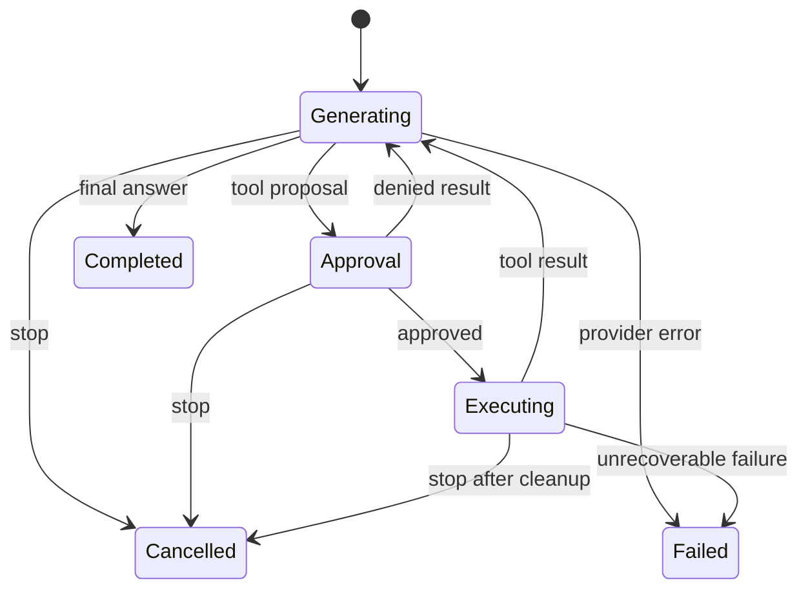

# 05 — Engineering the Hermes-style agent runtime

[Previous](04-auth-payments-and-entitlements.md) · [Course index](../README.md) · [Next](06-testing-dx-performance-and-reliability.md)

**Planned workload: 180 hours.** Agent model and protocol experiments 20; deterministic runtime and streaming UI 30; tools, approval and cancellation 35; provider and local-runtime adapters 25; persistence, memory and skills 25; previews, voice and integrations 20; adversarial recovery and documentation 25.

## 1. Define “clone” as observable behavior

The capstone is an original implementation inspired by a real product. The official [Hermes Desktop guide](https://hermes-agent.nousresearch.com/docs/user-guide/desktop) describes a desktop surface over a shared agent, with conversations, tools, settings and shared state. The [desktop README](https://github.com/NousResearch/hermes-agent/blob/main/apps/desktop/README.md) also provides a feature reference for streaming activity, previews, workspace browsing and voice. Atlas Desk translates those product ideas into its own architecture and branding.

Do not start by duplicating every button. Start with a vertical slice: submit a prompt, stream an answer, propose one file operation, request approval, execute within the selected workspace and save the result. A vertical slice tests the whole authority chain. A beautiful static screen tests almost none of it.

There are two legitimate runtime routes. You can build your own agent loop behind a stable adapter, or connect to a pinned existing Hermes runtime through a verified interface. Do not invent a `hermes --json` command or undocumented gateway API to make a diagram look runnable. The reference code in this package implements a deterministic simulation; real Hermes integration is a learner implementation task grounded in the pinned project's actual source and documentation.

If you reuse upstream code, review its license and retain required notices. The repository's [license](https://github.com/NousResearch/hermes-agent/blob/main/LICENSE) was MIT at the research snapshot. Check each separately distributed asset, model and dependency independently; a repository license does not automatically cover everything downloaded by the application.

## 2. An agent is an orchestrated loop

A language model generates text or structured tool requests. The application decides what those requests mean, whether they are allowed and how results return to the model. The model is not the security boundary and does not own the operating system. Tool execution is an application policy decision.

The simplest loop is: assemble context, request model output, validate any tool proposal, obtain required approval, execute a bounded tool, append its result and continue until completion or a limit. Limits include turns, tokens, time, money, output bytes and tool invocations. An agent without limits is an unattended resource consumption mechanism.

Use a state machine so lifecycle is explicit. A run can be starting, generating, waiting for approval, executing a tool, cancelling or terminal. Terminal states include completed, cancelled, failed and interrupted. A transition should record a reason and a run identifier. Do not infer completion from the absence of a spinner or from a network socket closing.



This diagram is deliberately a conceptual subset. A production implementation also records startup, recovery and intermediate cancellation behavior. Keep one authoritative run service so the UI, tray menu and background scheduler cannot each make contradictory state transitions.

## 3. Separate provider, orchestrator and tool executor

A provider adapter translates your internal request into a model vendor's API and normalizes output events. The orchestrator applies the agent loop. A tool executor performs bounded operations under policy. Keeping these separate makes provider changes and deterministic tests practical.

This is an **integration contract**, not a vendor SDK API:

```ts
export type ModelEvent =
  | { kind: 'text'; text: string }
  | { kind: 'tool'; id: string; name: string; arguments: unknown }
  | { kind: 'usage'; inputTokens: number; outputTokens: number }
  | { kind: 'finish'; reason: 'stop' | 'length' | 'tool' };

export interface ModelAdapter {
  generate(request: {
    messages: readonly unknown[];
    signal: AbortSignal;
    maxOutputTokens: number;
  }): AsyncIterable<ModelEvent>;
}

export interface ToolExecutor {
  execute(input: {
    runId: string;
    proposalId: string;
    tool: string;
    arguments: unknown;
    signal: AbortSignal;
  }): Promise<{ text: string; truncated: boolean }>;
}
```

The `AsyncIterable` yields a sequence over time. A `for await` loop can consume it without assuming that all output already exists. The abort signal travels through the whole stack. The output cap is part of the request, but the orchestrator should also enforce limits if an adapter misbehaves.

Provider adapters need contract tests for text-only output, tool output, partial tool arguments, rate limits, cancellation and malformed responses. Use provider documentation for exact SDK calls and structured-output behavior at implementation time. The course deliberately does not claim every vendor's tool-call semantics are interchangeable.

## 4. Streaming protocols and framing

A stream is a sequence of bytes, not a sequence of complete JSON objects. Network or process chunks can split a Unicode character or a JSON line. A parser needs incremental decoding and buffering. If using newline-delimited JSON, append decoded text, extract complete lines and retain the unfinished suffix for the next chunk.

A complete **Node experiment** follows. Save it as `lines.mjs`; it prints two decoded objects. It illustrates framing only, not a production schema decoder.

```js
async function* jsonLines(chunks, maxChars = 10000) {
  const decoder = new TextDecoder('utf-8', { fatal: true });
  let pending = '';
  for await (const chunk of chunks) {
    pending += decoder.decode(chunk, { stream: true });
    let boundary;
    while ((boundary = pending.indexOf('\n')) >= 0) {
      const line = pending.slice(0, boundary).replace(/\r$/, '');
      pending = pending.slice(boundary + 1);
      if (line.length > maxChars) throw new Error('LINE_TOO_LARGE');
      if (line.trim()) yield JSON.parse(line);
    }
    if (pending.length > maxChars) throw new Error('LINE_TOO_LARGE');
  }
  pending += decoder.decode();
  if (pending.trim()) {
    if (pending.length > maxChars) throw new Error('LINE_TOO_LARGE');
    yield JSON.parse(pending);
  }
}

const bytes = new TextEncoder().encode('{"text":"café"}\n{"done":true}\n');
async function* chunks() {
  for (let offset = 0; offset < bytes.length; offset += 3) {
    yield bytes.slice(offset, offset + 3);
  }
}
for await (const event of jsonLines(chunks())) console.log(event);
```

A real protocol also limits raw bytes, line count, event count and decoded payload shape. Decide whether the final unterminated line is legal. Treat malformed input as a protocol error, close the associated run cleanly and avoid retrying a possibly executed tool blindly. Framing, schema validation and execution policy are three separate layers.

For server-sent events, use the actual SSE framing rules rather than assuming each network chunk begins with `data:`. For a WebSocket, message boundaries help framing but not authorization or size limits. For a child process, reserve stdout for protocol messages and stderr for redacted diagnostics if the runtime contract permits that arrangement.

## 5. Process strategies and supervision

A utility process is useful for Node-capable indexing and orchestration work outside the main event loop. The [utilityProcess API](https://www.electronjs.org/docs/latest/api/utility-process) supplies lifecycle and message support. Keep the main process responsible for window authority and sensitive capability decisions, even when orchestration moves to a worker.

An external Python or other runtime can be bundled, discovered from a trusted installation or connected remotely. Each choice changes installation size, dependency management and update ownership. A bundled runtime needs architecture-specific builds and signing where applicable. A user-installed runtime needs version checks and an understandable missing-runtime flow.

When spawning a known executable, pass an argument array and avoid shell interpolation. Use a controlled working directory and a minimal environment. Do not copy every parent environment variable into a tool process; that can expose cloud credentials unrelated to the job. See Node's [child process documentation](https://nodejs.org/api/child_process.html) for the exact behavior of the chosen runtime version.

A supervisor watches process start, readiness, exit and failure. Define a readiness handshake with a protocol version rather than sleeping for a guessed number of seconds. Use bounded restart attempts with backoff. Restarting a crashed worker must not replay destructive operations unless their idempotency and approval state permit it.

Terminating a process does not universally terminate all its descendants. Plan process-tree cleanup with appropriate platform mechanisms, and test it on Windows, macOS and Linux. Prefer isolating tool runs in a managed sandbox whose lifetime you can control rather than building a cross-platform kill strategy around assumptions from one Unix shell.

## 6. Tool proposals are immutable objects

A proposal should include the run, tool, target scope, arguments, risk category and a human-readable explanation. Freeze or persist the exact proposal before showing approval. The executor consumes that proposal by ID and verifies it has not changed. Approval is a decision about a concrete operation, not a standing invitation to execute whatever arguments the model emits next.

For file edits, show a diff and the target path relative to the workspace. Record the expected file hash or revision. If the file changes between approval and execution, either re-evaluate the patch safely or request new approval. Overwriting a user's concurrent edit is a correctness failure even if the agent's request was benign.

For network tools, show the destination and data categories being sent. A harmless-looking fetch can transmit private content through a query string or POST body. A local tool's output may contain secrets, so decide what is allowed back into model context. Redaction should be deliberate and testable rather than a hopeful instruction in a prompt.

Approval policies can remember bounded choices, such as read-only access to one workspace for one session. Make grants visible and revocable. Keep “approve this action” separate from “trust this tool for this scope.” Any persistent grant needs ownership, expiry and invalidation on account or workspace changes.

## 7. Sandboxing and prompt injection

Prompt injection occurs when untrusted content tries to redirect the agent's behavior. A README might tell the agent to upload credentials or ignore its task. The defense is not merely a stronger system prompt. The application must constrain tools, data access and egress so untrusted instructions cannot create new authority.

Electron's renderer sandbox protects the host from a class of browser-process compromise. It does not sandbox arbitrary shell tools launched by a privileged process. For code execution, consider a container, VM, remote sandbox or platform-specific restricted runner with limited mounts, network and resources. State exactly which boundary your selected solution enforces.

For the capstone baseline, implement safe named tools first: list a granted directory, read a bounded text file, propose a patch and write an approved report. Defer a general shell tool until you can explain its effective permissions and containment. A command allowlist is not sufficient if arguments can trigger script execution or access unrestricted paths.

Never give an agent your personal browser profile by default. If browser automation is a feature, use a dedicated profile, scoped sessions and explicit account connection. Treat cookies as credentials. An imported browser state file needs the same protection as a token store and should not become a convenient attachment sent to the model.

## 8. Memory, skills and retrieval

Conversation history records what happened in a session. Memory records selected facts intended for future sessions. A skill describes a reusable procedure. These have different provenance, expiry and trust. Do not treat an automatically generated memory as a high-priority instruction with permission to modify the host.

Give memory entries a source, creation time, confidence or review state and deletion controls. Let users inspect what the agent retained. Useful memory might be a preferred project test command or chosen workspace; credentials and sensitive incidental content should not be retained casually. A false memory can produce recurring errors, so correction needs a clear workflow.

A skill should be versioned content with declared capabilities and dependencies. Reading a downloaded skill is not permission to run arbitrary installer scripts. Display requested tools and scope before enabling it. A skill update changing permissions should trigger review rather than inherit every previous grant silently.

Retrieval can begin with lexical search over local documents. Add embeddings only when they solve an observed retrieval problem. Store embedding model version and source revision so stale vectors can be rebuilt. Limit retrieved content and include provenance in the interface. A model response citing a filename does not prove it used the current file revision.

## 9. MCP and extension architecture

MCP standardizes connections between model applications and external tools or context services. Use the [current specification](https://modelcontextprotocol.io/specification/latest) and a pinned SDK; protocol details evolve. A tool server is an external integration with its own trust and identity, not a built-in safe capability.

Atlas Desk should store server configuration outside model-visible prompt text. Connect explicitly, validate negotiated capabilities and apply the same approval policy to external tools as local ones. A server describing its tool as “read-only” is not independent evidence that its implementation cannot send data elsewhere.

For local server processes, control executable paths, arguments and environment. For remote servers, use the supported authorization flow and validate the configured destination. Keep credentials scoped per server and account. Never forward your application's general session token to every tool server.

Version your extension contract. Theme contributions can be declarative and low privilege; executable plugins require isolation and capability review. Separate installing an extension, enabling it for a workspace and authorizing a specific operation. This creates useful product controls and simplifies support when a third-party integration fails.

## 10. Voice, previews and richer output

Voice input adds recording permission, cancellation, partial transcription and privacy decisions. Start with push-to-talk, show recording state and let users inspect transcripts before sending. Background wake-word behavior is a separate product with different resource and consent implications. Do not add it as an invisible extension of the microphone button.

Speech output needs queue management and interruption. A user pressing Stop should stop both speech and the underlying run according to the interface's stated behavior. If they start speaking while output plays, decide whether to pause, cancel or continue. Echo cancellation and device selection deserve real-device tests.

Artifact previews need type boundaries. Render text and Markdown in safe components. Display images with size limits. Put HTML or external pages in an unprivileged view. Treat generated code as code to inspect, not automatically execute. An attractive preview is not justification to grant it the chat window's preload.

A terminal view is especially sensitive. A pseudo-terminal gives a process an interactive environment, but terminal escape sequences and output can have surprising effects. Bound output, avoid turning links into automatic commands and distinguish user-typed input from model-proposed input. The baseline course can use a read-only tool log before adding an interactive terminal extension.

## 11. Cost, scheduling and durable jobs

Agent costs arise from model usage, repeated context, embeddings, sandbox time and provider retries. Track usage per run and account with clear units. A rough cost estimate can be displayed before a long operation, but actual billing needs authoritative backend accounting where you pay for hosted resources.

Enforce a budget in the orchestrator and again on the hosted service. A desktop-modified number cannot be your only protection against unlimited requests. Stop cleanly when a budget is reached and preserve useful intermediate output. Explain whether retrying will incur additional cost.

Scheduled work needs a durable job record with timezone, recurrence, next run, identity and approval policy. Sleeping laptops do not execute timers reliably; decide whether a missed run is skipped, runs on wake or is executed by a server. A background agent should not unexpectedly perform a destructive job hours after its original context expired.

A job's creator may sign out or lose entitlement before it runs. Revalidate authority at execution time. Keep read-only summaries, private data access and external writes as distinct job capabilities. Record what executed and why it was allowed so a user can understand later behavior.

## 12. Integrating a real Hermes runtime responsibly

Pin an upstream release or commit and inspect its actual desktop and gateway contracts. Document startup, discovery, authentication, session identity, event framing, cancellation and update ownership. Use the upstream [building notes](https://github.com/NousResearch/hermes-agent/blob/main/apps/desktop/BUILDING.md) as a source for that pinned integration rather than assuming the current main branch remains compatible forever.

Create an adapter that normalizes the verified upstream interface into your internal events. Keep the rest of Atlas Desk independent of upstream transport details. Test the adapter against captured nonsecret fixtures and a real pinned runtime. If the integration lacks a supported operation, expose that limitation rather than scraping a terminal display and presenting it as a reliable structured protocol.

Never mutate an existing user's Hermes configuration or credential files as a shortcut. Offer a separate profile or explicit import flow with backup and ownership rules. Shared state between multiple surfaces can be valuable, but two applications writing undocumented files concurrently can corrupt data or create confusing authority.

If the runtime updates independently, negotiate supported protocol versions and display actionable compatibility errors. If Atlas Desk owns a bundled runtime, update it as a signed verified artifact through a release process. “Download latest and execute it” is not a sufficient maintenance strategy for an application with local tool access.

## 13. Guided vertical slices

Build the deterministic companion first and inspect its tests. The model simulation emits a short response, proposes a known harmless action, waits for approval and completes or cancels. Because the output is deterministic, you can reproduce UI and lifecycle bugs without spending tokens or depending on provider availability.

Replace only the model adapter with a real provider. Preserve the event contract and all approval checks. Add partial argument assembly and malformed-response handling. A real model should not be able to bypass a policy merely because the simulation never produced a dangerous shape.

Add a workspace read tool, then a proposed patch tool. Record the proposal, present a diff, approve by proposal ID and verify the file version before applying. Kill the worker between approval and completion and recover the run. Confirm you do not accidentally apply the same patch twice.

Add optional integrations in order: searchable memory, a reviewed skill, one MCP server, a safe artifact preview and push-to-talk voice. Each should be independently disableable. A failure in voice or a plugin must not destroy access to local conversation history.

## 14. Prompts for coding assistants

Use this prompt with Claude or Codex when implementing a provider adapter: “Read the pinned SDK documentation and our `ModelAdapter` contract. Implement only that adapter. Preserve cancellation, bounds and tool-argument validation. Return exact changed files, documented version assumptions, and tests for malformed and interrupted streams. Do not add new tools or change approval policy.” This is a suggested prompt, not a claim that an assistant or provider was invoked here.

For review: “Inspect our proposal lifecycle from UI to executor. Find any path where an approved proposal can change, another run can reuse its approval, or sign-out leaves an executable grant. Give concrete call paths and add focused regression tests after explaining the invariant.” Requiring concrete paths helps avoid generic security commentary detached from the implementation.

For performance: “Profile the supplied synthetic stream and identify whether time is spent in parsing, IPC, persistence or rendering. Propose the smallest measured improvement and report before/after measurements with the same input. Preserve output and cancellation behavior.” This turns an assistant into an experiment partner rather than a source of unverified optimization claims.

## 15. Completion evidence

The 180-hour block should produce a useful agent workspace, a documented runtime protocol, real or simulated provider evidence clearly labeled, immutable proposals, tested cancellation and recovery, controlled workspace tools, memory controls and a plugin capability model. The capstone contract lists which features are baseline and which are advanced extensions.

Record what a compromised renderer, malicious document, failed provider and crashed tool can each do. Your design should make those outcomes bounded and understandable. The next chapter turns these intended properties into repeatable tests and measurements, because a production-grade label needs behavioral evidence behind it.

## 16. Worked event trace: approval races with cancellation

Consider run R with proposal P. The worker emits P and waits. The user presses Stop while an approval click is already queued in the renderer. If handlers independently set booleans, approval may arrive after cancellation and still execute the tool. Use one serialized decision point that checks the run state and proposal identity atomically.

The intended trace is: `started(R)`, `proposal(R,P)`, `cancelled(R)`. A later `approve(R,P)` returns a stale-or-terminal result. It must not produce `executing(R,P)`. In the alternative ordering, approval wins first, execution begins and cancellation requests the executor to stop. The terminal state then depends on what the operation can guarantee. A completed irreversible external write cannot be described as rolled back merely because cancellation arrived afterward.

For a local patch tool, you may be able to prepare the patch without writing, check cancellation, verify the target revision and commit atomically. For a remote message-sending tool, once the external service accepts the message, cancellation cannot unsend it unless that service supports a real compensating operation. Reflect actual effects in the transcript.

The companion intentionally uses a harmless simulated tool so its cancellation semantics are deterministic. When replacing that tool, preserve the state checks and add executor-specific evidence. A universal Stop button is useful, but its tooltip and status should distinguish “stop requested” from “all effects reversed.”

## 17. A bounded execution result is easier to trust

Tool output can be enormous or contain binary data. Define a result envelope with status, content type, displayed excerpt, truncation marker and an artifact reference for larger retained output. Do not return ten megabytes of terminal output through a single IPC event and let every UI component copy it.

A **result contract fragment** shows the idea:

```ts
type ToolResult = {
  proposalId: string;
  status: 'succeeded' | 'failed' | 'cancelled' | 'uncertain';
  excerpt: string;
  truncated: boolean;
  artifactId?: string;
  effect: 'none' | 'local-write' | 'external-write';
};
```

The `uncertain` state matters when a process or connection fails after an operation may have committed. The `effect` field supports honest UI explanations and recovery. These values must come from the executor's actual observation, not a model's generated claim about what probably happened.

A summary sent back to the model can differ from a full user-visible artifact. The model may need only an error category and a bounded excerpt. The user may need the complete log for review. Keep those channels separate so context limits and privacy policy can be enforced intentionally.

## 18. Local model deployment is another runtime product

A local-model option needs a supported runtime, model format, download manifest, license record and hardware guidance. Check disk space before download and verify the received artifact. Support interruption and resume through the actual download mechanism. Avoid placing model files inside a signed app bundle after installation; keep mutable resources in an appropriate separate location.

Inspect capability support rather than assuming a model that generates text can reliably use every tool schema. Some runtimes expose structured tool calls, others need a different adapter, and some models are unsuitable for unattended tool orchestration. Offer a text-only mode when tool reliability is insufficient. A local fallback should reduce capability transparently rather than silently reinterpret malformed output as a shell command.

Memory pressure can affect the UI and the model runtime together. Show a useful error when a model cannot load, preserve the conversation and offer a smaller supported model or remote provider. Never treat a failed local model startup as permission to upload the same private context to a remote provider without the user's chosen policy.
