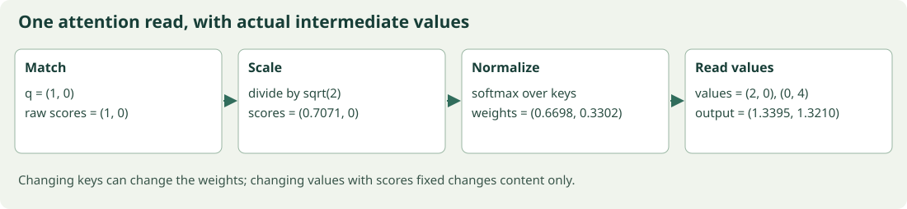
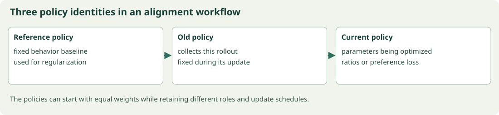
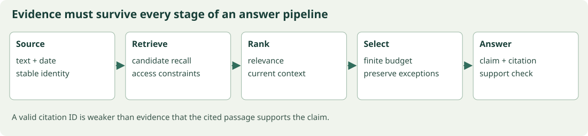

# From Numbers to Language Models

A patient mathematical and computational journey through attention, transformers, alignment, retrieval, and intelligent systems

<a id="preface"></a>
## Preface

This book is for a programmer who wants to understand modern language models well enough to reconstruct the important calculations and write their own code. You do not need previous transformer or reinforcement-learning knowledge. Familiarity with variables, functions, loops, and running a Python script is helpful; the first chapters rebuild the mathematical vocabulary used later.

We begin with quantities you can inspect. A token ID selects a row. A matrix forms a new measurement. A derivative follows a change. A probability describes a choice. Attention combines those ideas into a learned read operation. From there, a complete small transformer becomes a sequence of understandable steps rather than a diagram to memorize.

The pace is deliberately cumulative. New symbols are tied to a problem and a numerical example. Definitions, algebraic identities, conditional theorems, empirical measurements, and illustrative approximations are distinguished. When an analogy stops matching the mathematics, the text says where it stops. Optional projects provide practice and worked solutions without blocking the reading path.

## What changed from the curriculum

The source was a 54-lesson course. This edition reorganizes it into 18 connected main chapters and four reference appendices. It preserves the substantive examples, replaces repeated standalone calculus scaffolding with locally relevant reasoning, introduces the missing transitions, and pairs each main chapter with an interactive experiment. The [coverage map](COVERAGE.md) accounts for every original lesson.

This is a textbook about the foundations and major mechanisms across the supplied topics. It is not a claim to reproduce every historical model or frontier result mentioned by the original primers. The chapters distinguish working local implementations from extensions requiring larger data, trained models, specialized hardware, or separate empirical investigation.

## Read with two companions

The [browser laboratory](companion/index.html) has 18 local experiments with visible controls, actual numerical results, resets, and readable source. They are small on purpose. A browser experiment may train a conditional table while the Python companion trains a transformer; that distinction is displayed rather than hidden.

The Python examples include an explicit reverse-mode autodiff engine, a complete causal transformer, supervised training, response masking, LoRA and quantization calculations, and complete small PPO and DPO training experiments. Source files are included in the package. The main code listings in the book are complete runnable programs; integration extensions are labeled as such.

## Setup before the first example

The source edition was checked with Python 3.12.14, NumPy 2.3.5, and CPU execution. Use a Python version compatible with the pinned NumPy release. From the extracted package root:

```bash
python -m venv .venv
```

On macOS/Linux, activate with `source .venv/bin/activate`. On Windows PowerShell, activate with `.venv\Scripts\Activate.ps1`. Then install the Python dependency:

```bash
python -m pip install -r requirements.txt
python examples/12_scaled_dot_product_attention.py
python examples/20_train_gpt.py
python examples/sequence_alignment.py
```

Installation needs access to the package source used by your computer. The included examples run locally afterward without model downloads or API keys. Optional symbolic audits additionally require the pinned authoring requirements.

The browser companion uses no JavaScript packages. With Node.js 22 or newer, run:

```bash
node companion/server.mjs
```

Open the displayed localhost address. The same server exposes the fully typeset offline [HTML reader](book.html). Opening the laboratory directly as a local file may prevent module and catalog loading; use the server so the execution environment matches the instructions. Node 24.22.1 was used for the checked build.

## Notation and how to slow down productively

We use row vectors for token features, so linear maps multiply on the right. Arrays commonly have batch, token, and feature axes in that order. Logarithms are natural. `@` is matrix multiplication and `*` is elementwise multiplication in the Python examples. A mask value of `True` means allowed in this implementation. Other libraries can use another convention.

When an equation is unfamiliar, name each input, write its shape or domain, expand one coordinate, and evaluate a tiny instance. Then compare the calculation with its implementation. If a result differs, inspect the reduction, sign, target, or visibility rule before adding more complexity. This habit transfers from attention to policy gradients, retrieval, and physical feedback.

The main chapters can be read in order. Within the continuous volume, each chapter has its own linked section list and a route back to the contents. The appendices contain notation, implementation guidance, optional projects with solutions, and references. Verification results and limits are recorded separately in [verification.md](verification.md).

<a id="contents"></a>
## Contents

- [Chapter 1: Giving numbers a meaning: tensors, coordinates, and learned maps](#chapter-01)
- [Chapter 2: Following a change backward: calculus, computation graphs, and learning](#chapter-02)
- [Chapter 3: Predicting uncertainty: probability, information, and language likelihood](#chapter-03)
- [Chapter 4: From text to representations: tokenization, embeddings, and sequence memory](#chapter-04)
- [Chapter 5: Attention from the first weighted read to the full backward pass](#chapter-05)
- [Chapter 6: Building a transformer block: visibility, heads, position, and residual paths](#chapter-06)
- [Chapter 7: A language model you can train: objectives, the decoder, and a complete run](#chapter-07)
- [Chapter 8: Making training and inference practical: data, memory, caches, and context](#chapter-08)
- [Chapter 9: Adapting a model while measuring what changes](#chapter-09)
- [Chapter 10: Allocating capacity: mixtures of experts and knowledge distillation](#chapter-10)
- [Chapter 11: Learning to act: bandits, Markov decisions, and Bellman reasoning](#chapter-11)
- [Chapter 12: Optimizing a policy: likelihood ratios, critics, GAE, and PPO](#chapter-12)
- [Chapter 13: Aligning responses: reward models, DPO, and verifiable feedback](#chapter-13)
- [Chapter 14: Supplying the right information: prompts, context, embeddings, and RAG](#chapter-14)
- [Chapter 15: Reliable iteration: tools, agent graphs, and improvement loops](#chapter-15)
- [Chapter 16: Measuring what matters: judges, uncertainty, and reproducible research](#chapter-16)
- [Chapter 17: Beyond text: visual representations, cross-modal generation, and recurrent depth](#chapter-17)
- [Chapter 18: Closing the loop: physical actions, generative policies, and a final synthesis](#chapter-18)
- [Appendix A: Notation and conventions](#appendix-notation)
- [Appendix B: Reconstructing autodiff and the decoder](#appendix-implementation)
- [Appendix C: Optional synthesis projects with solutions](#appendix-projects)
- [Appendix D: References and provenance](#appendix-references)
- [Complete numerical and alignment source](#source-appendix)

# I. Mathematical language

Begin with quantities and operations whose behavior can be checked by hand. The first three chapters establish coordinates, derivatives, and probabilities. Together they let us say what a model computes, how a parameter change affects it, and what a prediction means. Keep a small array and a single scalar objective in view before generalizing to many tokens or parameters.


<a id="chapter-01"></a>
## Chapter 1: Giving numbers a meaning: tensors, coordinates, and learned maps

### In this chapter

- [A sentence does not enter the computer as meaning](#chapter-01-section-1)
- [Build one array before naming all the dimensions](#chapter-01-section-2)
- [Tensors, Python, and the meaning of a shape](#chapter-01-section-3)
- [Read the first program patiently](#chapter-01-section-9)
- [Why a linear map is more than a lookup table](#chapter-01-section-11)
- [Distinguish storage order from the relationship you intend](#chapter-01-section-12)
- [Linear algebra for representations and projections](#chapter-01-section-13)
- [From a distance calculation to representation design](#chapter-01-section-19)
- [Inspect rank through a concrete bottleneck](#chapter-01-section-20)
- [Use the companion as a coordinate microscope](#chapter-01-section-22)


<a id="chapter-01-section-1"></a>
### A sentence does not enter the computer as meaning

Imagine teaching a small model to continue the sequence `red cat sleeps`. Before the model can learn anything, the program needs a representation of that input. We could assign the three words integer IDs, perhaps 2, 7, and 4. Those integers are labels. Seven is not more feline than two, and the difference between IDs seven and four does not measure a semantic distance. The IDs tell the program which rows of a table to retrieve.

That first distinction will protect us from a surprising number of later mistakes. An ID identifies an item. A feature vector describes an item using a collection of numbers. An axis of an array says which kind of thing changes as we move along it. We will keep these three meanings separate even when the program stores all of them as numbers.

Suppose the row for `cat` contains four learned features: $(0.2,-0.1,0.6,0.4)$. We do not yet know what those features mean, and we should not name the first coordinate 'animalness' merely because that sounds plausible. Training will adjust the coordinates to help the task. At this point our job is more modest: know where the numbers are, what operations are allowed, and which numbers one operation combines.

<a id="chapter-01-section-2"></a>
### Build one array before naming all the dimensions

Write the three feature rows underneath one another. This gives a three-row, four-column matrix. Each row corresponds to a token position, so reading across one row changes the feature while keeping the token fixed. Reading down a column changes the token while keeping the feature coordinate fixed. The array has shape `(3,4)`. If we process two sentences together, introduce a batch axis and obtain shape `(2,3,4)`.

A batch is an organizational device that lets the same operation process several examples. It does not mean the sentences should exchange information. When we later say an operation preserves the batch axis, we mean that one example's output can be computed without reading another example's values. We will test that property as well as checking dimensions.

Our convention is to write token features as rows. A learned linear map therefore multiplies them on the right. Some books use column vectors and multiply on the left. Neither convention is intrinsically better; mixing them halfway through a calculation is the problem. Whenever you translate a paper, write down one small input and output shape before transposing anything.

<a id="chapter-01-section-3"></a>
### Tensors, Python, and the meaning of a shape

<a id="chapter-01-section-4"></a>
#### Why arrays come before architectures

A language model does arithmetic on arrays. A token ID such as 7 is an integer address, not a measure of how meaningful a word is. Looking up row 7 in a learned table produces a vector of measurements. Processing a batch produces an array whose axes describe different kinds of variation. If these meanings are unclear, a program can run successfully while mixing unrelated examples.

Start with a sentence represented by three tokens and four features per token. Its shape is `(3, 4)`. Two such sentences have shape `(2, 3, 4)`. We write this as $(B,T,D)$: batch, token position, feature. A scalar has shape `()`, a vector has one axis, and a matrix has two. Tensor here means a multidimensional numerical array; this programming usage does not require differential geometry.

<a id="chapter-01-section-5"></a>
#### Trace a projection without hiding an index

Let $X\in\mathbb R^{B\times T\times D}$ and $W\in\mathbb R^{D\times F}$. Define $Y=XW$. The batch and time axes survive; the feature axis is contracted:

$$Y_{btf}=\sum_{d=0}^{D-1}X_{btd}W_{df}.$$

For a row $(1,2)$ and a column $(3,4)^\top$, the output is $1\cdot3+2\cdot4=11$. Multiplication forms two contributions; summation combines them into one feature. The output shape is $(B,T,F)$, because every batch-position pair obtains $F$ new measurements.

A bias $b\in\mathbb R^F$ is added as $Y_{btf}+b_f$. Broadcasting treats missing leading axes as size one and permits matching axes when sizes agree or one is one. It does not infer your intentions. Adding a `(T,)` vector to a `(B,T,D)` array generally targets the final axis and is wrong for a per-position offset. Write `(1,T,1)` explicitly.

<a id="chapter-01-section-6"></a>
#### Reshaping is different from moving an axis

Reshape preserves flattened element order. Transpose changes which index corresponds to which original axis. To introduce heads, reshape `(B,T,H*d)` to `(B,T,H,d)`, then transpose to `(B,H,T,d)`. Directly reshaping to `(B,H,T,d)` assigns elements to different token-head pairs. Equal numbers of elements do not establish semantic equivalence.

Integer arrays normally index token IDs. Floating arrays represent activations and weights. Boolean arrays represent allowed connections. Keep those roles separate. A mask value of `True` means allowed throughout this course; some APIs use the opposite convention.

<a id="chapter-01-section-7"></a>
#### Read the experiment

The loop independently computes the matrix contraction, so agreement with `@` checks the index equation. The next assertion checks the inverse transpose. It does not establish that a future model's axes are correct; that requires carrying their meanings through each operation. A useful debugging practice is to write the intended shape above every contraction before running it.

Optional application: project `(2,5,3)` inputs to seven features, then add a per-token offset. A correct result has shape `(2,5,7)`, and changing one input sentence must leave the other sentence unchanged. This independence is a stronger check than a shape assertion alone.

<a id="chapter-01-section-8"></a>
##### Worked shape audit: one projection and its reverse

Take $B=2,T=3,D=4,F=6$. The input has 24 numbers, the weight has 24 parameters, and the output has 36 numbers. Output entry $Y_{1,2,5}$ is the sum of four products $X_{1,2,d}W_{d,5}$. It uses one input token and one output-feature column; it does not mix batches or token positions. If a scalar loss supplies upstream $G$ of shape $(2,3,6)$, weight gradient entry $(d,f)$ sums $X_{btd}G_{btf}$ over all six batch-position pairs. Thus the shared weight aggregates evidence across positions while the forward projection remains positionwise. This distinction is the first example of parameter sharing versus information mixing.


<a id="chapter-01-section-9"></a>
### Read the first program patiently

In Python, `import numpy as np` gives the numerical library the short name `np`. A tuple such as `(2,3,4)` specifies sizes, while square brackets index into an existing array. Indexing begins at zero, so the first batch has index zero and the fourth feature has index three. The nested loops in the program are intentionally slower and more explicit than the matrix expression. They establish an independent reference for what the compact operation means.

A random generator with a fixed seed gives repeatable demonstration values. Random numbers here are inputs for a calculation, not the result of training. Repeating the program with another seed should preserve the equalities being checked, even though the numerical outputs change. The meaningful claim is the relationship between the two computations.


<a id="chapter-01-section-10"></a>
#### Executable calculation

Run `python examples/01_tensors_shapes.py` from the package root. Complete source is also included as [01_tensors_shapes.py](examples/01_tensors_shapes.py).

```python
import numpy as np
rng = np.random.default_rng(0)
inputs = rng.normal(size=(2, 3, 4))
weight = rng.normal(size=(4, 6))
output = inputs @ weight
manual = np.zeros((2, 3, 6))
for batch in range(2):
    for token in range(3):
        for feature in range(6):
            for channel in range(4):
                manual[batch, token, feature] += inputs[batch, token, channel] * weight[channel, feature]
assert np.allclose(output, manual)
heads = output.reshape(2, 3, 2, 3).transpose(0, 2, 1, 3)
restored = heads.transpose(0, 2, 1, 3).reshape(2, 3, 6)
assert np.allclose(restored, output)
print('projected', output.shape, 'heads', heads.shape)
```

Recorded output on the checked Python/NumPy environment:

```text
projected (2, 3, 6) heads (2, 2, 3, 3)
```


For one selected output, stop the loops mentally at fixed batch, token, and output-feature indices. Only the innermost channel index changes. Multiply each input channel by the corresponding entry in the weight column, then add. Advancing the output-feature index chooses another weight column. Advancing the token index chooses another input row. Nothing in that calculation mixes the two sentences.

<a id="chapter-01-section-11"></a>
### Why a linear map is more than a lookup table

A lookup table retrieves one existing row. A linear map forms new measurements by combining coordinates. If an output feature uses weight column $(1,-1,0,0)^\top$, it measures the difference between the first two input features. If another column is $(0,0,1,1)^\top$, it measures their last-two-coordinate sum. A learned matrix selects useful combinations through training instead of requiring us to choose every measurement manually.

Linearity means two precise properties: the map of a sum equals the sum of the mapped vectors, and scaling an input scales its output by the same amount. These properties let us reason about individual directions. They also impose limits. A purely linear classifier cannot make arbitrary curved decision boundaries in the original feature space; nonlinear transformations will become necessary.

<a id="chapter-01-section-12"></a>
### Distinguish storage order from the relationship you intend

An array's shape is a contract about indexing. It is not proof that the program assigned the correct meaning to an index. Suppose two token rows are `(1,2)` and `(10,20)`. Flattening gives `(1,2,10,20)`. Reshaping to two rows of two preserves them; interpreting the same flattened sequence as two heads with different grouping can create the pairs `(1,2)` and `(10,20)` for a different semantic purpose. The numbers alone do not tell the program which interpretation is intended.

A reliable design writes the intended index equation first. For a projection, output at batch b and token t uses only input at that same b and t. For attention, output at a query position deliberately sums over key positions. For an embedding, the token ID selects a row without arithmetic on the ID's magnitude. These are three different uses of indices that can all appear in one short model.

When testing, choose values that expose a wrong interpretation. Distinct rows such as one and ten make an accidental swap visible. All-zero inputs or identical rows can hide it. Unequal dimensions also help: an incorrect transpose often fails immediately when query count, key count, and value width differ. This is why our later numerical examples avoid making every dimension equal merely for convenience.

<a id="chapter-01-section-13"></a>
### Linear algebra for representations and projections

<a id="chapter-01-section-14"></a>
#### Features as coordinates

A vector is a list of coordinates relative to a chosen basis. In an embedding, a coordinate is not automatically a human concept. A learned change of basis can redistribute information while preserving the useful relationships. Two models may solve the same task with different internal coordinates.

For $u,v\in\mathbb R^D$, the dot product is $u^\top v=\sum_i u_iv_i$. Its geometric expression is $\|u\|\|v\|\cos\theta$. Thus a large dot product can indicate alignment, large norms, or both. Cosine similarity divides out the norms and is undefined when either vector is zero. Never silently divide by zero or assume that magnitude is irrelevant to a trained retrieval model.

For $u=(1,2)$ and $v=(2,0)$, the dot product is two, norms are $\sqrt5$ and two, and cosine is $1/\sqrt5$. Doubling $v$ doubles the dot product but leaves the cosine unchanged. This difference later explains why normalized embeddings and unnormalized attention scores behave differently.

<a id="chapter-01-section-15"></a>
#### Matrix multiplication as composition

Using row vectors, let $x\in\mathbb R^{1\times D}$, $A\in\mathbb R^{D\times R}$, and $B\in\mathbb R^{R\times F}$. Then $(xA)B=x(AB)$. Expand the left side at output coordinate $j$:

$$\sum_{r=1}^R\left(\sum_{i=1}^Dx_iA_{ir}\right)B_{rj}
=\sum_{i=1}^Dx_i\left(\sum_{r=1}^RA_{ir}B_{rj}\right).$$

Interchanging two finite sums justifies associativity. The intermediate width $R$ limits the rank of $AB$ to at most $R$. It is the number of independent intermediate directions, not simply the number of nonzero entries. This will become the mathematical foundation of LoRA.

<a id="chapter-01-section-16"></a>
#### Rank, singular values, and approximation

Every real matrix has a singular value decomposition $W=U\Sigma V^\top$. Orthogonal factors rotate or reflect; nonnegative singular values stretch independent directions. Keeping the largest $r$ singular values gives a best rank-at-most-$r$ approximation in Frobenius norm. The squared error is the sum of squares of discarded singular values. This statement concerns approximating a fixed matrix under that norm; it does not prove that rank-$r$ fine-tuning is optimal for a language task.

The experiment deliberately constructs a rank-two update. Numerical rank depends on a tolerance because floating-point values rarely satisfy exact algebraic identities. We then truncate a separate random matrix and compare measured error with the discarded singular-value energy.

<a id="chapter-01-section-17"></a>
#### When the analogy breaks

A neural layer with a nonlinear activation is not just one global linear projection. Composition of linear layers collapses into a single matrix, whereas composition separated by nonlinearities generally does not. Likewise, adding a rank-two update to a full-rank base matrix usually leaves the combined matrix full rank. It is the update that is constrained.

Optional worked task: if singular values are $(5,2,1)$, rank-one error is $\sqrt{2^2+1^2}=\sqrt5$. Keeping rank two reduces error to one. These are absolute errors; relative error divides by $\sqrt{30}$.

<a id="chapter-01-section-18"></a>
##### Worked projection and a counterexample

Project $v=(3,4)$ onto unit direction $u=(1,0)$. The scalar coefficient is $u^\top v=3$, so the projected vector is $(3,0)$ and residual is $(0,4)$. Their dot product is zero, and squared lengths satisfy $25=9+16$. This Pythagorean identity depends on orthogonality. A learned matrix need not be an orthogonal projection: multiplying by $\operatorname{diag}(2,1)$ stretches the first coordinate rather than projecting onto a subspace. Calling every neural matrix a 'projection' is common terminology, but it does not grant idempotence $P^2=P$ or orthogonality. Keep the mathematical property distinct from the programming name.


<a id="chapter-01-section-19"></a>
### From a distance calculation to representation design

Consider two vectors $(1,0)$ and $(2,0)$. Their cosine similarity is one because they point in the same direction. Their Euclidean distance is one because their lengths differ. Both descriptions are correct. If magnitude expresses useful confidence or frequency information, removing it can discard a signal. If magnitude is an unwanted artifact, normalization may help. The representation objective and evaluation task decide which comparison is appropriate.

A basis is a set of independent coordinate directions that can express the vectors under discussion. Rotating the basis changes the coordinates without necessarily changing relationships such as angles and distances. A general learned matrix need not preserve either of those relationships. It can stretch some directions, suppress others, and change dimension. That is why calling a neural weight matrix a projection should not make us assume it is an orthogonal geometric projection.

<a id="chapter-01-section-20"></a>
### Inspect rank through a concrete bottleneck

Take a map from four features to two intermediate features and then to six outputs. Every final output is formed through only two intermediate measurements. The combined matrix has rank at most two, even though it contains 24 entries. A large number of entries is not the same as a large number of independent directions. Later, LoRA will use exactly this distinction to learn a restricted weight update cheaply.

The singular-value experiment makes that restriction measurable. Its first assertion checks a rank bound; its second checks the error of a truncated approximation. These are algebraic properties of the constructed matrices. They do not tell us that a low-rank update will solve a particular language task. Keeping the mathematical statement narrower than its application is part of understanding it.


<a id="chapter-01-section-21"></a>
#### Executable calculation

Run `python examples/02_linear_algebra.py` from the package root. Complete source is also included as [02_linear_algebra.py](examples/02_linear_algebra.py).

```python
import numpy as np
rng = np.random.default_rng(1)
a = rng.normal(size=(5, 2))
b = rng.normal(size=(2, 4))
update = a @ b
assert np.linalg.matrix_rank(update) <= 2
weight = rng.normal(size=(5, 4))
u, singular, vt = np.linalg.svd(weight, full_matrices=False)
approximation = (u[:, :2] * singular[:2]) @ vt[:2]
error = np.linalg.norm(weight - approximation)
assert np.allclose(error ** 2, np.sum(singular[2:] ** 2))
print('rank', np.linalg.matrix_rank(update), 'error', round(error, 6))
```

Recorded output on the checked Python/NumPy environment:

```text
rank 2 error 1.006401
```


<a id="chapter-01-section-22"></a>
### Use the companion as a coordinate microscope

Open the companion and choose **Coordinates and projections**. Change one input coordinate while leaving the others fixed. The output changes by that coordinate change multiplied by the corresponding weight row. Changing two coordinates produces the sum of their separate effects; that is linearity made visible. Reset returns the original input and matrix, making comparisons reproducible.

If an output differs from your hand calculation, first check the row/column convention. Next check whether you used matrix multiplication or elementwise multiplication. Finally inspect the reduction index: a projection sums over input features, not over examples. These checks explain most early shape mistakes more directly than repeatedly reshaping arrays until an error disappears.

We now have a language for values and the maps between them. A model learns those maps by changing their parameters. To understand learning, we need to make one further relationship precise: how a small parameter change affects a final error.

[Back to contents](#contents)

---


<a id="chapter-02"></a>
## Chapter 2: Following a change backward: calculus, computation graphs, and learning

### In this chapter

- [Begin with a measurement that can be wrong](#chapter-02-section-1)
- [Derivatives, Jacobians, and the chain rule](#chapter-02-section-2)
- [Work one complete chain with numbers](#chapter-02-section-7)
- [A graph records dependencies, not a new kind of calculus](#chapter-02-section-9)
- [Understand accumulation before implementing an optimizer](#chapter-02-section-10)
- [Derive a nonlinear activation rather than treating it as a named box](#chapter-02-section-11)
- [Keep parameter updates separate from derivatives](#chapter-02-section-12)
- [Neural networks, backpropagation, and optimization](#chapter-02-section-13)
- [Derive a matrix gradient without memorizing its shape](#chapter-02-section-19)
- [Check a derivative independently](#chapter-02-section-21)
- [Read the full implementation in layers](#chapter-02-section-22)
- [What happens at a nonsmooth point](#chapter-02-section-23)


<a id="chapter-02-section-1"></a>
### Begin with a measurement that can be wrong

Suppose a model predicts a number $v$ and the desired answer is $y$. We need a scalar that becomes small when the prediction is close. One convenient choice is half the squared error, $L=(v-y)^2/2$. The square removes the sign and emphasizes larger deviations. The factor one half makes its derivative cleaner; it does not change where the minimum lies.

Take $y=1$ and $v=0.4$. Error is $-0.6$, squared error is 0.36, and the loss is 0.18. If the prediction rises slightly, the error becomes less negative and the loss falls. A derivative gives this directional statement a numerical scale. It tells us how much loss change to expect per small unit change in the prediction.

The word small is essential. A derivative describes a local relationship. It is not a promise that moving a parameter an arbitrary distance in that direction keeps improving the objective. We will repeatedly compare local predictions with actual changes, because this distinction explains learning-rate instability.

<a id="chapter-02-section-2"></a>
### Derivatives, Jacobians, and the chain rule

<a id="chapter-02-section-3"></a>
#### What a gradient actually predicts

Training needs a local answer: how does the loss change when a parameter moves slightly? For differentiable $f$, the derivative is the limit $f'(a)=\lim_{h\to0}[f(a+h)-f(a)]/h$. The limit matters: a finite difference estimates a derivative; it is not its definition or an exact replacement.

For $f(x)=x^2$, expand $(a+h)^2-a^2=2ah+h^2$. Divide by $h\ne0$ to obtain $2a+h$, then take the limit to obtain $2a$. We have used the distributive law and the fact that $h\to0$. No memorized power rule was required.

A scalar function $L(\theta)$ of many parameters has gradient whose $i$th component is $\partial L/\partial\theta_i$. Its first-order approximation is $L(\theta+\Delta)\approx L(\theta)+\nabla L^\top\Delta$. Choosing $\Delta=-\eta\nabla L$ gives predicted change $-\eta\|\nabla L\|^2$, negative for nonzero gradient and positive step size. The approximation can fail for a large step.

<a id="chapter-02-section-4"></a>
#### Derive a small network

Let $u=wx+b$, $v=\tanh u$, and $L=(v-y)^2/2$. Hold data $x,y$ fixed. The outer derivative is $\partial L/\partial v=v-y$. The activation derivative is $\partial v/\partial u=1-v^2$. The affine derivatives are $\partial u/\partial w=x$ and $\partial u/\partial b=1$. Therefore

$$\frac{\partial L}{\partial w}=(v-y)(1-v^2)x,\qquad
\frac{\partial L}{\partial b}=(v-y)(1-v^2).$$

Every factor describes one edge of the computation. A gradient multiplies along a path and adds across different paths. If $w$ is used twice, both uses contribute. Forgetting one path is a common error in tied embeddings and recurrent models.

<a id="chapter-02-section-5"></a>
#### Jacobians and reverse mode

For $f:\mathbb R^n\to\mathbb R^m$, $J_{ij}=\partial f_i/\partial x_j$. Given upstream scalar-loss derivatives $g\in\mathbb R^m$, reverse mode computes $J^\top g\in\mathbb R^n$. It avoids constructing a huge Jacobian explicitly. Backpropagation is the chain rule organized around this vector-Jacobian product.

At an absolute-value cusp, no unique classical derivative exists. At a clipping boundary, a numerical derivative may average two slopes. Check smooth points first. With floating-point subtraction, tiny $h$ can lose significant digits; huge $h$ measures nonlocal curvature. The central difference has truncation error of order $h^2$ for sufficiently smooth functions, but roundoff eventually dominates.

The experiment compares an analytical network derivative with central differences. Agreement at one point provides useful local evidence, not a proof for every input. A proper implementation check also changes the input, uses multiple coordinates, and checks shared-parameter paths.

<a id="chapter-02-section-6"></a>
##### A shared-parameter derivative you can reconstruct

Let $u=w^2$, $v=3w$, and $L=(u+v)^2/2$. The derivative at the final square is $u+v$. The first path contributes $(u+v)2w$ and the second contributes $(u+v)3$. Add them to obtain $(w^2+3w)(2w+3)$. At $w=1$, this is $4\cdot5=20$. Differentiating only the $w^2$ occurrence would give eight and miss twelve from the second path. This tiny counterexample explains why an autodiff engine accumulates into a shared leaf instead of overwriting its gradient each time a parent operation is visited.


<a id="chapter-02-section-7"></a>
### Work one complete chain with numbers

Use $x=2$, $w=0.3$, $b=-0.1$, and target $y=1$. The affine intermediate is $u=wx+b=0.5$. The activation is $v=\tanh(0.5)\approx0.462117$. Therefore $L\approx(0.462117-1)^2/2\approx0.144659$. Every number belongs to one named stage; this naming is what makes a long chain manageable.

The outer slope is $v-y\approx-0.537883$. The tanh slope is $1-v^2\approx0.786448$. The affine slope with respect to $w$ is $x=2$. Multiply along the path: $\partial L/\partial w\approx-0.846033$. The negative sign says a small increase in this weight decreases the loss. With learning rate 0.01, gradient descent proposes a weight change of about $+0.00846033$.

Notice the sign reversal. Gradient points toward increasing loss. Descent subtracts the gradient. If we later maximize a reward, we either add its gradient or minimize the negative reward. Many reinforcement-learning bugs are ordinary sign mistakes disguised by more elaborate notation.


<a id="chapter-02-section-8"></a>
#### Executable calculation

Run `python examples/03_calculus_chain_rule.py` from the package root. Complete source is also included as [03_calculus_chain_rule.py](examples/03_calculus_chain_rule.py).

```python
import numpy as np
from core import finite_difference
sample, target = 1.4, -0.2
def objective(parameter):
    value = np.tanh(parameter[0] * sample + parameter[1])
    return 0.5 * (value - target) ** 2
parameter = np.array([0.3, -0.1])
value = np.tanh(parameter[0] * sample + parameter[1])
local = (value - target) * (1 - value ** 2)
analytic = np.array([local * sample, local])
numerical = finite_difference(objective, parameter)
assert np.allclose(analytic, numerical, atol=1e-7)
print('analytic', analytic, 'numerical', numerical)
```

Recorded output on the checked Python/NumPy environment:

```text
analytic [0.64497852 0.46069894] numerical [0.64497852 0.46069894]
```


<a id="chapter-02-section-9"></a>
### A graph records dependencies, not a new kind of calculus

Draw one node for $w$, one for $b$, one for $u$, one for $v$, and one for $L$. Edges indicate which values were used to compute another value. During the forward pass, store the intermediate values. During the reverse pass, start at the scalar loss with derivative one and distribute derivatives to parents using each operation's local rule.

For a sum, each input receives the upstream derivative. For a product, each input receives that derivative multiplied by the other input. For tanh, multiply by one minus the squared saved output. When a variable has several outgoing paths, add the contributions that return along them. These are not additional assumptions: they are the chain rule and the derivative of a sum applied systematically.

Reverse mode is especially useful when there are many parameters but one scalar objective. It computes the derivative of that objective with respect to every participating parameter in one backward traversal. It does not construct every output-by-input derivative separately. A full Jacobian is sometimes useful for analysis, but training normally needs its product with an upstream vector.

<a id="chapter-02-section-10"></a>
### Understand accumulation before implementing an optimizer

Let $L=(w+w)^2/2$. The inside sum contains two uses of the same parameter. At $w=1$, the sum is two and the outer derivative is two. Each use returns contribution two, so the total derivative is four. Overwriting the first contribution with the second would incorrectly give two. Visiting the shared leaf twice and propagating its entire accumulated gradient twice would also be wrong. The graph traversal and the accumulation rule solve different bookkeeping problems.

Our engine stores references to the same parameter object wherever it is reused. It visits each graph node once in reverse topological order, while local reverse rules add into parent gradients. This is the pattern that later handles repeated embedding IDs and recurrent transformer weights.

<a id="chapter-02-section-11"></a>
### Derive a nonlinear activation rather than treating it as a named box

The hyperbolic tangent can be written as $\tanh u=(e^u-e^{-u})/(e^u+e^{-u})$. Let numerator be N and denominator be D. Their derivatives are respectively D and N. The quotient rule therefore gives $(D^2-N^2)/D^2=1-(N/D)^2=1-\tanh^2u$. This derivation explains both the formula and its limits. Near zero, tanh is approximately linear and the derivative is near one. Far from zero, the output approaches plus or minus one and the derivative approaches zero.

If a long chain contains many saturated tanh operations, local slope factors can become small. This is one mechanism behind weak gradients in recurrent systems. It is a statement about a product of derivatives, not a claim that every nonlinear network fails. A residual path can provide another route, and different activations and normalization change the numerical behavior.

The squared-error objective also has a useful exact expansion. For $L(v)=(v-y)^2/2$ and change h, $L(v+h)-L(v)=(v-y)h+h^2/2$. The first term is the derivative prediction; the second is the curvature correction. If v is below y, a positive h initially helps, but an excessively large h can overshoot and increase loss. This is a complete local-versus-finite example with no approximation error because the objective is quadratic.

<a id="chapter-02-section-12"></a>
### Keep parameter updates separate from derivatives

A correct gradient describes the current forward function. An optimizer decides how to use it. Plain descent rescales every coordinate by one learning rate. Momentum combines present and previous gradients. Adaptive methods use additional state. Two optimizers can receive the same correct gradient and follow different paths.

For the simple quadratic $L=\lambda w^2/2$, descent multiplies w by $1-\eta\lambda$ at every step. If that factor is between zero and one, convergence is monotone. Between minus one and zero, signs alternate while magnitude shrinks. Outside that magnitude range, errors grow. The companion lets you observe the distinction directly rather than attributing every unstable run to a backward-pass bug.

Finally, a zero gradient needs interpretation. It can mean an optimum, a saturated activation, a missing dependency, or a cancellation among paths. Inspect intermediate values and test a small perturbation. A single numerical symptom does not identify its cause; the computation graph provides the evidence needed to distinguish these cases.

<a id="chapter-02-section-13"></a>
### Neural networks, backpropagation, and optimization

<a id="chapter-02-section-14"></a>
#### Why stack learned transformations

A linear layer maps $x$ to $xW+b$. Two consecutive linear layers can be collapsed into one affine map. A nonlinearity between them changes the class of functions the network can express. Our small networks use $\tanh$, a smooth function with output in $(-1,1)$; production transformers often use GELU or gated SiLU variants instead.

A network is a directed computation graph. Nodes store numerical results; edges describe dependencies. Reverse mode starts with derivative one at a scalar loss and propagates local vector-Jacobian products in reverse topological order. The graph is an accounting device for the chain rule, not an additional learning algorithm.

<a id="chapter-02-section-15"></a>
#### Derive the matrix reverse pass

For $Y=XW$ and upstream gradient $G=\partial L/\partial Y$, expand $Y_{ij}=\sum_kX_{ik}W_{kj}$. Holding $W$ fixed, an input perturbation gives $dY=dXW$. The scalar change is $dL=\sum_{ij}G_{ij}dY_{ij}$. Regroup the finite sums by $dX_{ik}$ to obtain $\partial L/\partial X=GW^\top$. Regroup by $dW_{kj}$ instead to obtain $\partial L/\partial W=X^\top G$.

If a bias is shared over examples, its gradient sums the upstream gradients across the shared axis. Broadcasting in the forward pass becomes summation in the backward pass. If one weight is used in two paths, its gradients add. The supplied `Tensor` class implements both rules explicitly.

<a id="chapter-02-section-16"></a>
#### Optimization is another layer of reasoning

Gradient descent uses $\theta_{k+1}=\theta_k-\eta g_k$. Stochastic gradients estimate a dataset gradient from a minibatch. Momentum maintains a moving average of gradients. Adam also maintains an average of squared gradients and bias-corrects the moving estimates. AdamW applies decoupled weight decay; adding an L2 penalty to Adam's loss is not generally identical.

For scalar quadratic $L=\lambda\theta^2/2$, gradient descent gives $\theta_{k+1}=(1-\eta\lambda)\theta_k$. Convergence requires $|1-\eta\lambda|<1$, or $0<\eta<2/\lambda$ for positive $\lambda$. This is a complete proof for that quadratic, not a universal learning-rate rule for neural networks.

Global gradient clipping replaces $g$ by $g\min(1,c/\|g\|)$. It limits the length of the raw gradient while preserving its direction. It does not fix a wrong loss, corrupted labels, or an exploding activation. Log unclipped norms so clipping does not hide instability.

<a id="chapter-02-section-17"></a>
#### Follow the implementation

`core.py` provides a deliberately small NumPy autodiff engine. Its `backward()` visits every parent before appending a node and traverses the resulting order backward. Fresh graphs are built on each training step, and leaf gradients are reset after updates. The tiny fitting experiment learns a scalar affine relationship. It demonstrates optimization mechanics, not language understanding.

A trustworthy check compares autodiff against finite differences before attempting a large training run. If a training loss stays flat, inspect parameter participation, gradient norms, learning rate, and label alignment in that order.

<a id="chapter-02-section-18"></a>
##### Derive Adam's initial bias correction

If $m_t=\beta m_{t-1}+(1-\beta)g_t$ and $m_0=0$, then $m_t=(1-\beta)\sum_{i=1}^t\beta^{t-i}g_i$. Under a stationary mean gradient $\mathbb E g_i=\mu$, take expectations and sum the geometric series to get $\mathbb E m_t=(1-\beta^t)\mu$. Dividing by $1-\beta^t$ removes this initialization bias under that assumption. It does not remove stochastic noise or make the gradient stationary. Adam applies an analogous correction to its second-moment accumulator, then divides the corrected first moment by the square root of the corrected second moment plus epsilon.


<a id="chapter-02-section-19"></a>
### Derive a matrix gradient without memorizing its shape

For $Y=XW$, write $Y_{ij}=\sum_kX_{ik}W_{kj}$. Suppose the final loss supplies $G_{ij}=\partial L/\partial Y_{ij}$. To find the derivative with respect to $W_{kj}$, identify every output using that entry. Holding $k,j$ fixed, sum over input rows $i$: $\partial L/\partial W_{kj}=\sum_iX_{ik}G_{ij}$. This is entry $(k,j)$ of $X^\top G$.

For input entry $X_{ik}$, sum over output features $j$: $\partial L/\partial X_{ik}=\sum_jG_{ij}W_{kj}$, giving $GW^\top$. The transpose appears because the reverse pass reverses the contraction, not because transposes are a universal way to repair a mismatch.

A broadcast bias has another sharing pattern. The same bias entry affects several rows, so its gradient sums contributions over those rows. Forward broadcasting becomes reverse summation. This principle will also appear in layer normalization, where one mean depends on every feature of a token.


<a id="chapter-02-section-20"></a>
#### Executable calculation

Run `python examples/06_neural_networks_autodiff.py` from the package root. Complete source is also included as [06_neural_networks_autodiff.py](examples/06_neural_networks_autodiff.py).

```python
import numpy as np
from core import Tensor
inputs = Tensor(np.array([[-1.0], [0.0], [1.0], [2.0]]))
target = Tensor(2 * inputs.data + 0.5)
weight, bias = Tensor([[0.0]]), Tensor([0.0])
initial = None
for step in range(100):
    prediction = inputs @ weight + bias
    loss = ((prediction - target) ** 2).mean()
    if initial is None:
        initial = float(loss.data)
    loss.backward()
    for parameter in (weight, bias):
        parameter.data -= 0.1 * parameter.grad
        parameter.grad.fill(0)
    inputs.grad.fill(0)
    target.grad.fill(0)
assert float(loss.data) < initial / 1000
print('initial', initial, 'final', float(loss.data), 'weight', weight.data)
```

Recorded output on the checked Python/NumPy environment:

```text
initial 7.25 final 4.4017965133294734e-14 weight [[1.99999989]]
```


<a id="chapter-02-section-21"></a>
### Check a derivative independently

Central differences evaluate the function at $w+h$ and $w-h$, subtract, and divide by $2h$. They ask the original forward computation a local question without using its backward implementation. At a smooth point and moderate scale, agreement with the analytical derivative is useful evidence. A very small step can lose digits in subtraction; a large step measures curvature instead of a local slope.

The companion's **Gradient microscope** shows the loss, exact derivative, finite-difference estimate, and a proposed update for the one-neuron example. Change the step and watch the derivative estimate stabilize before roundoff becomes important. Change the learning rate separately. A good derivative estimate does not guarantee that a large optimizer step is useful.

<a id="chapter-02-section-22"></a>
### Read the full implementation in layers

The included numerical engine is explained operation by operation in the implementation appendix. Begin with addition and multiplication, then broadcasting, matrix products, reductions, indexing, and smooth functions. You do not need to memorize all the source before using it. You should be able to point to the local rule that corresponds to an equation you derive.

There are deliberate limits: the engine is CPU NumPy, uses ordinary floating-point arrays, and builds a fresh graph for each training step. It has no GPU kernels or automatic device placement. Those conveniences can be added by a framework later. The mathematical responsibilities remain the same: define the objective, preserve dependencies, accumulate derivatives correctly, and update the intended parameters.

<a id="chapter-02-section-23"></a>
### What happens at a nonsmooth point

Our examples use tanh because it has an ordinary derivative everywhere. Another common activation is the rectified linear function, defined as zero for negative input and equal to input for positive input. Its derivative is zero on the negative side and one on the positive side, while no unique classical derivative exists at zero. A framework chooses a documented convention there. A central difference taken exactly across that corner can return an average slope that differs from the chosen backward rule. This is why a gradient test should first use smooth interior points, then test nonsmooth conventions separately instead of treating every mismatch as evidence that calculus failed.

The next chapter changes the kind of prediction. Instead of one desired number, a language model predicts a distribution over possible next tokens. Probability gives us a way to describe that uncertainty, and information theory gives us a loss that rewards useful distributions.

[Back to contents](#contents)

---


<a id="chapter-03"></a>
## Chapter 3: Predicting uncertainty: probability, information, and language likelihood

### In this chapter

- [A model must leave room for more than one continuation](#chapter-03-section-1)
- [Probability, conditioning, and statistical estimation](#chapter-03-section-2)
- [Conditioning is an update to the question being asked](#chapter-03-section-8)
- [Turn arbitrary scores into a normalized choice](#chapter-03-section-10)
- [Entropy, KL divergence, softmax, and cross-entropy](#chapter-03-section-11)
- [Why log loss punishes confident errors](#chapter-03-section-17)
- [Expand a sequence probability one conditional at a time](#chapter-03-section-19)
- [Read a mean log loss as a geometric mean probability](#chapter-03-section-20)
- [Language modeling from counts to autoregression](#chapter-03-section-21)
- [Walk through shifting before trusting training loss](#chapter-03-section-26)
- [Use likelihood without overstating it](#chapter-03-section-28)


<a id="chapter-03-section-1"></a>
### A model must leave room for more than one continuation

After the prefix `the cat`, several next tokens may be plausible. A model that emits only one token hides how uncertain it is. A categorical distribution instead assigns one nonnegative probability to each candidate, with all probabilities adding to one. That distribution is a statement about the model's prediction under the supplied context. It is not automatically a probability that a factual claim is true.

Start with three candidates having probabilities $(0.5,0.3,0.2)$. Sampling chooses the first about half the time over many independent trials. It does not mean every pair of samples contains exactly one first-candidate result. The probability describes a process; a finite realization fluctuates. This difference between an expectation and an observed count will matter when we train reinforcement-learning policies.

<a id="chapter-03-section-2"></a>
### Probability, conditioning, and statistical estimation

<a id="chapter-03-section-3"></a>
#### Uncertainty is represented by a distribution

A categorical variable chooses one label from a finite set. Its probabilities are nonnegative and sum to one. A language model assigns such a distribution to the next token, conditional on a prefix. It does not directly assign a truth value to a sentence.

The joint probability $p(a,b)$ is the probability both events occur. If $p(b)>0$, define $p(a\mid b)=p(a,b)/p(b)$. Multiplying gives $p(a,b)=p(a\mid b)p(b)$. Apply this repeatedly to obtain

$$p(x_1,\ldots,x_T)=\prod_{t=1}^Tp(x_t\mid x_{<t}).$$

This chain rule is exact and does not assume adjacent tokens are independent. A bigram model adds the simplifying assumption $p(x_t\mid x_{<t})=p(x_t\mid x_{t-1})$. A transformer relaxes that short-memory restriction within its available context.

<a id="chapter-03-section-4"></a>
#### Bayes' rule with numbers

Suppose a document is relevant with prior probability $0.2$. A retrieval flag appears with probability $0.8$ for relevant documents and $0.1$ for irrelevant documents. The joint probability of relevant and flagged is $0.2\cdot0.8=0.16$. Total flag probability is $0.16+0.8\cdot0.1=0.24$. Consequently relevance given the flag is $0.16/0.24=2/3$. The denominator includes false positives; ignoring their base rate overstates confidence.

<a id="chapter-03-section-5"></a>
#### Expectations and likelihood

For discrete $X$, $\mathbb E[f(X)]=\sum_xp(x)f(x)$. The expected reward is a probability-weighted sum of rewards, not necessarily a reward that is ever observed. Variance is $\mathbb E[(X-\mathbb EX)^2]$ and measures spread around that mean.

Observe a Bernoulli outcome $y\in\{0,1\}$ with success probability $p$. Its likelihood is $p^y(1-p)^{1-y}$, so its negative log-likelihood is $-y\log p-(1-y)\log(1-p)$. For independent samples, log-likelihoods add. Averaging rescales the objective; it does not change its unregularized minimizer.

With $s$ successes and $f$ failures, the maximum-likelihood estimate is $s/(s+f)$ when the total is positive. A Beta$(a,b)$ prior yields Beta$(a+s,b+f)$ posterior and mean $(a+s)/(a+b+s+f)$. This mean is a different estimator from the maximum-likelihood solution. It avoids zero probability in small samples when $a,b>0$.

<a id="chapter-03-section-6"></a>
#### From mathematical probability to measurement

Dataset frequency estimates a probability under a sampling procedure. It need not represent future users. Correlated examples reduce the amount of independent information; duplicated test prompts can make an error bar look more convincing than it is. Conditional performance on one benchmark should not be interpreted as universal competence.

The experiment computes Bayes' rule by summing disjoint cases and evaluates a Bernoulli loss in logit space. The logit parameter is unconstrained, while its sigmoid always lies strictly between zero and one for finite exact inputs.

<a id="chapter-03-section-7"></a>
##### From a finite dataset to uncertainty

For three successes and one failure, the likelihood is $p^3(1-p)$. Its log derivative is $3/p-1/(1-p)$. Setting it to zero gives $3(1-p)=p$, hence $p=3/4$. The second derivative is $-3/p^2-1/(1-p)^2<0$, so this stationary point is a strict maximum of log-likelihood in $(0,1)$. A Beta$(1,1)$ prior instead gives posterior Beta$(4,2)$ and posterior mean $4/6=2/3$. The difference comes from using a prior and a posterior-mean estimator, not from a contradictory probability calculation.


<a id="chapter-03-section-8"></a>
### Conditioning is an update to the question being asked

The prior question is how likely a document is to be relevant before observing a retrieval flag. The conditional question asks how likely it is after the flag is known. The denominator in Bayes' rule accounts for all ways that observation could occur. It prevents us from treating a useful but imperfect signal as conclusive evidence.

The same discipline applies to token prediction. A conditional next-token distribution may change when the prefix changes. That dependence does not violate normalization: each fixed prefix defines its own distribution. A model can be uncertain after one prefix and confident after another without changing its parameters between the two queries.


<a id="chapter-03-section-9"></a>
#### Executable calculation

Run `python examples/04_probability_conditioning.py` from the package root. Complete source is also included as [04_probability_conditioning.py](examples/04_probability_conditioning.py).

```python
import numpy as np
prior, sensitivity, false_positive = 0.2, 0.8, 0.1
flagged = prior * sensitivity + (1 - prior) * false_positive
posterior = prior * sensitivity / flagged
assert np.allclose(posterior, 2 / 3)
logit = 0.7
probability = 1 / (1 + np.exp(-logit))
labels = np.array([1, 1, 0, 1])
loss = np.mean(np.logaddexp(0, logit) - labels * logit)
print('posterior', posterior, 'probability', probability, 'loss', loss)
```

Recorded output on the checked Python/NumPy environment:

```text
posterior 0.6666666666666666 probability 0.6681877721681662 loss 0.578186048885458
```


<a id="chapter-03-section-10"></a>
### Turn arbitrary scores into a normalized choice

Suppose a neural layer gives logits $(0,\log2,\log3)$. Exponentiating gives positive weights $(1,2,3)$. Their sum is six, so softmax probabilities are $(1/6,2/6,3/6)$. The logits themselves were not probabilities: they included zero and values greater than one, and they did not sum to one. Softmax converts relative score differences into a valid distribution.

Subtracting $\log3$ from every logit gives exponentials $(1/3,2/3,1)$, whose sum is two. Normalization produces exactly the same probabilities. This cancellation is the reason numerical implementations subtract the maximum. It is an algebraic invariance that becomes a stability technique.

<a id="chapter-03-section-11"></a>
### Entropy, KL divergence, softmax, and cross-entropy

<a id="chapter-03-section-12"></a>
#### A loss that respects probabilities

A model outputs scores, also called logits, rather than unconstrained probabilities. For a finite vector $z$, softmax produces $p_i=e^{z_i}/\sum_je^{z_j}$. Every entry is positive and the sum is one. Adding the same constant to all logits leaves the probabilities unchanged because that factor cancels from numerator and denominator.

For logits $(0,\log2)$, exponentials are $(1,2)$, so probabilities are $(1/3,2/3)$. Subtracting the largest logit before exponentiation gives $(1/2,1)$ with the same normalized result. This shift prevents overflow without changing the exact function.

<a id="chapter-03-section-13"></a>
#### Information in a prediction

The surprisal of event $i$ under $q$ is $-\log q_i$. Entropy is $H(p)=-\sum_i p_i\log p_i$. Cross-entropy is $H(p,q)=-\sum_i p_i\log q_i$. Subtract them:

$$H(p,q)-H(p)=\sum_i p_i\log\frac{p_i}{q_i}=D_{KL}(p\Vert q).$$

KL is nonnegative when distributions have compatible support. One proof uses $\log u\le u-1$: substitute $u=q_i/p_i$, multiply by $p_i$, sum, and negate. The sums of both distributions are one, giving a lower bound of zero. Terms with $p_i=0$ contribute zero by continuity. If $p_i>0$ and $q_i=0$, KL is infinite. KL is asymmetric and generally not a metric.

<a id="chapter-03-section-14"></a>
#### Derive the famous gradient

For target class $y$, $L=-\log p_y=-z_y+\log\sum_j e^{z_j}$. Differentiate with respect to $z_k$. The first term contributes $-1$ only if $k=y$. The second contributes $e^{z_k}/\sum_j e^{z_j}=p_k$. Thus

$$\frac{\partial L}{\partial z_k}=p_k-\mathbf1[k=y].$$

For a soft target distribution $q$, replace the indicator by $q_k$. This result assumes the loss is a sum for one example. A batch mean divides gradients by the number of included examples. Averaging over padded positions changes the objective unless their loss is masked.

Perplexity is $\exp(L)$ when loss uses natural logarithms. A uniform distribution over four tokens has loss $\log4$ and perplexity four. Comparing perplexity across different tokenizers is generally misleading because a token represents a different amount of text.

<a id="chapter-03-section-15"></a>
#### Numerical and conceptual failure cases

Computing softmax, taking log, and then selecting a very improbable class can underflow. Use log-softmax directly. Also distinguish a low-entropy model from a correct model: a confidently wrong prediction has low entropy and high loss. Entropy describes uncertainty in the model distribution, not whether the model deserves that confidence.

The experiment independently checks the logit gradient and the entropy decomposition. Zero-probability handling is unnecessary here because every chosen probability is positive.

<a id="chapter-03-section-16"></a>
##### Derive the softmax Jacobian directly

Write $p_i=e^{z_i}/Z$ with $Z=\sum_j e^{z_j}$. The quotient rule gives $\partial p_i/\partial z_k=(\mathbf1[i=k]e^{z_i}Z-e^{z_i}e^{z_k})/Z^2$. Divide each term by $Z$ to get $p_i(\mathbf1[i=k]-p_k)$. For two equal logits, both probabilities are $1/2$, so the Jacobian is $\begin{pmatrix}1/4&-1/4\\-1/4&1/4\end{pmatrix}$. Multiplying by $(1,1)^\top$ gives zero: moving both logits together does not change probabilities. The null direction is exactly the common-shift invariance.


<a id="chapter-03-section-17"></a>
### Why log loss punishes confident errors

For a correct token assigned probability 0.8, negative log-probability is about 0.2231. At probability 0.1, it is about 2.3026. At probability 0.001, it is about 6.9078. These are not arbitrary penalty values: logarithms turn products of conditional probabilities into sums, so token losses add into sequence negative log-likelihood.

If a model assigns exact zero to an event that occurs, the log loss is infinite. Smoothing in a count model avoids this in small datasets. Finite-logit softmax gives strictly positive probabilities in exact arithmetic, but an unstable implementation can still underflow to zero. Computing log-softmax directly avoids unnecessarily taking the logarithm of an already rounded tiny probability.

Entropy measures spread under a distribution. Cross-entropy evaluates one distribution using another. Their difference is KL divergence, which quantifies a mismatch under a particular weighting direction. Keep the arguments in order. A teacher-weighted expectation and a student-weighted expectation ask different questions, even when both are called a KL loss.


<a id="chapter-03-section-18"></a>
#### Executable calculation

Run `python examples/05_entropy_softmax.py` from the package root. Complete source is also included as [05_entropy_softmax.py](examples/05_entropy_softmax.py).

```python
import numpy as np
from core import softmax, log_softmax, finite_difference
scores = np.array([0.2, -0.3, 0.8])
target = np.array([0.1, 0.2, 0.7])
def loss(values):
    return -np.sum(target * log_softmax(values))
analytic = softmax(scores) - target
assert np.allclose(analytic, finite_difference(loss, scores), atol=1e-7)
entropy = -np.sum(target * np.log(target))
kl = np.sum(target * (np.log(target) - log_softmax(scores)))
assert np.allclose(loss(scores), entropy + kl)
print('loss', loss(scores), 'entropy', entropy, 'KL', kl)
```

Recorded output on the checked Python/NumPy environment:

```text
loss 0.9121664402303955 entropy 0.8018185525433373 KL 0.11034788768705825
```


<a id="chapter-03-section-19"></a>
### Expand a sequence probability one conditional at a time

For three tokens $a,b,c$, the joint probability is $p(a)p(b\mid a)p(c\mid a,b)$. This follows by multiplying the definition of conditional probability twice. No short-memory assumption was needed. A bigram model deliberately replaces the last conditional by $p(c\mid b)$, forgetting the earlier token. That simplification makes counting easy but limits what patterns the model can represent.

A transformer will retain a wider prefix through contextual hidden states, but the chain-rule factorization stays the same. Architectural sophistication changes how a conditional is computed; it does not remove the need to define the conditional distribution or the training target.

<a id="chapter-03-section-20"></a>
### Read a mean log loss as a geometric mean probability

If N included targets have probabilities $p_1,\ldots,p_N$, their mean negative log loss is $L=-N^{-1}\sum_i\log p_i$. Negating and exponentiating gives $e^{-L}=(\prod_i p_i)^{1/N}$, the geometric mean target probability. This is not the arithmetic mean probability and not the fraction of correctly chosen tokens. For probabilities 0.9 and 0.1, the geometric mean is 0.3 while the arithmetic mean is 0.5. Log loss strongly registers the poorly predicted case. Perplexity is the reciprocal of that geometric mean under the stated tokenization and weighting. This identity is a useful way to interpret a reported loss without turning it into an unsupported task-accuracy claim.

<a id="chapter-03-section-21"></a>
### Language modeling from counts to autoregression

<a id="chapter-03-section-22"></a>
#### Start with a problem small enough to solve exactly

Given a prefix, predict the next token. A bigram table stores a distribution for every previous token. Counting transitions supplies the maximum-likelihood estimate, but an unseen transition receives probability zero. One such event makes the probability of the whole sequence zero. Smoothing trades exact fit for more robust estimates.

Let $C_{ij}$ count transitions from token $i$ to token $j$, with vocabulary size $V$. Add-$\alpha$ smoothing defines $p(j\mid i)=(C_{ij}+\alpha)/(\sum_k C_{ik}+\alpha V)$ for $\alpha>0$. Summing the numerators over $j$ reproduces the denominator, proving normalization. A row with no observations becomes uniform. Smoothing is a prior-like modeling choice, not evidence that all transitions actually occur.

For counts $(3,1,0)$ and $\alpha=1$, probabilities become $(4,2,1)/7$. The observed first token's probability decreases from $3/4$ to $4/7$ because some mass is reserved for uncertainty. In a neural model, shared parameters permit statistical generalization across prefixes; a count table has no such learned representation.

<a id="chapter-03-section-23"></a>
#### Factor a sequence, then form training pairs

For tokens $(a,b,c,d)$, inputs are $(a,b,c)$ and labels are $(b,c,d)$. Position zero predicts $b$ from $a$; it must not see $b$ in its input state. Causal masking preserves this rule while allowing all positions' losses to be computed in one training pass. Teacher forcing provides the correct preceding tokens during training. During generation, the model conditions on its own earlier outputs, so errors can change the future prefix distribution.

The training objective is $L=-N^{-1}\sum_{n,t}\log p_\theta(x_t^{(n)}\mid x_{<t}^{(n)})$, with $N$ the number of included target positions. A token mean and an example mean differ when sequence lengths vary. Specify the denominator rather than saying only 'average loss.'

<a id="chapter-03-section-24"></a>
#### Train and validation are different questions

Training loss measures fit to observed examples. Validation loss estimates generalization to a chosen held-out population. Split whole documents before producing overlapping windows; otherwise almost identical text can appear in both sets. A chronological split may be appropriate for forecasting, while a source or domain split tests another kind of generalization.

A small model that memorizes `abac` can achieve low loss without learning natural language. That is acceptable for verifying shifting, masking, gradient flow, and sampling. It is not a substitute for a realistic evaluation.

The code builds a smoothed transition model and computes a sequence loss. The first token is treated as given; a complete document model also needs a beginning distribution and an end-of-sequence convention. This distinction prevents an off-by-one mismatch between the stated probability and the implemented one.

<a id="chapter-03-section-25"></a>
##### A normalized joint needs a stopping convention

Suppose vocabulary is $\{a,\mathrm{EOS}\}$ and each step emits EOS with probability $q\in(0,1)$. The probability of exactly $n$ copies of $a$ followed by EOS is $(1-q)^nq$. Summing over $n\ge0$ gives $q/[1-(1-q)]=1$. Thus the model defines a normalized distribution over finite strings. If EOS probability were always zero, no finite output would terminate under this process. Fixed-length sequence likelihood and variable-length generation are different specifications. Explicit stopping rules matter both to mathematical normalization and to practical token budgets.


<a id="chapter-03-section-26"></a>
### Walk through shifting before trusting training loss

For sequence `(0,1,2,3)`, create inputs `(0,1,2)` and labels `(1,2,3)`. The first output distribution must predict one from the prefix containing zero. The second predicts two from zero and one. If we use identical input and label arrays without the intended shift, the model may learn to copy visible tokens instead of predicting unseen next tokens.

The causal mask and the label shift solve complementary problems. The shift says which token is the target. The mask says which input positions are visible while predicting it. Both can be individually well formed while jointly implementing the wrong task. Decode a tiny example and write each input prefix beside its target before running a long experiment.


<a id="chapter-03-section-27"></a>
#### Executable calculation

Run `python examples/07_language_modeling.py` from the package root. Complete source is also included as [07_language_modeling.py](examples/07_language_modeling.py).

```python
import numpy as np
sequence = np.array([0, 1, 0, 2, 0, 1, 0, 2])
vocabulary, alpha = 3, 1.0
counts = np.zeros((vocabulary, vocabulary))
np.add.at(counts, (sequence[:-1], sequence[1:]), 1)
probability = (counts + alpha) / (counts.sum(axis=1, keepdims=True) + alpha * vocabulary)
assert np.allclose(probability.sum(axis=1), 1)
loss = -np.log(probability[sequence[:-1], sequence[1:]]).mean()
print('counts', counts, 'loss', loss, 'perplexity', np.exp(loss))
```

Recorded output on the checked Python/NumPy environment:

```text
counts [[0. 2. 2.]
 [2. 0. 0.]
 [1. 0. 0.]] loss 0.7291414099486773 perplexity 2.07329972874055
```


<a id="chapter-03-section-28"></a>
### Use likelihood without overstating it

A low average token loss indicates that the model assigns relatively high probability to the evaluated targets under their provided prefixes. It does not establish that sampled long answers will be correct. During sampling, one unusual token changes future prefixes; those new prefixes may be unlike the training examples. Later evaluation chapters separate teacher-forced likelihood from task success, calibration, and evidence support.

The companion's **Probability and information** experiment lets you change logits and a target class. It shows normalized probabilities, target log loss, entropy, and the gradient `probability minus target`. Raising the correct logit usually decreases that target loss; raising all logits together does not change anything. The latter intervention is an excellent way to check whether the implementation respects softmax's shift invariance.

A final probability convention matters: a target with positive probability under one distribution and zero probability under another can make KL infinite. Check support before treating every divergence as a finite number.

We can now represent a sequence, differentiate a loss, and interpret a distribution. Before building attention, we need to understand what the sequence elements represent and how earlier models stored information across time. Tokenization and embeddings provide the input vocabulary; recurrence shows the bottleneck that attention addresses.

[Back to contents](#contents)

---


# II. Representations and attention

The mathematics now has a sequence problem to solve. We decide what a token represents, learn how a state can summarize history, and replace a single summary with query-dependent access to saved information. Attention becomes a complete forward and backward calculation before masks, position, and residual paths turn it into a transformer block.


<a id="chapter-04"></a>
## Chapter 4: From text to representations: tokenization, embeddings, and sequence memory

### In this chapter

- [Decide what one prediction unit will be](#chapter-04-section-1)
- [Tokenization, byte pairs, and text boundaries](#chapter-04-section-2)
- [Reconstruct the merge loop on an overlapping example](#chapter-04-section-8)
- [The first learned table](#chapter-04-section-10)
- [Embeddings, distributional learning, and similarity](#chapter-04-section-11)
- [Follow a contrastive update geometrically](#chapter-04-section-16)
- [One token can need several contextual meanings](#chapter-04-section-18)
- [A useful failure to recognize](#chapter-04-section-19)
- [Recurrent networks, sequence-to-sequence, and alignment](#chapter-04-section-20)
- [Unroll a recurrent state without hiding time](#chapter-04-section-26)
- [Why alignment is a change in access, not merely more parameters](#chapter-04-section-28)


<a id="chapter-04-section-1"></a>
### Decide what one prediction unit will be

A language model predicts tokens, but a token is not necessarily a word. It might be a character, byte, word fragment, punctuation mark, or special boundary symbol. The tokenizer decides how text becomes IDs; the model's embedding and output tables are trained for those IDs. A mismatch between tokenizer and weights is a mismatch in the meaning of every row.

We will use tiny vocabularies to make calculations inspectable. Their simplicity is a teaching choice. A four-symbol model can demonstrate shifting, probability normalization, attention, and optimization without pretending to understand ordinary language. When you later load a real model, preserve the tokenizer, normalization rules, special symbols, and serialization template as part of its configuration.

<a id="chapter-04-section-2"></a>
### Tokenization, byte pairs, and text boundaries

<a id="chapter-04-section-3"></a>
#### Why words are not an adequate fixed vocabulary

A word-level vocabulary cannot enumerate every name, spelling, code identifier, or language variation. Character models have a small vocabulary but longer sequences. Subword tokenization learns reusable pieces between these extremes. The tokenizer is part of the model definition: a weight matrix trained for one vocabulary cannot be paired casually with another.

In byte-pair encoding, begin with elementary symbols and repeatedly merge a frequent adjacent pair into a new symbol. Training records an ordered merge list. Encoding applies the learned rules rather than learning new merges from the input. Our demonstration uses characters, including spaces, for readability. Production byte-level variants encode UTF-8 bytes and handle special tokens and pre-tokenization differently.

<a id="chapter-04-section-4"></a>
#### Work through one merge

Suppose sequences include `(l,o,w)` twice and `(l,o,w,e,r)` once. Pair `(l,o)` occurs three times, as does `(o,w)`. A deterministic tie rule is needed. If `(l,o)` is selected, create symbol `lo` and replace nonoverlapping occurrences. The sequences become `(lo,w)` and `(lo,w,e,r)`. Count pairs again; the next most frequent pair may be `(lo,w)`.

A single left-to-right pass avoids merging overlapping occurrences twice. For `(a,a,a)`, replacing pair `(a,a)` produces `(aa,a)`, not two overlapping `aa` symbols. Merge order affects the vocabulary and encodings. A tokenizer must serialize this order to be reproducible.

<a id="chapter-04-section-5"></a>
#### Tokens alter computational cost

Attention cost grows roughly with the square of sequence length for dense prefill. If a tokenizer needs twice as many tokens for the same text, the attention score work grows roughly fourfold before other factors. Vocabulary growth, however, increases embedding and output projection sizes. There is no universal smallest-cost vocabulary independent of the corpus and architecture.

Normalization can collapse distinct inputs. Lowercasing loses case; Unicode normalization may combine visually equivalent forms but must be deliberate. A reversible byte tokenizer preserves a representation of arbitrary input bytes, whereas a character scheme with an unknown symbol can lose information. Round-trip tests are therefore part of correctness.

<a id="chapter-04-section-6"></a>
#### Boundaries matter to learning and generation

Special tokens identify roles, document boundaries, and end conditions. Their semantics depend on training, not just their printed spelling. Never infer that a model supports a chat template because strings like `[assistant]` look plausible.

The code shows actual pair counting and nonoverlapping replacement. It learns a few merges on a toy corpus and verifies that concatenating resulting symbols reconstructs the original text. This checks this simple character representation only. It does not validate a production tokenizer or its treatment of byte sequences.

Optional application: compare characters per token across prose, Python, and another language. Report both compression and vocabulary coverage. A high average compression rate can conceal poor treatment of a minority domain.

<a id="chapter-04-section-7"></a>
##### A segmentation ambiguity and why training order resolves it

Consider text `abc` and learned merges `(a,b)->ab` and `(b,c)->bc`. Applying the first merge yields `(ab,c)`; applying the second first yields `(a,bc)`. Both decode to the same text but produce different token IDs, lengths, and embedding lookups. An ordered merge table resolves the ambiguity. A tokenizer implementation must also define how special tokens bypass ordinary merging and how text normalization is applied. A round-trip test alone cannot distinguish these two valid decodings; compare exact IDs against a reference tokenizer when reproducing a model.


<a id="chapter-04-section-8"></a>
### Reconstruct the merge loop on an overlapping example

Take `aaaa` as four symbols. Adjacent pair `(a,a)` appears at three starting positions, but a nonoverlapping replacement pass can create only two `aa` symbols. Counting candidate occurrences and applying the selected merge are therefore separate operations. The implementation advances by two after a replacement so it cannot reuse the same character twice.

After a merge, recompute counts from the new token sequences. Do not retain the old pair counts as if the representation had stayed unchanged. If `(a,a)` becomes `aa`, new pairs such as `(aa,a)` can now exist. The algorithm changes the units on which subsequent statistics are computed.


<a id="chapter-04-section-9"></a>
#### Executable calculation

Run `python examples/08_tokenization_bpe.py` from the package root. Complete source is also included as [08_tokenization_bpe.py](examples/08_tokenization_bpe.py).

```python
from collections import Counter
corpus = [list(text) for text in ['low low', 'lower low', 'new low']]
def replace_pair(tokens, pair):
    output, position = [], 0
    while position < len(tokens):
        if tuple(tokens[position:position + 2]) == pair:
            output.append(''.join(pair))
            position += 2
        else:
            output.append(tokens[position])
            position += 1
    return output
original = [''.join(row) for row in corpus]
for _ in range(4):
    counts = Counter(pair for row in corpus for pair in zip(row, row[1:]))
    pair = sorted(counts, key=lambda p: (-counts[p], p))[0]
    corpus = [replace_pair(row, pair) for row in corpus]
    print('merge', pair, 'count', counts[pair])
assert [''.join(row) for row in corpus] == original
print(corpus)
```

Recorded output on the checked Python/NumPy environment:

```text
merge ('l', 'o') count 5
merge ('lo', 'w') count 5
merge (' ', 'low') count 3
merge ('e', 'r') count 1
[['low', ' low'], ['low', 'er', ' low'], ['n', 'e', 'w', ' low']]
```


A tokenizer's reversibility and its model compatibility are different tests. Concatenating the demonstration symbols recovers the original text, which checks reversibility for this character scheme. Matching a released tokenizer requires the exact token IDs and special-token handling, not merely the same decoded text. Two valid segmentations of one string can lead a model to entirely different embedding sequences.

<a id="chapter-04-section-10"></a>
### The first learned table

Once token IDs are known, an embedding table gives each token a feature vector. It is tempting to think of the table as a dictionary of meanings. A more useful initial view is that it is a collection of adjustable input parameters. Those rows become representations because a task repeatedly rewards certain relationships among them.

Suppose `cat` and `dog` often occur in similar contexts. A model that shares processing across feature coordinates can benefit from representing some of their predictive behavior similarly. But the training objective determines which similarities matter. A model trained to distinguish legal document categories need not arrange all everyday semantic relationships in an intuitive picture.

<a id="chapter-04-section-11"></a>
### Embeddings, distributional learning, and similarity

<a id="chapter-04-section-12"></a>
#### A lookup table becomes a representation

For vocabulary size $V$ and width $D$, an embedding table is $E\in\mathbb R^{V\times D}$. Token ID $i$ retrieves row $E_i$. Multiplying a one-hot row by $E$ gives the same result: only one term in each output coordinate survives. The integer value of the ID has no distance meaning.

Why do nearby vectors sometimes have related meanings? A learning objective rewards similar behavior in similar contexts. If two words predict similar neighbors, training can make their representations useful in similar ways. Geometry is an outcome of the objective and data. It is not a guarantee that every semantic relation becomes a straight line.

<a id="chapter-04-section-13"></a>
#### A contrastive example

Let query $q$ and candidate vectors $d_j$ produce scores $s_j=q^\top d_j/\tau$, with temperature $\tau>0$. If candidate zero is correct, minimize $L=-\log[\exp(s_0)/\sum_j\exp(s_j)]$. From the softmax gradient,

$$\frac{\partial L}{\partial q}=\frac1\tau\left(\sum_jp_jd_j-d_0\right).$$

To derive it, differentiate each score: $\partial s_j/\partial q=d_j/\tau$. Multiply by $p_j-\mathbf1[j=0]$ and sum over candidates. Gradient descent moves the query toward the positive relative to its probability-weighted alternatives. If all candidates are identical, this gradient is zero and the task supplies no discriminating signal.

Negative examples need care. Another document in the batch may also answer the question. Treating every other document as negative then creates false-negative pressure. Batch size changes the candidate distribution and the objective, not just its estimation variance.

<a id="chapter-04-section-14"></a>
#### Static, contextual, token, and sentence representations

A static table gives the same vector for a token every time. A contextual transformer produces a representation that depends on neighboring tokens. A sentence representation must aggregate those contextual vectors or use a specially trained pooling token. Mean pooling with padding included biases toward sequence length and padded states.

A generative model's hidden vector is not automatically a good retrieval embedding. Retrieval usually benefits from explicit similarity training and matching query/document conventions. Likewise, normalization is appropriate only if the scoring system is trained or selected for that geometry.

The experiment differentiates a contrastive query by hand. It checks the derivative numerically and checks the effect of a small update. The tiny candidates are chosen to make the geometry readable; meaningful text embeddings require a dataset and a trained encoder.

Optional application: replace the positive with an identical vector to a negative. The loss cannot reach zero by changing only the query because the tied scores remain equal. This is an identifiability limitation, not an optimizer malfunction.

<a id="chapter-04-section-15"></a>
##### Normalization changes the gradient too

If an encoder emits raw vector $h$ and retrieval uses $u=h/\|h\|$ for nonzero $h$, its Jacobian is $(I-uu^\top)/\|h\|$. Derive this by differentiating $h(h^\top h)^{-1/2}$ with the product rule. The resulting gradient removes the radial component, so infinitesimal learning changes direction rather than normalized length. A small raw norm amplifies this Jacobian, explaining the need to handle near-zero outputs. Simply treating normalized vectors as independent unconstrained parameters would differentiate a different system.


<a id="chapter-04-section-16"></a>
### Follow a contrastive update geometrically

Let the positive document vector be $(1,0)$, a negative be $(0,1)$, and the current query be $(0,0)$ with temperature one. Both scores are zero, so both probabilities are one half. The query gradient is the probability-weighted document mean minus the positive: $(0.5,0.5)-(1,0)=(-0.5,0.5)$. A descent step of size 0.1 gives query $(0.05,-0.05)$.

The positive score is now 0.05 and the negative score is -0.05. The update improved their ordering because it increased the positive relative to an alternative. This is more informative than saying only that 'similar things move closer.' The precise direction depends on the weighted alternatives, and an incorrectly labeled negative can push against a useful relationship.


<a id="chapter-04-section-17"></a>
#### Executable calculation

Run `python examples/09_embeddings.py` from the package root. Complete source is also included as [09_embeddings.py](examples/09_embeddings.py).

```python
import numpy as np
from core import softmax, log_softmax, finite_difference
candidates = np.array([[1., 0.], [0., 1.], [-1., 0.]])
query = np.array([0.2, 0.3])
temperature = 0.7
def objective(vector):
    return -log_softmax(vector @ candidates.T / temperature)[0]
probabilities = softmax(query @ candidates.T / temperature)
gradient = (probabilities @ candidates - candidates[0]) / temperature
assert np.allclose(gradient, finite_difference(objective, query), atol=1e-7)
updated = query - 0.1 * gradient
assert objective(updated) < objective(query)
print('before', objective(query), 'after', objective(updated))
```

Recorded output on the checked Python/NumPy environment:

```text
before 1.0000004739918806 after 0.8294490327932804
```


<a id="chapter-04-section-18"></a>
### One token can need several contextual meanings

A static embedding returns the same row whenever a token ID appears. Yet `bank` beside `river` and `bank` beside `loan` call for different predictions. A contextual representation starts from the same row but transforms it using the surrounding sequence. Attention will provide one mechanism for that transformation. Recurrent models provide another and help explain why direct access to saved states was valuable.

<a id="chapter-04-section-19"></a>
### A useful failure to recognize

A static embedding can place related words nearby while still failing a sentence task. The phrases `dog bites person` and `person bites dog` contain the same token set but express different relationships. A representation that averages only static word vectors gives the same result for both, losing order and grammatical roles. Contextual processing is needed when the task depends on those distinctions. This example motivates sequence structure without requiring us to claim that any particular contextual architecture will always recover the correct relationship.

<a id="chapter-04-section-20"></a>
### Recurrent networks, sequence-to-sequence, and alignment

<a id="chapter-04-section-21"></a>
#### Understand the bottleneck attention replaced

A recurrent neural network processes $x_t$ using a state $h_t=\tanh(x_tW_x+h_{t-1}W_h+b)$. The state summarizes previous inputs. Sharing the same weights across positions permits variable-length sequences, but dependencies across time create a sequential computation path.

In a basic encoder-decoder, the encoder's final state initializes the decoder. Every source detail must influence that fixed-width state. This is a representational and optimization bottleneck, especially for long sequences. It does not mean a fixed-dimensional real vector has a simple finite information capacity in ideal mathematics; finite precision, robustness, and learning impose the practical constraint.

<a id="chapter-04-section-22"></a>
#### Derive the long gradient path

Write $a_t=x_tW_x+h_{t-1}W_h+b$. In column-vector Jacobian notation, the derivative from $h_{t-1}$ to $h_t$ contains $W_h$ and a diagonal matrix with entries $1-\tanh^2(a_t)$. Across many steps, these Jacobians multiply. If their relevant singular values repeatedly fall below one, gradients shrink; values above one can amplify. A single eigenvalue statement is insufficient for arbitrary nonnormal, time-varying products.

Gates in LSTMs and GRUs create more controllable paths for storing and updating information. They help but do not guarantee perfect memory or remove all sequential work.

<a id="chapter-04-section-23"></a>
#### Attention as alignment over saved states

Instead of retaining only $h_T$, keep encoder outputs $h_1,\ldots,h_T$. At decoder step $t$, let its state be $s_t$. Additive attention computes

$$e_{ti}=v^\top\tanh(W_hh_i+W_ss_t+b),\quad
\alpha_{ti}=\frac{e^{e_{ti}}}{\sum_j e^{e_{tj}}},\quad
c_t=\sum_i\alpha_{ti}h_i.$$

Each energy compares the current decoder need with one source state. Softmax normalizes the energies, and the weighted sum retrieves a context vector. The decoder can focus on a different source region at each output step. The alignment weights are learned through the final task loss; no word-alignment labels are required by this formulation.

The additive scoring network and dot-product scoring are different parameterizations. Attention itself does not require a transformer. The conceptual bridge is saved states plus a query-dependent weighted read.

<a id="chapter-04-section-24"></a>
#### Trace the example

Our code encodes three one-dimensional observations with a tiny recurrent state, then constructs an additive attention context from the saved states. It is a forward demonstration, not a trained translator. The sum of weights should be one, and the context should lie within the convex hull of the source states. Reordering inputs changes recurrent states because the recurrence is order-sensitive.

A useful comparison is to replace the weighted context by the final state and inspect the two vectors. Their difference illustrates alternative access paths, without proving one model will train better on a specific dataset.

<a id="chapter-04-section-25"></a>
##### One scalar recurrence exposes vanishing and exploding paths

For linear recurrence $h_t=wh_{t-1}$ and initial state $h_0$, $h_T=w^Th_0$. The derivative with respect to $h_0$ is $w^T$. With $w=0.5,T=10$, it is $1/1024$; with $w=2$, it is 1024. This is an exact scalar demonstration of multiplicative path growth. A tanh recurrence adds factors $1-h_t^2$, each between zero and one. Matrices introduce singular directions and noncommuting products, so the scalar example is intuition for the mechanism rather than a complete spectral theorem for every recurrent network.


<a id="chapter-04-section-26"></a>
### Unroll a recurrent state without hiding time

At time zero, choose an initial state, often zeros in a basic demonstration. At the first token, combine its input projection with the old state projection and apply the nonlinearity. Store the result as the first new state. At the second token, repeat using that saved state. The same weight matrices appear at every time step, but the numerical state changes because the inputs and history differ.

The forward computation has a dependency chain across time. During training, gradients follow the reverse chain and add contributions to the shared weights from every use. A long input therefore presents both a representation problem—what to preserve in the state—and an optimization problem—how signals travel through many transformations.


<a id="chapter-04-section-27"></a>
#### Executable calculation

Run `python examples/10_rnn_seq2seq.py` from the package root. Complete source is also included as [10_rnn_seq2seq.py](examples/10_rnn_seq2seq.py).

```python
import numpy as np
from core import softmax
observations = np.array([[1.0], [0.0], [-1.0]])
state = np.zeros(2)
states = []
wx = np.array([[0.6, -0.2]])
wh = np.array([[0.5, 0.1], [-0.2, 0.4]])
for observation in observations:
    state = np.tanh(observation @ wx + state @ wh)
    states.append(state.copy())
states = np.array(states)
query = np.array([0.3, -0.1])
energies = np.tanh(states + query) @ np.array([0.7, -0.4])
weights = softmax(energies)
context = weights @ states
assert np.allclose(weights.sum(), 1)
print('states', states, 'weights', weights, 'context', context)
```

Recorded output on the checked Python/NumPy environment:

```text
states [[ 0.53704957 -0.19737532]
 [ 0.29861639 -0.02523981]
 [-0.41831167  0.21629475]] weights [0.42931608 0.36239701 0.2082869 ] context [ 0.25165286 -0.04883187]
```


<a id="chapter-04-section-28"></a>
### Why alignment is a change in access, not merely more parameters

An encoder-decoder without attention asks the decoder to work mainly from a compact summary. Saving all encoder states makes a richer memory available, but the decoder still needs a rule for selecting useful parts. Alignment scores compare its current need with each saved state. A normalized weighted read turns those scores into a context vector.

That access pattern is the bridge into the next chapter. We will separate the decision of where to read from the content being read, derive the resulting operation, and then derive its gradients. The companion's **Tokens and representations** experiment lets you run merge steps and inspect a small embedding lookup. Treat the displayed vectors as supplied demonstration parameters. Their relationship to text is defined by the fixture, not evidence that the browser has trained a language encoder.

[Back to contents](#contents)

---


<a id="chapter-05"></a>
## Chapter 5: Attention from the first weighted read to the full backward pass

### In this chapter

- [Begin with a question and three memory slots](#chapter-05-section-1)
- [Attention as differentiable weighted retrieval](#chapter-05-section-2)
- [A probability distribution over places to read](#chapter-05-section-7)
- [Let the token produce its own query](#chapter-05-section-9)
- [Queries, keys, values, and scaled dot-product attention](#chapter-05-section-10)
- [Trace one complete forward pass by hand](#chapter-05-section-16)
- [What one attention matrix row means](#chapter-05-section-18)
- [Bring in a loss without inventing a giant Jacobian](#chapter-05-section-19)
- [Keep the upstream objective visible](#chapter-05-section-20)
- [Backpropagating through attention by hand](#chapter-05-section-21)
- [Read each reverse equation in the direction it aggregates](#chapter-05-section-26)
- [Use independent routes to establish confidence](#chapter-05-section-28)


<a id="chapter-05-section-1"></a>
### Begin with a question and three memory slots



The forward read keeps compatibility, normalization, and returned content separate.

Suppose a system has three stored facts represented by value vectors. The current token needs some combination of those facts. We want a read operation whose choice can change smoothly as the token's needs change, allowing an ordinary gradient to train the choice. This is the problem attention solves at the level of numerical computation.

We will build it in three layers. First, assume somebody has already supplied relevance scores and study the weighted read. Second, learn to calculate scores from queries and keys. Third, follow an upstream loss derivative backward through the entire operation. Separating these layers prevents the compact final equation from hiding several independent ideas.

<a id="chapter-05-section-2"></a>
### Attention as differentiable weighted retrieval

<a id="chapter-05-section-3"></a>
#### Separate deciding where to read from what is read

Imagine three memory slots. Each has an address-like key and a content-like value. A query scores keys, a normalization produces nonnegative weights, and a weighted sum returns content. Keys and values need not have the same width. This analogy explains the operation, but a neural key is a continuous learned vector, not a literal database address.

For scores $s_1,\ldots,s_N$, weights are $a_i=\operatorname{softmax}(s)_i$. Values $v_i\in\mathbb R^{D_v}$ produce output $o=\sum_i a_iv_i$. Since $a_i\ge0$ and $\sum_i a_i=1$, $o$ lies in the convex hull of values. It may combine incompatible facts; being a convex combination does not make it a valid symbolic answer.

<a id="chapter-05-section-4"></a>
#### Work a two-slot read

Let scores be $(0,\log3)$ and scalar values be $(2,10)$. Exponentials are $(1,3)$, weights are $(1/4,3/4)$, and output is $(1/4)2+(3/4)10=8$. Uniform scores instead give output six. Increasing the second score shifts mass toward ten continuously.

Differentiate the output with respect to score $s_k$. Softmax's derivative is $\partial a_i/\partial s_k=a_i(\mathbf1[i=k]-a_k)$. Therefore

$$\frac{\partial o}{\partial s_k}
=\sum_i v_i a_i(\mathbf1[i=k]-a_k)
=a_k(v_k-o).$$

The first sum selects $a_kv_k$; the second is $a_k\sum_i a_iv_i=a_ko$. A slot changes the result most when it has appreciable weight and its value differs from the current output. If all values are identical, score gradients vanish because changing the mixture does not change the output.

<a id="chapter-05-section-5"></a>
#### Soft selection is not discrete lookup

A low temperature sharpens weights but generally does not create exact one-hot selection for finite scores. As temperature tends to zero, a unique maximum dominates; ties share mass. Hard argmax loses ordinary derivatives at switches and has zero derivative almost everywhere elsewhere. Replacing soft attention by argmax changes the learning problem.

Attention weights are also not a general causal explanation. The output depends on values, subsequent layers, residual streams, and the task. Changing a weight while holding everything else fixed is a different intervention from removing a token and recomputing the network.

The experiment confirms the score derivative from the equation. Its values are two-dimensional, so we scalarize the output with a chosen readout before comparing derivatives. This is exactly how reverse mode carries an upstream gradient through a vector-valued operation.

<a id="chapter-05-section-6"></a>
##### A convex mixture can erase a useful distinction

Let values be $v_1=(1,0)$ and $v_2=(0,1)$ with equal weights. The output is $(1/2,1/2)$. It is distinct from both slots, and a later linear readout cannot recover which slot should have been chosen from this output alone when many weight/value configurations yield the same mixture. Multiple heads or nonlinear downstream processing can preserve or exploit more information, but soft attention itself is an aggregation. If all values equal $v$, output remains $v$ for every score vector; differentiating confirms every addressing gradient is zero.


<a id="chapter-05-section-7"></a>
### A probability distribution over places to read

Let values be scalar two and ten. A score difference controls their mixing weights. If the second score exceeds the first by $\log3$, its exponential is three times larger, so it receives three quarters of the probability. Output eight is neither an input slot nor a discrete selection. It is the arithmetic result of a particular mixture.

The value of this operation is its flexibility, but the mixture can also lose information. If two distinct arrangements produce the same weighted sum, downstream layers cannot recover which arrangement occurred from that sum alone. Multiple heads will later provide several separate reads; residual connections will retain another path. These additions do not alter what one head computes.


<a id="chapter-05-section-8"></a>
#### Executable calculation

Run `python examples/11_attention_weighted_retrieval.py` from the package root. Complete source is also included as [11_attention_weighted_retrieval.py](examples/11_attention_weighted_retrieval.py).

```python
import numpy as np
from core import softmax, finite_difference
scores = np.array([0., np.log(3)])
values = np.array([[2., -1.], [10., 3.]])
readout = np.array([0.4, -0.2])
weights = softmax(scores)
output = weights @ values
gradient = weights * ((values - output) @ readout)
def scalar_output(energy):
    return float((softmax(energy) @ values) @ readout)
assert np.allclose(gradient, finite_difference(scalar_output, scores), atol=1e-7)
print('weights', weights, 'output', output, 'score gradient', gradient)
```

Recorded output on the checked Python/NumPy environment:

```text
weights [0.25 0.75] output [8. 2.] score gradient [-0.45  0.45]
```


<a id="chapter-05-section-9"></a>
### Let the token produce its own query

A query is a feature vector used to ask for compatible information. A key is a feature vector used for matching a stored slot. A value is the content returned from that slot. These are roles inside a learned computation, not three different kinds of natural-language object. The same input token can produce all three through different linear maps.

If a query and a key point in similar directions, their dot product can be large. Their lengths matter too, which is why dot-product compatibility is not identical to cosine similarity unless vectors are normalized. Learned projections can make different directions useful for matching without requiring us to label those directions manually.

<a id="chapter-05-section-10"></a>
### Queries, keys, values, and scaled dot-product attention

<a id="chapter-05-section-11"></a>
#### Turn hidden vectors into a learned read mechanism

Let $X\in\mathbb R^{T\times D}$. Projections create $Q=XW_Q$, $K=XW_K$, and $V=XW_V$. For query position $i$ and key position $j$, score $S_{ij}=q_i^\top k_j/\sqrt{d_k}$. Apply softmax across key positions $j$, then multiply by values:

$$A=\operatorname{softmax}_{\text{keys}}(QK^\top/\sqrt{d_k}),\qquad O=AV.$$

Shapes explain the calculation: $Q$ is $(T,d_k)$, $K^\top$ is $(d_k,T)$, the score matrix is $(T,T)$, and $V$ is $(T,d_v)$. Consequently $O$ is $(T,d_v)$. Every output row has its own distribution over keys. Softmax across queries would normalize the wrong decision.

<a id="chapter-05-section-12"></a>
#### A numerical score

For $q=(1,0)$, $k_1=(1,0)$, and $k_2=(0,1)$, raw dot products are one and zero. Divide by $\sqrt2$ to obtain approximately $0.7071$ and zero. The first weight is $e^{0.7071}/(e^{0.7071}+1)\approx0.6698$. With values $(2,0)$ and $(0,4)$, output is approximately $(1.3395,1.3209)$.

<a id="chapter-05-section-13"></a>
#### Why the square root appears

Assume each component of $q,k$ has mean zero and variance one, with the independence conditions needed to make products uncorrelated. The dot product is $\sum_{r=1}^{d_k}q_rk_r$. Each product has mean zero and variance one; summing uncorrelated products gives variance $d_k$. Division by $\sqrt{d_k}$ gives variance one. This is an initialization-scale argument. Trained queries and keys need not satisfy those assumptions exactly.

Large score gaps make softmax nearly one-hot, which can make its score derivatives small. Scaling reduces this saturation tendency at initialization. It does not guarantee numerical stability on arbitrary data; stable normalization and suitable precision are still required.

<a id="chapter-05-section-14"></a>
#### Why use three projections

A token can ask one kind of question, advertise another matching description, and provide different content. Independent projections let those roles differ. If $Q=K$ before masking, $QK^\top$ is symmetric, but row-normalized attention need not be symmetric because row denominators differ. With separate projections, scores need not even be symmetric.

The code computes both vectorized and explicit-loop attention. It uses distinct value width to reinforce that matching width and content width are independent choices. A successful agreement checks implementation against this definition. It does not establish that a random set of projections has learned useful language relationships.

Optional application: rescale both queries and keys by two. Scores grow by four, so attention sharpens. Rescaling values by two instead doubles outputs while leaving weights unchanged. These interventions distinguish addressing from content.

<a id="chapter-05-section-15"></a>
##### Check scaling assumptions rather than memorizing a constant

Suppose independent coordinates instead have $\operatorname{Var}(q_r)=\sigma_q^2$ and $\operatorname{Var}(k_r)=\sigma_k^2$, both mean zero. Then each product has variance $\sigma_q^2\sigma_k^2$, so the dot product variance is $d_k\sigma_q^2\sigma_k^2$. Division by $\sqrt{d_k}$ leaves variance $\sigma_q^2\sigma_k^2$, not necessarily one. Learned projections, normalization, and correlations determine the actual distribution. This calculation explains both why the square root is sensible and why it is not a universal cure for arbitrary activation scales.


<a id="chapter-05-section-16"></a>
### Trace one complete forward pass by hand

Use query $q=(1,0)$, keys $k_1=(1,0)$ and $k_2=(0,1)$, and values $v_1=(2,0)$ and $v_2=(0,4)$. Dot products are one and zero. Key width is two, so scaled scores are $(1/\sqrt2,0)$. Subtract the maximum, obtaining $(0,-1/\sqrt2)$, exponentiate, and normalize. Weights are approximately $(0.669762,0.330238)$.

Multiply each value coordinate by its slot weight. The first output coordinate is $0.669762\cdot2+0.330238\cdot0\approx1.339523$. The second is $0.669762\cdot0+0.330238\cdot4\approx1.320954$. This order—compatibility, scale, normalization, weighted content—is the same order implemented by the vectorized function.


<a id="chapter-05-section-17"></a>
#### Executable calculation

Run `python examples/12_scaled_dot_product_attention.py` from the package root. Complete source is also included as [12_scaled_dot_product_attention.py](examples/12_scaled_dot_product_attention.py).

```python
import numpy as np
from core import attention, softmax
query = np.array([[1., 0.], [0., 1.]])
key = np.array([[1., 0.], [0., 1.], [1., 1.]])
value = np.array([[2., 0., 1.], [0., 4., -1.], [1., 1., 0.]])
output, weights = attention(query, key, value)
manual = []
for row in query:
    scores = np.array([sum(row[d] * slot[d] for d in range(2)) / np.sqrt(2) for slot in key])
    manual.append(softmax(scores) @ value)
assert np.allclose(output, manual)
assert np.allclose(weights.sum(axis=-1), 1)
print('weights', weights, 'output', output)
```

Recorded output on the checked Python/NumPy environment:

```text
weights [[0.40111209 0.19777581 0.40111209]
 [0.19777581 0.40111209 0.40111209]] output [[ 1.20333628  1.19221535  0.20333628]
 [ 0.79666372  2.00556046 -0.20333628]]
```


<a id="chapter-05-section-18"></a>
### What one attention matrix row means

A score matrix has one row for every query and one column for every key. Softmax runs across the columns of each row because each query makes its own read decision. A column sum has no general requirement to equal one. Several queries may all read the same key heavily; attention is not a one-to-one assignment.

If you normalize over the wrong axis, the program can still return a square matrix and plausible-looking numbers. The semantic test is whether every query's distribution over allowed keys sums to one. Later, masks introduce zero weights for disallowed keys without changing that row interpretation.

<a id="chapter-05-section-19"></a>
### Bring in a loss without inventing a giant Jacobian

The output of attention is a matrix. Training eventually reduces many outputs to a scalar loss. We represent everything downstream of attention by an upstream matrix $G$ whose entries say how that loss changes with each output coordinate. This lets us derive a local backward rule that works regardless of the rest of the network.

Do not confuse $G$ with an attention weight or a new learned parameter. It is a derivative supplied by later operations. In the numerical test we manufacture it by defining the scalar objective as the sum of elementwise output times a fixed matrix. That objective has exactly the desired upstream derivative.

<a id="chapter-05-section-20"></a>
### Keep the upstream objective visible

A vector output has many possible derivatives depending on what later computation asks of it. If we sum both output coordinates, upstream derivative is `(1,1)`. If we read only the first, it is `(1,0)`. If we square an output coordinate, the upstream derivative depends on its current value. Attention's local reverse rule must work for all of these cases, which is why we write it in terms of a general upstream matrix.

The numerical experiment chooses a linear readout so the upstream derivative is known exactly. This is a test construction, not an assumption that real transformer losses are linear in attention output. Subsequent nonlinear layers and vocabulary losses supply other upstream values through the same chain rule. Once a local reverse operation agrees for several independent readouts and unequal shapes, it becomes a reusable building block for larger graphs.

<a id="chapter-05-section-21"></a>
### Backpropagating through attention by hand

<a id="chapter-05-section-22"></a>
#### Work backward through exactly three operations

Write $S=QK^\top/\sqrt d$, $A=\operatorname{softmax}(S)$ rowwise, and $O=AV$. Suppose a scalar objective supplies upstream matrix $G=\partial L/\partial O$. We will derive all three input gradients without constructing a four-dimensional Jacobian.

For $O_{ic}=\sum_jA_{ij}V_{jc}$, differentiation gives

$$G_V=A^\top G,\qquad G_A=GV^\top.$$

The first sums contributions from every query that read a value; the second measures how changing a weight changes the upstream objective. Check dimensions: $G_V$ has the shape of $V$, and $G_A$ has the shape of $A$.

For one row $a=\operatorname{softmax}(s)$ with upstream $g$, its score gradient is $a\odot(g-\langle a,g\rangle)$. Expand coordinate $k$: $\sum_jg_ja_j(\mathbf1[j=k]-a_k)=a_kg_k-a_k\sum_jg_ja_j$. Thus for all rows,

$$G_S=A\odot\left(G_A-\operatorname{rowsum}(A\odot G_A)\right).$$

The row sum retains an axis so it broadcasts over keys. Its role is a probability-weighted baseline. Score gradients sum to zero in every row, consistent with softmax's invariance to adding a row constant.

Finally, use matrix-product derivatives:

$$G_Q=G_SK/\sqrt d,\qquad G_K=G_S^\top Q/\sqrt d.$$

If $Q=XW_Q$, the projection contributes $G_QW_Q^\top$ to $G_X$. Add analogous key and value contributions because the input appears on three paths. Weight gradients are $X^\top G_Q$, $X^\top G_K$, and $X^\top G_V$.

<a id="chapter-05-section-23"></a>
#### What masking changes

A fixed disallowed score is replaced by negative infinity before normalization. Its probability is zero, so its score gradient is zero. Gradients must not flow into the overwritten score. Every query needs at least one allowed key; otherwise normalization is undefined. In a numerical implementation, avoid multiplying unrelated infinities by zero in loss code.

<a id="chapter-05-section-24"></a>
#### Read the independent check

The experiment defines $L=\sum O\odot G$. This linear scalarization supplies an arbitrary upstream derivative and tests the full local backward operation. It compares each analytical input gradient with central differences while holding the other inputs fixed. All arrays are small and use float64 to reduce roundoff.

An important edge case is a single allowed key: its weight is always one, so key and query score gradients vanish, while its value still receives a gradient. Another is identical values: addressing gradients can vanish even when value gradients do not. These are consequences of the operation, not bugs.

Optional application: chain the three projections from a shared input and compare the sum of three input-gradient contributions with a finite-difference input gradient. This directly checks the shared-input accounting that a transformer relies on.

<a id="chapter-05-section-25"></a>
##### Carry one reverse pass all the way to the shared input

For $X\in\mathbb R^{T\times D}$ and projection weights $W_Q,W_K,W_V$, compute $G_Q,G_K,G_V$ as above. The input derivative is $G_X=G_QW_Q^\top+G_KW_K^\top+G_VW_V^\top$. Every summand has shape $(T,D)$, which permits addition. Each projection weight derivative instead contracts over token positions: $G_{W_Q}=X^\top G_Q$, with analogous key and value terms. Confusing these two contractions can produce plausible shapes when widths happen to agree. Test unequal widths and lengths to reveal accidental transposes.


<a id="chapter-05-section-26"></a>
### Read each reverse equation in the direction it aggregates

The value gradient accumulates contributions from every query that read a slot. The weight gradient compares each possible slot's content with the upstream direction. The score gradient adjusts those weight sensitivities relative to their probability-weighted average. Finally, query and key gradients reverse the dot-product comparison, retaining the scale factor.

For one row, write $b=\sum_j a_jg_j$. Score derivative is $a_k(g_k-b)$. The baseline $b$ is not an optional regularizer. It arises from differentiating the normalization denominator. Omitting it would incorrectly treat each weight as independent of the others. A quick invariant catches this mistake: score gradients must sum to zero because a common score shift changes no probability.


<a id="chapter-05-section-27"></a>
#### Executable calculation

Run `python examples/13_attention_backpropagation.py` from the package root. Complete source is also included as [13_attention_backpropagation.py](examples/13_attention_backpropagation.py).

```python
import numpy as np
from core import attention, finite_difference
rng = np.random.default_rng(13)
q, k, v = rng.normal(size=(2, 3)), rng.normal(size=(4, 3)), rng.normal(size=(4, 2))
g = rng.normal(size=(2, 2))
o, a = attention(q, k, v)
gv = a.T @ g
ga = g @ v.T
gs = a * (ga - (a * ga).sum(axis=-1, keepdims=True))
gq, gk = gs @ k / np.sqrt(3), gs.T @ q / np.sqrt(3)
assert np.allclose(gs.sum(axis=-1), 0)
checks = [(gq, finite_difference(lambda z: np.sum(attention(z, k, v)[0] * g), q)),
          (gk, finite_difference(lambda z: np.sum(attention(q, z, v)[0] * g), k)),
          (gv, finite_difference(lambda z: np.sum(attention(q, k, z)[0] * g), v))]
for analytic, numeric in checks:
    assert np.allclose(analytic, numeric, atol=1e-7)
print('maximum gradient errors', [float(np.max(np.abs(a-b))) for a, b in checks])
```

Recorded output on the checked Python/NumPy environment:

```text
maximum gradient errors [2.0035140213536806e-11, 6.29335195068137e-11, 2.7627233833982245e-11]
```


<a id="chapter-05-section-28"></a>
### Use independent routes to establish confidence

The handwritten equations, explicit loops, vectorized forward operation, and central-difference checks are separate routes to the same local relationships. Agreement is especially valuable when the code uses unequal query and key lengths or different value width, because accidental transposes cannot hide behind equal dimensions.

The companion's **Attention workbench** exposes one query, two keys, and two values. It displays raw scores, scaled scores, probabilities, output, and the score derivative for a fixed readout. Change a value while keeping scores fixed: weights stay unchanged. Change a key: addressing can change. These interventions make the key/value distinction visible.

For cross-attention, query and key lengths can differ. The score matrix is then rectangular, but its rows still normalize over keys; none of the backward reasoning requires equal lengths.

We have derived an attention head, but it still reads every supplied position and does not inherently know order. The next chapter adds the structural rules that turn this read mechanism into a causal, multi-head, position-aware transformer block.

[Back to contents](#contents)

---


<a id="chapter-06"></a>
## Chapter 6: Building a transformer block: visibility, heads, position, and residual paths

### In this chapter

- [Add one responsibility at a time](#chapter-06-section-1)
- [Causal masks, padding, packed sequences, and batches](#chapter-06-section-2)
- [Causality is a statement about dependency](#chapter-06-section-8)
- [Multi-head, multi-query, and grouped-query attention](#chapter-06-section-10)
- [Follow head indexing with a small labeled tensor](#chapter-06-section-16)
- [Position, sinusoidal features, relative biases, and RoPE](#chapter-06-section-18)
- [Position changes compatibility while preserving useful structure](#chapter-06-section-24)
- [Residual streams, normalization, and feed-forward blocks](#chapter-06-section-26)
- [Normalize features without mixing sentences or time](#chapter-06-section-32)
- [Put the pieces together before moving to a whole model](#chapter-06-section-34)


<a id="chapter-06-section-1"></a>
### Add one responsibility at a time

An attention formula is not yet a complete language model. We need rules about what a token may see, several parallel ways to read, an indication of order, and a stable path for transforming and preserving features. Each addition solves a separate problem. Keeping them separate makes it possible to diagnose a failure without attributing everything to attention.

Consider predicting the third token of a training sentence. The model must not use that third token or any later token as evidence for its own prediction. It may need to read more than one relationship from earlier tokens. It must distinguish different orders of the same words. Finally, its output needs to retain useful local information while incorporating retrieved context. We will assemble exactly those responsibilities.

<a id="chapter-06-section-2"></a>
### Causal masks, padding, packed sequences, and batches

<a id="chapter-06-section-3"></a>
#### Visibility defines the task

A decoder at position $i$ predicts the token at position $i+1$ using positions no later than $i$. The allowed matrix is $M_{ij}=\mathbf1[j\le i]$. Before softmax, set disallowed scores to negative infinity. Their exponentials become zero, so they contribute neither probability nor output.

Masking after softmax by setting some probabilities to zero generally leaves rows summing to less than one. Renormalization could repair that, but masking logits is simpler and gives the intended definition directly. Using a finite large negative constant is only an approximation; its adequacy depends on score range and precision.

<a id="chapter-06-section-4"></a>
#### Distinguish four different masks

A key-padding mask prevents queries from reading padded keys. It need not prevent padded query positions from producing outputs. A loss mask excludes unwanted target positions from the objective. A causal mask hides future keys. A document-boundary mask prevents one packed document from reading another. They solve different problems and may need to be combined.

For token validity $v_j$, document ID $d_j$, and query position $i$, a packed decoder can allow $j$ when $j\le i$, $v_j$ is true, and $d_j=d_i$. Position numbering is a separate choice. Resetting position IDs at document boundaries can be appropriate but does not replace the document mask.

<a id="chapter-06-section-5"></a>
#### Prove the no-future-dependence property

In a single causal attention layer, output row $i$ depends only on values and scores from positions $j\le i$. Tokenwise feed-forward and normalization operations do not mix positions. A residual connection preserves the same dependency. By induction over layers, a stack built only from these operations remains independent of future input tokens at row $i$. Positionwise normalization is essential: normalizing across time would break this argument.

This proof assumes the inputs at earlier positions themselves do not contain future information. Preprocessing or incorrectly aligned labels can leak future tokens even if the attention mask is correct.

<a id="chapter-06-section-6"></a>
#### Test behavior, not only mask shape

The experiment changes the final value vector by a large amount and checks that earlier outputs are unchanged. It then adds document IDs to show how packed examples remain separated. The last query is intentionally valid so every tested row has at least one visible key.

Left padding requires additional care: a padded query may have no valid earlier keys. You can avoid computing such rows, allow a harmless key and mask their loss, or use a backend's documented handling. Do not assume all-masked rows produce useful zeros; a straightforward softmax gives undefined values.

Optional application: create two packed documents of lengths two and three, alter every token in the first, and check the second document's outputs are unchanged. Check both attention and loss accounting. A causal-only mask would fail the document-isolation test.

<a id="chapter-06-section-7"></a>
##### A two-token leakage counterexample

Let values be scalar $(0,10)$ and all unmasked scores zero. Without a causal mask, the first output is five because it reads both tokens equally. With the allowed first row `(True, False)`, its output is zero. Now multiply the original unmasked probabilities by `(1,0)` after softmax: output is still zero in this particular value example, hiding the normalization defect. Change values to $(2,10)$: correct causal output is two, while post-softmax zeroing gives one. A test that uses only zeros can therefore miss a real masking error.


<a id="chapter-06-section-8"></a>
### Causality is a statement about dependency

A triangular array is one implementation detail of a causal rule. The actual property is that changing a future input cannot change an earlier output. This property gives us a stronger test than visually inspecting a mask. It also reveals leaks from outside attention, such as normalization across time or preprocessing that includes future targets.

A padded key and an excluded target are not the same thing. The first should not be read. The second should not contribute a direct loss term. A valid earlier token can still influence a later supervised output even if its own target loss is excluded. We will use that distinction when constructing response-only instruction losses.


<a id="chapter-06-section-9"></a>
#### Executable calculation

Run `python examples/14_attention_masks.py` from the package root. Complete source is also included as [14_attention_masks.py](examples/14_attention_masks.py).

```python
import numpy as np
from core import attention
rng = np.random.default_rng(14)
q, k, v = [rng.normal(size=(4, 3)) for _ in range(3)]
causal = np.tril(np.ones((4, 4), dtype=bool))
base, weights = attention(q, k, v, causal)
changed = v.copy()
changed[-1] += 100
modified, _ = attention(q, k, changed, causal)
assert np.allclose(base[:-1], modified[:-1])
assert np.allclose(weights[~causal], 0)
document = np.array([0, 0, 1, 1])
packed = causal & (document[:, None] == document[None, :])
_, packed_weights = attention(q, k, v, packed)
assert np.allclose(packed_weights[2:, :2], 0)
print('causal weights', weights, 'packed weights', packed_weights)
```

Recorded output on the checked Python/NumPy environment:

```text
causal weights [[1.         0.         0.         0.        ]
 [0.19400791 0.80599209 0.         0.        ]
 [0.39740975 0.19721439 0.40537585 0.        ]
 [0.97741014 0.00611523 0.00782393 0.0086507 ]] packed weights [[1.         0.         0.         0.        ]
 [0.19400791 0.80599209 0.         0.        ]
 [0.         0.         1.         0.        ]
 [0.         0.         0.47490765 0.52509235]]
```


<a id="chapter-06-section-10"></a>
### Multi-head, multi-query, and grouped-query attention

<a id="chapter-06-section-11"></a>
#### Several learned reads in parallel

A single head produces one weighted combination for each query. Multiple heads use separate projections, allowing different compatibility spaces and value mixtures. For head $h$, compute $O_h=\operatorname{Attention}(XW_Q^h,XW_K^h,XW_V^h)$, concatenate the results, and apply output projection $W_O$.

With total width $D$ and $H$ heads, a common choice is $d=D/H$. Each head's score scale is $\sqrt d$, not $\sqrt D$. Concatenation reconstructs width $D$; it is not averaging heads. $W_O$ can mix their channels after the separate reads.

<a id="chapter-06-section-12"></a>
#### Derive the tensor transformations

A projected array starts at $(B,T,D)$. Reshape it to $(B,T,H,d)$, then transpose to $(B,H,T,d)$. Multiplication by transposed keys produces $(B,H,T,T)$. Multiplying weights by values returns $(B,H,T,d)$. Transpose back to $(B,T,H,d)$ before flattening heads. These operations change indexing but introduce no learned parameters.

One can implement all head projections as a single matrix because selecting slices of its output is equivalent to separate matrices concatenated along columns. The separate attention normalizations remain essential; combining all heads into one softmax would be a different model.

<a id="chapter-06-section-13"></a>
#### Why share keys and values

During autoregressive decoding, past keys and values are cached. Multi-query attention uses $H$ query heads but one key and one value head. Grouped-query attention uses an intermediate number $G$ of key/value heads, with $G$ dividing $H$. Each group of $H/G$ query heads shares keys and values.

For $L$ layers, batch $B$, context $T$, key/value width $d$, and element size $b$ bytes, cache size is approximately $2LBGTdb$. The factor two stores keys and values. With $G=H$, this is ordinary multi-head caching; with $G=1$, the cache can be much smaller. Model architecture and training must support the sharing; simply dropping cache heads is not an equivalent conversion.

Active arithmetic, memory capacity, and bandwidth are separate constraints. Fewer key/value heads reduce cache traffic, but projection costs and kernel behavior also matter. A smaller asymptotic memory formula does not alone predict measured latency.

<a id="chapter-06-section-14"></a>
#### Implementation boundary

The code expands grouped keys/values into query-head order to express the mathematics clearly. An efficient kernel may avoid physically copying them. The assertion compares one group against its corresponding individual query head. Head order is contiguous within each group in this example; a different mapping requires a different repeat or indexing operation.

Optional application: compare cache bytes for $H=8$ and $G=2$ with all other quantities fixed. The key/value cache ratio is four, while the query-head count remains eight. This is a memory statement, not a claim of fourfold end-to-end speedup.

<a id="chapter-06-section-15"></a>
##### Count projection parameters explicitly

With full width $D$, ordinary query, key, value, and output matrices each have $D^2$ parameters when biases are omitted, totaling $4D^2$. Splitting into heads changes indexing, not this total under the standard fixed-width design. With $H$ query heads, $G$ key/value heads, and per-head width $d=D/H$, query and output still cost $D^2$ each, while key and value each cost $DGd$. Total is $2D^2+2DGd$. This count excludes feed-forward layers and normalization. It makes clear which weights GQA changes and which costs remain.


<a id="chapter-06-section-16"></a>
### Follow head indexing with a small labeled tensor

Let there be two tokens, two heads, and two channels per head. Label one projected token's four features `(a,b,c,d)`. Reshaping to token-head-channel order assigns `(a,b)` to head zero and `(c,d)` to head one at that token. Transposing then groups the same head across tokens. A direct reshape into head-token-channel order can instead group adjacent flattened token values incorrectly. Both arrays have eight elements, but they describe different computations.

The output projection mixes the concatenated head channels after each head has performed its separate softmax. It cannot be moved inside as one shared normalization without changing the operation. Head specialization is learned behavior, not a property we can assume from drawing different colors for heads.


<a id="chapter-06-section-17"></a>
#### Executable calculation

Run `python examples/15_multihead_gqa.py` from the package root. Complete source is also included as [15_multihead_gqa.py](examples/15_multihead_gqa.py).

```python
import numpy as np
from core import attention
rng = np.random.default_rng(15)
batch, heads, groups, tokens, width = 1, 4, 2, 3, 2
q = rng.normal(size=(batch, heads, tokens, width))
k = rng.normal(size=(batch, groups, tokens, width))
v = rng.normal(size=(batch, groups, tokens, width))
expanded_k = np.repeat(k, heads // groups, axis=1)
expanded_v = np.repeat(v, heads // groups, axis=1)
output, _ = attention(q, expanded_k, expanded_v)
individual, _ = attention(q[:, 2], k[:, 1], v[:, 1])
assert np.allclose(output[:, 2], individual)
print('output shape', output.shape, 'cache head ratio', heads / groups)
```

Recorded output on the checked Python/NumPy environment:

```text
output shape (1, 4, 3, 2) cache head ratio 2.0
```


<a id="chapter-06-section-18"></a>
### Position, sinusoidal features, relative biases, and RoPE

<a id="chapter-06-section-19"></a>
#### Attention alone does not know sequence order

Without positional information or order-dependent masks, self-attention is permutation equivariant: permuting input rows permutes output rows correspondingly. This follows because the score matrix receives the same permutation on rows and columns, rowwise softmax respects that reindexing, and values are permuted consistently. It cannot distinguish all order-dependent tasks merely from token identity.

Learned absolute embeddings add a trainable position vector to each token embedding. Sinusoidal embeddings use deterministic sine/cosine coordinates at different frequencies. Relative position biases instead add a function of $i-j$ to scores. These are different ways to introduce order, with different extrapolation assumptions.

<a id="chapter-06-section-20"></a>
#### Derive rotary position embeddings in two dimensions

For angle $\theta$, define

$$R(\theta)=\begin{pmatrix}\cos\theta&-\sin\theta\\\sin\theta&\cos\theta\end{pmatrix}.$$

For column vectors, rotate query at position $m$ by $R(m\omega)$ and key at position $n$ by $R(n\omega)$. Their dot product becomes

$$(R(m\omega)q)^\top R(n\omega)k
=q^\top R(m\omega)^\top R(n\omega)k
=q^\top R((n-m)\omega)k.$$

The first equality moves the left rotation through the transpose. Orthogonality gives $R(\theta)^\top=R(-\theta)$; angle addition gives the final relative rotation. Thus the score contains relative position even though each vector is transformed using its absolute position.

In larger even width, apply a rotation to each coordinate pair using a prescribed frequency schedule. Pairing conventions differ across implementations. You must match the convention and schedule used during training. Values are usually not rotated in standard RoPE attention.

<a id="chapter-06-section-21"></a>
#### Relative does not mean unlimited extrapolation

The formula can be evaluated at arbitrary positions, but a model trained on short sequences may not generalize to the resulting phase patterns and attention distributions. Numerical existence is not learned competence. Frequency scaling and position interpolation alter the geometry and often require evaluation or further training.

ALiBi adds a head-specific linear distance penalty to causal scores. It has different structure from rotation: the penalty changes with distance regardless of content, whereas RoPE modifies the content-dependent dot product.

<a id="chapter-06-section-22"></a>
#### Trace the program

Our helper takes a two-dimensional column-vector convention, implemented by a matrix-vector product. The assertion checks the exact relative-angle identity numerically and also checks norm preservation. It does not check a whole long-context model.

Optional worked calculation: choose $q=(1,0)$ and $k=(1,0)$. The rotated dot product is $\cos((n-m)\omega)$. Identical content can therefore receive different compatibility scores at different relative distances. With multiple frequencies, these effects superpose across pairs.

<a id="chapter-06-section-23"></a>
##### Expand a rotary score coordinate by coordinate

Let $q=(q_1,q_2)$, $k=(k_1,k_2)$, and relative angle $\delta$. Multiplying by the rotation gives $q^\top R(\delta)k=(q_1k_1+q_2k_2)\cos\delta+(q_2k_1-q_1k_2)\sin\delta$. The first coefficient is the ordinary content dot product; the second captures an oriented cross-term. This expansion is useful for checking rotation sign conventions. Swapping the relative-position definition from $n-m$ to $m-n$ changes the sine sign, so code and derivation must use one convention consistently.


<a id="chapter-06-section-24"></a>
### Position changes compatibility while preserving useful structure

A rotary transform preserves each two-coordinate vector's length because a rotation is orthogonal. Yet it changes the dot product between vectors rotated by different angles. This combination is the point: preserve content-vector norm while making matching depend on relative position. A model can then learn position-sensitive relationships through ordinary dot-product attention.

For $q=k=(1,0)$ and angular increment 0.2, relative distances zero, one, and two yield cosine scores one, about 0.980067, and about 0.921061. Those numbers illustrate one frequency pair only. Real embeddings combine multiple pairs, and learned content affects the coefficients. Do not read the simple cosine as a universal attention-distance curve.


<a id="chapter-06-section-25"></a>
#### Executable calculation

Run `python examples/16_position_rope.py` from the package root. Complete source is also included as [16_position_rope.py](examples/16_position_rope.py).

```python
import numpy as np
def rotation(angle):
    c, s = np.cos(angle), np.sin(angle)
    return np.array([[c, -s], [s, c]])
q, k = np.array([1., 2.]), np.array([-0.5, 0.7])
m, n, frequency = 3, 8, 0.2
rotated_q, rotated_k = rotation(m * frequency) @ q, rotation(n * frequency) @ k
left = rotated_q @ rotated_k
right = q @ rotation((n-m) * frequency) @ k
assert np.allclose(left, right)
assert np.allclose(np.linalg.norm(q), np.linalg.norm(rotated_q))
print('absolute rotation score', left, 'relative rotation score', right)
```

Recorded output on the checked Python/NumPy environment:

```text
absolute rotation score -0.9442285988920982 relative rotation score -0.9442285988920983
```


<a id="chapter-06-section-26"></a>
### Residual streams, normalization, and feed-forward blocks

<a id="chapter-06-section-27"></a>
#### Attention is only one sublayer

A decoder block must both communicate across tokens and transform features within each token. Attention mixes information across positions. A feed-forward network applies the same nonlinear transformation independently at every position. Residual additions preserve a direct path alongside each transformation.

A pre-normalized block can be written $U=X+\operatorname{Attention}(\operatorname{LN}(X))$ and $Y=U+\operatorname{FFN}(\operatorname{LN}(U))$. In post-normalization, normalization follows a residual addition. These are distinct functions and have different optimization behavior. Do not move normalization when reproducing pretrained weights.

<a id="chapter-06-section-28"></a>
#### Layer normalization from its definition

For one token's feature vector $x\in\mathbb R^D$, compute $\mu=D^{-1}\sum_i x_i$, $v=D^{-1}\sum_i(x_i-\mu)^2$, and $\operatorname{LN}(x)_i=\gamma_i(x_i-\mu)/\sqrt{v+\epsilon}+\beta_i$. The variance uses denominator $D$, not the unbiased sample-variance denominator $D-1$, because this operation normalizes the current feature vector rather than estimating a population variance.

The epsilon prevents division by zero and changes exact scale invariance. For constant features, centered values are zero, so the normalized result before learned shift is zero. For nonconstant inputs and zero epsilon, a common positive rescaling cancels; with nonzero epsilon it does not cancel exactly.

RMSNorm omits mean subtraction and normalizes by $\sqrt{D^{-1}\sum_i x_i^2+\epsilon}$, usually with a learned scale. It preserves different information and cannot be treated as an interchangeable name for layer normalization.

<a id="chapter-06-section-29"></a>
#### Nonlinear feature computation

A simple FFN is $\phi(xW_1+b_1)W_2+b_2$. Expanding width allows intermediate features before projecting back to model width. A gated variant multiplies two branches, such as $\operatorname{SiLU}(xW_g)\odot(xW_u)$ before a down projection. Gating changes both expressivity and parameter count.

For residual map $y=x+f(x)$, the Jacobian is $I+J_f$. The identity term creates a direct gradient path. It does not prove gradients cannot explode or vanish; products of residual Jacobians can still be unstable.

<a id="chapter-06-section-30"></a>
#### Why positionwise normalization matters

Normalizing each token over features preserves causal independence. Normalizing a token using statistics across future positions would leak information in training. Batch normalization and layer normalization therefore differ in a way that is especially consequential for sequence models.

The experiment checks that shifting all features by a constant leaves ordinary layer normalization unchanged, within floating-point tolerance. It compares an explicit formula with the autodiff helper and checks that changing a different token does not affect the first token's normalization.

Optional application: set all features equal and compare results with epsilon zero and epsilon positive. The former is undefined; the latter is well-defined. This edge case explains why epsilon is part of the algorithm rather than arbitrary boilerplate.

<a id="chapter-06-section-31"></a>
##### Layer normalization is a coupled feature operation

Changing one feature changes both the mean and variance, so its effect reaches every normalized feature of the same token. With $c=x-\mu$ and $r=\sqrt{D^{-1}\sum c_i^2+\epsilon}$, the Jacobian is $\partial(c_i/r)/\partial x_j=(\delta_{ij}-1/D)/r-c_ic_j/(Dr^3)$. The first term accounts for mean subtraction; the second accounts for variance. This coupling stays within the token's feature axis. It explains why differentiating normalization as merely division by a fixed standard deviation gives an incorrect backward pass.


<a id="chapter-06-section-32"></a>
### Normalize features without mixing sentences or time

Layer normalization computes statistics over the features of one token. If a token has features `(1,2,4)`, its mean is $7/3$. Subtract that mean, square the centered values, and average those three squares. This is the denominator used by the operation, not an unbiased estimate of a population variance. The distinction explains why changing `ddof` to one would implement a different normalization.

A residual connection adds a transformed branch to the untransformed stream. Its identity derivative creates a direct backward path, but the complete derivative is identity plus the branch Jacobian. A large branch can still destabilize a stack. Residuals make useful optimization paths available; they do not exempt the model from scale and learning-rate considerations.


<a id="chapter-06-section-33"></a>
#### Executable calculation

Run `python examples/17_transformer_blocks.py` from the package root. Complete source is also included as [17_transformer_blocks.py](examples/17_transformer_blocks.py).

```python
import numpy as np
from core import Tensor, layer_norm
values = np.array([[1., 2., 4.], [-2., 0., 1.]])
epsilon = 1e-5
centered = values - values.mean(axis=-1, keepdims=True)
manual = centered / np.sqrt((centered ** 2).mean(axis=-1, keepdims=True) + epsilon)
actual = layer_norm(Tensor(values)).data
assert np.allclose(actual, manual)
assert np.allclose(layer_norm(Tensor(values + 8)).data, actual)
changed = values.copy()
changed[1] += np.array([10., -5., 2.])
assert np.allclose(layer_norm(Tensor(changed)).data[0], actual[0])
print('normalized', actual)
```

Recorded output on the checked Python/NumPy environment:

```text
normalized [[-1.06904153 -0.26726038  1.33630191]
 [-1.33630191  0.26726038  1.06904153]]
```


<a id="chapter-06-section-34"></a>
### Put the pieces together before moving to a whole model

The companion's **Masks, position, and heads** experiment lets you toggle causal visibility, change a rotary distance, and inspect which key/value head a query head shares. The calculations are deliberately small. For a single allowed key, attention weight is exactly one and addressing gradients vanish; the content can still affect output. That is a consequence of removing a choice, not a failed optimizer.

At this point we can describe a decoder block in ordinary language. Normalize each token's features. Let its heads read allowed positions using position-sensitive compatibility. Mix the read channels and add them to the residual stream. Normalize again, apply a tokenwise nonlinear feature transformation, and add another residual. The next chapter turns that block into a complete probability model with a vocabulary, an objective, and a training loop.

[Back to contents](#contents)

---


# III. Building and adapting models

A working block becomes a trainable probability model. We then distinguish data, objective, architecture, and execution so their tradeoffs remain visible. Training a tiny model provides an integration check; memory estimates, caches, low-rank updates, experts, and distillation show how different resource constraints lead to different designs.


<a id="chapter-07"></a>
## Chapter 7: A language model you can train: objectives, the decoder, and a complete run

### In this chapter

- [Choose information flow before choosing a model name](#chapter-07-section-1)
- [Encoders, decoders, and cross-attention objectives](#chapter-07-section-2)
- [Teacher forcing is a training arrangement](#chapter-07-section-8)
- [A complete forward pass, with every intermediate responsibility named](#chapter-07-section-10)
- [Build a complete tiny GPT from tensor operations](#chapter-07-section-11)
- [Trace one target through the reverse pass](#chapter-07-section-17)
- [Make the first training task intentionally easy](#chapter-07-section-19)
- [Train, validate, checkpoint, and sample a tiny language model](#chapter-07-section-20)
- [Read the training loop as a sequence of state changes](#chapter-07-section-26)
- [From inspected code to your own implementation](#chapter-07-section-28)


<a id="chapter-07-section-1"></a>
### Choose information flow before choosing a model name

We now have enough components to build a small transformer, but first decide what information is available for the task. In classification, the whole input may be observed. In next-token generation, future target tokens are not available. In translation, the whole source is observed while the target is generated one token at a time. These are different conditional-prediction problems, and the architecture must respect their boundaries.

A familiar model family name can hide those choices. We will describe the visibility pattern, the target construction, and the output distribution explicitly. That description is useful even when a paper introduces a new acronym, because it identifies the actual computation we must implement.

<a id="chapter-07-section-2"></a>
### Encoders, decoders, and cross-attention objectives

<a id="chapter-07-section-3"></a>
#### Architecture follows information availability

An encoder processes all observed input tokens with bidirectional attention. A causal decoder restricts each position to its prefix. An encoder-decoder reads a full source sequence and generates a target sequence through a causal decoder that also cross-attends to source representations. These are visibility patterns and training designs, not simply model-size categories.

BERT-style masked-token prediction corrupts selected input tokens and predicts their original identities. The model sees both left and right context. Its loss is computed on designated prediction positions. It does not directly define the same left-to-right joint distribution as a causal model. Summing masked-token scores is therefore not automatically a normalized sequence likelihood.

A causal language model minimizes next-token negative log-likelihood. A text-to-text denoising model such as T5 maps a corrupted source into a target sequence containing missing spans under a defined serialization. The corruption scheme is part of the objective and influences what the representation learns.

<a id="chapter-07-section-4"></a>
#### Cross-attention with different lengths

Let decoder states $Y\in\mathbb R^{T_y\times D_y}$ and encoded source states $X\in\mathbb R^{T_x\times D_x}$. Set $Q=YW_Q$, $K=XW_K$, and $V=XW_V$. Then scores have shape $(T_y,T_x)$, and each target query chooses among source positions. The source and target lengths need not agree.

Source padding must be hidden from cross-attention. Causality applies to the decoder's target-side self-attention; it need not hide source positions because the source is already observed. Accidentally applying a square target causal mask to cross-attention either fails shape checks or imposes an unintended source alignment.

<a id="chapter-07-section-5"></a>
#### A training-pair example

For translation source `red cat` and target `chat rouge <eos>`, decoder input begins with `<bos>` followed by `chat rouge`. The output targets are `chat rouge <eos>`. Cross-attention reads the same encoded source at every target step. During teacher forcing, earlier target words are correct; during inference, generated earlier words are used.

The model predicts distributions, while the tokenizer and serialization define which IDs correspond to these symbols. A real chat model adds role and message boundaries learned during instruction training. An arbitrary printable template is not guaranteed to have the same effect.

<a id="chapter-07-section-6"></a>
#### Choose a baseline by the actual task

For classification, an encoder with a small head can be efficient. For open-ended generation, a causal decoder is a natural baseline. For constrained source-to-target transformations, encoder-decoder models can separate source processing from generation. These are useful starting hypotheses, not universal rankings.

The experiment demonstrates rectangular cross-attention and a source-padding mask. It verifies that altering the padded source value cannot alter any decoder output. This is the relevant behavioral property, beyond merely checking that the output array has the expected dimensions.

<a id="chapter-07-section-7"></a>
##### Compare likelihood factorizations carefully

For two target tokens, a causal model defines $p(y_1,y_2\mid x)=p(y_1\mid x)p(y_2\mid x,y_1)$. A masked encoder might separately estimate $p(y_1\mid x,y_2)$ and $p(y_2\mid x,y_1)$. Their product is not generally the causal joint, because each conditional uses information the other task lacks and no shared normalization over complete sequences is implied. This small example prevents using a masked model's pseudo-likelihood as if it were directly comparable to a decoder's normalized joint likelihood without qualification.


<a id="chapter-07-section-8"></a>
### Teacher forcing is a training arrangement

During training, the decoder is given the correct earlier target tokens. That permits many next-token losses to be computed in parallel under a causal mask. During generation, earlier target tokens come from the model's own decisions. A mistake can move the prefix into a region poorly represented during training. Teacher forcing is not an error; it is a well-defined likelihood-training procedure with a deployment-distribution consideration.

The rectangular cross-attention example separates target length from source length. This is worth keeping even if your main interest is decoder-only LLMs. It prevents the assumption that attention must always be a square token-by-token matrix.


<a id="chapter-07-section-9"></a>
#### Executable calculation

Run `python examples/18_encoder_decoder_architectures.py` from the package root. Complete source is also included as [18_encoder_decoder_architectures.py](examples/18_encoder_decoder_architectures.py).

```python
import numpy as np
from core import attention
rng = np.random.default_rng(18)
query = rng.normal(size=(2, 4))
source_key = rng.normal(size=(5, 4))
source_value = rng.normal(size=(5, 3))
allowed = np.array([[True, True, True, True, False]])
output, weights = attention(query, source_key, source_value, allowed)
changed = source_value.copy()
changed[-1] += 1000
modified, _ = attention(query, source_key, changed, allowed)
assert output.shape == (2, 3)
assert np.allclose(output, modified)
print('cross-attention weights', weights, 'output shape', output.shape)
```

Recorded output on the checked Python/NumPy environment:

```text
cross-attention weights [[0.02089186 0.41298293 0.30950774 0.25661747 0.        ]
 [0.85176918 0.03988242 0.07364383 0.03470457 0.        ]] output shape (2, 3)
```


<a id="chapter-07-section-10"></a>
### A complete forward pass, with every intermediate responsibility named

Our model begins with integer IDs of shape `(B,T)`. Embedding lookup changes them to floating features `(B,T,D)`. A position table adds order information. One pre-normalized decoder block creates contextual features. A final normalization and vocabulary projection turn those features into `(B,T,V)` logits. Log-softmax and target selection turn the logits into a scalar training objective.

The model's compact source is not a magical layer introduced after the mathematics. It is the composition of operations already studied. Each operation's backward rule is supplied by the same small engine used in Chapter 2. Keeping that connection visible is what makes writing the model yourself realistic rather than merely copying an architecture definition.

<a id="chapter-07-section-11"></a>
### Build a complete tiny GPT from tensor operations

<a id="chapter-07-section-12"></a>
#### Assemble the pieces into one probabilistic model

The supplied `TinyGPT` in `code/core.py` is a complete differentiable causal decoder. It has token embeddings, learned absolute position embeddings, multi-head causal attention, a nonlinear feed-forward network, residual connections, normalization, and a vocabulary output projection. It is intentionally small enough to inspect. It does not implement the architecture or quality of a particular released LLM.

For IDs of shape $(B,T)$, the embedding lookup gives $(B,T,D)$. Add positions, normalize, and form projected queries, keys, and values. Split heads, calculate causal attention, merge heads, and apply the output projection. Add that result to the residual stream, apply a normalized feed-forward branch, add again, normalize once more, and project to $(B,T,V)$ logits.

<a id="chapter-07-section-13"></a>
#### Understand the parameter graph

Every trainable array is a `Tensor` leaf. Arithmetic operations create new graph nodes that retain parent references and a local reverse rule. The parameter list contains leaves only. The model builds a new graph for every call; intermediate gradients therefore start at zero. Updating parameter data between forward and backward would invalidate the saved computation and must be avoided.

Embedding lookup uses repeated indexing. If token ID two appears four times, four upstream row gradients must add into embedding row two. The engine uses `np.add.at` because ordinary advanced-index `+=` does not reliably accumulate repeated indices as intended.

For a target at batch $b$, position $t$, select log-probability $\ell_{bt,y_{bt}}$. The mean negative of these selected values is a scalar. Calling `backward()` propagates derivatives through indexing, log-softmax, output projection, both residual branches, and the three attention projections to embeddings.

<a id="chapter-07-section-14"></a>
#### Verify more than successful execution

A shape check should confirm output $(B,T,V)$. A causality check should alter the last input ID and verify earlier logits are unchanged. A gradient check should perturb one parameter coordinate and compare the loss change with its autodiff gradient. These are different properties; passing one does not imply the others.

The example checks all three on a tiny vocabulary. Numerical gradients are expensive because each coordinate requires two forward passes. They are practical for representative coordinates and primitive operations, not for every parameter of a large model.

<a id="chapter-07-section-15"></a>
#### Deliberate simplifications

The model uses one block, tanh activation, no dropout, and unlearned normalization scale and shift. It trains with float64 NumPy on CPU. It has no attention cache or accelerated kernel. These simplifications preserve the central forward/backward mathematics while making the implementation inspectable.

A model can overfit a tiny pattern without learning general linguistic competence. the next section uses that limitation constructively: first prove the training pipeline can learn a simple pattern, then discuss what changes for realistic data.

<a id="chapter-07-section-16"></a>
##### Count the tiny model before trusting it

For vocabulary $V$, context $T$, and width $D$, our one-block model has token and position tables with $VD+TD$ parameters, four attention matrices with $4D^2$, feed-forward matrices with $8D^2$, and an untied output matrix with $DV$. Total is $2VD+TD+12D^2$. There are no learned biases or normalization affine parameters in this implementation. For $V=5,T=5,D=8$, total is $80+40+768=888$. Compare this arithmetic with the parameter arrays. A mismatch identifies an architectural misunderstanding before any training claim is made.


<a id="chapter-07-section-17"></a>
### Trace one target through the reverse pass

Choose one target token at one position. Its negative log-probability first creates vocabulary-logit derivatives equal to probabilities minus a one-hot target. The output matrix sends those derivatives back to hidden features. Normalization couples feature derivatives within the token. Residual additions split the upstream signal into direct and transformed branches. Attention then sends contributions to queries, keys, values, and every input token it read.

Several targets share the same weights and embedding rows. Their contributions add. In a token-mean loss, the total is divided by the number of included targets. The model does not independently train one copy of a parameter for each position. Parameter sharing is why a small implementation can generalize a learned local pattern to several positions.


<a id="chapter-07-section-18"></a>
#### Executable calculation

Run `python examples/19_implement_gpt.py` from the package root. Complete source is also included as [19_implement_gpt.py](examples/19_implement_gpt.py).

```python
import numpy as np
from core import TinyGPT
model = TinyGPT(vocabulary=5, width=8, heads=2, context=5)
inputs = np.array([[0, 1, 2, 3]])
targets = np.array([[1, 2, 3, 4]])
logits = model(inputs).data
assert logits.shape == (1, 4, 5)
changed = inputs.copy()
changed[0, -1] = 0
assert np.allclose(model(changed).data[:, :-1], logits[:, :-1])
loss = model.loss(inputs, targets)
loss.backward()
parameter, index = model.wq, (0, 0)
analytic = parameter.grad[index]
original, step = parameter.data[index], 1e-5
parameter.data[index] = original + step
positive = float(model.loss(inputs, targets).data)
parameter.data[index] = original - step
negative = float(model.loss(inputs, targets).data)
parameter.data[index] = original
assert np.allclose(analytic, (positive-negative)/(2*step), atol=1e-6)
print('loss', float(loss.data), 'checked gradient', analytic)
```

Recorded output on the checked Python/NumPy environment:

```text
loss 1.5986828515745766 checked gradient -0.0010531233244849207
```


<a id="chapter-07-section-19"></a>
### Make the first training task intentionally easy

A cyclic ID sequence gives the implementation a task whose rule we know. Failure to learn it is informative: it points to label construction, masks, gradients, optimizer coverage, or learning rate rather than to a mysterious lack of world knowledge. Success establishes those components can work together, while leaving real-language competence entirely untested.

Before optimizing, record an initial loss. During training, record the current loss and unclipped gradient norm. After training, evaluate the same loss without updating. These measurements have different roles. A displayed sample can look plausible by chance, and one noisy loss value can fluctuate. A sustained reduction on a deterministic task is a stronger integration check.

<a id="chapter-07-section-20"></a>
### Train, validate, checkpoint, and sample a tiny language model

<a id="chapter-07-section-21"></a>
#### Start with an intentionally easy dataset

Before paying for a large training run, confirm that the implementation can overfit a small deterministic pattern. Our dataset repeats a short sequence of token IDs. A successful run demonstrates that the shifting, loss, gradients, and updates work together. It provides no evidence about general language ability.

Create a batch of prefixes and their one-token-shifted targets. Compute logits, negative log-likelihood, backward derivatives, global gradient norm, and an update. Reset leaf gradients afterward. The ordering matters: clearing gradients before recording a norm loses the diagnostic, and updating weights before backward differentiates a graph whose stored values no longer match.

<a id="chapter-07-section-22"></a>
#### Follow one optimization step

With gradient $g$ and clipping threshold $c$, define $\widetilde g=g\min(1,c/(\|g\|+\epsilon))$. Update $\theta\leftarrow\theta-\eta\widetilde g$. The epsilon protects the zero-gradient case. Clipping rescales all parameters together, preserving relative gradient components. Independently clipping each coordinate is a different operation.

Our model uses ordinary gradient descent to expose this process. A production baseline usually uses AdamW with a documented learning-rate schedule, weight-decay exclusions, warmup, and mixed-precision handling. Those choices change training dynamics and need their own controlled comparison.

<a id="chapter-07-section-23"></a>
#### Validation and checkpoints

Validation requires fixed held-out examples and no parameter updates. This model has no dropout, but frameworks with dropout must also switch to evaluation mode. A checkpoint should save parameters, architecture configuration, tokenizer, optimizer state when present, random-generator state, step number, and data-position metadata. Saving only weights permits inference but may not permit faithful continuation.

The example writes a temporary in-memory snapshot of parameter arrays, deliberately perturbs a parameter, then restores it and checks identical logits. It avoids creating a misleading checkpoint format without architecture metadata. A practical extension is an `.npz` parameter file plus a JSON manifest.

<a id="chapter-07-section-24"></a>
#### Sampling changes the input distribution

At generation time, select a token from the last position's probability distribution, append it, and run again. Greedy selection picks the largest probability; sampling preserves diversity but can choose low-quality alternatives. Prefixes generated by the model can differ from training prefixes, so a low teacher-forced loss does not guarantee robust long generation.

The implementation crops to the learned context table and restarts absolute position indices for the cropped window. That is a defined toy behavior, not an exact reproduction of infinite-history generation or a cached full-prefix model. Keep inference semantics explicit.

The code asserts a substantial training-loss reduction without requiring one exact floating-point final value. This is a meaningful integration check. The generated IDs are shown for inspection; they are not used as a correctness oracle.

<a id="chapter-07-section-25"></a>
##### What a decreasing training loss actually establishes

Suppose loss falls from $\log4\approx1.386$ to 0.2 on a four-token deterministic pattern. Perplexity falls from four to $e^{0.2}\approx1.221$. That means the geometric mean probability assigned to the correct training targets is $e^{-0.2}\approx0.819$, under the stated token weighting. It does not mean 81.9 percent sequence accuracy or 81.9 percent factual correctness. A six-token all-correct sequence probability multiplies six conditional probabilities and can be much lower. Keep token-level likelihood, sampled sequence quality, and task success separate.


<a id="chapter-07-section-26"></a>
### Read the training loop as a sequence of state changes

The forward call constructs a graph using the current parameter values. The backward call fills leaf gradients. The optimizer measures and possibly rescales the accumulated gradient, changes parameter values, and clears their gradients. The next iteration constructs a fresh graph. Changing this order changes the computation; for example, updating a parameter before backward can make a saved forward value inconsistent with the parameter used in a reverse rule.

A checkpoint needs more than a file called `weights`. To reproduce inference, preserve vocabulary, tokenizer conventions, architecture dimensions, and parameter arrays. To resume the same optimization process, also preserve optimizer state, step number, data position, and random state under the chosen training system. Our simple example verifies parameter restoration by comparing logits directly.


<a id="chapter-07-section-27"></a>
#### Executable calculation

Run `python examples/20_train_gpt.py` from the package root. Complete source is also included as [20_train_gpt.py](examples/20_train_gpt.py).

```python
import numpy as np
from core import TinyGPT
model = TinyGPT(vocabulary=4, width=12, heads=2, context=6, seed=20)
inputs = np.array([[0, 1, 2, 3, 0, 1], [1, 2, 3, 0, 1, 2]])
targets = (inputs + 1) % 4
initial = float(model.loss(inputs, targets).data)
for step in range(180):
    loss = model.loss(inputs, targets)
    loss.backward()
    norm = model.step(learning_rate=0.15, max_norm=1)
final = float(model.loss(inputs, targets).data)
assert final < initial * 0.5
snapshot = [p.data.copy() for p in model.parameters()]
before = model(inputs).data.copy()
model.embedding.data += 1
for parameter, saved in zip(model.parameters(), snapshot):
    parameter.data[:] = saved
assert np.allclose(model(inputs).data, before)
print('initial', initial, 'final', final, 'sample', model.generate([0], 8, 0.5))
```

Recorded output on the checked Python/NumPy environment:

```text
initial 1.4719119592561287 final 0.007086804620041463 sample [0, 1, 2, 3, 0, 1, 2, 3, 0]
```


<a id="chapter-07-section-28"></a>
### From inspected code to your own implementation

Rebuild in stages. First implement a vocabulary projection on supplied hidden features and check its loss derivative. Next implement embedding lookup and repeated-ID accumulation. Add one attention head and verify causality. Split into heads only after the single-head version agrees with a reference. Add residual and feed-forward branches, checking each branch before training the full composition.

This order is slower than copying a complete model file but faster than debugging a large opaque system. Each successful check preserves a known property. When a later change breaks training, you have a smaller set of new responsibilities to inspect.

The companion's **Train a conditional language table** experiment trains a genuinely parameterized next-token model in your browser. Its conditional table is smaller than the transformer and is labeled accordingly. You can observe cross-entropy decreasing under gradient descent and compare learning rates. The complete transformer training runs in the included Python examples. The two experiments share the likelihood and optimization mathematics without pretending to share architectural capacity.

The next chapter asks what changes when inputs become long and parameter counts become large. We will count costs, distinguish exact optimizations from approximations, and make inference semantics explicit before discussing speed.

[Back to contents](#contents)

---


<a id="chapter-08"></a>
## Chapter 8: Making training and inference practical: data, memory, caches, and context

### In this chapter

- [Start with a workload rather than a speed claim](#chapter-08-section-1)
- [Pretraining data, scaling, distributed execution, and memory](#chapter-08-section-2)
- [Data preparation changes the function being learned](#chapter-08-section-8)
- [Decoding, temperature, KV caches, and serving](#chapter-08-section-10)
- [Separate three distributions during decoding](#chapter-08-section-15)
- [A cache is a claim about unchanged computation](#chapter-08-section-17)
- [Exact online attention, sparse patterns, and linear alternatives](#chapter-08-section-18)
- [Exact reorganization and approximation answer different questions](#chapter-08-section-24)
- [Long-context modeling and position extrapolation](#chapter-08-section-26)
- [Evaluate the context you intend to use](#chapter-08-section-33)


<a id="chapter-08-section-1"></a>
### Start with a workload rather than a speed claim

A system serving short questions and long answers has a different bottleneck from one reading long documents and producing one label. Before choosing an optimization, specify batch size, prompt lengths, output lengths, model dimensions, precision, and hardware. The same algorithm can be compute-bound in one setting and memory-bound in another.

We will use arithmetic estimates as explanations, not as substitutes for measurement. A memory formula can reveal a job cannot fit. It cannot account for every allocator, kernel workspace, communication pattern, or queueing effect. A useful optimization story connects the counted quantity to an observed workload.

<a id="chapter-08-section-2"></a>
### Pretraining data, scaling, distributed execution, and memory

<a id="chapter-08-section-3"></a>
#### Scale is a resource-allocation problem

A language model's behavior depends on architecture, data, objective, optimization, and compute. Parameter count is only one axis. A large undertrained model may perform worse than a smaller model trained on better or more data. Empirical scaling laws describe fitted trends in particular regimes; they are not universal laws that eliminate experimentation.

Data preparation includes decoding, document boundaries, deduplication, quality filtering, language and domain balance, sensitive-data handling, and contamination checks. Filtering changes the distribution being learned. Repeating a dataset increases optimization steps but does not create independent factual evidence.

<a id="chapter-08-section-4"></a>
#### Count memory before launching a job

For $P$ trainable parameters, weights, gradients, optimizer moments, and sometimes master copies each require storage. A simple float32 Adam accounting gives four arrays of four bytes per parameter: weights, gradients, first moment, and second moment, approximately $16P$ bytes before activations and temporary buffers. Mixed-precision accounting differs with implementation. Frozen parameters avoid gradient and optimizer-state storage but still require weights and forward activations.

Activations depend on batch size, sequence length, width, layer count, and attention implementation. A materialized dense attention tensor can require order $BHT^2$ elements per layer. Checkpointing recomputes selected forward operations during backward to trade additional arithmetic for lower retained activation memory.

<a id="chapter-08-section-5"></a>
#### Derive accumulation correctly

Suppose microbatch $m$ has $n_m$ valid targets and mean loss $L_m$. The global token-mean objective is $L=\sum_m n_mL_m/\sum_m n_m$. Its gradient is the same weighted combination. Simply averaging microbatch means gives equal weight to microbatches even when their valid-target counts differ.

With equal sizes, divide each microbatch loss by the accumulation count before backward, accumulate gradients, then perform one optimizer step. Clip the accumulated gradient if the goal is to bound the full update. Clipping every microbatch separately defines another procedure.

<a id="chapter-08-section-6"></a>
#### Parallelism changes what is shared

Data parallel workers hold model replicas and process different data, then combine gradients. Tensor parallelism partitions operations or weight dimensions within layers. Pipeline parallelism partitions layers and introduces scheduling bubbles. Sharded optimizer and parameter schemes distribute model states. Communication, synchronization, and load imbalance can dominate ideal arithmetic savings.

Sparse MoE adds expert dispatch and all-to-all communication, which later lessons treat separately. A memory estimate that fits on paper can still fail because of fragmentation, kernel workspaces, or peak transient buffers.

The experiment demonstrates weighted gradient accumulation on a scalar regression problem. It deliberately uses unequal microbatches to show why averaging means is wrong. This numerical equality is the local algebra that distributed reduction must preserve.

<a id="chapter-08-section-7"></a>
##### A padding imbalance changes the objective

Microbatch A has one valid target with gradient ten; microbatch B has nine valid targets with mean gradient zero. Equal averaging of the two means gives gradient five. The global token mean gives $(1\cdot10+9\cdot0)/10=1$. Both calculations are arithmetically correct for different objectives. If a distributed framework averages worker gradients equally, compensate for unequal valid-target counts when the desired objective is the global token mean. Gradient accumulation is therefore a reduction-design problem before it is a memory optimization.


<a id="chapter-08-section-8"></a>
### Data preparation changes the function being learned

Deduplication reduces repeated text and can reduce train-test leakage. Filtering changes which styles and domains the model sees. Document boundaries determine which conditional transitions are included. Quality scores and sampling weights alter effective task balance. None of these choices is merely a file-format detail, because the objective is an expectation under the resulting data distribution.

A larger dataset can contain less useful information if it adds mostly duplicates or systematically wrong targets. More training steps can reduce fitting error while increasing memorization. Keep data provenance and split decisions alongside optimizer settings when recording an experiment.


<a id="chapter-08-section-9"></a>
#### Executable calculation

Run `python examples/21_pretraining_systems.py` from the package root. Complete source is also included as [21_pretraining_systems.py](examples/21_pretraining_systems.py).

```python
import numpy as np
inputs = np.array([1., 2., 3., 4., 5.])
targets = np.array([0., 1., 1., 2., 3.])
weight = 0.2
def gradient(x, y):
    return np.mean((weight*x-y)*x)
full = gradient(inputs, targets)
first, second = gradient(inputs[:2], targets[:2]), gradient(inputs[2:], targets[2:])
weighted = (2*first + 3*second)/5
unweighted = (first+second)/2
assert np.allclose(full, weighted)
assert not np.allclose(full, unweighted)
parameters = 1_000_000
print('full gradient', full, 'incorrect mean', unweighted)
print('simple float32 Adam states, MB', 16*parameters/1e6)
```

Recorded output on the checked Python/NumPy environment:

```text
full gradient -3.4 incorrect mean -2.9166666666666665
simple float32 Adam states, MB 16.0
```


<a id="chapter-08-section-10"></a>
### Decoding, temperature, KV caches, and serving

<a id="chapter-08-section-11"></a>
#### A distribution still needs a decision rule

Given logits $z$, temperature sampling uses $p_i\propto e^{z_i/\tau}$ for $\tau>0$. Higher temperature usually flattens a fixed distribution; lower temperature sharpens it. It changes the decoding distribution without changing model weights. The zero-temperature limit with a unique maximum is greedy decoding; code should handle greedy selection explicitly instead of dividing by zero.

Top-$k$ retains the $k$ largest logits and renormalizes. Nucleus sampling retains a smallest high-probability prefix whose cumulative probability reaches a chosen threshold, under a specified tie convention. Apply the threshold to a clearly defined distribution, normally after temperature. Different operation orders can produce different samples.

Beam search maintains several promising prefixes under a scoring rule. Raw log-probability often favors shorter completed sequences because every added term is nonpositive. Length penalties change that objective. More search does not automatically improve factual accuracy or human preference.

<a id="chapter-08-section-12"></a>
#### Why cache keys and values

For a causal decoder, an earlier token's hidden state does not change when a future token is appended, provided positions, masks, and all other inputs are consistent. Therefore its per-layer keys and values can be reused. A new query attends to cached past keys plus its current key and reads cached values plus its current value.

Prefill processes the initial prompt. Decode processes newly generated tokens. Dense prefill has quadratic attention work in prompt length, while a single new query performs work linear in current context length for its attention read. Caching avoids repeatedly recomputing old projections and states; it does not make attention to history constant cost.

Cache correctness needs layer-specific storage, correct position indices, correct batch identities, and careful handling of branch changes. Reusing a cache for a different prompt or after editing earlier tokens is invalid. Sliding windows require an explicit policy for position and visibility semantics.

<a id="chapter-08-section-13"></a>
#### Verify an elementary cache

The experiment compares the final row of a full causal attention operation with a one-query attention operation over all saved keys and values. It checks the exact local equality underlying caching. It is not a full cached implementation of `TinyGPT`, whose multiple sublayers would each need consistent cached states.

Serving systems also balance batch size, queueing, prompt length, output length, and memory bandwidth. Time to first token and throughput measure different experiences. Report prompt/output distributions and hardware alongside a speed result; tokens per second without workload context is incomplete.

Optional application: run two different prompts with the same token count. Demonstrate that reusing the first prompt's keys for the second changes the output. Equal shapes do not imply a valid cache identity.

<a id="chapter-08-section-14"></a>
##### Derive the key/value cache byte count

For $L=24,B=1,G=4,T=4096,d=64$ and two-byte elements, keys and values require $2\cdot24\cdot1\cdot4\cdot4096\cdot64\cdot2=100{,}663{,}296$ bytes, or 96 MiB. This excludes allocator overhead, alignment, other activations, and model weights. If batch grows to eight, this ideal cache grows to 768 MiB. If context doubles, it doubles again. Beam or speculative branches may share some prefixes but require explicit storage management; multiplying every branch's full history can overestimate or underestimate an actual system depending on sharing.


<a id="chapter-08-section-15"></a>
### Separate three distributions during decoding

The model distribution comes from its logits under the current prefix. Temperature and filtering define a modified sampling distribution. The realized generated token is one sample or decision from that distribution. A low-temperature output can be more predictable without being more factually supported, and a high-temperature output can be diverse without being useful.

For probabilities `(0.6,0.3,0.1)`, retaining only the two largest candidates removes the last one and renormalizes the others to `(2/3,1/3)`. This is no longer the original model distribution. Log-probabilities reported for evaluation should state whether they refer to original model probabilities or filtered sampling probabilities.


<a id="chapter-08-section-16"></a>
#### Executable calculation

Run `python examples/22_decoding_kv_cache.py` from the package root. Complete source is also included as [22_decoding_kv_cache.py](examples/22_decoding_kv_cache.py).

```python
import numpy as np
from core import attention, softmax
rng = np.random.default_rng(22)
q, k, v = [rng.normal(size=(5, 4)) for _ in range(3)]
full, _ = attention(q, k, v, np.tril(np.ones((5, 5), dtype=bool)))
last, _ = attention(q[-1:], k, v)
assert np.allclose(full[-1], last[0])
logits = np.array([1., 0.2, -0.7, 0.5])
keep = np.argsort(logits)[-2:]
filtered = np.full_like(logits, -np.inf)
filtered[keep] = logits[keep]
probability = softmax(filtered / 0.7)
assert np.count_nonzero(probability) == 2
print('cached last row', last, 'top-k probability', probability)
```

Recorded output on the checked Python/NumPy environment:

```text
cached last row [[ 0.83100195 -0.47165109 -0.66982414  1.25173382]] top-k probability [0.67134745 0.         0.         0.32865255]
```


<a id="chapter-08-section-17"></a>
### A cache is a claim about unchanged computation

For a fixed causal prefix with consistent positions, appending a token does not alter earlier hidden states. That is why their keys and values can be reused. If you edit an earlier token, change a position scheme, switch model weights, or mix examples across a batch, the premise can fail. A valid cache needs identity as well as shape.

The elementary equality test compares a full causal attention row against a one-query read over saved keys and values. A complete multi-layer cache must apply the same logic at each layer. Reusing only final-layer keys for every layer would not implement the same network, even if all arrays have compatible dimensions.

<a id="chapter-08-section-18"></a>
### Exact online attention, sparse patterns, and linear alternatives

<a id="chapter-08-section-19"></a>
#### Separate arithmetic from memory traffic

Dense attention computes every query-key interaction. A naive implementation also stores all scores or probabilities. FlashAttention-style algorithms reorganize exact attention using tiles and online normalization, avoiding large intermediate writes. They do not generally change dense attention's quadratic arithmetic complexity. Floating-point operation order may change rounding.

For one query with scores $s_j$, the output is $\sum_j e^{s_j}v_j/\sum_j e^{s_j}$. Maintain a running maximum $m$, normalizer $l$, and unnormalized output accumulator $u$. On a new score block with maximum $m_b$, set $m'=\max(m,m_b)$ and update

$$l'=e^{m-m'}l+\sum_{j\in b}e^{s_j-m'},\qquad
u'=e^{m-m'}u+\sum_{j\in b}e^{s_j-m'}v_j.$$

The rescaling converts the old accumulator from reference maximum $m$ to $m'$. After all blocks, output $u/l$. These identities follow by factoring the same exponential constant from numerator and denominator. Our CPU loop demonstrates the algebra, not a fast GPU kernel.

<a id="chapter-08-section-20"></a>
#### Sparse attention changes the connectivity

A sliding window of width $w$ lets each query read nearby positions, reducing score work to roughly $O(Twd)$ for fixed $w$. Global tokens, dilation, or learned selection can add long-range paths. Multiple layers can propagate information farther than one window, but this does not make sparse and dense attention identical.

Low-rank sequence compression assumes useful attention can be approximated through a lower-dimensional sequence representation. That assumption can fail for tasks requiring many distinct precise references. Approximation quality must be measured on the intended workload.

<a id="chapter-08-section-21"></a>
#### Linear attention changes the kernel

If similarity has form $\phi(q)^\top\phi(k)$, reassociate sums:

$$o_i=\frac{\phi(q_i)^\top\left(\sum_j\phi(k_j)v_j^\top\right)}{\phi(q_i)^\top\left(\sum_j\phi(k_j)\right)}.$$

This avoids a full score matrix when feature-map dimension is manageable. Causal versions maintain prefix accumulators. The denominator needs positivity or other stability treatment. Ordinary softmax attention cannot simply be reassociated this way because exponentiating a dot product is not a finite ordinary dot product without a feature representation or approximation.

<a id="chapter-08-section-22"></a>
#### Pick the property you need to preserve

Exact tiled attention preserves the mathematical operation. Sparse patterns preserve selected edges. Kernel methods preserve or approximate another similarity representation. State-space and recurrent alternatives use another computation structure. Compare quality, memory, wall time, precision, and supported masks rather than calling all of them the same efficiency trick.

The experiment checks online normalization against a direct stable softmax read, including extreme scores. A correct output equality is the key numerical invariant before considering performance.

<a id="chapter-08-section-23"></a>
##### Verify online rescaling with two scores

Take scores 1000 and 1001 with scalar values two and four. After the first item, use maximum 1000, normalizer one, and accumulator two. On the second item, new maximum is 1001. Rescale the old contribution by $e^{-1}$, giving normalizer $e^{-1}+1$ and accumulator $2e^{-1}+4$. Their ratio equals direct softmax attention. Exponentiating 1001 directly would overflow ordinary floating-point formats, but exponentiating zero and minus one is safe. The algorithm's stability follows from changing the reference scale consistently in both numerator and denominator.


<a id="chapter-08-section-24"></a>
### Exact reorganization and approximation answer different questions

An online normalizer changes how the same weighted sum is accumulated. Sparse attention changes which interactions are computed. Linear attention usually changes or approximates the similarity representation to permit reassociation. These alternatives can all be useful, but they preserve different properties. Compare their mathematical target before comparing their latency.

A CPU loop that implements an online identity is not a fast FlashAttention kernel. It establishes the algebra needed to understand one. GPU efficiency additionally depends on tiling, on-chip memory, memory transfers, parallelism, and backward-pass storage choices. The book does not treat successful numerical equality as evidence of GPU performance.


<a id="chapter-08-section-25"></a>
#### Executable calculation

Run `python examples/23_efficient_attention.py` from the package root. Complete source is also included as [23_efficient_attention.py](examples/23_efficient_attention.py).

```python
import numpy as np
from core import softmax
scores = np.array([1000., 999., 1002., 998., 1001.])
values = np.arange(15, dtype=float).reshape(5, 3)
maximum, normalizer, accumulator = -np.inf, 0.0, np.zeros(3)
for start in range(0, len(scores), 2):
    block = scores[start:start+2]
    next_max = max(maximum, block.max())
    rescale = np.exp(maximum-next_max)
    weights = np.exp(block-next_max)
    accumulator = rescale*accumulator + weights @ values[start:start+2]
    normalizer = rescale*normalizer + weights.sum()
    maximum = next_max
online = accumulator / normalizer
direct = softmax(scores) @ values
assert np.allclose(online, direct)
print('online', online, 'direct', direct)
```

Recorded output on the checked Python/NumPy environment:

```text
online [6.82787261 7.82787261 8.82787261] direct [6.82787261 7.82787261 8.82787261]
```


<a id="chapter-08-section-26"></a>
### Long-context modeling and position extrapolation

<a id="chapter-08-section-27"></a>
#### Capacity to accept tokens differs from capacity to use them

A configured context limit says how much input an implementation permits. Effective long-context ability asks whether the model can retrieve, combine, and reason over the relevant information at that length. A single planted keyword tests a narrow retrieval property. Multi-document synthesis, distractor resistance, ordering, and evidence integration are harder and different tasks.

Increasing context raises attention work, key/value cache memory, and potentially distractor interference. Retrieval can reduce the amount of irrelevant material, while long-context processing can retain relationships that a retriever might omit. The two approaches can be combined; there is no mathematical rule that one universally replaces the other.

<a id="chapter-08-section-28"></a>
#### Position interpolation is a geometric intervention

Suppose a model was trained on positions below $L_0$ and must process up to $L_1>L_0$. A simple interpolation maps $p$ to $pL_0/L_1$ before positional encoding. This keeps the mapped range near training positions while compressing relative distances. Nearby tokens become closer in positional phase, which can change local discrimination.

For a rotary frequency $\omega$, a relative distance $\Delta$ gives phase $\omega\Delta$. Scaling positions by $a$ changes it to $a\omega\Delta$. Different frequencies encode different scales, so changing all frequencies uniformly is not equivalent to a selectively adjusted schedule. Methods described as NTK-aware or dynamic scaling require their actual formula and assumptions to reproduce; a label alone is insufficient.

<a id="chapter-08-section-29"></a>
#### Build an evaluation that can fail informatively

Vary evidence location, total length, number of distractors, lexical overlap, and number of required evidence pieces. Keep answer keys independent of the candidate model. Measure answer correctness, evidence citation accuracy, abstention behavior, latency, and memory. A long-context test contaminated by training data may measure recall from weights rather than use of supplied evidence.

For example, place an update saying a service now uses port 8443 near the middle, while several older notes say 443. Ask for the current port with the source date. Exact keyword retrieval alone may find both numbers; temporal resolution and citation correctness distinguish a useful answer from a plausible one.

<a id="chapter-08-section-30"></a>
#### Quantify the resource change

Doubling $T$ roughly quadruples dense score entries and doubles the key/value cache, holding architecture and batch fixed. Position interpolation does not change those resource counts. Efficient kernels reduce intermediate storage and traffic, while grouped-query attention reduces cache head count. Each intervention addresses a distinct term.

The experiment compares rotary scores under original and compressed positions, making the geometry change explicit. It also reports score-matrix and cache scaling ratios. No extrapolation-quality claim follows from these calculations; that requires a trained model and held-out tasks.

<a id="chapter-08-section-31"></a>
##### Construct an evidence-position test that cannot be solved by memorization

Generate random key-value pairs after the evaluated model was trained, place a queried key's value at controlled positions, and ask for that value. Vary distance and distractors while keeping the answer format fixed. Randomization reduces the chance that the answer can be recalled from weights. Then add two-hop questions linking one random key to another, and contradictory dated updates. These extensions test composition and temporal selection beyond a single literal lookup. Report separate curves for each task rather than treating all as one measure of long-context understanding.


<a id="chapter-08-section-32"></a>
#### Executable position-scaling calculation

Run `python examples/24_long_context.py` from the package root. Complete source is included as [24_long_context.py](examples/24_long_context.py). Compare the original and interpolated score at each distance before interpreting the resource ratios.

```python
import numpy as np
q, k = np.array([1., 0.5]), np.array([0.2, 1.])
def score(distance, scale=1.0):
    angle = 0.2 * distance * scale
    c, s = np.cos(angle), np.sin(angle)
    rotation = np.array([[c, -s], [s, c]])
    return q @ rotation @ k
for distance in [1, 5, 20, 80]:
    print('distance', distance, 'original', score(distance), 'interpolated', score(distance, 0.25))
old, new = 1024, 4096
print('dense score ratio', (new/old)**2, 'cache ratio', new/old)
```

Recorded output on the checked Python/NumPy environment:

```text
distance 1 original 0.507244206773314 interpolated 0.6541439299328659
distance 5 original -0.379112272219409 interpolated 0.4555751318683807
distance 20 original 0.22357171117260702 interpolated -0.379112272219409
distance 80 original -0.4112486512278105 interpolated 0.22357171117260702
dense score ratio 16.0 cache ratio 4.0
```

<a id="chapter-08-section-33"></a>
### Evaluate the context you intend to use

A single relevant phrase hidden in a long document tests one kind of access. Two relevant facts that must be combined test composition. A newer exception contradicting an old rule tests temporal selection and provenance. A useful long-context evaluation separates these demands because one score can conceal distinct weaknesses.

The companion's **Inference and context costs** experiment changes context length, key/value-head count, and temperature. It calculates cache bytes and dense score entries from the displayed dimensions, then compares a direct attention read with its cached last-row form. These are real calculations on a specified small model. The memory estimate excludes temporary buffers and implementation overhead, which remain labeled limits.

We now understand how a base model can be trained and executed. The next chapters change its behavior with instruction examples, restricted updates, sparse computation, and teacher guidance. Their losses and memory tradeoffs will be easier to reason about because we have separated objective, architecture, and execution.

[Back to contents](#contents)

---


<a id="chapter-09"></a>
## Chapter 9: Adapting a model while measuring what changes

### In this chapter

- [Name the desired behavior before tuning](#chapter-09-section-1)
- [Evaluation, calibration, and mechanistic investigation](#chapter-09-section-2)
- [Read confidence in the units of its measurement](#chapter-09-section-8)
- [Instruction tuning and supervised response losses](#chapter-09-section-10)
- [Walk a response boundary through label shifting](#chapter-09-section-16)
- [Parameter-efficient tuning, adapters, and LoRA derivatives](#chapter-09-section-18)
- [Count the low-rank update in a realistic dimension](#chapter-09-section-24)
- [Quantization, numerical error, and QLoRA](#chapter-09-section-26)
- [Precision is a numerical model choice](#chapter-09-section-32)


<a id="chapter-09-section-1"></a>
### Name the desired behavior before tuning

Suppose a model can continue text but fails to return a consistent structured answer. Instruction examples may teach the response format. Suppose it lacks a current fact. Retrieval may be more appropriate than repeatedly training that fact into weights. Suppose it performs one domain task poorly under a small hardware budget. A low-rank update may be worth comparing with full tuning. These are different problems, so one adaptation recipe should not be assumed to solve all of them.

Evaluation comes first in this chapter because an intervention is meaningful only relative to a measured goal. Keep a held-out set for the desired behavior and a separate set for important retained capabilities. A lower tuning loss proves better fit to the tuning objective, not universal improvement.

<a id="chapter-09-section-2"></a>
### Evaluation, calibration, and mechanistic investigation

<a id="chapter-09-section-3"></a>
#### Decide what success means before measuring it

Next-token loss, factual question answering, code execution, instruction following, and calibrated uncertainty are different targets. A single score cannot establish all of them. Choose a deployment population, specify a metric, reserve an evaluation set, and record uncertainty. Reusing the test set to tune prompts turns it into development data.

Exact match is useful when an answer has a canonical representation. It can punish equivalent wording. Semantic scoring can recognize paraphrases but introduce evaluator bias. Executable tests provide strong evidence for specified behavior but can miss untested cases. Evaluation design is the problem of making these limitations explicit.

<a id="chapter-09-section-4"></a>
#### Calibration with a numerical example

A predictor is calibrated for an event if among cases assigned probability $p$, the event occurs with frequency $p$ under the evaluation distribution. Accuracy alone does not establish calibration. A model that is 80 percent correct and always claims 99 percent confidence is overconfident.

For a binary event $y$ and probability $p$, Brier loss is $(p-y)^2$. Its expected value under true success rate $q$ is $q(p-1)^2+(1-q)p^2=p^2-2pq+q$. Differentiating gives $2(p-q)$, so the unique minimizer on $[0,1]$ is $p=q$. This is a proper scoring rule. Log loss is also proper under its support conditions.

Expected calibration error bins confidence and compares empirical accuracy with mean confidence. Its value depends on binning and sample size. A coarse bin can hide errors that cancel. Report reliability data and uncertainty rather than treating one ECE number as a complete description.

<a id="chapter-09-section-5"></a>
#### From inspection to causal evidence

Attention maps reveal one intermediate quantity. They do not by themselves identify the cause of a decision. Probe classifiers show information can be decoded, but not that the model uses that information. Ablation removes a component; activation patching replaces internal states between runs; controlled interventions can test causal hypotheses. Distribution shifts caused by an intervention complicate interpretation.

For an induction-like behavior, construct matched examples, locate candidate components, intervene, and measure a specific output change. Include negative controls and alternative explanations. A circuit description is stronger when it predicts behavior beyond the examples used to discover it.

<a id="chapter-09-section-6"></a>
#### Statistical discipline

A paired comparison uses the same examples for both systems. Bootstrap over independent units such as users or documents when examples are clustered. A confidence interval quantifies a sampling procedure, not every source of uncertainty, including contamination and evaluator error.

The example computes Brier score and bootstrap uncertainty for a small paired accuracy difference. It illustrates the calculation, but eight examples are too few for a reliable deployment decision. The deliberately modest sample makes this limitation visible.

<a id="chapter-09-section-7"></a>
##### A calibrated constant predictor can still be unhelpful

If a dataset has 70 percent positive labels, always predicting 0.7 can be calibrated at its one confidence value. Yet it distinguishes no individual cases. A perfect ranking model might discriminate examples well but need probability recalibration. Calibration and discrimination are therefore separate axes. Under Brier loss, the constant predictor's expected score is $0.7(0.3)^2+0.3(0.7)^2=0.21$. A perfectly accurate probability predictor has zero. Report calibration alongside task accuracy and discrimination metrics suitable for the application.


<a id="chapter-09-section-8"></a>
### Read confidence in the units of its measurement

A model's confidence can be based on token probabilities, a dedicated classifier, a prompted self-rating, or an external evaluator. These are different quantities. An answer's product of token probabilities tends to decrease with length and does not directly measure factual correctness. A prompted statement such as '90 percent sure' must itself be evaluated for calibration.

For a practical baseline, choose a well-defined event: for example, whether a selected answer is correct on a specified question set. Then compare predicted probabilities with observed outcomes under that task. Avoid asking one confidence number to summarize every possible interpretation of response quality.


<a id="chapter-09-section-9"></a>
#### Executable calculation

Run `python examples/25_evaluation_interpretability.py` from the package root. Complete source is also included as [25_evaluation_interpretability.py](examples/25_evaluation_interpretability.py).

```python
import numpy as np
rng = np.random.default_rng(25)
labels = np.array([1, 0, 1, 1, 0, 0, 1, 0])
probability = np.array([.8, .3, .6, .9, .4, .1, .7, .2])
brier = np.mean((probability-labels)**2)
a = np.array([1, 1, 0, 1, 1, 0, 1, 1])
b = np.array([1, 0, 0, 1, 1, 0, 1, 0])
differences = a-b
samples = rng.choice(differences, size=(2000, len(differences)), replace=True).mean(axis=1)
print('Brier', brier, 'paired improvement', differences.mean())
print('illustrative bootstrap interval', np.quantile(samples, [.025, .975]))
```

Recorded output on the checked Python/NumPy environment:

```text
Brier 0.07500000000000001 paired improvement 0.25
illustrative bootstrap interval [0.    0.625]
```


<a id="chapter-09-section-10"></a>
### Instruction tuning and supervised response losses

<a id="chapter-09-section-11"></a>
#### Change the training distribution and objective deliberately

Pretraining learns to continue text. Instruction tuning trains on examples of desired responses to instructions. It uses the same basic next-token likelihood machinery but changes the serialized data and often which target positions receive loss. It does not directly guarantee truthfulness, safety, or broad reasoning improvements.

Let a serialized example contain system text, user text, and assistant response. Use the entire preceding conversation as context, but frequently compute loss only on assistant response tokens. With mask $m_t\in\{0,1\}$,

$$L=-\frac{\sum_t m_t\log\pi_\theta(x_t\mid x_{<t})}{\sum_t m_t}.$$

The denominator counts supervised targets, not total input tokens. Every included target still needs the correctly shifted input. If all mask entries are zero, the objective is undefined; reject the batch or skip it under a documented policy.

<a id="chapter-09-section-12"></a>
#### Trace a three-position example

Suppose the input positions end with a user boundary and then two assistant tokens. The target for the boundary position is the first assistant token, so that position's loss should be included. A mask based only on the visible role of the input token can be off by one. Construct masks against target indices, then inspect one decoded example with its labels and mask.

Masked-out prompt tokens still affect response predictions through the forward computation. Excluding their direct loss does not freeze their embedding gradients when those embeddings help predict supervised responses. Loss masking and parameter freezing are separate mechanisms.

<a id="chapter-09-section-13"></a>
#### Data quality is a mathematical issue

Contradictory demonstrations produce competing gradients. Repeated templates can distort task balance. Long responses receive more weight under a token mean than short responses unless examples are reweighted. Decide whether the intended objective is per-token performance or equal weighting of conversations.

Keep training and evaluation tasks separate by source and generation process when possible. Synthetic instructions can be useful, but a teacher's errors and style biases can be replicated. Include answerability, uncertainty, and abstention examples if those behaviors matter.

<a id="chapter-09-section-14"></a>
#### Evaluate both adaptation and regression

Measure the desired task before and after tuning and also evaluate important retained capabilities. Low tuning loss can coexist with memorization or regression. A small learning rate or frozen base weights can reduce some changes but does not prove that forgetting is absent.

The example compares the model's masked loss with an independently computed selection from log-softmax. It also verifies that changing excluded labels leaves the objective unchanged. The inputs remain fixed, so this is specifically a loss-selection check, not a statement about changing the actual prompt.

<a id="chapter-09-section-15"></a>
##### A response mask can change parameter gradients far upstream

Consider prompt token embedding $e_p$, answer state $h=e_pW$, and supervised answer loss $L(h)$. Even if no prompt-target loss is included, $\partial L/\partial e_p=(\partial L/\partial h)W^\top$ can be nonzero. The prompt token influences the answer prediction through the forward graph. Excluding a prompt position from the target reduction removes one direct loss term; it does not detach prompt representations. This distinction matters when debugging unexpectedly nonzero embedding gradients during response-only supervised fine-tuning.


<a id="chapter-09-section-16"></a>
### Walk a response boundary through label shifting

Suppose serialized input ends with a user-boundary token followed by assistant tokens A and B. The prediction at the boundary position targets A. If response-only supervision starts only at the input position containing A, it may accidentally omit the first assistant target. Construct the mask against target ownership, then map it back to the prediction positions. This is an indexing problem with a semantic consequence.

Masked prompt positions still participate in computing response states. Their embedding rows can receive indirect gradients from supervised later targets. Parameter freezing is a separate decision. To freeze a base model, exclude its parameters from updates or use the framework's documented gradient controls; a target mask cannot implement that policy by itself.


<a id="chapter-09-section-17"></a>
#### Executable calculation

Run `python examples/26_instruction_sft.py` from the package root. Complete source is also included as [26_instruction_sft.py](examples/26_instruction_sft.py).

```python
import numpy as np
from core import TinyGPT, log_softmax
model = TinyGPT(6, width=8, heads=2, context=4)
inputs = np.array([[0, 1, 2, 3]])
targets = np.array([[1, 2, 3, 4]])
mask = np.array([[0., 0., 1., 1.]])
actual = float(model.loss(inputs, targets, mask).data)
logp = log_softmax(model(inputs).data)
selected = logp[0, np.arange(4), targets[0]]
manual = -np.sum(mask[0]*selected)/mask.sum()
assert np.allclose(actual, manual)
changed = targets.copy()
changed[0, :2] = 5
assert np.allclose(model.loss(inputs, changed, mask).data, actual)
print('response-only loss', actual)
```

Recorded output on the checked Python/NumPy environment:

```text
response-only loss 1.6445050445689042
```


<a id="chapter-09-section-18"></a>
### Parameter-efficient tuning, adapters, and LoRA derivatives

<a id="chapter-09-section-19"></a>
#### Freeze a base map and learn a structured change

Full tuning updates every parameter. Parameter-efficient methods update a smaller subset or introduce small trainable modules. Adapters add bottleneck transformations; prompt and prefix tuning learn additional conditioning representations; LoRA parameterizes a low-rank weight update. These methods restrict adaptation in different ways.

Using the row-vector convention, let $W_0\in\mathbb R^{D\times F}$, $A\in\mathbb R^{D\times r}$, and $B\in\mathbb R^{r\times F}$. Define $Y=XW_0+s(XA)B$ with scale $s=\alpha/r$. The update is $\Delta W=sAB$, whose rank is at most $r$. Trainable parameters are $r(D+F)$ instead of $DF$, although the frozen base weights still occupy memory.

<a id="chapter-09-section-20"></a>
#### Derive both factor gradients

Let upstream $G$ have the shape of $Y$ and $U=XA$. The output update is $sUB$. Matrix reverse rules give $G_B=sU^\top G$, $G_U=sGB^\top$, and $G_A=X^\top G_U=sX^\top GB^\top$. The input receives both $GW_0^\top$ and $sGB^\top A^\top$.

If $A$ is random and $B=0$ initially, the forward function begins exactly at the base map. The first $A$ gradient is zero because it contains $B^\top$, while $B$ can receive a nonzero gradient through $XA$. After $B$ moves, $A$ can learn. Setting both factors to zero would make both factor gradients zero initially.

<a id="chapter-09-section-21"></a>
#### Merging and its conditions

For inference without dropout or other adapter-dependent behavior, replace the base with $W_0+sAB$. The resulting linear map is algebraically identical. With multiple adapters, quantized bases, nonlinear inserted modules, or training-time dropout, merging requires additional care and may involve approximation.

LoRA is a constraint on the update, not proof that important changes are low rank or restricted to high layers. Freezing the base prevents overwriting its stored values, but the adapted model can still behave differently on previously learned tasks. Reversibility of removing an adapter is distinct from absence of behavioral interference while it is active.

<a id="chapter-09-section-22"></a>
#### Choose targets experimentally

Applying LoRA only to query and value projections is one possible design; adapting keys, outputs, or feed-forward maps changes capacity and cost. Compare ranks, target modules, scaling, learning rates, and retained capabilities under a fixed evaluation protocol. The original method does not prescribe one universally optimal choice.

The experiment checks zero-initialization behavior, both factor derivatives, and merge equivalence using independently computed numerical gradients. This exposes the main algebra without relying on a package wrapper.

<a id="chapter-09-section-23"></a>
##### A rank constraint does not identify the factors

For any invertible $R\in\mathbb R^{r\times r}$, $(AR)(R^{-1}B)=AB$. The same update matrix therefore has many factor representations. Factor norms and optimizer trajectories can differ despite an identical initial product. This is why comparing only the numerical entries of $A$ across runs does not establish whether two adapters learned the same function. Compare the product, the merged linear map, and held-out behavior. The redundancy also explains why initialization and scaling affect optimization even though the rank bound is unchanged.


<a id="chapter-09-section-24"></a>
### Count the low-rank update in a realistic dimension

For input and output width 1024 and rank eight, the full matrix has $1024^2=1{,}048{,}576$ parameters. The two LoRA factors have $1024\cdot8+8\cdot1024=16{,}384$, one sixty-fourth as many trainable entries. The base matrix still exists. The major training-memory savings come from avoiding its gradients and optimizer states, while activations and frozen-weight storage remain.

This count does not predict task quality. A rank-eight update might be sufficient for one adaptation and restrictive for another. Compare target modules and rank under the same data, compute, and evaluation rather than treating rank as a universal amount of semantic capacity.


<a id="chapter-09-section-25"></a>
#### Executable calculation

Run `python examples/27_lora_peft.py` from the package root. Complete source is also included as [27_lora_peft.py](examples/27_lora_peft.py).

```python
import numpy as np
from core import finite_difference
rng = np.random.default_rng(27)
x, base = rng.normal(size=(3, 4)), rng.normal(size=(4, 5))
a, b = rng.normal(size=(4, 2)), np.zeros((2, 5))
g, scale = rng.normal(size=(3, 5)), 0.5
ga = scale*x.T @ g @ b.T
gb = scale*(x @ a).T @ g
assert np.allclose(ga, 0)
assert np.linalg.norm(gb) > 0
b += 0.02*gb
ga = scale*x.T @ g @ b.T
numeric = finite_difference(lambda z: np.sum((x @ base+scale*(x @ z) @ b)*g), a)
assert np.allclose(ga, numeric, atol=1e-7)
assert np.allclose(x @ base+scale*(x @ a) @ b, x @ (base+scale*a @ b))
print('trainable parameters', a.size+b.size, 'base parameters', base.size)
```

Recorded output on the checked Python/NumPy environment:

```text
trainable parameters 18 base parameters 20
```


<a id="chapter-09-section-26"></a>
### Quantization, numerical error, and QLoRA

<a id="chapter-09-section-27"></a>
#### Represent weights with fewer bits

Uniform symmetric quantization chooses a scale $s>0$ and represents a weight by integer $q=\operatorname{clip}(\operatorname{round}(w/s),-Q,Q)$. Reconstruct $\widehat w=sq$. With no clipping, rounding error is at most $s/2$. With clipping, that bound no longer applies. A zero tensor needs a safe nonzero scale convention.

For four-bit signed symmetric illustration, use integer range $[-7,7]$. A maximum absolute weight of 1.4 gives scale 0.2. Weight 0.31 maps to integer two and reconstructs as 0.4, error 0.09. Actual four-bit formats may use asymmetric ranges, nonuniform codebooks, group scales, and packed storage. Our float NumPy array of integers does not itself demonstrate compressed byte storage.

<a id="chapter-09-section-28"></a>
#### Propagate error through a layer

Let reconstruction error be $E=\widehat W-W$. For row input $x$, output error is $xE$. By submultiplicativity, $\|xE\|_2\le\|x\|_2\|E\|_2\le\|x\|_2\|E\|_F$. A small weight error bound controls one linear layer's output under bounded input. It does not directly bound a whole autoregressive model's generated text, because nonlinearities and discrete token selection can amplify small changes.

Per-channel or groupwise scales reduce the influence of outlier channels at the cost of scale metadata and more complex kernels. Activation quantization introduces another error source. Calibration data should reflect actual activations and workloads; weight-only experiments cannot establish activation quantization quality.

<a id="chapter-09-section-29"></a>
#### What QLoRA adds

QLoRA trains low-rank adapters while using a frozen quantized base. Its specific recipe includes a nonuniform four-bit format, additional compression of quantization constants, and memory-management choices. It is not simply 'round weights and train everything with four-bit gradients.' Computation can dequantize blocks into a higher-precision compute type, while trainable adapters and optimizer states use their documented formats.

The derivative of exact rounding is zero almost everywhere and undefined at thresholds. Quantization-aware training may use surrogate gradients, which are estimators rather than ordinary derivatives of the rounding function. With a frozen quantized base and differentiable adapters, gradients need not update the stored integer codes.

<a id="chapter-09-section-30"></a>
#### Evaluate the actual deployment format

Check accuracy, calibration, outlier behavior, throughput, and peak memory. Fewer weight bits do not guarantee faster execution without efficient kernels. Merging an adapter into a quantized base may introduce fresh rounding error and requires re-evaluation.

The experiment quantizes a small matrix, checks the unclipped reconstruction bound, and measures output error against a norm bound. It does not implement NF4, packed kernels, or a complete QLoRA training system.

<a id="chapter-09-section-31"></a>
##### An outlier changes uniform quantization resolution

For weights $(0.1,0.2,0.3,10)$ with symmetric range $[-7,7]$, the shared scale is $10/7\approx1.429$. All three small weights round to zero, losing their differences. If the outlier uses a separate group, the small group's scale is $0.3/7\approx0.0429$, preserving much finer distinctions. Grouping improves this example's resolution but adds scale metadata and changes kernel access patterns. Weight distributions and activation sensitivity determine whether the extra complexity is worthwhile. Mean squared weight error alone may not predict task degradation.


<a id="chapter-09-section-32"></a>
### Precision is a numerical model choice

A lower-bit representation replaces exact stored values by values from a finite codebook. Error depends on scale, clipping, grouping, outliers, and the sensitivity of downstream computations. Integer codes stored in an ordinary NumPy array demonstrate reconstruction but do not automatically use the same packed memory layout or accelerated kernels as a deployment backend.

The companion's **Adapters and precision** experiment changes one LoRA factor, rank scaling, and quantization level. It displays the base output, adapted output, merged output, and quantized reconstruction error. Merge equality is an exact property of the stated linear maps in real arithmetic; quantized merge can add fresh rounding error. The interface keeps those claims separate.


<a id="chapter-09-section-33"></a>
#### Executable calculation

Run `python examples/28_quantization_qlora.py` from the package root. Complete source is also included as [28_quantization_qlora.py](examples/28_quantization_qlora.py).

```python
import numpy as np
rng = np.random.default_rng(28)
weight = rng.normal(size=(4, 5))
limit = 7
scale = max(float(np.max(np.abs(weight)))/limit, 1e-12)
integer = np.clip(np.round(weight/scale), -limit, limit).astype(np.int8)
reconstructed = integer.astype(float)*scale
error = reconstructed-weight
assert np.max(np.abs(error)) <= scale/2+1e-12
x = rng.normal(size=(2, 4))
actual = np.linalg.norm(x @ error)
bound = np.linalg.norm(x)*np.linalg.norm(error)
assert actual <= bound+1e-12
print('scale', scale, 'output error', actual, 'bound', bound)
```

Recorded output on the checked Python/NumPy environment:

```text
scale 0.3343869004438958 output error 0.8619986857257129 bound 1.4927999248301533
```


After a tuning run, compare desired-task quality, retained behavior, memory, latency, and calibration. Keep the adapter or merged checkpoint associated with the exact base version. A small file that loads successfully on the wrong base can produce a valid computation with unintended behavior. The next chapter considers two other ways to allocate capacity: route tokens through selected experts, and train a student using a teacher's distributions.

[Back to contents](#contents)

---


<a id="chapter-10"></a>
## Chapter 10: Allocating capacity: mixtures of experts and knowledge distillation

### In this chapter

- [Two questions that sound similar but are not](#chapter-10-section-1)
- [Start with a two-expert scalar calculation](#chapter-10-section-2)
- [Mixture-of-experts routing, capacity, and balancing](#chapter-10-section-3)
- [Separate assignments from probabilities](#chapter-10-section-8)
- [Work a capacity example without hiding overflow](#chapter-10-section-9)
- [Sparse activation is not free storage](#chapter-10-section-11)
- [Change the question: learn from a teacher](#chapter-10-section-12)
- [Distinguish compression of parameters from compression of behavior](#chapter-10-section-13)
- [Knowledge distillation, temperature, and prefix distributions](#chapter-10-section-14)
- [Derive the student's pressure for a concrete distribution](#chapter-10-section-19)
- [Temperature changes what alternatives are visible](#chapter-10-section-21)
- [The prefix distribution decides where imitation is practiced](#chapter-10-section-22)
- [Use a small comparison before making a compression claim](#chapter-10-section-23)


<a id="chapter-10-section-1"></a>
### Two questions that sound similar but are not

How can a model store more parameters without using all of them for every token? How can a smaller model learn useful behavior from a larger one? The first question motivates conditional computation and mixtures of experts. The second motivates distillation. Both concern resource allocation, but they change different parts of the learning system.

An MoE can have many stored experts while activating only a few per token. A distilled student usually has its own fixed architecture and learns from teacher outputs or distributions. The teacher need not be present when the student is deployed. An MoE router, by contrast, remains part of the deployed computation because it decides which expert branches to execute.

<a id="chapter-10-section-2"></a>
### Start with a two-expert scalar calculation

Suppose expert zero returns two, expert one returns eight, and a gate assigns probabilities 0.25 and 0.75. A dense mixture returns $0.25\cdot2+0.75\cdot8=6.5$. A top-one design could select only expert one. If it keeps the original gate weight, output is six. If it renormalizes over the selected set, output is eight. Three reasonable-looking snippets implement three different functions.

We must specify which one we mean before differentiating or counting work. In particular, a renormalized top-one weight is identically one within a fixed selection region. The task's smooth gate-weight derivative then disappears through that path. A router can still receive other signals under a method's chosen design, but those signals are not supplied by the name MoE alone.

<a id="chapter-10-section-3"></a>
### Mixture-of-experts routing, capacity, and balancing

<a id="chapter-10-section-4"></a>
#### Conditional computation separates capacity from active work

A dense feed-forward sublayer applies all its weights to each token. A sparse mixture-of-experts layer chooses a small number of expert networks per token. A router maps hidden vector $x$ to logits $r=xW_r$, probabilities $p=\operatorname{softmax}(r)$, and selected expert IDs. The output combines selected expert results under a stated weighting rule.

For selected set $S(x)$, one convention is $y=\sum_{e\in S}\widetilde p_eE_e(x)$ where $\widetilde p$ renormalizes probabilities within the selected set. Another keeps original router probabilities. These define different functions and gradients. In particular, renormalized top-one weight is always one, so the task loss provides no ordinary smooth router-weight gradient through that weight alone. Discrete selection requires other training mechanisms or weighting choices.

<a id="chapter-10-section-5"></a>
#### Capacity is a systems constraint

With $N$ tokens, $E$ experts, $k$ selections per token, and capacity factor $c$, a simple per-expert capacity is $\lceil cNk/E\rceil$. This is one convention; implementations differ. If assignments exceed capacity, a system may drop, reroute, or process overflow. Dropping an expert branch can leave the token's residual stream intact while still losing that expert computation.

For $N=8,E=4,k=1,c=1$, capacity is two assignments per expert. If six tokens choose expert zero, four assignments overflow there even though other experts are underused. Total nominal capacity being adequate does not guarantee balanced dispatch.

<a id="chapter-10-section-6"></a>
#### Load balancing is not a proof of specialization

A common auxiliary term combines assignment fractions $f_e$ and mean routing probabilities $P_e$ as $E\sum_e f_eP_e$. The discrete assignments are treated according to the method's gradient convention, often with no derivative through argmax. This loss encourages aggregate utilization but does not guarantee meaningful semantic expert specialization or optimal task accuracy.

Router instability, outlier activations, uneven token lengths, and all-to-all communication complicate training. Total parameter count determines weight storage, while active experts influence per-token arithmetic. Communication and expert placement determine much of the practical latency.

The code implements a clearly specified top-one router with original softmax weights, counts capacity overflow without silently changing outputs, and computes a balancing statistic. It is a local mathematical example, not a distributed MoE kernel.

Optional application: set all router logits equal. A deterministic argmax tie rule may send every token to expert zero despite uniform probabilities. This shows why probability balance and actual dispatch balance must both be monitored.

<a id="chapter-10-section-7"></a>
##### Top-one normalization can remove a gradient path

If one selected expert's weight is renormalized by the sum over the selected set, it becomes $p_e/p_e=1$. Within a fixed selection region, differentiating that weight with respect to router logits gives zero. Using the original $p_e$ instead retains a smooth magnitude path, while the argmax choice remains discrete. This is a small but important implementation distinction: two snippets both described as top-one MoE can train differently. Router auxiliary losses, noise, and specialized estimators can add other signals, but they must be specified rather than assumed.


<a id="chapter-10-section-8"></a>
### Separate assignments from probabilities

A probability vector is smooth in its logits. Selecting the largest entry creates a discrete assignment. A balancing statistic can depend on both, and they can disagree dramatically. If all router logits are equal, probabilities are uniform. A deterministic tie rule can nevertheless assign every token to expert zero. Looking only at mean probabilities would miss the dispatch imbalance.

During debugging, record token counts per expert, mean probabilities, overflow or dropped assignments, and task loss separately. If a few experts receive nearly all tokens, ask whether the cause is initialization, tie handling, a routing objective, data skew, or capacity behavior. Increasing capacity can reduce dropped work while leaving the routing imbalance unresolved.

<a id="chapter-10-section-9"></a>
### Work a capacity example without hiding overflow

With twelve tokens, four experts, top-two selection, and capacity factor one, nominal assignment count is 24 and a simple capacity formula gives six assignments per expert. If expert zero receives ten assignments, four overflow there even if another expert receives only two. Total available slots equal total assignments, yet distribution prevents all work from fitting under the per-expert cap.

What happens to overflow is part of the algorithm. Dropping the expert branch, rerouting to another expert, and processing extra work dynamically have different quality and system costs. A residual stream can keep a dropped token alive while still omitting the expert transformation it was meant to receive. 'Token not dropped from the sequence' does not imply 'no computation was lost.'


<a id="chapter-10-section-10"></a>
#### Executable calculation

Run `python examples/29_mixture_of_experts.py` from the package root. Complete source is also included as [29_mixture_of_experts.py](examples/29_mixture_of_experts.py).

```python
import numpy as np
from core import softmax
rng = np.random.default_rng(29)
x = rng.normal(size=(8, 3))
router = rng.normal(size=(3, 4))
experts = rng.normal(size=(4, 3, 3))
probability = softmax(x @ router)
chosen = probability.argmax(axis=1)
output = np.stack([probability[t, e]*(x[t] @ experts[e]) for t, e in enumerate(chosen)])
counts = np.bincount(chosen, minlength=4)
capacity = int(np.ceil(len(x)/4))
overflow = np.maximum(counts-capacity, 0).sum()
fraction = counts/len(x)
balance = 4*np.sum(fraction*probability.mean(axis=0))
print('assignments', counts, 'overflow', overflow, 'balance', balance, 'shape', output.shape)
```

Recorded output on the checked Python/NumPy environment:

```text
assignments [2 3 1 2] overflow 1 balance 1.0051254686339979 shape (8, 3)
```


<a id="chapter-10-section-11"></a>
### Sparse activation is not free storage

Only a few experts may run per token, but all expert weights need to be available somewhere. Expert parallelism can distribute them across devices, requiring token dispatch and result collection. Computation savings can be offset by communication, uneven loads, and small inefficient batches. Total parameters, active parameters, memory capacity, bandwidth, and latency are distinct measures.

A fair comparison states which measure is held fixed. Equal total parameters may give different active work. Equal active work may give different storage. Equal wall time depends on hardware and implementation. The browser experiment deliberately focuses on routing arithmetic and capacity, while the book treats distributed execution as an engineering extension requiring actual measurement.

<a id="chapter-10-section-12"></a>
### Change the question: learn from a teacher

Now suppose a teacher assigns probabilities `(0.7,0.2,0.1)` to three candidate tokens. A hard target would preserve only the chosen class. A soft target tells the student that the second candidate is more plausible than the third. Matching that structure can transfer useful information, provided the teacher's distribution is useful for the task.

Teacher output is not truth by definition. If the teacher is systematically wrong about a domain, a well-trained student can reproduce the error. If teacher responses are generated with a privileged context unavailable at deployment, the student may be asked to imitate behavior without the information that caused it. Distillation design includes the input distribution and available evidence, not just a loss formula.

<a id="chapter-10-section-13"></a>
### Distinguish compression of parameters from compression of behavior

A student can have fewer parameters while storing a different approximation to the teacher's function. Distillation does not copy a collection of independent facts from one memory box to another. It optimizes the student's predictions on selected inputs under a chosen loss. Which inputs are selected determines which aspects of behavior are practiced, and the student's architecture constrains which relationships it can represent.

Suppose the teacher is uncertain between two valid answers but the dataset stores only one sampled answer each time. Sequence-level training sees those samples over repeated examples; token-level distribution matching can expose uncertainty on each example directly. Neither signal is universally better. The distributional target may be expensive to obtain or incompatible with the student's vocabulary, while sampled text can be filtered and evaluated under an explicit task contract.

A practical compression record should therefore describe teacher identity, student architecture, input and prefix distribution, target construction, loss direction, temperature, and held-out evaluation. Without these, a claim that one model is a distilled version of another leaves most of the training procedure unspecified.

Also measure the deployment system. A smaller matrix can run inefficiently on a device optimized for another shape. A lower-bit format may require dequantization overhead. A compact student may need more generated tokens to solve a task. Parameter count is one resource indicator, while latency, memory, energy, and answer quality describe other consequences. Holding those distinctions throughout the experiment lets you explain what was actually gained and what was traded away.

<a id="chapter-10-section-14"></a>
### Knowledge distillation, temperature, and prefix distributions

<a id="chapter-10-section-15"></a>
#### A student can learn from distributions

A hard label says which class is correct. A teacher distribution also encodes relative alternatives. Classical distillation trains student probabilities to match softened teacher probabilities, often combined with a hard-label loss. Teacher confidence is not equivalent to truth, so matching a teacher can transfer its mistakes.

Let $p_T=\operatorname{softmax}(z_T/\tau)$ and $p_S=\operatorname{softmax}(z_S/\tau)$. A conventional loss is $\tau^2D_{KL}(p_T\Vert p_S)$. Holding the teacher fixed, differentiate with respect to student logits:

$$\frac{\partial L}{\partial z_{S,k}}=\tau(p_{S,k}-p_{T,k}).$$

The softmax cross-entropy derivative contributes the probability difference, the division by temperature contributes $1/\tau$, and the prefactor contributes $\tau^2$. Their product is $\tau$. The scaling convention is motivated partly by high-temperature gradient behavior; it does not make all temperatures equivalent.

<a id="chapter-10-section-16"></a>
#### Direction of divergence changes the target behavior

Forward KL penalizes failing to assign mass where the teacher assigns mass. Reverse KL weights expectations under the student and can favor concentrating on modes. These descriptions are heuristics whose practical effect depends on support, model class, and optimization. If the teacher assigns zero mass where the student is positive, reverse KL can be infinite. Finite logits avoid exact zeros in exact arithmetic, but numerical underflow still matters.

Sequence-level distillation trains on teacher-generated responses as targets. Token-level distillation matches distributions at each supplied prefix. The prefix source is crucial: teacher-generated, dataset, and student-generated prefixes expose different states. A student may imitate well on teacher prefixes but drift during its own rollout.

<a id="chapter-10-section-17"></a>
#### On-policy is a distribution choice

On-policy distillation collects prefixes from the student and asks for teacher guidance there. This can address rollout mismatch but requires teacher coverage and reliable feedback on those states. It does not create a theorem that the student must improve. Using teacher-only hidden data at training time can create a mismatch with deployment context.

Compression evaluation should include held-out tasks, out-of-domain behavior, calibration, and actual serving cost. Fewer parameters may not yield proportional speed improvements on a given backend. Synthetic data provenance and teacher/model permissions are practical parts of a reproducible distillation experiment.

The code checks the temperature-scaled gradient against finite differences. It freezes teacher logits and computes stable log-probabilities. The lesson's scalar audit studies a binary soft-target objective; it is the local component of distillation, not a full student-training claim.

<a id="chapter-10-section-18"></a>
##### A temperature calculation with all factors visible

For two student logits $(x,0)$ and teacher target $(q,1-q)$ at temperature $\tau$, the teacher-dependent cross-entropy term is $\tau^2[\log(1+e^{x/\tau})-qx/\tau]$. Differentiate: the logarithm contributes $\sigma(x/\tau)/\tau$, and the linear term contributes $-q/\tau$. Multiplying by $\tau^2$ yields $\tau(\sigma(x/\tau)-q)$. The second derivative is $\sigma(x/\tau)(1-\sigma(x/\tau))$. This verifies the code's scale and shows that matching the same softened target under a different temperature is still a different objective.


<a id="chapter-10-section-19"></a>
### Derive the student's pressure for a concrete distribution

Let student probabilities be `(0.4,0.4,0.2)` and teacher target be `(0.7,0.2,0.1)` at temperature one. The cross-entropy logit gradient is student minus teacher: `(-0.3,0.2,0.1)`. Descent raises the first logit and lowers the others. The components add to zero, reflecting the fact that a common logit shift cannot affect probabilities.

The loss does not separately command each probability to move by exactly those amounts. Parameters change logits, and softmax couples the resulting probabilities. The gradient specifies a local direction in logit space; the actual probability change depends on learning rate and the softmax Jacobian. This is the same local-versus-finite distinction we established in Chapter 2.


<a id="chapter-10-section-20"></a>
#### Executable calculation

Run `python examples/30_knowledge_distillation.py` from the package root. Complete source is also included as [30_knowledge_distillation.py](examples/30_knowledge_distillation.py).

```python
import numpy as np
from core import softmax, log_softmax, finite_difference
teacher = np.array([2., 0.5, -1.])
student = np.array([0.2, -0.1, 0.4])
temperature = 2.0
teacher_p = softmax(teacher/temperature)
teacher_logp = log_softmax(teacher/temperature)
def objective(logits):
    return temperature**2*np.sum(teacher_p*(teacher_logp-log_softmax(logits/temperature)))
analytic = temperature*(softmax(student/temperature)-teacher_p)
numeric = finite_difference(objective, student)
assert np.allclose(analytic, numeric, atol=1e-7)
print('distillation loss', objective(student), 'gradient', analytic)
```

Recorded output on the checked Python/NumPy environment:

```text
distillation loss 0.7258984752800344 gradient [-0.50525896  0.02320531  0.48205365]
```


<a id="chapter-10-section-21"></a>
### Temperature changes what alternatives are visible

Dividing logits by a temperature greater than one flattens the distribution. Alternatives that were nearly invisible can receive more mass and therefore more learning weight. A lower temperature makes the target sharper. The conventional temperature-squared factor is a scaling choice motivated by gradient behavior; it does not make the objectives identical or remove the need to tune the optimizer.

When the teacher and student have different vocabularies, token-level distributions cannot be compared entry by entry without an alignment scheme. Sequence-level distillation can train on text outputs using the student's tokenizer, but it supplies a different signal. Check the representation and support before writing a KL term.

<a id="chapter-10-section-22"></a>
### The prefix distribution decides where imitation is practiced

A teacher-generated answer visits prefixes the teacher tends to produce. A student rollout visits prefixes the student tends to produce, including its mistakes. A student can match the teacher well on the first distribution and behave poorly on the second. On-policy guidance asks for teacher feedback at student-visited prefixes, addressing that mismatch under the teacher's coverage and reliability limits.

This does not mean on-policy is universally better. It can be more expensive, expose states where teacher answers are unreliable, or reduce diversity. State where data came from and which expectation the loss approximates. The same mathematical divergence can have a different practical meaning under another prefix distribution.

<a id="chapter-10-section-23"></a>
### Use a small comparison before making a compression claim

The companion's **Experts and teachers** experiment displays a router's probabilities, selected expert, capacity counts, and a temperature-scaled distillation gradient. Reset restores the fixtures. Changing temperature changes actual probabilities and derivatives; it does not replay a stored animation. The local examples keep the algebra inspectable while the implementation notes explain what a production system would still need.

A compression claim should compare held-out task quality and real serving cost. If a smaller student becomes faster but loses a critical capability, the tradeoff is not summarized by parameter count alone. If a sparse model stores many experts but routes inefficiently on the target hardware, low active arithmetic may not yield useful latency. These observations are why evaluation accompanies every architecture and objective in this book.

A zero KL means identical teacher and student distributions on the evaluated support. Their cross-entropy can still be positive because it includes the teacher's own entropy. Compare the correct quantity when diagnosing an apparent nonzero minimum.

We now leave supervised prediction and imitation to study actions whose consequences affect future observations. Probability and gradients remain our tools, but the distribution of data will become part of the policy's behavior.

[Back to contents](#contents)

---


# IV. Decisions and alignment

Predictions become actions with consequences. Values summarize future returns, policy gradients account for parameter-dependent sampling, and preference objectives connect feedback to response probabilities. Follow the fixed and changing distributions carefully: the policy collecting data, the policy being updated, and a reference policy need not play the same role.


<a id="chapter-11"></a>
## Chapter 11: Learning to act: bandits, Markov decisions, and Bellman reasoning

### In this chapter

- [A label can be observed; an unchosen action's outcome often cannot](#chapter-11-section-1)
- [Bandits, policies, returns, and Markov decision processes](#chapter-11-section-2)
- [Estimate one arm before comparing policies](#chapter-11-section-8)
- [Define a state by the prediction it supports](#chapter-11-section-10)
- [Bellman equations, policy evaluation, and dynamic programming](#chapter-11-section-11)
- [Solve a two-state value problem without an algorithm first](#chapter-11-section-17)
- [Why a fixed point is an answer rather than a slogan](#chapter-11-section-19)
- [Replace a known expectation with sampled experience](#chapter-11-section-20)
- [A policy and a value answer different questions](#chapter-11-section-21)
- [Temporal differences, Q-learning, and exploration](#chapter-11-section-22)
- [Follow one terminal update and its predecessor](#chapter-11-section-28)
- [Read the companion's policy and value views together](#chapter-11-section-30)


<a id="chapter-11-section-1"></a>
### A label can be observed; an unchosen action's outcome often cannot

In a supervised example, the desired target is supplied. In a decision problem, we choose an action and observe its consequence. The reward of an action we did not take is usually unavailable. Our choices therefore affect both immediate results and future information. Exploration is not an optional decoration added to an otherwise ordinary classifier; it addresses this missing-feedback problem.

Begin with a bandit: choose one of several arms and observe a reward. There is no relevant state transition connecting decisions. Then add a state and action-dependent dynamics. That creates the setting in which an action can be valuable because it leads somewhere useful, even if its immediate reward is small.

<a id="chapter-11-section-2"></a>
### Bandits, policies, returns, and Markov decision processes

<a id="chapter-11-section-3"></a>
#### Predicting a label differs from choosing an action

In supervised learning, an example supplies a target. In reinforcement learning, an agent chooses an action, receives feedback, and may change what it observes next. A policy describes action selection. A reward describes a task signal. Neither a reward function nor a high measured reward is automatically a complete specification of what people want.

A bandit has actions and rewards without state transitions relevant to future decisions. An MDP adds states $s$, actions $a$, transition law $P(s'\mid s,a)$, reward distribution, initial-state distribution, and discount $\gamma$. The Markov assumption says the current state contains the information needed to predict the next state and reward given the action. A language prefix can be treated as a state, though practical summaries may lose relevant history.

<a id="chapter-11-section-4"></a>
#### Define a return before optimizing it

For rewards $r_t$, define discounted return $G_t=\sum_{k=0}^{T-t-1}\gamma^kr_{t+k}$. With rewards $(1,0,2)$ and $\gamma=0.9$, $G_0=1+0.9\cdot0+0.9^2\cdot2=2.62$. The recursion is $G_t=r_t+\gamma G_{t+1}$, with terminal return zero. This follows by factoring one power of $\gamma$ from all terms after the first.

For infinite horizons and $0\le\gamma<1$, bounded rewards ensure the return converges absolutely. Finite-horizon tasks can use $\gamma=1$, but time may need to be included in the state if optimal behavior depends on remaining steps.

<a id="chapter-11-section-5"></a>
#### Exploration creates information

A greedy bandit agent selects the largest estimated value and can become stuck after noisy initial feedback. Epsilon-greedy selects a random action with probability $\epsilon$ and otherwise exploits. UCB methods add an uncertainty bonus, while Thompson sampling samples plausible reward parameters. Each approach uses assumptions about stationarity and reward structure.

For sample mean $Q_n$ after $n$ observations, the update $Q_n=Q_{n-1}+(R_n-Q_{n-1})/n$ follows by expanding the new mean. Constant step sizes instead emphasize recent observations and can track drift, at the expense of not converging to the exact historical mean.

<a id="chapter-11-section-6"></a>
#### A miniature experiment with a precise boundary

The code simulates three Bernoulli arms and epsilon-greedy learning. The reward probabilities are known to the simulator but hidden from the policy. It reports estimates and action counts; one finite random run is not a performance theorem.

In LLM alignment, a whole response can be treated as one action in a contextual bandit, or generation can be treated as token-by-token sequential decision making. The choice changes where credit assignment and value estimation appear. Both formulations need a clearly defined reward and sampling distribution.

<a id="chapter-11-section-7"></a>
##### Markov state is a modeling choice you can test

Suppose a robot's observation is only position, but velocity affects its next position under the same action. Two histories with identical current position and different velocities can have different next-state distributions. Position alone is then not Markov for those dynamics. Adding velocity can restore the property for a suitable physical model. In an LLM agent, a summary that omits whether a tool action already succeeded creates the same type of ambiguity: identical visible summaries can require different next actions. State design is therefore a prerequisite to meaningful policy learning.


<a id="chapter-11-section-8"></a>
### Estimate one arm before comparing policies

Suppose observed rewards for an arm are one, zero, one. The sample mean is two thirds. The incremental formula starts at one after the first observation, moves halfway toward zero after the second to become one half, then moves one third of the way toward one after the third to become two thirds. The update step one over count is not arbitrary: it exactly reproduces the historical mean.

A constant step size uses another weighting scheme. Recent observations retain greater influence, which can help when rewards drift. It no longer equals the complete historical average. Choosing an estimator means choosing which evidence to emphasize, and that choice should match the stationarity assumptions of the task.


<a id="chapter-11-section-9"></a>
#### Executable calculation

Run `python examples/31_rl_foundations.py` from the package root. Complete source is also included as [31_rl_foundations.py](examples/31_rl_foundations.py).

```python
import numpy as np
rng = np.random.default_rng(31)
truth = np.array([0.2, 0.5, 0.8])
estimate, counts = np.zeros(3), np.zeros(3, dtype=int)
for step in range(2000):
    action = int(rng.integers(3)) if rng.random() < 0.1 else int(estimate.argmax())
    reward = float(rng.random() < truth[action])
    counts[action] += 1
    estimate[action] += (reward-estimate[action])/counts[action]
rewards = [1., 0., 2.]
returns, running = [], 0.
for reward in rewards[::-1]:
    running = reward+0.9*running
    returns.append(running)
assert np.allclose(returns[-1], 2.62)
print('estimates', estimate, 'counts', counts, 'return', returns[-1])
```

Recorded output on the checked Python/NumPy environment:

```text
estimates [0.15909091 0.5        0.78867102] counts [  88   76 1836] return 2.62
```


<a id="chapter-11-section-10"></a>
### Define a state by the prediction it supports

A state is adequate for an MDP model when, given that state and an action, additional history is not needed to specify the next-state and reward distribution. This is a modeling assumption about information, not a synonym for the latest raw observation. If velocity affects the next position, position alone may be insufficient.

For a finite-horizon task, remaining time can also matter. An action useful with ten steps left may be useless with one step left. Include time in the state or write time-indexed value functions. Otherwise the same visible state could require different decisions under the supposedly stationary policy.

<a id="chapter-11-section-11"></a>
### Bellman equations, policy evaluation, and dynamic programming

<a id="chapter-11-section-12"></a>
#### A value is an expected future return

For fixed policy $\pi$, $V^\pi(s)=\mathbb E_\pi[G_t\mid s_t=s]$. Split the first reward from the return and condition on the next action and state:

$$V^\pi(s)=\sum_a\pi(a\mid s)\sum_{s'}P(s'\mid s,a)\left(r(s,a,s')+\gamma V^\pi(s')\right).$$

The sums are the law of total expectation. Define policy-averaged reward vector $r_\pi$ and transition matrix $P_\pi$. Then $V=r_\pi+\gamma P_\pi V$, or $(I-\gamma P_\pi)V=r_\pi$. For finite states and $\gamma<1$, this has a unique solution under standard stochastic transition assumptions.

<a id="chapter-11-section-13"></a>
#### Why repeated backups converge

Define $T_\pi V=r_\pi+\gamma P_\pi V$. For any vectors $U,V$, the absolute difference at a state is bounded by $\gamma\sum_{s'}P_\pi(s'\mid s)|U(s')-V(s')|\le\gamma\|U-V\|_\infty$. Taking the maximum gives a contraction. Repeated application shrinks value error geometrically, proving convergence to the unique fixed point.

For control, replace policy averaging over actions by a maximum: $(T_*V)(s)=\max_a\mathbb E[r+\gamma V(s')]$. The inequality $|\max_a u_a-\max_a v_a|\le\max_a|u_a-v_a|$ yields the same contraction factor. Value iteration repeatedly applies this optimality backup.

<a id="chapter-11-section-14"></a>
#### Policy improvement

Given $V^\pi$, define $Q^\pi(s,a)=\mathbb E[r+\gamma V^\pi(s')]$. A greedy policy selects an action maximizing this quantity. Under the finite discounted setting, this policy is at least as good in value as the original. The key idea is that replacing one decision by a no-worse action and then repeatedly applying the improved policy preserves the inequality through Bellman backups.

The result concerns exact values and the actual MDP. Approximation error, insufficient exploration, and function approximation complicate the guarantee. An LLM reward model is not an exact known environment reward merely because it outputs a number.

<a id="chapter-11-section-15"></a>
#### Trace the small system

The code solves a two-state fixed-policy model both by a linear solve and by repeated Bellman backups. Comparing these independent procedures checks the fixed-point implementation. It also reports a residual $\|V-(r+\gamma PV)\|_\infty$, which measures equation consistency.

A terminal state can be represented by zero future value and no further reward, or by an absorbing zero-reward state. Keep the transition convention consistent. Bootstrapping from an arbitrary nonzero terminal value introduces reward that the task never supplied.

<a id="chapter-11-section-16"></a>
##### Bellman residual bounds value error in the discounted case

Let $V^*$ be the fixed point of contraction $T$ with factor $\gamma<1$, and let approximate value $V$ have residual $\epsilon=\|V-TV\|_\infty$. By the triangle inequality, $\|V-V^*\|\le\|V-TV\|+\|TV-TV^*\|\le\epsilon+\gamma\|V-V^*\|$. Rearranging gives $\|V-V^*\|_\infty\le\epsilon/(1-\gamma)$. The bound becomes loose as discount approaches one. It applies to the stated exact Bellman operator, not an arbitrary sampled or neural approximation whose residual was evaluated on only a few states.


<a id="chapter-11-section-17"></a>
### Solve a two-state value problem without an algorithm first

Let state A return reward one each step and remain at A; let state B return zero and move to A. With discount 0.9, $V(A)=1+0.9V(A)$, so $0.1V(A)=1$ and $V(A)=10$. Then $V(B)=0+0.9V(A)=9$. The value ten includes an infinite geometric stream of rewards; it is not the immediate reward.

If the reward at A occurred only once and then the episode terminated, its value would be one instead. The transition and terminal conventions change the task. Many apparent Bellman mistakes are really ambiguous descriptions of when rewards occur and whether future value remains.


<a id="chapter-11-section-18"></a>
#### Executable calculation

Run `python examples/32_bellman_dynamic_programming.py` from the package root. Complete source is also included as [32_bellman_dynamic_programming.py](examples/32_bellman_dynamic_programming.py).

```python
import numpy as np
transition = np.array([[0.7, 0.3], [0.2, 0.8]])
reward = np.array([1., 0.])
discount = 0.9
exact = np.linalg.solve(np.eye(2)-discount*transition, reward)
value = np.zeros(2)
for _ in range(250):
    value = reward+discount*transition @ value
residual = np.max(np.abs(value-(reward+discount*transition @ value)))
assert np.allclose(value, exact, atol=1e-9)
print('value', value, 'Bellman residual', residual)
```

Recorded output on the checked Python/NumPy environment:

```text
value [5.09090909 3.27272727] Bellman residual 1.4548362514688051e-12
```


<a id="chapter-11-section-19"></a>
### Why a fixed point is an answer rather than a slogan

A Bellman equation relates each state's value to immediate reward and successor values. Iteration repeatedly replaces the current vector by the right side. Under the finite discounted assumptions, the operator contracts the maximum difference between two value vectors by at most gamma. This gives a reason convergence occurs, not merely a pattern observed in a plot.

The residual measures how much a proposed vector violates its own Bellman equation. A small residual under the exact operator yields an error bound through the contraction argument. A small residual measured on a few sampled states cannot automatically certify every unvisited state, especially with a neural approximator.

<a id="chapter-11-section-20"></a>
### Replace a known expectation with sampled experience

Dynamic programming can sum over a known model. In many tasks we only observe transitions. A TD update replaces the expectation by a sampled reward and next-state estimate. This changes the source of error: targets now contain sampling noise and imperfect bootstrap values. The algebra still traces back to the same return decomposition.

<a id="chapter-11-section-21"></a>
### A policy and a value answer different questions

A policy tells us how actions are chosen. A value predicts expected return under a specified policy or optimality definition. If the policy changes, its value function generally changes too, even though environment dynamics remain fixed. A table of large values is not itself a complete action-selection rule unless we state how those values are attached to states or actions.

For a state value, action selection needs a transition model or another estimate of action consequences. For an action value, a greedy rule can select the largest entry directly, while an exploratory behavior rule may choose otherwise. This distinction explains why learning a value estimate and collecting experience can use different policies. Always label whether a value belongs to the current policy, a target policy, or an optimality equation; the superscript is part of its meaning, not decoration.

<a id="chapter-11-section-22"></a>
### Temporal differences, Q-learning, and exploration

<a id="chapter-11-section-23"></a>
#### Learn from sampled transitions

Dynamic programming assumes a known transition model. Temporal-difference learning uses observed transitions. With value estimate $V$, TD(0) error is $\delta_t=r_t+\gamma V(s_{t+1})-V(s_t)$, and the tabular update is $V(s_t)\leftarrow V(s_t)+\alpha\delta_t$. At a true terminal transition, omit the bootstrap term.

The target uses an estimate of future value, so TD bootstraps. Monte Carlo instead waits for a sampled complete return. Bootstrapping can reduce variance while introducing dependence on current value errors. This is a tradeoff, not a universal dominance claim.

<a id="chapter-11-section-24"></a>
#### On-policy and off-policy targets

SARSA updates $Q(s_t,a_t)$ toward $r_t+\gamma Q(s_{t+1},a_{t+1})$, using the next action actually selected by the behavior policy. Q-learning uses $r_t+\gamma\max_aQ(s_{t+1},a)$, targeting greedy control even when behavior explores. The distinction is in the target policy, not whether the data were collected in a file or in memory.

For a transition to a terminal goal with reward one, the target is exactly one. If current $Q=0.2$ and $\alpha=0.1$, the updated value is $0.2+0.1(1-0.2)=0.28$. A preceding zero-reward state with discount $0.9$ eventually inherits value about $0.9$ when reaching that goal is optimal.

<a id="chapter-11-section-25"></a>
#### Convergence has conditions

Tabular Q-learning has convergence results under finite discounted settings, sufficient visitation, and suitable diminishing step sizes, among other assumptions. Constant learning rates in one finite simulation do not meet every asymptotic condition. Neural function approximation, bootstrapping, and off-policy learning can interact unstably; tabular guarantees do not transfer automatically.

Deep Q-learning often uses replay buffers and target networks. Replay changes sample reuse and correlation. A target network temporarily holds bootstrap targets more stable. Double-Q ideas address maximization bias caused by using noisy estimates to select and evaluate the same action.

<a id="chapter-11-section-26"></a>
#### Termination and truncation differ

A task-terminal state has no future task return. A rollout stopped only by a sampling time limit may still have future value, depending on the task definition. Treating all truncations as terminal can bias value estimates. Record both flags when the environment distinguishes them.

The code uses a deterministic three-state line world with a genuine terminal goal. It checks that the learned start-state greedy action moves right. This is a compact control example, not an implementation of a neural value learner or an LLM training system.

Optional application: add a negative step reward. The optimal policy should still reach the goal, but loops become less attractive. Derive the expected return for a path before changing the code so reward semantics remain clear.

<a id="chapter-11-section-27"></a>
##### Why maximizing noisy estimates can overestimate value

Suppose two actions both have true value zero, but estimates independently take values plus or minus one with equal probability. The maximum estimate is minus one only when both are minus one, probability one quarter; otherwise it is plus one, probability three quarters. Expected maximum is therefore $-1/4+3/4=1/2$, even though the maximum true value is zero. This exact example explains maximization bias. Separating action selection from evaluation with suitably independent estimates can reduce that bias, though realistic estimates are not perfectly independent.


<a id="chapter-11-section-28"></a>
### Follow one terminal update and its predecessor

In the line-world example, moving into the goal gives reward one and ends the episode. The terminal target is one with no future bootstrap. After that action value becomes accurate, the preceding state can learn a discounted value near 0.9 for moving toward it. Values propagate backward through sampled transitions even though rewards were received at the end.

If we accidentally add the terminal state's arbitrary stored estimate, the agent learns a return containing a reward source that does not exist in the task. Keep true termination distinct from stopping data collection after a time limit. The latter may still permit a bootstrap when the underlying task continues.


<a id="chapter-11-section-29"></a>
#### Executable calculation

Run `python examples/33_td_q_learning.py` from the package root. Complete source is also included as [33_td_q_learning.py](examples/33_td_q_learning.py).

```python
import numpy as np
rng = np.random.default_rng(33)
q = np.zeros((3, 2))
for episode in range(1500):
    state = 0
    for _ in range(20):
        action = int(rng.integers(2)) if rng.random() < .2 else int(q[state].argmax())
        next_state = min(2, state+1) if action == 1 else max(0, state-1)
        terminal = next_state == 2
        reward = float(terminal)
        target = reward if terminal else reward+.9*q[next_state].max()
        q[state, action] += .1*(target-q[state, action])
        state = next_state
        if terminal:
            break
assert q[0].argmax() == 1
print('Q values', q)
```

Recorded output on the checked Python/NumPy environment:

```text
Q values [[0.81       0.9       ]
 [0.80999999 1.        ]
 [0.         0.        ]]
```


<a id="chapter-11-section-30"></a>
### Read the companion's policy and value views together

The **Bellman laboratory** exposes a discount and a small transition model, then calculates values and a Bellman residual. The same displayed reward can correspond to different values as discount changes because the weight on future outcomes changes. Approaching discount one also slows contraction and enlarges residual-to-value error bounds.

At discount one, the contraction proof no longer applies. A finite terminating task may still have well-defined values, but it needs an argument based on its horizon or termination structure rather than the discounted proof.

A tabular example is not a proof that a neural control algorithm is stable. Function approximation, off-policy data, and bootstrapping introduce additional interactions. We use the finite case to establish exact meanings before adding approximation. The next chapter optimizes a policy directly and derives the gradient of expected reward from the sampling distribution.

[Back to contents](#contents)

---


<a id="chapter-12"></a>
## Chapter 12: Optimizing a policy: likelihood ratios, critics, GAE, and PPO

### In this chapter

- [The samples depend on the thing we are changing](#chapter-12-section-1)
- [Policy gradients and REINFORCE from the likelihood ratio](#chapter-12-section-2)
- [Recover the bandit derivative from two routes](#chapter-12-section-7)
- [A baseline changes variance without changing the elementary expected gradient](#chapter-12-section-9)
- [Actor-critic learning and generalized advantage estimation](#chapter-12-section-10)
- [Compute a two-step advantage with visible values](#chapter-12-section-16)
- [Old policy, new policy, and reference policy have different jobs](#chapter-12-section-18)
- [Importance weighting has a precise elementary justification](#chapter-12-section-19)
- [PPO, importance ratios, clipping, and KL monitoring](#chapter-12-section-20)
- [Differentiate the active branches](#chapter-12-section-26)
- [Execute a complete policy improvement experiment](#chapter-12-section-28)


<a id="chapter-12-section-1"></a>
### The samples depend on the thing we are changing

A policy chooses actions using probabilities determined by its parameters. If we change those parameters, we change which trajectories are likely. We cannot differentiate an expected reward by pretending the sampled actions were drawn from a distribution unrelated to the parameters. The likelihood-ratio derivation accounts for that dependence.

We will first derive a gradient for a two-action bandit whose exact expected reward is known. Then we introduce a critic to estimate future returns and a weighted advantage estimate. Finally, PPO limits some of the pressure from reusing an old rollout. Each step addresses a practical difficulty while retaining a clear mathematical target.

<a id="chapter-12-section-2"></a>
### Policy gradients and REINFORCE from the likelihood ratio

<a id="chapter-12-section-3"></a>
#### Differentiate an expectation whose samples depend on parameters

Let trajectory $\tau$ have probability $p_\theta(\tau)$ and return $R(\tau)$ independent of $\theta$ once the trajectory is fixed. The objective is $J(\theta)=\sum_\tau p_\theta(\tau)R(\tau)$. Assuming differentiation and summation can be interchanged,

$$\nabla J=\sum_\tau p_\theta(\tau)R(\tau)\nabla\log p_\theta(\tau)
=\mathbb E[R(\tau)\nabla\log p_\theta(\tau)].$$

The identity uses $\nabla p=p\nabla\log p$ on positive-probability trajectories. If environment transitions and the initial distribution do not depend on policy parameters, only policy factors contribute to the log derivative. Thus $\nabla\log p_\theta(\tau)=\sum_t\nabla\log\pi_\theta(a_t\mid s_t)$.

<a id="chapter-12-section-4"></a>
#### Remove irrelevant past rewards

An action cannot affect rewards already received. Conditional-expectation arguments permit using reward-to-go instead of total episode reward for each action. This reduces variance without changing the expected gradient under the stated sampling assumptions.

A state baseline $b(s)$ also leaves the expected score gradient unchanged:

$$\sum_a\pi(a\mid s)b(s)\nabla\log\pi(a\mid s)
=b(s)\nabla\sum_a\pi(a\mid s)=0.$$

The baseline must be independent of the sampled action conditional on state for this elementary argument. In an autodiff surrogate, return and baseline targets are usually detached so the policy update differentiates only the intended log-probability term.

<a id="chapter-12-section-5"></a>
#### A two-action derivation

Let action one have probability $p=\sigma(\theta)$ and expected reward $0.8$, while action zero has reward mean $0.2$. Expected reward is $J=0.2+0.6p$, giving derivative $0.6p(1-p)$. The score derivative for sampled binary action $a$ is $a-p$. Therefore $R(a-p)$ is an unbiased gradient estimator. Its individual samples can be noisy even though its mean has the correct sign.

Gradient ascent maximizes reward. Most optimizers minimize a loss, so use negative log-probability times advantage. A sign error trains away from the rewarded behavior. Entropy bonuses encourage exploration but also change the optimized objective.

The experiment compares a large Monte Carlo mean with the exact bandit gradient. The tolerance accounts for sampling noise. It separately prints a baseline estimator to show variance reduction can be measured rather than assumed.

For LLMs, a response log-probability is a sum of token log-probabilities conditional on its prefixes. The same score identity applies, while reward definition, sampling cost, and long-horizon credit assignment become the hard practical questions.

<a id="chapter-12-section-6"></a>
##### Derive the softmax policy score for any action count

For logits $z$ and action $a$, $\log\pi(a)=z_a-\log\sum_j e^{z_j}$. Therefore $\partial\log\pi(a)/\partial z_k=\mathbf1[k=a]-\pi(k)$. Multiply this vector by a fixed return or advantage to get a sampled ascent direction. Summing the components gives zero, consistent with invariance to a common logit shift. In the two-action sigmoid parameterization with only the action-one logit free, the score reduces to $a-p$. This connects the bandit code to the general categorical policy derivative.


<a id="chapter-12-section-7"></a>
### Recover the bandit derivative from two routes

Let action one have mean reward 0.8 and action zero have mean reward 0.2. With $p=\sigma(\theta)$, expected reward is $J=0.2+0.6p$. Direct differentiation gives $0.6p(1-p)$. At theta zero, $p=1/2$ and the derivative is 0.15. A positive ascent step increases the probability of the better arm.

Now enumerate sampled score contributions. Action one has score $1-p$ and occurs with probability $p$; action zero has score $-p$ and occurs with probability $1-p$. Expected reward-weighted score is $p\cdot0.8(1-p)+(1-p)\cdot0.2(-p)=0.6p(1-p)$. This independently recovers the same derivative and explains why a noisy sample can estimate it.


<a id="chapter-12-section-8"></a>
#### Executable calculation

Run `python examples/34_policy_gradients.py` from the package root. Complete source is also included as [34_policy_gradients.py](examples/34_policy_gradients.py).

```python
import numpy as np
rng = np.random.default_rng(34)
theta = 0.3
p = 1/(1+np.exp(-theta))
action = rng.random(100000) < p
mean_reward = np.where(action, .8, .2)
reward = (rng.random(len(action)) < mean_reward).astype(float)
score = action.astype(float)-p
estimate = np.mean(reward*score)
exact = .6*p*(1-p)
baseline = .2+.6*p
centered = (reward-baseline)*score
assert abs(estimate-exact) < .005
print('Monte Carlo', estimate, 'exact', exact, 'variances', np.var(reward*score), np.var(centered))
```

Recorded output on the checked Python/NumPy environment:

```text
Monte Carlo 0.14605710447693573 exact 0.1466749870144475 variances 0.08994359562735979 0.0411855864061244
```


<a id="chapter-12-section-9"></a>
### A baseline changes variance without changing the elementary expected gradient

For a baseline independent of the sampled action conditional on state, the expected baseline times policy score is zero. That is because action probabilities sum to one and the derivative of one is zero. This cancellation is a mathematical condition, not a license to subtract any learned quantity with unrestricted gradient flow.

In an autodiff implementation, hold sampled returns and the chosen advantage target fixed during the actor update unless the algorithm explicitly derives another objective. Letting the actor change a target through its own gradient can create a different optimization problem. The critic has its own regression objective and update path.

<a id="chapter-12-section-10"></a>
### Actor-critic learning and generalized advantage estimation

<a id="chapter-12-section-11"></a>
#### Separate action selection from return prediction

The actor is a policy. The critic estimates a value used to reduce variance or bootstrap future returns. Advantage is $A^\pi(s,a)=Q^\pi(s,a)-V^\pi(s)$, measuring how an action compares with the policy's average at that state. A high-return state can still contain a negative-advantage action.

A sampled TD residual is $\delta_t=r_t+\gamma V(s_{t+1})-V(s_t)$, with terminal bootstrap zero. If the critic is exact, the residual is a noisy estimate of action advantage. An imperfect critic introduces estimation error that depends on its fit and the sampling distribution.

<a id="chapter-12-section-12"></a>
#### Derive the GAE recursion

Generalized advantage estimation combines future TD residuals:

$$\widehat A_t=\sum_{l=0}^{T-t-1}(\gamma\lambda)^l\delta_{t+l}.$$

Separate the first residual and factor $\gamma\lambda$ from the rest to obtain $\widehat A_t=\delta_t+\gamma\lambda\widehat A_{t+1}$. Compute this backward, resetting propagation at terminal boundaries. This is a weighted sum of residuals, not a new Bellman equation for the true value function.

When $\lambda=0$, use a one-step residual. When $\lambda=1$ over a truly terminated rollout, the sum telescopes to sampled return minus $V(s_t)$. To see it, expand the value terms: each $+\gamma^{l+1}V(s_{t+l+1})$ cancels the next $-\gamma^{l+1}V(s_{t+l+1})$. At a truncated rollout, a final bootstrap remains.

<a id="chapter-12-section-13"></a>
#### Build targets without accidental gradient paths

A common critic target is $\widehat R_t=\widehat A_t+V_{\text{old}}(s_t)$. Fit the new critic to this fixed target with squared error. The actor uses fixed advantages in its policy surrogate. Letting gradients flow through the advantage computation changes the objective and can let the policy manipulate its own training target.

Advantage normalization subtracts the batch mean and divides by a batch standard deviation plus epsilon. It can stabilize numerical scale but changes finite-sample behavior and interacts with grouping and padding. Constant advantages have zero centered signal; be deliberate about whether that is desired.

<a id="chapter-12-section-14"></a>
#### Numerical trace

The example computes residuals and a backward GAE recursion for a three-step terminal episode, then checks the $\lambda=1$ telescoping identity against directly computed returns. It keeps the final state's value zero and records terminal status explicitly.

A critic can become more accurate under its regression metric without producing a better policy if the sampled distribution, rewards, or actor update are unsuitable. Track actor reward and held-out task behavior alongside critic loss and explained variance.

<a id="chapter-12-section-15"></a>
##### Expand a two-step GAE estimate

For residuals $\delta_0,\delta_1$ in a terminal two-step episode, $A_0=\delta_0+\gamma\lambda\delta_1$ and $A_1=\delta_1$. Substitute $\delta_0=r_0+\gamma V_1-V_0$ and $\delta_1=r_1-V_1$ to get $A_0=r_0+\gamma\lambda r_1-V_0+\gamma(1-\lambda)V_1$. At $\lambda=1$, the intermediate value cancels and the estimate is sampled return minus initial value. At $\lambda=0$, only the one-step bootstrap remains. The expansion shows exactly where critic error enters as lambda changes.


<a id="chapter-12-section-16"></a>
### Compute a two-step advantage with visible values

Let rewards be zero then one, value estimates be 0.2 and 0.4, terminal value zero, and discount 0.9. Residuals are $\delta_0=0+0.9\cdot0.4-0.2=0.16$ and $\delta_1=1-0.4=0.6$. With lambda 0.95, $A_0=0.16+0.9\cdot0.95\cdot0.6=0.673$ and $A_1=0.6$.

With lambda one, the first advantage is 0.7, equal to discounted sampled return 0.9 minus initial value 0.2. With lambda zero, it is only 0.16 and depends heavily on the one-step critic estimate. This calculation makes the interpolation concrete without promising a universal best lambda.


<a id="chapter-12-section-17"></a>
#### Executable calculation

Run `python examples/35_actor_critic_gae.py` from the package root. Complete source is also included as [35_actor_critic_gae.py](examples/35_actor_critic_gae.py).

```python
import numpy as np
reward = np.array([0., 0., 1.])
value = np.array([.2, .3, .4, 0.])
gamma, lam = .9, .95
delta = reward+gamma*value[1:]-value[:-1]
def gae(parameter):
    output, running = np.zeros(3), 0.
    for index in range(2, -1, -1):
        running = delta[index]+gamma*parameter*running
        output[index] = running
    return output
returns, running = np.zeros(3), 0.
for index in range(2, -1, -1):
    running = reward[index]+gamma*running
    returns[index] = running
assert np.allclose(gae(1), returns-value[:-1])
print('TD residual', delta, 'GAE', gae(lam), 'return', returns)
```

Recorded output on the checked Python/NumPy environment:

```text
TD residual [0.07 0.06 0.6 ] GAE [0.559915 0.573    0.6     ] return [0.81 0.9  1.  ]
```


<a id="chapter-12-section-18"></a>
### Old policy, new policy, and reference policy have different jobs

The old policy supplied a rollout. The new policy is being optimized using it. An importance ratio compares their action probabilities at the sampled states. A reference policy used for alignment regularization is another object, often held fixed over a longer training period. Do not use one log-probability array for all three merely because the initial weights happened to agree.

A probability ratio corrects a specified sampling mismatch under support conditions. It does not automatically repair state-distribution changes, critic error, or unrestricted reuse of stale data. PPO's clipped surrogate is a practical objective designed around controlled updates; its properties need to be read from its actual piecewise formula.

<a id="chapter-12-section-19"></a>
### Importance weighting has a precise elementary justification

For a fixed state and function f of an action, an expectation under a new policy is $\sum_a\pi_{new}(a)f(a)$. If the old policy is positive wherever the new policy is positive, multiply and divide each term by the old probability. The sum becomes $\sum_a\pi_{old}(a)[\pi_{new}(a)/\pi_{old}(a)]f(a)$, an expectation under the old policy with a probability ratio. This is the basic importance-sampling identity.

If the old probability is zero for an action the new policy uses, this route cannot estimate its contribution from old samples. If old probabilities are extremely small, ratios can be large and sample estimates can have high variance. Clipping ratios changes the estimator or objective; it is not an algebraically exact continuation of the identity.

In sequential problems, state visitation also depends on the policy. A per-action ratio at sampled states does not by itself establish an exact full-trajectory objective under every update. PPO uses a particular surrogate and practical controls. Understanding the elementary identity helps us see both why ratios appear and why their presence is not a universal certificate of off-policy correctness.

The distinction between the old and reference policies follows the same discipline. The old policy defines the sampling distribution for an update. The reference defines a behavior baseline in a regularized objective. Their probabilities may begin equal but serve different mathematical roles, so implementations should preserve their identities separately.

<a id="chapter-12-section-20"></a>
### PPO, importance ratios, clipping, and KL monitoring

<a id="chapter-12-section-21"></a>
#### Reuse a rollout without pretending the policy stayed fixed

Collect actions under an old policy $\pi_{\text{old}}$, then update parameters. The action probability ratio is $r_t(\theta)=\pi_\theta(a_t\mid s_t)/\pi_{\text{old}}(a_t\mid s_t)$. Compute it as $\exp(\log\pi_\theta-\log\pi_{\text{old}})$ for numerical convenience. Old log-probabilities and advantage targets are fixed during optimization.

The PPO clipped surrogate maximizes

$$L^{\text{clip}}=\mathbb E\left[\min(r_t\widehat A_t,\operatorname{clip}(r_t,1-\epsilon,1+\epsilon)\widehat A_t)\right].$$

A minimization implementation negates this expression. A critic loss and entropy term may be added with explicit coefficients. Different implementations make different choices about value clipping and normalization.

<a id="chapter-12-section-22"></a>
#### Work through both signs

Take $\epsilon=0.2$ and advantage $A=2$. At ratio $r=1.3$, the unclipped term is 2.6 and clipped term is 2.4, so the minimum is 2.4. Further increasing this action's probability supplies no additional surrogate benefit in that region.

Now take $A=-2$ and $r=0.7$. The unclipped term is -1.4 and clipped term is -1.6, so the minimum is -1.6. Further decreasing a bad action's probability past the lower bound likewise supplies no additional benefit. For a bad action whose probability increases, the unfavorable gradient remains active. Clipping is asymmetric because it limits improvement pressure, not all changes.

<a id="chapter-12-section-23"></a>
#### Clipping is not a hard trust region

The objective does not constrain every action ratio or the full policy KL to a fixed bound. Ratios can move outside the clip range, including because parameters are shared across actions and examples. Monitor empirical KL, ratio distributions, clip fraction, entropy, reward, and critic behavior. Early stopping on a KL estimate is a separate control mechanism.

A sampled log-ratio statistic is not automatically an unbiased estimate of any chosen KL direction without the correct sampling distribution. State which policy supplied the samples. Keep reference-policy KL used in RLHF distinct from the old-policy ratio used to control one PPO update.

<a id="chapter-12-section-24"></a>
#### Sequence models add masks and lengths

Token-level policy terms must exclude padding and prompt positions under the chosen objective. Terminal response rewards must be assigned under a documented return scheme. Averaging token terms versus averaging responses changes relative weight by response length.

The code prints surrogate values for positive and negative advantages and estimates derivatives away from clipping boundaries. It verifies the expected flat regions. At the boundary itself, the objective is piecewise differentiable and a finite difference can straddle two regions; do not use that as a smooth-gradient test.

<a id="chapter-12-section-25"></a>
##### A complete local PPO optimizer is included

Run `python code/alignment_training.py` from the course root. The bandit experiment collects actions under an old categorical policy, stores the old probabilities, computes fixed centered rewards, and performs several clipped-surrogate updates. Its derivative uses $rA(\mathbf1_a-\pi)$ only where the selected surrogate branch is active. At positive advantage and ratio above the upper boundary, the branch is flat; at negative advantage and ratio below the lower boundary, it is flat. The experiment reports exact expected bandit reward under the known simulator means, avoiding confusion with one noisy sampled batch.


<a id="chapter-12-section-26"></a>
### Differentiate the active branches

Away from boundaries, the unclipped term has derivative with respect to a selected action log-probability equal to ratio times advantage. Multiplying by the policy score gives a parameter update direction. In a clipped flat region, that selected surrogate term contributes zero through the ratio. The sign of advantage determines which side is flat.

Parameters are shared across actions and examples. An update motivated by another active term can still move a ratio that was already clipped. Therefore clipping is not a projection into a safe set of all policies. Monitor measured divergence, ratios, rewards, and failures in addition to the clipped objective.


<a id="chapter-12-section-27"></a>
#### Executable calculation

Run `python examples/36_ppo.py` from the package root. Complete source is also included as [36_ppo.py](examples/36_ppo.py).

```python
import numpy as np
def surrogate(ratio, advantage, epsilon=.2):
    return np.minimum(ratio*advantage, np.clip(ratio, 1-epsilon, 1+epsilon)*advantage)
ratios = np.array([.7, .9, 1., 1.1, 1.3])
print('positive', surrogate(ratios, 2.))
print('negative', surrogate(ratios, -2.))
def derivative(ratio, advantage):
    h = 1e-5
    return (surrogate(ratio+h, advantage)-surrogate(ratio-h, advantage))/(2*h)
assert np.allclose(derivative(1.3, 2.), 0)
assert np.allclose(derivative(.7, -2.), 0)
assert np.allclose(derivative(.9, 2.), 2)
print('active positive slope', derivative(.9, 2.))
```

Recorded output on the checked Python/NumPy environment:

```text
positive [1.4 1.8 2.  2.2 2.4]
negative [-1.6 -1.8 -2.  -2.2 -2.6]
active positive slope 1.9999999999908977
```


<a id="chapter-12-section-28"></a>
### Execute a complete policy improvement experiment

The additional `alignment_training.py` program contains a complete PPO-style bandit optimization loop. It collects a batch under the old policy, stores those probabilities, forms fixed centered reward advantages, and performs several surrogate updates. It then reports expected reward under the known simulator means. This final expectation is less noisy than the reward of one particular batch.

The companion's **Policy updates** experiment computes the bandit gradient, GAE values, and a PPO surrogate for visible advantage and ratio controls. Try a positive advantage above the upper clip limit, then a negative advantage below the lower limit. The displayed slope changes because a different mathematical branch is active. Reset restores all parameters without retaining hidden training state.

The code's centered advantages are fixed for each collected batch. Recomputing them after every parameter change from a newly sampled batch would define another training schedule. Neither schedule is identified by a loss formula alone. Record rollout collection, batch reuse, advantage estimation, and update counts together when reproducing a policy optimizer. These temporal choices determine which probabilities are old and how stale the observations become.

Stored old log-probabilities must correspond to the exact actions and states in the reused rollout.

We now have the optimization machinery needed to understand one family of LLM alignment methods. The next chapter asks where response rewards and preferences come from and derives how a KL-regularized reward problem leads to a direct pairwise policy loss.

[Back to contents](#contents)

---


<a id="chapter-13"></a>
## Chapter 13: Aligning responses: reward models, DPO, and verifiable feedback

### In this chapter

- [A preference label is evidence about a comparison](#chapter-13-section-1)
- [Reward modeling, RLHF, and constrained policy optimization](#chapter-13-section-2)
- [Why the reward offset cannot be identified](#chapter-13-section-8)
- [Derive the optimum as a comparison with a known distribution](#chapter-13-section-10)
- [DPO and the derivation from rewards to policy ratios](#chapter-13-section-11)
- [Follow a pair loss back to individual token logits](#chapter-13-section-17)
- [A concrete end-to-end run and its limits](#chapter-13-section-19)
- [Relative rewards without a separate learned critic](#chapter-13-section-20)
- [A relative preference can improve while an absolute probability falls](#chapter-13-section-21)
- [GRPO, group baselines, and verifiable rewards](#chapter-13-section-22)
- [A zero-signal group is an informative failure mode](#chapter-13-section-28)


<a id="chapter-13-section-1"></a>
### A preference label is evidence about a comparison



Policy identities name mathematical roles, even when the initial arrays agree.

Suppose people compare two answers to the same prompt. They may prefer one for correctness, completeness, style, or some mixture. The label tells us a comparison under the collection procedure; it does not supply an absolute reward scale or guarantee agreement across every user and situation. Before fitting a preference objective, define what the labels were intended to measure.

We will move from a model of pairwise choice to a regularized policy objective, derive its ideal finite-set solution, and substitute that relationship into a direct preference loss. Then we will compare learned reward feedback with externally verifiable task outcomes. The distinctions matter because better optimization of one signal can still worsen the intended behavior.

<a id="chapter-13-section-2"></a>
### Reward modeling, RLHF, and constrained policy optimization

<a id="chapter-13-section-3"></a>
#### Preferences are observations, rewards are a model

A preference dataset may contain a prompt $x$, chosen response $y_w$, and rejected response $y_l$. A reward model assigns scalar score $r_\phi(x,y)$. A Bradley-Terry model predicts the chosen response wins with probability $\sigma(r_w-r_l)$. Minimize $-\log\sigma(r_w-r_l)$. The scale and meaning of the reward depend on data and model assumptions.

Adding any prompt-dependent constant to all responses' rewards leaves pairwise probabilities unchanged because it cancels in the difference. Absolute reward zero is therefore not identified by this pairwise objective. Cyclic, noisy, or context-dependent preferences can violate the simple scalar-ranking model.

<a id="chapter-13-section-4"></a>
#### KL-regularized optimization

For one prompt and finite response set, maximize $\sum_y\pi(y)r(y)-\beta\sum_y\pi(y)\log[\pi(y)/\pi_{\mathrm{ref}}(y)]$, with $\beta>0$, normalized $\pi$, and reference support covering candidate responses. Introduce a Lagrange multiplier for $\sum_y\pi(y)=1$. Differentiating with respect to $\pi(y)$ gives

$$r(y)-\beta\left(\log\frac{\pi(y)}{\pi_{\mathrm{ref}}(y)}+1\right)+\lambda=0.$$

Rearrange and normalize to obtain

$$\pi^*(y)=\frac{\pi_{\mathrm{ref}}(y)e^{r(y)/\beta}}{\sum_{y'}\pi_{\mathrm{ref}}(y')e^{r(y')/\beta}}.$$

This is an exact finite-set result. Neural policies may not represent it exactly, and practical optimization may not find it. A larger $\beta$ penalizes deviation more strongly under this convention.

<a id="chapter-13-section-5"></a>
#### A training pipeline with separate responsibilities

A common RLHF design first performs supervised instruction tuning, fits a reward model on preferences, then optimizes a policy with a reference penalty. PPO is one possible optimizer. The old policy used for PPO ratios and the fixed reference used for alignment regularization play different roles.

Sequence KL decomposes into expected token log-ratios under the policy when prefixes and sampling are handled consistently. A single response's log-ratio can be negative even though expected KL is nonnegative. An individual sampled penalty is therefore not itself a nonnegative divergence.

<a id="chapter-13-section-6"></a>
#### Reward optimization can exploit errors

A reward model is reliable only over a measured distribution. Strong optimization may discover outputs that score highly without satisfying the intended task. Monitor independent human or task-grounded evaluations, length effects, style preference, and out-of-distribution behavior. Increasing reward alone is not sufficient evidence of improvement.

The example calculates the closed-form optimum over three responses and checks it against nearby distributions. It also checks that adding a constant to rewards leaves the optimum unchanged. This clarifies the role of the normalizer before introducing direct preference optimization.

<a id="chapter-13-section-7"></a>
##### Rewrite the regularized objective as a KL gap

Let $\pi^*(y)=\pi_{\mathrm{ref}}(y)e^{r(y)/\beta}/Z$. Taking logs gives $\log[\pi(y)/\pi^*(y)]=\log[\pi(y)/\pi_{\mathrm{ref}}(y)]-r(y)/\beta+\log Z$. Multiply by $\pi(y)$ and sum. Rearranging yields $\mathbb E_\pi r-\beta KL(\pi\Vert\pi_{\mathrm{ref}})=\beta\log Z-\beta KL(\pi\Vert\pi^*)$. Nonnegativity of KL proves the displayed optimum globally over the finite simplex, with equality at $\pi=\pi^*$. This is stronger than checking a few neighboring distributions numerically.


<a id="chapter-13-section-8"></a>
### Why the reward offset cannot be identified

If a chosen answer has reward three and a rejected answer has reward one, their difference is two. Add ten to both rewards and the difference stays two. A Bradley-Terry likelihood based on that difference cannot determine which absolute scale origin is correct. This is not a missing training trick; the observations do not contain that information.

The KL-regularized policy optimum also cancels a common prompt-dependent reward offset during normalization. Multiplying every unnormalized response weight by the same positive constant changes no probability. These two invariances explain why the unknown normalizer disappears from the DPO preference difference.


<a id="chapter-13-section-9"></a>
#### Executable calculation

Run `python examples/37_reward_modeling_rlhf.py` from the package root. Complete source is also included as [37_reward_modeling_rlhf.py](examples/37_reward_modeling_rlhf.py).

```python
import numpy as np
from core import softmax
reference = np.array([.5, .3, .2])
reward = np.array([0., 1., .4])
beta = .7
optimum = softmax(np.log(reference)+reward/beta)
def objective(policy):
    return policy @ reward-beta*np.sum(policy*np.log(policy/reference))
assert np.allclose(optimum, softmax(np.log(reference)+(reward+5)/beta))
for epsilon in [-.02, .02]:
    nearby = optimum+np.array([epsilon, -epsilon, 0.])
    assert objective(optimum) >= objective(nearby)
print('optimal policy', optimum, 'objective', objective(optimum))
```

Recorded output on the checked Python/NumPy environment:

```text
optimal policy [0.23741925 0.59441242 0.16816833] objective 0.5213463612147314
```


<a id="chapter-13-section-10"></a>
### Derive the optimum as a comparison with a known distribution

The exponential-tilted policy is more than a stationary point. Rewrite the regularized reward objective as beta times log normalizer minus beta times KL to that tilted policy. Since KL is nonnegative, the maximum occurs at the tilted policy under the finite-set support assumptions. This proof identifies both the optimum and the reason any other distribution loses objective value.

A neural model is restricted to the distributions its parameters can represent. A finite-sample optimizer may not find the representable optimum. Keep the exact simplex result as a conceptual reference, not a blanket guarantee about an actual training run.

<a id="chapter-13-section-11"></a>
### DPO and the derivation from rewards to policy ratios

<a id="chapter-13-section-12"></a>
#### Eliminate a fitted reward under a specific model

The previous lesson derived $\pi^*(y\mid x)\propto\pi_{\mathrm{ref}}(y\mid x)e^{r(x,y)/\beta}$. Taking logarithms and rearranging gives $r(x,y)=\beta\log[\pi^*(y\mid x)/\pi_{\mathrm{ref}}(y\mid x)]+\beta\log Z(x)$. For two responses to the same prompt, the unknown prompt-only normalizer cancels.

Assume a Bradley-Terry preference likelihood based on the reward difference. Substitute the policy-ratio reward parameterization. With

$$\Delta=\log\pi_\theta(y_w\mid x)-\log\pi_\theta(y_l\mid x)-\log\pi_{\mathrm{ref}}(y_w\mid x)+\log\pi_{\mathrm{ref}}(y_l\mid x),$$

the DPO loss is $L=-\log\sigma(\beta\Delta)$. This derivation relies on the KL-regularized reward model and preference assumptions. It is not a universal equivalence between every RL objective and every pairwise classifier.

<a id="chapter-13-section-13"></a>
#### Differentiate and interpret the pressure

Using $-\log\sigma(u)=\log(1+e^{-u})$, the derivative is $dL/d\Delta=-\beta\sigma(-\beta\Delta)$. A badly ordered pair has a larger-magnitude correcting gradient. The objective increases the chosen response's relative log-probability over the rejected response, after accounting for the reference.

A response log-probability is a sum over its generated tokens, excluding prompt tokens and padding. Replacing that sum with a length average changes the objective and its reward interpretation. Length effects are real, but they should be handled explicitly rather than by silently changing the formula.

<a id="chapter-13-section-14"></a>
#### The reference matters

The reference provides a baseline for the policy's relative preference. It should be frozen under ordinary DPO training. If both chosen and rejected probabilities move, the loss depends on their difference relative to that baseline; it does not require the chosen response's absolute probability to increase on every update.

DPO avoids an online rollout-and-reward-model stage in its standard offline form, but still depends on coverage and quality of preference data. Distribution shift, label noise, contradictory preferences, and overoptimization can cause problems. Compare held-out task performance and retained capabilities, not only training pair accuracy.

<a id="chapter-13-section-15"></a>
#### Related objectives are not interchangeable names

IPO, KTO, ORPO, and other preference objectives use different assumptions, losses, or data formats. Understand their actual equations before choosing one. A beta parameter can have different numerical meaning across formulations. Reusing a hyperparameter value without checking its definition is unsafe experimentally.

The experiment checks the scalar DPO derivative and demonstrates that a reference-adjusted preference can differ from a raw policy preference. It uses stored log-probabilities rather than a model wrapper so every sign is visible.

<a id="chapter-13-section-16"></a>
##### Fit a preference policy end to end

The additional `code/alignment_training.py` experiment optimizes a three-response categorical policy with the exact DPO loss. The frozen reference probabilities are $(0.5,0.3,0.2)$, and response one is preferred to response zero. Every step computes policy log-softmax, forms the reference-adjusted margin, applies stable softplus to its negative, backpropagates, and updates logits. Response two has no direct preference label, but normalization couples its probability to the others. The printed decrease in pair loss verifies optimization of this objective; it is not evidence that the resulting policy answers natural-language questions.


<a id="chapter-13-section-17"></a>
### Follow a pair loss back to individual token logits

A response probability is the product of its conditional next-token probabilities, given prompt and preceding response. Taking its logarithm turns that product into a sum. DPO compares two such sums after subtracting the reference gap. Prompt tokens are context, while response targets contribute the selected log-probability terms under the stated objective.

Let the derivative of loss with respect to the chosen response sum be $-c$, where $c=\beta\sigma(-\beta\Delta)>0$. Every chosen token log-probability receives upstream factor $-c$. Differentiating log-softmax distributes that factor to the vocabulary logits at that position. Rejected response tokens receive the opposite sequence-level sign. Shared transformer parameters accumulate all those contributions.

This calculation explains why the complete `sequence_alignment.py` example really updates attention and embeddings rather than simulating a change in a preference score. Both response computations build graphs using the same policy parameters. The reference values are fixed numerical scalars and are not updated.


<a id="chapter-13-section-18"></a>
#### Executable calculation

Run `python examples/38_dpo_preference_optimization.py` from the package root. Complete source is also included as [38_dpo_preference_optimization.py](examples/38_dpo_preference_optimization.py).

```python
import numpy as np
from core import finite_difference
beta = .4
policy_logp = np.array([-1.2, -1.8])
reference_logp = np.array([-1., -2.])
delta = policy_logp[0]-policy_logp[1]-reference_logp[0]+reference_logp[1]
def objective(value):
    return np.logaddexp(0, -beta*value[0])
analytic = -beta/(1+np.exp(beta*delta))
numeric = finite_difference(objective, np.array([delta]))[0]
assert np.allclose(analytic, numeric, atol=1e-7)
print('adjusted gap', delta, 'loss', objective(np.array([delta])), 'gradient', analytic)
```

Recorded output on the checked Python/NumPy environment:

```text
adjusted gap -0.3999999999999999 loss 0.7763437730407396 gradient -0.21596595382222628
```


<a id="chapter-13-section-19"></a>
### A concrete end-to-end run and its limits

The sequence-alignment program first trains the small transformer on a cyclic token pattern, then copies its arrays into a separate frozen reference model. It prefers sequence `(0,1,2,3,0)` over `(0,3,2,1,0)`, treating the first token as the prompt. Initial DPO loss is log two because policy and reference initially agree. Optimization increases the policy's relative chosen-response gap and reduces the pair loss.

The reference is already strongly favorable to the chosen pattern after supervised training. Further decreasing this one-pair loss does not demonstrate broad human alignment. It demonstrates the exact probability aggregation, sign, freezing, and gradient path. A useful real experiment needs diverse held-out comparisons and independent evaluations of retained behavior.

<a id="chapter-13-section-20"></a>
### Relative rewards without a separate learned critic

Some tasks have an external correctness check, such as a specified arithmetic answer or an executable test. Group-relative methods compare several responses to the same prompt and use relative reward statistics. Their attraction is not that rewards become philosophically complete; it is that a particular task signal can be checked more directly than a broad learned preference score.

<a id="chapter-13-section-21"></a>
### A relative preference can improve while an absolute probability falls

DPO depends on a chosen-minus-rejected log-probability difference relative to the reference. If both policy log-probabilities decrease but the rejected response decreases more, the gap increases and the pair loss can improve. This is not a sign error by itself. The objective directly controls a relative comparison, while normalization and parameter sharing determine other changes.

For example, moving chosen log-probability from minus two to minus three and rejected log-probability from minus four to minus six increases the policy gap from two to three. A fixed reference gap cancels in the same way before and after. Whether that change is useful requires evaluation beyond the pair loss. This small calculation prevents interpreting every decreasing chosen absolute probability as proof the DPO formula was implemented incorrectly, while also showing why a training-loss improvement is insufficient evidence of broad benefit.

<a id="chapter-13-section-22"></a>
### GRPO, group baselines, and verifiable rewards

<a id="chapter-13-section-23"></a>
#### Relative feedback within a prompt

For a prompt, sample a group of responses and assign rewards $R_1,\ldots,R_G$. A common group-relative advantage is $A_i=(R_i-\overline R)/(s_R+\epsilon)$, with a stated standard-deviation convention. This avoids learning a separate value model in that design, but the group statistic is still an estimator with its own finite-sample behavior.

If rewards are $(0,0,1,1)$, the population mean is $0.5$ and population standard deviation is $0.5$, so normalized advantages are approximately $(-1,-1,1,1)$. If every reward is identical, centered advantages are zero. A prompt on which every sampled response fails may therefore supply no relative task gradient under this rule, although other regularizers may remain active.

<a id="chapter-13-section-24"></a>
#### Relate the update to PPO carefully

A GRPO-style objective can use old-policy importance ratios, clipped surrogates, and a reference-policy KL term with group-derived advantages. Token versus sequence reduction, response-length weighting, group normalization, and KL estimators vary between methods. 'GRPO' alone does not specify all those choices. Read the actual algorithm and implementation configuration before reproducing a result.

A group mean includes each response's own reward. For iid samples without normalization, centering by this mean introduces a finite-group factor in a simple score-function expectation: the expected centered estimator is $(1-1/G)$ times the uncentered reward gradient. A leave-one-out baseline avoids that particular self-inclusion effect under its assumptions. Division by random standard deviation introduces further behavior.

<a id="chapter-13-section-25"></a>
#### What verifiability buys and what it does not

An exact arithmetic checker or executable test can provide reliable feedback for a specified condition. It may still be incomplete. Code can overfit visible tests; mathematical answers can have correct final values and invalid reasoning; parsers can accept unintended formats. Reward coverage determines what is optimized.

Separate answer correctness, formatting, and process constraints. Track reward hacking, answer extraction failures, pass rates under independent tests, and performance outside the rewarded domain. More optimization against a narrow checker does not prove broad reasoning improvement.

<a id="chapter-13-section-26"></a>
#### A bounded numerical experiment

The code normalizes groups with both mixed and constant rewards, verifies zero mean, and computes a clipped policy surrogate. It explicitly uses population standard deviation with `ddof=0`. It does not implement a production rollout service or make a claim about the quality of generated explanations.

Optional application: compare groups of size two and eight under the same Bernoulli reward rate. Count how often every reward is equal. This quantifies how frequently a relative-only signal disappears for that sampling problem.

<a id="chapter-13-section-27"></a>
##### Quantify all-equal reward groups

With independent Bernoulli success probability $p$ and group size $G$, all rewards are equal when either every response fails or every response succeeds. The probability is $(1-p)^G+p^G$. For $p=0.1,G=4$, it is $0.9^4+0.1^4=0.6562$. Thus most groups in this example carry no centered relative reward signal. Increasing group size changes this probability but also sampling cost. Curriculum choice, prompt difficulty, and alternative baselines can matter as much as the clipping equation when designing a practical relative-reward learner.


<a id="chapter-13-section-28"></a>
### A zero-signal group is an informative failure mode

If every response fails, centered group rewards are zero. This can happen frequently on tasks that are too hard for the current policy. If every response succeeds, the same centered signal vanishes for another reason. Group size, task difficulty, and reward granularity determine how often useful variation appears. An objective equation cannot create a preference signal from an all-equal group under that normalization.

The checker can also be incomplete. A program may pass visible tests and fail important unseen cases. An answer parser may reward a correct number even when the accompanying reasoning is invalid. Specify what is verified and evaluate broader claims separately.


<a id="chapter-13-section-29"></a>
#### Executable calculation

Run `python examples/39_grpo_verifiable_rewards.py` from the package root. Complete source is also included as [39_grpo_verifiable_rewards.py](examples/39_grpo_verifiable_rewards.py).

```python
import numpy as np
def group_advantage(rewards):
    rewards = np.asarray(rewards, dtype=float)
    return (rewards-rewards.mean())/(rewards.std(ddof=0)+1e-8)
mixed = group_advantage([0, 0, 1, 1])
constant = group_advantage([0, 0, 0, 0])
assert np.allclose(mixed.mean(), 0)
assert np.allclose(constant, 0)
ratio = np.array([.9, 1.1, 1.3, .8])
surrogate = np.minimum(ratio*mixed, np.clip(ratio, .8, 1.2)*mixed)
print('mixed advantages', mixed, 'constant', constant, 'surrogate', surrogate.mean())
```

Recorded output on the checked Python/NumPy environment:

```text
mixed advantages [-0.99999998 -0.99999998  0.99999998  0.99999998] constant [0. 0. 0. 0.] surrogate 0.0
```


The companion's **Preferences and alignment** experiment lets you change a policy log-probability gap, reference gap, beta, and group rewards. It calculates DPO loss and derivatives and displays centered group advantages. The browser does not query a human judge or a large model. Its purpose is to make the objective's assumptions and pressures visible before you use the complete Python training pipeline.

Beta has two connected but different appearances in this derivation. In the ideal reward problem, larger beta penalizes departure from the reference more strongly. In the fixed-data DPO loss, beta also scales the pairwise margin and its derivative. A statement about one effect should not be transferred mechanically to the other without holding the remaining quantities fixed.

We have changed model behavior through data and feedback. The next chapter changes what information is available at use time, using prompts, selected context, and retrieved evidence rather than assuming every answer must reside in weights.

[Back to contents](#contents)

---


# V. Evidence and reliable systems

Weights are only one source of useful behavior. A system also chooses context, retrieves evidence, invokes tools, and evaluates outcomes. The central question is what can be established from the available information. We use explicit contracts and independent checks to distinguish a fluent answer, a valid computation, and a supported result.


<a id="chapter-14"></a>
## Chapter 14: Supplying the right information: prompts, context, embeddings, and RAG

### In this chapter

- [Begin with a question the weights should not be expected to answer alone](#chapter-14-section-1)
- [Prompting, structured output, search, and test-time computation](#chapter-14-section-2)
- [Preserve the task while improving its representation](#chapter-14-section-9)
- [Context engineering, persistent memory, and information budgets](#chapter-14-section-10)
- [Budget evidence according to the actual bottleneck](#chapter-14-section-17)
- [Dense retrieval, contrastive encoders, and vector search](#chapter-14-section-18)
- [Retrieve precisely before retrieving approximately](#chapter-14-section-25)
- [RAG ingestion, BM25, hybrid fusion, and reranking](#chapter-14-section-26)
- [A citation is a link in an argument](#chapter-14-section-33)
- [Advanced RAG, graph retrieval, and failure diagnosis](#chapter-14-section-34)


<a id="chapter-14-section-1"></a>
### Begin with a question the weights should not be expected to answer alone



Each boundary can lose the evidence needed by the final claim.

A service's port changed yesterday. An old note says 443; the current configuration says 8443. A model trained earlier may have no way to know the update. A clearer prompt cannot manufacture the missing evidence. A retrieval system can locate relevant documents, preserve their dates and source identities, and provide them when answering.

This chapter connects five layers that are often discussed separately: the task contract, the live context budget, the retrieval representation, the candidate-ranking pipeline, and the use of evidence in an answer. A useful system needs these layers to agree about the question being answered.

<a id="chapter-14-section-2"></a>
### Prompting, structured output, search, and test-time computation

<a id="chapter-14-section-3"></a>
#### A prompt is a conditioning interface

A prompt selects a conditional distribution of a fixed model. It can specify a task, input, examples, constraints, and output format. It does not update weights by ordinary use. Clear instructions reduce ambiguity, but a well-written instruction cannot supply missing facts or guarantee that the model follows every constraint.

A useful prompt contract states the goal, the evidence available, what to do when evidence is insufficient, the output schema, and the checks that will judge the result. Few-shot examples demonstrate desired behavior; they also consume context and may bias style or labels. Keep examples representative and separate from evaluation cases.

<a id="chapter-14-section-4"></a>
#### Structured output needs validation

JSON syntax is weaker than semantic correctness. A parser can establish valid JSON; a schema can establish required fields and types; application checks can establish constraints such as a cited document ID existing in the retrieved set. None alone proves the answer is true.

For an evidence answer, request `answer`, `evidence_ids`, and `status` fields. Validate types, check every ID against supplied evidence, and allow `insufficient_evidence`. Treat retrieved text as data rather than instructions. These boundaries are part of reliable software behavior, not merely wording preferences.

<a id="chapter-14-section-5"></a>
#### Decomposition and search spend additional compute

Task decomposition can break a large problem into smaller verifiable outputs. Self-consistency samples multiple candidates and aggregates answers. Tree or graph search explores alternative partial solutions and uses a scoring or verification rule. Their value depends on candidate diversity and evaluator reliability. Repeating the same error many times does not create independent evidence.

If each independent candidate succeeds with probability $p$, the probability of at least one success among $n$ is $1-(1-p)^n$. This is a pass-at-least-one calculation, not the probability that a selector chooses the correct candidate. Correlated samples and imperfect selection weaken the simple benefit.

Generated explanations may help solve a task, but a plausible explanation is not guaranteed to describe the computation that caused the answer. Evaluate final correctness and inspectable intermediate artifacts. Avoid treating verbose reasoning as a substitute for an external check.

<a id="chapter-14-section-6"></a>
#### Keep prompt experiments controlled

Hold model version, decoding settings, tool access, context budget, and test examples fixed when comparing prompts. Record cost and latency as well as quality. A prompt optimized on twenty examples may overfit their phrasing; reserve a separate test set.

The code validates a structured answer against an evidence ID set and computes the independent-candidate success formula. It performs no model API call. This explicit boundary keeps the exercise runnable and prevents a deterministic mock from being mistaken for measured LLM behavior.

<a id="chapter-14-section-7"></a>
##### A selector can erase the benefit of more samples

For two independent candidates with correctness probability $p$, at least one is correct with probability $1-(1-p)^2$. If a selector chooses uniformly at random without using correctness information, its chosen answer is still correct with probability $p$, not the larger at-least-one probability. A perfect verifier could realize the larger value, while an imperfect verifier realizes something between or even worse depending on its bias. This simple counterexample separates generation diversity from selection quality and explains why test-time search needs a measured evaluator.


<a id="chapter-14-section-8"></a>
#### Executable calculation

Run `python examples/40_prompting_search.py` from the package root. Complete source is also included as [40_prompting_search.py](examples/40_prompting_search.py).

```python
import json
payload = '{"answer":"The service uses 8443.","evidence_ids":["doc-2"],"status":"answered"}'
answer = json.loads(payload)
evidence = {'doc-1', 'doc-2'}
assert set(answer) == {'answer', 'evidence_ids', 'status'}
assert isinstance(answer['answer'], str)
assert isinstance(answer['evidence_ids'], list)
assert all(isinstance(item, str) and item in evidence for item in answer['evidence_ids'])
assert answer['status'] in {'answered', 'insufficient_evidence'}
probability, samples = .3, 5
print('validated answer', answer)
print('independent at-least-one success', 1-(1-probability)**samples)
```

Recorded output on the checked Python/NumPy environment:

```text
validated answer {'answer': 'The service uses 8443.', 'evidence_ids': ['doc-2'], 'status': 'answered'}
independent at-least-one success 0.8319300000000001
```


<a id="chapter-14-section-9"></a>
### Preserve the task while improving its representation

A query rewrite can help retrieve synonymous evidence. It can also accidentally drop a date, environment, or exception. Keep the original request alongside derived queries. A decomposition into several retrieval questions should identify which final claim each question supports. More searches are useful only if they recover relevant evidence or resolve uncertainty.

Structured output makes some errors easier to detect. It cannot make an unsupported claim true. Validate syntax, schema, cited-ID existence, and factual support as separate conditions. A response can pass the first three and fail the fourth.

<a id="chapter-14-section-10"></a>
### Context engineering, persistent memory, and information budgets

<a id="chapter-14-section-11"></a>
#### The live context is a bounded working set

A system may have instructions, user input, conversation history, retrieved evidence, tool schemas, tool results, and saved notes. The model sees only the material actually placed into its current context. Persistent storage and live model context are different resources. A fact saved somewhere is not automatically available to the next model call.

Context engineering chooses what to include, in what form, with which provenance, and under which budget. Prompt wording is one component. The larger system also retrieves current evidence, maintains task state, and removes stale material.

<a id="chapter-14-section-12"></a>
#### Formulate a selection problem

Suppose item $i$ costs $c_i$ tokens and has estimated utility $u_i$. A simple budget model maximizes $\sum_i u_i z_i$ subject to $\sum_i c_i z_i\le B$ and $z_i\in\{0,1\}$. This is a knapsack abstraction. Real utilities are not independent: two individually useful documents may be redundant, and a crucial exception may be valuable only alongside its rule.

Reserve space for instructions, the current request, and output before selecting evidence. Character count is not token count; a rough estimator is acceptable for a toy experiment only if labeled. Production budgeting needs the actual model tokenizer and message serialization overhead.

<a id="chapter-14-section-13"></a>
#### Facts, state, and traces serve different purposes

A fact should carry source and time information. Task state records goals, decisions, completed work, unresolved issues, and constraints. A raw execution trace records what happened but may contain dead ends and redundant data. Summarization can shorten a trace while accidentally dropping an exception or decision boundary.

A useful checkpoint preserves exact identifiers, pending actions, authoritative evidence links, and what remains uncertain. Distinguish a user's explicit decision from a model's tentative inference. When facts conflict, retain provenance and resolve the conflict rather than silently averaging statements.

<a id="chapter-14-section-14"></a>
#### Compression is an error-producing transformation

A summary can omit or distort information. Evaluate compression by whether downstream questions remain answerable, not just by length reduction. Test questions about dates, exceptions, and decisions are especially revealing. Keeping original sources accessible permits recovery when a summary is insufficient.

Memory retrieval also needs access controls and freshness. A relevant old note may be superseded. A cross-user memory leak is a correctness failure even if the retrieved text is semantically relevant. Treat untrusted stored text as evidence to interpret, not authority to execute instructions.

The experiment performs exact knapsack selection on a few context items using deliberately explicit illustrative token costs. It shows why selecting by utility alone can waste budget. It does not claim a universal utility estimator or implement production memory semantics.

<a id="chapter-14-section-15"></a>
##### Greedy context selection can fail even with additive utility

Suppose budget is ten and items have cost-utility pairs $(6,12),(5,9),(5,9)$. Choosing the highest-utility item first yields utility 12 and leaves four unused cost units. Choosing the two five-cost items yields utility 18. Even a seemingly sensible greedy rule can miss the optimum. Utility-per-cost also lacks a universal exact guarantee for binary knapsack. The lesson's exhaustive search is feasible only because there are very few items; larger systems need approximations and task evaluation, especially when utilities include redundancy and dependencies.


<a id="chapter-14-section-16"></a>
#### Executable calculation

Run `python examples/41_context_memory.py` from the package root. Complete source is also included as [41_context_memory.py](examples/41_context_memory.py).

```python
from itertools import product
items = [('current-policy', 6, 10), ('old-thread', 8, 6), ('schema', 3, 5), ('task-state', 4, 8)]
budget = 13
best, score = None, -1
for selection in product([0, 1], repeat=len(items)):
    cost = sum(flag*item[1] for flag, item in zip(selection, items))
    utility = sum(flag*item[2] for flag, item in zip(selection, items))
    if cost <= budget and utility > score:
        best, score = selection, utility
chosen = [item[0] for flag, item in zip(best, items) if flag]
assert sum(flag*item[1] for flag, item in zip(best, items)) <= budget
print('selected', chosen, 'illustrative utility', score)
```

Recorded output on the checked Python/NumPy environment:

```text
selected ['current-policy', 'schema', 'task-state'] illustrative utility 23
```


<a id="chapter-14-section-17"></a>
### Budget evidence according to the actual bottleneck

A context limit is shared among instructions, the user's request, evidence, tool descriptions, previous state, and output. A summary can reduce size while removing the exception that matters. A large passage can preserve detail while hiding the relevant sentence among distractors. Budgeting is therefore not only truncation; it is an information-selection problem with task-dependent loss.

The knapsack example makes one simplified version exact. Real utility includes redundancy and dependencies, so the numeric score should not be mistaken for a universal evidence-value estimator. Test whether the selected context still supports the required answers.

<a id="chapter-14-section-18"></a>
### Dense retrieval, contrastive encoders, and vector search

<a id="chapter-14-section-19"></a>
#### Retrieval is a measurable ranking task

Given query $q$, rank documents so useful evidence appears near the top. A dual encoder separately maps queries and documents into vectors, making document indexing reusable. Similarity can be a dot product or cosine according to training. A cross-encoder jointly processes query and document and can model detailed interactions, but typically costs more per candidate.

For a batch of query-document pairs, scores $S_{ij}=f(q_i)^\top g(d_j)/\tau$ and diagonal labels give $L=-B^{-1}\sum_i\log\operatorname{softmax}(S_i)_i$. Each row treats the paired document as positive. A symmetric objective also predicts queries from documents. False negatives occur when another document in the batch is relevant.

<a id="chapter-14-section-20"></a>
#### Exact search before approximation

Normalize vectors if cosine is the intended score, then compute all query-document dot products and sort. This is an exact baseline. Approximate nearest-neighbor indexes trade recall, latency, build cost, and memory using structures such as graphs or quantized partitions. Approximation should be evaluated against exact neighbors under the same vectors and score.

ANN recall is not the same as task retrieval recall. An approximate index may faithfully retrieve the embedding model's nearest neighbors even when those documents do not answer the question. Separate encoder quality from index approximation quality.

<a id="chapter-14-section-21"></a>
#### Work a retrieval metric

If relevant IDs are $\{d_2,d_5\}$ and top three results contain only $d_5$, recall at three is $1/2$. Precision at three is $1/3$. Reciprocal rank is the inverse of the first relevant rank. For a single first relevant result at rank two, it is $1/2$. Each metric answers a different question about ranking.

Document chunks need stable IDs, source locations, timestamps, and access-control metadata. Retrieve only evidence the caller is authorized to use. Filtering after taking a tiny top-$k$ can leave too few results; filtering strategy and candidate budget affect recall.

<a id="chapter-14-section-22"></a>
#### Distribution and query conventions matter

Some encoders expect different query and document prefixes or pooling rules. Use the model's documented conventions when integrating an actual encoder. Changing them alters embeddings. Evaluate short questions, exact identifiers, rare entities, negation, and multilingual inputs rather than relying only on semantic paraphrases.

The code uses hand-designed vectors to make ranking and metrics inspectable. It demonstrates exact cosine search and contrastive loss, not a trained text encoder or an ANN implementation. The later hybrid lesson adds lexical matching for exact terms.

<a id="chapter-14-section-23"></a>
##### Derive cosine search as Euclidean search under normalization

For unit vectors $u,v$, squared Euclidean distance is $\|u-v\|^2=u^\top u+v^\top v-2u^\top v=2-2u^\top v$. Minimizing this distance is equivalent to maximizing the dot product. Without equal unit norms, the extra norm terms vary and the ranking equivalence can fail. An index configured for Euclidean distance can therefore match cosine ranking only when normalization and its handling of zero vectors are correct. State the vector preprocessing as part of the retrieval specification, not as an optional display choice.


<a id="chapter-14-section-24"></a>
#### Executable calculation

Run `python examples/42_dense_retrieval.py` from the package root. Complete source is also included as [42_dense_retrieval.py](examples/42_dense_retrieval.py).

```python
import numpy as np
from core import log_softmax
vectors = np.array([[1., 0.], [.8, .2], [0., 1.], [-1., 0.]])
vectors = vectors/np.linalg.norm(vectors, axis=1, keepdims=True)
query = np.array([1., .1])
query /= np.linalg.norm(query)
scores = vectors @ query
ranking = np.argsort(-scores)
relevant = {1, 2}
recall = len(set(ranking[:2]) & relevant)/len(relevant)
first = next(rank for rank, item in enumerate(ranking, 1) if item in relevant)
contrastive_loss = -log_softmax(scores/.2)[1]
print('ranking', ranking, 'recall@2', recall, 'reciprocal rank', 1/first, 'loss', contrastive_loss)
```

Recorded output on the checked Python/NumPy environment:

```text
ranking [0 1 2 3] recall@2 0.5 reciprocal rank 0.5 loss 0.7129513026132387
```


<a id="chapter-14-section-25"></a>
### Retrieve precisely before retrieving approximately

An exact vector search is a valuable baseline because it separates encoder quality from index approximation. If exact nearest neighbors do not contain useful evidence, improving approximate-index recall cannot solve the representation problem. If exact retrieval is strong but an approximate index misses those candidates, tune the index or its budget.

Exact names, version IDs, and error codes can favor lexical matching. Semantic paraphrases can favor dense matching. Hybrid pipelines acknowledge that these signals are complementary rather than requiring one score to express every relationship.

<a id="chapter-14-section-26"></a>
### RAG ingestion, BM25, hybrid fusion, and reranking

<a id="chapter-14-section-27"></a>
#### Build the evidence path before generating prose

A retrieval-augmented system ingests documents, produces searchable units, retrieves candidates, reranks or filters them, constructs context, generates an answer, and checks evidence use. Failure at any stage can produce a wrong answer. A fluent generator cannot cite a relevant passage that never reached its context.

Chunking trades local focus against context preservation. Small chunks can isolate facts but lose qualifiers. Large chunks preserve relationships but consume more context and dilute similarity. Overlap reduces boundary loss while increasing duplication. Keep source offsets so neighboring text can be recovered after retrieval.

<a id="chapter-14-section-28"></a>
#### Derive a lexical baseline

BM25 scores query terms using inverse document frequency and saturated term frequency. One common term contribution is

$$\operatorname{IDF}(t)\frac{f(t,d)(k_1+1)}{f(t,d)+k_1(1-b+b|d|/\operatorname{avgdl})}.$$

Here $f$ is document term count, $|d|$ is document length, $k_1$ controls saturation, and $b$ controls length normalization. Different implementations choose different IDF and query-frequency conventions. State the exact variant when reproducing rankings.

When term frequency becomes large, the fraction approaches $k_1+1$ rather than growing indefinitely. With $b=0$, length normalization disappears. With $b=1$, the normalization term uses the full document-length ratio. Exact identifiers and rare error codes often make lexical retrieval a strong complement to dense vectors.

<a id="chapter-14-section-29"></a>
#### Fuse rankings without pretending scores are comparable

Dense cosine and BM25 scores have different scales. Reciprocal rank fusion uses ranks: $\operatorname{RRF}(d)=\sum_m1/(c+\operatorname{rank}_m(d))$ for documents returned by method $m$. An absent document contributes zero. The constant $c$ controls how strongly top ranks dominate. A union of candidates permits documents found by only one method to survive.

Reranking applies a more expensive relevance model to this candidate set. Candidate recall is an upper bound on what the reranker can recover. Late-interaction models keep multiple document vectors and aggregate query-token matches, such as a sum of maximum similarities; this differs from both one-vector retrieval and a full joint cross-encoder.

<a id="chapter-14-section-30"></a>
#### Ground answers in selected evidence

Attach stable evidence IDs to passages. Ask for citations to those IDs and allow abstention. Validate that cited IDs exist, then assess whether the cited text actually supports the associated claim. Existence of a citation is weaker than entailment. Retrieved text can also contain malicious instructions; its role remains evidence.

The experiment implements a small BM25 variant and rank fusion with an illustrative semantic ranking. It is deterministic and local. It does not run an embedding encoder or a generator, so its outputs measure ranking mechanics only.

<a id="chapter-14-section-31"></a>
##### Compute reciprocal rank fusion by hand

Let document A rank first in one list and third in another, while B ranks second in both. With $c=60$, A receives $1/61+1/63\approx0.032266$, while B receives $2/62\approx0.032258$. A wins very narrowly. This small difference illustrates how the fusion constant and rank positions affect ordering. If one retriever omits A entirely, its missing-list contribution is zero, not an invented worst rank. RRF combines rank evidence; it does not calibrate document relevance probabilities or establish that either passage supports a generated claim.


<a id="chapter-14-section-32"></a>
#### Executable calculation

Run `python examples/43_rag_hybrid_ranking.py` from the package root. Complete source is also included as [43_rag_hybrid_ranking.py](examples/43_rag_hybrid_ranking.py).

```python
import numpy as np
from collections import Counter
corpus = ['service port 8443 current', 'service port 443 old', 'database backup daily']
docs = [text.split() for text in corpus]
query = 'current service port'.split()
mean_length = np.mean([len(doc) for doc in docs])
scores = []
for doc in docs:
    count = Counter(doc)
    score = 0.
    for term in query:
        frequency = sum(term in other for other in docs)
        idf = np.log(1+(len(docs)-frequency+.5)/(frequency+.5))
        tf = count[term]
        score += idf*tf*2.2/(tf+1.2*(.25+.75*len(doc)/mean_length))
    scores.append(score)
lexical = list(np.argsort(-np.array(scores)))
semantic = [1, 0, 2]
fusion = {d: sum(1/(60+ranking.index(d)+1) for ranking in [lexical, semantic]) for d in range(3)}
print('BM25', scores, 'fused', sorted(fusion, key=lambda d: -fusion[d]))
```

Recorded output on the checked Python/NumPy environment:

```text
BM25 [np.float64(1.8519618955528834), np.float64(0.9063018189439682), np.float64(0.0)] fused [0, 1, 2]
```


<a id="chapter-14-section-33"></a>
### A citation is a link in an argument

An evidence ID identifies a passage. The passage must support the associated claim under the relevant date, environment, and scope. If a source says a default port is 443 and another says production overrides it to 8443, citing the default alone does not support a claim about current production. Citation validation needs the same contextual distinctions as the answer.

<a id="chapter-14-section-34"></a>
### Advanced RAG, graph retrieval, and failure diagnosis

<a id="chapter-14-section-35"></a>
#### More retrieval stages need more observable boundaries

A query may require several pieces of evidence: a service's current version, that version's support policy, and a date exception. Query decomposition can retrieve each part. Query rewriting can improve recall but can also change the question. Preserve the original request and measure whether rewriting helps the actual task.

Graph retrieval represents entities and relationships explicitly. A query can follow links such as service-to-version-to-policy. Entity resolution, edge provenance, timestamps, and extraction errors become central. A graph is not automatically more factual than text; it can store incorrect or stale edges in a more structured form.

<a id="chapter-14-section-36"></a>
#### Marginalization versus prompt concatenation

The original probabilistic RAG formulation can treat retrieved document $z$ as a latent variable, such as $p(y\mid x)=\sum_zp_\eta(z\mid x)p_\theta(y\mid x,z)$ under a specified retrieval set. Many practical systems instead concatenate passages and generate once. Both are called RAG in practice, but their mathematical objectives differ.

For two documents with retrieval probabilities $(0.7,0.3)$ and answer probabilities $(0.8,0.2)$, marginal answer probability is $0.7\cdot0.8+0.3\cdot0.2=0.62$. Selecting only the first document gives 0.8 for this toy conditional, a different model. A retriever similarity score is not automatically a calibrated document probability.

<a id="chapter-14-section-37"></a>
#### Diagnose with intervention

Evaluate retrieval with known relevant evidence. Then give the generator oracle evidence and measure answer quality. Compare ordinary retrieval against the oracle condition. If oracle evidence fixes the answer, retrieval or context construction is implicated. If the answer remains wrong, generation or task formulation may be the larger problem.

Measure citation precision, evidence coverage, answer correctness, and unsupported-claim rate separately. A response can cite true evidence while omitting a critical exception. A system can retrieve all needed documents but truncate the crucial paragraph during context assembly.

<a id="chapter-14-section-38"></a>
#### Temporal and multi-hop examples

For current-port questions, rank newer authoritative configuration above old discussion, but retain provenance. For a two-hop policy question, first identify the deployed version and then retrieve the applicable rule. Do not combine a version from one environment with a policy from another. Metadata filters are part of the evidence logic.

The example performs a tiny graph traversal and computes a latent-document marginal. Its graph is manually specified so the reasoning can be checked. It does not demonstrate automatic graph extraction or prove that graph retrieval beats lexical or dense retrieval on real questions.

Optional application: remove one edge and observe whether the answer becomes unavailable. A robust system should return insufficient evidence rather than inventing the missing relation. This is a useful end-to-end abstention test.

<a id="chapter-14-section-39"></a>
##### Diagnose retrieval versus synthesis with a four-cell experiment

Evaluate ordinary retrieved evidence and oracle evidence, each with the baseline and changed generator. If both generators improve greatly under oracle context, retrieval or context assembly is a likely bottleneck. If the changed generator helps under both contexts, generation contributes independently. If only one interaction improves, inspect compatibility between evidence format and generator behavior. These observations remain empirical, but the controlled design isolates causes better than comparing two completely different pipelines whose retriever, prompt, model, and context budget all changed together.


<a id="chapter-14-section-40"></a>
#### Executable calculation

Run `python examples/44_advanced_rag_evaluation.py` from the package root. Complete source is also included as [44_advanced_rag_evaluation.py](examples/44_advanced_rag_evaluation.py).

```python
import numpy as np
graph = {'service-A': [('version', 'v2')], 'v2': [('policy', 'policy-2026')],
         'policy-2026': [('port', '8443')]}
node, path = 'service-A', []
for relation in ['version', 'policy', 'port']:
    matches = [target for edge, target in graph.get(node, []) if edge == relation]
    assert len(matches) == 1
    path.append((node, relation, matches[0]))
    node = matches[0]
retrieval_probability = np.array([.7, .3])
answer_probability = np.array([.8, .2])
marginal = retrieval_probability @ answer_probability
assert np.allclose(marginal, .62)
print('evidence path', path, 'marginal answer probability', marginal)
```

Recorded output on the checked Python/NumPy environment:

```text
evidence path [('service-A', 'version', 'v2'), ('v2', 'policy', 'policy-2026'), ('policy-2026', 'port', '8443')] marginal answer probability 0.62
```


The companion's **Retrieval and context** experiment runs a small lexical ranking and rank-fusion calculation, then selects evidence under a visible budget. Change the query from a general phrase to an exact port or version term and inspect the ranking. Every score is computed from the local corpus and displayed parameters. The fixture is small so you can verify why a document wins.

The next chapter places retrieval and generation inside a repeated program. We will retain explicit evidence and budgets so that an agent's activity can be distinguished from verified progress.

[Back to contents](#contents)

---


<a id="chapter-15"></a>
## Chapter 15: Reliable iteration: tools, agent graphs, and improvement loops

### In this chapter

- [Repetition only helps when it changes something relevant](#chapter-15-section-1)
- [Write down state before writing the loop](#chapter-15-section-2)
- [Tools, bounded agent loops, graphs, and external state](#chapter-15-section-3)
- [A graph has two kinds of relationship](#chapter-15-section-9)
- [Bounded loops need a progress measure](#chapter-15-section-10)
- [Reconcile before retrying a side effect](#chapter-15-section-12)
- [An improvement loop changes a persistent object](#chapter-15-section-13)
- [Design the stop condition before the first iteration](#chapter-15-section-14)
- [Recursive improvement, self-training, self-play, and evidence](#chapter-15-section-15)
- [Selection noise can imitate a staircase of progress](#chapter-15-section-21)
- [Self-generated training data needs an external question to answer](#chapter-15-section-23)
- [Run a bounded loop in the companion](#chapter-15-section-24)


<a id="chapter-15-section-1"></a>
### Repetition only helps when it changes something relevant

A model can produce a plan, call a tool, revise an answer, or propose a program change. A surrounding application decides which proposals are valid, what can execute, what evidence is saved, and when to stop. An agent is therefore a combined system, not a property created by adding the word autonomous to a prompt.

Consider a narrow task: answer the current-port question using the document store. The program can retrieve, draft an answer, check its citation, and stop. If evidence is missing, the correct outcome may be an explicit incomplete status. A loop that continues generating confident guesses has performed more activity while making the result worse.

<a id="chapter-15-section-2"></a>
### Write down state before writing the loop

A minimal state can include the goal, known evidence, proposed answer, remaining budget, completed actions, and unresolved errors. Each field has a reason. Evidence prevents repeatedly searching for information already found. Completed-action IDs prevent duplicate side effects. Remaining budget provides a termination condition independent of the model's willingness to continue.

State should distinguish observations from assumptions. 'The tool returned document A' is an observation. 'Document A probably contains the latest policy' is an inference. If the inference later proves false, preserving that distinction makes correction possible without rewriting history into a misleading success story.

<a id="chapter-15-section-3"></a>
### Tools, bounded agent loops, graphs, and external state

<a id="chapter-15-section-4"></a>
#### A model call is one component of a program

An agent system repeatedly observes state, proposes an action, executes a permitted tool, records the result, and decides whether to stop. The model supplies probabilistic proposals; deterministic code can validate arguments, enforce budgets, execute tools, and check outcomes. More model calls do not by themselves establish progress.

Represent a loop state with a goal, evidence, pending tasks, completed artifacts, error records, and budgets. A transition function maps state and a validated action to a new state. Termination conditions should include success, exhausted budget, repeated failure, and lack of measurable progress.

<a id="chapter-15-section-5"></a>
#### Contracts for tools and nodes

A tool contract specifies its name, arguments, preconditions, result format, failure modes, and side effects. A graph node contract adds input/output schemas and transition rules. Control-flow edges determine which operation runs next; data-flow edges determine which evidence a node can access. These relationships need not be identical.

For a retrieval-answer-review graph, retrieval emits evidence IDs and passages; answer generation emits claims linked to IDs; review checks schema, citation validity, and task criteria. A failed review may return to answer generation with explicit defects. Limit retries and preserve the best verified result rather than overwriting it unconditionally.

<a id="chapter-15-section-6"></a>
#### Idempotency and retries

An idempotent action can be repeated without multiplying its effect. Reading a document is naturally close to this; sending a payment is not unless the service supports an idempotency key. A timeout does not establish that a side effect failed. Retrying blindly can duplicate external actions.

Use stable task and action IDs, persist attempted actions, and reconcile ambiguous outcomes. Separate proposing an action from permission to execute it. Text found in a retrieved document should not become a new tool authority.

<a id="chapter-15-section-7"></a>
#### Loops require an evaluator

A measurable progress variable might be failing tests remaining, required evidence collected, or unresolved schema errors. A plan becoming longer is not necessarily progress. If a candidate and its evaluator share the same blind spot, repeated self-review can reinforce an error. Independent executable checks or grounded evidence provide stronger feedback where available.

The code implements a finite retrieve-answer-verify loop using deterministic local functions and a strict step budget. It demonstrates orchestration semantics, not LLM intelligence. In a real system, only the proposal function needs to be replaced by a model interface; validation and budget enforcement should remain inspectable code.

Optional application: make the proposal function repeatedly request an unavailable document. Verify that the loop stops with an explicit incomplete result rather than spinning forever or fabricating evidence.

<a id="chapter-15-section-8"></a>
##### An ambiguous timeout needs reconciliation

Suppose a tool creates a ticket but the network response is lost. The loop observes a timeout, not proof of failure. If it retries with a new request identity, two tickets may be created. A stable idempotency key or a lookup by the original action ID permits reconciliation. In contrast, repeating a pure local schema check is harmless. Classify tool actions by effects before designing retries. A language model's confidence that a call failed does not substitute for the service's observable state.


<a id="chapter-15-section-9"></a>
### A graph has two kinds of relationship

A control-flow edge says which node may run next. A data-flow edge says which information a node receives. In a retrieve-answer-review workflow, the reviewer may need the original question, selected evidence, and candidate answer even if it does not execute immediately after every retrieval operation. Drawing only a line of calls can hide missing evidence paths.

A node contract specifies inputs, outputs, validation, side effects, and failure behavior. A retrieval node emits source IDs and passages. A drafting node emits claims and citations. A deterministic validator checks schema and citation existence. A broader evaluator may assess support. These checks provide different evidence and should not be collapsed into one opaque approved flag.

<a id="chapter-15-section-10"></a>
### Bounded loops need a progress measure

For a software repair task, failing independent tests can be a progress measure. For evidence collection, unresolved required facts can be counted. For an answer contract, missing required fields can be checked. A longer explanation is not necessarily progress, and a larger number of tool calls is not a quality metric.

A progress measure can be incomplete. A program can pass tests while violating untested requirements. That limitation does not make testing useless; it means the measure's coverage must be understood. Protect the evaluator from being casually weakened by the same loop that seeks to improve the candidate.


<a id="chapter-15-section-11"></a>
#### Executable calculation

Run `python examples/45_agent_loops_graphs.py` from the package root. Complete source is also included as [45_agent_loops_graphs.py](examples/45_agent_loops_graphs.py).

```python
state = {'evidence': {}, 'answer': None, 'steps': 0, 'status': 'running'}
store = {'doc-2': 'Current port is 8443.'}
while state['steps'] < 3 and state['status'] == 'running':
    state['steps'] += 1
    if not state['evidence']:
        state['evidence']['doc-2'] = store['doc-2']
    elif state['answer'] is None:
        state['answer'] = {'port': 8443, 'evidence_id': 'doc-2'}
    else:
        candidate = state['answer']
        valid = candidate['evidence_id'] in state['evidence'] and str(candidate['port']) in state['evidence'][candidate['evidence_id']]
        state['status'] = 'verified' if valid else 'failed'
if state['status'] == 'running':
    state['status'] = 'budget_exhausted'
assert state['status'] == 'verified'
print(state)
```

Recorded output on the checked Python/NumPy environment:

```text
{'evidence': {'doc-2': 'Current port is 8443.'}, 'answer': {'port': 8443, 'evidence_id': 'doc-2'}, 'steps': 3, 'status': 'verified'}
```


<a id="chapter-15-section-12"></a>
### Reconcile before retrying a side effect

A timeout may mean a request failed before reaching a service, or that it succeeded and its response was lost. These cases look similar to a client but require different actions. If the effect is creating a ticket, retrying with a new identity can create duplicates. If the effect is reading a local document, a repeated read is normally much less consequential.

A stable idempotency key ties retries to one intended action when the service supports it. A lookup by the original action ID can resolve an ambiguous outcome. The surrounding application should preserve that identity and evidence. A model's narrative confidence cannot replace a query of actual state.

<a id="chapter-15-section-13"></a>
### An improvement loop changes a persistent object

Revising one answer, modifying an orchestration prompt, storing a reusable note, and updating model weights are four different changes. Ask what persists after the iteration ends. The answer determines what an improvement claim could mean and how it should be evaluated.

A repaired answer can be a successful task result without evidence that the base model became more capable. A better prompt can improve a particular workflow without changing weights. A weight update can change behavior broadly, including unwanted regressions. These distinctions prevent a useful local engineering technique from being promoted into an unsupported universal claim.

<a id="chapter-15-section-14"></a>
### Design the stop condition before the first iteration

A loop can stop because the task is verified, because required evidence is unavailable, because a budget is exhausted, or because repeated attempts make no progress. These outcomes should not be collapsed into a single done flag. A completed result and a well-explained inability to complete are different artifacts, both potentially correct under the task contract.

For the port question, verification requires an authoritative current source and a supported answer. Exhausting retrieval attempts without that source should preserve an insufficient-evidence status. For a code task, a candidate can pass the available tests while still awaiting a required manual review; the state should retain that pending requirement rather than treating a green test run as a universal completion signal.

A retry budget can be expressed in calls, tokens, elapsed time, or estimated cost. Choose units that match the resource constraint and record them visibly. A model's proposal to continue should not silently reset its own budget. Similarly, a graph transition should not discard the best verified artifact merely because a later unverified candidate was generated.

Independent checks can be deterministic where the task allows them. A schema check can verify required fields. A source lookup can verify a citation ID exists. An executable test can check specified behavior. A broader judgment may still require a probabilistic evaluator or a person, but preserving the deterministic evidence reduces what that judgment must infer.

The same structure helps improvement experiments. Name the candidate being changed, preserve its predecessor, record evaluation data and settings, and decide what evidence is required to accept a change. Reverting an update is much easier when the system saved exact versions rather than only a narrative saying it improved. This is an ordinary engineering discipline with particular value in probabilistic systems.

<a id="chapter-15-section-15"></a>
### Recursive improvement, self-training, self-play, and evidence

<a id="chapter-15-section-16"></a>
#### Specify what persists between iterations

An improvement loop can revise an answer, change a prompt, store memory, generate training data, tune weights, or modify an orchestration program. These are different interventions. A better answer in one session is not evidence that the underlying model weights improved. A stored skill is not the same as a new learned representation.

A credible experiment names the object being changed, the proposal mechanism, the evaluator, the persistence mechanism, and the held-out measurement. Keep versions so a failed update can be diagnosed and reverted. Measure resource cost as well as task score.

<a id="chapter-15-section-17"></a>
#### Selection can overfit a checker

Suppose many candidates have equal true quality but noisy measured scores. Selecting the largest measured score preferentially selects positive noise. Evaluating the selected candidate on independent data often produces a lower score. This selection effect grows with the number of candidates and can mimic progress.

For iid binary success outcomes, a sample mean has standard error approximately $\sqrt{p(1-p)/n}$ under the usual large-sample approximation. Repeatedly selecting improvements based on tiny differences within that noise can produce a misleading staircase. Independent held-out tasks and final evaluation reduce this specific failure mode, though they do not solve every distribution shift.

<a id="chapter-15-section-18"></a>
#### Self-training changes the data distribution

Generating candidate solutions, filtering with a verifier, and training on accepted examples can improve a targeted skill when the generator produces useful diversity and the verifier is reliable. If errors pass the filter or rare modes disappear, later training can reinforce mistakes and narrow coverage. Synthetic data quality and diversity need explicit measurement.

Self-play creates tasks through interaction among policies or roles. It can generate a curriculum, but success in a closed game need not transfer to external tasks. Ground the evaluation in the intended deployment problem, and keep task generation separate from final test construction.

<a id="chapter-15-section-19"></a>
#### Distinguish evidence from extrapolation

Bounded iterative refinement with external tests is an established engineering pattern. Open-ended claims of unlimited recursive improvement require much stronger evidence about generalization, evaluator validity, resource scaling, and persistent capability change. A rising internal score alone does not establish those claims.

The example uses two independent noisy datasets to show selection optimism. Candidate true qualities are all equal. Choosing the highest development score yields an apparently improved winner, while its independent test score has no reason to retain that noise advantage. This is a controlled counterexample to the inference 'the loop found a higher score, therefore it improved capability.'

Optional application: give candidates genuinely different true qualities and vary evaluation sample size. Observe when selection begins to recover the better candidate reliably. This connects statistical power to improvement-loop design.

<a id="chapter-15-section-20"></a>
##### Improvement claims need a preserved external task

If iteration one is scored on arithmetic and iteration two on easier formatting tasks, a higher score is not evidence of general capability improvement. If the loop edits its own tests, passing more tests can reflect weakened requirements. Preserve an independent evaluation target and version its data. Allow the system to propose new tests, but distinguish those exploratory tests from the held-out measurement. A rigorous improvement claim identifies the changed artifact, the unchanged measurement, the resource budget, and uncertainty across repeated runs.


<a id="chapter-15-section-21"></a>
### Selection noise can imitate a staircase of progress

Imagine fifty candidate prompts with identical true quality. Evaluate each on a small noisy development set and select the highest score. The winner tends to have unusually favorable noise. Re-evaluate it on independent examples and that advantage often shrinks. Nothing paradoxical occurred: selection used both quality and noise, even though quality was constant.

If every new iteration chooses the best among many candidates on the same small set, reported development scores can rise while independent performance remains flat. A preserved test set and repeated evaluations help expose this effect. The amount of uncertainty depends on sample size, clustering, and the selection process.


<a id="chapter-15-section-22"></a>
#### Executable calculation

Run `python examples/50_recursive_self_improvement.py` from the package root. Complete source is also included as [50_recursive_self_improvement.py](examples/50_recursive_self_improvement.py).

```python
import numpy as np
rng = np.random.default_rng(50)
candidates, trials = 50, 100
true_probability = .6
development = (rng.random((candidates, trials)) < true_probability).mean(axis=1)
independent_test = (rng.random((candidates, 10000)) < true_probability).mean(axis=1)
winner = development.argmax()
print('selected candidate', int(winner), 'development', development[winner])
print('independent test', independent_test[winner], 'true quality', true_probability)
assert development[winner] >= development.mean()
```

Recorded output on the checked Python/NumPy environment:

```text
selected candidate 19 development 0.69
independent test 0.5962 true quality 0.6
```


<a id="chapter-15-section-23"></a>
### Self-generated training data needs an external question to answer

A model can generate candidate solutions, filter them with a verifier, and train on accepted examples. This can be useful when the generator explores valuable cases and the verifier supplies reliable discrimination. It can also amplify mistakes, remove rare modes, or overfit a narrow checker. The process is not automatically improving merely because it is recursive.

Record which data were generated, which filters were applied, which model produced them, and how final evaluation remains independent. In self-play, distinguish mastery of the self-created game from transfer to the intended task. Persistent artifacts and provenance make these distinctions inspectable.

<a id="chapter-15-section-24"></a>
### Run a bounded loop in the companion

The **Loops and improvement** experiment executes a local retrieve-draft-verify process under a visible step budget. You can remove evidence or reduce the budget and observe an explicit incomplete result. A second view shows how selecting the largest noisy development score can exaggerate measured quality. Neither experiment calls a remote model or sends an external action.

An execution log and a durable task summary have different purposes. The log preserves detailed events for diagnosis. The summary preserves the compact state needed to continue work. A good summary retains exact action identities, verified results, unresolved outcomes, and source provenance. It can omit redundant prose while keeping the log accessible. If compression drops whether an external action already succeeded, the next iteration can repeat it incorrectly. Treat summary construction as an information transformation whose adequacy can be tested by continuation tasks.

A checkpoint should preserve unresolved outcomes explicitly so another iteration can reconcile them safely.

Reset clears the loop state and restores the deterministic fixture. Navigation disposes the previous experiment's listeners so repeated entry does not multiply actions. These ordinary software responsibilities are part of a trustworthy agent harness. The next chapter examines evaluators themselves: how to compare systems without allowing style, order, or reused test data to decide the result accidentally.

[Back to contents](#contents)

---


<a id="chapter-16"></a>
## Chapter 16: Measuring what matters: judges, uncertainty, and reproducible research

### In this chapter

- [An evaluator can be useful without being an oracle](#chapter-16-section-1)
- [Decompose a vague quality score into observable criteria](#chapter-16-section-2)
- [LLM judges, ranking, agreement, and controlled experiments](#chapter-16-section-3)
- [Work a position-swap example](#chapter-16-section-9)
- [Agreement and usefulness can diverge](#chapter-16-section-11)
- [Pair the comparison before estimating uncertainty](#chapter-16-section-12)
- [A judge used for training should not be the only final measurement](#chapter-16-section-13)
- [Distinguish a confidence interval from a guarantee about the world](#chapter-16-section-14)
- [Read papers, reproduce claims, and design the next experiment](#chapter-16-section-15)
- [Read one equation as an executable specification](#chapter-16-section-22)
- [Separate reproduction levels](#chapter-16-section-24)
- [Design an ablation that could change your conclusion](#chapter-16-section-25)
- [Use the companion as a measurement sandbox](#chapter-16-section-26)


<a id="chapter-16-section-1"></a>
### An evaluator can be useful without being an oracle

An LLM judge can compare answers quickly and recognize some semantic differences that exact string matching misses. It can also prefer longer prose, familiar style, or whichever answer appears first. The right starting point is to treat it as a measurement instrument whose behavior needs calibration and testing.

This is the same stance we used toward a numerical gradient checker. One successful comparison establishes a property at a point, not universal truth. For a judge, we need representative cases, clear criteria, independent reference judgments, and tests that can expose specific biases. Merely choosing a larger judge model does not eliminate these responsibilities.

<a id="chapter-16-section-2"></a>
### Decompose a vague quality score into observable criteria

For an evidence-based answer, separate correctness, completeness, support, citation accuracy, format compliance, and appropriate uncertainty. An answer might be factually right but cite the wrong passage. Another might cite valid passages while omitting a decisive exception. A single score can hide these differences and make a regression difficult to diagnose.

A rubric should define what each score means with concrete anchors. If partial credit is allowed, describe which missing elements reduce it. If evidence is insufficient, specify how abstention should be judged. Do not reward confident completion when the correct task behavior is to state that the answer cannot be established.

<a id="chapter-16-section-3"></a>
### LLM judges, ranking, agreement, and controlled experiments

<a id="chapter-16-section-4"></a>
#### A judge is a measurement instrument

An LLM judge can score a response, compare a pair, or rank a list. It approximates a desired assessment and can be biased by order, length, style, identity, or persuasive but unsupported explanations. Its output is evidence about an evaluator's judgment, not ground truth by definition.

A rubric should define observable criteria and include anchors. For evidence-grounded answers, score factual support, completeness, citation correctness, and instruction compliance separately. A single 'quality' score can conceal which dimension changed.

<a id="chapter-16-section-5"></a>
#### Pairwise order and ties

Presenting A before B may influence a judge. Evaluate both orders, map results back to candidate identity, and inspect disagreement. Permit ties and abstention where the rubric supports them. A forced winner can create artificial distinctions. Blind model identities when identity itself is not part of the criterion.

A Bradley-Terry fit models $P(i\succ j)=\sigma(s_i-s_j)$. Scores are identifiable only up to a common shift. Inconsistent comparisons do not disappear because a fitted ranking exists; inspect residuals and agreement on important subsets.

<a id="chapter-16-section-6"></a>
#### Agreement is not correctness

For two binary raters, Cohen's kappa is $(p_o-p_e)/(1-p_e)$, where $p_o$ is observed agreement and $p_e$ is agreement expected from their marginal label rates. High agreement can coexist with shared systematic error. Kappa also depends on prevalence and should not replace task-specific analysis.

A human reference set should include representative hard cases, with adjudication for ambiguous criteria. Measure judge accuracy against that reference, repeatability across runs, order sensitivity, and drift across model versions. If the same judge generates training preferences and evaluates the resulting model, correlated bias can inflate apparent progress.

<a id="chapter-16-section-7"></a>
#### Design a paired improvement experiment

Use the same held-out prompts for two systems. Randomize answer order, fix rubric and judge settings, and analyze results by domain and difficulty. Bootstrap independent units, not every sentence from a shared document as if independent. Report win/tie/loss counts alongside uncertainty and cost.

Reranking metrics such as NDCG evaluate graded relevance ordering. Their ideal ranking denominator depends on the relevance labels for that query. A higher NDCG does not directly imply a generator's answer is more factual; retrieval and generation remain distinct measurements.

The example computes kappa and demonstrates how position-swapped preference labels can expose inconsistency. The labels are illustrative input data, not results of actual model judging. This keeps the statistical computation reproducible without claiming an experiment that was never run.

<a id="chapter-16-section-8"></a>
##### Agreement can be high for a trivial judge

If 95 percent of examples are labeled acceptable, a judge that always says acceptable has 95 percent raw accuracy. It misses every unacceptable example. Report confusion counts and class-specific recall so this failure is visible. If both the reference and candidate rater have heavily skewed marginals, kappa can differ substantially from raw agreement. Neither statistic alone establishes usefulness for rare but consequential errors. Build a test set with enough examples of the failure modes the judge is intended to detect, then report results by category.


<a id="chapter-16-section-9"></a>
### Work a position-swap example

Suppose a judge prefers the first displayed answer in both presentations of a pair. In presentation one, candidate A is first and wins. In presentation two, candidate B is first and wins. If results are recorded only as left-wins, the bias can look consistent. Mapping decisions back to candidate identity exposes the contradiction.

Order swapping is a diagnostic, not a complete correction. A judge can consistently prefer the wrong factual claim under both orders. It can also disagree for legitimate reasons when a rubric is ambiguous. Inspect the content and reference evidence, and preserve ties or abstentions where the task warrants them.


<a id="chapter-16-section-10"></a>
#### Executable calculation

Run `python examples/46_llm_judges.py` from the package root. Complete source is also included as [46_llm_judges.py](examples/46_llm_judges.py).

```python
import numpy as np
first = np.array([1, 1, 0, 0, 1, 0, 1, 0])
second = np.array([1, 0, 0, 0, 1, 1, 1, 0])
observed = np.mean(first == second)
expected = first.mean()*second.mean()+(1-first.mean())*(1-second.mean())
kappa = (observed-expected)/(1-expected)
original_winner = np.array(['A', 'B', 'A', 'tie'])
swapped_identity_winner = np.array(['A', 'A', 'A', 'tie'])
consistent = original_winner == swapped_identity_winner
print('agreement', observed, 'kappa', kappa, 'order consistency', consistent.mean())
```

Recorded output on the checked Python/NumPy environment:

```text
agreement 0.75 kappa 0.5 order consistency 0.75
```


<a id="chapter-16-section-11"></a>
### Agreement and usefulness can diverge

On a set containing 95 percent acceptable outputs, an always-acceptable judge gets 95 percent raw accuracy. It misses every unacceptable output. If those rare failures are the purpose of the review system, the high accuracy is misleading. Report false acceptances and false rejections, not just the fraction of matching labels.

Kappa adjusts agreement relative to marginal label rates under its definition, but it is not a guarantee of correctness. Two raters can share a systematic error. A reference set itself can have ambiguous labels or narrow coverage. Measurement quality depends on the task and the collection process as well as the statistic.

<a id="chapter-16-section-12"></a>
### Pair the comparison before estimating uncertainty

Use the same prompts for systems A and B whenever the comparison permits it. Differences on a shared difficult prompt are more informative than unrelated samples whose difficulty varies. Bootstrap the independent sampling units. If several questions came from one document or user, resampling individual questions as independent can underestimate uncertainty.

An interval from a bootstrap procedure describes that procedure's sampling variability. It does not automatically account for contamination, evaluator bias, distribution shift, or errors in answer keys. List those uncertainties separately rather than implying one confidence interval has absorbed them all.

<a id="chapter-16-section-13"></a>
### A judge used for training should not be the only final measurement

If a model is optimized to please a particular judge and then evaluated only by that same judge, the result can reflect learned evaluator preferences. Independent human review, executable checks, source-grounded assessment, or another carefully validated measurement can reveal failures the training signal missed.

Different judges are not guaranteed to have independent errors. Several models trained on similar data can share biases. The goal is not merely to count evaluators but to obtain evidence with different failure modes and a clear relationship to the desired task.

<a id="chapter-16-section-14"></a>
### Distinguish a confidence interval from a guarantee about the world

Suppose a paired test reports an estimated improvement with a narrow bootstrap interval. That interval reflects resampling variability under the chosen examples and procedure. If the examples all come from one easy domain, the interval can be narrow while saying little about another domain. If both systems encountered the test data during tuning, the comparison can be systematically biased in a way the resampling does not reveal.

This does not invalidate uncertainty estimates. It identifies what additional evidence is needed. Use domain-stratified results, source-level splits, contamination checks where feasible, and independent task sets when claims extend beyond the initial sample. Explain which uncertainty each check addresses rather than announcing that all uncertainty has been eliminated.

A reproducible result also needs a preserved measurement definition. If one run counts ties as half-wins and another discards them, their reported win rates are not directly comparable. If a parser changes which answers count as valid, an apparent gain can come from measurement rather than model behavior. Version the rubric, parser, and reduction convention alongside model and prompt settings.

The practical objective is a conclusion another reader can assess: what changed, what was measured, how the measurement was checked, and where the conclusion stops. That is stronger than either unqualified confidence or an unstructured list of caveats.

<a id="chapter-16-section-15"></a>
### Read papers, reproduce claims, and design the next experiment

<a id="chapter-16-section-16"></a>
#### Turn a paper's equation into a program specification

Start with the question, setting, assumptions, and claimed improvement. Identify what changes relative to a baseline. Separate an architectural change from a training-data change, a compute increase, and an evaluation change. A larger score after all four change does not isolate which intervention caused the gain.

For each equation, list symbol domains and shapes. State which variables are random, which are optimized, and which are fixed. Identify the expectation distribution and reduction convention. Expand one coordinate or one two-action case before implementing the vectorized version. Then check limits, units where meaningful, and degenerate cases.

<a id="chapter-16-section-17"></a>
#### A reproducibility ladder

First reproduce a mathematical identity with tiny arrays. Next reproduce a local algorithmic behavior with a controlled toy task. Then reproduce a training trend under matched conditions. Finally reproduce a reported benchmark with documented data, model, compute, and evaluation versions. These are different levels of evidence. Passing the first does not imply the fourth.

A useful experiment manifest records code revision, dependency versions, random seeds, tokenizer, data split hashes, architecture, optimizer, schedule, precision, hardware, evaluation settings, and checkpoint identity. Some accelerated backends remain nondeterministic despite a seed. Report tolerances and repeated-run variation where relevant.

<a id="chapter-16-section-18"></a>
#### Falsifiable hypotheses and ablations

'Adding a memory module helps' is too broad. A sharper hypothesis is: under a fixed model and token budget, retrieving source-grounded notes improves accuracy on questions whose evidence was absent from the live context, with no increase in unsupported citations. Specify the test set and failure criteria before examining results.

Ablate one factor at a time when feasible, and include a matched-cost baseline. If an agent uses five model calls while a baseline uses one, improved quality may reflect additional compute rather than the proposed topology. A fair comparison can report both fixed-budget and best-achievable tradeoffs.

<a id="chapter-16-section-19"></a>
#### Audit uncertainty without paralysis

Classify statements as definitions, algebraic identities, theorems under hypotheses, empirical results, heuristics, or open questions. Do not promote a heuristic to a theorem by writing it as an equation. A measured result applies to its setup; its extension to another domain is an inference that needs testing.

The course's primary-paper index supports further reading. Its primer mapping records which supplied pages motivated each topic. The lessons are original instructional explanations; source pages are not copied as a substitute for derivation. Emerging recursive and physical-AI topics remain a moving research frontier.

<a id="chapter-16-section-20"></a>
#### Reconstruct an independent check

The example checks the KL-regularized optimum identity from earlier lessons in two independent ways: closed-form exponential tilting and a grid search over a two-action simplex. The finite grid only approximates the optimum, so comparison uses a tolerance tied to grid spacing. This is the habit to carry into new work: state the property, construct an independent route, and interpret the residual honestly.

A next project could replace one toy component with a trained public model while preserving the same contracts and tests. Choose one capability to measure deeply before adding more architecture.

<a id="chapter-16-section-21"></a>
##### A published effect and a causal explanation are different claims

A reported benchmark gain establishes an empirical observation under a particular setup, subject to its measurement quality. Explaining that gain requires comparisons that isolate the proposed mechanism. If a sparse model gains accuracy but also uses more total parameters and different data, the mechanism is underdetermined. Reproduce the observation, then test competing explanations with controlled ablations. Record unsuccessful experiments too: omitting them can exaggerate confidence in the chosen story. This is the research analogue of the course's independent numerical checks.


<a id="chapter-16-section-22"></a>
### Read one equation as an executable specification

When encountering an expectation, identify its sampling distribution before implementing an average. When encountering a KL term, identify its direction and support. When encountering a loss sum, identify which positions are included and how reduction weights examples. These decisions can change the optimized function while leaving code syntactically correct.

Then write a tiny instance whose answer you can derive independently. Two actions reveal policy signs. Two keys reveal attention normalization. Unequal lengths reveal mistaken reductions. Repeated token IDs reveal scatter-accumulation errors. The purpose of a small example is to expose structure, not to imitate a large benchmark's realism.


<a id="chapter-16-section-23"></a>
#### Executable calculation

Run `python examples/54_research_reproducibility.py` from the package root. Complete source is also included as [54_research_reproducibility.py](examples/54_research_reproducibility.py).

```python
import numpy as np
from core import softmax
reference = np.array([.6, .4])
reward = np.array([0., 1.])
beta = .7
closed = softmax(np.log(reference)+reward/beta)
grid = np.linspace(.0001, .9999, 10001)
policy = np.stack([1-grid, grid], axis=1)
objective = policy @ reward-beta*np.sum(policy*np.log(policy/reference), axis=1)
best = policy[objective.argmax()]
assert np.max(np.abs(best-closed)) < .0002
print('closed form', closed, 'grid optimum', best)
```

Recorded output on the checked Python/NumPy environment:

```text
closed form [0.26442277 0.73557723] grid optimum [0.26444712 0.73555288]
```


<a id="chapter-16-section-24"></a>
### Separate reproduction levels

Reproducing an algebraic identity, reproducing a local algorithm on a toy task, reproducing a learning trend, and reproducing a published benchmark are different accomplishments. Each requires additional evidence. A correct loss function is necessary for a training reproduction but insufficient if the data, optimizer, model, and evaluation differ.

An experiment record should state code revision, dependency versions, random seeds, model and tokenizer identity, data splits, objective, optimizer, precision, hardware, and evaluation configuration. A seed makes some processes repeatable but does not force every parallel backend to be deterministic. Compare outcomes with tolerances and repeated runs where the problem requires them.

<a id="chapter-16-section-25"></a>
### Design an ablation that could change your conclusion

Suppose a new agent graph uses five model calls while a baseline uses one. Higher quality could arise from extra compute rather than the graph's organization. Compare at a fixed call or token budget, and also report best-achievable quality versus cost if that is relevant. A good ablation addresses a competing explanation rather than merely removing a component until performance falls.

For recurrent transformers, compare fixed-parameter and fixed-compute settings. For RAG, compare ordinary and oracle context. For preference tuning, evaluate both target preferences and retained task ability. For visual models, test relations and small details directly rather than inferring them from broad scene recognition.

<a id="chapter-16-section-26"></a>
### Use the companion as a measurement sandbox

The **Judges and evidence** experiment calculates agreement, class-specific outcomes, calibration loss, and order consistency from visible small fixtures. Change one label or probability and observe which statistics change. A high agreement score can coexist with poor recall for an important class; the interface displays both to make that failure visible.

The book's own verification report follows the same discipline. Structural checks establish that chapters and assets resolve. Numerical tests establish selected equations and invariants. Browser inspection establishes observed rendering and interaction on the tested browser. These layers do not merge into a claim of error-free universal correctness.

Text-overlap metrics answer a narrower question than factual support. A correct paraphrase can have low overlap, and a fluent unsupported answer can reuse many reference words. Choose metrics that match the claimed improvement and retain examples that expose their blind spots.

We have now studied text models, their training signals, and the systems around them. The final part extends the same principles to images, repeated latent computation, and physical actions. New modalities introduce new representations and objectives, while the obligations to define shapes, information access, and evidence remain.

[Back to contents](#contents)

---


# VI. Beyond text

The same reasoning extends to visual tokens, cross-modal connectors, repeated internal computation, and physical actions. New representations add new failure modes, but shapes, gradients, information access, and evaluation remain the organizing tools. The final synthesis identifies what the delivered examples establish and how to extend them without losing a working baseline.


<a id="chapter-17"></a>
## Chapter 17: Beyond text: visual representations, cross-modal generation, and recurrent depth

### In this chapter

- [An image needs a representation before it can share a computation](#chapter-17-section-1)
- [Vision transformers, image patches, and CLIP](#chapter-17-section-2)
- [Trace patch order with labels instead of random colors](#chapter-17-section-8)
- [Alignment in a shared space differs from conditional generation](#chapter-17-section-10)
- [Generative vision-language models and cross-modal fusion](#chapter-17-section-11)
- [Follow one answer-token gradient into the visual connector](#chapter-17-section-17)
- [More input tokens and more internal steps are different resources](#chapter-17-section-19)
- [Keep compute comparisons honest across representations](#chapter-17-section-20)
- [Recurrent depth, recursive transformers, and latent computation](#chapter-17-section-21)
- [Derive a shared two-step update with named intermediates](#chapter-17-section-27)
- [Test generalization across modality and compute separately](#chapter-17-section-29)


<a id="chapter-17-section-1"></a>
### An image needs a representation before it can share a computation

A text tokenizer provides a sequence of symbolic IDs. An image begins as a spatial array of pixel measurements. To use transformer-style sequence processing, a vision system needs a way to turn that spatial structure into feature tokens without forgetting how those tokens relate to the image.

Patch extraction is one such transformation. It does not learn meaning by itself; it rearranges pixels and supplies them to learned projections. Spatial positions, resolution, color conventions, and cropping all affect what information reaches the model. Shape compatibility alone cannot establish that two modalities are semantically aligned.

<a id="chapter-17-section-2"></a>
### Vision transformers, image patches, and CLIP

<a id="chapter-17-section-3"></a>
#### Images can become sequences of learned features

A vision transformer divides an image into patches, flattens each patch, projects it into model width, adds positional information, and processes the sequence. For image height $H$, width $W$, channels $C$, and square patch side $P$, a divisible image produces $N=(H/P)(W/P)$ patches, each with $P^2C$ numbers.

Flattening is a deterministic reindexing. A learned patch projection maps local pixels to features. The transformer then relates patches globally. Larger patches shorten the sequence but discard fine spatial granularity in the initial representation. Padding, interpolation, and positional handling matter for images whose dimensions differ from training.

<a id="chapter-17-section-4"></a>
#### Contrastive image-text alignment

CLIP-style learning uses an image encoder and a text encoder. Normalize their output vectors and form scores $S_{ij}=u_i^\top v_j/\tau$. Matching image-caption pairs sit on the diagonal. A symmetric contrastive loss predicts each image's caption and each caption's image. The objective aligns modalities in a shared similarity space; it does not itself make a text generator describe arbitrary images.

For two pairs, a score matrix with large diagonal and small off-diagonal entries yields low loss. If both captions describe both images equally well, the diagonal-only target can impose false-negative pressure. Dataset ambiguity and bias remain part of the training signal.

<a id="chapter-17-section-5"></a>
#### Zero-shot classification is prompt-conditioned retrieval

Encode candidate class descriptions such as 'a photo of a cat' and compare them with an image embedding. The selected class depends on the wording and candidate set. A softmax over these candidates is a relative score, not automatically a calibrated probability over every possible real-world object.

Spatial reasoning and counting can be hard for a global embedding. The objective rewards matching whole image-text pairs, which may not require precise binding of every object and relation. An embedding can retrieve related scenes while confusing 'left of' and 'right of.' Evaluate the relation directly.

<a id="chapter-17-section-6"></a>
#### Trace the patch indexing

The experiment takes a four-by-four single-channel image, extracts nonoverlapping two-by-two patches with reshape and transpose, reconstructs the image, and checks exact equality. This catches the common error of flattening patches with the wrong spatial ordering. It then computes a symmetric contrastive loss from illustrative normalized vectors.

No pretrained visual model is downloaded. The vectors are constructed examples, and the loss calculation demonstrates the objective only. Actual image understanding requires trained encoders, representative data, and a suitable evaluation set.

<a id="chapter-17-section-7"></a>
##### Patch size changes the attention term quadratically

For a $224\times224$ image and $16\times16$ patches, there are $14^2=196$ patch tokens before any class token. Using $8\times8$ patches yields $28^2=784$, four times as many tokens. Dense attention score entries then increase by roughly sixteen times, holding heads fixed. This arithmetic excludes patch projection and feed-forward costs, so it is not an end-to-end latency prediction. It does show why fine spatial resolution becomes a sequence-budget problem and why resampling or hierarchical visual encoders can be useful.


<a id="chapter-17-section-8"></a>
### Trace patch order with labels instead of random colors

Use a four-by-four image containing integers zero through fifteen in row order. A two-by-two patch from the top left contains zero, one, four, and five. The patch to its right contains two, three, six, and seven. A reshape that groups consecutive flattened elements without the required transpose can mix rows and produce a different patch layout.

The reconstruction equality in the example is an independent way to check indexing. It does not establish visual understanding, but it catches a fundamental representation error before training. With real images, also document channel order and numerical scale. An encoder trained on normalized RGB inputs cannot be assumed to interpret arbitrary byte arrays correctly.


<a id="chapter-17-section-9"></a>
#### Executable calculation

Run `python examples/47_vision_clip.py` from the package root. Complete source is also included as [47_vision_clip.py](examples/47_vision_clip.py).

```python
import numpy as np
from core import log_softmax
image = np.arange(16).reshape(4, 4, 1)
patches = image.reshape(2, 2, 2, 2, 1).transpose(0, 2, 1, 3, 4).reshape(4, 4)
restored = patches.reshape(2, 2, 2, 2, 1).transpose(0, 2, 1, 3, 4).reshape(4, 4, 1)
assert np.array_equal(restored, image)
visual = np.array([[1., 0.], [0., 1.]])
text = np.array([[.9, .1], [.2, .8]])
text /= np.linalg.norm(text, axis=1, keepdims=True)
scores = visual @ text.T / .2
loss = -(np.diag(log_softmax(scores)).mean()+np.diag(log_softmax(scores.T)).mean())/2
print('patches', patches, 'symmetric contrastive loss', loss)
```

Recorded output on the checked Python/NumPy environment:

```text
patches [[ 0  1  4  5]
 [ 2  3  6  7]
 [ 8  9 12 13]
 [10 11 14 15]] symmetric contrastive loss 0.018636697380712153
```


<a id="chapter-17-section-10"></a>
### Alignment in a shared space differs from conditional generation

A contrastive image-text system compares separately encoded representations. A generative vision-language model uses visual information while producing token distributions. The former can support retrieval or candidate-label classification without having a decoder that describes an image. The latter needs a mechanism connecting visual features to language states.

Training determines whether that connection carries useful information. A random projection can produce exactly the right array width and still be meaningless to a pretrained language model. This is why a connector is trained under an objective rather than selected only by dimensional arithmetic.

<a id="chapter-17-section-11"></a>
### Generative vision-language models and cross-modal fusion

<a id="chapter-17-section-12"></a>
#### Similarity alignment and language generation are different tasks

A contrastive model compares image and text embeddings. A generative vision-language model conditions text generation on visual information. One design maps image-encoder features through a learned projector into the language model's embedding width, then inserts those visual tokens into the context. Another uses cross-attention from language states to visual features. Resamplers can compress many visual patches into a smaller latent set.

For visual features $F\in\mathbb R^{N\times D_v}$ and projector $P\in\mathbb R^{D_v\times D}$, projected features are $Z=FP$. They have the correct width to enter a language model, but width equality does not establish semantic alignment. Training must teach the downstream model how to use them.

<a id="chapter-17-section-13"></a>
#### Define the supervised objective

Given image $I$, question $x$, and answer tokens $y$, minimize $-\sum_t\log p_\theta(y_t\mid I,x,y_{<t})$, with a specified target mask and reduction. Early training may freeze large encoders and learn only a connector; later stages may tune more components. These choices affect memory, adaptation capacity, and retained behavior.

For a prefix-fusion causal model, visual features placed before answer tokens are visible to answer queries. Whether visual features attend bidirectionally to one another depends on the exact mask design and encoder. A generic triangular text mask is not a complete description of every multimodal architecture.

<a id="chapter-17-section-14"></a>
#### Resolution and sequence budget

High resolution can improve small-text or fine-detail tasks but increases patch count and computation. Crops and tiling preserve detail with more tokens and require spatial metadata to maintain layout. Video adds a time axis, frame sampling, and temporal position. Audio requires a suitable representation and alignment with text or other streams.

OCR accuracy, visual grounding, counting, charts, and spatial relations test different abilities. A model that recognizes a scene may still hallucinate small text. Ask for evidence that can be localized or checked where the application needs it.

<a id="chapter-17-section-15"></a>
#### Cross-modal gradient flow

If the image encoder is frozen, gradients may still pass through its output to train the connector or language model, but its parameters are not updated. Detaching features can save graph storage when the encoder is frozen; detaching the connector output would prevent learning the connector. Loss masking applies to answer targets, while visual inputs still influence the loss.

The example uses cross-attention from two language queries to three visual feature tokens, then projects the result to vocabulary logits. It checks rectangular shapes and probability normalization. It is a mathematical fusion demonstration using synthetic features, not an image-question answering model.

Optional application: perturb one visual feature and compare answer logits. Dependence on visual input is necessary for grounded generation but not sufficient: a trained model must depend on the right visual evidence.

<a id="chapter-17-section-16"></a>
##### A visual connector has a direct supervised gradient

For visual features $F$, connector $P$, projected tokens $Z=FP$, and scalar answer loss with upstream $G_Z$, the connector gradient is $F^\top G_Z$. If the visual encoder is also trainable, its feature gradient is $G_ZP^\top$. If it is frozen, retain the first gradient and omit its parameter updates; do not detach $Z$ before the language model if the connector needs training. This matrix calculation separates freezing encoder weights from breaking every gradient path out of the visual representation.


<a id="chapter-17-section-17"></a>
### Follow one answer-token gradient into the visual connector

Let image features form matrix $F$ and connector weights form $P$, so visual tokens are $Z=FP$. An answer loss provides upstream gradient $G_Z$. The connector gradient is $F^\top G_Z$, and feature gradient is $G_ZP^\top$. If the image encoder is frozen, do not update its parameters; the connector can still learn. If you detach the connector output before the decoder, that useful gradient path disappears.

Loss masking again has a different job. We may compute direct loss only on answer tokens while allowing visual tokens to influence those answers through attention. Excluding a direct visual-token target does not imply that the visual connector should receive no gradient.


<a id="chapter-17-section-18"></a>
#### Executable calculation

Run `python examples/48_generative_vlm.py` from the package root. Complete source is also included as [48_generative_vlm.py](examples/48_generative_vlm.py).

```python
import numpy as np
from core import attention, softmax
rng = np.random.default_rng(48)
visual = rng.normal(size=(3, 5))
projector = rng.normal(size=(5, 4))
visual_tokens = visual @ projector
language_query = rng.normal(size=(2, 4))
context, weights = attention(language_query, visual_tokens, visual_tokens)
output_projection = rng.normal(size=(4, 7))
probability = softmax(context @ output_projection)
assert probability.shape == (2, 7)
assert np.allclose(probability.sum(axis=-1), 1)
print('visual attention', weights, 'answer probabilities', probability)
```

Recorded output on the checked Python/NumPy environment:

```text
visual attention [[0.3290616  0.29450814 0.37643026]
 [0.12926618 0.56831846 0.30241537]] answer probabilities [[0.01426249 0.00318082 0.61410451 0.00195421 0.00192768 0.35062438
  0.01394591]
 [0.06340227 0.00445073 0.47215245 0.01355489 0.00713362 0.40067941
  0.03862664]]
```


<a id="chapter-17-section-19"></a>
### More input tokens and more internal steps are different resources

A high-resolution image creates more visual tokens. A recurrent-depth transformer applies additional transformations to a representation. Both can increase computation, but they address different bottlenecks. More patches can expose small details; more repeated latent updates can provide additional processing of information already present. Neither guarantees better answers on every task.

To understand repeated computation, begin with shared weights and explicit states rather than interpreting hidden updates as human-readable thoughts. The mathematical question is how a state changes under the shared map and how gradients accumulate across its uses.

<a id="chapter-17-section-20"></a>
### Keep compute comparisons honest across representations

An image model using four times as many patch tokens has changed its access to detail and its computational workload. A recurrent model using more internal steps has changed processing depth. If both outperform a smaller baseline, the improvement cannot automatically be attributed to one named architectural idea. Compare fixed-data and fixed-compute settings and report the actual token and step budgets.

For a visual question, also test whether the supplied pixels contain the required evidence. No amount of latent iteration can recover unreadable text from a low-resolution input without introducing assumptions. Additional compute can help process available information; it does not make absent evidence observed. This is the multimodal version of the retrieval lesson: diagnose missing information separately from insufficient processing of the information that is present.

<a id="chapter-17-section-21"></a>
### Recurrent depth, recursive transformers, and latent computation

<a id="chapter-17-section-22"></a>
#### Reuse a transformation across depth

An ordinary stack applies different parameterized layers in sequence. A recurrent-depth model repeatedly applies a shared transformation: $h^{(k+1)}=F_\theta(h^{(k)},x,k)$. The input injection and depth signal are architectural choices. Reusing weights can reduce parameter count for a given number of transformation steps, but each step still costs computation.

Recurrence across depth differs from autoregression across tokens. It also differs from an outer program recursively calling a language model on subproblems. These three forms of repeated computation can be combined, but their states, gradients, and costs are different.

<a id="chapter-17-section-23"></a>
#### Differentiate shared weights across steps

For two steps $h_1=F_\theta(h_0)$ and $h_2=F_\theta(h_1)$, the total parameter derivative of a scalar loss includes a direct contribution through step two and an indirect contribution through step one:

$$\frac{dL}{d\theta}=\frac{\partial L}{\partial h_2}\left(\frac{\partial F_\theta(h_1)}{\partial\theta}+\frac{\partial F_\theta(h_1)}{\partial h_1}\frac{\partial F_\theta(h_0)}{\partial\theta}\right).$$

The same parameter appears at multiple nodes, so reverse mode accumulates its contributions. Treating the repeated calls as independent weights would train another architecture. Truncating gradients through earlier recurrences is an approximation whose effect should be measured.

<a id="chapter-17-section-24"></a>
#### Fixed points require conditions

If a map is a contraction on a complete space, repeated application converges to a unique fixed point. A generic transformer block is not automatically a contraction. Residual growth, normalization, nonlinearities, and learned weights can produce convergence, oscillation, or divergence. Running more recurrences than seen in training is an extrapolation experiment, not a guaranteed improvement.

Adaptive computation can decide when to stop per example or token. Such a decision requires a halting rule and training signal, plus clear accounting for remaining probability mass or compute budgets under the chosen method. Fewer parameters do not imply smaller key/value storage for every recurrent architecture; cache semantics must be specified separately.

<a id="chapter-17-section-25"></a>
#### Latent steps are not readable reasoning by default

Extra hidden-state updates can provide useful computation without generating additional visible tokens. Their semantic interpretation needs evidence. A claim that a particular hidden update represents a proof step is stronger than observing improved accuracy with more updates. Test generalization, ablations, and matched-compute baselines.

The code checks a shared scalar parameter's derivative through four recurrent tanh updates using the course autodiff engine and finite differences. It then shows a separate contractive scalar iteration with a known stability condition. These demonstrations establish the mechanics, not that any arbitrary transformer will benefit from looping.

<a id="chapter-17-section-26"></a>
##### Recurrent depth has a simple stability counterexample

For scalar update $h_{k+1}=ah_k+b$, the fixed point for $a\ne1$ is $h^*=b/(1-a)$. Error obeys $h_{k+1}-h^*=a(h_k-h^*)$, so convergence for every initial state requires $|a|<1$. With $a=-0.5$, errors alternate sign while shrinking. With $a=1.1$, they grow. With $a=1,b\ne0$, no fixed point exists and the state drifts linearly. A learned recurrent transformer can have far more complicated dynamics, but this exact counterexample disproves any blanket claim that repeating a shared block must converge or improve an answer.


<a id="chapter-17-section-27"></a>
### Derive a shared two-step update with named intermediates

Let $u=\tanh(0.2w+0.1)$ and $v=\tanh(wu+0.1)$. For loss $L=v^2$, the derivative is $2v(1-v^2)(u+w\,du/dw)$, where $du/dw=0.2(1-u^2)$. The term $u$ is the direct dependence on the second use of $w$; the term $w\,du/dw$ is the indirect dependence through the first use. Both are needed because one parameter participates twice.

Introducing intermediate symbols makes the expanded derivative readable. It also mirrors the computation graph. If a symbolic program prints a very long expression, reconstructing these named stages is often more helpful than memorizing the expanded formula.


<a id="chapter-17-section-28"></a>
#### Executable calculation

Run `python examples/49_recursive_transformers.py` from the package root. Complete source is also included as [49_recursive_transformers.py](examples/49_recursive_transformers.py).

```python
import numpy as np
from core import Tensor, finite_difference
weight = Tensor([[.6]])
hidden = Tensor([[.2]])
for _ in range(4):
    hidden = (hidden @ weight+.1).tanh()
loss = (hidden ** 2).mean()
loss.backward()
def objective(values):
    state = .2
    for _ in range(4):
        state = np.tanh(state*values[0]+.1)
    return state**2
numeric = finite_difference(objective, np.array([.6]))[0]
assert np.allclose(weight.grad[0, 0], numeric, atol=1e-7)
print('shared gradient', weight.grad[0, 0], 'numerical', numeric)
```

Recorded output on the checked Python/NumPy environment:

```text
shared gradient 0.2066848751789856 numerical 0.20668487523342602
```


<a id="chapter-17-section-29"></a>
### Test generalization across modality and compute separately

A model that recognizes objects may still confuse spatial relations, small text, or counts. A model that improves with four recurrent steps may degrade with forty. Vary the specific demand rather than assuming one broad score establishes every capability. Match data and compute where a causal explanation depends on them.

The companion's **Vision and recurrence** experiment extracts numeric patches, calculates a tiny contrastive image-text loss, and iterates a scalar shared map under visible gain and step controls. The patch and contrastive fixtures are synthetic. The recurrence experiment reports actual states and distinguishes contraction from divergence. These are mathematical demonstrations, while the Python examples provide the corresponding code paths for further study.

The time axis introduces another representation choice in video. Frame sampling determines which events are even observed, while temporal positions determine how the selected frames are related. More visual tokens do not recover an event that was never sampled.

The final chapter closes the loop with physical actions. There, errors change the observations that arrive next, and a statistically convenient action average can be physically inappropriate. Representation, learning, planning, and feedback must be considered together.

[Back to contents](#contents)

---


<a id="chapter-18"></a>
## Chapter 18: Closing the loop: physical actions, generative policies, and a final synthesis

### In this chapter

- [A plausible plan is not a completed physical action](#chapter-18-section-1)
- [Physical AI, partial observability, imitation, and control](#chapter-18-section-2)
- [A history can contain information absent from one observation](#chapter-18-section-8)
- [Why squared-error imitation can choose the wrong action](#chapter-18-section-10)
- [Action diffusion, flow matching, and learned world models](#chapter-18-section-11)
- [Corruption and reconstruction are separate from learning a sampler](#chapter-18-section-17)
- [A world model can be exploited by its planner](#chapter-18-section-19)
- [Integrate the learning system without hiding its boundaries](#chapter-18-section-20)
- [Capstone: train, adapt, retrieve, and verify one local system](#chapter-18-section-21)
- [Follow the complete supervised-to-preference experiment](#chapter-18-section-28)
- [Choose the next experiment by the missing relationship](#chapter-18-section-29)


<a id="chapter-18-section-1"></a>
### A plausible plan is not a completed physical action

A robot must observe, estimate state, choose an action, execute under timing and actuator constraints, and observe the result. A language instruction can describe a goal, but a control system still needs numerical actions and feedback. The physical consequences of an error cannot be evaluated only by how convincing the explanation sounds.

We will study small equations that make these responsibilities explicit. They are simulated teaching models, not instructions to command hardware. Their purpose is to connect the probability and gradient machinery of earlier chapters with state uncertainty, action distributions, and stability.

<a id="chapter-18-section-2"></a>
### Physical AI, partial observability, imitation, and control

<a id="chapter-18-section-3"></a>
#### Acting in the world changes the problem

A physical agent receives imperfect observations and chooses actions whose effects unfold under dynamics and latency. A language instruction alone does not specify a complete control policy. The system also needs perception, state estimation, action representations, timing, feedback, and task constraints.

An MDP state contains information sufficient for predicting transitions. A robot often sees only observation $o_t$ generated from hidden state $s_t$, leading to a partially observable MDP. A belief distribution over states or a learned history representation can summarize uncertainty. Treating one camera frame as a complete state is a modeling assumption that can fail under occlusion or motion ambiguity.

<a id="chapter-18-section-4"></a>
#### Behavioral cloning from demonstrations

Given observations and expert actions, behavioral cloning minimizes a supervised action loss, such as $\mathbb E\|\pi_\theta(o)-a^*\|^2$ for suitable continuous actions. Deployment exposes the learner to its own mistakes, shifting the state distribution away from expert demonstrations. Small local errors can compound. Data aggregation with expert corrections is one way to address this mismatch under the method's assumptions.

A single mean-squared-error action prediction can be unsuitable for multimodal actions. If an obstacle can be passed safely on either side, averaging left and right demonstrations can point directly at the obstacle. The conditional mean minimizes squared error but need not be a safe or feasible action.

<a id="chapter-18-section-5"></a>
#### Feedback control with a solvable system

Consider scalar dynamics $x_{t+1}=x_t+\Delta t\,u_t$ and target zero. Choose proportional feedback $u_t=-kx_t$. Then $x_{t+1}=(1-\Delta t k)x_t$. Stability requires $|1-\Delta t k|<1$, giving $0<\Delta t k<2$. This is the same geometric convergence structure seen in quadratic optimization, now with a physical state interpretation.

Real dynamics include actuator limits, delays, contacts, and model errors. A high-level vision-language-action model can propose goals or action chunks, while a faster controller handles local feedback. The actual separation of responsibilities should be explicit.

<a id="chapter-18-section-6"></a>
#### Evaluation must reflect deployment variation

Measure success across initial conditions, objects, viewpoints, disturbances, and embodiments. Simulation can support repeatability and scale, but simulation-to-real transfer depends on what dynamics and sensing variations are represented. A successful text plan is not evidence of successful physical execution.

The code simulates only the scalar system, compares stable and unstable gains, and reports state trajectories. It sends no commands to hardware. The exact stability derivation applies to this discrete linear model; it does not certify a robot controller or a learned policy.

<a id="chapter-18-section-7"></a>
##### Why mean action can be physically wrong

Suppose at an obstacle, expert action is left with probability one half and right with probability one half, represented as $a=-1$ and $a=1$. A deterministic squared-error predictor minimizes $\mathbb E(\widehat a-a)^2=\widehat a^2+1$, whose derivative is $2\widehat a$ and minimizer is zero. If zero points into the obstacle, the statistically optimal mean under this loss is behaviorally unsuitable. A multimodal policy can represent the two alternatives, while feedback and feasibility checks decide how to execute one. The loss must match the action semantics.


<a id="chapter-18-section-8"></a>
### A history can contain information absent from one observation

A single frame may show an object at a position without revealing its velocity. Two histories ending at that same frame can imply different future motion under the same action. A policy that sees only the frame must either infer uncertainty, retain history, or use another state representation. This is the practical meaning of partial observability.

A belief state represents a distribution over possible hidden states. A learned recurrent representation can summarize history without explicitly enumerating such a distribution, but it must be evaluated for whether it preserves the information needed by the task. Calling a hidden vector state does not prove the Markov assumption holds.


<a id="chapter-18-section-9"></a>
#### Executable calculation

Run `python examples/51_physical_ai_control.py` from the package root. Complete source is also included as [51_physical_ai_control.py](examples/51_physical_ai_control.py).

```python
import numpy as np
def simulate(gain, dt=.1, steps=20):
    state, trajectory = 1., [1.]
    for _ in range(steps):
        action = -gain*state
        state += dt*action
        trajectory.append(state)
    return np.array(trajectory)
stable = simulate(5)
unstable = simulate(25)
assert abs(stable[-1]) < abs(stable[0])
assert abs(unstable[-1]) > abs(unstable[0])
print('stable final', stable[-1], 'unstable final', unstable[-1])
print('opposite demonstration mean', np.mean([-1., 1.]))
```

Recorded output on the checked Python/NumPy environment:

```text
stable final 9.5367431640625e-07 unstable final 3325.256730079651
opposite demonstration mean 0.0
```


<a id="chapter-18-section-10"></a>
### Why squared-error imitation can choose the wrong action

Imagine demonstrations that pass an obstacle on either side. Represent the two actions as minus one and plus one, equally likely. The conditional mean is zero. It minimizes expected squared error, but if zero means moving straight into the obstacle, the optimal predictor under that loss is unsuitable for the task. A distribution over feasible modes can preserve alternatives that a single mean erases.

Action chunking predicts several future actions together. Receding-horizon execution applies only part of the chunk, observes again, and replans. This balances coherent plans with feedback. Long open-loop execution can be efficient but fragile under disturbances; frequent replanning costs computation and may create inconsistent actions without suitable design.

<a id="chapter-18-section-11"></a>
### Action diffusion, flow matching, and learned world models

<a id="chapter-18-section-12"></a>
#### Predict a distribution over action sequences

Action chunking predicts several future actions together. It can represent temporally coherent behavior and reduce high-level decision frequency. Receding-horizon execution performs only part of the planned chunk before observing again and replanning. Long open-loop chunks can drift when the world changes.

Diffusion policies represent action sequences through a conditional denoising process. For a clean action vector $a_0$, sample noise $\epsilon\sim\mathcal N(0,I)$ and construct $a_t=\sqrt{\bar\alpha_t}a_0+\sqrt{1-\bar\alpha_t}\epsilon$. Train a network to predict noise or another parameterization from $a_t$, time, and observations.

<a id="chapter-18-section-13"></a>
#### Recover the clean estimate carefully

If a noise predictor returns $\widehat\epsilon$, rearrange the corruption equation:

$$\widehat a_0=\frac{a_t-\sqrt{1-\bar\alpha_t}\widehat\epsilon}{\sqrt{\bar\alpha_t}}.$$

This is an algebraic estimate at a nonzero $\bar\alpha_t$, not a complete reverse sampler. A full diffusion sampler needs a noise schedule, conditional denoiser, reverse update equations, and stochastic or deterministic sampling choices. Using the true injected noise demonstrates the identity but is not an available deployment oracle.

<a id="chapter-18-section-14"></a>
#### Flow matching offers another generative path

A simple flow-matching construction interpolates $x_t=(1-t)x_0+tx_1$ between source noise $x_0$ and data $x_1$. The path velocity is $x_1-x_0$. Train $v_\theta(x_t,t,c)$ to predict this conditional velocity, then integrate $dx/dt=v_\theta(x,t,c)$ from the source distribution. Different path and coupling choices produce different formulations.

A one-step Euler approximation is $x_{t+h}=x_t+h v_\theta(x_t,t,c)$. Numerical integration error and learned vector-field error both affect results. Flow matching and diffusion share generative goals but have different training and sampling definitions.

<a id="chapter-18-section-15"></a>
#### World models and planning

A learned world model predicts future observations, latent states, or rewards under actions. A planner searches action sequences using those predictions. Prediction error can compound, and optimizing against a model can exploit its errors. Short-horizon replanning, uncertainty estimates, and real-environment evaluation can help diagnose those limitations.

The experiment reconstructs clean actions using known injected noise and demonstrates an exact linear interpolation with a constant oracle velocity. It labels both oracle quantities explicitly. It does not train a diffusion policy, a flow model, or a world model; the purpose is to make their core equations traceable before implementing learned approximations.

Optional application: replace the oracle noise by noise plus a fixed error. Derive that reconstruction error is scaled by $\sqrt{(1-\bar\alpha_t)/\bar\alpha_t}$. This shows why the corruption level matters to error amplification.

<a id="chapter-18-section-16"></a>
##### Noise-prediction error amplification is explicit

Let predicted noise be $\widehat\epsilon=\epsilon+e$. Substitute into the clean-action estimate: $\widehat a_0=a_0-\sqrt{(1-\bar\alpha_t)/\bar\alpha_t}\,e$. Therefore error magnitude is multiplied by $\sqrt{(1-\bar\alpha_t)/\bar\alpha_t}$. At $\bar\alpha_t=0.5$, the factor is one; at 0.01, it is approximately 9.95. This does not by itself determine the best training weighting or sampler, because the denoiser's error distribution changes with time. It does explain why reconstruction from heavily corrupted samples is sensitive to noise-prediction error.


<a id="chapter-18-section-17"></a>
### Corruption and reconstruction are separate from learning a sampler

The forward diffusion equation constructs a noisy action from a clean action and sampled noise. Rearranging it using the true noise recovers the clean action algebraically. During deployment, the true noise component relative to the unknown clean action is not available. A trained predictor and a specified reverse procedure must supply an approximation.

This distinction prevents an oracle reconstruction identity from being mistaken for a learned diffusion policy. The numerical example intentionally uses the injected noise so you can verify the equation. The text identifies what a full trained system would need: a dataset, conditioning representation, denoising network, time schedule, loss weighting, sampler, and evaluation under actual closed-loop execution.


<a id="chapter-18-section-18"></a>
#### Executable calculation

Run `python examples/52_generative_actions_world_models.py` from the package root. Complete source is also included as [52_generative_actions_world_models.py](examples/52_generative_actions_world_models.py).

```python
import numpy as np
rng = np.random.default_rng(52)
action = np.array([-.5, .2, .8])
noise = rng.normal(size=3)
alpha_bar = .4
corrupted = np.sqrt(alpha_bar)*action+np.sqrt(1-alpha_bar)*noise
recovered = (corrupted-np.sqrt(1-alpha_bar)*noise)/np.sqrt(alpha_bar)
assert np.allclose(recovered, action)
source, destination = rng.normal(size=3), action
state = source.copy()
velocity = destination-source
for _ in range(10):
    state += .1*velocity
assert np.allclose(state, destination)
print('oracle reconstruction', recovered, 'oracle flow endpoint', state)
```

Recorded output on the checked Python/NumPy environment:

```text
oracle reconstruction [-0.5  0.2  0.8] oracle flow endpoint [-0.5  0.2  0.8]
```


<a id="chapter-18-section-19"></a>
### A world model can be exploited by its planner

A learned dynamics model predicts what may happen under candidate actions. A planner searches those predictions for high reward. If the model has errors, the planner can find actions that look excellent only inside the inaccurate model. More search may then make the real result worse by exploiting prediction weaknesses more effectively.

Evaluate plans in the actual target environment or a sufficiently independent test process. Short-horizon replanning and uncertainty estimates can help diagnose failures, but neither creates a universal guarantee. This is the physical analogue of optimizing a language model against an imperfect reward model or judge.

<a id="chapter-18-section-20"></a>
### Integrate the learning system without hiding its boundaries

Our final project contains a real differentiable transformer training path and a separate evidence-grounded answer path. The transformer learns synthetic token patterns and can be instruction- or preference-tuned under the supplied objectives. The evidence path ranks documents and verifies a narrow structured answer. These are working components with different capabilities.

Do not silently replace the deterministic extractor with the tiny model and claim a general factual assistant. A larger learned answerer is an additional integration requiring weights, data, and held-out evaluation. The project is designed so that you can add such a component while preserving interpretable interfaces and baselines.

<a id="chapter-18-section-21"></a>
### Capstone: train, adapt, retrieve, and verify one local system

<a id="chapter-18-section-22"></a>
#### Integrate interfaces without confusing demonstrations with capabilities

This capstone has two real executable components: a small trainable autoregressive model and an evidence-retrieval answer path. The tiny model learns a synthetic symbol pattern. The evidence path answers a narrow port question using deterministic extraction and citations. Combining their interfaces teaches system boundaries; it does not turn a small symbol model into a general factual assistant.

Begin by running the transformer training lesson and inspecting loss reduction. Then inspect the retrieval index and the selected evidence. Finally validate a structured answer against the selected passage. Each stage has a check whose meaning is clear.

<a id="chapter-18-section-23"></a>
#### Define the artifacts

The model artifact consists of architecture configuration and trained arrays. The data artifact records vocabulary and token sequences. The retrieval artifact records document IDs, text, timestamps, and ranking configuration. The answer artifact records the claim, evidence IDs, status, and relevant configuration versions. Keeping these separate makes a failed answer diagnosable.

For this task, the knowledge corpus has an old port note, a current port note, and an unrelated backup note. A lexical retriever should rank the current configuration highly. The deterministic answer extractor recognizes a numeric port in the selected passage. A verifier checks that the cited passage contains that number and is the intended current configuration. This is a narrow check, not a general natural-language entailment engine.

<a id="chapter-18-section-24"></a>
#### Add adaptation as a controlled experiment

Use response-only SFT masks from Chapter 9 to teach a small formatting pattern. For a larger model, compare full tuning with LoRA under a fixed held-out task set. If adding preferences, compute response log-probability sums and verify the DPO sign on a known pair before optimizing. Do not tune the generator and judge simultaneously and then claim an independent improvement measurement.

The local capstone does not claim to execute every larger-scale extension. It supplies working foundational components and a precise interface for experiments. Real model weights, training data, and compute budgets are separate choices with version and evaluation requirements.

<a id="chapter-18-section-25"></a>
#### A failure-oriented acceptance protocol

Change the old note's port and confirm the current answer remains correct. Remove current evidence and require abstention. Insert an instruction inside a document and verify the retrieval pipeline treats it as text. Corrupt a citation ID and require validation failure. Shift target labels incorrectly and verify the model-training tests catch the mismatch.

For an actual end-to-end learned answerer, add a held-out question set and evaluate retrieval, oracle-context generation, answer support, calibration, latency, and cost separately. A single integrated success example establishes connectivity, not reliable general performance.

The executable example below performs the narrow retrieval and answer verification task. It uses no network calls or secret credentials, making it suitable for a public learning repository.

<a id="chapter-18-section-26"></a>
##### A concrete extension path with acceptance conditions

First preserve the current deterministic retrieval baseline and its abstention behavior. Add a learned embedding retriever while keeping the corpus and held-out questions fixed; require improved evidence recall without unauthorized passages. Then add a real conditional generator and measure unsupported claims under both ordinary and oracle evidence. Only after those checks, compare full tuning, LoRA, and preference tuning on a separate response-quality set. Each stage changes one subsystem and leaves a runnable baseline. This sequence turns a broad capstone into a set of causal experiments instead of an opaque bundle of new components.


<a id="chapter-18-section-27"></a>
#### Executable calculation

Run `python examples/53_capstone_local_system.py` from the package root. Complete source is also included as [53_capstone_local_system.py](examples/53_capstone_local_system.py).

```python
import re
corpus = [
    {'id': 'old', 'current': False, 'text': 'Old service port 443.'},
    {'id': 'current', 'current': True, 'text': 'Current service port 8443.'},
    {'id': 'backup', 'current': True, 'text': 'Backup runs daily.'},
]
query = {'current', 'service', 'port'}
def rank(document):
    words = set(re.findall(r'\w+', document['text'].lower()))
    return len(query & words)
evidence = max(corpus, key=rank)
match = re.search(r'port (\d+)', evidence['text'])
if match and evidence['current'] and rank(evidence) == len(query):
    answer = {'port': int(match.group(1)), 'citation': evidence['id'], 'status': 'answered'}
else:
    answer = {'port': None, 'citation': None, 'status': 'insufficient_evidence'}
assert answer['port'] == 8443 and answer['citation'] == 'current'
print(answer)
```

Recorded output on the checked Python/NumPy environment:

```text
{'port': 8443, 'citation': 'current', 'status': 'answered'}
```


<a id="chapter-18-section-28"></a>
### Follow the complete supervised-to-preference experiment

Run `python examples/sequence_alignment.py` from the package root. It trains the tiny transformer on a cyclic pattern, copies its parameters into an independent reference model, and computes whole-response log-probabilities for a chosen and rejected sequence. DPO then updates the policy while the reference stays fixed.

The checked source run reduced supervised token loss from about 1.4420 to 0.02573 and reduced its one-pair DPO loss from log two to about 0.01313. Those numbers describe the supplied seeded synthetic task. They verify a complete optimization path, not natural-language competence or broad human preference satisfaction. The script checks reference immutability and the intended relative probability change.

<a id="chapter-18-section-29"></a>
### Choose the next experiment by the missing relationship

If retrieval misses relevant evidence, improve retrieval before tuning a generator to compensate. If the generator fails with oracle evidence, examine its task formulation and training. If a policy learns the reward but violates the intended behavior, inspect reward coverage. If a recurrent model degrades with more steps, examine its learned dynamics and training distribution. These choices follow from measured bottlenecks rather than from adding fashionable components.

The companion's **Actions and feedback** experiment simulates scalar control and action corruption under visible parameters. A stable gain shrinks state error; an excessive gain makes it grow. The diffusion view reconstructs using a clearly labeled oracle noise value. No hardware is connected and no learned robot capability is implied.

You now have a connected set of tools: coordinates to represent information, derivatives to trace change, probabilities to express uncertainty, attention to retrieve features, objectives to train behavior, retrieval to supply evidence, and feedback to measure consequences. Durable mastery comes from rebuilding these relationships in new cases while keeping assumptions and evidence visible. The included projects and sources give you concrete places to continue that work.

[Back to contents](#contents)

---


# Reference appendices

Return here for notation, an operation-by-operation explanation of the numerical implementation, optional projects with solutions, and source provenance. These sections are references rather than another prerequisite sequence.


<a id="appendix-notation"></a>
## Appendix A: Notation and conventions

### In this chapter


The lessons use row-vector data conventions. A token feature row is multiplied on the right by a weight matrix. Some papers instead write column vectors and multiply weights on the left. Both conventions are valid; transpose all related equations consistently rather than mixing them.

| Symbol | Meaning | Typical shape or domain |
|---|---|---|
| $B$ | Number of examples in a batch | Positive integer |
| $T$ | Number of positions in a sequence | Positive integer |
| $D$ | Model feature width | Positive integer |
| $H$ | Query-head count | Divides the width in the simple implementation |
| $G$ | Key/value-head count in GQA | Divides $H$ |
| $d_k,d_v$ | Per-head key and value widths | Positive integers |
| $V$ as a dimension | Vocabulary size | Positive integer |
| $X$ | Token features | $(B,T,D)$, or $(T,D)$ without batch |
| $E$ | Token embedding table | $(V,D)$ |
| $Q,K,V$ as arrays | Queries, keys, values | $(B,H,T,d)$ in equal-length attention |
| $S$ | Attention scores | $(B,H,T_q,T_k)$ |
| $A$ | Attention probabilities | Same shape as $S$, normalized over $T_k$ |
| $O$ | Attention output | $(B,H,T_q,d_v)$ before head merging |
| $W$ | Learned linear-map weight | Input width by output width |
| $L$ | Scalar objective, usually minimized | Real scalar |
| $g$ | Gradient of a scalar objective | Same shape as differentiated parameter |
| $\eta$ | Learning rate | Positive real |
| $\pi_\theta$ | Parameterized policy | Conditional action/response distribution |
| $\pi_{\mathrm{old}}$ | Policy used to collect a rollout | Fixed during a PPO update |
| $\pi_{\mathrm{ref}}$ | Reference distribution for regularization | Frozen under ordinary DPO/RLHF setup |
| $r_t$ | Environment reward | Real scalar |
| $r_t(\theta)$ in PPO | Probability ratio, distinct from reward | Positive real |
| $\gamma$ | Return discount | Usually $[0,1)$ for infinite-horizon proofs |
| $\lambda$ | GAE interpolation parameter | Usually $[0,1]$ |
| $\beta$ | KL/preference coefficient | Interpret under each stated equation |
| $\tau$ | Temperature | Strictly positive for division formulas |

Repeated letters are common in the literature. Read the local definition: $V$ can mean vocabulary size, a value matrix, or a value function. The lessons identify the role in context. Avoid implementing equations from symbol resemblance alone.

`@` means matrix multiplication in Python. `*` means elementwise multiplication. `.T` reverses axes for a two-dimensional array; for batched arrays, use an explicit transpose or `swapaxes` of the final two axes. `axis=-1` is the last axis. `keepdims=True` preserves a size-one reduced axis so subsequent broadcasting has the intended alignment.

All logarithms are natural unless explicitly stated otherwise. Losses are token means when the chapter says so; a sum and a mean have different gradient scales. Probability vectors are normalized over the candidate class/key/action axis. Masks use `True` to mean an allowed connection throughout the local code. Check another library's documented convention before translating.

A differential such as $dX$ means an infinitesimal change, whereas $D$ is a dimension. A partial derivative holds the other independent arguments fixed. A total derivative includes every path by which a shared variable influences the result. A gradient with respect to a tensor has that tensor's shape; a full Jacobian has one set of axes for outputs and another for inputs.

Definitions and exact algebra are distinguished from empirical observations. A theorem applies only under its hypotheses. A scalar sensitivity laboratory studies the explicitly displayed function; a smooth surrogate for a discrete process is not the process itself. The recursive, agent, and physical-AI chapters make these distinctions especially explicit.

[Back to contents](#contents)

---


<a id="appendix-implementation"></a>
## Appendix B: Reconstructing autodiff and the decoder

### In this chapter

- [One node, three pieces of information](#appendix-implementation-section-1)
- [Addition and broadcast reversal](#appendix-implementation-section-2)
- [Elementwise products and powers](#appendix-implementation-section-3)
- [Matrix multiplication](#appendix-implementation-section-4)
- [Reductions, views, and indexing](#appendix-implementation-section-5)
- [Smooth nonlinearities](#appendix-implementation-section-6)
- [Stable log-softmax](#appendix-implementation-section-7)
- [Layer normalization](#appendix-implementation-section-8)
- [Full decoder forward pass](#appendix-implementation-section-9)
- [Loss, update, and generation](#appendix-implementation-section-10)
- [From this engine to PyTorch](#appendix-implementation-section-11)
- [Complete additional implementations](#appendix-implementation-section-12)


The source of truth is [core.py](examples/core.py). This appendix explains its design so the course does not depend on an unexplained framework. Read the corresponding chapters in the reading order before the autodiff discussion and the corresponding chapters in the reading order before the full decoder.

<a id="appendix-implementation-section-1"></a>
### One node, three pieces of information

Each `Tensor` stores `data`, `grad`, and `parents`, plus a local reverse function. `data` is the forward numerical value. `grad` accumulates the derivative of the final scalar objective with respect to that value. `parents` identify the operations that produced it. The reverse function answers: given the gradient at this output, what contributions should its parents receive?

A graph is built as normal Python arithmetic executes. If two operations use the same leaf, they reference the same object. A reverse traversal visits the graph's nodes once but adds contributions along all incoming dependency paths. This distinction prevents both double-visiting whole subgraphs and losing shared-parameter contributions.

`backward()` first performs a depth-first traversal that visits parents before appending a node. Reversing that order ensures downstream gradients are available before a node sends them to its parents. The scalar output starts with derivative one because $dL/dL=1$.

The implementation intentionally accumulates gradients. Call backward once per newly constructed loss graph in the training examples, then clear leaf gradients after updating. Reusing a graph for multiple backward calls without resetting all intermediates is outside this small engine's supported training pattern.

<a id="appendix-implementation-section-2"></a>
### Addition and broadcast reversal

For equal-shaped arrays, $Y=A+B$ gives $G_A=G_Y$ and $G_B=G_Y$. If $B$ was broadcast, several output entries depend on the same original $B$ entry, so their derivatives add.

For input shape `(2,3)` and bias shape `(3,)`, forward addition uses the bias twice. Its gradient sums over the first axis. For shape `(2,3,4)` plus `(1,3,1)`, the bias gradient sums over batch and feature axes while retaining the middle position axis. `unbroadcast` performs exactly these reductions: remove extra leading dimensions by summation, then sum any expanded size-one axis.

Broadcasting is not copying independent parameters. A shared bias has one parameter per original entry, so the reverse pass must collect every use into that one entry.

<a id="appendix-implementation-section-3"></a>
### Elementwise products and powers

For $Y=A\odot B$, variations give $dY=dA\odot B+A\odot dB$. Consequently $G_A=G_Y\odot B$ and $G_B=G_Y\odot A$, followed by unbroadcasting. If both arguments are the same object, both contributions accumulate and yield the familiar derivative of a square.

For fixed scalar power $p$, $Y=A^p$ gives $G_A=G_Y\odot pA^{p-1}$ where the real-domain derivative exists. The engine uses this for squares, reciprocals, and inverse square roots. It does not provide a general symbolic real-domain checker; keep inputs in the intended domain. Dividing by zero remains an error in the mathematics even if a floating-point runtime emits a warning and infinity.

<a id="appendix-implementation-section-4"></a>
### Matrix multiplication

For $Y=AB$, $G_A=G_YB^\top$ and $G_B=A^\top G_Y$. With batch dimensions, transpose only the final two axes and then unbroadcast any shared batch axes. The local implementation supports operands of at least two dimensions. It deliberately rejects vector-special-case matmul to keep the rule uniform.

A projected feature matrix shared across many token rows accumulates its weight gradient over every token. That is why the right factor's gradient contracts over both example and position dimensions after the required broadcast reductions.

<a id="appendix-implementation-section-5"></a>
### Reductions, views, and indexing

A sum distributes its upstream gradient to every contributing element. A mean divides by the number of reduced elements. Keeping a reduced axis or removing it changes only shape bookkeeping, not which original elements contributed.

Reshape reverses by reshaping the gradient to the old shape. Transpose reverses by applying the inverse permutation. These operations rearrange coordinates without adding parameters or arithmetic interactions.

Indexing reverses by scattering gradients into original locations. Repeated embedding IDs are crucial: the derivative of row lookup at every occurrence must add into the same embedding row. `np.add.at` guarantees the intended repeated-index accumulation. A simple advanced-index assignment can lose repeated updates.

<a id="appendix-implementation-section-6"></a>
### Smooth nonlinearities

For exponential, derivative equals the output, so reuse the saved result. For logarithm, divide the upstream gradient by the input. For tanh, multiply by $1-y^2$. These are local rules composed by the graph; no operation needs to know the entire network structure.

The tests compare each rule and several compositions against central differences. A finite difference is an independent numerical approximation, not a replacement for deriving a correct reverse rule.

<a id="appendix-implementation-section-7"></a>
### Stable log-softmax

Subtract a row maximum, exponentiate shifted logits, sum exponentials, take log, and subtract that log-normalizer. This avoids large positive exponentials. The numerical maximum is treated as a constant in this small implementation. Why is that legitimate for the composed log-softmax?

Let $u=z-c\mathbf1$ and $f(u)=u-\log\sum_j e^{u_j}$. For any scalar $c$, $f(z-c\mathbf1)=f(z)$. The derivative in the common-shift direction is zero. Therefore the contribution from differentiating the shift cancels in the full function. This argument concerns the complete shift-invariant expression; dropping the derivative of an arbitrary stabilization term elsewhere would not automatically be correct.

A row with no finite allowed logits is undefined. The ordinary numerical softmax rejects it. The causal decoder guarantees a diagonal allowed entry for every actual input position; padding-specific all-masked cases are discussed in Chapter 6.

<a id="appendix-implementation-section-8"></a>
### Layer normalization

`layer_norm` subtracts each token's feature mean, computes its mean squared centered value, adds epsilon, takes inverse square root, and multiplies. The autodiff engine composes the primitive rules, including the dependence of the mean and variance on every feature.

The small decoder omits learned normalization scale and shift. This is a documented architectural simplification, not a claim that those parameters are absent from production models.

<a id="appendix-implementation-section-9"></a>
### Full decoder forward pass

1. Look up token embeddings and add learned absolute positions.
2. Normalize each token's feature vector.
3. Project to queries, keys, and values.
4. Reshape and transpose into heads.
5. Compute scaled scores and add the fixed causal mask.
6. Normalize over keys and read values.
7. Restore head order, merge channels, and apply output projection.
8. Add the attention result to the original residual stream.
9. Normalize, apply an expanded tanh feed-forward map, project down, and add again.
10. Normalize the final features and project to vocabulary logits.

Every step preserves the earlier token's independence from future token IDs. Tokenwise operations preserve it directly; masked attention preserves it by restricting visible keys. This is tested behaviorally by changing a future token and comparing earlier logits.

<a id="appendix-implementation-section-10"></a>
### Loss, update, and generation

The loss selects target log-probabilities and computes a mean or explicitly masked weighted mean. A zero total supervised weight is rejected. After backward, `step` measures the joint gradient norm, rescales if needed, updates parameters, and zeros their gradients.

Generation runs a new forward pass on each growing or cropped prefix. It does not use a key/value cache. When the prefix exceeds the learned position table, it takes the latest context window and restarts absolute indices for that window. This is a defined toy inference policy with a context limitation. It is not equivalent to an unlimited-context model.

<a id="appendix-implementation-section-11"></a>
### From this engine to PyTorch

| Local concept | Typical PyTorch counterpart | What to preserve |
|---|---|---|
| `Tensor.data` arrays | `torch.Tensor` values | Shape, dtype, device |
| Leaf parameters | `torch.nn.Parameter` | Which arrays are trainable |
| Reverse rules | Autograd | The same computation graph semantics |
| Parameter list | `module.parameters()` | Correct optimizer coverage |
| Clearing gradients | `optimizer.zero_grad()` | Accumulation policy |
| Explicit update | Optimizer step | Learning-rate and optimizer definition |
| Local causal attention | Explicit operations or documented SDPA API | Mask convention, scale, dropout, causality |
| Local embedding lookup | `torch.nn.Embedding` | Repeated-index gradient accumulation |

This is a conceptual mapping, not an executed PyTorch port. PyTorch is not installed in the checked environment and is not required by the delivered examples. Consult the official versioned documentation before choosing an accelerated backend or relying on its mask semantics.

<a id="appendix-implementation-section-12"></a>
### Complete additional implementations

- [Core tensor engine and transformer](examples/core.py)
- [Categorical DPO and bandit PPO training](examples/alignment_training.py)
- [Transformer supervised-to-DPO training](examples/sequence_alignment.py)
- [Run every Python experiment](examples/run_all.py)

[Back to contents](#contents)

---


<a id="appendix-projects"></a>
## Appendix C: Optional synthesis projects with solutions

### In this chapter

- [1. Prove attention is permutation equivariant without positions](#appendix-projects-section-1)
- [2. Recover a full attention gradient](#appendix-projects-section-2)
- [3. Explain an attention gradient that is exactly zero](#appendix-projects-section-3)
- [4. Build a document-isolation test](#appendix-projects-section-4)
- [5. Check LoRA initialization without a framework](#appendix-projects-section-5)
- [6. Compare sum and mean sequence log-probabilities](#appendix-projects-section-6)
- [7. Demonstrate PPO's missing hard constraint](#appendix-projects-section-7)
- [8. Prove the expected KL sequence decomposition](#appendix-projects-section-8)
- [9. Separate retrieval recall from answer support](#appendix-projects-section-9)
- [10. Expose a judge's position bias](#appendix-projects-section-10)
- [11. Connect optimization and control stability](#appendix-projects-section-11)
- [12. Design a fair recurrent-depth comparison](#appendix-projects-section-12)


These are self-study extensions, not gates to continuing the course. Attempting a calculation before reading its solution can reveal which conceptual bridge needs another pass.

<a id="appendix-projects-section-1"></a>
### 1. Prove attention is permutation equivariant without positions

For permutation matrix $P$, input becomes $PX$. Projected arrays become $PQ,PK,PV$. Scores become $P(QK^\top)P^\top$. Rowwise softmax permutes its rows and columns correspondingly, so weights become $PAP^\top$. Output is $(PAP^\top)(PV)=PAV$. Thus outputs permute with inputs. This assumes no incompatible mask or positional signal. A fixed triangular mask breaks arbitrary permutation symmetry because it introduces an order relation.

<a id="appendix-projects-section-2"></a>
### 2. Recover a full attention gradient

Use three tokens, key width two, and value width three. Set a nonconstant upstream matrix $G$. Compute $G_V=A^\top G$, $G_A=GV^\top$, $G_S=A\odot(G_A-\operatorname{rowsum}(A\odot G_A))$, $G_Q=G_SK/\sqrt2$, and $G_K=G_S^\top Q/\sqrt2$. Verify shapes at every step. Then perturb one coordinate of each input separately and compare central differences of $\sum O\odot G$. Do not perturb all inputs simultaneously; that checks a directional derivative rather than individual partial derivatives.

<a id="appendix-projects-section-3"></a>
### 3. Explain an attention gradient that is exactly zero

Give every key the same value vector. Output equals that value independent of weights because weights sum to one. Therefore score gradients vanish. The value gradients need not vanish: changing one value changes the weighted read. This distinguishes a zero addressing signal caused by the task from a broken backward implementation.

<a id="appendix-projects-section-4"></a>
### 4. Build a document-isolation test

Pack two documents in one sequence. Use an allowed mask requiring both causality and equal document IDs. Run the model, alter every input token in the first document, and compare outputs in the second. They should agree if every sequence-mixing component respects isolation. If the embedding positions are reset, keep the same resets in both runs. Causal masking alone permits the second document to read the first and fails this property.

<a id="appendix-projects-section-5"></a>
### 5. Check LoRA initialization without a framework

Choose nonzero input $X$, random $A$, zero $B$, and upstream $G$. Compute $G_B=s(XA)^\top G$ and $G_A=sX^\top GB^\top$. The second is zero initially; the first is generally nonzero. Now set both factors to zero and observe both gradients vanish. The useful initialization preserves the base function while retaining a learning path through one factor.

<a id="appendix-projects-section-6"></a>
### 6. Compare sum and mean sequence log-probabilities

Response A has two tokens each with probability 0.5, so summed log-probability is $2\log0.5\approx-1.386$ and mean is $-0.693$. Response B has four tokens each with probability 0.6, so sum is approximately $-2.043$ and mean is $-0.511$. The sum ranks A higher; the mean ranks B higher. In DPO, replacing sequence sums by means changes the preference objective. Decide whether to study that variant explicitly rather than silently substituting it.

<a id="appendix-projects-section-7"></a>
### 7. Demonstrate PPO's missing hard constraint

Take one positive-advantage sampled action whose ratio is already above the upper clip boundary. Its local clipped objective is flat. A shared neural parameter can still move because other examples have nonzero gradients, changing this action's ratio further. Thus the clipping objective does not enforce a global ratio bound. A real trust-region constraint would need an explicit constrained optimization or projection mechanism under its own definition.

<a id="appendix-projects-section-8"></a>
### 8. Prove the expected KL sequence decomposition

For autoregressive distributions with appropriate support, log response ratio is the sum of token log ratios. Take expectation over responses sampled from the policy. Apply the law of total expectation at each prefix. Each token term becomes the policy-prefix-weighted KL between next-token distributions. Summing gives sequence KL. An individual sampled log-ratio can be negative; nonnegativity belongs to the expectation over the distribution, not every realized response.

<a id="appendix-projects-section-9"></a>
### 9. Separate retrieval recall from answer support

Create ten questions with known evidence. Measure whether all necessary passages appear in the top candidates. Then supply the correct passages directly to the answerer. If retrieval recall is low but oracle-context answers are strong, improve retrieval and context selection. If oracle answers remain weak, improve generation or task formulation. If answers are correct but cited passages do not support them, citation validation needs separate work. Do not merge these cases into a single 'RAG accuracy' explanation.

<a id="appendix-projects-section-10"></a>
### 10. Expose a judge's position bias

For each candidate pair, score A/B and then B/A while preserving candidate identities. Map positional results back to identity. A consistent judge should normally choose the same candidate or a tie under both orders when content is unchanged. Disagreement quantifies one instability, but agreement does not prove correctness. Compare a subset with independent adjudication, especially for factual support and subtle constraints.

<a id="appendix-projects-section-11"></a>
### 11. Connect optimization and control stability

Quadratic gradient descent gives $\theta_{t+1}=(1-\eta\lambda)\theta_t$. Scalar proportional control gives $x_{t+1}=(1-\Delta t k)x_t$. Both converge when the magnitude of the multiplier is below one. This shared algebra explains oscillatory convergence for negative multipliers and divergence outside the unit interval in magnitude. The physical interpretation differs, and nonlinear or delayed systems require additional analysis.

<a id="appendix-projects-section-12"></a>
### 12. Design a fair recurrent-depth comparison

Compare a recurrent shared block with an ordinary stack under at least two budgets: equal parameter count and equal measured inference compute. Equal parameters can allow the recurrent model more transformation steps; equal compute may favor another allocation. Keep training data, evaluation, and search budget controlled. Report accuracy versus compute curves and extrapolation behavior across loop counts, including degradation. A single best point cannot establish that more recurrence universally improves reasoning.

[Back to contents](#contents)

---


<a id="appendix-references"></a>
## Appendix D: References and provenance

### In this chapter

- [Supplied topic maps](#appendix-references-section-1)
- [Primary research references](#appendix-references-section-2)
- [Official documentation](#appendix-references-section-3)
- [How to use references](#appendix-references-section-4)


This textbook consolidates the supplied 54-lesson archive. The table below retains original lesson numbers for provenance; [the coverage map](COVERAGE.md) maps them to textbook chapters. Primer and paper access scopes are inherited from the source edition, not expanded into a claim of new exhaustive paper reading.

# Sources and research scope

Access date: **2026-11-12**. Supplied primer pages were opened for their topic structure and available extracted material. The primary-paper landing pages and abstracts below were checked for identity and relevance; this is not a claim that every full paper and supplement was read line by line. The mathematics in the source curriculum is independently developed and numerically checked where applicable. No benchmark values, model prices, or current leaderboard rankings are asserted.

<a id="appendix-references-section-1"></a>
### Supplied topic maps

- [Aman.ai primer: attention](https://aman.ai/primers/attention/)
- [Aman.ai primer: transformers](https://aman.ai/primers/transformers/)
- [Aman.ai primer: LLM](https://aman.ai/primers/LLM/)
- [Aman.ai primer: RAG](https://aman.ai/primers/RAG/)
- [Aman.ai primer: mixture-of-experts](https://aman.ai/primers/mixture-of-experts/)
- [Aman.ai primer: prompt-engineering](https://aman.ai/primers/prompt-engineering/)
- [Aman.ai primer: context-engineering](https://aman.ai/primers/context-engineering/)
- [Aman.ai primer: loop-and-graph-engineering](https://aman.ai/primers/loop-and-graph-engineering/)
- [Aman.ai primer: LLM-as-a-judge](https://aman.ai/primers/LLM-as-a-judge/)
- [Aman.ai primer: recursive-self-improvement](https://aman.ai/primers/recursive-self-improvement/)
- [Aman.ai primer: reinforcement-learning](https://aman.ai/primers/reinforcement-learning/)
- [Aman.ai primer: preference-optimization](https://aman.ai/primers/preference-optimization/)
- [Aman.ai primer: VLM](https://aman.ai/primers/VLM/)
- [Aman.ai primer: embeddings](https://aman.ai/primers/embeddings/)
- [Aman.ai primer: parameter-efficient-fine-tuning](https://aman.ai/primers/parameter-efficient-fine-tuning/)
- [Aman.ai primer: knowledge-distillation](https://aman.ai/primers/knowledge-distillation/)
- [Aman.ai primer: recursive-transformers](https://aman.ai/primers/recursive-transformers/)
- [Aman.ai primer: physical-ai](https://aman.ai/primers/physical-ai/)

<a id="appendix-references-section-2"></a>
### Primary research references

| Paper | Original curriculum lessons | Why consult it |
|---|---|---|
| [Attention Is All You Need](https://arxiv.org/abs/1706.03762) | 12–20 | Transformer architecture |
| [Neural Machine Translation by Jointly Learning to Align and Translate](https://arxiv.org/abs/1409.0473) | 10–11 | Additive alignment attention |
| [Efficient Estimation of Word Representations in Vector Space](https://arxiv.org/abs/1301.3781) | 09 | Distributional representation learning |
| [BERT: Pre-training of Deep Bidirectional Transformers for Language Understanding](https://arxiv.org/abs/1810.04805) | 18 | Masked bidirectional pretraining |
| [Exploring the Limits of Transfer Learning with a Unified Text-to-Text Transformer](https://arxiv.org/abs/1910.10683) | 18 | Text-to-text and denoising objectives |
| [RoFormer: Enhanced Transformer with Rotary Position Embedding](https://arxiv.org/abs/2104.09864) | 16, 24 | Rotary positional encoding |
| [FlashAttention: Fast and Memory-Efficient Exact Attention with IO-Awareness](https://arxiv.org/abs/2205.14135) | 23 | Exact tiled attention and IO cost |
| [LoRA: Low-Rank Adaptation of Large Language Models](https://arxiv.org/abs/2106.09685) | 27 | Low-rank adaptation |
| [QLoRA: Efficient Finetuning of Quantized LLMs](https://arxiv.org/abs/2305.14314) | 28 | Quantized frozen base with adapters |
| [Switch Transformers: Scaling to Trillion Parameter Models with Simple and Efficient Sparsity](https://arxiv.org/abs/2101.03961) | 29 | Sparse conditional computation |
| [Distilling the Knowledge in a Neural Network](https://arxiv.org/abs/1503.02531) | 30 | Classical teacher/student distillation |
| [Proximal Policy Optimization Algorithms](https://arxiv.org/abs/1707.06347) | 36 | Clipped policy surrogate |
| [Direct Preference Optimization: Your Language Model is Secretly a Reward Model](https://arxiv.org/abs/2305.18290) | 38 | Policy-ratio preference objective |
| [DeepSeekMath: Pushing the Limits of Mathematical Reasoning in Open Language Models](https://arxiv.org/abs/2402.03300) | 39 | Group-relative policy optimization reference |
| [Retrieval-Augmented Generation for Knowledge-Intensive NLP Tasks](https://arxiv.org/abs/2005.11401) | 43–44 | Latent-document RAG formulation |
| [ReAct: Synergizing Reasoning and Acting in Language Models](https://arxiv.org/abs/2210.03629) | 40, 45 | Interleaved model proposals and actions |
| [Learning Transferable Visual Models From Natural Language Supervision](https://arxiv.org/abs/2103.00020) | 47 | Contrastive image-text learning |
| [Universal Transformers](https://arxiv.org/abs/1807.03819) | 49 | Recurrent computation across depth |
| [Diffusion Policy: Visuomotor Policy Learning via Action Diffusion](https://arxiv.org/abs/2303.04137) | 52 | Denoising action policies |
| [RT-2: Vision-Language-Action Models Transfer Web Knowledge to Robotic Control](https://arxiv.org/abs/2307.15818) | 51–52 | Vision-language-action reference |

<a id="appendix-references-section-3"></a>
### Official documentation

- [NumPy broadcasting](https://numpy.org/doc/stable/user/basics.broadcasting.html): official reference for array compatibility and axis behavior. The delivered code was executed against NumPy 2.3.5; the live stable documentation may describe a newer release.
- [PyTorch scaled dot-product attention](https://docs.pytorch.org/docs/stable/generated/torch.nn.functional.scaled_dot_product_attention.html): an official entry point for a future framework port. The stable URL redirected to a versioned documentation path during research. No PyTorch backend behavior is claimed to have been executed in this course.

<a id="appendix-references-section-4"></a>
### How to use references

Read a reference after the prerequisite lesson, then reconstruct its definitions and distinguish its specific algorithm from the simplified local demonstration. A loss-equation demonstration is not a reproduction of a large training result. For new implementations, check the full method, implementation notes, versioned configuration, and supported data and model licenses.

[Back to contents](#contents)

---


<a id="source-appendix"></a>
# Complete numerical and alignment source

The canonical runnable files are included in examples/. These listings expose the entire implementation for reading in one volume.

<a id="source-core"></a>
## core.py

```python
"""Small transparent numerical building blocks. NumPy, float64, CPU only."""
import numpy as np


def softmax(scores, axis=-1):
    scores = np.asarray(scores, dtype=float)
    maximum = scores.max(axis=axis, keepdims=True)
    if not np.isfinite(maximum).all():
        raise ValueError('Every softmax row needs a finite allowed score')
    weights = np.exp(scores - maximum)
    return weights / weights.sum(axis=axis, keepdims=True)


def log_softmax(scores, axis=-1):
    scores = np.asarray(scores, dtype=float)
    shifted = scores - scores.max(axis=axis, keepdims=True)
    return shifted - np.log(np.exp(shifted).sum(axis=axis, keepdims=True))


def attention(query, key, value, allowed=None):
    scores = query @ np.swapaxes(key, -1, -2) / np.sqrt(query.shape[-1])
    if allowed is not None:
        scores = np.where(allowed, scores, -np.inf)
    weights = softmax(scores)
    return weights @ value, weights


def finite_difference(function, values, step=1e-5):
    values = np.asarray(values, dtype=float).copy()
    gradient = np.zeros_like(values)
    for index in np.ndindex(values.shape):
        original = values[index]
        values[index] = original + step
        positive = function(values)
        values[index] = original - step
        negative = function(values)
        values[index] = original
        gradient[index] = (positive - negative) / (2 * step)
    return gradient


def unbroadcast(gradient, shape):
    while gradient.ndim > len(shape):
        gradient = gradient.sum(axis=0)
    for axis, size in enumerate(shape):
        if size == 1 and gradient.shape[axis] != 1:
            gradient = gradient.sum(axis=axis, keepdims=True)
    return gradient.reshape(shape)


class Tensor:
    """Reverse mode autodiff for the operations used by our tiny decoder.

    Leaf and intermediate gradients accumulate; build a fresh graph per step.
    Matrix multiplication supports operands with at least two dimensions.
    This is a teaching implementation, with no GPU, fused kernels, or views.
    """
    def __init__(self, data, parents=(), backward=None):
        self.data = np.asarray(data, dtype=float)
        self.grad = np.zeros_like(self.data)
        self.parents = parents
        self._backward = backward or (lambda: None)

    @staticmethod
    def wrap(value):
        return value if isinstance(value, Tensor) else Tensor(value)

    def __add__(self, other):
        other = self.wrap(other)
        out = Tensor(self.data + other.data, (self, other))
        def backward():
            self.grad += unbroadcast(out.grad, self.data.shape)
            other.grad += unbroadcast(out.grad, other.data.shape)
        out._backward = backward
        return out
    __radd__ = __add__

    def __neg__(self):
        return self * -1

    def __sub__(self, other):
        return self + -self.wrap(other)

    def __rsub__(self, other):
        return self.wrap(other) + -self

    def __mul__(self, other):
        other = self.wrap(other)
        out = Tensor(self.data * other.data, (self, other))
        def backward():
            self.grad += unbroadcast(out.grad * other.data, self.data.shape)
            other.grad += unbroadcast(out.grad * self.data, other.data.shape)
        out._backward = backward
        return out
    __rmul__ = __mul__

    def __pow__(self, power):
        out = Tensor(self.data ** power, (self,))
        out._backward = lambda: self._accumulate(out.grad * power * self.data ** (power - 1))
        return out

    def _accumulate(self, gradient):
        self.grad += gradient

    def __truediv__(self, other):
        return self * self.wrap(other) ** -1

    def __matmul__(self, other):
        other = self.wrap(other)
        if self.data.ndim < 2 or other.data.ndim < 2:
            raise ValueError('Teaching matmul requires at least two dimensions')
        out = Tensor(self.data @ other.data, (self, other))
        def backward():
            self.grad += unbroadcast(out.grad @ np.swapaxes(other.data, -1, -2), self.data.shape)
            other.grad += unbroadcast(np.swapaxes(self.data, -1, -2) @ out.grad, other.data.shape)
        out._backward = backward
        return out

    def sum(self, axis=None, keepdims=False):
        out = Tensor(self.data.sum(axis=axis, keepdims=keepdims), (self,))
        def backward():
            grad = out.grad
            if axis is not None and not keepdims:
                axes = (axis,) if isinstance(axis, int) else axis
                for item in sorted(a % self.data.ndim for a in axes):
                    grad = np.expand_dims(grad, item)
            self.grad += np.broadcast_to(grad, self.data.shape)
        out._backward = backward
        return out

    def mean(self, axis=None, keepdims=False):
        axes = tuple(range(self.data.ndim)) if axis is None else ((axis,) if isinstance(axis, int) else axis)
        size = np.prod([self.data.shape[a] for a in axes])
        return self.sum(axis, keepdims) / size

    def exp(self):
        out = Tensor(np.exp(self.data), (self,))
        out._backward = lambda: self._accumulate(out.grad * out.data)
        return out

    def log(self):
        out = Tensor(np.log(self.data), (self,))
        out._backward = lambda: self._accumulate(out.grad / self.data)
        return out

    def tanh(self):
        out = Tensor(np.tanh(self.data), (self,))
        out._backward = lambda: self._accumulate(out.grad * (1 - out.data ** 2))
        return out

    def reshape(self, *shape):
        out = Tensor(self.data.reshape(*shape), (self,))
        out._backward = lambda: self._accumulate(out.grad.reshape(self.data.shape))
        return out

    def transpose(self, *axes):
        out = Tensor(self.data.transpose(*axes), (self,))
        inverse = np.argsort(axes)
        out._backward = lambda: self._accumulate(out.grad.transpose(*inverse))
        return out

    def __getitem__(self, index):
        out = Tensor(self.data[index], (self,))
        def backward():
            np.add.at(self.grad, index, out.grad)
        out._backward = backward
        return out

    def backward(self):
        if self.data.size != 1:
            raise ValueError('Start backward from a scalar objective')
        order, visited = [], set()
        def visit(node):
            if id(node) not in visited:
                visited.add(id(node))
                for parent in node.parents:
                    visit(parent)
                order.append(node)
        visit(self)
        self.grad = np.ones_like(self.data)
        for node in reversed(order):
            node._backward()


def tensor_log_softmax(scores):
    # Shift is a numeric constant. Its omitted derivative cancels by shift invariance.
    shifted = scores - scores.data.max(axis=-1, keepdims=True)
    return shifted - shifted.exp().sum(axis=-1, keepdims=True).log()


def tensor_softmax(scores):
    return tensor_log_softmax(scores).exp()


def layer_norm(values, eps=1e-5):
    centered = values - values.mean(axis=-1, keepdims=True)
    variance = (centered * centered).mean(axis=-1, keepdims=True)
    return centered * (variance + eps) ** -0.5


class TinyGPT:
    """One pre-normalized causal decoder block with learned absolute positions.

    Uses tanh feed-forward activation for a short, readable derivative.
    Not a reproduction of any commercial architecture.
    """
    def __init__(self, vocabulary, width=16, heads=2, context=12, seed=7):
        if width % heads:
            raise ValueError('width must be divisible by heads')
        rng = np.random.default_rng(seed)
        self.width, self.heads, self.context = width, heads, context
        def weight(shape, scale=0.1):
            return Tensor(rng.normal(0, scale, shape))
        self.embedding = weight((vocabulary, width))
        self.position = weight((context, width))
        self.wq = weight((width, width))
        self.wk = weight((width, width))
        self.wv = weight((width, width))
        self.wo = weight((width, width))
        self.w1 = weight((width, 4 * width))
        self.w2 = weight((4 * width, width))
        self.output = weight((width, vocabulary))

    def parameters(self):
        return [v for v in vars(self).values() if isinstance(v, Tensor)]

    def __call__(self, ids):
        batch, time = ids.shape
        if time > self.context:
            raise ValueError('Input exceeds learned position table')
        hidden = self.embedding[ids] + self.position[np.arange(time)]
        normalized = layer_norm(hidden)
        dimension = self.width // self.heads
        def split(weight):
            return (normalized @ weight).reshape(batch, time, self.heads, dimension).transpose(0, 2, 1, 3)
        query, key, value = split(self.wq), split(self.wk), split(self.wv)
        scores = (query @ key.transpose(0, 1, 3, 2)) / np.sqrt(dimension)
        mask = np.where(np.tril(np.ones((time, time), dtype=bool)), 0.0, -np.inf)
        weights = tensor_softmax(scores + mask)
        combined = (weights @ value).transpose(0, 2, 1, 3).reshape(batch, time, self.width)
        hidden = hidden + combined @ self.wo
        hidden = hidden + ((layer_norm(hidden) @ self.w1).tanh() @ self.w2)
        return layer_norm(hidden) @ self.output

    def loss(self, inputs, targets, weights=None):
        log_probs = tensor_log_softmax(self(inputs))
        batch, time = targets.shape
        selected = log_probs[np.arange(batch)[:, None], np.arange(time)[None, :], targets]
        if weights is None:
            return -selected.mean()
        weights = np.asarray(weights, dtype=float)
        if weights.sum() <= 0:
            raise ValueError('At least one supervised target is needed')
        return -(selected * weights).sum() / weights.sum()

    def step(self, learning_rate=0.03, max_norm=1.0):
        norm = np.sqrt(sum(np.sum(p.grad ** 2) for p in self.parameters()))
        scale = min(1.0, max_norm / (norm + 1e-12))
        for parameter in self.parameters():
            parameter.data -= learning_rate * scale * parameter.grad
            parameter.grad.fill(0)
        return float(norm)

    def generate(self, prefix, count=8, temperature=1.0, seed=0):
        rng = np.random.default_rng(seed)
        result = list(prefix)
        if not result or temperature <= 0:
            raise ValueError('Need a prefix and positive temperature')
        for _ in range(count):
            context = np.array([result[-self.context:]])
            scores = self(context).data[0, -1]
            result.append(int(rng.choice(len(scores), p=softmax(scores / temperature))))
        return result

```

<a id="source-alignment-training"></a>
## alignment_training.py

```python
"""Train a tiny categorical policy with DPO and a bandit policy with PPO.

These are complete small optimization experiments, not language-model quality
benchmarks. A categorical response policy isolates the same log-probability
loss used for whole responses without a sequence model's additional costs.
"""
import numpy as np
from core import Tensor, tensor_log_softmax, softmax


def dpo_train(steps=100, learning_rate=.3):
    logits = Tensor(np.zeros((1, 3)))
    reference_logp = np.log(np.array([.5, .3, .2]))
    beta = .5
    # Response 1 is preferred over response 0; response 2 is unconstrained.
    losses = []
    for _ in range(steps):
        logp = tensor_log_softmax(logits)
        margin = beta*(logp[0, 1]-logp[0, 0]-reference_logp[1]+reference_logp[0])
        # Stable softplus(-margin), with a constant numeric shift.
        value = -margin
        shift = max(float(value.data), 0.)
        loss = ((value-shift).exp()+np.exp(-shift)).log()+shift
        losses.append(float(loss.data))
        loss.backward()
        logits.data -= learning_rate*logits.grad
        logits.grad.fill(0)
    assert losses[-1] < losses[0]
    return softmax(logits.data)[0], losses


def ppo_bandit(updates=40, batch_size=256, seed=1):
    rng = np.random.default_rng(seed)
    logits = np.zeros(2)
    reward_probability = np.array([.2, .8])
    history = []
    for _ in range(updates):
        old_probability = softmax(logits)
        actions = rng.choice(2, size=batch_size, p=old_probability)
        rewards = (rng.random(batch_size) < reward_probability[actions]).astype(float)
        advantage = rewards-rewards.mean()
        for _ in range(4):
            probability = softmax(logits)
            ratio = probability[actions]/old_probability[actions]
            # Derivative of min(r*A, clip(r)*A) away from boundaries.
            active = np.where(advantage >= 0, ratio < 1.2, ratio > .8)
            coefficient = active*ratio*advantage
            score = np.eye(2)[actions]-probability
            gradient = np.mean(coefficient[:, None]*score, axis=0)
            logits += .2*gradient
        history.append(float(softmax(logits) @ reward_probability))
    assert history[-1] > history[0]
    return softmax(logits), history


if __name__ == '__main__':
    policy, losses = dpo_train()
    print('DPO categorical policy:', policy, 'loss:', losses[0], '->', losses[-1])
    policy, rewards = ppo_bandit()
    print('PPO bandit policy:', policy, 'expected reward:', rewards[0], '->', rewards[-1])

```

<a id="source-sequence-alignment"></a>
## sequence_alignment.py

```python
"""Complete response-likelihood SFT -> DPO experiment on the tiny transformer.

Synthetic token patterns isolate the optimization. These are real transformer
updates, not a simulation of changes to model probabilities. No general text
understanding or human alignment result is claimed.
"""
import numpy as np
from core import TinyGPT, tensor_log_softmax


def sequence_log_probability(model, tokens):
    tokens = np.asarray(tokens, dtype=int)
    # First token is the given prompt; every later token is a response target.
    inputs, targets = tokens[:-1][None, :], tokens[1:]
    log_probability = tensor_log_softmax(model(inputs))
    return log_probability[0, np.arange(len(targets)), targets].sum()


def softplus(value):
    shift = max(float(value.data), 0.)
    return ((value-shift).exp()+np.exp(-shift)).log()+shift


def experiment():
    model = TinyGPT(4, width=8, heads=2, context=4, seed=71)
    inputs = np.array([[0, 1, 2, 3], [1, 2, 3, 0]])
    targets = (inputs+1) % 4
    initial = float(model.loss(inputs, targets).data)
    for _ in range(80):
        loss = model.loss(inputs, targets)
        loss.backward()
        model.step(.15)
    final_sft = float(model.loss(inputs, targets).data)
    assert final_sft < initial

    # Explicit frozen reference snapshot: same architecture and copied arrays.
    reference = TinyGPT(4, width=8, heads=2, context=4, seed=72)
    for destination, source in zip(reference.parameters(), model.parameters()):
        destination.data[:] = source.data
    chosen = [0, 1, 2, 3, 0]
    rejected = [0, 3, 2, 1, 0]
    reference_gap = float((sequence_log_probability(reference, chosen)-sequence_log_probability(reference, rejected)).data)
    beta, losses = .5, []
    for _ in range(60):
        policy_gap = sequence_log_probability(model, chosen)-sequence_log_probability(model, rejected)
        loss = softplus(-beta*(policy_gap-reference_gap))
        losses.append(float(loss.data))
        loss.backward()
        model.step(.03)
    final_gap = float((sequence_log_probability(model, chosen)-sequence_log_probability(model, rejected)).data)
    assert losses[-1] < losses[0]
    assert final_gap > reference_gap
    # Reference must remain unchanged throughout the policy optimization.
    check_gap = float((sequence_log_probability(reference, chosen)-sequence_log_probability(reference, rejected)).data)
    assert np.allclose(reference_gap, check_gap)
    return {'sft_initial': initial, 'sft_final': final_sft,
            'dpo_initial': losses[0], 'dpo_final': losses[-1],
            'reference_gap': reference_gap, 'adapted_gap': final_gap}


if __name__ == '__main__':
    print(experiment())

```

