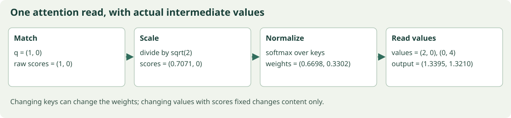

# Attention from the first weighted read to the full backward pass

## Begin with a question and three memory slots



The forward read keeps compatibility, normalization, and returned content separate.

Suppose a system has three stored facts represented by value vectors. The current token needs some combination of those facts. We want a read operation whose choice can change smoothly as the token's needs change, allowing an ordinary gradient to train the choice. This is the problem attention solves at the level of numerical computation.

We will build it in three layers. First, assume somebody has already supplied relevance scores and study the weighted read. Second, learn to calculate scores from queries and keys. Third, follow an upstream loss derivative backward through the entire operation. Separating these layers prevents the compact final equation from hiding several independent ideas.

## Attention as differentiable weighted retrieval

### Separate deciding where to read from what is read

Imagine three memory slots. Each has an address-like key and a content-like value. A query scores keys, a normalization produces nonnegative weights, and a weighted sum returns content. Keys and values need not have the same width. This analogy explains the operation, but a neural key is a continuous learned vector, not a literal database address.

For scores $s_1,\ldots,s_N$, weights are $a_i=\operatorname{softmax}(s)_i$. Values $v_i\in\mathbb R^{D_v}$ produce output $o=\sum_i a_iv_i$. Since $a_i\ge0$ and $\sum_i a_i=1$, $o$ lies in the convex hull of values. It may combine incompatible facts; being a convex combination does not make it a valid symbolic answer.

### Work a two-slot read

Let scores be $(0,\log3)$ and scalar values be $(2,10)$. Exponentials are $(1,3)$, weights are $(1/4,3/4)$, and output is $(1/4)2+(3/4)10=8$. Uniform scores instead give output six. Increasing the second score shifts mass toward ten continuously.

Differentiate the output with respect to score $s_k$. Softmax's derivative is $\partial a_i/\partial s_k=a_i(\mathbf1[i=k]-a_k)$. Therefore

$$\frac{\partial o}{\partial s_k}
=\sum_i v_i a_i(\mathbf1[i=k]-a_k)
=a_k(v_k-o).$$

The first sum selects $a_kv_k$; the second is $a_k\sum_i a_iv_i=a_ko$. A slot changes the result most when it has appreciable weight and its value differs from the current output. If all values are identical, score gradients vanish because changing the mixture does not change the output.

### Soft selection is not discrete lookup

A low temperature sharpens weights but generally does not create exact one-hot selection for finite scores. As temperature tends to zero, a unique maximum dominates; ties share mass. Hard argmax loses ordinary derivatives at switches and has zero derivative almost everywhere elsewhere. Replacing soft attention by argmax changes the learning problem.

Attention weights are also not a general causal explanation. The output depends on values, subsequent layers, residual streams, and the task. Changing a weight while holding everything else fixed is a different intervention from removing a token and recomputing the network.

The experiment confirms the score derivative from the equation. Its values are two-dimensional, so we scalarize the output with a chosen readout before comparing derivatives. This is exactly how reverse mode carries an upstream gradient through a vector-valued operation.

#### A convex mixture can erase a useful distinction

Let values be $v_1=(1,0)$ and $v_2=(0,1)$ with equal weights. The output is $(1/2,1/2)$. It is distinct from both slots, and a later linear readout cannot recover which slot should have been chosen from this output alone when many weight/value configurations yield the same mixture. Multiple heads or nonlinear downstream processing can preserve or exploit more information, but soft attention itself is an aggregation. If all values equal $v$, output remains $v$ for every score vector; differentiating confirms every addressing gradient is zero.


## A probability distribution over places to read

Let values be scalar two and ten. A score difference controls their mixing weights. If the second score exceeds the first by $\log3$, its exponential is three times larger, so it receives three quarters of the probability. Output eight is neither an input slot nor a discrete selection. It is the arithmetic result of a particular mixture.

The value of this operation is its flexibility, but the mixture can also lose information. If two distinct arrangements produce the same weighted sum, downstream layers cannot recover which arrangement occurred from that sum alone. Multiple heads will later provide several separate reads; residual connections will retain another path. These additions do not alter what one head computes.


### Executable calculation

Run `python examples/11_attention_weighted_retrieval.py` from the package root. Complete source is also included as [11_attention_weighted_retrieval.py](../examples/11_attention_weighted_retrieval.py).

```python
import numpy as np
from core import softmax, finite_difference
scores = np.array([0., np.log(3)])
values = np.array([[2., -1.], [10., 3.]])
readout = np.array([0.4, -0.2])
weights = softmax(scores)
output = weights @ values
gradient = weights * ((values - output) @ readout)
def scalar_output(energy):
    return float((softmax(energy) @ values) @ readout)
assert np.allclose(gradient, finite_difference(scalar_output, scores), atol=1e-7)
print('weights', weights, 'output', output, 'score gradient', gradient)
```

Recorded output on the checked Python/NumPy environment:

```text
weights [0.25 0.75] output [8. 2.] score gradient [-0.45  0.45]
```


## Let the token produce its own query

A query is a feature vector used to ask for compatible information. A key is a feature vector used for matching a stored slot. A value is the content returned from that slot. These are roles inside a learned computation, not three different kinds of natural-language object. The same input token can produce all three through different linear maps.

If a query and a key point in similar directions, their dot product can be large. Their lengths matter too, which is why dot-product compatibility is not identical to cosine similarity unless vectors are normalized. Learned projections can make different directions useful for matching without requiring us to label those directions manually.

## Queries, keys, values, and scaled dot-product attention

### Turn hidden vectors into a learned read mechanism

Let $X\in\mathbb R^{T\times D}$. Projections create $Q=XW_Q$, $K=XW_K$, and $V=XW_V$. For query position $i$ and key position $j$, score $S_{ij}=q_i^\top k_j/\sqrt{d_k}$. Apply softmax across key positions $j$, then multiply by values:

$$A=\operatorname{softmax}_{\text{keys}}(QK^\top/\sqrt{d_k}),\qquad O=AV.$$

Shapes explain the calculation: $Q$ is $(T,d_k)$, $K^\top$ is $(d_k,T)$, the score matrix is $(T,T)$, and $V$ is $(T,d_v)$. Consequently $O$ is $(T,d_v)$. Every output row has its own distribution over keys. Softmax across queries would normalize the wrong decision.

### A numerical score

For $q=(1,0)$, $k_1=(1,0)$, and $k_2=(0,1)$, raw dot products are one and zero. Divide by $\sqrt2$ to obtain approximately $0.7071$ and zero. The first weight is $e^{0.7071}/(e^{0.7071}+1)\approx0.6698$. With values $(2,0)$ and $(0,4)$, output is approximately $(1.3395,1.3209)$.

### Why the square root appears

Assume each component of $q,k$ has mean zero and variance one, with the independence conditions needed to make products uncorrelated. The dot product is $\sum_{r=1}^{d_k}q_rk_r$. Each product has mean zero and variance one; summing uncorrelated products gives variance $d_k$. Division by $\sqrt{d_k}$ gives variance one. This is an initialization-scale argument. Trained queries and keys need not satisfy those assumptions exactly.

Large score gaps make softmax nearly one-hot, which can make its score derivatives small. Scaling reduces this saturation tendency at initialization. It does not guarantee numerical stability on arbitrary data; stable normalization and suitable precision are still required.

### Why use three projections

A token can ask one kind of question, advertise another matching description, and provide different content. Independent projections let those roles differ. If $Q=K$ before masking, $QK^\top$ is symmetric, but row-normalized attention need not be symmetric because row denominators differ. With separate projections, scores need not even be symmetric.

The code computes both vectorized and explicit-loop attention. It uses distinct value width to reinforce that matching width and content width are independent choices. A successful agreement checks implementation against this definition. It does not establish that a random set of projections has learned useful language relationships.

Optional application: rescale both queries and keys by two. Scores grow by four, so attention sharpens. Rescaling values by two instead doubles outputs while leaving weights unchanged. These interventions distinguish addressing from content.

#### Check scaling assumptions rather than memorizing a constant

Suppose independent coordinates instead have $\operatorname{Var}(q_r)=\sigma_q^2$ and $\operatorname{Var}(k_r)=\sigma_k^2$, both mean zero. Then each product has variance $\sigma_q^2\sigma_k^2$, so the dot product variance is $d_k\sigma_q^2\sigma_k^2$. Division by $\sqrt{d_k}$ leaves variance $\sigma_q^2\sigma_k^2$, not necessarily one. Learned projections, normalization, and correlations determine the actual distribution. This calculation explains both why the square root is sensible and why it is not a universal cure for arbitrary activation scales.


## Trace one complete forward pass by hand

Use query $q=(1,0)$, keys $k_1=(1,0)$ and $k_2=(0,1)$, and values $v_1=(2,0)$ and $v_2=(0,4)$. Dot products are one and zero. Key width is two, so scaled scores are $(1/\sqrt2,0)$. Subtract the maximum, obtaining $(0,-1/\sqrt2)$, exponentiate, and normalize. Weights are approximately $(0.669762,0.330238)$.

Multiply each value coordinate by its slot weight. The first output coordinate is $0.669762\cdot2+0.330238\cdot0\approx1.339523$. The second is $0.669762\cdot0+0.330238\cdot4\approx1.320954$. This order—compatibility, scale, normalization, weighted content—is the same order implemented by the vectorized function.


### Executable calculation

Run `python examples/12_scaled_dot_product_attention.py` from the package root. Complete source is also included as [12_scaled_dot_product_attention.py](../examples/12_scaled_dot_product_attention.py).

```python
import numpy as np
from core import attention, softmax
query = np.array([[1., 0.], [0., 1.]])
key = np.array([[1., 0.], [0., 1.], [1., 1.]])
value = np.array([[2., 0., 1.], [0., 4., -1.], [1., 1., 0.]])
output, weights = attention(query, key, value)
manual = []
for row in query:
    scores = np.array([sum(row[d] * slot[d] for d in range(2)) / np.sqrt(2) for slot in key])
    manual.append(softmax(scores) @ value)
assert np.allclose(output, manual)
assert np.allclose(weights.sum(axis=-1), 1)
print('weights', weights, 'output', output)
```

Recorded output on the checked Python/NumPy environment:

```text
weights [[0.40111209 0.19777581 0.40111209]
 [0.19777581 0.40111209 0.40111209]] output [[ 1.20333628  1.19221535  0.20333628]
 [ 0.79666372  2.00556046 -0.20333628]]
```


## What one attention matrix row means

A score matrix has one row for every query and one column for every key. Softmax runs across the columns of each row because each query makes its own read decision. A column sum has no general requirement to equal one. Several queries may all read the same key heavily; attention is not a one-to-one assignment.

If you normalize over the wrong axis, the program can still return a square matrix and plausible-looking numbers. The semantic test is whether every query's distribution over allowed keys sums to one. Later, masks introduce zero weights for disallowed keys without changing that row interpretation.

## Bring in a loss without inventing a giant Jacobian

The output of attention is a matrix. Training eventually reduces many outputs to a scalar loss. We represent everything downstream of attention by an upstream matrix $G$ whose entries say how that loss changes with each output coordinate. This lets us derive a local backward rule that works regardless of the rest of the network.

Do not confuse $G$ with an attention weight or a new learned parameter. It is a derivative supplied by later operations. In the numerical test we manufacture it by defining the scalar objective as the sum of elementwise output times a fixed matrix. That objective has exactly the desired upstream derivative.

## Keep the upstream objective visible

A vector output has many possible derivatives depending on what later computation asks of it. If we sum both output coordinates, upstream derivative is `(1,1)`. If we read only the first, it is `(1,0)`. If we square an output coordinate, the upstream derivative depends on its current value. Attention's local reverse rule must work for all of these cases, which is why we write it in terms of a general upstream matrix.

The numerical experiment chooses a linear readout so the upstream derivative is known exactly. This is a test construction, not an assumption that real transformer losses are linear in attention output. Subsequent nonlinear layers and vocabulary losses supply other upstream values through the same chain rule. Once a local reverse operation agrees for several independent readouts and unequal shapes, it becomes a reusable building block for larger graphs.

## Backpropagating through attention by hand

### Work backward through exactly three operations

Write $S=QK^\top/\sqrt d$, $A=\operatorname{softmax}(S)$ rowwise, and $O=AV$. Suppose a scalar objective supplies upstream matrix $G=\partial L/\partial O$. We will derive all three input gradients without constructing a four-dimensional Jacobian.

For $O_{ic}=\sum_jA_{ij}V_{jc}$, differentiation gives

$$G_V=A^\top G,\qquad G_A=GV^\top.$$

The first sums contributions from every query that read a value; the second measures how changing a weight changes the upstream objective. Check dimensions: $G_V$ has the shape of $V$, and $G_A$ has the shape of $A$.

For one row $a=\operatorname{softmax}(s)$ with upstream $g$, its score gradient is $a\odot(g-\langle a,g\rangle)$. Expand coordinate $k$: $\sum_jg_ja_j(\mathbf1[j=k]-a_k)=a_kg_k-a_k\sum_jg_ja_j$. Thus for all rows,

$$G_S=A\odot\left(G_A-\operatorname{rowsum}(A\odot G_A)\right).$$

The row sum retains an axis so it broadcasts over keys. Its role is a probability-weighted baseline. Score gradients sum to zero in every row, consistent with softmax's invariance to adding a row constant.

Finally, use matrix-product derivatives:

$$G_Q=G_SK/\sqrt d,\qquad G_K=G_S^\top Q/\sqrt d.$$

If $Q=XW_Q$, the projection contributes $G_QW_Q^\top$ to $G_X$. Add analogous key and value contributions because the input appears on three paths. Weight gradients are $X^\top G_Q$, $X^\top G_K$, and $X^\top G_V$.

### What masking changes

A fixed disallowed score is replaced by negative infinity before normalization. Its probability is zero, so its score gradient is zero. Gradients must not flow into the overwritten score. Every query needs at least one allowed key; otherwise normalization is undefined. In a numerical implementation, avoid multiplying unrelated infinities by zero in loss code.

### Read the independent check

The experiment defines $L=\sum O\odot G$. This linear scalarization supplies an arbitrary upstream derivative and tests the full local backward operation. It compares each analytical input gradient with central differences while holding the other inputs fixed. All arrays are small and use float64 to reduce roundoff.

An important edge case is a single allowed key: its weight is always one, so key and query score gradients vanish, while its value still receives a gradient. Another is identical values: addressing gradients can vanish even when value gradients do not. These are consequences of the operation, not bugs.

Optional application: chain the three projections from a shared input and compare the sum of three input-gradient contributions with a finite-difference input gradient. This directly checks the shared-input accounting that a transformer relies on.

#### Carry one reverse pass all the way to the shared input

For $X\in\mathbb R^{T\times D}$ and projection weights $W_Q,W_K,W_V$, compute $G_Q,G_K,G_V$ as above. The input derivative is $G_X=G_QW_Q^\top+G_KW_K^\top+G_VW_V^\top$. Every summand has shape $(T,D)$, which permits addition. Each projection weight derivative instead contracts over token positions: $G_{W_Q}=X^\top G_Q$, with analogous key and value terms. Confusing these two contractions can produce plausible shapes when widths happen to agree. Test unequal widths and lengths to reveal accidental transposes.


## Read each reverse equation in the direction it aggregates

The value gradient accumulates contributions from every query that read a slot. The weight gradient compares each possible slot's content with the upstream direction. The score gradient adjusts those weight sensitivities relative to their probability-weighted average. Finally, query and key gradients reverse the dot-product comparison, retaining the scale factor.

For one row, write $b=\sum_j a_jg_j$. Score derivative is $a_k(g_k-b)$. The baseline $b$ is not an optional regularizer. It arises from differentiating the normalization denominator. Omitting it would incorrectly treat each weight as independent of the others. A quick invariant catches this mistake: score gradients must sum to zero because a common score shift changes no probability.


### Executable calculation

Run `python examples/13_attention_backpropagation.py` from the package root. Complete source is also included as [13_attention_backpropagation.py](../examples/13_attention_backpropagation.py).

```python
import numpy as np
from core import attention, finite_difference
rng = np.random.default_rng(13)
q, k, v = rng.normal(size=(2, 3)), rng.normal(size=(4, 3)), rng.normal(size=(4, 2))
g = rng.normal(size=(2, 2))
o, a = attention(q, k, v)
gv = a.T @ g
ga = g @ v.T
gs = a * (ga - (a * ga).sum(axis=-1, keepdims=True))
gq, gk = gs @ k / np.sqrt(3), gs.T @ q / np.sqrt(3)
assert np.allclose(gs.sum(axis=-1), 0)
checks = [(gq, finite_difference(lambda z: np.sum(attention(z, k, v)[0] * g), q)),
          (gk, finite_difference(lambda z: np.sum(attention(q, z, v)[0] * g), k)),
          (gv, finite_difference(lambda z: np.sum(attention(q, k, z)[0] * g), v))]
for analytic, numeric in checks:
    assert np.allclose(analytic, numeric, atol=1e-7)
print('maximum gradient errors', [float(np.max(np.abs(a-b))) for a, b in checks])
```

Recorded output on the checked Python/NumPy environment:

```text
maximum gradient errors [2.0035140213536806e-11, 6.29335195068137e-11, 2.7627233833982245e-11]
```


## Use independent routes to establish confidence

The handwritten equations, explicit loops, vectorized forward operation, and central-difference checks are separate routes to the same local relationships. Agreement is especially valuable when the code uses unequal query and key lengths or different value width, because accidental transposes cannot hide behind equal dimensions.

The companion's **Attention workbench** exposes one query, two keys, and two values. It displays raw scores, scaled scores, probabilities, output, and the score derivative for a fixed readout. Change a value while keeping scores fixed: weights stay unchanged. Change a key: addressing can change. These interventions make the key/value distinction visible.

For cross-attention, query and key lengths can differ. The score matrix is then rectangular, but its rows still normalize over keys; none of the backward reasoning requires equal lengths.

We have derived an attention head, but it still reads every supplied position and does not inherently know order. The next chapter adds the structural rules that turn this read mechanism into a causal, multi-head, position-aware transformer block.
