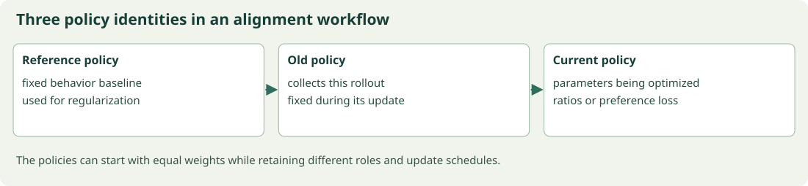

# Aligning responses: reward models, DPO, and verifiable feedback

## A preference label is evidence about a comparison



Policy identities name mathematical roles, even when the initial arrays agree.

Suppose people compare two answers to the same prompt. They may prefer one for correctness, completeness, style, or some mixture. The label tells us a comparison under the collection procedure; it does not supply an absolute reward scale or guarantee agreement across every user and situation. Before fitting a preference objective, define what the labels were intended to measure.

We will move from a model of pairwise choice to a regularized policy objective, derive its ideal finite-set solution, and substitute that relationship into a direct preference loss. Then we will compare learned reward feedback with externally verifiable task outcomes. The distinctions matter because better optimization of one signal can still worsen the intended behavior.

## Reward modeling, RLHF, and constrained policy optimization

### Preferences are observations, rewards are a model

A preference dataset may contain a prompt $x$, chosen response $y_w$, and rejected response $y_l$. A reward model assigns scalar score $r_\phi(x,y)$. A Bradley-Terry model predicts the chosen response wins with probability $\sigma(r_w-r_l)$. Minimize $-\log\sigma(r_w-r_l)$. The scale and meaning of the reward depend on data and model assumptions.

Adding any prompt-dependent constant to all responses' rewards leaves pairwise probabilities unchanged because it cancels in the difference. Absolute reward zero is therefore not identified by this pairwise objective. Cyclic, noisy, or context-dependent preferences can violate the simple scalar-ranking model.

### KL-regularized optimization

For one prompt and finite response set, maximize $\sum_y\pi(y)r(y)-\beta\sum_y\pi(y)\log[\pi(y)/\pi_{\mathrm{ref}}(y)]$, with $\beta>0$, normalized $\pi$, and reference support covering candidate responses. Introduce a Lagrange multiplier for $\sum_y\pi(y)=1$. Differentiating with respect to $\pi(y)$ gives

$$r(y)-\beta\left(\log\frac{\pi(y)}{\pi_{\mathrm{ref}}(y)}+1\right)+\lambda=0.$$

Rearrange and normalize to obtain

$$\pi^*(y)=\frac{\pi_{\mathrm{ref}}(y)e^{r(y)/\beta}}{\sum_{y'}\pi_{\mathrm{ref}}(y')e^{r(y')/\beta}}.$$

This is an exact finite-set result. Neural policies may not represent it exactly, and practical optimization may not find it. A larger $\beta$ penalizes deviation more strongly under this convention.

### A training pipeline with separate responsibilities

A common RLHF design first performs supervised instruction tuning, fits a reward model on preferences, then optimizes a policy with a reference penalty. PPO is one possible optimizer. The old policy used for PPO ratios and the fixed reference used for alignment regularization play different roles.

Sequence KL decomposes into expected token log-ratios under the policy when prefixes and sampling are handled consistently. A single response's log-ratio can be negative even though expected KL is nonnegative. An individual sampled penalty is therefore not itself a nonnegative divergence.

### Reward optimization can exploit errors

A reward model is reliable only over a measured distribution. Strong optimization may discover outputs that score highly without satisfying the intended task. Monitor independent human or task-grounded evaluations, length effects, style preference, and out-of-distribution behavior. Increasing reward alone is not sufficient evidence of improvement.

The example calculates the closed-form optimum over three responses and checks it against nearby distributions. It also checks that adding a constant to rewards leaves the optimum unchanged. This clarifies the role of the normalizer before introducing direct preference optimization.

#### Rewrite the regularized objective as a KL gap

Let $\pi^*(y)=\pi_{\mathrm{ref}}(y)e^{r(y)/\beta}/Z$. Taking logs gives $\log[\pi(y)/\pi^*(y)]=\log[\pi(y)/\pi_{\mathrm{ref}}(y)]-r(y)/\beta+\log Z$. Multiply by $\pi(y)$ and sum. Rearranging yields $\mathbb E_\pi r-\beta KL(\pi\Vert\pi_{\mathrm{ref}})=\beta\log Z-\beta KL(\pi\Vert\pi^*)$. Nonnegativity of KL proves the displayed optimum globally over the finite simplex, with equality at $\pi=\pi^*$. This is stronger than checking a few neighboring distributions numerically.


## Why the reward offset cannot be identified

If a chosen answer has reward three and a rejected answer has reward one, their difference is two. Add ten to both rewards and the difference stays two. A Bradley-Terry likelihood based on that difference cannot determine which absolute scale origin is correct. This is not a missing training trick; the observations do not contain that information.

The KL-regularized policy optimum also cancels a common prompt-dependent reward offset during normalization. Multiplying every unnormalized response weight by the same positive constant changes no probability. These two invariances explain why the unknown normalizer disappears from the DPO preference difference.


### Executable calculation

Run `python examples/37_reward_modeling_rlhf.py` from the package root. Complete source is also included as [37_reward_modeling_rlhf.py](../examples/37_reward_modeling_rlhf.py).

```python
import numpy as np
from core import softmax
reference = np.array([.5, .3, .2])
reward = np.array([0., 1., .4])
beta = .7
optimum = softmax(np.log(reference)+reward/beta)
def objective(policy):
    return policy @ reward-beta*np.sum(policy*np.log(policy/reference))
assert np.allclose(optimum, softmax(np.log(reference)+(reward+5)/beta))
for epsilon in [-.02, .02]:
    nearby = optimum+np.array([epsilon, -epsilon, 0.])
    assert objective(optimum) >= objective(nearby)
print('optimal policy', optimum, 'objective', objective(optimum))
```

Recorded output on the checked Python/NumPy environment:

```text
optimal policy [0.23741925 0.59441242 0.16816833] objective 0.5213463612147314
```


## Derive the optimum as a comparison with a known distribution

The exponential-tilted policy is more than a stationary point. Rewrite the regularized reward objective as beta times log normalizer minus beta times KL to that tilted policy. Since KL is nonnegative, the maximum occurs at the tilted policy under the finite-set support assumptions. This proof identifies both the optimum and the reason any other distribution loses objective value.

A neural model is restricted to the distributions its parameters can represent. A finite-sample optimizer may not find the representable optimum. Keep the exact simplex result as a conceptual reference, not a blanket guarantee about an actual training run.

## DPO and the derivation from rewards to policy ratios

### Eliminate a fitted reward under a specific model

The previous lesson derived $\pi^*(y\mid x)\propto\pi_{\mathrm{ref}}(y\mid x)e^{r(x,y)/\beta}$. Taking logarithms and rearranging gives $r(x,y)=\beta\log[\pi^*(y\mid x)/\pi_{\mathrm{ref}}(y\mid x)]+\beta\log Z(x)$. For two responses to the same prompt, the unknown prompt-only normalizer cancels.

Assume a Bradley-Terry preference likelihood based on the reward difference. Substitute the policy-ratio reward parameterization. With

$$\Delta=\log\pi_\theta(y_w\mid x)-\log\pi_\theta(y_l\mid x)-\log\pi_{\mathrm{ref}}(y_w\mid x)+\log\pi_{\mathrm{ref}}(y_l\mid x),$$

the DPO loss is $L=-\log\sigma(\beta\Delta)$. This derivation relies on the KL-regularized reward model and preference assumptions. It is not a universal equivalence between every RL objective and every pairwise classifier.

### Differentiate and interpret the pressure

Using $-\log\sigma(u)=\log(1+e^{-u})$, the derivative is $dL/d\Delta=-\beta\sigma(-\beta\Delta)$. A badly ordered pair has a larger-magnitude correcting gradient. The objective increases the chosen response's relative log-probability over the rejected response, after accounting for the reference.

A response log-probability is a sum over its generated tokens, excluding prompt tokens and padding. Replacing that sum with a length average changes the objective and its reward interpretation. Length effects are real, but they should be handled explicitly rather than by silently changing the formula.

### The reference matters

The reference provides a baseline for the policy's relative preference. It should be frozen under ordinary DPO training. If both chosen and rejected probabilities move, the loss depends on their difference relative to that baseline; it does not require the chosen response's absolute probability to increase on every update.

DPO avoids an online rollout-and-reward-model stage in its standard offline form, but still depends on coverage and quality of preference data. Distribution shift, label noise, contradictory preferences, and overoptimization can cause problems. Compare held-out task performance and retained capabilities, not only training pair accuracy.

### Related objectives are not interchangeable names

IPO, KTO, ORPO, and other preference objectives use different assumptions, losses, or data formats. Understand their actual equations before choosing one. A beta parameter can have different numerical meaning across formulations. Reusing a hyperparameter value without checking its definition is unsafe experimentally.

The experiment checks the scalar DPO derivative and demonstrates that a reference-adjusted preference can differ from a raw policy preference. It uses stored log-probabilities rather than a model wrapper so every sign is visible.

#### Fit a preference policy end to end

The additional `code/alignment_training.py` experiment optimizes a three-response categorical policy with the exact DPO loss. The frozen reference probabilities are $(0.5,0.3,0.2)$, and response one is preferred to response zero. Every step computes policy log-softmax, forms the reference-adjusted margin, applies stable softplus to its negative, backpropagates, and updates logits. Response two has no direct preference label, but normalization couples its probability to the others. The printed decrease in pair loss verifies optimization of this objective; it is not evidence that the resulting policy answers natural-language questions.


## Follow a pair loss back to individual token logits

A response probability is the product of its conditional next-token probabilities, given prompt and preceding response. Taking its logarithm turns that product into a sum. DPO compares two such sums after subtracting the reference gap. Prompt tokens are context, while response targets contribute the selected log-probability terms under the stated objective.

Let the derivative of loss with respect to the chosen response sum be $-c$, where $c=\beta\sigma(-\beta\Delta)>0$. Every chosen token log-probability receives upstream factor $-c$. Differentiating log-softmax distributes that factor to the vocabulary logits at that position. Rejected response tokens receive the opposite sequence-level sign. Shared transformer parameters accumulate all those contributions.

This calculation explains why the complete `sequence_alignment.py` example really updates attention and embeddings rather than simulating a change in a preference score. Both response computations build graphs using the same policy parameters. The reference values are fixed numerical scalars and are not updated.


### Executable calculation

Run `python examples/38_dpo_preference_optimization.py` from the package root. Complete source is also included as [38_dpo_preference_optimization.py](../examples/38_dpo_preference_optimization.py).

```python
import numpy as np
from core import finite_difference
beta = .4
policy_logp = np.array([-1.2, -1.8])
reference_logp = np.array([-1., -2.])
delta = policy_logp[0]-policy_logp[1]-reference_logp[0]+reference_logp[1]
def objective(value):
    return np.logaddexp(0, -beta*value[0])
analytic = -beta/(1+np.exp(beta*delta))
numeric = finite_difference(objective, np.array([delta]))[0]
assert np.allclose(analytic, numeric, atol=1e-7)
print('adjusted gap', delta, 'loss', objective(np.array([delta])), 'gradient', analytic)
```

Recorded output on the checked Python/NumPy environment:

```text
adjusted gap -0.3999999999999999 loss 0.7763437730407396 gradient -0.21596595382222628
```


## A concrete end-to-end run and its limits

The sequence-alignment program first trains the small transformer on a cyclic token pattern, then copies its arrays into a separate frozen reference model. It prefers sequence `(0,1,2,3,0)` over `(0,3,2,1,0)`, treating the first token as the prompt. Initial DPO loss is log two because policy and reference initially agree. Optimization increases the policy's relative chosen-response gap and reduces the pair loss.

The reference is already strongly favorable to the chosen pattern after supervised training. Further decreasing this one-pair loss does not demonstrate broad human alignment. It demonstrates the exact probability aggregation, sign, freezing, and gradient path. A useful real experiment needs diverse held-out comparisons and independent evaluations of retained behavior.

## Relative rewards without a separate learned critic

Some tasks have an external correctness check, such as a specified arithmetic answer or an executable test. Group-relative methods compare several responses to the same prompt and use relative reward statistics. Their attraction is not that rewards become philosophically complete; it is that a particular task signal can be checked more directly than a broad learned preference score.

## A relative preference can improve while an absolute probability falls

DPO depends on a chosen-minus-rejected log-probability difference relative to the reference. If both policy log-probabilities decrease but the rejected response decreases more, the gap increases and the pair loss can improve. This is not a sign error by itself. The objective directly controls a relative comparison, while normalization and parameter sharing determine other changes.

For example, moving chosen log-probability from minus two to minus three and rejected log-probability from minus four to minus six increases the policy gap from two to three. A fixed reference gap cancels in the same way before and after. Whether that change is useful requires evaluation beyond the pair loss. This small calculation prevents interpreting every decreasing chosen absolute probability as proof the DPO formula was implemented incorrectly, while also showing why a training-loss improvement is insufficient evidence of broad benefit.

## GRPO, group baselines, and verifiable rewards

### Relative feedback within a prompt

For a prompt, sample a group of responses and assign rewards $R_1,\ldots,R_G$. A common group-relative advantage is $A_i=(R_i-\overline R)/(s_R+\epsilon)$, with a stated standard-deviation convention. This avoids learning a separate value model in that design, but the group statistic is still an estimator with its own finite-sample behavior.

If rewards are $(0,0,1,1)$, the population mean is $0.5$ and population standard deviation is $0.5$, so normalized advantages are approximately $(-1,-1,1,1)$. If every reward is identical, centered advantages are zero. A prompt on which every sampled response fails may therefore supply no relative task gradient under this rule, although other regularizers may remain active.

### Relate the update to PPO carefully

A GRPO-style objective can use old-policy importance ratios, clipped surrogates, and a reference-policy KL term with group-derived advantages. Token versus sequence reduction, response-length weighting, group normalization, and KL estimators vary between methods. 'GRPO' alone does not specify all those choices. Read the actual algorithm and implementation configuration before reproducing a result.

A group mean includes each response's own reward. For iid samples without normalization, centering by this mean introduces a finite-group factor in a simple score-function expectation: the expected centered estimator is $(1-1/G)$ times the uncentered reward gradient. A leave-one-out baseline avoids that particular self-inclusion effect under its assumptions. Division by random standard deviation introduces further behavior.

### What verifiability buys and what it does not

An exact arithmetic checker or executable test can provide reliable feedback for a specified condition. It may still be incomplete. Code can overfit visible tests; mathematical answers can have correct final values and invalid reasoning; parsers can accept unintended formats. Reward coverage determines what is optimized.

Separate answer correctness, formatting, and process constraints. Track reward hacking, answer extraction failures, pass rates under independent tests, and performance outside the rewarded domain. More optimization against a narrow checker does not prove broad reasoning improvement.

### A bounded numerical experiment

The code normalizes groups with both mixed and constant rewards, verifies zero mean, and computes a clipped policy surrogate. It explicitly uses population standard deviation with `ddof=0`. It does not implement a production rollout service or make a claim about the quality of generated explanations.

Optional application: compare groups of size two and eight under the same Bernoulli reward rate. Count how often every reward is equal. This quantifies how frequently a relative-only signal disappears for that sampling problem.

#### Quantify all-equal reward groups

With independent Bernoulli success probability $p$ and group size $G$, all rewards are equal when either every response fails or every response succeeds. The probability is $(1-p)^G+p^G$. For $p=0.1,G=4$, it is $0.9^4+0.1^4=0.6562$. Thus most groups in this example carry no centered relative reward signal. Increasing group size changes this probability but also sampling cost. Curriculum choice, prompt difficulty, and alternative baselines can matter as much as the clipping equation when designing a practical relative-reward learner.


## A zero-signal group is an informative failure mode

If every response fails, centered group rewards are zero. This can happen frequently on tasks that are too hard for the current policy. If every response succeeds, the same centered signal vanishes for another reason. Group size, task difficulty, and reward granularity determine how often useful variation appears. An objective equation cannot create a preference signal from an all-equal group under that normalization.

The checker can also be incomplete. A program may pass visible tests and fail important unseen cases. An answer parser may reward a correct number even when the accompanying reasoning is invalid. Specify what is verified and evaluate broader claims separately.


### Executable calculation

Run `python examples/39_grpo_verifiable_rewards.py` from the package root. Complete source is also included as [39_grpo_verifiable_rewards.py](../examples/39_grpo_verifiable_rewards.py).

```python
import numpy as np
def group_advantage(rewards):
    rewards = np.asarray(rewards, dtype=float)
    return (rewards-rewards.mean())/(rewards.std(ddof=0)+1e-8)
mixed = group_advantage([0, 0, 1, 1])
constant = group_advantage([0, 0, 0, 0])
assert np.allclose(mixed.mean(), 0)
assert np.allclose(constant, 0)
ratio = np.array([.9, 1.1, 1.3, .8])
surrogate = np.minimum(ratio*mixed, np.clip(ratio, .8, 1.2)*mixed)
print('mixed advantages', mixed, 'constant', constant, 'surrogate', surrogate.mean())
```

Recorded output on the checked Python/NumPy environment:

```text
mixed advantages [-0.99999998 -0.99999998  0.99999998  0.99999998] constant [0. 0. 0. 0.] surrogate 0.0
```


The companion's **Preferences and alignment** experiment lets you change a policy log-probability gap, reference gap, beta, and group rewards. It calculates DPO loss and derivatives and displays centered group advantages. The browser does not query a human judge or a large model. Its purpose is to make the objective's assumptions and pressures visible before you use the complete Python training pipeline.

Beta has two connected but different appearances in this derivation. In the ideal reward problem, larger beta penalizes departure from the reference more strongly. In the fixed-data DPO loss, beta also scales the pairwise margin and its derivative. A statement about one effect should not be transferred mechanically to the other without holding the remaining quantities fixed.

We have changed model behavior through data and feedback. The next chapter changes what information is available at use time, using prompts, selected context, and retrieved evidence rather than assuming every answer must reside in weights.
