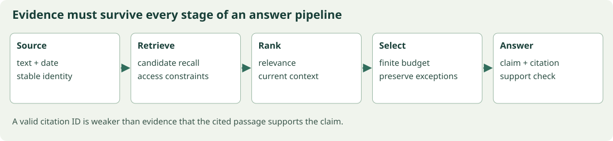

# Supplying the right information: prompts, context, embeddings, and RAG

## Begin with a question the weights should not be expected to answer alone



Each boundary can lose the evidence needed by the final claim.

A service's port changed yesterday. An old note says 443; the current configuration says 8443. A model trained earlier may have no way to know the update. A clearer prompt cannot manufacture the missing evidence. A retrieval system can locate relevant documents, preserve their dates and source identities, and provide them when answering.

This chapter connects five layers that are often discussed separately: the task contract, the live context budget, the retrieval representation, the candidate-ranking pipeline, and the use of evidence in an answer. A useful system needs these layers to agree about the question being answered.

## Prompting, structured output, search, and test-time computation

### A prompt is a conditioning interface

A prompt selects a conditional distribution of a fixed model. It can specify a task, input, examples, constraints, and output format. It does not update weights by ordinary use. Clear instructions reduce ambiguity, but a well-written instruction cannot supply missing facts or guarantee that the model follows every constraint.

A useful prompt contract states the goal, the evidence available, what to do when evidence is insufficient, the output schema, and the checks that will judge the result. Few-shot examples demonstrate desired behavior; they also consume context and may bias style or labels. Keep examples representative and separate from evaluation cases.

### Structured output needs validation

JSON syntax is weaker than semantic correctness. A parser can establish valid JSON; a schema can establish required fields and types; application checks can establish constraints such as a cited document ID existing in the retrieved set. None alone proves the answer is true.

For an evidence answer, request `answer`, `evidence_ids`, and `status` fields. Validate types, check every ID against supplied evidence, and allow `insufficient_evidence`. Treat retrieved text as data rather than instructions. These boundaries are part of reliable software behavior, not merely wording preferences.

### Decomposition and search spend additional compute

Task decomposition can break a large problem into smaller verifiable outputs. Self-consistency samples multiple candidates and aggregates answers. Tree or graph search explores alternative partial solutions and uses a scoring or verification rule. Their value depends on candidate diversity and evaluator reliability. Repeating the same error many times does not create independent evidence.

If each independent candidate succeeds with probability $p$, the probability of at least one success among $n$ is $1-(1-p)^n$. This is a pass-at-least-one calculation, not the probability that a selector chooses the correct candidate. Correlated samples and imperfect selection weaken the simple benefit.

Generated explanations may help solve a task, but a plausible explanation is not guaranteed to describe the computation that caused the answer. Evaluate final correctness and inspectable intermediate artifacts. Avoid treating verbose reasoning as a substitute for an external check.

### Keep prompt experiments controlled

Hold model version, decoding settings, tool access, context budget, and test examples fixed when comparing prompts. Record cost and latency as well as quality. A prompt optimized on twenty examples may overfit their phrasing; reserve a separate test set.

The code validates a structured answer against an evidence ID set and computes the independent-candidate success formula. It performs no model API call. This explicit boundary keeps the exercise runnable and prevents a deterministic mock from being mistaken for measured LLM behavior.

#### A selector can erase the benefit of more samples

For two independent candidates with correctness probability $p$, at least one is correct with probability $1-(1-p)^2$. If a selector chooses uniformly at random without using correctness information, its chosen answer is still correct with probability $p$, not the larger at-least-one probability. A perfect verifier could realize the larger value, while an imperfect verifier realizes something between or even worse depending on its bias. This simple counterexample separates generation diversity from selection quality and explains why test-time search needs a measured evaluator.


### Executable calculation

Run `python examples/40_prompting_search.py` from the package root. Complete source is also included as [40_prompting_search.py](../examples/40_prompting_search.py).

```python
import json
payload = '{"answer":"The service uses 8443.","evidence_ids":["doc-2"],"status":"answered"}'
answer = json.loads(payload)
evidence = {'doc-1', 'doc-2'}
assert set(answer) == {'answer', 'evidence_ids', 'status'}
assert isinstance(answer['answer'], str)
assert isinstance(answer['evidence_ids'], list)
assert all(isinstance(item, str) and item in evidence for item in answer['evidence_ids'])
assert answer['status'] in {'answered', 'insufficient_evidence'}
probability, samples = .3, 5
print('validated answer', answer)
print('independent at-least-one success', 1-(1-probability)**samples)
```

Recorded output on the checked Python/NumPy environment:

```text
validated answer {'answer': 'The service uses 8443.', 'evidence_ids': ['doc-2'], 'status': 'answered'}
independent at-least-one success 0.8319300000000001
```


## Preserve the task while improving its representation

A query rewrite can help retrieve synonymous evidence. It can also accidentally drop a date, environment, or exception. Keep the original request alongside derived queries. A decomposition into several retrieval questions should identify which final claim each question supports. More searches are useful only if they recover relevant evidence or resolve uncertainty.

Structured output makes some errors easier to detect. It cannot make an unsupported claim true. Validate syntax, schema, cited-ID existence, and factual support as separate conditions. A response can pass the first three and fail the fourth.

## Context engineering, persistent memory, and information budgets

### The live context is a bounded working set

A system may have instructions, user input, conversation history, retrieved evidence, tool schemas, tool results, and saved notes. The model sees only the material actually placed into its current context. Persistent storage and live model context are different resources. A fact saved somewhere is not automatically available to the next model call.

Context engineering chooses what to include, in what form, with which provenance, and under which budget. Prompt wording is one component. The larger system also retrieves current evidence, maintains task state, and removes stale material.

### Formulate a selection problem

Suppose item $i$ costs $c_i$ tokens and has estimated utility $u_i$. A simple budget model maximizes $\sum_i u_i z_i$ subject to $\sum_i c_i z_i\le B$ and $z_i\in\{0,1\}$. This is a knapsack abstraction. Real utilities are not independent: two individually useful documents may be redundant, and a crucial exception may be valuable only alongside its rule.

Reserve space for instructions, the current request, and output before selecting evidence. Character count is not token count; a rough estimator is acceptable for a toy experiment only if labeled. Production budgeting needs the actual model tokenizer and message serialization overhead.

### Facts, state, and traces serve different purposes

A fact should carry source and time information. Task state records goals, decisions, completed work, unresolved issues, and constraints. A raw execution trace records what happened but may contain dead ends and redundant data. Summarization can shorten a trace while accidentally dropping an exception or decision boundary.

A useful checkpoint preserves exact identifiers, pending actions, authoritative evidence links, and what remains uncertain. Distinguish a user's explicit decision from a model's tentative inference. When facts conflict, retain provenance and resolve the conflict rather than silently averaging statements.

### Compression is an error-producing transformation

A summary can omit or distort information. Evaluate compression by whether downstream questions remain answerable, not just by length reduction. Test questions about dates, exceptions, and decisions are especially revealing. Keeping original sources accessible permits recovery when a summary is insufficient.

Memory retrieval also needs access controls and freshness. A relevant old note may be superseded. A cross-user memory leak is a correctness failure even if the retrieved text is semantically relevant. Treat untrusted stored text as evidence to interpret, not authority to execute instructions.

The experiment performs exact knapsack selection on a few context items using deliberately explicit illustrative token costs. It shows why selecting by utility alone can waste budget. It does not claim a universal utility estimator or implement production memory semantics.

#### Greedy context selection can fail even with additive utility

Suppose budget is ten and items have cost-utility pairs $(6,12),(5,9),(5,9)$. Choosing the highest-utility item first yields utility 12 and leaves four unused cost units. Choosing the two five-cost items yields utility 18. Even a seemingly sensible greedy rule can miss the optimum. Utility-per-cost also lacks a universal exact guarantee for binary knapsack. The lesson's exhaustive search is feasible only because there are very few items; larger systems need approximations and task evaluation, especially when utilities include redundancy and dependencies.


### Executable calculation

Run `python examples/41_context_memory.py` from the package root. Complete source is also included as [41_context_memory.py](../examples/41_context_memory.py).

```python
from itertools import product
items = [('current-policy', 6, 10), ('old-thread', 8, 6), ('schema', 3, 5), ('task-state', 4, 8)]
budget = 13
best, score = None, -1
for selection in product([0, 1], repeat=len(items)):
    cost = sum(flag*item[1] for flag, item in zip(selection, items))
    utility = sum(flag*item[2] for flag, item in zip(selection, items))
    if cost <= budget and utility > score:
        best, score = selection, utility
chosen = [item[0] for flag, item in zip(best, items) if flag]
assert sum(flag*item[1] for flag, item in zip(best, items)) <= budget
print('selected', chosen, 'illustrative utility', score)
```

Recorded output on the checked Python/NumPy environment:

```text
selected ['current-policy', 'schema', 'task-state'] illustrative utility 23
```


## Budget evidence according to the actual bottleneck

A context limit is shared among instructions, the user's request, evidence, tool descriptions, previous state, and output. A summary can reduce size while removing the exception that matters. A large passage can preserve detail while hiding the relevant sentence among distractors. Budgeting is therefore not only truncation; it is an information-selection problem with task-dependent loss.

The knapsack example makes one simplified version exact. Real utility includes redundancy and dependencies, so the numeric score should not be mistaken for a universal evidence-value estimator. Test whether the selected context still supports the required answers.

## Dense retrieval, contrastive encoders, and vector search

### Retrieval is a measurable ranking task

Given query $q$, rank documents so useful evidence appears near the top. A dual encoder separately maps queries and documents into vectors, making document indexing reusable. Similarity can be a dot product or cosine according to training. A cross-encoder jointly processes query and document and can model detailed interactions, but typically costs more per candidate.

For a batch of query-document pairs, scores $S_{ij}=f(q_i)^\top g(d_j)/\tau$ and diagonal labels give $L=-B^{-1}\sum_i\log\operatorname{softmax}(S_i)_i$. Each row treats the paired document as positive. A symmetric objective also predicts queries from documents. False negatives occur when another document in the batch is relevant.

### Exact search before approximation

Normalize vectors if cosine is the intended score, then compute all query-document dot products and sort. This is an exact baseline. Approximate nearest-neighbor indexes trade recall, latency, build cost, and memory using structures such as graphs or quantized partitions. Approximation should be evaluated against exact neighbors under the same vectors and score.

ANN recall is not the same as task retrieval recall. An approximate index may faithfully retrieve the embedding model's nearest neighbors even when those documents do not answer the question. Separate encoder quality from index approximation quality.

### Work a retrieval metric

If relevant IDs are $\{d_2,d_5\}$ and top three results contain only $d_5$, recall at three is $1/2$. Precision at three is $1/3$. Reciprocal rank is the inverse of the first relevant rank. For a single first relevant result at rank two, it is $1/2$. Each metric answers a different question about ranking.

Document chunks need stable IDs, source locations, timestamps, and access-control metadata. Retrieve only evidence the caller is authorized to use. Filtering after taking a tiny top-$k$ can leave too few results; filtering strategy and candidate budget affect recall.

### Distribution and query conventions matter

Some encoders expect different query and document prefixes or pooling rules. Use the model's documented conventions when integrating an actual encoder. Changing them alters embeddings. Evaluate short questions, exact identifiers, rare entities, negation, and multilingual inputs rather than relying only on semantic paraphrases.

The code uses hand-designed vectors to make ranking and metrics inspectable. It demonstrates exact cosine search and contrastive loss, not a trained text encoder or an ANN implementation. The later hybrid lesson adds lexical matching for exact terms.

#### Derive cosine search as Euclidean search under normalization

For unit vectors $u,v$, squared Euclidean distance is $\|u-v\|^2=u^\top u+v^\top v-2u^\top v=2-2u^\top v$. Minimizing this distance is equivalent to maximizing the dot product. Without equal unit norms, the extra norm terms vary and the ranking equivalence can fail. An index configured for Euclidean distance can therefore match cosine ranking only when normalization and its handling of zero vectors are correct. State the vector preprocessing as part of the retrieval specification, not as an optional display choice.


### Executable calculation

Run `python examples/42_dense_retrieval.py` from the package root. Complete source is also included as [42_dense_retrieval.py](../examples/42_dense_retrieval.py).

```python
import numpy as np
from core import log_softmax
vectors = np.array([[1., 0.], [.8, .2], [0., 1.], [-1., 0.]])
vectors = vectors/np.linalg.norm(vectors, axis=1, keepdims=True)
query = np.array([1., .1])
query /= np.linalg.norm(query)
scores = vectors @ query
ranking = np.argsort(-scores)
relevant = {1, 2}
recall = len(set(ranking[:2]) & relevant)/len(relevant)
first = next(rank for rank, item in enumerate(ranking, 1) if item in relevant)
contrastive_loss = -log_softmax(scores/.2)[1]
print('ranking', ranking, 'recall@2', recall, 'reciprocal rank', 1/first, 'loss', contrastive_loss)
```

Recorded output on the checked Python/NumPy environment:

```text
ranking [0 1 2 3] recall@2 0.5 reciprocal rank 0.5 loss 0.7129513026132387
```


## Retrieve precisely before retrieving approximately

An exact vector search is a valuable baseline because it separates encoder quality from index approximation. If exact nearest neighbors do not contain useful evidence, improving approximate-index recall cannot solve the representation problem. If exact retrieval is strong but an approximate index misses those candidates, tune the index or its budget.

Exact names, version IDs, and error codes can favor lexical matching. Semantic paraphrases can favor dense matching. Hybrid pipelines acknowledge that these signals are complementary rather than requiring one score to express every relationship.

## RAG ingestion, BM25, hybrid fusion, and reranking

### Build the evidence path before generating prose

A retrieval-augmented system ingests documents, produces searchable units, retrieves candidates, reranks or filters them, constructs context, generates an answer, and checks evidence use. Failure at any stage can produce a wrong answer. A fluent generator cannot cite a relevant passage that never reached its context.

Chunking trades local focus against context preservation. Small chunks can isolate facts but lose qualifiers. Large chunks preserve relationships but consume more context and dilute similarity. Overlap reduces boundary loss while increasing duplication. Keep source offsets so neighboring text can be recovered after retrieval.

### Derive a lexical baseline

BM25 scores query terms using inverse document frequency and saturated term frequency. One common term contribution is

$$\operatorname{IDF}(t)\frac{f(t,d)(k_1+1)}{f(t,d)+k_1(1-b+b|d|/\operatorname{avgdl})}.$$

Here $f$ is document term count, $|d|$ is document length, $k_1$ controls saturation, and $b$ controls length normalization. Different implementations choose different IDF and query-frequency conventions. State the exact variant when reproducing rankings.

When term frequency becomes large, the fraction approaches $k_1+1$ rather than growing indefinitely. With $b=0$, length normalization disappears. With $b=1$, the normalization term uses the full document-length ratio. Exact identifiers and rare error codes often make lexical retrieval a strong complement to dense vectors.

### Fuse rankings without pretending scores are comparable

Dense cosine and BM25 scores have different scales. Reciprocal rank fusion uses ranks: $\operatorname{RRF}(d)=\sum_m1/(c+\operatorname{rank}_m(d))$ for documents returned by method $m$. An absent document contributes zero. The constant $c$ controls how strongly top ranks dominate. A union of candidates permits documents found by only one method to survive.

Reranking applies a more expensive relevance model to this candidate set. Candidate recall is an upper bound on what the reranker can recover. Late-interaction models keep multiple document vectors and aggregate query-token matches, such as a sum of maximum similarities; this differs from both one-vector retrieval and a full joint cross-encoder.

### Ground answers in selected evidence

Attach stable evidence IDs to passages. Ask for citations to those IDs and allow abstention. Validate that cited IDs exist, then assess whether the cited text actually supports the associated claim. Existence of a citation is weaker than entailment. Retrieved text can also contain malicious instructions; its role remains evidence.

The experiment implements a small BM25 variant and rank fusion with an illustrative semantic ranking. It is deterministic and local. It does not run an embedding encoder or a generator, so its outputs measure ranking mechanics only.

#### Compute reciprocal rank fusion by hand

Let document A rank first in one list and third in another, while B ranks second in both. With $c=60$, A receives $1/61+1/63\approx0.032266$, while B receives $2/62\approx0.032258$. A wins very narrowly. This small difference illustrates how the fusion constant and rank positions affect ordering. If one retriever omits A entirely, its missing-list contribution is zero, not an invented worst rank. RRF combines rank evidence; it does not calibrate document relevance probabilities or establish that either passage supports a generated claim.


### Executable calculation

Run `python examples/43_rag_hybrid_ranking.py` from the package root. Complete source is also included as [43_rag_hybrid_ranking.py](../examples/43_rag_hybrid_ranking.py).

```python
import numpy as np
from collections import Counter
corpus = ['service port 8443 current', 'service port 443 old', 'database backup daily']
docs = [text.split() for text in corpus]
query = 'current service port'.split()
mean_length = np.mean([len(doc) for doc in docs])
scores = []
for doc in docs:
    count = Counter(doc)
    score = 0.
    for term in query:
        frequency = sum(term in other for other in docs)
        idf = np.log(1+(len(docs)-frequency+.5)/(frequency+.5))
        tf = count[term]
        score += idf*tf*2.2/(tf+1.2*(.25+.75*len(doc)/mean_length))
    scores.append(score)
lexical = list(np.argsort(-np.array(scores)))
semantic = [1, 0, 2]
fusion = {d: sum(1/(60+ranking.index(d)+1) for ranking in [lexical, semantic]) for d in range(3)}
print('BM25', scores, 'fused', sorted(fusion, key=lambda d: -fusion[d]))
```

Recorded output on the checked Python/NumPy environment:

```text
BM25 [np.float64(1.8519618955528834), np.float64(0.9063018189439682), np.float64(0.0)] fused [0, 1, 2]
```


## A citation is a link in an argument

An evidence ID identifies a passage. The passage must support the associated claim under the relevant date, environment, and scope. If a source says a default port is 443 and another says production overrides it to 8443, citing the default alone does not support a claim about current production. Citation validation needs the same contextual distinctions as the answer.

## Advanced RAG, graph retrieval, and failure diagnosis

### More retrieval stages need more observable boundaries

A query may require several pieces of evidence: a service's current version, that version's support policy, and a date exception. Query decomposition can retrieve each part. Query rewriting can improve recall but can also change the question. Preserve the original request and measure whether rewriting helps the actual task.

Graph retrieval represents entities and relationships explicitly. A query can follow links such as service-to-version-to-policy. Entity resolution, edge provenance, timestamps, and extraction errors become central. A graph is not automatically more factual than text; it can store incorrect or stale edges in a more structured form.

### Marginalization versus prompt concatenation

The original probabilistic RAG formulation can treat retrieved document $z$ as a latent variable, such as $p(y\mid x)=\sum_zp_\eta(z\mid x)p_\theta(y\mid x,z)$ under a specified retrieval set. Many practical systems instead concatenate passages and generate once. Both are called RAG in practice, but their mathematical objectives differ.

For two documents with retrieval probabilities $(0.7,0.3)$ and answer probabilities $(0.8,0.2)$, marginal answer probability is $0.7\cdot0.8+0.3\cdot0.2=0.62$. Selecting only the first document gives 0.8 for this toy conditional, a different model. A retriever similarity score is not automatically a calibrated document probability.

### Diagnose with intervention

Evaluate retrieval with known relevant evidence. Then give the generator oracle evidence and measure answer quality. Compare ordinary retrieval against the oracle condition. If oracle evidence fixes the answer, retrieval or context construction is implicated. If the answer remains wrong, generation or task formulation may be the larger problem.

Measure citation precision, evidence coverage, answer correctness, and unsupported-claim rate separately. A response can cite true evidence while omitting a critical exception. A system can retrieve all needed documents but truncate the crucial paragraph during context assembly.

### Temporal and multi-hop examples

For current-port questions, rank newer authoritative configuration above old discussion, but retain provenance. For a two-hop policy question, first identify the deployed version and then retrieve the applicable rule. Do not combine a version from one environment with a policy from another. Metadata filters are part of the evidence logic.

The example performs a tiny graph traversal and computes a latent-document marginal. Its graph is manually specified so the reasoning can be checked. It does not demonstrate automatic graph extraction or prove that graph retrieval beats lexical or dense retrieval on real questions.

Optional application: remove one edge and observe whether the answer becomes unavailable. A robust system should return insufficient evidence rather than inventing the missing relation. This is a useful end-to-end abstention test.

#### Diagnose retrieval versus synthesis with a four-cell experiment

Evaluate ordinary retrieved evidence and oracle evidence, each with the baseline and changed generator. If both generators improve greatly under oracle context, retrieval or context assembly is a likely bottleneck. If the changed generator helps under both contexts, generation contributes independently. If only one interaction improves, inspect compatibility between evidence format and generator behavior. These observations remain empirical, but the controlled design isolates causes better than comparing two completely different pipelines whose retriever, prompt, model, and context budget all changed together.


### Executable calculation

Run `python examples/44_advanced_rag_evaluation.py` from the package root. Complete source is also included as [44_advanced_rag_evaluation.py](../examples/44_advanced_rag_evaluation.py).

```python
import numpy as np
graph = {'service-A': [('version', 'v2')], 'v2': [('policy', 'policy-2026')],
         'policy-2026': [('port', '8443')]}
node, path = 'service-A', []
for relation in ['version', 'policy', 'port']:
    matches = [target for edge, target in graph.get(node, []) if edge == relation]
    assert len(matches) == 1
    path.append((node, relation, matches[0]))
    node = matches[0]
retrieval_probability = np.array([.7, .3])
answer_probability = np.array([.8, .2])
marginal = retrieval_probability @ answer_probability
assert np.allclose(marginal, .62)
print('evidence path', path, 'marginal answer probability', marginal)
```

Recorded output on the checked Python/NumPy environment:

```text
evidence path [('service-A', 'version', 'v2'), ('v2', 'policy', 'policy-2026'), ('policy-2026', 'port', '8443')] marginal answer probability 0.62
```


The companion's **Retrieval and context** experiment runs a small lexical ranking and rank-fusion calculation, then selects evidence under a visible budget. Change the query from a general phrase to an exact port or version term and inspect the ranking. Every score is computed from the local corpus and displayed parameters. The fixture is small so you can verify why a document wins.

The next chapter places retrieval and generation inside a repeated program. We will retain explicit evidence and budgets so that an agent's activity can be distinguished from verified progress.
