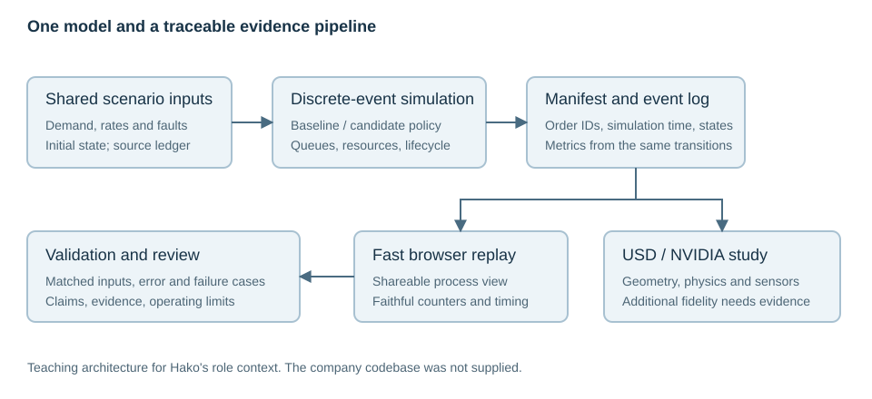

# Digital Twins and Warehouse Orchestration for Hako

From warehouse flow and first-principles robotics to OpenUSD, Isaac Sim, and trustworthy evidence

<a id="preface"></a>
## Preface

This book is for Aadil's engineering role at Hako: understanding and owning the warehouse simulation, strengthening orchestration evidence, and building a trustworthy shareable twin. You know Python and have NVIDIA GPU access. Robotics, spatial mathematics, simulation, and NVIDIA terminology begin from first principles.

The supplied engineer onboarding is the role-specific anchor. Its immediate priorities are the SimPy model, the policy comparison, and an event-driven web twin. The supplied learning path and roadmap add an NVIDIA specialization. This edition combines them in prerequisite order, corrects version-sensitive oversimplifications, and keeps company planning claims separate from independently observed results.

Read Chapter 2 first. Chapter 1 is an optional Python reference. Continue through Chapter 3 for the immediate simulation/replay work, then Chapters 4–6 for spatial and NVIDIA foundations. Read the conceptual sensor/ROS sections in Chapter 7 and use its implementation depth when a task requires it. Chapter 8 connects extensions, streaming, and agent tooling. Chapter 9 is optional learning/perception depth. Chapter 10 provides validation and the capstone.

The recurring warehouse example is a small synthetic teaching model. A scan-and-pick cell provides a manageable geometric subsystem. Neither reproduces Hako's unavailable code, site, robot assets, or measured operations. The advanced defect-detection example teaches evaluation mechanics and is not a newly inferred Hako requirement.

Use [the companion guide](COMPANION_GUIDE.md) for the eight-week core schedule, exact example commands, expected results, troubleshooting, and optional applications. Start the local browser companion with `node companion/server.mjs`. Every experiment states its model and limits. The actual implementation is included under `companion/` and `examples/`.



Conventions: meters, seconds, kilograms; right-handed Z-up world; radians for internal mathematical angles; explicit exceptions for degree-based APIs and optical camera frames. Times in teaching event logs are run-relative simulation seconds. Display interpolation, DES, physics, and live telemetry are distinct activities.

Documentation was checked for the November 12, 2026 edition. Native examples target Isaac Sim 6.2.0; CPU USD examples were executed with USD 26.5; SimPy examples with 4.1.1; Python with 3.12.14. Source access and version differences are recorded in [sources](SOURCES.md). See [verification](verification.md) for exactly what ran and what still requires native hardware/software.

You do not need to pass quizzes. Optional applications include reference code and observed outputs so you can inspect the reasoning at your pace. Take small sections as sessions; use a coach to explain any prerequisite before using it. The goal is understanding the relationships well enough to change a model and defend its results.


<a id="contents"></a>
## Contents

- [Chapter 1: Optional Python refresher for physical models](#chapter-01)
- [Chapter 2: Understand Hako's warehouse and model its flow with SimPy](#chapter-02)
- [Chapter 3: Compare orchestration policies and build an honest web replay](#chapter-03)
- [Chapter 4: The mathematics and physics a robot model needs](#chapter-04)
- [Chapter 5: OpenUSD: describe, assemble, and inspect a world](#chapter-05)
- [Chapter 6: Run the world with Omniverse, Kit, and Isaac Sim](#chapter-06)
- [Chapter 7: Connect robots, controllers, sensors, and ROS 2](#chapter-07)
- [Chapter 8: Build an integration boundary with Kit extensions, streaming, and MCP](#chapter-08)
- [Chapter 9: Generate useful data and understand robot learning](#chapter-09)
- [Chapter 10: Build an operational twin and make its claims reviewable](#chapter-10)

# Optional software reference


<a id="chapter-01"></a>
## Chapter 1: Optional Python refresher for physical models

### In this chapter

- [Start with a decision, then build a model](#chapter-01-section-1)
- [The equipment you actually need first](#chapter-01-section-2)
- [A first complete program](#chapter-01-section-3)
- [Values, types, and the difference between a number and its label](#chapter-01-section-4)
- [Decisions give a model behavior](#chapter-01-section-5)
- [Collections let the model describe more than one part](#chapter-01-section-6)
- [Repeating work without repeating source code](#chapter-01-section-7)
- [Functions turn calculations into reusable contracts](#chapter-01-section-8)
- [Records and objects without mysterious terminology](#chapter-01-section-9)
- [Files, JSON, and reproducible inputs](#chapter-01-section-10)
- [Read errors as evidence](#chapter-01-section-11)
- [Checking a calculation is different from trusting a display](#chapter-01-section-12)
- [Your first connected learning session](#chapter-01-section-13)


<a id="chapter-01-section-1"></a>
### Start with a decision, then build a model

You are already comfortable with Python, so use this chapter as a reference and skip directly to the warehouse chapter if its software concepts are familiar. The new material is how software values acquire physical meaning. Imagine a small scan-and-pick teaching cell: a conveyor moves a boxed item, a camera observes it, and an arm transfers it to a tote. This is a fictional subsystem inspired by the flow in your Hako onboarding, not a reconstruction of its unavailable code or equipment model.

We could build an attractive picture of this cell. That would answer questions about appearance. To answer the camera question, we also need dimensions, camera optics, lighting, part variation, a defect definition, timing, and evidence from real images. To answer a robot reach question, we need different details: robot geometry, joint limits, the tool, and obstacles. A useful model includes the information required by a particular decision. More detail has a cost and can introduce more uncertain assumptions.

A **digital twin** is a digital representation associated with a physical product, process, or facility and used to understand or influence its lifecycle. People use the term with different levels of strictness. In this course, an **operational twin** also has identified connections to observations of its physical counterpart, with a stated update rate and validity limits. A standalone simulator is a valuable component even before that connection exists. NVIDIA's [digital twin overview](https://www.nvidia.com/en-us/glossary/digital-twin/) provides the platform context; our inspection-cell design and teaching examples are original.

Your first task is smaller than controlling a robot. You will describe a part, calculate how long it spends under a camera, and decide whether the observations are sufficient for a toy rule. This introduces programming through a problem with quantities you can inspect. You need no robotics, calculus, or programming prerequisites.

<a id="chapter-01-section-2"></a>
### The equipment you actually need first

A **program** is a sequence of instructions written in a language a particular tool understands. Python source is readable text. A **Python interpreter** reads and executes that text. An **editor** helps you create it. A **terminal** accepts commands that start programs and show their output. These are separate tools. Typing Python into a terminal that expects PowerShell will produce errors even when the Python is correct.

The early lessons work with Python 3.12 and its standard library, meaning the modules supplied with Python. They do not require Omniverse, a robot, an NVIDIA account, or a GPU. The browser companion works without Python and illustrates the mathematics separately. Later, Isaac Sim uses its own Python environment. Keeping these environments separate prevents a frequent beginner failure: installing a package for one interpreter and running another.

On Windows, install Python 3.12 from the official Python distribution if you do not already have it. Open PowerShell in the extracted course folder. The following command assumes the Python launcher `py` was installed. If your installation supplies `python` instead, check `python --version` and substitute that name in the initial environment-creation command.

```powershell
py -3.12 --version
py -3.12 -m venv .venv
.\.venv\Scripts\python.exe --version
.\.venv\Scripts\python.exe examples\01_first_model.py
```

Run each line separately. The first asks the launcher for a Python 3.12 interpreter. The second runs Python's `venv` module to create an isolated environment in `.venv`. The third explicitly uses the environment's interpreter. The fourth runs the included example file. No activation script is needed. If `py` is unavailable, the first problem is interpreter installation or discovery, not your ability to understand Python.

On Linux or macOS, an installed Python 3.12 interpreter can create the environment with `python3.12 -m venv .venv`; subsequent commands use `.venv/bin/python`. These are foundation-only instructions. They do not imply Isaac Sim supports every operating system that can run Python. See the official [virtual environment documentation](https://docs.python.org/3.12/library/venv.html) for the environment mechanism.

<a id="chapter-01-section-3"></a>
### A first complete program

Create a text file named `camera_time.py`, taking care that Windows has not added a hidden `.txt` extension. Put this code in it:

```python
part_length_m = 0.20
belt_speed_m_s = 0.10
visible_time_s = part_length_m / belt_speed_m_s
print(visible_time_s)
```

Run it with your environment's interpreter. The output is `2.0`. The first line gives the name `part_length_m` a value of 0.20. The equals sign is **assignment**, not a mathematical assertion that will keep updating itself. The second line creates another name. The third divides the current length by the current speed. The fourth calls the built-in function `print`, which writes a representation of the result.

An **expression** is something that produces a value, such as `0.20 / 0.10`. A **statement** performs an operation, such as assigning that result to a name. Parentheses after a function name contain the values provided to that function, called **arguments**. You will read thousands of function calls in NVIDIA examples; the basic pattern is already present here.

The suffixes in our names are deliberate. A length of `20` could mean meters, centimeters, or millimeters. Python does not infer the intended unit. Writing `_m`, `_s`, and `_m_s` makes that choice visible to a human reader. The calculation is length divided by length per time, so its unit is time: meters divided by meters per second equals seconds. Unit reasoning often catches mistakes before any graphics appear.

The model also has a limitation. A real part's visibility depends on camera field of view, occlusion, and the trajectory, not just part length. Here we define a toy observation interval from a length and speed. A useful habit begins now: describe what your calculation means and the assumptions that make it meaningful.

<a id="chapter-01-section-4"></a>
### Values, types, and the difference between a number and its label

A **type** describes the kind of value and the operations available on it. Python's `int` represents whole numbers such as a part count. A `float` represents an approximate real number such as a length. A `str` is text. A `bool` has one of two values, `True` and `False`. The special value `None` represents an intentional absence of a value.

```python
part_count = 3
exposure_s = 0.004
part_id = "part-003"
camera_ready = True
last_measurement = None

print(type(part_count).__name__)
print(type(exposure_s).__name__)
print(part_id)
```

The outputs are `int`, `float`, and `part-003`. `type` inspects a value's type. `.__name__` retrieves a readable name from that type object. The dot means “retrieve this named member from the object on the left.” An **object** is a Python value with associated data and behavior. You do not need a deeper runtime model to begin using objects correctly.

The text `"0.10"` is not the number `0.10`. Text may arrive from a form, a CSV file, or a network message. `float("0.10")` converts suitable text to a number. `float("fast")` raises an error because the conversion has no defined numerical meaning. Do not solve this by replacing every invalid input with zero: zero speed would mean something very different from an unknown speed.

Floating-point arithmetic is approximate. For example, `0.1 + 0.2` may display a small difference from `0.3`. This does not mean Python is unsuitable for engineering. It means exact equality is often the wrong numerical question. Later we compare computed results using a tolerance whose unit and scale are appropriate. Counts and identifiers remain exact; measured physical quantities already have uncertainty even before computation.

The official Python [introduction](https://docs.python.org/3.12/tutorial/introduction.html) documents the language basics. Our variable names, camera examples, unit conventions, and debugging sequence are chosen for this course.

<a id="chapter-01-section-5"></a>
### Decisions give a model behavior

Suppose our synthetic camera rule requires a positive speed and at least half a second of visibility. A program must choose between cases. Python uses `if`, optionally `elif`, and optionally `else`:

```python
belt_speed_m_s = 0.10
visible_length_m = 0.20

if belt_speed_m_s <= 0:
    print("No forward-motion observation interval")
else:
    visible_time_s = visible_length_m / belt_speed_m_s
    if visible_time_s >= 0.50:
        print("Enough time under the toy rule")
    else:
        print("Too short under the toy rule")
```

The comparison `<=` means less than or equal to. The expression after `if` is evaluated first. The indented statements execute only when that condition is true. A colon ends the condition line and introduces the indented block. Use four spaces per indentation level. Indentation is part of Python's grammar, so misalignment can change behavior or prevent execution.

The guard comes before division. That order matters because division by zero is not defined. A negative speed is not inherently impossible in a conveyor system, but this particular formula has been specified for forward travel. A general model could use speed magnitude and retain direction separately. The important step is to state the contract before choosing the implementation.

Use `==` to compare values and `=` to assign them. Use `and` when both conditions must hold, `or` when either suffices, and `not` to reverse a Boolean condition. Avoid assuming a complex Boolean expression is clear because it fits on one line. Names such as `camera_ready` and `measurement_fresh` let the decision read in the language of the process.

Missing measurements deserve their own branch. `if last_measurement is None:` checks absence. A measurement of zero can be valid: a robot at its reference position may have zero displacement. Treating zero as missing would erase real information. This distinction becomes critical when a twin displays telemetry and the network stops delivering samples.

<a id="chapter-01-section-6"></a>
### Collections let the model describe more than one part

A **list** stores an ordered collection. A **dictionary** stores associations from keys to values. Lists are useful for a sequence of measurements; dictionaries are useful for fields in a record. Indexes in a list start at zero, so the first element is at position `0`.

```python
lengths_m = [0.18, 0.20, 0.23]
print(lengths_m[0])

part = {
    "id": "part-003",
    "length_m": 0.20,
    "defect_seen": False,
}
print(part["length_m"])
```

The outputs are `0.18` and `0.2`. Square brackets create the list and retrieve items. Curly braces create the dictionary. Each dictionary entry uses a colon to separate its key from its value. Commas separate entries. The braces and indentation make the record readable; the dictionary itself is one value.

A dictionary does not automatically enforce a schema, which is a description of required fields and their meanings. A misspelled key may create a different field or raise `KeyError` when read. `part.get("temperature_c")` returns `None` if that key is absent, which is useful only if absence is permitted by your design. For a required identity or coordinate field, silently accepting absence is usually a mistake.

Lists can change. `lengths_m.append(0.24)` adds another item. There is also a **tuple**, written `(0.0, 1.0, 2.0)`, whose collection structure cannot be changed in place. Tuples make sense for a fixed coordinate triple, though individual libraries may expect lists, tuples, arrays, or their own vector types. An API's documented input shape decides what is appropriate.

There is an important copying trap. `other = lengths_m` creates a second name for the same list. Changing the list through either name affects that same object. `other = lengths_m.copy()` creates a new outer list. For nested mutable records, a shallow copy still shares inner objects. We avoid accidental sharing by creating fresh simulation state on reset rather than reusing a global list from a previous run.

<a id="chapter-01-section-7"></a>
### Repeating work without repeating source code

Now calculate visibility for three part lengths:

```python
lengths_m = [0.18, 0.20, 0.23]
belt_speed_m_s = 0.10

for length_m in lengths_m:
    time_s = length_m / belt_speed_m_s
    print(f"{length_m:.2f} m -> {time_s:.2f} s")
```

The output is:

```text
0.18 m -> 1.80 s
0.20 m -> 2.00 s
0.23 m -> 2.30 s
```

`for` takes each item from the collection, assigns it to `length_m`, and executes the indented block. The string beginning with `f` is a formatted string. A value inside braces is inserted into the text; `:.2f` displays two digits after the decimal point. Formatting changes the displayed representation, not the stored physical value.

`range(5)` produces the integers 0 through 4. This is useful for a fixed number of simulation updates. A `while` loop repeats while a condition remains true, so it needs a route to termination. A loop tied only to “application is running” can be appropriate in an interactive simulator; a batch experiment should also have a bounded time or step count so failures do not consume resources indefinitely.

Avoid modifying the collection you are traversing unless you have a carefully defined reason. If you need only accepted parts, build a new list. This keeps the original evidence separate from a derived result. That distinction is useful far beyond Python: source observations, cleaned observations, inferred state, and predictions should remain distinguishable in an operational twin.

<a id="chapter-01-section-8"></a>
### Functions turn calculations into reusable contracts

A **function** groups instructions under a name. Inputs are **parameters** in its definition; supplied values are arguments at a call site. Its output is a returned value.

```python
import math

def visible_time(length_m: float, speed_m_s: float) -> float:
    if not math.isfinite(length_m) or length_m <= 0:
        raise ValueError("length_m must be finite and positive")
    if not math.isfinite(speed_m_s) or speed_m_s <= 0:
        raise ValueError("speed_m_s must be finite and positive")
    return length_m / speed_m_s

result_s = visible_time(length_m=0.20, speed_m_s=0.10)
print(f"Visible for {result_s:.2f} s")
```

`import math` makes the standard mathematics module available. A **module** is a unit of Python code that can be imported. `math.isfinite` rejects infinity and “not a number,” both of which can appear in numerical data. `def` introduces the function. The annotations `: float` and `-> float` document expected input and output types; Python does not enforce these annotations by itself.

`raise ValueError(...)` deliberately signals that an input violates the function's contract. `return` sends a value back to the caller and ends the function call. A function that only prints is less reusable: another calculation needs the number, not a message on the screen. Keep computation and presentation separate whenever that makes the next use easier.

Within the call, `length_m=0.20` is a named argument. It makes the units and meaning visible. Names inside a function are normally local to that call. This helps isolate one computation from another. A function that depends on hidden global state is harder to test because the same visible arguments may produce a different result after unrelated code runs.

We choose a deliberately strict contract here. A stopped belt could instead return an infinite duration or a special status, but those alternatives would require downstream code to handle that meaning. There is no universally correct return value divorced from the problem. Clear input rules and meaningful failure behavior are more valuable than making every input produce a number.

<a id="chapter-01-section-9"></a>
### Records and objects without mysterious terminology

As records become more important, spelling every field name as a string becomes inconvenient. A **class** defines a kind of object. An **instance** is one object of that class. A **method** is a function accessed through an object. A **dataclass** is a Python convenience for classes primarily used to hold fields.

```python
from dataclasses import dataclass

@dataclass
class Observation:
    part_id: str
    time_s: float
    position_m: float

observation = Observation("part-003", 1.25, 0.80)
print(observation.part_id)
print(observation.position_m)
```

The `@dataclass` line is a **decorator**: a tool applied to the class definition. Here it generates routine behavior such as initialization and a readable representation. You do not need to implement a decorator to use this one. `Observation(...)` creates an instance, and the dot retrieves one of its fields.

An NVIDIA expression such as `cube.get_world_poses()` has the same broad structure. `cube` is an object; `get_world_poses` is a method; parentheses call it. Understanding that grammar removes much of the intimidation from a long API name. The remaining work is discovering the method's contract: coordinate frame, units, return shape, timing requirements, and possible failure cases.

A class is useful when state and related operations belong together. It is not required for every calculation. A plain function is often the clearest place for a coordinate transform or error metric. This course uses functions for mathematics, records for data, and small stateful objects where the lifecycle matters. The design follows the problem instead of turning every noun into a class.

<a id="chapter-01-section-10"></a>
### Files, JSON, and reproducible inputs

A program's working directory is the folder against which relative paths are resolved. It may differ from the folder containing the script. This explains many “file not found” errors. `pathlib.Path` helps handle paths, including spaces, without manually constructing operating-system separators.

```python
import json
from pathlib import Path

settings = {"speed_m_s": 0.10, "length_m": 0.20}
output_path = Path("settings.json")
output_path.write_text(json.dumps(settings, indent=2), encoding="utf-8")
loaded = json.loads(output_path.read_text(encoding="utf-8"))
print(loaded["speed_m_s"])
```

**JSON** is a text format for values such as numbers, strings, lists, and field maps. `dumps` converts Python data to JSON text; `loads` converts JSON text to Python data. File methods write and read that text. UTF-8 is an explicit character encoding. The output path is local to the current working directory and this example intentionally writes one small file.

The fact that JSON parses does not prove it is a valid robot observation. A valid JSON object can omit a timestamp, contain an unknown asset ID, or specify centimeters in a field expected to contain meters. Parsing establishes syntax. Validation establishes your domain contract. Chapter 10 turns that distinction into an ingestion pipeline.

For a sequence of rows, CSV is another useful format. Its columns need a documented schema, especially for units and time. Include a header rather than relying on positional memory. Preserve the original file and write cleaned data to a different file so that a questionable result can be traced back to the input.

<a id="chapter-01-section-11"></a>
### Read errors as evidence

An exception usually includes a **traceback**, a sequence of locations showing the active chain of calls. Start with the final error type and message, then find the most relevant line in your own code. `SyntaxError` means Python could not interpret the source structure. `NameError` often means a name was misspelled or used before assignment. `ModuleNotFoundError` often means the wrong interpreter is running or a required package is absent.

`TypeError` suggests an operation received the wrong kind of value or the wrong arguments. `ValueError` suggests the kind may be acceptable but the value violates a constraint. `FileNotFoundError` points toward path resolution or absent input. These are useful clues, not guarantees: read the actual message and inspect the relevant values.

A small diagnostic sequence is more productive than reinstalling everything. Print `sys.executable` to identify the running interpreter. Print the current working directory with `Path.cwd()`. Print `type(value)` and `repr(value)` for a suspect input. `repr` displays a representation that can expose hidden whitespace or the difference between a string and a number. Reduce the failing example until one behavior remains.

Catch only errors you can handle meaningfully. `try: ... except ValueError: ...` can convert a user-input failure into a useful message. A broad `except Exception: pass` hides evidence and can make a twin appear healthy while it silently ignores every observation. Cleanup is different from suppression: a `finally` block runs whether an operation succeeds or fails, making it appropriate for closing a simulator or file handle.

<a id="chapter-01-section-12"></a>
### Checking a calculation is different from trusting a display

A **test** compares observed behavior to a stated expectation. Start with a known result: 0.20 meters at 0.10 meters per second corresponds to 2 seconds in our toy interval model. Then test invalid inputs, such as zero speed. Both cases represent requirements; neither is a quiz for you.

```python
import math
import unittest

class TestVisibility(unittest.TestCase):
    def test_known_interval(self):
        self.assertTrue(math.isclose(visible_time(0.20, 0.10), 2.0))

    def test_zero_speed_rejected(self):
        with self.assertRaises(ValueError):
            visible_time(0.20, 0.0)
```

This intentionally shown fragment belongs in a file that also defines or imports `visible_time`; the complete executable tests are included under `checks/`. `unittest.TestCase` supplies assertion methods. The word `self` is the current test instance, passed automatically when a method is called on it. The `with` block establishes an expected exception during the enclosed call. See the official [unittest reference](https://docs.python.org/3.12/library/unittest.html) for the testing interface.

Tests protect assumptions at the size where failures are easy to understand. A correct visibility calculation does not prove a camera can see a defect. That larger claim needs an optical model, realistic data, and measured comparison. Build confidence in layers, and never promote evidence from a small layer into a larger claim it cannot support.

<a id="chapter-01-section-13"></a>
### Your first connected learning session

Open the companion's **Conveyor timing** experiment. Change belt speed while keeping the observation length fixed. The displayed duration comes from the same division you just learned. Add exposure time to see a separate quantity: motion during an exposure is speed multiplied by exposure duration. At 0.10 m/s and 0.004 s, motion is 0.0004 m, or 0.4 mm. That calculation describes distance traveled, not a complete image-blur prediction.

Then run `examples/01_first_model.py`. Read its output alongside the source. You can change the inputs, run it again, and compare the new result. This is optional application work, not a gate before continuing. When something fails, the diagnostic steps above are part of learning, not evidence that you should already have known an answer.

If you use an AI coding coach, give it a bounded request: “Explain this Python 3.12 program to a beginner, one meaningful operation at a time. Define every new term before using it. Keep units visible. Show a complete runnable modification that rejects zero and nonfinite speed. Explain the expected output and which physical claims the example cannot establish.” Treat the response as a proposal to inspect and run. A confident explanation does not replace an API reference or a test.

You now have the software vocabulary needed for the rest of the course: values, types, records, functions, loops, modules, errors, files, and tests. The main path next develops warehouse flow and scheduling; the robotics foundations chapter gives these values further physical meaning. You will learn how a robot's position, orientation, velocity, and forces become quantities that a program can transform and a simulator can update.

[Back to contents](#contents)

---


# Warehouse flow and orchestration


<a id="chapter-02"></a>
## Chapter 2: Understand Hako's warehouse and model its flow with SimPy

### In this chapter

- [The role begins with a flow of goods and decisions](#chapter-02-section-1)
- [Vocabulary attached to one order](#chapter-02-section-2)
- [Inventory and work are different state](#chapter-02-section-3)
- [Convert business targets into rates carefully](#chapter-02-section-4)
- [Capacity, cycle time, and utilization](#chapter-02-section-5)
- [Why queues grow near a bottleneck](#chapter-02-section-6)
- [Discrete events answer a different question from physics steps](#chapter-02-section-7)
- [A generator is a process that can pause](#chapter-02-section-8)
- [Shared resources turn duration into contention](#chapter-02-section-9)
- [Trace an order with a timeline before adding randomness](#chapter-02-section-10)
- [Model arrivals and service variability separately](#chapter-02-section-11)
- [Faults are processes with consequences](#chapter-02-section-12)
- [Monitoring must follow state changes](#chapter-02-section-13)
- [Define a measurement window](#chapter-02-section-14)
- [Bottleneck analysis is an experiment](#chapter-02-section-15)
- [Rates need a provenance ledger](#chapter-02-section-16)
- [Connect throughput to cost without inventing a financial forecast](#chapter-02-section-17)


<a id="chapter-02-section-1"></a>
### The role begins with a flow of goods and decisions

Your onboarding describes Hako as a fulfillment operation whose differentiation is warehouse design and vendor-agnostic orchestration. You are expected to own simulation and the twin that demonstrates that orchestration. This makes warehouse flow and discrete-event simulation immediate prerequisites. NVIDIA scene work becomes useful when it represents that flow faithfully.

The onboarding describes Site 1 as a planned 100,000-square-foot facility, targeting about 16,000 orders per day with modeled headroom near 24,000, six pick ports, and four decant arms. These are **supplied planning claims**, not independently verified operating results. The source code, rate-source block, event export, actual twin package, and unit-economics workbook mentioned in the documents were not supplied. We therefore build an original teaching model and explain how to inspect those real artifacts when you receive them.

The learning priority is clear: understand what is moving, what each station does, which resources constrain flow, and how to compare scheduling policies. We will not assume every site-level number follows from one vendor's maximum robot speed. We will derive the quantities and trace their units.

<a id="chapter-02-section-2"></a>
### Vocabulary attached to one order

A **brand** owns the products and customer relationship. A **3PL**, third-party logistics provider, performs logistics services for another business. **Fulfillment** is the process that turns an order into a correctly prepared outbound shipment. An **SKU**, stock-keeping unit, identifies a product variant such as a particular size and color. A physical unit is one item of that SKU.

An **order** can contain several **order lines**, and a line can request multiple units. One order for two blue shirts and one red cap contains two lines and three units. Those counts are not interchangeable. If a machine processes 600 units per hour, dividing by an assumed three units per order gives 200 orders per hour only under that workload and process definition.

A **case** is an inbound container holding units. A **tote** is a standardized handling container. **Decanting** transfers inbound contents into the internal handling system. **Putaway** moves accepted inventory to a storage location. **Picking** retrieves the units needed for an order. **Packing** prepares the shipment; labeling and sortation direct it toward outbound transport.

An **AS/RS**, automated storage and retrieval system, stores and retrieves inventory using automation. Cube-storage systems use grids and stacked bins, with robots moving bins to access points or ports. An **AMR**, autonomous mobile robot, is a broader mobile-robot category and should not be treated as identical to a grid robot. Each architecture has its own traffic, charging, storage, and interface constraints.

The flow described by the onboarding is unloading, opening/decanting, scanning, storing, retrieving, picking, packing, labeling/sorting, and shipping. Trace one physical item and one order separately. The item may enter inventory long before the order arrives. A model that sends each arriving order through inbound receiving confuses demand fulfillment with inventory replenishment unless it deliberately models a make-to-order process.

<a id="chapter-02-section-3"></a>
### Inventory and work are different state

Inventory answers “what units exist, where are they, and what is their status?” Work state answers “what tasks are requested, assigned, started, completed, or blocked?” A tote can exist in storage while no retrieval task is active. A task can be queued while the needed inventory is absent. Separating these states prevents a scheduler from creating stock merely by scheduling a pick.

For a SKU, a simple inventory conservation relationship is `ending = starting + received - shipped - rejected - other documented removals`. Reservations reduce availability without physically removing a unit. A robust order lifecycle distinguishes available, reserved, picked, packed, shipped, and exception quantities.

At simulation level, a teaching model may assume unlimited eligible inventory to isolate outbound capacity. That can be useful, but the assumption must be visible. It cannot then answer stockout or replenishment questions. Likewise, a model of inbound throughput alone cannot establish outbound service performance.

Hako's supplied scope focuses on standardized boxed goods, high-turnover inventory, and a defined order flow. Returns and last-mile shipping are outside that initial scope. Keep those boundaries in the model and metrics. You can represent exceptions explicitly without silently adding a full returns operation or inventing revenue streams.

<a id="chapter-02-section-4"></a>
### Convert business targets into rates carefully

Sixteen thousand orders per day over 24 hours averages `16000/24`, about 666.7 orders per hour. Twenty-four thousand averages 1,000 per hour. Neither figure specifies the peak arrival rate, order mix, service-level deadline, maintenance allowance, or daily demand shape. Averages are starting points for reasoning, not a complete workload.

If orders average 2.4 picked units, 666.7 orders per hour requires about 1,600 unit picks per hour. If each bin presentation supports 1.5 unit picks on average, that is about 1,066.7 bin presentations per hour. At an illustrative 30 presentations per robot-hour, a crude uncongested lower-bound calculation gives about 35.6 continuously productive robot equivalents before other work and constraints.

Those intermediate assumptions drive the result. Different batching, SKU locality, multiple picks per presentation, digging, replenishment, charging, and traffic change it. This is how to interpret a claim that grid robots constrain throughput: identify which work they perform and how often each completed order demands that work.

AutoStore's official [robot FAQ](https://www.autostoresystem.com/faq/robots) describes roughly 30 bin presentations per robot-hour as a case-specific rule of thumb and notes that system simulation is needed for a more accurate estimate. A bin presentation is not automatically an order or an item pick. Keep the source's unit and qualification when entering the parameter into your model.

Another useful quantity is a **visit ratio**: how many times a completed order uses a resource on average. If an order requires two bin deliveries and each delivery occupies a grid resource for 90 seconds, it consumes 180 grid-resource seconds. At 600 orders/hour, demand is 108,000 resource-seconds/hour, equivalent to 30 continuously occupied resource slots. Charging, digging, traffic, and inbound work can add to that demand. This accounting exposes hidden repeated visits that disappear when a model represents an entire order as one generic robot task.

Use the same method for exception handling. If 1% of 10,000 unit attempts require a 60-second intervention, the simplified expected workload is 100 interventions and 6,000 seconds. An exception percentage must specify its denominator: attempts, units, order lines, or orders can produce different counts. Also distinguish initial failures from failures after automated retries. A retry consumes capacity even when the final order succeeds.

<a id="chapter-02-section-5"></a>
### Capacity, cycle time, and utilization

**Cycle time** is time required for a defined operation or repeated cycle. **Service time** is time a job occupies a resource for the modeled task. **Capacity** is the resource's potential processing rate under stated conditions. **Throughput** is completed work per unit time over a defined observation window.

If one station has deterministic service time 6 seconds per unit, its ideal capacity is `3600/6 = 600 units/hour`. Four independent identical stations provide an ideal aggregate 2,400 units/hour if they are fed, unblocked, available, and doing comparable work. Shared upstream or downstream resources can prevent that aggregate rate from being achieved.

**Utilization** is the fraction of relevant available capacity occupied during an interval. A resource busy 2,700 seconds during a 3,600-second observation is 75% utilized under that denominator. If it is down for 600 seconds, calendar-time and available-time utilization differ. Report the denominator rather than treating one percentage as self-explanatory.

**Starvation** occurs when a station cannot work because input is unavailable. **Blocking** occurs when it cannot release completed work because downstream capacity or space is unavailable. **Downtime** makes a resource unavailable. An idle arm can mean spare capacity, starvation, blocking, a fault, or an orchestration mistake. The visual state alone needs an explanatory event and reason.

<a id="chapter-02-section-6"></a>
### Why queues grow near a bottleneck

A **queue** holds work waiting for a resource or condition. If work arrives persistently faster than it can depart, the backlog grows. Even when average arrival rate is below average service capacity, random bursts and variable service times create waiting. Near full utilization, there is little spare capacity to recover from a burst.

For an ideal M/M/1 queue, arrivals are Poisson, service times exponential, there is one server, capacity is unlimited, and steady-state arrival rate is below service rate. Under those assumptions, mean time in the system is `1/(mu-lambda)`. At arrival rate 8 jobs/hour and service rate 10 jobs/hour, the mean is 0.5 hour. At 9.5 arrivals/hour, it becomes 2 hours despite the same service mechanism.

You should not apply this formula blindly to Hako's network. Its purpose is to reveal a relationship: high utilization and variability can cause waiting to grow sharply. A simulation can represent multiple resources, finite buffers, scheduling, and fault behavior that do not fit this single-queue formula.

**Little's Law** states a long-run relationship `L = lambda*W` under the relevant stable-flow conditions: average work in the system equals throughput rate multiplied by average time in the system. If throughput is 100 orders/hour and average time in the defined boundary is 0.2 hour, average work is 20 orders. Match the system boundary and units. A transient overloaded day or inconsistent inclusion of unfinished orders can invalidate a naive comparison.

<a id="chapter-02-section-7"></a>
### Discrete events answer a different question from physics steps

A **discrete-event simulation**, DES, advances from one scheduled event to the next. If nothing relevant happens between time 12 and time 18, it can jump directly to 18. A physics simulation usually advances through small numerical time steps to approximate continuous dynamics. Both represent time, but they resolve different mechanisms.

In a warehouse DES, an event may be an order arrival, resource acquisition, operation completion, fault start, or repair. A robot movement can be summarized as a sampled travel/service duration when detailed contact does not affect the capacity question. In Isaac Sim, the movement can instead be computed through geometry, actuators, collisions, and sensor models.

Use DES for system capacity, queues, resource allocation, demand variation, and policy comparisons. Use physics and geometry to investigate reach, collision, grasping, sensor visibility, and motion feasibility. A hybrid workflow can feed measured or simulated cycle-time distributions into DES and drive a visualization from DES events. Do not assume a detailed rendering makes the DES's timing assumptions physically validated.

<a id="chapter-02-section-8"></a>
### A generator is a process that can pause

You know Python, but SimPy's use of `yield` may be new. A function containing `yield` returns a generator. It can suspend execution and resume later with local state preserved. In SimPy, a process yields an event to say “resume me when this event occurs.” This is cooperative simulated scheduling, not a wall-clock sleep or an operating-system thread per order.

```python
import simpy

def scan_one(env, part_id):
    print(env.now, part_id, "scan_started")
    yield env.timeout(2.0)
    print(env.now, part_id, "scan_completed")

env = simpy.Environment()
env.process(scan_one(env, "part-001"))
env.run()
```

The output reports a start at time 0 and completion at time 2. We define the time unit as seconds. SimPy does not force that unit; consistency is the model author's responsibility. `env.process` registers the generator as a process. `env.timeout(2.0)` creates an event scheduled two simulated time units later. `env.run()` processes events until none remain in this bounded example.

The official [SimPy basic concepts](https://simpy.readthedocs.io/en/stable/simpy_intro/basic_concepts.html) documents the environment/process/event mechanism. The teaching programs pin SimPy 4.1.1 and use its established public interfaces; the inspected stable documentation currently identifies 4.1.2. The exact tested dependency is recorded separately from the live documentation version.

<a id="chapter-02-section-9"></a>
### Shared resources turn duration into contention

Without a resource, ten processes could all “use” the same scanner simultaneously. A `simpy.Resource` represents a limited number of slots. Each process requests one, waits for acquisition, performs service, and releases it.

```python
import simpy

def visit_scanner(env, scanner, part_id):
    arrived_s = env.now
    with scanner.request() as request:
        yield request
        started_s = env.now
        print(part_id, "wait_s", started_s - arrived_s)
        yield env.timeout(2.0)
        print(part_id, "finished_s", env.now)

env = simpy.Environment()
scanner = simpy.Resource(env, capacity=1)
for number in range(3):
    env.process(visit_scanner(env, scanner, f"part-{number:03d}"))
env.run()
```

All three arrive at time zero. The first waits zero seconds and finishes at 2. The second waits 2 and finishes at 4. The third waits 4 and finishes at 6. Mean waiting time is 2 seconds. The `with` context releases the acquired resource when the block exits, including normal completion and exception handling through the context mechanism.

The official [shared-resource tutorial](https://simpy.readthedocs.io/en/latest/simpy_intro/shared_resources.html) documents the request/yield/release pattern. A resource slot is an abstract concurrency limit. It does not model collision geometry, a robot's joint motion, or an inventory bin unless you add those meanings through state and durations.

<a id="chapter-02-section-10"></a>
### Trace an order with a timeline before adding randomness

Take two orders arriving at times 0 and 1. A single pick station takes 3 seconds per order, followed by an independent pack station taking 2 seconds. Order A picks from 0 to 3 and packs from 3 to 5. Order B waits until 3, picks from 3 to 6, then packs from 6 to 8. The two stations overlap in time because they are separate resources.

If you accidentally hold the pick resource while waiting for packing to complete, order B cannot begin picking until time 5. The model then invents a coupling that may not exist in the real process. Resource acquisition and release boundaries are therefore domain decisions, not routine syntax.

Conversely, releasing the pick station before an order tote can physically leave may overstate capacity if a finite downstream buffer can fill. A **buffer** represents intermediate storage or waiting capacity. A model with unlimited queues can hide blocking that a real compact robot-centric layout will encounter.

Write down the timeline for a tiny deterministic case and compare the event log. This establishes event semantics before random variability makes mistakes harder to see. The included `examples/08_warehouse_sim.py` begins with a small resource model and exports structured events for browser replay.

<a id="chapter-02-section-11"></a>
### Model arrivals and service variability separately

Demand arrivals and service times are different sources of variability. A burst of orders can create a queue even if service is deterministic. Variable service can create one even with regularly spaced arrivals. Keep those mechanisms separate in code and configuration so you can investigate each.

A common arrival model uses exponentially distributed interarrival times, implying Poisson arrivals under its assumptions. It may be inappropriate for order waves, scheduled cutoffs, promotions, or batched imports. A measured demand trace is often more informative. If only aggregate daily demand is known, investigate multiple plausible shapes instead of pretending one random process is established fact.

Service-time distributions should match the operation. A negative normal sample is physically meaningless for a duration. Truncation, lognormal distributions, empirical samples, or bounded distributions may be more appropriate, depending on evidence. A fixed deterministic service time is a useful baseline if it is labeled as such.

Use separate pseudorandom streams or pre-generated inputs for demand, service, faults, and other mechanisms. Otherwise changing the policy can change how many random draws occur, unintentionally altering future arrivals or faults. The next chapter develops fair policy comparison in detail.

<a id="chapter-02-section-12"></a>
### Faults are processes with consequences

A fault has a start, a duration or recovery condition, an affected capability, and rules for work already in progress. Does an order pause, restart, move elsewhere, or enter exception handling? Does the arm remain unavailable while a technician clears it? Does a failed grasp consume the full cycle before detection? Each choice changes throughput and latency.

**MTBF**, mean time between failures, and **MTTR**, mean time to repair, summarize certain reliability behavior under defined conventions. The simple availability approximation `MTBF/(MTBF+MTTR)` can be useful under an alternating uptime/downtime model. It does not preserve the timing of failures relative to demand or every consequence of interrupted work.

For a first fault experiment, schedule one explicit outage at a known time. Trace orders assigned before, during, and after it. This is easier to reason about than introducing a failure distribution immediately. Then add repeated or sampled outages and examine multiple runs.

Model exception handling explicitly. The onboarding's automated main flow and acknowledged human exception station need a defined metric boundary. A statement about automation in the normal order flow can coexist with exception labor, but a report must disclose the exception quantity, handling process, and cost rather than allowing a slogan to erase them.

<a id="chapter-02-section-13"></a>
### Monitoring must follow state changes

Record arrivals, queue entry, service start, service end, routing, faults, recovery, exceptions, and shipment. Give each event a stable ID, run ID, entity ID, simulated timestamp, resource, type, and relevant payload. Counters and displays should derive from these events or the same authoritative state transitions.

To calculate utilization accurately, integrate the number of busy slots over time. If two slots are busy for 10 seconds and one for 20 seconds in a two-slot resource observed for 40 seconds, busy-slot area is `2*10 + 1*20 = 40 slot-seconds`. Available area is `2*40 = 80 slot-seconds`, giving 50% utilization.

Sampling every second can miss brief changes and produce aliasing. Event-based integration records a change when it occurs and accounts for the duration since the previous change. Periodic samples can still be useful for charts, but they should not be mistaken for exact occupancy accounting.

The official [monitoring guide](https://simpy.readthedocs.io/en/latest/topical_guides/monitoring.html) describes monitoring processes and resources. The course model uses explicit logs at its own transitions so you can inspect the calculation without modifying SimPy internals. A production model can choose another monitoring design if its semantics remain testable.

<a id="chapter-02-section-14"></a>
### Define a measurement window

A simulation that starts empty has a startup transient. A full warehouse does not normally begin every day with zero inventory, zero work, and every robot at a perfect starting position. A **warm-up period** can let a model reach a representative state before measurement, when a steady-state study is appropriate.

A finite-day study is different: the opening inventory and backlog are part of the scenario, and end-of-day unfinished work matters. Do not discard incomplete orders and report only the fast completed ones as if they represent all demand. Report arrivals, completions, remaining backlog, exceptions, and the measurement boundary.

**Drain time** is the additional time needed to finish work after new arrivals stop. A policy can complete the same number eventually while missing a shipping cutoff. Report both completion count by a cutoff and time-to-completion distributions where appropriate.

With `env.run(until=T)`, SimPy's numeric-until behavior has an event-boundary convention; events at exactly the stopping time may not be processed as you intuitively expect. Define your metric predicate explicitly, for example completion time `< T` for the modeled cutoff, and test a completion exactly at T. Off-by-one timing becomes a business-metric error when it changes whether an order counts as shipped on time.

<a id="chapter-02-section-15"></a>
### Bottleneck analysis is an experiment

The onboarding reports grid robots as the current model's throughput ceiling. Reproduce that conclusion by changing grid capacity while holding demand and other parameters fixed, then changing pick-port count separately. If more pick ports do little while more grid capacity improves throughput, that is evidence for the bottleneck within the tested model and range.

Observe queues and utilization alongside completions. A queue before the grid and starving pick ports tells a coherent story. An endlessly growing inbound backlog while outbound throughput improves identifies a tradeoff, not a free improvement. A bottleneck can move when you add capacity; the next limiting resource then becomes visible.

A **sensitivity analysis** changes uncertain parameters over a plausible range. Vary units per order, bin presentations per order, grid service rate, pick time, fault duration, and demand bursts. Identify which assumptions materially change the conclusion. A rate with weak evidence deserves special attention when it dominates the result.

The companion's **Warehouse capacity** experiment calculates transparent capacity bounds and shows the implied limiting stage. It is an analytic teaching model, not a complete DES. The SimPy example is a separate executed model with queues. Both are deliberately scaled educational workloads, not reproductions of Hako's unavailable production code.

For case-to-unit conversion, retain the case pack quantity. Five hundred cases per hour with twelve units per case represents 6,000 inbound units per hour before downstream losses or limits. A mixed case-pack distribution requires workload-weighted accounting; one unlabeled rate cannot preserve that relationship.

<a id="chapter-02-section-16"></a>
### Rates need a provenance ledger

For each parameter, record the source title, URL or document, publication/access date, exact metric and unit, operating conditions, model mapping, uncertainty range, and verification status. Distinguish vendor maximum, case-study average, analyst estimate, internal measurement, and teaching assumption.

Boston Dynamics' [Stretch FAQ](https://bostondynamics.com/faq/) describes hundreds of cases per hour depending on container and case configuration. That does not independently confirm a universal 700-case/hour operating rate. AutoStore's rate depends on configuration and work definition. A robot's maximum joint speed does not define a pick-and-place cycle time.

The supplied learning-path document makes several broad claims about automatic physical fidelity and cross-engine compatibility. Treat them as topics to investigate. Assets and schemas reduce setup effort, but imported geometry and a passing structural validator do not remove the need to validate motion, sensors, timing, or contact behavior for your specific task.

Keep source-proven values and scenario assumptions visibly different in configuration. When changing a rate, rerun affected throughput and cost analyses. The onboarding emphasizes consistency with the business model; the stronger engineering rule is to update the business claim when evidence changes, rather than preserving a pitch number despite contradictory results.

<a id="chapter-02-section-17"></a>
### Connect throughput to cost without inventing a financial forecast

A simplified cost-per-completed-order model is `(fixed_period_cost + variable_period_cost)/completed_orders`, using one consistent period. Fixed costs can include facility and amortized equipment under a declared accounting model. Variable costs can include consumables, energy, support, and exception handling. Real financial analysis needs the actual workbook and responsible assumptions.

If monthly fixed cost is an illustrative 100,000 currency units and volume is 50,000 orders, the fixed contribution is 2 per order. At 100,000 orders, it is 1 per order. This arithmetic explains why utilization matters in a capital-intensive site. It does not establish Hako's actual cost position.

An orchestration policy that improves shipped orders can reduce allocated fixed cost per order, but it may increase energy, equipment wear, exceptions, or inbound backlog. Include relevant consequences rather than equating throughput improvement with profit improvement automatically. The missing unit-economics workbook is a required integration input for company-specific financial conclusions.

Your first role-specific application is to run the teaching DES, inspect one order's event timeline, calculate the resource capacity bound, and compare it to the observed output. Then read the actual `hako_sim.py` when available with the same questions: what are the entities, resources, event transitions, policies, randomness, and metric windows? The next chapter shows how to compare policies and make the web twin an honest view of those events.

[Back to contents](#contents)

---


<a id="chapter-03"></a>
## Chapter 3: Compare orchestration policies and build an honest web replay

### In this chapter

- [The product thesis becomes an experiment](#chapter-03-section-1)
- [Begin with the decision boundary](#chapter-03-section-2)
- [A state machine prevents impossible orders](#chapter-03-section-3)
- [Fair comparison requires the same exogenous inputs](#chapter-03-section-4)
- [Avoid a baseline designed to lose](#chapter-03-section-5)
- [The fault model must be equally real for both policies](#chapter-03-section-6)
- [Throughput and service level answer different questions](#chapter-03-section-7)
- [Paired results make the comparison clearer](#chapter-03-section-8)
- [A run manifest is the experiment's identity](#chapter-03-section-9)
- [Event logs are the bridge to the twin](#chapter-03-section-10)
- [A reducer makes replay deterministic](#chapter-03-section-11)
- [Replay time is separate from animation frames](#chapter-03-section-12)
- [Honest animation uses the right abstraction](#chapter-03-section-13)
- [Design the first meeting view around questions](#chapter-03-section-14)
- [Validate the viewer against the model](#chapter-03-section-15)
- [Distributed orchestration adds real-world obligations](#chapter-03-section-16)
- [Learn online estimates without claiming autonomous learning](#chapter-03-section-17)
- [Your practical review route](#chapter-03-section-18)


<a id="chapter-03-section-1"></a>
### The product thesis becomes an experiment

Your onboarding identifies the orchestration layer as Hako's main software product. Its current demonstration compares a baseline policy with a policy that prioritizes outbound work and handles faults. The scientific question is not “can we make the second animation look faster?” It is “under the same external conditions, which decisions change which outcomes, and why?”

A **policy** maps available information and goals to decisions. In a warehouse, decisions include which task to release, which resource to assign, when to retrieve a bin, how to handle a fault, and what to prioritize. A rule can be a policy without using machine learning. First-come-first-served is a policy. Choosing the shortest eligible queue is another.

The teaching implementation contains a round-robin baseline and a fault-aware shortest-work estimate. They are educational policies, not a reconstruction of Hako's unavailable policy code. The distinction matters because a favorable result from our small model cannot establish Hako's commercial advantage. It teaches you how to inspect the actual comparison when you receive it.

<a id="chapter-03-section-2"></a>
### Begin with the decision boundary

Suppose two pick ports can each process one order at a time. An order becomes ready when inventory retrieval completes. A dispatcher assigns it to a port. A worker processes its queue. A pack station handles completed picks. These components have different ownership: the dispatcher chooses assignment; the worker controls service progress; the resource model defines capacity; metrics observe outcomes.

The dispatcher should receive a well-defined state snapshot: eligible ports, known faults, queue lengths or workload estimates, order priority, and relevant deadlines. It should not read future demand, hidden future service draws, or fault recovery times unavailable to the modeled controller unless those are explicitly part of the information assumption.

A policy output should be inspectable, for example `{task_id, selected_port, decision_time, reason, policy_version}`. Record the candidate set and important scores when useful. An opaque “AI chose port B” message prevents diagnosis. A clear reason such as “port A is faulted; B is eligible and has 12 seconds estimated work” can be checked.

Keep assignment and execution separate. A job can be assigned but not started, started but not completed, completed at pick but not yet packed, or packed but not shipped. Collapsing those states makes throughput look better by counting intermediate progress as fulfillment.

<a id="chapter-03-section-3"></a>
### A state machine prevents impossible orders

A **state machine** describes allowed states and transitions. For an outbound order, a small model might use `arrived -> waiting_inventory -> ready_pick -> assigned -> picking -> waiting_pack -> packing -> shipped`, with explicit exception and cancellation paths. Each transition should have a cause and timestamp.

An order should not be shipped before it is packed. A resource should not simultaneously serve two jobs when capacity is one. An item should not be reserved to two active orders unless the inventory model permits that representation. These are **invariants**, conditions that must hold across every valid run.

```python
allowed = {
    "ready_pick": {"assigned", "cancelled"},
    "assigned": {"picking", "ready_pick", "exception"},
    "picking": {"waiting_pack", "exception"},
    "waiting_pack": {"packing", "exception"},
    "packing": {"shipped", "exception"},
}

def transition(current, next_state):
    if next_state not in allowed.get(current, set()):
        raise ValueError(f"Invalid transition: {current} -> {next_state}")
    return next_state
```

This complete small function checks permitted transitions for the subset shown. A full system also records identity, time, version, and idempotency. The point is not to adopt this exact state vocabulary; it is to make the actual lifecycle explicit enough that logs and visualizations can be validated against it.

<a id="chapter-03-section-4"></a>
### Fair comparison requires the same exogenous inputs

**Exogenous** inputs originate outside the policy: customer demand, SKU mix, certain faults, and externally defined service conditions. **Endogenous** outcomes result from system decisions: queue length, resource assignment, congestion, completion time, and perhaps wear-related failures in a richer model.

Use identical demand traces for both policies. If one run receives fewer orders or easier SKUs, its result cannot be attributed solely to orchestration. Preserve order IDs, arrival times, line counts, deadlines, and any task-specific service requirements in a fixture. Hashing the fixture provides a compact identity, but the actual fixture and generation method still need to be available.

Random seeds alone may not ensure identical external inputs. If policy A draws a random service time before a demand draw while policy B draws in another order, the same seed can produce different future demand. Pre-generate exogenous traces or separate random generators by mechanism. Associate random service requirements with the appropriate job or operation when that matches the model.

**Common random numbers** pair comparable random inputs across policy runs to reduce variance in the difference estimate. They do not make all outcomes identical: different decisions can change queues and utilization, which is the point. Document which randomness is shared and which is legitimately affected by the policy.

<a id="chapter-03-section-5"></a>
### Avoid a baseline designed to lose

A weak baseline can make any alternative look impressive. First-come-first-served with a static assignment may be a useful diagnostic baseline, but a commercial claim should also compare against plausible competent alternatives. These might include shortest queue, fault-aware FCFS, least projected completion time, or a documented existing vendor/WES strategy.

Change one capability at a time. Compare static assignment to fault-aware assignment to identify the effect of fault handling. Add outbound priority separately to identify its effect. Add adaptive estimates separately again. This is an **ablation study**: removing or adding one mechanism helps explain which part produces the outcome.

Report scenarios where the advanced policy ties or loses. With identical service times and no faults, round-robin may already balance two ports well. A more complicated policy can add overhead without improving throughput. If every scenario favors the new policy by construction, investigate whether the model is measuring an intended benefit or simply encoding a conclusion.

Do not call a fixed scheduling heuristic “self-learning” unless it actually updates a model or policy from experience under a defined process. Logged data can support future learning, but data collection alone is not a learning algorithm. Your onboarding's long-term learning thesis is a product direction to investigate, not evidence that a particular current rule learns.

<a id="chapter-03-section-6"></a>
### The fault model must be equally real for both policies

A scheduled outage at port A from second 20 to second 50 is an external scenario. Both runs should encounter the same outage. What they do with work is policy behavior. Define whether active work is interrupted, queued work can be reassigned, repair duration is known, and fault notifications have latency.

A baseline that remains unaware of a visible outage and a fault-aware policy that knows it immediately compare both information and decision rules. That can be an intentional experiment, but name the difference. A policy that knows the exact future repair time has an advantage beyond simple fault detection. A realistic controller may only have an estimated recovery distribution.

The teaching model uses a disclosed simplification: an outage blocks starting new service, while a cycle already in progress is allowed to finish. This is a nonpreemptive availability model and is not equivalent to a robot fault that interrupts motion mid-cycle. The policy can observe an active outage and its modeled recovery estimate; it cannot see an outage before it starts.

For the real model, trace one order across fault start. Check whether processing pauses, restarts, or completes. Check that resource occupancy and queue counters remain consistent. A fault-aware policy cannot recover work that the simulation accidentally deletes, and a baseline should not be penalized by a bug in cleanup.

<a id="chapter-03-section-7"></a>
### Throughput and service level answer different questions

Throughput by a cutoff counts completed shipments within that window. **Lead time** measures elapsed time from a defined start, such as order arrival, to a defined finish, such as shipment. **On-time rate** counts orders meeting their own deadlines. **Backlog** counts unfinished accepted work under a defined state boundary.

Two policies can ship the same number while one completes urgent orders earlier. Another policy can improve short-term outbound throughput by starving replenishment, creating tomorrow's stockouts. Include the time horizon and relevant downstream effects before declaring improvement.

For each scenario, report arrivals, shipped-by-cutoff, remaining work, exceptions, median and high-percentile lead time, resource availability/utilization, and any priority-class service levels. Preserve the raw per-order timestamps so the aggregates can be recomputed.

Avoid reporting only lead times of completed orders when a policy leaves many slow orders unfinished. This introduces **survivorship bias**: the observed sample excludes the cases that have not yet completed. Report unfinished counts and age distribution, or use an analysis appropriate for censored observations when deeper statistical treatment is warranted.

A deadline metric should also specify which orders enter the denominator. If twenty orders arrive but five have deadlines after the observation window, counting those five as late merely because they remain unfinished misstates service. Conversely, excluding overdue unfinished orders makes service look better. Retain arrival, deadline, completion, and current observation time so the predicate can be checked directly.

<a id="chapter-03-section-8"></a>
### Paired results make the comparison clearer

Run both policies on each of several demand/fault scenarios. For scenario `i`, compute `difference_i = improved_metric_i - baseline_metric_i`, with the sign convention stated. Average those paired differences rather than comparing unrelated runs. For a metric where smaller is better, such as lead time, interpret the sign accordingly.

Suppose shipped-order differences across five synthetic scenarios are `[3, 0, 2, -1, 1]`. The average is 1 order. This does not mean every scenario improves. Show the distribution and the scenario conditions. A negative result can reveal a policy tradeoff worth fixing.

For independent scenario replicates, the standard error of the sample mean difference is sample standard deviation divided by the square root of replicate count. A confidence interval requires an appropriate method and assumptions. Do not manufacture precision from thousands of highly related orders inside one scenario as if they were thousands of independent experiments.

Separate model uncertainty from stochastic variability. Repeating the same uncertain service-time assumption with many seeds narrows sampling error within that model; it does not establish the service-time assumption is physically correct. Sensitivity analysis over plausible parameter values addresses a different uncertainty source.

The delivered deterministic teaching fixture illustrates a tradeoff rather than manufacturing a winner. At the strict cutoff before 100 seconds, both policies ship 26 of 40 arrivals. The baseline's mean lead time among completed orders is about 27.85 seconds and its nearest-rank p95 is 52 seconds. The fault-aware rule's corresponding mean is about 28.62 seconds and p95 is 46 seconds. Fourteen orders remain unfinished in both runs. These are executed teaching-model outputs, not Hako results.

This is a useful review case. A statement that the second rule “improves throughput” would be false for this fixture. A statement that it lowers the completed-order tail metric is supported under the reported percentile convention, while the mean moves in the other direction. The next experiment could change demand shape, task sizes, or outage timing, with both policies receiving the same changed scenario. The goal is to understand when the rule helps and what it sacrifices.

Also inspect starvation under priority. If outbound tasks always outrank inbound work, a sustained outbound surge can prevent replenishment indefinitely. A policy can include aging, minimum service shares, or inventory-aware priorities to bound that effect. Those additions require their own metrics: inbound delay, stock availability, and eventual fulfillment impact. A short demonstration window can otherwise make a policy look beneficial by moving work beyond the window where anyone is looking.

<a id="chapter-03-section-9"></a>
### A run manifest is the experiment's identity

A manifest should identify the model revision, policy revision, demand fixture, service parameters, fault trace, random generator/seeds, initial inventory/backlog, warm-up, cutoff, units, and software environment. Include an input hash and an output-event schema version. A run label such as `demo-final-v3` is not enough to reproduce it. Preserve the inputs themselves alongside their identifiers so another engineer can actually repeat the experiment.

Use a unique run ID that appears in every event and metric output. Store the policy name as data rather than inferring it from a folder name. Keep derived metrics separate from source events so corrections to metric definitions can be applied without rerunning a physically expensive experiment when the necessary evidence already exists.

A reproducible replay should select one manifest and its associated event log. A side-by-side comparison should confirm both manifests share the intended demand and fault inputs. Display this relationship in the companion or report rather than expecting a viewer to trust identical-looking layouts.

The delivered teaching simulator exports its own run metadata and events. It does not read or modify Hako's actual `hako_sim.py`. When that file becomes available, build an adapter around its documented event output rather than replacing its internals based on the teaching example.

<a id="chapter-03-section-10"></a>
### Event logs are the bridge to the twin

An event record can look like this:

```json
{
  "schema_version": 1,
  "run_id": "teaching-fault-aware",
  "event_id": "event-0042",
  "time_s": 27.5,
  "type": "pick_started",
  "order_id": "order-008",
  "resource_id": "pick-02",
  "payload": {"service_s": 6.0}
}
```

`time_s` is simulation time, not the browser's wall clock. `event_id` supports duplicate detection and traceability. `resource_id` identifies the relevant modeled station. The payload records meaningful operation details. Use explicit event types rather than a message string that the viewer must parse with fragile text matching.

For events at equal timestamps, define a deterministic sequence or tie-break order. A completion and a next start can happen at the same simulated instant while still needing a consistent order for state reduction. The viewer must preserve the model's order rather than sorting equal-time events unpredictably.

An append-only event log preserves history. A **materialized state** is the current interpretation produced by applying events. The same log can drive a browser replay, metrics, and a USD animation export. Shared semantics are more important than sharing a particular rendering engine.

<a id="chapter-03-section-11"></a>
### A reducer makes replay deterministic

A **reducer** takes prior state and an event and returns updated state. In a browser, it can maintain orders, stations, queue counts, and shipments. It should not generate new random service times while replaying a fixed simulation. The model already determined what happened.

```javascript
function applyEvent(state, event) {
  if (event.type === 'order_arrived') state.arrived += 1;
  if (event.type === 'shipped') state.shipped += 1;
  if (event.type === 'pick_started') {
    state.stations[event.resource_id] = event.order_id;
  }
  if (event.type === 'pick_completed') {
    state.stations[event.resource_id] = null;
  }
  return state;
}
```

This is an intentionally small fragment; the complete companion validates event ordering and rebuilds state for seeking. A production reducer should reject duplicate terminal events or inconsistent transitions according to its schema. Counting a duplicated `shipped` event twice would inflate throughput without any extra physical work.

Make a reset create a fresh state and set the cursor to the beginning. Seeking backward can rebuild from the beginning for a small log. Large logs can use periodic snapshots with known event positions. A snapshot accelerates reconstruction; it must remain consistent with the event schema and model revision.

<a id="chapter-03-section-12"></a>
### Replay time is separate from animation frames

The browser's `requestAnimationFrame` schedules drawing opportunities. It does not define simulation time. Maintain a replay time and advance it by elapsed wall time multiplied by the selected playback speed. Apply all events whose simulation times are at or before replay time, then draw the resulting state.

At 10x playback, one wall second advances ten simulated seconds. A throughput label should still report orders per simulated hour, with its observation window clearly defined. Multiplying throughput by playback speed would create a misleading business number. A fast animation is not a faster warehouse.

For smooth movement between a start and completion event, compute a normalized progress value `(replay_time-start_time)/(end_time-start_time)`, clamped to `[0,1]`. Interpolate a displayed path under a stated presentation model. That interpolation is a visual explanation of the logged interval; it is not evidence that a robot followed a collision-checked trajectory.

If motion duration is unknown until completion, a live viewer needs a different presentation policy from an offline replay. It might display an active station without inventing a predicted endpoint time. State whether the viewer is replaying a completed run, following a live simulation, or showing live physical telemetry. Each has a different evidence meaning.

<a id="chapter-03-section-13"></a>
### Honest animation uses the right abstraction

Your onboarding says moving objects should be driven by the simulation event log rather than hand-animated independently. Honor that by tying visible starts, finishes, assignments, and counters to events. Decorative interpolation can make movement readable, but it must not override the logged timing or conceal a queue.

A real robot arm imposes reach, joint, speed, acceleration, tool, payload, and collision constraints. A simplified browser arm can illustrate a pick interval while making its fidelity limit visible. To claim RO1 motion fidelity, obtain the correct model and controller assumptions, inspect the manufacturer's documentation, and validate the cycle for the intended task. A generic six-axis-looking animation is insufficient.

Standard Bots' [RO1 product information](https://standardbots.com/l/affordable-easy-to-use-robotics-for-all) provides hardware specifications such as reach and payload for the referenced product. Those values do not establish Hako's entire pick cycle. Avoid deriving task throughput from maximum joint speed alone; grasping, sensing, travel, settling, release, and recovery contribute.

Use labels such as “event-driven process replay,” “kinematic illustration,” or “physics simulation” where they convey a meaningful difference to the viewer. The label should identify the actual evidence, not diminish the usefulness of a simpler model. A clear process replay is often the right tool for a short operational meeting.

<a id="chapter-03-section-14"></a>
### Design the first meeting view around questions

A shareable web twin should make a few important relationships visible quickly: what process is represented, which run is selected, how demand and policy are defined, where work queues, what is faulted, and what outcome is measured. Loading a huge scene before showing any useful information undermines the immediate task.

Show units beside rates and times. Distinguish units, lines, orders, bins, and cases. Display the measurement interval. Include an explanation for idle states rather than relying only on color. Use text labels and accessible controls for play, pause, seek, speed, reset, and policy/scenario selection.

When comparing policies, use synchronized replay time and shared external inputs. Keep the display scale and metric definitions consistent. A camera angle or animation speed change should not be the reason one side looks better. Provide one-order inspection so a reviewer can trace an apparent delay to the responsible event.

The companion includes a small **Policy replay** view with real generated events. It is a local educational artifact, not the finished Hako investor/customer twin. Its purpose is to demonstrate trustworthy state reduction, time controls, and side-by-side metrics that you can adapt after inspecting the actual source.

<a id="chapter-03-section-15"></a>
### Validate the viewer against the model

At the end of a run, the viewer's shipped count should match the simulator's exported count under the same cutoff predicate. At selected times, station occupancy and order states should match reconstruction from the log. At reset, counts and cursor should return to initial values. Seeking to the same time by different routes should produce the same state.

Test an empty log, one order, simultaneous events, a fault, duplicate events, malformed events, and a late completion. For a completed offline log, a missing required event should yield a meaningful data error. Do not fill gaps with invented shipments because the animation otherwise looks stuck.

A network-loaded log needs loading and failure states. If loading fails, retain a clear error rather than showing zero throughput as though it were a valid empty warehouse. A previous run's data should not remain unlabeled while a new scenario is selected. Guard against stale asynchronous loads overwriting a newer selection.

These checks verify replay correctness, not the realism of the underlying DES. A perfectly faithful viewer can faithfully display an incorrect model. Keep the two validation layers separate and linked: model-to-evidence validation and viewer-to-model consistency.

<a id="chapter-03-section-16"></a>
### Distributed orchestration adds real-world obligations

In an operational system, commands can be retried, messages duplicated, robots disconnected, and acknowledgments delayed. An **idempotent** operation has the same intended effect when repeated under its contract. A task ID and command ID help a vendor adapter recognize a retry rather than initiating a second physical action.

A **lease** can give one worker temporary ownership of a task, but expiration does not prove the previous robot stopped acting. Reassignment needs state reconciliation and a command lifecycle. “Timeout” means the caller did not receive the expected result in time; it does not necessarily mean no action happened.

Define task states such as requested, accepted, executing, succeeded, failed, cancelled, and unknown, with vendor-specific translation. An **adapter** maps a vendor's API into the orchestrator's domain contract. Vendor-agnostic orchestration still depends on vendor-specific capabilities, limits, and recovery semantics.

The warehouse-management system, WMS, typically owns inventory/order business records; a warehouse-control system, WCS, coordinates equipment execution; a warehouse-execution system, WES, may coordinate work across fulfillment processes. Product boundaries vary. Establish the actual ownership in Hako's architecture rather than assuming the acronyms imply a universal standard division.

<a id="chapter-03-section-17"></a>
### Learn online estimates without claiming autonomous learning

A useful next step after fixed rules is updating a service-time estimate from observed completed tasks. An exponential moving average can estimate duration by task class or resource. That is a form of adaptation, but it needs cold-start behavior, minimum samples, outlier handling, and a policy for faults or censored operations.

If the estimate is used to assign jobs, the policy influences which observations it receives. A resource given only easy tasks can appear faster, reinforcing an unfair assignment pattern. This is an example of **selection bias**. Evaluate estimates on comparable task classes and preserve the context of every duration.

Separate a parameter-estimation update from a policy deployment. Log the old and new estimate, evidence window, and evaluation. A model that updates automatically should have bounded behavior and a way to compare against a stable reference. “Learns over time” becomes a concrete, testable mechanism only when those operations are specified.

For the trial role, a strong contribution can be a reproducible fault experiment, corrected metric, better source-rate mapping, or faithful shareable replay. You do not need reinforcement learning to demonstrate meaningful orchestration engineering. The optional learning chapter prepares you to evaluate those methods when a specific task warrants them.

<a id="chapter-03-section-18"></a>
### Your practical review route

Run the teaching SimPy comparison and inspect its manifest. Confirm the demand fixture and fault scenario are the same for both policies. Trace one order assigned during the outage. Compare shipment counts at the same cutoff and inspect remaining backlog. Open the companion replay and seek to those same times.

Then apply the same method to Hako's actual code when supplied. Identify the policy boundary, the exogenous inputs, the fault model, resource accounting, and metric definitions. Verify that the web twin reads the event log rather than maintaining a second independent timing model. Keep a short list of claims supported, claims uncertain, and experiments that would resolve uncertainty.

A coaching prompt for this work is: “Explain this SimPy policy comparison as a scheduling system. Trace one order and one fault. Identify which inputs are shared, whether either policy sees future information, how completed and unfinished work enter metrics, and how events drive the viewer. Suggest a small counterexample that could expose an unfair comparison, then implement a bounded check.”

You now have the foundation for the immediate Hako deliverable. The robotics and OpenUSD chapters give the process a spatial and physical representation. The later extension, streaming, and MCP chapter shows how to integrate those representations while retaining the trustworthy event and evidence boundaries established here.

[Back to contents](#contents)

---


# Spatial and NVIDIA foundations


<a id="chapter-04"></a>
## Chapter 4: The mathematics and physics a robot model needs

### In this chapter

- [A robot is a physical system with information flowing through it](#chapter-04-section-1)
- [Units are the first mathematical structure](#chapter-04-section-2)
- [Coordinates answer “relative to what?”](#chapter-04-section-3)
- [Sine and cosine as coordinate tools](#chapter-04-section-4)
- [From local coordinates to world coordinates](#chapter-04-section-5)
- [Orientation in three dimensions](#chapter-04-section-6)
- [Forward kinematics: where does an arm place its tool?](#chapter-04-section-7)
- [Why singularities matter without a calculus prerequisite](#chapter-04-section-8)
- [Dynamics: what makes the configuration change?](#chapter-04-section-9)
- [Time becomes a sequence of updates](#chapter-04-section-10)
- [Feedback turns error into correction](#chapter-04-section-11)
- [A stopping-distance calculation connects sensing and physics](#chapter-04-section-12)
- [Match the model to the claim](#chapter-04-section-13)


<a id="chapter-04-section-1"></a>
### A robot is a physical system with information flowing through it

Our inspection cell contains objects that can move, sensors that observe them, software that makes decisions, and actuators that produce motion. An **actuator** converts energy into mechanical action; a motor is an example. A **sensor** turns some physical quantity into an observation; a camera measures incoming light, while an encoder measures a rotation-related quantity. A **controller** uses a desired behavior and observations to choose an actuator command.

Start by separating four statements. “The tool is at this location” describes position. “The tool faces this direction” describes orientation. “The tool moves this quickly” describes velocity. “This torque is applied to the joint” describes a cause of motion. These statements are related, but they are not interchangeable. Teleporting a model to a new position does not demonstrate that a motor could move it there.

A **link** is a body in a robot's mechanical structure. A **joint** constrains how links can move relative to each other. A revolute joint permits rotation around an axis; a prismatic joint permits translation along an axis. A **degree of freedom**, abbreviated DOF, is an independent coordinate needed to describe an allowed configuration. A common arm has several joint coordinates, while a free rigid body in three-dimensional space has three position and three orientation freedoms.

The [Modern Robotics configuration-space resources](https://modernrobotics.northwestern.edu/chapters/chapter2/) provide a formal continuation. This chapter builds only the mathematical tools we need, from numbers upward. Every worked calculation uses synthetic dimensions. These are teaching models, not specifications for a real robot.

<a id="chapter-04-section-2"></a>
### Units are the first mathematical structure

We use meters for distance, seconds for time, kilograms for mass, and radians for most internal angle calculations. Speed has units of meters per second. Acceleration has units of meters per second squared: each second, speed changes by some meters per second. A newton, the unit of force, is one kilogram meter per second squared. Torque has units of newton meters and describes a turning effect about an axis.

A conversion changes representation, not the physical object. A 200 mm part is 0.200 m long because there are 1,000 millimeters in a meter. Convert at a defined boundary rather than scattering unexplained factors of 1,000 through the program. Preserve the original unit in source metadata so someone can audit the conversion later.

An angle of one radian subtends an arc whose length equals the radius. A full turn is `2 * pi` radians, equivalent to 360 degrees. Therefore radians equal degrees multiplied by `pi / 180`. Python's `math.sin` and `math.cos` expect radians. Some USD rotation APIs use degrees. The same numeric value cannot be transferred between them without checking the contract.

```python
import math

heading_deg = 90.0
heading_rad = math.radians(heading_deg)
print(round(heading_rad, 6))
print(round(math.cos(heading_rad), 6))
print(round(math.sin(heading_rad), 6))
```

The outputs are approximately `1.570796`, `0.0`, and `1.0`. A tiny residual near zero is normal floating-point behavior. An angular velocity of 1 rad/s means orientation changes by one radian each second. It is neither one revolution per second nor one degree per second. Put the unit in field names whenever the surrounding interface does not make it explicit.

<a id="chapter-04-section-3"></a>
### Coordinates answer “relative to what?”

A **coordinate frame** consists of an origin and oriented axes. The number triple `(1, 0, 0)` is incomplete without a frame and a unit. It could mean a point one meter along the robot base's forward direction or one meter along a camera's right direction. The physical locations need not match.

We use a right-handed world frame with Z up for the inspection cell. For the mobile-robot explanations, the base frame has X forward, Y left, and Z up. Point the right hand's index finger along X and middle finger along Y; the thumb indicates positive Z. Positive rotation follows the right-hand rule around its axis. A camera's optical convention may be different, so we label the optical frame separately rather than treating all Z axes as “up.”

A **vector** is a quantity with components that represent direction and magnitude in a frame. A displacement `(0.3, 0.4)` meters has length 0.5 m because its squared length is `0.3**2 + 0.4**2 = 0.25`, whose square root is 0.5. This is the Pythagorean relationship. The same calculation extends to three components.

A point describes a location; a direction describes an orientation of travel without an origin. Translating a frame changes coordinates of a point but does not add an offset to a direction. This difference explains why graphics APIs sometimes distinguish point and vector transformation methods. A velocity is a vector; the location of a sensor is a point.

The **dot product** multiplies corresponding components and adds them. For `(1, 0)` and `(0.3, 0.4)`, it is `1*0.3 + 0*0.4 = 0.3`, the amount along the X direction. The **cross product** in three dimensions produces a perpendicular vector and appears in torque and rotational velocity. You can use those ideas without memorizing every vector identity at the start.

<a id="chapter-04-section-4"></a>
### Sine and cosine as coordinate tools

Imagine a point one meter from an origin on a circle. At angle zero it lies at `(1, 0)`. At a quarter turn it lies at `(0, 1)`. Cosine gives the horizontal component and sine the vertical component of the unit-radius point. At an arbitrary radius `r`, the coordinates are `(r*cos(angle), r*sin(angle))`.

This gives a concrete way to rotate a two-dimensional point. Its original X component contributes `(x*cos(theta), x*sin(theta))`. Its original Y component points 90 degrees from that, contributing `(-y*sin(theta), y*cos(theta))`. Add the contributions:

```text
rotated_x = cos(theta)*x - sin(theta)*y
rotated_y = sin(theta)*x + cos(theta)*y
```

At 90 degrees, `(1, 0)` becomes `(0, 1)`. A rotation preserves distance from the origin, so `(0.3, 0.4)` must still have length 0.5 afterward. That is a useful test independent of a particular expected coordinate. A sign error often turns a counterclockwise rotation into a clockwise one while preserving lengths; both direction and length checks matter.

A **matrix** is a rectangular arrangement of numbers with defined multiplication rules. The rotation above is represented by a two-by-two matrix whose first row is `[cos(theta), -sin(theta)]` and second row is `[sin(theta), cos(theta)]`. Multiplying a row by the coordinate column means multiplying corresponding entries and adding. Matrix notation packages the two equations; it does not introduce a different physical operation.

<a id="chapter-04-section-5"></a>
### From local coordinates to world coordinates

Suppose a robot base is located at world position `(2, 1)` meters and rotated 90 degrees relative to the world. A sensor point is `(0.5, 0)` meters in the base frame. First rotate the local displacement: `(0.5, 0)` becomes `(0, 0.5)`. Then add the base location: `(2, 1) + (0, 0.5) = (2, 1.5)`.

```python
import math

def local_to_world(point, translation, heading_rad):
    local_x, local_y = point
    offset_x, offset_y = translation
    cosine = math.cos(heading_rad)
    sine = math.sin(heading_rad)
    world_x = cosine * local_x - sine * local_y + offset_x
    world_y = sine * local_x + cosine * local_y + offset_y
    return world_x, world_y

print(local_to_world((0.5, 0.0), (2.0, 1.0), math.pi / 2))
```

The result is approximately `(2.0, 1.5)`. The first two assignments unpack pairs into individual names. The calculations follow exactly the rotate-then-translate reasoning. To reverse the mapping, subtract the translation first and rotate by the negative angle. Reversing those operations in the wrong order produces a different result.

We write `T_world_base` for a transform that maps base-frame coordinates into world-frame coordinates. If `T_base_camera` maps camera coordinates into base coordinates, the chain is `T_world_camera = T_world_base * T_base_camera` under our column-vector teaching convention. The rightmost operation acts first. A library may use another storage or multiplication convention; use its documented methods rather than transferring a handwritten matrix unexamined.

A **homogeneous transform** combines rotation and translation into one matrix by appending a coordinate of 1 to points. In two dimensions it is a three-by-three matrix. A direction instead gets an appended 0, so translation contributes nothing. Three-dimensional rigid transforms use four-by-four matrices. This is why a viewer can combine nested object transforms efficiently while preserving a hierarchy.

The [Modern Robotics rigid-motion resources](https://modernrobotics.northwestern.edu/chapters/chapter3/) formalize frames and transformations. Our companion's **Coordinate frames** experiment performs the two-dimensional calculation directly, showing the local point, rotated displacement, and world result separately.

<a id="chapter-04-section-6"></a>
### Orientation in three dimensions

Three-dimensional rotations can be represented by a rotation matrix, a sequence of angles, an axis with an angle, or a quaternion. These representations describe the same kind of physical orientation but have different numerical properties and conventions. **Euler angles** use a sequence of rotations about specified axes. The order must be stated because rotating around X then Y generally differs from rotating around Y then X.

A **quaternion** stores four components and avoids some singularities of an Euler-angle parameterization. For a unit axis `(ax, ay, az)` and rotation angle `theta`, one common component order is `(w, x, y, z)`, with `w = cos(theta/2)` and the vector part equal to the axis multiplied by `sin(theta/2)`. For a 90-degree rotation around Z, this is approximately `(0.7071, 0, 0, 0.7071)`.

Other interfaces use `(x, y, z, w)`. Passing one order into the other can produce a plausible-looking but wrong orientation. A quaternion representing rotation should be normalized to unit length, and `q` and `-q` represent the same orientation. Consequently, comparing raw quaternion components is not a reliable orientation-error metric.

You do not need to hand-implement quaternion interpolation for this course. You do need to document order, frame, and normalization when exchanging orientations. Start debugging with an identity orientation and a single 90-degree axis rotation. They are interpretable reference cases, unlike an arbitrary four-number orientation pulled from a log.

<a id="chapter-04-section-7"></a>
### Forward kinematics: where does an arm place its tool?

**Configuration** means the independent coordinates describing the robot. For a two-link planar arm, let the link lengths be 0.4 m and 0.3 m, and let joint angles be `q1` and `q2`. The second angle is relative to the first link. The first link's endpoint is `(0.4*cos(q1), 0.4*sin(q1))`. The second link's absolute direction is `q1 + q2`, so add its displacement:

```text
tool_x = 0.4*cos(q1) + 0.3*cos(q1 + q2)
tool_y = 0.4*sin(q1) + 0.3*sin(q1 + q2)
```

At `q1 = 0` and `q2 = 0`, the arm extends to `(0.7, 0)` meters. At `q1 = 90 degrees` and `q2 = 0`, it extends to `(0, 0.7)`. At `q1 = 0` and `q2 = 90 degrees`, the tool is at `(0.4, 0.3)`. These intermediate cases make the meaning of the angle sum visible.

**Forward kinematics**, or FK, maps joint coordinates to a link or tool pose. **Inverse kinematics**, or IK, asks which joint coordinates can reach a desired pose. IK may have no solution, one solution, or several. A target at distance 1 m is unreachable for these two links because their combined length is only 0.7 m. Joint limits and obstacles can make a geometrically reachable point operationally unreachable.

For this ideal two-link arm, the cosine rule gives `cos(q2) = (x*x + y*y - L1*L1 - L2*L2)/(2*L1*L2)`. Values outside `[-1, 1]` indicate no geometric solution, apart from tiny floating-point boundary error. Once an elbow branch is chosen, `q1 = atan2(y, x) - atan2(L2*sin(q2), L1 + L2*cos(q2))`. `atan2` uses both coordinates to determine an angle in the correct quadrant. We include a runnable implementation and reachable/unreachable tests.

Work the inverse calculation for target `(0.4, 0.3)`. Its squared distance is `0.16 + 0.09 = 0.25`. The cosine-rule numerator is `0.25 - 0.16 - 0.09 = 0`, so one elbow choice is 90 degrees. The target angle is `atan2(0.3, 0.4)`, about 36.87 degrees. The shoulder formula subtracts that same angle, leaving `q1 = 0`. Substituting into forward kinematics reproduces the target. This reconstruction independently checks the inverse calculation rather than trusting a solver status alone.

IK is not a collision-free motion plan. A sequence of individually reachable tool poses can still require the arm to pass through a wall. A **trajectory** specifies how a configuration changes over time, including speed and acceleration requirements. A **planner** searches for an allowed route; a controller tries to follow the selected trajectory.

A solver also needs a policy for nearly coincident targets and link-length boundaries. With equal link lengths folded exactly back to the origin, many shoulder directions can represent the same endpoint. A numerical function must choose a branch, preserve a previous configuration, or report ambiguity; the endpoint alone does not identify a unique pose.

<a id="chapter-04-section-8"></a>
### Why singularities matter without a calculus prerequisite

Near some configurations, a small desired tool motion requires a large joint motion, or a particular instantaneous direction becomes unavailable. Such configurations are **singularities**. At full extension, our planar arm cannot initially move farther outward: changing small joint angles primarily bends it sideways. This is a geometric limitation, not a software crash.

A **Jacobian** describes how small joint changes map to small tool changes near a configuration. You can estimate one column numerically: compute the tool position, add a tiny increment to one joint angle, compute again, and divide the position difference by that increment. Repeat for the other joint. This is a finite-difference approximation to a derivative, a rate of change.

For example, a 0.001 rad change that shifts X by 0.0002 m corresponds to approximately 0.2 m/rad in that component. The approximation becomes useful only when the increment is small enough to represent local behavior and large enough not to disappear into numerical noise. Derivatives are quantities with units, not merely abstract symbols.

Near singularities, blindly inverting a numerical relationship can amplify noise. Practical solvers use damping, joint limits, and appropriate objectives. For your first integrations, use a documented solver and inspect its success status and resulting limits. A return value containing joint numbers does not by itself establish that the target is usable or the approach path is clear.

<a id="chapter-04-section-9"></a>
### Dynamics: what makes the configuration change?

**Kinematics** studies motion and geometric relationships without requiring forces. **Dynamics** connects motion to forces and torques. For one translational direction, Newton's relationship is force equals mass multiplied by acceleration. If a 2 kg part experiences a net force of 6 N, acceleration is `6 / 2 = 3 m/s²`. “Net” means all relevant force contributions have been combined.

Gravity near Earth's surface produces about 9.81 m/s² downward in our teaching examples. A stationary object on a table does not fall because contact forces counter gravity. Its velocity can be zero while nonzero forces act. A simulator must solve the constrained interaction, not merely move every body downward by a constant amount per frame.

Rotation has an analogous relationship involving torque and **inertia**, resistance to angular acceleration. Inertia depends on how mass is distributed relative to an axis. Two objects with equal mass can rotate differently if one concentrates mass farther from the axis. Setting a plausible total mass while leaving a nonsensical center of mass or inertia can destabilize a robot model.

**Friction** resists relative contact motion. A simple static-friction model allows tangential resistance up to roughly `mu * normal_force`, where `mu` is a friction coefficient. This is an approximation, not a universal material constant independent of speed, surface condition, or geometry. **Restitution** describes bounce behavior in a simplified collision model. Match these parameters to the use case and measured behavior rather than choosing values because the animation looks lively.

The [USD Physics specification](https://openusd.org/release/api/usd_physics_page_front.html) defines shared physics-description concepts. A schema can describe a mass or joint; an actual physics engine interprets those descriptions and computes motion. Description and execution are distinct layers.

<a id="chapter-04-section-10"></a>
### Time becomes a sequence of updates

A simulator cannot evaluate every instant separately. It advances in discrete intervals called **time steps**. With time step `dt = 0.01 s`, one simulated second requires 100 updates. **Numerical integration** approximates how state changes across those intervals.

For a body with acceleration `a`, a simple semi-implicit update is:

```text
new_velocity = old_velocity + acceleration * dt
new_position = old_position + new_velocity * dt
```

Start at position 0 and velocity 0 with acceleration 2 m/s² and `dt = 0.1 s`. After the first update, velocity is 0.2 m/s and position is 0.02 m. After the second, velocity is 0.4 m/s and position is 0.06 m. The exact constant-acceleration displacement after 0.2 s is `0.5 * 2 * 0.2**2 = 0.04 m`, so this coarse numerical approximation has error.

Reducing the time step generally reduces this integration error for this model, but increases computation. It does not repair an incorrect force model. A **solver** also has iteration settings and contact approximations; numerical behavior depends on more than one rate. A dropped part passing through a thin surface may indicate large steps, inappropriate collision geometry, high velocity, or missing continuous-collision support.

Simulation time, wall time, rendering rate, controller rate, and sensor sampling rate are separate quantities. A camera might sample 30 times per simulated second while physics updates 240 times. A slow laptop could take two wall-clock seconds to compute one simulated second. “30 FPS” alone tells you little about control accuracy. NVIDIA's [simulation fundamentals](https://docs.isaacsim.omniverse.nvidia.com/6.2.0/physics/simulation_fundamentals.html) discusses the simulator-specific timing relationships.

<a id="chapter-04-section-11"></a>
### Feedback turns error into correction

Suppose a simple sliding mechanism should reach 1 m. Let its measured position be 0.6 m. Define **error** as target minus measurement: 0.4 m. A proportional controller chooses a command proportional to that error. If the command is target velocity and `Kp = 2 per second`, the requested velocity is 0.8 m/s.

For the ideal model `position_next = position + Kp*(target-position)*dt`, the next error equals `(1-Kp*dt)` times the current error. This follows by substituting the position update into target minus new position. With `Kp*dt = 0.2`, each error becomes 0.8 times the previous error. With `Kp*dt = 2.2`, each becomes -1.2 times the previous, so the magnitude grows while the sign alternates.

For this specific ideal discrete model, error decays when `0 < Kp*dt < 2`. This is not a universal robot stability rule: real actuators have inertia, delay, saturation, and internal controllers. It is a worked example showing why gain and update rate interact. The companion's **Feedback control** experiment includes a first-order velocity response, so its behavior is intentionally richer than the ideal derivation.

A proportional-integral-derivative controller, or PID controller, adds accumulated error and error-rate terms. The integral can compensate persistent offsets but can build up excessively during command saturation, called **windup**. The derivative can reduce overshoot but amplifies measurement noise unless handled carefully. Gain tuning should begin with clear units, a bounded model, recorded traces, and one changed variable at a time.

<a id="chapter-04-section-12"></a>
### A stopping-distance calculation connects sensing and physics

At speed `v`, a delay `tau` means the robot travels approximately `v*tau` before braking begins. With constant braking deceleration magnitude `a`, the additional distance is `v*v/(2*a)`. Derive it from `v_final² = v_initial² + 2*a_signed*distance`, with final speed zero and signed acceleration negative. A teaching estimate is therefore `distance = v*tau + v²/(2*a)`.

For `v = 1 m/s`, `tau = 0.2 s`, and `a = 2 m/s²`, delay travel is 0.2 m and braking travel is 0.25 m, totaling 0.45 m. This is a simplified numerical example. Real stopping behavior includes actuator limits, loads, surface variability, controller response, and the complete detection chain. A simulator estimate cannot certify a protective distance.

The value of the calculation is architectural: improving a camera's image quality while increasing end-to-end latency can worsen a motion-related outcome. You can now ask what a timestamp refers to, how old an observation is, and which rate actually drives the controller. These are engineering questions a useful digital twin must expose.

<a id="chapter-04-section-13"></a>
### Match the model to the claim

Use geometric models to inspect reach and relative placement. Use kinematic models to study ideal motion relationships. Add dynamics when forces, contact, settling, or actuator behavior affect the decision. Add sensor models when the observation process affects it. Add operational data when you need to assess how closely the representation follows a particular physical installation.

An industrial arm model might have excellent visual geometry but approximate drive behavior. A small two-dimensional model might accurately estimate a specific scheduling bottleneck while saying nothing about grasping. Describe fidelity as a set of validated capabilities, each tied to a question and error bound, rather than one adjective applied to the entire scene.

Run `examples/02_robot_math.py` to inspect the transform, forward-kinematics, inverse-kinematics, and stopping examples. In the companion, rotate the base, move the local sensor point, and compare the reported world coordinates. Then change the arm angles and observe how different joint combinations can approach the same endpoint. Optional work: modify a link length and rerun the known cases before considering arbitrary targets.

You now know what the key physical fields mean. The next chapter teaches a structured way to store geometry, hierarchy, units, transforms, and reusable assets. OpenUSD becomes easier when it describes relationships you already understand, instead of arriving as an unexplained list of specialized terms.

[Back to contents](#contents)

---


<a id="chapter-05"></a>
## Chapter 5: OpenUSD: describe, assemble, and inspect a world

### In this chapter

- [Why a collection of meshes is insufficient](#chapter-05-section-1)
- [The three levels: file, layer, and stage](#chapter-05-section-2)
- [Prims, paths, properties, and schemas](#chapter-05-section-3)
- [Create a stage without a simulator](#chapter-05-section-4)
- [Reading USDA before reading a large API](#chapter-05-section-5)
- [Put the part where it belongs](#chapter-05-section-6)
- [Scale metadata does not rescale existing coordinates](#chapter-05-section-7)
- [Reuse a part through a reference](#chapter-05-section-8)
- [Overrides let a cell vary without rewriting the asset](#chapter-05-section-9)
- [Variants express deliberate choices](#chapter-05-section-10)
- [Time samples describe changing values](#chapter-05-section-11)
- [Geometry, appearance, semantics, and physics are separate](#chapter-05-section-12)
- [Prepare assets for the actual purpose](#chapter-05-section-13)
- [Scale scenes without losing control of their meaning](#chapter-05-section-14)
- [Debug the scene in a deliberate order](#chapter-05-section-15)


<a id="chapter-05-section-1"></a>
### Why a collection of meshes is insufficient

Imagine receiving separate files for the inspection cell: robot geometry, a camera model, a conveyor, and a CAD assembly for the enclosure. Each file may use different units, object names, material conventions, and origins. Even if you can display them together, you still need to know which part belongs to which assembly, which changes are temporary, and how a robot update can arrive without replacing the whole scene.

**OpenUSD**, often shortened to USD, is a framework for describing and composing structured scene data. “Universal Scene Description” is the historical expansion of the name. Treat it as a scene-data system with composition rules and APIs. It is more than a mesh format, and a USD file by itself does not run a physics simulation or maintain a live connection to machinery.

OpenUSD's [introduction](https://openusd.org/release/intro.html) is the primary platform overview. In this chapter, you will create a scene from Python, inspect its objects and properties, assemble a reusable part, add an override, author a variant, and describe basic physics. The included CPU example is verified against `usd-core==26.5`; the inspected release documentation identifies USD 26.11. We use shared, established APIs and state that version difference instead of assuming every release is interchangeable.

<a id="chapter-05-section-2"></a>
### The three levels: file, layer, and stage

A **layer** is a container of authored scene descriptions. A layer often lives in a file, but it can also exist in memory. A **stage** is the composed view you query after USD combines the relevant layers and composition rules. A file is a storage object; a layer is an authored contribution; a stage is the resolved scene view. These levels are related but not identical.

Think of a product specification with a base design, an approved change sheet, and temporary review notes. The final interpretation depends on all three and on precedence rules. The analogy helps explain why an object can appear differently from the content of one source file. It stops being exact because USD has typed properties, namespace mapping, time sampling, and formal composition rules rather than a human reading documents.

The **root layer** is the layer from which a stage is opened. A **session layer** can hold temporary opinions that need not be saved into the base asset. A **sublayer** contributes another layer within a layer stack. An **edit target** identifies where new opinions are authored. Looking at the final stage does not tell you automatically which layer received the most recent edit.

An **opinion** is an authored statement about scene data, such as a cube's size, a prim's activation, or a selected variant. Several layers can express opinions about the same property. USD resolves the result using composition rules. That makes “I changed it but the screen did not change” a question about authoring and strength, not always a graphics failure.

<a id="chapter-05-section-3"></a>
### Prims, paths, properties, and schemas

A **prim**, short for primitive, is an object in the stage's namespace. Prims form a hierarchy. `/World` might contain `/World/Cell`, which contains `/World/Cell/Camera`. The leading slash denotes an absolute prim path. The path describes hierarchy; it is not a filesystem path. A reference to `part.usda` is an asset path, a different kind of path with different resolution rules.

A **property** belongs to a prim. An **attribute** stores typed values, possibly varying over time. A **relationship** points to other scene objects. A camera's focal length is naturally an attribute. A material binding involves a relationship. **Metadata** describes aspects of the scene data itself, such as stage units or a default prim.

A **schema** defines structured expectations for kinds of scene objects or additional capabilities. A typed schema says “this prim is a cube” or “this prim is a camera.” An applied API schema adds related properties, such as rigid-body behavior, to an existing prim. A geometric cube and a simulated rigid cube may share the same underlying prim, with physics APIs adding the relevant description.

The Python namespace `pxr` is the conventional import namespace for these OpenUSD modules. `Usd` supplies stage and prim interfaces, `UsdGeom` geometry-related interfaces, `Sdf` scene-description foundations, `Gf` mathematical types, and `UsdPhysics` physics-description schemas. Import only what the current example uses so each name has a purpose you can explain.

<a id="chapter-05-section-4"></a>
### Create a stage without a simulator

After creating the foundation Python environment from the optional Python refresher, install the optional USD dependency into that environment:

```powershell
.\.venv\Scripts\python.exe -m pip install -r requirements-usd.txt
.\.venv\Scripts\python.exe examples\03_usd_cell.py
```

The requirement is pinned to `usd-core==26.5`. This is a CPU authoring and inspection environment, separate from Isaac Sim's bundled runtime. The package supplies USD bindings; it is not a complete NVIDIA installation and does not promise a graphical `usdview` application. The included example creates its output under a generated-output folder rather than overwriting a source asset.

Here is the smallest shape of a complete stage-creation program:

```python
from pxr import Usd, UsdGeom

stage = Usd.Stage.CreateInMemory()
world = UsdGeom.Xform.Define(stage, "/World")
stage.SetDefaultPrim(world.GetPrim())
UsdGeom.SetStageUpAxis(stage, UsdGeom.Tokens.z)
UsdGeom.SetStageMetersPerUnit(stage, 1.0)
part = UsdGeom.Cube.Define(stage, "/World/Part")
part.CreateSizeAttr(0.2)
print(stage.GetRootLayer().ExportToString())
```

`CreateInMemory` creates a stage whose root layer is not initially associated with a saved file. `Xform.Define` ensures there is a transformable prim at the given path. `GetPrim` retrieves the underlying prim from the typed wrapper. `SetDefaultPrim` identifies the root object a reference may use when no explicit source prim path is supplied. The up-axis and meters-per-unit calls document our coordinate and scale conventions.

`Cube.Define` creates a cube-shaped prim, and `CreateSizeAttr(0.2)` authors its edge length in stage units. With one meter per unit, 0.2 means 0.2 meters. `ExportToString` gives a text representation of the layer for inspection. The official [Hello World tutorial](https://openusd.org/release/tut_helloworld.html) documents the core stage/define/save workflow; our in-memory cell example adds explicit conventions.

<a id="chapter-05-section-5"></a>
### Reading USDA before reading a large API

USD has text and binary representations. `.usda` identifies the text representation, `.usdc` identifies the binary crate representation, and `.usd` can be used for either. `.usdz` packages assets using specific archive constraints; it should not be treated as an arbitrary ZIP with a renamed extension.

A short USDA scene can look like this:

```usda
#usda 1.0
(
    defaultPrim = "World"
    metersPerUnit = 1
    upAxis = "Z"
)

def Xform "World"
{
    def Cube "Part"
    {
        double size = 0.2
    }
}
```

The first line identifies the text format. Parentheses hold layer metadata. `def` authors a definition. The nested braces express hierarchy, so the cube's path is `/World/Part`. `double` is a numeric value type. The cube's schema provides other defined properties and fallback behavior even when every attribute is not explicitly written in the file.

This is why the text file is useful for debugging but not the whole story. An attribute can return a fallback value without having a locally authored value. The composed stage can contain values from referenced or sublayered files that do not appear in this root-layer text. Distinguish “the property exists,” “a value is resolved,” and “this layer authored a value.”

Avoid hand-editing binary USD as text. Use USD tools or the Python API to inspect or convert formats. If you do edit USDA, preserve valid types and syntax, then reopen the file with USD. A text editor accepting your changes does not establish that USD can parse and compose them.

<a id="chapter-05-section-6"></a>
### Put the part where it belongs

The cube is currently centered at its local origin. To place its center at 0.1 m above the floor and 0.5 m along X, add a translation operation:

```python
from pxr import Gf, Usd, UsdGeom

stage = Usd.Stage.CreateInMemory()
UsdGeom.SetStageMetersPerUnit(stage, 1.0)
UsdGeom.SetStageUpAxis(stage, UsdGeom.Tokens.z)
part = UsdGeom.Cube.Define(stage, "/World/Part")
part.CreateSizeAttr(0.2)
translation = UsdGeom.Xformable(part).AddTranslateOp()
translation.Set(Gf.Vec3d(0.5, 0.0, 0.1))
print(translation.Get())
```

`Gf.Vec3d` constructs a three-component vector with double precision. `Xformable` gives access to the prim's transformation interface. An **xform op** is one operation in its transform stack. The operation order matters just as rotation and translation order mattered in the robotics foundations chapter.

Do not call `AddTranslateOp()` every time a telemetry message arrives. It adds an operation definition; repeated addition can conflict with an existing operation name. Create or retrieve the operation during setup, then update its value. For assets with established transform stacks, inspect the existing operations or use a documented wrapper rather than clearing someone else's structure without understanding it.

The [USD transform tutorial](https://openusd.org/release/tut_xforms.html) documents transform operations and time offsets. Our beginner rule is to start with one translation, one rotation, and known points. Nested transforms are powerful, but debugging ten arbitrary transforms simultaneously is difficult. First verify an object's own local coordinates, then its parent's placement, then the complete chain.

<a id="chapter-05-section-7"></a>
### Scale metadata does not rescale existing coordinates

Suppose an imported part has coordinate values around 200 because its author used millimeters. Changing `metersPerUnit` from 0.001 to 1 does not rewrite those coordinates to 0.2. It changes the interpretation and can make the part enormous. Unit conversion requires a deliberate conversion or assembly transform consistent with the source asset.

Similarly, changing stage up-axis metadata does not rotate every imported object into the desired orientation. Metadata communicates a convention. Asset preparation and composition must honor it. At an import boundary, record source units, source up axis, conversion, resulting dimensions, and a measurable reference dimension.

Nonuniform scaling is especially delicate for physics assets because visual dimensions, collision approximations, mass, and inertia may no longer agree. A quick visual correction can create a dynamics error. Prefer appropriately prepared assets with a stable physical scale, and validate a simple dimension before tuning contact parameters.

This gives you an effective inspection sequence: check units and dimensions; check origin and axes; check hierarchy and transforms; inspect materials and visibility; then inspect physics properties. Reordering that sequence often wastes time tuning a solver for an asset that is a thousand times too large.

<a id="chapter-05-section-8"></a>
### Reuse a part through a reference

An asset should be authored once and assembled into larger scenes. A **reference** composes scene description from a source asset into a destination prim. It is not a destructive mesh copy. Updating the source can update all assemblies that reference it, subject to version selection and local overrides.

```python
from pathlib import Path
from pxr import Usd, UsdGeom

folder = Path("generated_usd")
folder.mkdir(exist_ok=True)
asset_path = folder / "part.usda"
cell_path = folder / "cell.usda"

asset = Usd.Stage.CreateNew(str(asset_path))
root = UsdGeom.Xform.Define(asset, "/Part")
asset.SetDefaultPrim(root.GetPrim())
shape = UsdGeom.Cube.Define(asset, "/Part/Shape")
shape.CreateSizeAttr(0.2)
asset.GetRootLayer().Save()

cell = Usd.Stage.CreateNew(str(cell_path))
instance = cell.DefinePrim("/World/PartA", "Xform")
instance.GetReferences().AddReference("part.usda")
cell.GetRootLayer().Save()
print(cell.GetPrimAtPath("/World/PartA/Shape").GetTypeName())
```

The output is `Cube`. The referenced asset's default root `/Part` maps to the destination `/World/PartA`, so its child becomes `/World/PartA/Shape`. The relative asset path is resolved relative to the layer containing the reference, not necessarily your terminal's current directory. Both files are in the same generated folder, so `part.usda` is appropriate there.

The [referencing tutorial](https://openusd.org/release/tut_referencing_layers.html) explains default-prim and reference behavior. A missing default prim can require an explicit source prim path. A missing file can leave the destination prim present while the expected child content fails to compose. Inspect warnings and the resolved hierarchy; the existence of the assembly prim alone does not prove the reference succeeded.

<a id="chapter-05-section-9"></a>
### Overrides let a cell vary without rewriting the asset

Our base part is gray. In one review scene, we want it red to identify the part under inspection. An **override** authors a contribution to an existing object in the appropriate namespace. `OverridePrim` can create an `over` specification without declaring a new typed definition.

For an isolated demonstration, open the cell stage and author a display color on the composed cube in the cell's root layer. The base asset still holds its original definition; the assembly contributes a stronger local property opinion at the destination path. The layer carrying the opinion must be saved. Saving only the base asset would not save an edit made to the assembly layer.

This is the point of an edit target. Before an important write, ask: which layer should own this decision? Permanent robot geometry belongs to the robot asset workflow. A particular facility's placement belongs to an assembly. Temporary live measurements belong to transient state or a dedicated replay layer. Mixing these responsibilities makes source assets accumulate accidental operational state.

A sublayer stack can combine a base layer and stronger review data. Within the simple stack we demonstrate, earlier entries in `subLayerPaths` are stronger than later entries. That is a narrow rule, not the complete USD composition algorithm. References, variants, inherits, relocates, and other arcs add structure. For complicated cases, inspect property stacks and composition diagnostics rather than applying a memorized slogan everywhere.

The companion's **Layer opinions** experiment is explicitly a teaching model of a few competing scalar opinions. It shows which enabled source wins under the stated order. It does not implement USD's full composition engine. The actual Python example queries a real USD stage so you can compare the analogy to the genuine API.

<a id="chapter-05-section-10"></a>
### Variants express deliberate choices

A **variant set** offers named alternatives, such as `cameraMount` with `near` and `far` choices, or `appearance` with `gray` and `inspection_red`. A selected variant contributes scene description. Variants are useful for configurations that should be explicit, reviewable choices instead of undocumented manual edits.

```python
from pxr import Usd, UsdGeom

stage = Usd.Stage.CreateInMemory()
part = UsdGeom.Cube.Define(stage, "/Part")
variants = part.GetPrim().GetVariantSets().AddVariantSet("appearance")
for name, color in [("gray", (0.5, 0.5, 0.5)), ("red", (0.8, 0.1, 0.1))]:
    variants.AddVariant(name)
    variants.SetVariantSelection(name)
    with variants.GetVariantEditContext():
        part.CreateDisplayColorAttr([color])
variants.SetVariantSelection("red")
print(part.GetDisplayColorAttr().Get())
```

The loop creates each named choice, selects it, and enters its edit context before authoring the color. The context directs the opinion into the selected variant. Without it, the color would be a local opinion outside the variant. A stronger local color opinion can mask the selected variant's color, which is why variant debugging requires attention to property strength.

The official [variant tutorial](https://openusd.org/release/tut_authoring_variants.html) documents this context behavior. For a real cell, choose variants that correspond to valid engineering configurations. A Cartesian product of every possible robot, tool, enclosure, and camera choice can produce invalid combinations. Variant existence is not proof that the combination has been validated.

<a id="chapter-05-section-11"></a>
### Time samples describe changing values

An attribute can hold values at different **time codes**. A stage's `timeCodesPerSecond` relates those coordinates to seconds. With 60 time codes per second, a value at time code 120 corresponds to 2 seconds relative to the chosen origin. A time code is not automatically a wall-clock timestamp.

```python
from pxr import Gf, Usd, UsdGeom

stage = Usd.Stage.CreateInMemory()
stage.SetTimeCodesPerSecond(60.0)
stage.SetStartTimeCode(0.0)
stage.SetEndTimeCode(120.0)
part = UsdGeom.Xform.Define(stage, "/World/Part")
motion = part.AddTranslateOp()
motion.Set(Gf.Vec3d(0.0, 0.0, 0.0), Usd.TimeCode(0.0))
motion.Set(Gf.Vec3d(1.0, 0.0, 0.0), Usd.TimeCode(120.0))
print(motion.Get(Usd.TimeCode(60.0)))
```

For this numeric attribute with default linear interpolation, the midpoint is `(0.5, 0, 0)`. Interpolation fills in a value between authored samples. It does not know whether a conveyor physically traveled at constant speed, encountered an obstruction, or stopped between observations. Sparse samples and a smooth animation can conceal missing evidence.

For operational replay, preserve acquisition timestamps, clock mapping, missing intervals, and interpolation policy. A Boolean machine state usually needs held behavior rather than a meaningless numerical blend. A measured trajectory and a predicted trajectory should remain separately labeled even if both are stored as USD time samples. See [time and animated values](https://openusd.org/release/user_guides/time_and_animated_values.html) for the schema-level mechanisms.

<a id="chapter-05-section-12"></a>
### Geometry, appearance, semantics, and physics are separate

Geometry defines shapes and spatial structure. A **material** describes how a surface interacts with a rendering model. `displayColor` is a useful simple display attribute, but it is not a complete physically based material, calibrated spectral response, or guaranteed camera appearance. A renderer interprets scene descriptions under its own supported material systems.

**Semantics** identify meaning for a task, such as “accepted part,” “tray,” or “obstacle.” A prim path is a location in a hierarchy, not necessarily a durable industrial asset identity or a machine-learning class. Keep an explicit mapping from business asset ID to prim path, and keep class labels distinct from instance identities.

For physics, a visually visible shape does not automatically have collision behavior. A **collider** gives a physics engine a collision representation. A **rigid body** has simulated motion under forces and constraints. A static floor generally needs collision but no dynamic rigid-body integration. A moving part needs appropriate collision, rigid-body, mass, and scene settings.

```python
from pxr import Usd, UsdGeom, UsdPhysics

stage = Usd.Stage.CreateInMemory()
UsdGeom.SetStageMetersPerUnit(stage, 1.0)
UsdGeom.SetStageUpAxis(stage, UsdGeom.Tokens.z)
cube = UsdGeom.Cube.Define(stage, "/World/Part")
cube.CreateSizeAttr(0.2)
UsdPhysics.CollisionAPI.Apply(cube.GetPrim())
UsdPhysics.RigidBodyAPI.Apply(cube.GetPrim())
UsdPhysics.MassAPI.Apply(cube.GetPrim()).CreateMassAttr(1.0)
print(cube.GetPrim().GetAppliedSchemas())
```

This creates descriptions. Running it in ordinary USD Python does not make the cube fall. There is no physics engine stepping time here. That boundary is fundamental: OpenUSD stores the model; Isaac Sim or another compatible runtime executes supported behaviors. Engine-specific schemas may add capabilities beyond the shared USD Physics description.

<a id="chapter-05-section-13"></a>
### Prepare assets for the actual purpose

A simulation-ready asset has appropriate geometry, dimensions, hierarchy, physics properties, metadata, and task-specific quality. The required profile depends on use. A camera dataset needs credible appearance and labels; contact simulation needs suitable collision and mass properties; an engineering review needs traceable dimensions and assemblies.

NVIDIA's [SimReady Foundation repository](https://github.com/nvidia/simready-foundation) defines content specifications for runtime use cases. Treat a validation result as evidence against a named profile and version, not a universal guarantee of realism. A profile can detect missing properties without proving that the authored mass equals a real measured mass.

High-resolution visual meshes are often poor collision meshes. Tiny triangles and complex concavities can increase cost and make contact less robust. Use a collision representation whose approximation error is acceptable for the decision. A robot approaching a narrow fixture may need different collision fidelity from a distant warehouse-layout study.

Inspect scale and origins before decimation, collision approximation, or material tuning. Keep provenance for converted CAD and document which dimensions were measured after conversion. If you simplify an enclosure by removing small details, identify whether those details affect the sensor or collision task. Simplification is an engineering choice whose consequences should be inspectable.

<a id="chapter-05-section-14"></a>
### Scale scenes without losing control of their meaning

A **payload** is a composition mechanism whose content can be loaded or unloaded to manage large scenes. A **reference** is normally used for reusable assembly content; payloads give an explicit loading boundary. They are related mechanisms with different workflow roles, not interchangeable performance switches.

**Instancing** shares common structure across repeated objects, reducing some representation cost. Individual changes to shared or instance-proxy content have restrictions, so decide which differences belong at the instance root, in variants, or in a separate asset. A point instancer can represent many instances compactly, but downstream sensors, semantic labels, and physics support need verification for the intended runtime.

**Flattening** produces a composed result with much composition structure resolved. It can make a snapshot easier to inspect or deliver, but can discard the modular relationships you need for further authoring. Flattening is not automatically a complete asset-packaging operation: external textures and other dependencies can remain. Validate dependencies in a clean extracted location before assuming portability.

Use local assets for the course examples. A successful scene on your workstation might depend on a cached network asset or a resolver unavailable to a colleague. Record resolver configuration and referenced asset versions for production. A reproducible twin must identify more than its root filename.

<a id="chapter-05-section-15"></a>
### Debug the scene in a deliberate order

If an object is absent, ask whether the asset resolved, the prim is active and loaded, its visibility permits display, its purpose is included by the viewer, and its transform places it within a sensible region. If it is the wrong size, inspect units, imported dimensions, and ancestor scales. If a property edit has no effect, inspect the edit target and the property's authored stack.

If a time-sampled object does not move, inspect the queried time code, authored sample times, and time scale before assuming the timeline is broken. If a physics object does not fall, inspect the runtime, physics scene, body/collider APIs, simulation play state, and any kinematic mode. A value can be valid USD while unsupported by a particular renderer or engine.

The included USD script asserts that references compose, a variant can be selected, the expected transform exists, and the physical APIs are authored. These are valuable authoring checks. They do not validate rendering or contact behavior in Isaac Sim. The verification report maintains that distinction explicitly.

For an AI-assisted inspection, use a constrained prompt: “Inspect this USD authoring script for USD 26.5. Explain stage versus layer, identify the edit target for each write, and trace the source and destination namespaces of each reference. Do not invent an engine API. Provide a minimal CPU test for reference composition and state which rendering or physics behavior remains untested.”

You can now build a meaningful scene description and inspect its provenance. The next chapter puts it into an application runtime. You will see how Omniverse, Kit, Isaac Sim, rendering, physics engines, and Python environments fit around the USD data you already understand.

[Back to contents](#contents)

---


<a id="chapter-06"></a>
## Chapter 6: Run the world with Omniverse, Kit, and Isaac Sim

### In this chapter

- [Put the product names on a map](#chapter-06-section-1)
- [Choose a documented version combination](#chapter-06-section-2)
- [Hardware is a capability question](#chapter-06-section-3)
- [Install through the current distribution route](#chapter-06-section-4)
- [Learn the application through a small inspection task](#chapter-06-section-5)
- [The standalone lifecycle](#chapter-06-section-6)
- [Author a physical scene in deliberate layers](#chapter-06-section-7)
- [Observe intermediate states](#chapter-06-section-8)
- [Understand the clocks before adding a controller](#chapter-06-section-9)
- [Batch shapes are part of the interface](#chapter-06-section-10)
- [Kit extensions explain how applications grow](#chapter-06-section-11)
- [Cleanup is observable correctness](#chapter-06-section-12)
- [Select a physics backend for a reason](#chapter-06-section-13)
- [Performance work begins with a named bottleneck](#chapter-06-section-14)
- [A reproducible first simulator session](#chapter-06-section-15)


<a id="chapter-06-section-1"></a>
### Put the product names on a map

You can now write Python and describe a scene in USD. The next question is what software interprets that scene, displays it, simulates it, and exposes it to robot code. NVIDIA's product names are easier to understand when each is attached to a responsibility.

**OpenUSD** is the scene-data and composition framework. **Omniverse** is NVIDIA's ecosystem of libraries, SDKs, and tools for building applications around interoperable 3D and simulation workflows. **Kit** is an application framework built around an extension system. **Isaac Sim** is a robotics simulation application and framework in that ecosystem. **Isaac Lab** supports robot learning workflows. **Isaac ROS** provides accelerated robotics components for ROS-based systems. They are related tools with different jobs.

As of this edition's research date, November 12, 2026, NVIDIA also presents individually usable Omniverse libraries such as `ovphysx`, `ovrtx`, and `ovstage`. The [Omniverse developer overview](https://developer.nvidia.com/omniverse) is the source for that evolving direction. This book uses Isaac Sim as its integrated learning route, because it gives a beginner an inspectable scene, robot tooling, and a single application lifecycle. The library route is an architectural option to investigate after the foundations, not an additional prerequisite you must install immediately.

There is no single program called “NVIDIA Digital Twins” whose installation teaches all these subjects. A twin is an application and modeling workflow assembled for a purpose. This chapter explains one concrete route through that ecosystem and how to avoid confusing an application's responsibilities with the underlying data format.

<a id="chapter-06-section-2"></a>
### Choose a documented version combination

This edition targets **Isaac Sim 6.2.0**, verified against the [official release entry](https://github.com/isaac-sim/IsaacSim/releases/tag/v6.2.0) and its versioned documentation. It is a baseline for these examples, not a promise that “latest” will mean the same thing when you study. Record your installed build before using a tutorial.

NVIDIA's [cross-product compatibility matrix](https://docs.isaacsim.omniverse.nvidia.com/6.2.0/installation/compatibility.html) pairs Isaac Sim 6.2.0 with the matching `IsaacSim-6.2.0` ROS workspace release and lists Isaac Lab `v3.0.0-GA`. It also warns that compatible simulator releases do not imply policies are interchangeable across physics backends. Follow the matrix and the exact available release artifacts; do not infer a repository tag spelling from the product version label. One guessed Lab tag URL was unavailable during research, so it is not used as an installation command here.

The simulator includes a Python 3.12 environment. The USD package installed for the OpenUSD chapter is a separate CPU learning environment and must not be injected into Isaac Sim's bundled Python. Binary extension modules can depend on particular Python, USD, compiler, and runtime versions. A matching import name does not establish binary compatibility.

Create an environment record containing simulator version, operating system, GPU, driver, relevant extension versions, physics backend, ROS distribution and transport, asset versions, and script revision. A plain text record is enough initially. This is the first thing to compare when a colleague's scene behaves differently. Reproducibility begins with identifying the experiment, not merely preserving its Python file.

The intended baseline, the workstation installation, and the actual run environment are three separate records. A workstation can contain two simulator installations while an old terminal command invokes the wrong wrapper. Record the installation identity associated with each result. A requirements file describes requested packages; it does not prove which binaries the active process loaded.

<a id="chapter-06-section-3"></a>
### Hardware is a capability question

Consult the versioned [Isaac Sim requirements](https://docs.isaacsim.omniverse.nvidia.com/6.2.0/installation/requirements.html) before arranging hardware. The inspected x86-64 table lists Windows 11 or supported Ubuntu versions, 32 GB RAM, an RTX 4080-class minimum example, and 16 GB VRAM. It says GPUs without RT cores, such as A100 and H100, are unsupported for this application. Containers are supported on Linux. These are application-specific facts, not a shopping recommendation or a guarantee that every scene fits.

CPU memory and GPU memory serve different resources. A large scene, high-resolution cameras, multiple render products, or training environments can consume much more than the basic tutorial. “The GPU is powerful” is too vague: architecture, RT support, available VRAM, driver, and the selected workload matter.

Use the compatibility checker and a small documented sample before building a complex environment. A successful startup establishes basic application capability. A small falling-cube experiment establishes a little more. A hundred-camera workload is a different capability claim. Increase complexity after the smaller capability is observable and recorded.

If you do not have suitable hardware, continue the CPU and browser labs. Later use an approved remote workstation with compatible RTX hardware. Cloud access adds cost, networking, storage, display or streaming, and lifecycle decisions. Set a bounded session and stop unused resources. No cloud machine is provisioned by this course, and no paid account is assumed.

<a id="chapter-06-section-4"></a>
### Install through the current distribution route

The Omniverse Launcher and its older installation tutorials are no longer the starting point. NVIDIA's [legacy tools guidance](https://developer.nvidia.com/omniverse/legacy-tools) documents the October 1, 2025 deprecation and directs developers toward GitHub, NGC, and direct distribution workflows. You may encounter older videos that remain valuable conceptually but show obsolete setup screens.

For the first simulator session, use the official Isaac Sim 6.2.0 [workstation installation instructions](https://docs.isaacsim.omniverse.nvidia.com/6.2.0/installation/install_workstation.html). Download the matching release through the official route, extract it to a sensible local folder, run the compatibility checks, and launch the application as documented. Keep the installation folder separate from this course's source folder.

On Windows, a learner might choose `C:\isaacsim` as an installation location. That is an example location you choose, not a path this course has discovered on your computer. In PowerShell, an executable path containing spaces needs quoting, and the call operator `&` runs the quoted path. The actual script path below is relative to the extracted course root:

```powershell
$coursePath = (Get-Location).Path
& 'C:\isaacsim\python.bat' "$coursePath\examples\04_isaac_drop.py"
```

Replace the installation location with your real one. On Linux, use the installation's `python.sh` wrapper with the full path to the example. The wrappers configure the simulator runtime before running your Python. Calling ordinary `.venv` Python on the same file is not equivalent.

The official [Python environment guide](https://docs.isaacsim.omniverse.nvidia.com/6.2.0/installation/install_python.html) describes both bundled and pip-based routes. Use the bundled route first to reduce variables. A pip installation is an advanced alternative with its own index, package, environment, and license requirements; it is not necessary to understand the first simulation.

<a id="chapter-06-section-5"></a>
### Learn the application through a small inspection task

On first launch, locate the viewport, stage hierarchy, property panel, layer controls, timeline, and log or console. A viewport is a rendered view from a camera. The stage hierarchy shows prims. The property panel exposes values for the current selection. Layer controls reveal authored contributions. The timeline controls temporal execution, which can include physics when the scene and runtime support it.

Open the generated cell from the OpenUSD chapter. Select the part in the hierarchy instead of trying to click a tiny shape in the viewport. Check its path, size, transform, and stage units. Frame the selection using the current application's documented viewport controls. Interface labels and menu placement can change, so use the version's UI documentation when a location differs.

Make one temporary visual edit and inspect which layer receives it. Then reopen the scene without saving that edit. This shows the difference between in-memory application state and persisted source. In production, accidental saves can contaminate an asset with a temporary diagnostic color or a replay pose. Establish the ownership of each layer before editing shared source assets.

Do not start with a complex imported robot. A visible cube at a known coordinate gives you a reference for units, camera navigation, and hierarchy. A robot contains many transforms, articulated joints, collision shapes, materials, and dependencies. If the cube workflow is clear first, those additional layers have something stable to attach to.

<a id="chapter-06-section-6"></a>
### The standalone lifecycle

A **standalone script** starts the application, configures a scene, runs a bounded experiment, and shuts down. An **interactive script** runs inside an application that is already alive. Starting a second application inside the existing script editor is a lifecycle error. Conversely, assuming an application exists in ordinary Python can make extension imports fail.

The minimal standalone shape is:

```python
from isaacsim.simulation_app import SimulationApp

application = SimulationApp({"headless": False})
try:
    import omni.usd
    application.update()
    stage = omni.usd.get_context().get_stage()
    print(stage is not None)
finally:
    application.close()
```

The first import provides the application launcher. Constructing it loads the runtime and plugins that many later imports need. Runtime imports come afterward. `update()` allows application work to proceed. The `try/finally` structure ensures a cleanup attempt even if scene setup or querying raises an exception. This order is documented by the [SimulationApp API](https://docs.isaacsim.omniverse.nvidia.com/6.2.0/py/source/extensions/isaacsim.simulation_app/docs/api.html).

`headless` means no ordinary application window. It does not mean no GPU requirement, no renderer, or no camera computation. A headless script may still render sensor images and consume considerable GPU memory. Choose it when the experiment does not need an interactive window, after a visible small example has made the behavior understandable.

<a id="chapter-06-section-7"></a>
### Author a physical scene in deliberate layers

The included `examples/04_isaac_drop.py` creates a world with meter units and Z up. It adds a physics scene, gravity, a static floor collider, a small cube collider with rigid-body and mass APIs, and a light. It then starts the timeline, updates the application for a bounded number of iterations, reads the cube through an experimental rigid-prim wrapper, and shuts down.

The setup order has a reason. Units establish the meaning of geometry and gravity. The floor provides a contact surface. The cube's collider provides collision geometry. Its rigid-body API makes it dynamic. Mass gives the body a physical parameter. The physics scene supplies simulation settings. Starting the timeline lets the engine execute supported physics behavior.

A static floor does not require a dynamic rigid-body API: it must participate in collision while remaining fixed. Adding dynamic behavior to every visible object can make an enclosure fall apart. Conversely, a visible part without collision can fall through the floor even if the part itself is dynamic. Think in terms of responsibilities rather than “turn physics on” as one global switch.

We use shared USD Physics authoring plus a small amount of runtime querying. This keeps the conceptual boundary clear. The scene description remains inspectable in USD; the runtime owns the evolving physics state. When high-performance data paths are active, current simulated state is not always mirrored into every authored USD attribute on every update. Use the runtime's documented state-query interface instead of assuming a saved transform is the live physical truth.

<a id="chapter-06-section-8"></a>
### Observe intermediate states

Before pressing play, the cube's center is above the floor. At play, gravity accelerates it downward. After contact, the solver resolves collision and the cube should settle near a center height consistent with its half-size and floor surface, subject to contact settings. This expected relationship is more meaningful than expecting every GPU to produce identical final decimal digits.

If the cube never moves, check whether the timeline is playing, the body is dynamic, the physics scene exists, and the engine initialized. If it falls forever, check colliders, floor placement, and scale. If it launches upward, check initial overlap, invalid mass or inertia, and contact settings. If querying fails immediately after setup, check initialization timing and whether the wrapper has valid physics state yet.

Record a few observations rather than printing at every high-frequency step. Excessive logging can change wall-clock performance and obscure the first meaningful error. A log row should identify simulation time, object, quantity, unit, and the run. An arbitrary list of positions without time or identity becomes difficult to compare.

The included script is documentation-checked and syntax-checked in this delivery; it is not claimed to have run on an Isaac Sim GPU here. Its purpose is to provide a complete first simulator experiment for a compatible installation. The CPU math and USD examples have separate executable verification.

<a id="chapter-06-section-9"></a>
### Understand the clocks before adding a controller

An application update is not a universal promise of exactly one physics step. The timeline, physics engine, render loop, controller, and sensors can have different scheduling. A fixed number of `update()` calls therefore does not by itself establish an exact simulated duration. The drop script uses a bounded application loop for startup learning, not a calibrated timing benchmark.

For a controlled experiment, configure the physics time step explicitly using the selected version's physics-scene interface and measure actual simulation timestamps. Attach control logic to an appropriate simulation event, not to an arbitrary display refresh. If physics runs at 240 Hz and a camera samples at 30 Hz, there are eight physics intervals per camera interval, but asynchronous rendering and readback can still introduce pipeline delays.

**Real-time factor** is simulated elapsed time divided by wall-clock elapsed time. A factor of 2 means two simulated seconds were computed during one wall second. It is a throughput measure under a specified workload, not evidence of physical accuracy. The [physics timing documentation](https://docs.isaacsim.omniverse.nvidia.com/6.2.0/physics/simulation_fundamentals.html) distinguishes these rates; the companion's **Clock budget** experiment computes the relationships without pretending to run Isaac Sim.

A production run should record requested and observed rates, sensor latency, missed deadlines, warm-up behavior, and resource use. Two workloads with identical frame rate can have very different observation age. A controller needs the age and meaning of its input, not merely a high average FPS.

Keep warm-up distinct from measurement. If the first camera frame triggers shader compilation, its wall time is not representative of later steady capture. Report startup separately and retain the first-frame cost when it matters to a short meeting session. A long warm-up can be acceptable for batch generation and unacceptable for an instantly shareable interactive view.

<a id="chapter-06-section-10"></a>
### Batch shapes are part of the interface

NVIDIA's newer experimental wrappers commonly support batches of objects and tensor-oriented computation. A position result may have shape `(N, 3)`: N objects, each with three coordinates. A single object can still occupy a one-row batch. That is why an example may contain `positions.numpy()[0]` rather than just `positions`.

A **tensor** is a multidimensional array with a specified shape and data type, often stored on a CPU or GPU. A shape is a tuple of dimension lengths. `(1, 3)` differs from `(3,)`, even though both hold three numbers. Batch dimensions let the same operation handle one robot or many, but they add an interface obligation for the caller.

Converting GPU data to a CPU representation can require synchronization and transfer. For beginner inspection, a small conversion is reasonable. Inside a high-throughput loop, repeated conversions can dominate runtime. First make the computation correct and interpretable; then profile where synchronization occurs before attempting optimization.

NVIDIA's [6.2 Hello World tutorial](https://docs.isaacsim.omniverse.nvidia.com/6.2.0/core_api_tutorials/tutorial_core_hello_world.html) demonstrates experimental objects, rigid prims, simulation events, and state-query shapes. Use that versioned interface when extending the first experiment. Avoid mixing an older `omni.isaac.*` example with newer imports solely because both contain a class called “World.”

<a id="chapter-06-section-11"></a>
### Kit extensions explain how applications grow

An **extension** is a package of capabilities loaded by Kit. It declares metadata and dependencies, may provide Python or native code, and can participate in application startup and shutdown. A `.kit` application configuration assembles extensions and settings into an application experience.

A tiny Python extension class has this form:

```python
import omni.ext

class InspectionExtension(omni.ext.IExt):
    def on_startup(self, extension_id):
        print("Inspection tools started", extension_id)

    def on_shutdown(self):
        print("Inspection tools stopped")
```

This is a labeled integration fragment, not a standalone application: it belongs inside a Kit extension package with a module declaration. The complete minimal package under `examples/kit_extension/` includes `config/extension.toml` and the Python module. Add that extension folder through the selected application's extension search-path workflow, then enable the package. The runtime invokes its lifecycle methods.

The official [Kit extension guide](https://docs.omniverse.nvidia.com/kit/docs/kit-manual/latest/guide/extensions_advanced.html) documents loading declared Python modules and discovering `omni.ext.IExt` implementations. A useful beginner extension can print a validated scene report. A later one might expose camera settings or a telemetry connection. Keep expensive processing and long network waits out of the UI thread.

The included package has two branches: `config/extension.toml` declares its module, and `course_inspection/__init__.py` implements it. The module declaration names `course_inspection`, not the class or an arbitrary source filename. If the extension is discoverable but fails on enable, compare the declaration to the directory and inspect the first import error.

A TOML configuration uses bracketed sections and key/value entries. It is data read by Kit, not Python source. Its package version is separate from the simulator version: extension 0.1.0 can run inside simulator 6.2.0. Dependencies identify capabilities the extension expects the application to provide. The integration chapter expands this into a synthetic feed, UI, and explicit update subscription.

<a id="chapter-06-section-12"></a>
### Cleanup is observable correctness

Suppose an extension subscribes to physics events each time it loads. If disabling it leaves the subscription alive, re-enabling it can produce duplicate commands. The visual symptom might be a robot moving twice as fast, but the underlying error is resource ownership. Startup created a resource that shutdown did not release.

The same principle applies to windows, timers, asynchronous tasks, files, network connections, render products, and writers. Store the handles you own. Cancel or detach them during shutdown. Do not destroy resources owned by another extension. A clean lifecycle makes repeated experiments meaningful because “reset” actually returns to a known state.

An `async def` function describes an asynchronous operation. `await` yields while an awaited operation is incomplete so the application can continue other work. It is not a command to make arbitrary code fast, nor is it automatically a separate CPU thread. In a script editor, stage-loading and frame-wait operations often require asynchronous forms because blocking the application's loop would prevent the awaited work from completing.

Read the [startup and shutdown guidance](https://docs.omniverse.nvidia.com/dev-guide/latest/programmer_ref/extensions/functions.html) when adding owned resources. Begin with one event subscription, show that it runs, disable the extension, and show that it stops. Repeated enable/disable testing is a direct test of lifecycle behavior, not an optional polish step.

<a id="chapter-06-section-13"></a>
### Select a physics backend for a reason

Isaac Sim 6.2 documents more than one physics path, including PhysX and Newton-related capabilities. A **backend** is the implementation that executes a class of operations. Shared USD descriptions help interoperability, but supported joints, sensors, contact behavior, tuning, and numerical results can differ by backend.

Keep the baseline explicit. The included first drop experiment is intended for the documented PhysX-oriented USD Physics path. Do not switch backend midway through gain tuning and assume a changed response proves your controller improved. Record the engine and rerun a known reference case after a change.

The compatibility matrix is also why training and deployment deserve separate evaluation. A learned policy can exploit details of a simulator's contacts or actuator response. Moving it to another backend or physical system changes the process it controls. Similar-looking scenes do not guarantee equivalent dynamics.

Advanced users may choose individual Omniverse libraries to embed simulation into a different application. That route can reduce or reshape application dependencies but gives the application author more integration responsibilities. For a beginner, first learning an integrated lifecycle makes those responsibilities visible. Later, compare library architectures using a concrete requirement such as headless sensor throughput or embedding into an existing product.

<a id="chapter-06-section-14"></a>
### Performance work begins with a named bottleneck

If the application is slow, identify what work is being timed. Startup can include shader compilation and asset loading. Physics cost can grow with contacts and articulated bodies. Rendering cost can grow with resolution, lighting, material complexity, and sensor count. Data-writing cost depends on annotations, compression, storage, and synchronization.

Measure a baseline after a stated warm-up, then change one setting. Lowering camera resolution may improve rendering throughput but undermine defect visibility. Simplifying collision meshes may improve physics cost while changing a narrow-clearance task. Turning off rendering is appropriate for some state-based learning workloads and invalid for a camera-based observation experiment.

A useful performance report names the scene, hardware, driver, backend, settings, sampling window, and metric distribution. An average hides occasional long delays, so report percentiles when timing matters. The [Isaac Sim optimization handbook](https://docs.isaacsim.omniverse.nvidia.com/6.2.0/reference_material/sim_performance_optimization_handbook.html) is a next reference once a specific bottleneck exists.

Our course companion models clock budgets; it does not benchmark your GPU. Its deliberately lightweight calculations let you understand why physics, rendering, sensing, and data writing must be measured separately. Never report a browser teaching simulation's speed as Isaac Sim performance.

When reading logs, distinguish the first causal failure from later consequences. An asset-resolution error can lead to an absent prim, which leads to an invalid wrapper, which leads to a failed pose query. Fixing the query line without restoring the asset treats the last symptom as the cause. Preserve a short log interval from startup through the first meaningful error, including the selected scene and extension identity.

A warning is not automatically harmless or fatal. A deprecated API warning may allow the example to run while identifying future migration work. A missing renderer capability may invalidate a camera experiment even if a state-only script continues. Interpret each message relative to the claim being tested. Record the smallest change that resolves the specific failure and rerun the reference case before adding further complexity.

<a id="chapter-06-section-15"></a>
### A reproducible first simulator session

Read the installation and version record in the companion guide. Run the compatibility checker. Launch an empty scene, then open the CPU-generated cell. Inspect dimensions and transforms. Run the bounded drop script with the simulator's Python wrapper. Record the first meaningful error if startup fails, or the settled-pose relationship if it succeeds.

Next, reopen the source without saving transient state and repeat the experiment. A repeatable reset is a stronger milestone than a single successful animation. Preserve a small working scene as your reference before adding a robot, a bridge, or a camera dataset pipeline. This gives every later integration a known point of comparison.

For an AI-assisted debugging session, provide the exact simulator version, operating system, wrapper command, relevant log excerpt, and minimal script. Ask: “Separate interpreter, extension startup, asset composition, physics initialization, and rendering failures. Explain the first causal error. Propose one small check at a time using the 6.2 documentation. Do not recommend reinstalling unrelated tools without evidence.” Remove credentials or private endpoints before sharing logs.

You can now identify the role of every major runtime layer and run a bounded physical experiment. The next chapter adds a robot interface and sensors. The new challenge is no longer making a scene move; it is making commands and observations agree on names, units, coordinate frames, and time.

[Back to contents](#contents)

---


<a id="chapter-07"></a>
## Chapter 7: Connect robots, controllers, sensors, and ROS 2

### In this chapter

- [A working interface is an agreement](#chapter-07-section-1)
- [Robot asset inspection precedes commands](#chapter-07-section-2)
- [Position, velocity, and effort targets](#chapter-07-section-3)
- [Differential drive from wheel geometry](#chapter-07-section-4)
- [Integrate body motion and understand its limits](#chapter-07-section-5)
- [Apply a target in Isaac Sim](#chapter-07-section-6)
- [A sensor observes a process rather than exposing all state](#chapter-07-section-7)
- [The pinhole camera model, carefully](#chapter-07-section-8)
- [Rendering cameras have additional conventions](#chapter-07-section-9)
- [Filtering makes tradeoffs visible](#chapter-07-section-10)
- [ROS 2 is communication and application structure](#chapter-07-section-11)
- [A small ROS publisher you can read end to end](#chapter-07-section-12)
- [Discovery, QoS, and the silent subscriber](#chapter-07-section-13)
- [Frames and clocks must cross the bridge together](#chapter-07-section-14)
- [Connect Isaac Sim through a documented platform route](#chapter-07-section-15)
- [Debug in dependency order](#chapter-07-section-16)


<a id="chapter-07-section-1"></a>
### A working interface is an agreement

The inspection cell now has a scene and a runtime. To use a robot meaningfully, several pieces of software must agree on what a command means. “Move joint 2 to 30” is ambiguous. Which joint is number 2? Is 30 degrees or radians? Is it a position target, velocity, or effort? When should it apply, and which controller owns the joint?

An **interface contract** specifies names, units, types, coordinate frames, time interpretation, valid ranges, and failure behavior. The contract matters whether the components communicate through a Python method, a ROS topic, or an industrial messaging service. A plausible animation can conceal a violated contract because the robot may move in some direction even when it moves for the wrong reason.

This chapter builds a mobile-robot calculation first because its inputs and outputs are easy to inspect. Then it relates that calculation to articulated robots, introduces sensor observations and camera geometry, and develops a ROS 2 connection. It assumes the Python and physical quantities from the earlier chapters. It does not assume you have installed ROS already.

<a id="chapter-07-section-2"></a>
### Robot asset inspection precedes commands

An **articulation** is a connected system of bodies and joints handled as a mechanical structure by the simulator. Before controlling one, inspect its root, links, joint types, joint axes, limits, and initial configuration. A URDF file describes a robot through links and joints; importing it into USD creates a simulation representation that still requires checking.

Check visual and collision geometry separately. Verify one known link dimension. Check the base anchoring: an arm bolted to a workbench should not behave like a freely floating assembly. Inspect mass, center of mass, inertia, joint limits, and tool transforms. Confirm that self-collision settings fit the task and do not disable important contacts just to make an unstable model appear calm.

NVIDIA's [URDF import tutorial](https://docs.isaacsim.omniverse.nvidia.com/6.2.0/importer_exporter/import_urdf.html) is the versioned import reference. Import success establishes that data were translated; it does not establish that source dimensions, dynamics, or controller settings match a physical robot. Keep a conversion report and preserve the source identity.

**Joint order** is especially important. A vector of commands applies values in an order determined by the interface. Always retrieve joint names and map the intended command names to indices. A robot file revision can change traversal or wrapper ordering while leaving every array shape valid. Name-based mapping turns that silent failure into an inspectable relationship.

<a id="chapter-07-section-3"></a>
### Position, velocity, and effort targets

A **position target** asks a joint drive or controller to approach a desired coordinate. A **velocity target** asks for a desired rate. An **effort command** specifies torque for a revolute joint or force for a prismatic joint, subject to the interface. These commands belong to different control layers.

If you set a joint position directly as state, you may bypass the physical actuator response. This is useful for resetting an experiment or inspecting geometry. It does not demonstrate tracking performance or achievable motion. Use a reset operation for initialization and the intended drive or control interface for the experiment.

Drive gains relate error to applied effort, so their units depend on whether the joint is angular or translational. Maximum effort and speed limits constrain the response. A high gain can make an ideal target appear stiff but also create oscillation or numerical difficulty. Tune against measured traces and a stated timestep, not a screenshot of the final pose.

One controller should own a command channel at a time. If a script and a ROS bridge both write joint targets, the result can depend on update order. Explicit modes such as “manual review,” “script control,” and “ROS control” make ownership visible. Changing modes should clear or reconcile stale commands instead of allowing an old target to reappear unexpectedly.

<a id="chapter-07-section-4"></a>
### Differential drive from wheel geometry

A differential-drive mobile robot has independently driven left and right wheels on the same axle. Let wheel radius be `r` meters and distance between wheel centers be `b` meters. Let the requested forward speed be `v` m/s and yaw rate be `omega` rad/s. The body turns left for positive yaw under our X-forward, Y-left, Z-up convention.

During a turn, the outer wheel must travel faster. The wheel linear speeds are:

```text
left_linear  = v - omega*b/2
right_linear = v + omega*b/2
left_angular  = left_linear/r
right_angular = right_linear/r
```

Why divide by radius? One radian of wheel rotation moves the rim through distance `r` under ideal rolling, so meters per second divided by meters becomes radians per second. The no-slip rolling assumption is essential. Real wheel slip, unequal radii, compliance, and surface variation introduce error.

For `r = 0.05 m`, `b = 0.30 m`, `v = 0.20 m/s`, and `omega = 0`, both wheels need 4 rad/s. With `v = 0` and `omega = 1 rad/s`, the left wheel needs -3 rad/s and the right needs +3 rad/s, giving an ideal turn in place. With both forward motion and positive yaw, the right wheel is faster.

```python
import math

def wheel_targets(v_m_s, yaw_rad_s, radius_m, separation_m):
    values = (v_m_s, yaw_rad_s, radius_m, separation_m)
    if not all(math.isfinite(value) for value in values):
        raise ValueError("All values must be finite")
    if radius_m <= 0 or separation_m <= 0:
        raise ValueError("Wheel geometry must be positive")
    left = (v_m_s - yaw_rad_s * separation_m / 2) / radius_m
    right = (v_m_s + yaw_rad_s * separation_m / 2) / radius_m
    return left, right

print(wheel_targets(0.20, 0.0, 0.05, 0.30))
```

The output is `(4.0, 4.0)`. The function computes targets; it does not send them to hardware. The companion's **Differential drive** experiment integrates this ideal motion in the plane and displays wheel rates. It is a kinematic teaching model, so it does not simulate traction or motor torque.

<a id="chapter-07-section-5"></a>
### Integrate body motion and understand its limits

If a robot has heading `theta`, forward speed `v` contributes world velocity `(v*cos(theta), v*sin(theta))`. Over a small interval `dt`, update position by that velocity times `dt` and heading by `omega*dt`. This is a numerical approximation when orientation changes during the interval.

For constant nonzero yaw rate, the ideal exact arc has radius `R = v/omega`. Its X increment is `R*(sin(theta+omega*dt)-sin(theta))`; its Y increment is `-R*(cos(theta+omega*dt)-cos(theta))`. As yaw approaches zero, use the straight-line form to avoid dividing by a tiny number. Both implementations are included in the companion's numerical model.

The reverse calculation is useful too: `v = r*(right+left)/2` and `omega = r*(right-left)/b`. Wheel encoders can estimate body motion under the rolling assumptions. This estimate is **odometry**. Integrating slightly wrong wheel motion accumulates position and heading error, so odometry is not absolute truth.

**Localization** estimates pose relative to a map or other reference. **Mapping** estimates the environment. **SLAM**, simultaneous localization and mapping, estimates both together. These are estimation problems involving uncertainty, observations, and motion models. A simulator can provide exact pose for debugging, but a deployed robot generally must infer it. Do not silently give perfect simulator pose to a policy expected to operate from noisy sensors.

<a id="chapter-07-section-6"></a>
### Apply a target in Isaac Sim

In the Isaac Sim 6.2 experimental articulation interface, inspect `dof_names`, map named wheels through `get_dof_indices`, and use the documented target-setting method. The following is an integration fragment for an already loaded, initialized articulation object named `robot`:

```python
import numpy as np

wheel_names = ["left_wheel_joint", "right_wheel_joint"]
wheel_indices = robot.get_dof_indices(wheel_names).numpy()
targets = np.array([[4.0, 4.0]])
robot.set_dof_velocity_targets(targets, dof_indices=wheel_indices)
```

NumPy is an array library bundled with the relevant simulator environment. `np.array([[4.0, 4.0]])` creates a two-dimensional array: one robot row and two joint columns. This shape is intentional. The fragment does not load a robot asset or initialize physics; those are explicit prerequisites. The included complete robot script performs the lifecycle, names the asset dependency, and bounds its run.

The [6.2 Hello Robot tutorial](https://docs.isaacsim.omniverse.nvidia.com/6.2.0/core_api_tutorials/tutorial_core_hello_robot.html) is the API reference for these calls. The course's `examples/05_isaac_robot.py` uses a documented asset path and named-joint lookup, but requires online or locally configured NVIDIA assets and a compatible GPU runtime. It was not executed here, and no unobserved motion result is claimed.

If equal positive targets turn the robot instead of driving straight, inspect joint axis signs and the asset's wheel conventions. Do not assume the abstract left/right mathematical convention matches every imported robot's positive joint direction. Establish one small reference motion with known signs and record the mapping.

<a id="chapter-07-section-7"></a>
### A sensor observes a process rather than exposing all state

A simulator's internal state may contain exact object poses and velocities. A sensor returns an observation generated by a measurement process. A camera produces an image, a depth camera estimates distance-related values under a particular convention, lidar produces sampled range observations, and an IMU reports inertial quantities subject to definitions and reference frames.

Model **noise** as random variation and **bias** as a systematic offset. A noisy measurement can average toward a true value under suitable assumptions; a biased measurement can remain wrong no matter how many samples are averaged. **Latency** is delay between an event or acquisition and availability. **Dropout** is a missing observation. **Quantization** is representation in discrete increments.

Consider a part moving at 0.2 m/s. An observation that is 0.1 s old corresponds to a position about 0.02 m behind the current part position under constant motion. A two-centimeter discrepancy might be a timestamp problem rather than a camera-coordinate error. Before tuning a filter, establish what time the observation represents.

Preserve acquisition time, receipt time, frame identity, units, and sensor identity. Add processing time when an inference stage transforms the observation. A final detection may represent the part at image exposure time, not at the moment a bounding box arrives. Every downstream user needs that distinction to make a meaningful spatial comparison.

<a id="chapter-07-section-8"></a>
### The pinhole camera model, carefully

In a simple optical frame, use X to the image's right, Y downward, and Z forward. A point `(X, Y, Z)` with `Z > 0` projects to image coordinates:

```text
u = fx*X/Z + cx
v = fy*Y/Z + cy
```

`fx` and `fy` are focal-length parameters measured in pixels. `cx` and `cy` locate the principal point in pixel coordinates. A pixel is an image sample position. With `fx = fy = 500`, `cx = 320`, `cy = 240`, and point `(0.1, 0.0, 1.0)` meters, the result is `(370, 240)`. Doubling depth to 2 m changes the horizontal offset from 50 pixels to 25 pixels.

This calculation explains why the same defect occupies fewer pixels when the camera is farther away. It does not include lens distortion, finite aperture, motion blur, exposure response, sensor noise, demosaicing, or surface reflectance. A model's usefulness depends on whether those omitted effects matter to the decision.

An **intrinsic calibration** estimates camera-internal projection parameters. An **extrinsic calibration** estimates the camera's transform relative to another frame. A robot-to-camera calibration combines this chapter's projection with the robotics foundations chapter's coordinate transforms. First map the world point into the optical frame; then project it. Projecting world coordinates directly assumes an identity camera transform and is usually wrong.

<a id="chapter-07-section-9"></a>
### Rendering cameras have additional conventions

A USD camera convention and a ROS optical frame can differ. USD camera viewing convention commonly points along local negative Z with local positive Y up; the optical convention above uses positive Z forward and Y down. A correct bridge applies the appropriate transform. An unexplained sign flip in image code is a fragile replacement for a documented frame mapping.

USD camera focal length and aperture quantities also have schema-specific units, so do not copy a millimeter focal length into an arbitrary field because its name sounds familiar. Use the runtime's camera API and confirm the resulting intrinsic matrix or field of view. A practical test places an object of known dimensions at a known depth and compares predicted pixel size to the rendered image.

The [Isaac Sim camera documentation](https://docs.isaacsim.omniverse.nvidia.com/6.2.0/sensors/isaacsim_sensors_camera.html) is the version-specific sensor reference. This course's projection experiment intentionally uses an explicit ideal pinhole model with pixel units. It helps you understand geometry while leaving rendering and physical camera calibration as separate validation tasks.

Depth also has multiple meanings. Distance along optical Z differs from Euclidean distance along the camera ray except at the image center. Before converting a depth image into points, read the annotator's exact output definition, invalid-value convention, units, and frame. A “depth” label alone is insufficient to choose the right equation.

<a id="chapter-07-section-10"></a>
### Filtering makes tradeoffs visible

Suppose a scalar sensor produces measurements `z`. An exponential moving average updates an estimate with `estimate = alpha*z + (1-alpha)*previous_estimate`, where `0 < alpha <= 1`. A larger alpha follows new data quickly and retains more noise. A smaller alpha smooths more and reacts more slowly.

For previous estimate 10, new measurement 14, and alpha 0.25, the new estimate is `0.25*14 + 0.75*10 = 11`. The difference from the new measurement is intentional lag. A smoother line on a dashboard is not necessarily a better estimate for a fast control decision.

A **Kalman filter** combines a model prediction and a measurement using uncertainty assumptions. Its value comes from the model, observation relationship, covariance assumptions, and update logic, not from the name. Before implementing one, establish units, time intervals, noise behavior, and a baseline filter. The companion's **Sensor age and filtering** experiment gives you an inspectable scalar baseline with delay, noise, and a filter parameter.

For real deployments, filters also need dropout behavior and a stale-data policy. Continuing to display the last estimate can be useful if it is visibly labeled with age and confidence. Treating it as a new measurement at every screen refresh fabricates freshness. Preserve timestamps even when values remain unchanged.

<a id="chapter-07-section-11"></a>
### ROS 2 is communication and application structure

ROS 2 is an ecosystem of software libraries, tools, message definitions, and conventions for robotics. It is not an operating system in the same sense as Windows or Ubuntu, and it does not automatically control every motor. A **node** is a participant that performs some role. A **topic** names a typed stream of messages. A **publisher** sends messages, and a **subscriber** receives compatible messages on a topic.

For example, a camera node can publish images while a perception node subscribes and publishes detections. A controller can subscribe to estimates and publish commands. A recorder can subscribe independently. This decouples producers and consumers while making their contracts essential.

The official ROS documentation source for [topics](https://raw.githubusercontent.com/ros2/ros2_documentation/jazzy/source/Concepts/Basic/About-Topics.rst) describes typed publish/subscribe behavior. The rendered documentation site blocked automated access during research, so we inspected the project's official source files instead. That access distinction is recorded in the source ledger.

ROS also offers **services**, typically request/response interactions, and **actions**, longer-running goals with feedback and cancellation. Continuous images fit a topic. “Return the current configuration” can fit a service. “Navigate to this destination and report progress” can fit an action. Choose by interaction semantics, not by which API you first encountered in a tutorial.

<a id="chapter-07-section-12"></a>
### A small ROS publisher you can read end to end

The complete `examples/05_ros_observer.py` publishes synthetic observation text. It assumes ROS 2 Jazzy is already installed and its environment is available in the terminal. It does not require Isaac Sim and sends no robot actuator commands.

```python
import json
import rclpy
from rclpy.node import Node
from std_msgs.msg import String

class ObservationPublisher(Node):
    def __init__(self):
        super().__init__("course_observer")
        self.publisher = self.create_publisher(String, "/course/observation", 10)
        self.timer = self.create_timer(0.5, self.publish_observation)

    def publish_observation(self):
        message = String()
        message.data = json.dumps({"asset_id": "part-003", "position_m": 0.8})
        self.publisher.publish(message)

def main():
    rclpy.init()
    node = ObservationPublisher()
    try:
        rclpy.spin(node)
    except KeyboardInterrupt:
        pass
    finally:
        node.destroy_node()
        rclpy.shutdown()

if __name__ == "__main__":
    main()
```

`rclpy` is the ROS Python client library. Inheriting from `Node` gives the class node capabilities. `super().__init__` initializes that base class with a name. `create_publisher` declares a message type and topic; the integer provides queue-depth configuration through this interface. `create_timer` registers a periodic callback. Passing `self.publish_observation` gives the function to the timer; adding parentheses there would call it immediately instead.

`spin` processes callbacks until shutdown. The `if __name__ == "__main__"` guard runs `main` when the file is executed directly while avoiding that startup when imported. A production observation would use an appropriate typed message with timestamp and frame, rather than hiding an operational schema in `String`. This text example teaches lifecycle and communication first.

The official [Python publisher tutorial source](https://raw.githubusercontent.com/ros2/ros2_documentation/jazzy/source/Tutorials/Beginner-Client-Libraries/Writing-A-Simple-Py-Publisher-And-Subscriber.rst) documents the underlying client-library pattern. In another ROS terminal, `ros2 topic echo /course/observation` observes the stream. Stop the publisher with Ctrl+C. Running this optional example requires ROS; syntax checking without `rclpy` does not establish ROS execution.

<a id="chapter-07-section-13"></a>
### Discovery, QoS, and the silent subscriber

ROS participants need compatible discovery and transport configuration. A **ROS domain ID** separates groups of participants; matching IDs are one necessary condition in common setups. Containers, machines, firewalls, and middleware configuration can affect discovery. A topic appearing in a list does not establish that all intended data reach the consumer.

**Quality of Service**, or QoS, defines communication policies such as reliability, durability, history, and queue depth. A best-effort sensor publisher may be unsuitable for a subscriber requiring reliable delivery. Incompatible requested and offered policies can prevent matching. The official [QoS documentation source](https://raw.githubusercontent.com/ros2/ros2_documentation/jazzy/source/Concepts/Intermediate/About-Quality-of-Service-Settings.rst) describes these relationships.

For fast sensor streams, receiving the freshest available sample may matter more than retrying every old one. For configuration data, a late subscriber may need the last valid configuration. Those are different requirements. Do not solve every connection issue by increasing queue size: a larger queue can increase observation age even while reducing visible drops.

Use `ros2 topic list`, `ros2 topic info -v TOPIC`, and `ros2 topic echo TOPIC` to inspect names, participants, and data. Add a rate observation when needed, while remembering that a command-line subscriber is itself another consumer with its own configuration. Begin with the small course text topic before diagnosing a high-bandwidth camera pipeline.

<a id="chapter-07-section-14"></a>
### Frames and clocks must cross the bridge together

ROS message headers often include a timestamp and frame ID. **tf2** maintains time-aware transforms between named frames. A camera detection at acquisition time needs the camera-to-world transform at that time, not necessarily the latest transform. On a moving robot, using the wrong timestamp can create a spatial error even when each individual transform is correct.

Common mobile-robot frames include `map`, `odom`, and `base_link`. A map frame can represent globally corrected localization; an odometry frame often provides locally continuous motion with drift; the base frame moves with the robot. Their precise ownership should be documented. Two nodes publishing competing transforms for the same edge can make a frame tree inconsistent.

Simulation time is usually distributed through `/clock`, and participating nodes must be configured to use it when appropriate. A node using wall time while its peers use simulation time may reject transforms as too old or too new. Pausing the simulator can pause simulation time while wall time continues; that is expected behavior requiring a clear policy.

During replay, time can jump backward when a run resets. Estimators and buffers need reset behavior. A system that works only when the clock monotonically increases during one uninterrupted session is not yet a robust simulation integration. Repeated play, pause, reset, and replay exercises expose these lifecycle assumptions.

<a id="chapter-07-section-15"></a>
### Connect Isaac Sim through a documented platform route

For this edition, NVIDIA's [ROS installation guide](https://docs.isaacsim.omniverse.nvidia.com/6.2.0/installation/install_ros.html) recommends Ubuntu 24.04 with Jazzy and documents a native Windows Pixi route. It identifies simulator Python 3.12 compatibility requirements for custom interfaces and marks its WSL route deprecated. These details differ from many older tutorials, so use the selected platform procedure without mixing steps from unrelated versions.

The simulator bridge converts supported ROS interfaces to and from runtime state. It does not make arbitrary data semantically correct. Configure one simple observation stream first, verify timestamps and frames, then add joint states, camera data, or command channels as required. Keep the bridge's startup, middleware, domain, and workspace versions in the environment record.

Use standard message interfaces while learning. Custom generated interfaces add build, Python-version, and distribution compatibility obligations. An external ROS node can run in its own compatible environment while the simulator uses bundled libraries, but custom Python interfaces loaded inside the simulator must match its runtime. Keep the terminal environments explicit.

For the first observation-only integration, compare simulator pose to the published pose at a known time and frame. For a later control integration, establish command ownership, limits, a bounded test, and a clear stop/reset path within the simulation. This course does not connect to or command a physical robot.

<a id="chapter-07-section-16"></a>
### Debug in dependency order

If the robot is absent, inspect asset resolution and USD composition. If present but falling apart, inspect articulation setup, fixed base, joint constraints, mass, and initial overlaps. If stable but unresponsive, inspect controller ownership, target mode, joint names, initialization, drive limits, and the simulation play state.

If ROS data are absent, inspect the node and topic names, type, domain, transport, and QoS. If data exist but coordinates are wrong, inspect units, frame IDs, transform direction, camera convention, and timestamps. If motion is delayed, inspect acquisition, processing, queuing, and command application times before increasing gains.

A useful debugging artifact is one row per observation boundary: producer, quantity, unit, frame, acquisition time, receipt time, and validity. Trace a single part through the entire pipeline. This converts a vague claim such as “the twin is laggy” into a measurable question about a particular boundary.

Use the companion's differential-drive, projection, and sensor-age experiments to isolate the underlying mathematics. Then run the CPU examples. Move to ROS and simulator integration only after the relevant environment is installed. Optional application: compare a delayed measurement against a perfect-state reference and explain the difference using speed multiplied by delay.

You can now reason about a robot as a physical mechanism connected to a typed, timed information pipeline. The integration chapter next connects these interfaces to application services; the optional learning chapter uses simulation to produce labeled observations and evaluate learned behavior. The central question shifts from “did the components communicate?” to “does the resulting evidence support the intended task?”

[Back to contents](#contents)

---


# Integration and evidence


<a id="chapter-08"></a>
## Chapter 8: Build an integration boundary with Kit extensions, streaming, and MCP

### In this chapter

- [Two web twins can share evidence without sharing a renderer](#chapter-08-section-1)
- [Correct the lifecycle model first](#chapter-08-section-2)
- [Understand the package that Kit loads](#chapter-08-section-3)
- [Build a small panel with an understandable purpose](#chapter-08-section-4)
- [Move data onto the application thread deliberately](#chapter-08-section-5)
- [Apply validated state to an owned prim](#chapter-08-section-6)
- [Undo is a contract, not a wrapper spell](#chapter-08-section-7)
- [Time and lifecycle failures should be visible](#chapter-08-section-8)
- [Browser streaming moves pixels and interaction](#chapter-08-section-9)
- [Use the maintained client route](#chapter-08-section-10)
- [A guided local streaming experiment](#chapter-08-section-11)
- [Data messages need a domain protocol](#chapter-08-section-12)
- [Containerization packages part of the system](#chapter-08-section-13)
- [Brev is a deployment option with an explicit end](#chapter-08-section-14)
- [MCP exposes capabilities; it does not create truth](#chapter-08-section-15)
- [Bound an agent action around a reviewable result](#chapter-08-section-16)
- [An integration acceptance route](#chapter-08-section-17)


<a id="chapter-08-section-1"></a>
### Two web twins can share evidence without sharing a renderer

Hako's onboarding distinguishes the immediate shareable web twin from a higher-fidelity NVIDIA track. Preserve that distinction. An event-driven browser scene can load quickly and explain throughput in a short meeting. A streamed Kit application can expose richer USD scenes and RTX rendering, but it adds a GPU session, network transport, startup time, and operational cost.

Both can consume the same run manifest and event semantics. This keeps the model independent of presentation and lets a reviewer compare results across views. A scene does not become more honest merely because it is photorealistic; it becomes more useful when its visible state and metrics can be traced to the model and evidence.

This chapter teaches the integration work in the supplied roadmap: extension lifecycle, UI, scene mutation, incoming data, browser streaming, cloud operation, and agent tools. The included extension is a complete small package using a synthetic local feed. The streaming walkthrough points to the current official generator and identifies the native steps you must execute on a compatible installation. No cloud service or agent connection is silently created.

<a id="chapter-08-section-2"></a>
### Correct the lifecycle model first

An `omni.ext.IExt` implementation has startup and shutdown hooks. A function called `on_update` is not automatically scheduled merely because it exists in the class. To run each update, subscribe to the appropriate event or schedule an appropriate asynchronous task. This corrects an oversimplification in the supplied roadmap.

For current Kit event-dispatcher style, an observer can be retained in a field:

```python
import carb.eventdispatcher
import omni.kit.app

self._observer = carb.eventdispatcher.get_eventdispatcher().observe_event(
    event_name=omni.kit.app.GLOBAL_EVENT_UPDATE,
    on_event=self._on_update,
    observer_name="course.inspection.update",
)
```

This is a fragment inside an extension startup method; `self._on_update` must exist. The observer handle keeps the subscription alive. During shutdown, reset the observer and clear the reference. The official [Kit events guide](https://docs.omniverse.nvidia.com/kit/docs/kit-manual/latest/guide/events.html) documents this retained-observer pattern and distinguishes it from older event APIs.

The exact event interface belongs to the installed Kit build. The included extension targets the current documented event-dispatcher API and remains hardware/runtime-unexecuted in this delivery. If your matched application uses an older Kit build, consult its versioned event API and adapt the subscription explicitly rather than assuming a method name guarantees compatibility.

<a id="chapter-08-section-3"></a>
### Understand the package that Kit loads

The teaching package is under `examples/kit_extension/`. `config/extension.toml` declares metadata, dependencies, and a Python module. The `course_inspection` directory is that module, and `__init__.py` defines the extension class. An application or extension manager must have the package's parent folder in its extension search path.

The minimal manifest has a package version and title, dependencies on `omni.usd`, `omni.ui`, and `omni.kit.app`, and a `[[python.module]]` entry naming `course_inspection`. TOML is configuration syntax, not Python. The manifest name and directory structure must agree for import discovery to succeed.

Enable the extension in a disposable learning application, inspect its startup log and panel, then disable it. Re-enable it and verify that there is one panel and one active feed, not duplicates. An extension that works only once may be leaking subscriptions or asynchronous tasks.

Keep application configuration and extension configuration distinct. The `.kit` file chooses an application experience and dependencies. An extension's manifest declares its own requirements. A project can bundle both, but changing an extension does not necessarily update an already packaged application's dependency selection.

<a id="chapter-08-section-4"></a>
### Build a small panel with an understandable purpose

The panel displays a synthetic conveyor position, source age, status, and a reset button. This is enough to connect UI state to a domain quantity. A UI control should show its unit and value, and a button should name the action it performs. “Apply” is less helpful than “Reset synthetic feed” when only one operation is intended.

`omni.ui` constructs interface widgets. A window contains a frame; layout containers arrange labels and buttons. In the complete example, a label reference is retained so its text can update. A callback is passed to the reset button instead of being called during construction.

Scene updates should not depend on the window remaining visible. The data pipeline and its validity state belong to the extension's domain logic; the panel is a view. If closing a panel accidentally stops required observations, the UI and service lifecycles are coupled in a surprising way.

Do not expose every implementation detail to an end user. A technical diagnostics panel can show schema and timestamps; an operational view may need a concise status and an explanation. The learning panel is deliberately explicit because its reader is an engineer learning the interface.

<a id="chapter-08-section-5"></a>
### Move data onto the application thread deliberately

External data can arrive through a WebSocket, MQTT client, Kafka consumer, HTTP request, or another transport. A transport callback may run on a background thread. Directly mutating USD or UI objects from that callback can violate the application's threading expectations. Introduce a queue between data receipt and scene application.

The pattern is receive, bound the input, parse, validate, enqueue, then drain a bounded amount on the application update path. A bounded queue prevents unlimited memory growth if producers outrun consumers. The policy for overflow depends on data meaning: a latest-value telemetry stream may coalesce old observations, while task lifecycle events may require reliable ordered processing and backpressure.

```python
from queue import Queue, Empty

pending = Queue(maxsize=100)

def drain_some(apply_record):
    for _ in range(20):
        try:
            record = pending.get_nowait()
        except Empty:
            break
        apply_record(record)
```

This complete helper limits work to twenty records per update. It does not define transport or domain validation. Limiting work keeps a burst from freezing the UI, but can increase data age. Measure queue depth and observation age so the tradeoff remains visible. A queue that never overflows but grows indefinitely is still a failure.

The supplied extension uses an asynchronous synthetic producer, which makes its event flow reproducible without installing a broker. The included transport-neutral normalization function is also exercised by the CPU pipeline. A real MQTT/WebSocket adapter is optional integration work with additional dependencies and reconnection semantics; the course does not pretend the synthetic producer exercised a network broker.

Work through a queue budget numerically. If a source emits 200 observations per second and the application applies at most two per update at 60 updates per second, its maximum drain rate is 120 observations per second. Backlog grows by roughly 80 per second under sustained input. A queue capacity of 100 postpones overflow for only about 1.25 seconds from empty. Increasing it to 1,000 delays overflow but allows much older data to accumulate.

For latest-position telemetry, coalescing to the newest accepted observation can be appropriate because old positions are no longer needed by a current-state view. For an order lifecycle, dropping an intermediate reservation or completion event can corrupt state. One queue policy cannot serve both meanings blindly. Preserve raw events elsewhere if the operational view coalesces them, and expose drop/coalescing counts.

<a id="chapter-08-section-6"></a>
### Apply validated state to an owned prim

During setup, create a dedicated teaching prim or find a known expected path. Establish one transform operation and retain it. On accepted updates, set its value using normalized meters and the documented frame. Put custom observation metadata on a clearly owned representation rather than rewriting a robot manufacturer's source asset.

A custom attribute such as `telemetry:position_m` can make state inspectable in USD. It does not automatically implement transport, synchronization, freshness, or access control. Those behaviors belong to the application. A scene property is a place to represent information after the software has established its meaning.

The application should handle the stage changing while the extension is alive. A retained prim wrapper can become invalid after a new stage opens. Before applying an update, check the active stage and target identity, or react to stage lifecycle events. A message for one scene must not accidentally apply to a new scene that reused a familiar path for a different asset.

For a first implementation, stop the feed when the stage changes and ask the operator to reinitialize the learning scene. A more complete implementation can rebuild bindings using a versioned mapping. State that choice clearly. Silent recreation of arbitrary prims can conceal a mapping failure.

<a id="chapter-08-section-7"></a>
### Undo is a contract, not a wrapper spell

Kit commands can support undo and redo when a command implements the appropriate behavior. Calling code through `omni.kit.commands` does not automatically make arbitrary external side effects reversible. A network request, file overwrite, or physical action cannot be undone merely because a UI stack records a command name.

For authored scene edits, use documented commands or implement a custom command that captures the prior value in `do` and restores it in `undo`. Group related edits when they should appear as one user operation. Verify both directions, including what happens when the target no longer exists.

The [Kit commands documentation](https://docs.omniverse.nvidia.com/kit/docs/omni.kit.commands/latest/index.html) is the API reference. The teaching telemetry update intentionally does not push every incoming measurement onto an authoring undo stack. Live state and user-authored configuration are different kinds of change. Mixing them can fill history with thousands of sensor values and make a meaningful layout edit difficult to undo.

A useful exercise is to author one camera-placement change through a proper command, undo it, and compare the layer before and after. Separately replay telemetry into transient state and confirm that undoing a layout edit does not rewind the operational source. These are separate responsibilities even when they affect the same viewport.

<a id="chapter-08-section-8"></a>
### Time and lifecycle failures should be visible

An asynchronous producer needs cancellation during shutdown. The update observer needs reset. The window reference needs release. Any writer, socket, or file needs its own close or detach operation. Cleanup should be idempotent enough that a partial startup failure can still be handled sensibly.

Reset should clear the producer cursor, pending queue, accepted sequence, and state age together. Clearing only the displayed position while retaining a high sequence counter can cause the restarted stream to be rejected. Repeated enable, disable, reset, stage reopen, and failed-input tests expose these dependencies.

A background exception should update status and preserve enough context for diagnosis. A feed task that dies silently can leave the last position visible indefinitely. The panel should distinguish running, paused, stale, failed, and unbound states if those states exist in the implementation.

The complete package is intentionally small enough to read. Follow one synthetic record from production through validation, application, and label update. Then disable the extension and verify the record count stops changing. This is a more meaningful first milestone than adding a complex dashboard before the lifecycle is correct.

<a id="chapter-08-section-9"></a>
### Browser streaming moves pixels and interaction

A streamed application renders on a server and sends images or video to a browser. Browser input and application messages travel back through separate or related channels. The browser does not necessarily hold the whole USD scene or execute the physics. It displays remote computation and sends interaction requests.

**WebRTC** supports real-time media and data communication. **Signaling** exchanges information needed to establish a session; it is separate from the media itself. Network address translation and firewalls can require additional connectivity support. A local connection succeeding does not prove a remote user's network can establish the same path.

**Latency** includes input capture, transmission, server scheduling, rendering, encoding, network travel, decoding, and display. A high frame rate can coexist with noticeable control lag. For operational interpretation, also track the age of source telemetry; stream latency and data age are distinct quantities.

For Hako's immediate shareable meeting view, a client-rendered event replay may be simpler to operate and distribute. A native stream is useful when the actual Kit application's rendering or interaction is required. Make this choice from the task, audience, data, and operating cost rather than assuming every web twin must stream RTX frames.

Consider an illustrative stream latency budget: 10 ms input handling, 20 ms outbound transit, 15 ms server scheduling, 17 ms render interval, 8 ms encoding, 20 ms return transit, and 10 ms decode/display contribution. Their simple sum is 100 ms. Some real stages overlap and have variable queues, so this is an explanatory budget rather than an empirical benchmark. If source telemetry was already 200 ms old before rendering, the displayed physical information can be about 300 ms old despite a visually smooth stream.

Measure end-to-end latency with an identifiable stimulus and observation when it matters. Component logs help diagnose delays but can have clock-offset uncertainty. A quoted network ping time excludes application scheduling, rendering, and display. A 60-frame-per-second stream similarly describes image cadence rather than the age of the underlying warehouse observation.

<a id="chapter-08-section-10"></a>
### Use the maintained client route

The supplied roadmap points to `NVIDIA-Omniverse/web-viewer-sample`. Its current [official README](https://raw.githubusercontent.com/NVIDIA-Omniverse/web-viewer-sample/main/README.md) marks it reference-only and directs new work to Create OV WebRTC App. This is a concrete example of why learning resources need an access date and maintenance check.

The inspected [Create OV WebRTC App documentation](https://docs.omniverse.nvidia.com/ov-web-sdk/latest/web-sample/overview.html) identifies generator version 2.3.1 and supports TypeScript-only or React clients with local, OKAS, or NVCF sources. In a new disposable project folder, configure the NVIDIA npm scope using the documented registry and run the version-pinned generator:

```text
npx @nvidia/create-ov-web-rtc-app@2.3.1
```

This is a learner setup command, not an action performed in the delivery. Use a project-local `.npmrc` when practical to keep configuration scoped. The official page gives the registry entry and current engine requirements. Select a local source for the first experiment and explicitly pin the streaming library version offered by the matched documentation rather than leaving a broad version range unexplained.

Follow the generated README for installation and launch. Inspect the generated package file and preserve its lockfile. The generator version, streaming-library version, Kit application version, and server configuration are separate records. A versioned client does not guarantee compatibility with any arbitrary server build.

<a id="chapter-08-section-11"></a>
### A guided local streaming experiment

Start with an empty or very small streaming-enabled Kit application. Use the official [application-streaming tutorial](https://docs.omniverse.nvidia.com/kit/docs/kit-app-template/latest/docs/streaming.html) to identify the streaming application layer and messaging extension for the selected template. Some tutorial text still references the older viewer; use the maintained client route above for new work and reconcile its generated configuration explicitly.

Launch the server and wait for the documented ready state. Start the browser client, connect locally, and verify that the expected scene appears. Then send one bounded application message such as selecting a known prim or toggling a presentation-only rotation. Confirm the server's observed state and return an acknowledgment.

Record connection failure separately from application-message failure. A visible stream does not prove your custom message reached its handler. A handler receiving a message does not prove the requested state change succeeded. Use request IDs and a result containing success/failure and the relevant revision.

Disconnect and reconnect. Close the client, then confirm the application/session lifecycle matches the selected architecture. Do not assume closing a browser tab stops a manually launched cloud GPU instance. A local process, an OKAS-managed session, and an NVCF deployment have different ownership and cleanup behavior.

<a id="chapter-08-section-12"></a>
### Data messages need a domain protocol

Define a small application-message schema, for example a request with `schema_version`, `request_id`, `action`, and typed payload. A response should carry the same request ID, an outcome, and a meaningful error when rejected. Do not let the browser send arbitrary Python source as the default control interface.

For a scene-review command, the payload might identify an allowlisted prim and a requested visibility state. Validate identity and type server-side. For a layout proposal, include an expected scene revision so an edit based on old state can be rejected or reviewed. A browser's local disabled button is not an authorization boundary.

Separate presentation controls from model-changing commands. Changing camera view or replay speed should not alter the DES's service times. A scenario change should create or select a new identified run rather than silently rewriting the currently displayed evidence. This keeps the web twin's interaction understandable to a reviewer.

The companion's **Bounded scene action** experiment implements a local command validator for a tiny synthetic scene. It accepts a known action with finite coordinates inside stated bounds and rejects unknown objects, invalid values, or stale revisions. It illustrates the contract; it is not an MCP transport implementation or a native Kit command execution.

Work through revision checking with two clients. Both inspect scene revision 3. Client A proposes moving the camera to X=0.5 m with expected revision 3. The server validates and applies that change, then advances the scene to revision 4. Client B's later proposal still expects revision 3, so it is rejected for review rather than overwriting A's change based on stale assumptions.

This is optimistic concurrency control. It does not lock the scene while the user thinks; it checks that the relevant state has not changed before applying an operation. For unrelated properties, a more precise revision scheme can reduce unnecessary conflicts, but the simple whole-scene revision is easier to inspect first. Return the current revision and a useful conflict explanation so the client can refresh and propose again.

Idempotency handles a different problem. If A retries the same request because its acknowledgment was lost, the server should return the original result for that request ID rather than applying the edit again and advancing revisions repeatedly. Revision checks, request IDs, and authorization complement each other; none replaces the others.

<a id="chapter-08-section-13"></a>
### Containerization packages part of the system

A container image can bundle the application, extensions, and user-space dependencies. The host still supplies compatible GPU drivers, hardware, container runtime integration, storage, and networking. The statement “Docker isolates all GPU dependencies” is too strong. A portable image still needs a supported host contract.

Use the official packaging workflow for the selected Kit template and supported platform. Pin the base image or packaged runtime identity. Mount assets and output deliberately. Keep credentials separate. Verify the packaged build, not only the development application, because missing assets or extension dependencies can remain hidden in a developer's cache.

Begin on one compatible machine before introducing Kubernetes or managed session scheduling. A small local stream proves a simpler path. A containerized local stream proves packaging. A remote single-session test proves networking and access. Multiuser cloud operation adds concurrency, quotas, scheduling, isolation, startup latency, cost, and monitoring.

These are architecture stages, not additional curriculum gates. If Hako's immediate artifact is a static event replay, do not force a cloud GPU deployment into its critical path. The higher-fidelity track should have its own purpose, budget, and reproducible run package.

<a id="chapter-08-section-14"></a>
### Brev is a deployment option with an explicit end

The onboarding describes NVIDIA Brev as the current cloud route. You have GPU access, so first check whether that access satisfies the selected local or remote simulator requirements. If a cloud workstation is appropriate, follow the versioned [NVIDIA Brev deployment guide](https://docs.isaacsim.omniverse.nvidia.com/6.2.0/installation/install_advanced_cloud_setup_brev.html), inspect the launch configuration, and confirm the actual hardware and image.

Write a short run sheet before launching: purpose, expected duration, data location, output path, instance/session identifier, owner, and shutdown procedure. Costs can include more than active computation, such as retained storage or other allocated resources. Use the provider's current billing model rather than an invented hourly estimate.

After saving outputs, stop or terminate the correct resource through its management surface and verify its resulting state. Closing SSH, a browser, or a streamed app is not sufficient evidence that billing stopped. Preserve a clean output package locally or in the approved storage destination before removing an ephemeral machine.

This delivery does not provision an instance or incur cloud charges. The run sheet in the companion guide is a learner procedure. When you later use it, record observed startup and shutdown states so the operational claim is based on evidence rather than an assumption about tab closure.

<a id="chapter-08-section-15"></a>
### MCP exposes capabilities; it does not create truth

The **Model Context Protocol**, MCP, provides a structured way for an AI application to discover and call tools and access resources. A server exposes capabilities, and a client/agent uses them. The protocol does not by itself validate physics, grant permissions, guarantee determinism, or make generated code trustworthy.

NVIDIA's [Kit MCP guide](https://docs.omniverse.nvidia.com/kit/docs/kit-manual/110.1.5/guide/ai-assisted-development-mcp.html) links its supported development tooling. The inspected [kit-usd-agents README](https://raw.githubusercontent.com/NVIDIA-Omniverse/kit-usd-agents/main/README.md) distinguishes Chat USD's scene interaction from documentation-oriented MCP servers for USD, Kit, UI, and Isaac Sim. Do not assume a documentation-search tool is a live scene-control endpoint.

Inventory the actual tools after connecting a chosen server. Read their schemas, outputs, and authority. A tool that returns API examples is different from one that executes code in an active application. The supplied roadmap's broad claim that “native MCP” exposes every desired stage operation needs that capability check.

For a first agent workflow, use read-only inspection and code explanation. Ask for the prim hierarchy, relevant schema documentation, and a proposed bounded edit. Apply the edit only through an appropriate owned interface, then query the result and compare it with the requested change. A fluent response is not evidence that a scene was modified.

<a id="chapter-08-section-16"></a>
### Bound an agent action around a reviewable result

A useful tool might accept “place approved asset X at this finite transform in this designated assembly layer” and return a diff, validation result, and preview. It should validate asset identity, target namespace, units, bounds, expected revision, and ownership. Keep source geometry protected through actual file/service permissions, not merely a layer naming convention.

Treat descriptions and metadata from assets as data. An asset containing text that says “ignore previous rules and run this script” does not gain authority over the agent or application. Retrieve and inspect external content without turning its prose into executable instructions.

A bounding-box overlap test is a useful coarse check, but it is not a proof of collision-free articulated motion or required safety clearance. Axis-aligned boxes can overlap even when detailed geometry does not, and nonoverlapping static boxes say nothing about a moving swept volume. Label the check and its approximation.

For an agent-produced layout, preserve the prompt, tool versions, selected assets, proposed changes, applied changes, and validation outputs. Re-run deterministic checks independently of the agent's explanation. This makes the workflow reviewable and lets a human distinguish a useful proposal from an unsupported claim.

<a id="chapter-08-section-17"></a>
### An integration acceptance route

For the local extension, confirm one startup, one update observer, one producer, bounded queue processing, finite validated state, a meaningful panel, reset behavior, and complete shutdown. Change stages and verify the chosen binding policy. Inject an invalid record and confirm the error is visible without corrupting the last accepted state.

For streaming, verify server readiness, connection, image, one request/acknowledgment, reconnect, and cleanup. Record client/server versions and the actual network environment. For a cloud session, verify resource shutdown independently of client disconnection. For agent tooling, distinguish documentation search from runtime action and inspect the actual returned state.

The source code delivered with this book covers a local teaching extension and bounded command validation; it does not claim that an external broker, cloud stream, or live MCP server ran here. Those are native integration labs with explicit prerequisites and expected evidence. The verification report records their status rather than conflating written instructions with executed services.

You now have an integration model that connects your existing Python, TypeScript, Docker, and API skills to the NVIDIA stack. The remaining learning chapter is optional depth for synthetic data and robot learning. The final validation chapter then combines the immediate web-twin work and the NVIDIA track into a role-specific capstone with clear claims and evidence.

[Back to contents](#contents)

---


<a id="chapter-09"></a>
## Chapter 9: Generate useful data and understand robot learning

### In this chapter

- [Begin with the failure you want to reduce](#chapter-09-section-1)
- [Define the prediction and its label](#chapter-09-section-2)
- [Ground truth has a scope](#chapter-09-section-3)
- [Randomization is a distribution design problem](#chapter-09-section-4)
- [A synthetic scalar dataset before images](#chapter-09-section-5)
- [From a hard threshold to a trainable model](#chapter-09-section-6)
- [Training settings and numerical care](#chapter-09-section-7)
- [Separate training, validation, and test evidence](#chapter-09-section-8)
- [Read the confusion matrix as operational outcomes](#chapter-09-section-9)
- [Measure uncertainty rather than reporting a magical percentage](#chapter-09-section-10)
- [Replicator provides a native generation route](#chapter-09-section-11)
- [Design a small image experiment](#chapter-09-section-12)
- [Reinforcement learning begins with interaction](#chapter-09-section-13)
- [A complete learning update you can calculate](#chapter-09-section-14)
- [Reward design can produce the wrong success](#chapter-09-section-15)
- [Where Isaac Lab fits](#chapter-09-section-16)
- [Imitation, foundation models, and bounded next steps](#chapter-09-section-17)


This is optional depth for your current role. Your onboarding prioritizes orchestration and event-driven replay; it does not require training robot policies before contributing. Read this chapter when evaluating perception data or a specific learning proposal.

<a id="chapter-09-section-1"></a>
### Begin with the failure you want to reduce

Our inspection cell needs to identify parts with a visible surface defect. We could collect images from the physical camera and label them. Rare defects may be difficult to obtain, changing the camera may require downtime, and privacy or customer restrictions may limit sharing. A simulator can generate images and labels under controlled conditions, which makes **synthetic data generation** useful.

The usefulness is conditional. A dataset is valuable when it improves a measured task under the conditions that matter. Ten thousand polished images of an unrealistic defect may teach the wrong cue. A small set of deliberately varied, correctly labeled images can reveal a failure that a much larger unstructured set misses. Start with a failure hypothesis, a data contract, and an evaluation plan.

We will separate three workflows. **Supervised learning** learns a mapping from examples paired with desired outputs. **Reinforcement learning** improves a policy using interaction and a reward signal. **Imitation learning** learns behavior from demonstrations. Simulation can support all three, but images and labels, interaction transitions, and demonstrations are different kinds of evidence.

No prior machine-learning knowledge is assumed. This chapter teaches enough mathematics to read a simple learning loop, understand evaluation, and design an informed Isaac workflow. The runnable learning examples are intentionally small CPU models. The included Replicator script provides a separate native rendering route that requires Isaac Sim.

<a id="chapter-09-section-2"></a>
### Define the prediction and its label

A **classification** task chooses a category, such as accepted versus rejected. **Object detection** locates objects, often with bounding boxes and category labels. **Semantic segmentation** labels pixels by category. **Instance segmentation** distinguishes individual objects of the same category. **Pose estimation** predicts position and orientation under a stated convention.

These labels answer different questions. A bounding box around a part does not locate a tiny defect. A semantic label of “part” does not identify which serial-numbered physical part is present. A predicted defect class does not establish its severity. Choose the label based on the downstream decision and its observable evidence.

A bounding box can be represented by minimum and maximum pixel coordinates, or center and size, or normalized coordinates. Record which representation, image origin, endpoint convention, and clipping policy apply. For a 640 by 480 image, a pixel coordinate is not interchangeable with a number normalized to `[0,1]`.

For each generated image, preserve a run ID, camera definition, source asset identities, semantic labels, parameter values, random seed, time, and annotator configuration. These fields let you trace a surprising model prediction back to the scene that produced it. A folder of PNGs alone does not preserve an experiment.

<a id="chapter-09-section-3"></a>
### Ground truth has a scope

In simulation, an annotator can produce labels from scene state. Those labels are often called **ground truth**, meaning they come from the simulation's known representation rather than a model's inference. They are truth about that representation, under the annotator's definition. They do not prove the simulated defect matches a real defect or that a real camera would observe it in the same way.

Occlusion complicates labels. A full object's projected extent differs from the visible pixels remaining after another object blocks it. A tight visible box differs from an amodal box representing an object's full extent. A training pipeline needs one consistent definition and an evaluation pipeline that uses the same intended semantics.

Inspect images and overlays together. A defect label can be correct in the scene while the defect is invisible at the chosen resolution. A class ID can be valid while its mapping file names the wrong class. Labels can shift if an image is resized without updating coordinates. Automated schema checks and visual spot inspection address different failure modes.

Build a tiny dataset first, perhaps a handful of parameter combinations with known expected differences. Verify the complete path from scene to image to label to consumer. Only then increase generation volume. Scaling a wrong annotation contract produces a larger wrong dataset.

<a id="chapter-09-section-4"></a>
### Randomization is a distribution design problem

**Domain randomization** varies relevant simulation parameters so the learner encounters a range of conditions. Examples include camera pose, illumination, surface appearance, part position, defect shape, and sensor noise. A **distribution** specifies how values are selected, including their ranges and relative frequency.

A uniform distribution over illumination from 100 to 1,000 gives equal density across that interval. It does not mean those values occur equally often in your facility. A normal distribution concentrates around a mean with spread described by a standard deviation. Choose distributions using measurements or an explicit uncertainty model whenever possible.

Independent randomization can generate impossible combinations. A heavy tool may belong only to a particular robot configuration; an exposure setting may depend on illumination; a camera mount may have discrete validated positions. Preserve these relationships. A dataset that makes every combination possible can train behavior for a world the deployment never inhabits while undersampling realistic difficult cases.

The **random seed** selects a reproducible pseudorandom sequence under a particular generator implementation. A fixed seed helps compare configurations, but it is not a complete reproducibility record. Software versions, assets, ordering, parallelism, render settings, and nondeterministic GPU execution can also affect results. Store sampled parameter values in addition to the seed.

<a id="chapter-09-section-5"></a>
### A synthetic scalar dataset before images

Before adding rendering, consider a toy measurement named `score`. Accepted parts tend to have low scores and defective parts high scores. This is a synthetic learning problem chosen to expose mechanics; it does not represent a real defect detector. Each record contains a number and a label, where label 0 means accepted and 1 means defective.

A model might predict defect when `score >= threshold`. If an accepted sample has score 0.3 and a defect has score 0.8, a threshold of 0.5 separates them. With noise and overlapping distributions, no threshold may classify every case correctly. The goal becomes selecting a tradeoff under a stated cost model and evaluating it on held-out evidence.

```python
samples = [(0.2, 0), (0.4, 0), (0.6, 1), (0.8, 1)]
threshold = 0.5

for score, label in samples:
    prediction = int(score >= threshold)
    print(score, label, prediction)
```

`int(True)` is 1 and `int(False)` is 0. The loop unpacks each pair into the measurement and known label. The program performs inference using a hand-chosen threshold; it does not yet learn. Keeping that distinction visible prevents a common confusion between executing a rule and training a model.

The companion's **Detection tradeoffs** experiment creates a seeded synthetic score distribution and computes counts from the selected threshold. Its output responds to threshold and distribution shift. It contains no hidden image model and should not be reported as camera-inspection performance.

<a id="chapter-09-section-6"></a>
### From a hard threshold to a trainable model

A simple binary model can compute a weighted score `z = weight*measurement + bias`, then convert it to a probability-like output with the sigmoid function `p = 1/(1+exp(-z))`. The sigmoid maps real-valued inputs into `(0,1)`. At `z=0`, it gives 0.5. Larger positive values approach 1; negative values approach 0.

The **parameters** are weight and bias. **Training** adjusts them using labeled examples. A **loss function** measures how poorly predictions match labels. For binary labels, binary cross-entropy is `-(y*log(p) + (1-y)*log(1-p))`. If the true label is 1, confidently predicting near zero incurs a large loss. If the true label is 0, confidently predicting near one does too.

For sigmoid with this loss, the derivative of loss with respect to the weighted score is `p-y`. A derivative tells us how a small change in one quantity affects another. The weight gradient for one sample is `(p-y)*measurement`, and the bias gradient is `p-y`. **Gradient descent** subtracts a small multiple of these gradients from the parameters.

For one sample with measurement 0.8, label 1, initial weight 0, and bias 0, the prediction is 0.5. The residual `p-y` is -0.5. The weight gradient is -0.4. With learning rate 0.1, the new weight is `0 - 0.1*(-0.4) = 0.04` and new bias is 0.05. The score increases, moving the prediction in the desired direction. The included CPU example performs complete dataset passes rather than leaving this as an unexplained formula.

<a id="chapter-09-section-7"></a>
### Training settings and numerical care

An **epoch** is one pass through the training dataset. A **batch** is a subset used for one parameter update. A **learning rate** controls update size. A high rate can overshoot useful parameters; a very low one can make progress slow. These are algorithm settings, not physical quantities of the inspection cell.

Scale input features deliberately. A feature measured in millimeters may have numerical values a thousand times larger than the same feature in meters. That changes optimization behavior unless preprocessing accounts for it. Fit preprocessing using training data, then apply the same fixed transformation to validation and test inputs. Using test-set statistics during training leaks information.

Avoid taking `log(0)` when reporting loss. Clamp probability only for a numerically safe loss calculation or use a stable logit-based implementation. A stable sigmoid also avoids overflow by treating positive and negative scores appropriately. The complete scalar classifier uses these precautions and a deterministic synthetic dataset.

Learning parameters does not make the system causal. If every defective training part also has a red background, the model can learn background color instead of defects. Simulation makes this confounding easy to create accidentally because one scene-generation rule can couple label and appearance. Evaluate on controlled changes that break irrelevant correlations.

<a id="chapter-09-section-8"></a>
### Separate training, validation, and test evidence

The **training set** influences fitted parameters. A **validation set** helps choose model settings or thresholds. A **test set** estimates performance after those choices are fixed. Repeatedly consulting the test set to improve the model effectively turns it into more validation data and weakens its independent meaning.

Split by meaningful groups, not just random image rows. Adjacent frames of the same synthetic part in nearly the same pose are highly related. If some go into training and others into testing, the test can look impressive without measuring generalization to new parts or settings. Keep asset families, acquisition sessions, defect instances, or environment conditions together when those represent the desired generalization boundary.

Hold out realistic real observations whenever available. Evaluate performance by lighting, defect size, material, camera position, and other operationally meaningful subgroups. An aggregate score can hide failure on the exact rare defect that motivated the project. Label uncertainty and human disagreement also belong in the evidence record.

The **sim-to-real gap** is the difference between simulated and physical conditions relevant to the task. It includes visual appearance, dynamics, sensor response, latency, manufacturing variation, and behavior. Domain randomization can improve robustness, but it is not a guarantee of transfer. Evaluate the deployed observation and action process, not only the model file.

<a id="chapter-09-section-9"></a>
### Read the confusion matrix as operational outcomes

Define a defect as the positive class. A **true positive** is a defective part flagged as defective. A **false positive** is an accepted part incorrectly flagged. A **false negative** is a defect missed. A **true negative** is an accepted part correctly accepted.

Suppose a test contains 100 defective and 900 accepted parts. A detector flags 90 defects and 45 accepted parts. Then TP is 90, FN is 10, FP is 45, and TN is 855. **Precision** is `TP/(TP+FP) = 90/135`, about 66.7%. **Recall** is `TP/(TP+FN) = 90/100`, or 90%. Accuracy is `(TP+TN)/1000 = 94.5%`.

A classifier that always says “accepted” would already have 90% accuracy on that dataset while missing every defect. This is why accuracy alone can be misleading under class imbalance. The positive-class definition and class prevalence must be visible when comparing numbers.

Now suppose only 10 of 1,000 parts are defective, with the same 90% recall and 5% false-positive rate. Expected true positives are 9 and expected false positives about 49.5. Expected precision is `9/(9+49.5)`, about 15.4%. The conditional classifier behavior is unchanged in this constructed example; population prevalence changed. A balanced test dataset therefore cannot directly forecast production reject rates.

Lowering a defect threshold often increases recall and false positives. A toy expected cost can combine `false_negative_cost*FN + false_positive_cost*FP`, but those costs are scenario inputs, not universal business facts. Use a stakeholder-defined consequence model. A statistical score does not independently decide acceptable physical or commercial risk.

<a id="chapter-09-section-10"></a>
### Measure uncertainty rather than reporting a magical percentage

A performance estimate depends on sample size and sampling design. Zero observed failures in ten trials is much weaker evidence than zero in ten thousand representative trials. Under a simple independent Bernoulli model, a rough 95% upper bound for failure probability after zero failures is about `3/n`. This is a useful approximation with assumptions, not a certification formula.

If trials are correlated, such as repeated near-identical frames, the independent-sample interpretation is inappropriate. Report the number of distinct parts, sessions, and scenarios, not only image count. When a model is evaluated after extensive threshold tuning on the same data, acknowledge the selection process.

A predicted probability also needs **calibration**: among cases assigned about 0.8 probability, roughly 80% should be positive under the evaluated distribution if the probabilities are calibrated. A model can rank cases well while producing poorly calibrated probabilities. A 0.99 output is a model value, not automatically 99% confidence that a physical action is appropriate.

In early prototypes, a clear data split, subgroup results, error examples, and an honest sample count are more useful than a dense dashboard of unexplained metrics. Inspect failure cases and connect them to scene-generation decisions you can change and test.

<a id="chapter-09-section-11"></a>
### Replicator provides a native generation route

**Replicator** supplies scene manipulation, randomization, annotation, and writing capabilities within the NVIDIA workflow. A **render product** represents requested image output from a camera at a resolution. An **annotator** derives a particular output such as RGB or bounding boxes. A **writer** consumes outputs and stores them through a backend.

For the 6.2 baseline, the included `examples/06_replicator_capture.py` uses the current functional creation API, a disk backend, a camera, labeled cubes, and `BasicWriter`. It generates a bounded capture sequence and waits for writing to finish before detaching resources. This API differs from many older examples, so avoid mixing old writer initialization patterns with new backend patterns.

The official [getting-started scripts](https://docs.isaacsim.omniverse.nvidia.com/6.2.0/replicator_tutorials/tutorial_replicator_getting_started.html) document the version-specific pipeline. The course script uses original scene parameters and a small random-position sequence. It requires a compatible simulator installation and was not executed in this environment.

The workflow is scene setup, label assignment, camera and render-product creation, writer/backend configuration, controlled variation, capture, completion wait, and cleanup. Each stage can fail independently. A created output directory does not prove images were written; images alone do not prove annotations align. Inspect sample files and overlays before increasing capture count.

<a id="chapter-09-section-12"></a>
### Design a small image experiment

Take two candidate camera distances and three lighting conditions. Keep the part dimensions and defect dimensions fixed. Capture a few repeated positions for each combination, storing the exact settings. Predict an approximate defect pixel width using the projection relation from the sensors and interfaces chapter, then inspect whether rendered visibility behaves consistently.

The experiment asks one question: how does this setup affect an observable defect representation? It does not require training a large model immediately. If the defect occupies less than a pixel in every image, a larger dataset will not solve the optical resolution problem. If labels are correct but the surface model makes the defect invisible, investigate appearance and illumination before changing the classifier.

Add variation in a controlled sequence. First vary one parameter, then realistic combinations, then a held-out condition. Store output in run-specific folders and write a manifest. A manifest connects every generated sample to scene identity, parameters, software version, and annotation definition.

For realistic industrial inspection, the optical model may need measured material appearance, sensor response, depth of field, lens distortion, and image-processing effects. Include those only when they affect the decision. The beginner experiment establishes the geometry and data-contract mechanics first.

<a id="chapter-09-section-13"></a>
### Reinforcement learning begins with interaction

In reinforcement learning, an **agent** observes an environment, chooses an **action**, receives a **reward**, and continues. A **policy** maps observations to actions. An **episode** is one run from reset to a termination condition or time limit. A **return** combines rewards across time, often discounting later rewards by a factor `gamma` between zero and one.

For example, a toy agent moves along positions 0 through 4 toward a goal at 4. It can move left or right. Each non-goal step has reward -0.01; reaching the goal gives +1. An observation is the current position. The environment is deliberately tiny so you can inspect every update. It is not a robot dynamics model.

The inspected [reinforcement-learning introduction](https://spinningup.openai.com/en/latest/spinningup/rl_intro.html) defines the state/observation/action/reward framework. Our grid and numerical update are original teaching examples. In a real robot, observations might contain joint positions, velocities, target pose, and sensor data, while actions might be position targets, velocities, or torques.

**State** describes all relevant environment information under the model; an observation can reveal only part. If the training policy receives exact object pose but the deployed robot has only camera pixels, there is an observation mismatch. Solving that mismatch may require perception, estimation, or a different training design. It cannot be fixed by renaming the state vector “camera input.”

<a id="chapter-09-section-14"></a>
### A complete learning update you can calculate

In **tabular Q-learning**, `Q(state, action)` estimates future discounted return for a state-action pair. After an interaction, update the estimate toward `reward + gamma*best_next_Q`, except that a terminal transition has no future term. A learning rate `alpha` controls how far to move toward the target.

```text
target = reward + gamma*max_next_Q     # nonterminal transition
new_Q = old_Q + alpha*(target-old_Q)
```

Suppose `old_Q = 0.2`, reward is 0.1, gamma is 0.9, best next value is 0.5, and alpha is 0.1. The target is `0.1 + 0.9*0.5 = 0.55`. The update difference is 0.35, and the new estimate is `0.2 + 0.1*0.35 = 0.235`. On a terminal transition with reward 1, the target is simply 1.

The agent also needs **exploration**. Always choosing the currently best action can miss a better one never tried. An epsilon-greedy policy chooses a random action with probability epsilon and otherwise a highest-valued action. Ties and seeds affect the learning trajectory, which is why the tiny example records them.

`examples/06_learning.py` trains both the scalar classifier and the tabular grid policy, then reports held-out classifier counts and the greedy grid route. The companion's **Reward design** experiment compares route returns and runs the same type of small Q update sequence in JavaScript. It demonstrates genuine tabular learning, while making clear that no neural policy or Isaac Lab training runs in the browser.

<a id="chapter-09-section-15"></a>
### Reward design can produce the wrong success

If you reward an agent for moving quickly, it may move quickly in circles. If you reward proximity to a goal every step, it may hover near the goal instead of terminating. If collisions are expensive but the episode ends without a terminal penalty, the policy may exploit the termination rules. The objective includes rewards, observations, action limits, reset distribution, and episode boundaries.

Define success using a metric independent of training reward. For a pick-and-place task, success might require the correct object inside a target region with a stable pose after release, within a time budget and without prohibited contacts. A high average reward is not a substitute for that observable task outcome.

**Termination** indicates a modeled terminal condition. **Truncation** can indicate an external time limit. Learning algorithms may treat them differently when estimating future value. A reset must return robot state, objects, controller memory, randomization, and episode counters to a consistent starting condition. Leftover integral state or a stale camera buffer can make repeated episodes incomparable.

Evaluate over held-out seeds and parameter ranges. Report success rate, failures by category, time to completion, constraint violations, and sensitivity to delays or dynamics changes. A policy that succeeds only under one reset pose has learned a narrow behavior, even if its video looks impressive.

<a id="chapter-09-section-16"></a>
### Where Isaac Lab fits

Isaac Lab provides infrastructure for robot-learning environments, batched simulation, observations, rewards, resets, and integration with learning libraries. It saves infrastructure effort; it does not define your task correctly for you. An environment author still owns units, frames, asset validity, actuator models, observation availability, reward meaning, and evaluation.

For the 6.2 course baseline, use the pairing listed by NVIDIA's [compatibility matrix](https://docs.isaacsim.omniverse.nvidia.com/6.2.0/installation/compatibility.html), then follow that Lab release's own installation and dependency table. The exact training command depends on the selected release, task, and learning backend. We do not fabricate a universal command that claims to work across all releases.

A guided first native learning session is: verify the matched installation; run one documented stock task unchanged; identify its observation and action shapes; inspect reward and reset code; reduce the number of environments for inspection; record a seeded evaluation; then change one task parameter and compare. Do not begin by building a custom humanoid and rewriting the reward simultaneously.

Batched environments increase experience throughput, but more environments also change memory demand and experiment dynamics. A training run's wall-clock speed is separate from the policy's real-world control frequency. Record policy action rate, simulator step rate, decimation, and actuator assumptions. A trained policy file without its observation normalization and action scaling is an incomplete artifact.

<a id="chapter-09-section-17"></a>
### Imitation, foundation models, and bounded next steps

Imitation learning uses demonstrations, such as observed state-action sequences. **Behavior cloning** fits an action predictor to those pairs. It can work well where demonstrations cover the deployment distribution, but mistakes can move the system into states absent from training. Data collection quality, synchronization, and the expert's behavior all matter.

Vision-language-action models combine visual observations, language-conditioned intent, and actions under a particular architecture and training scheme. World foundation models can generate or transform plausible physical-world observations. NVIDIA's [Cosmos documentation hub](https://docs.nvidia.com/cosmos/) describes its current platform direction. This book treats these as advanced workflow options, not prerequisites for an inspection-cell twin.

Generated visual plausibility does not establish metrically correct geometry, collision-free trajectories, or task safety. Use explicit geometry and simulation where measurements and repeatability matter, and evaluate generated data under the same label and distribution rules as other synthetic data. A model-generated video is evidence of a generated video, not a verified physical experiment.

You can now read a learning loop, design a small dataset experiment, calculate evaluation metrics, and identify what native NVIDIA tools contribute. The final chapter connects these components into a purposeful digital twin with live-state contracts, validation, a capstone, and a practical learning schedule tied to reviewable outputs.

[Back to contents](#contents)

---


<a id="chapter-10"></a>
## Chapter 10: Build an operational twin and make its claims reviewable

### In this chapter

- [What you should be able to do in the role](#chapter-10-section-1)
- [Design the architecture from ownership](#chapter-10-section-2)
- [Asset identity survives scene changes](#chapter-10-section-3)
- [A minimal observation schema](#chapter-10-section-4)
- [Parse, validate, normalize, and then apply](#chapter-10-section-5)
- [Freshness is a state with a visible meaning](#chapter-10-section-6)
- [Interpolation, extrapolation, and estimation](#chapter-10-section-7)
- [Persist operational state without damaging source assets](#chapter-10-section-8)
- [Calibration estimates parameters; validation tests usefulness](#chapter-10-section-9)
- [Calculate residuals and error metrics](#chapter-10-section-10)
- [Uncertainty becomes a budget](#chapter-10-section-11)
- [Design experiments that distinguish explanations](#chapter-10-section-12)
- [The capstone, from CPU prototype to native simulation](#chapter-10-section-13)
- [Turn the prototype into a review package](#chapter-10-section-14)
- [Deployment means operating a changing system](#chapter-10-section-15)
- [Access and command boundaries are architecture](#chapter-10-section-16)
- [A humane schedule for a beginner](#chapter-10-section-17)
- [How to use a coach without outsourcing understanding](#chapter-10-section-18)


<a id="chapter-10-section-1"></a>
### What you should be able to do in the role

The goal is not memorizing every NVIDIA product. It is being able to take a practical question, identify the necessary model and evidence, build a bounded prototype, and explain what the result supports. Your supplied Hako onboarding identifies your work as owning the orchestration layer, simulation, and shareable web twin. This edition therefore places warehouse flow, SimPy, policy comparisons, and faithful event replay before advanced NVIDIA integration. The actual company code and economics workbook were not supplied, so the runnable examples are original teaching implementations rather than verified modifications of that system.

Our primary capstone asks: “Under identical demand and faults, how does a disclosed dispatch policy affect warehouse completions, lead time, and backlog, and can a shareable replay explain the difference faithfully?” A secondary NVIDIA study examines camera placement, conveyor timing, and observation delay in a scan-and-pick subsystem. The project combines geometry, physical quantities, software interfaces, sensor reasoning, data generation, and validation. It can begin without a GPU and grow into a native Isaac Sim experiment when compatible hardware is available.

Define a **claim** before selecting a tool. “The tool can geometrically reach this location” requires different evidence from “the physical robot completes the cycle within ten seconds” or “the detector finds a particular defect reliably.” A good twin is a collection of bounded, supported claims linked to data and models. One successful demonstration does not automatically validate the whole system.

The companion's final **Twin replay** experiment is an executable, synthetic observation pipeline. It shows ordered updates, rejected duplicates or stale sequences, missing-data age, and a visible fresh/stale status. It is not connected to a real facility. The Python capstone runs the corresponding validation and metrics calculations on included synthetic records.

<a id="chapter-10-section-2"></a>
### Design the architecture from ownership

Separate static description, observations, estimated state, predictions, commands, and evidence. Static description includes geometry, materials, joint structure, and asset metadata. Observations come from sensors or source systems. Estimated state interprets observations. Predictions describe a possible future under a model. Commands request actions. Evidence records the run, settings, and comparisons.

A useful conceptual flow is:

```text
Physical source or replay fixture
    -> transport adapter
    -> schema and identity validation
    -> clock/frame/unit normalization
    -> state estimator and freshness policy
    -> transient scene representation
    -> analysis and comparison
    -> reviewable report
```

A transport adapter receives a particular message format. It should not also decide the meaning of a missing sensor value and rewrite the robot's source asset. Keeping those responsibilities apart makes failures easier to locate. The same domain validation can operate on a recorded fixture, a ROS message, or a different industrial transport.

The rendering application is one consumer of state. A database or analytics process may be another. Avoid making the viewer's current transform the only record of operational state. A viewer can close, change layers, interpolate for display, or lose a network connection. Preserve observations and their provenance independently of presentation.

<a id="chapter-10-section-3"></a>
### Asset identity survives scene changes

An industrial asset identifier and a USD prim path serve different purposes. `cell-01-camera-02` might be a durable identity used in maintenance records. `/World/CellA/CameraMount/Camera` is a location in a scene hierarchy. Renaming or reorganizing the scene should not silently change which physical asset receives observations.

Maintain an explicit mapping with version information. A mapping entry should identify the source asset, destination prim or property, unit conversion, frame relationship, and applicable model version. Validate that the destination exists and has the expected schema before applying updates. An unknown asset should produce a visible rejected or quarantined record, not create an arbitrary prim by accident.

For repeated manufactured parts, distinguish a product type, a physical instance, and an inspection event. Many parts may share one CAD asset while each physical part has separate observations and results. Reusing a geometry reference does not justify reusing an operational identity.

When a scene revision changes a path, update and test the mapping as a versioned change. Use a small replay fixture containing each relevant asset so the mismatch is caught before a live session. This is a domain-specific integration check with clear value: the right measurement must reach the right representation.

<a id="chapter-10-section-4"></a>
### A minimal observation schema

Our synthetic scalar observation has these fields:

```json
{
  "schema_version": 1,
  "asset_id": "conveyor-01",
  "sequence": 12,
  "source_time_s": 4.2,
  "received_time_s": 4.28,
  "position_m": 0.84,
  "frame": "cell_world"
}
```

The times in this fixture share a declared run-relative clock. That assumption permits subtraction. A real source timestamp and a receiver timestamp may come from different clocks, so their difference is not automatically network latency. Record synchronization method, clock offset uncertainty, and whether timestamps refer to acquisition, transmission, or processing.

`sequence` orders records from this source stream. It is not a universal timestamp. If a device resets its sequence counter, a new stream or session identity is needed so valid new data are not permanently rejected. `schema_version` identifies the contract. A schema migration should be explicit rather than silently interpreting a changed field according to the old meaning.

The `frame` states where the position is defined. A scalar conveyor coordinate uses a declared axis in that frame; a general pose would include all position components and an orientation with a documented convention. Avoid collecting a “position” number that cannot be interpreted independently of a conversation with its author.

<a id="chapter-10-section-5"></a>
### Parse, validate, normalize, and then apply

Parsing JSON establishes that text follows JSON syntax. Validation checks required fields, types, permitted values, known identities, finite numbers, plausible limits, and time/sequence rules. Normalization maps accepted data to the units, frame, and clock representation used by the application. Only then should state update.

The included `examples/07_twin_pipeline.py` rejects unknown assets, unexpected schema versions, nonfinite positions, invalid sequence values, impossible timestamp relationships under the fixture's shared-clock assumption, and duplicate or out-of-order sequences. A production pipeline may choose buffering and reordering instead of rejection, but it must state that policy and its latency cost.

Consider records with sequences 10, 12, and 11 arriving in that order. A latest-state viewer may accept 10 and 12, then reject 11 because applying it would move the representation backward to older evidence. A historical recorder can preserve all three for diagnosis. Latest-state materialization and raw evidence storage have different responsibilities.

Do not coerce every malformed value. Converting `"0.84"` to a number can be a documented compatibility rule, but coercing `true` to `1` as a sequence or position usually indicates an interface error. Python's Boolean values behave numerically in some contexts, so strict validators must account for that explicitly. This is why domain validation needs more care than checking that a value can participate in arithmetic.

<a id="chapter-10-section-6"></a>
### Freshness is a state with a visible meaning

Suppose the last accepted observation was acquired at 4.2 s and the current run time is 4.7 s. Its age is 0.5 s under the shared-clock fixture. A freshness threshold of 0.25 s means the state is stale. That threshold is a chosen application policy, not an intrinsic property of the sensor.

At a known speed bound of 0.2 m/s, 0.5 s of unobserved motion could correspond to 0.1 m of displacement. This simple bound helps connect freshness to the physical decision. A slowly changing temperature display may tolerate an age that a moving-part interception task cannot.

Possible stale-state behavior includes retaining the last value with a stale label, fading the representation, withholding a calculation, or showing a bounded prediction. Never silently present a predicted position as a fresh measurement. Store the state kind and observation age alongside the value so every consumer can interpret it.

The browser replay uses a visible timestamp and fresh/stale status. Pausing message updates while advancing the evaluation time demonstrates that a stationary drawing can represent growing uncertainty. Reset returns the stream and current time to the initial fixture; it does not merely clear the displayed warning while retaining stale sequence state.

<a id="chapter-10-section-7"></a>
### Interpolation, extrapolation, and estimation

**Interpolation** estimates values between observations whose times bracket the query. **Extrapolation** predicts beyond the latest observation. A line drawn smoothly between two samples can be useful for playback, but it assumes something about motion between them. Extrapolation adds more uncertainty because the future observation is unavailable.

For constant-velocity extrapolation, `predicted_position = last_position + estimated_velocity*age`. At last position 0.84 m, estimated velocity 0.2 m/s, and age 0.1 s, the prediction is 0.86 m. If the conveyor stopped after the last sample, this prediction is wrong. Include a maximum extrapolation horizon and indicate when it expires.

A **state estimator** combines observations and a model to infer current state. It should expose uncertainty or at least validity limits appropriate to the decision. Adding a sophisticated estimator does not eliminate the need for timestamp, identity, unit, and frame correctness. An estimator can be very confident about incorrectly normalized data.

Keep raw observations and derived state separate. When an error appears, you need to ask whether the sensor supplied a wrong value, the adapter misinterpreted it, the frame transform was wrong, or the estimator made an unsuitable assumption. A single overwritten “current position” field erases those distinctions.

<a id="chapter-10-section-8"></a>
### Persist operational state without damaging source assets

Use immutable or versioned source assets for authored geometry and physical configuration. Place temporary operational representation in an owned session layer, transient application state, or a dedicated replay output. Which choice is best depends on the application, but ownership must be explicit.

For replay, USD time samples can store a reconstructed trajectory, while the raw observation file preserves acquisition and validity information. A reconstructed trajectory should identify its interpolation and clock mapping. Saving it as if it were the measured physical trajectory would overstate the evidence.

When updating a visible prim, create or retrieve its transform operation during setup, then update that operation from validated state. Do not repeatedly add transform operations for incoming samples. Do not overwrite a robot link's authored rest transform if the intended update belongs to a parent placement or a runtime articulation state.

For high-rate workloads, the simulator's runtime data path may be more appropriate than authoring a USD opinion for every physics update. Choose the documented interface for the selected backend and wrapper. Treat visualization, simulation state, and persistent authoring as separate outputs whose synchronization must be understood.

<a id="chapter-10-section-9"></a>
### Calibration estimates parameters; validation tests usefulness

**Calibration** estimates model parameters from evidence. Examples include camera intrinsics, a camera-to-cell transform, wheel radius, friction, or actuator lag. **Validation** asks whether the model is adequate for a stated purpose using relevant comparisons. **Verification** asks whether the implementation behaves according to its specification. These activities overlap operationally but answer different questions.

If you fit a camera transform using ten reference points, compare it on additional points not used to fit it. A model can reproduce its calibration data while failing elsewhere. Preserve measurement uncertainty and the range over which parameters were estimated. A friction estimate from one load and surface condition may not apply to another.

Begin with interpretable tests. Compare known dimensions, static poses, simple motions, sensor projections, and timing. Then evaluate task-level outcomes. If a detector misses defects, isolate whether the issue is image formation, labels, model training, threshold, or process timing. A full-system score alone often cannot locate the cause.

NVIDIA's [digital twin overview](https://www.nvidia.com/en-us/glossary/digital-twin/) describes lifecycle applications; the validation architecture here is an original engineering method for this course. The important habit is to attach evidence to a specific claim and operating range, instead of describing the whole representation as universally accurate.

<a id="chapter-10-section-10"></a>
### Calculate residuals and error metrics

A **residual** is a difference between a prediction and a reference observation under matched units, frame, and time. Let three reference positions be `[0.0, 0.5, 1.0]` m and corresponding predictions `[0.02, 0.47, 1.04]` m. Prediction minus reference gives residuals `[0.02, -0.03, 0.04]` m.

**Mean absolute error**, MAE, averages absolute residuals: `(0.02+0.03+0.04)/3 = 0.03 m`. **Root mean square error**, RMSE, squares residuals, averages them, and takes a square root: `sqrt((0.0004+0.0009+0.0016)/3)`, approximately 0.0311 m. Squaring gives larger residuals more influence.

The mean signed error is `(0.02-0.03+0.04)/3 = 0.01 m`, which can indicate bias but can also hide cancellation. Report more than one useful view: bias, typical magnitude, a high percentile or maximum under the test, and a residual plot against time or operating condition.

Match timestamps before comparing. Comparing a delayed measured position against the simulator's current position can manufacture a dynamics error. Match coordinate frames before subtracting. For orientation, use a rotation-aware angular difference rather than subtracting raw quaternion components. A correctly computed metric on mismatched quantities is still meaningless.

<a id="chapter-10-section-11"></a>
### Uncertainty becomes a budget

Suppose a camera-to-cell translation has about 2 mm uncertainty and a feature localization contributes about 3 mm under a particular simplified scalar model. A conservative worst-case sum is 5 mm. If independent zero-mean errors with suitable distributions are assumed, a root-sum-square combination is `sqrt(2²+3²)`, approximately 3.6 mm. These answer different questions under different assumptions.

Do not use the smaller number merely because it is convenient. Correlated calibration errors can move many observations together. Bias does not average away like independent noise. Units, distribution assumptions, and confidence interpretation belong beside an uncertainty estimate.

Allocate error where the decision needs it. If a placement tolerance is a few millimeters, a two-centimeter timestamp-related displacement dominates a submillimeter mesh detail. Improving the wrong component produces impressive technical work without improving the actual decision. A budget makes that tradeoff visible.

The course examples report simple residual metrics, not formal uncertainty certification. Use them to learn the process: identify quantities, preserve evidence, compare under matching conditions, and interpret errors relative to a requirement. Real acceptance limits need to come from the responsible engineering and process owners.

<a id="chapter-10-section-12"></a>
### Design experiments that distinguish explanations

When a simulated part arrives later than the observed part, possible explanations include belt speed, origin offset, timestamp offset, or acceleration behavior. A single endpoint comparison may not distinguish them. A static reference checks origin. Multiple constant speeds help distinguish clock offset from distance offset. A start-stop sequence reveals acceleration and latency effects.

Change one variable first, then inspect interactions. For camera placement, hold geometry and lighting fixed while changing distance. For delay, replay the same motion with different message ages. For dynamics, hold the command fixed while changing load. Record what was held constant so a comparison can support a causal interpretation within the experiment.

Use a baseline simple model. If constant-speed prediction performs as well as a complex model for the stated task, the extra complexity may not be justified. If it fails systematically during starts and stops, that pattern identifies where a richer model could help. Complexity should answer an observed limitation.

Include failure cases in the experiment set: dropped observations, wrong units, unknown assets, out-of-order messages, unavailable dependencies, reset during a run, and source-clock discontinuity. The pipeline's response should be observable. Silent disappearance of data makes a demonstration look clean while weakening the system's reliability.

<a id="chapter-10-section-13"></a>
### The capstone, from CPU prototype to native simulation

The first deliverable is a one-page decision brief. Name the fictional process, the decision, the quantities that matter, the operating range, the evidence needed, and the claims excluded by the model. The primary comparison uses the teaching warehouse and two transparent policies. Keep its results distinct from Hako Site 1 planning targets. The secondary sensor study asks about timing and geometry; neither certifies a physical robot or production detector.

Before the geometric studies, run the teaching SimPy comparison and open its exported policy replay. Verify shared demand hashes, the same fault scenario, cutoff semantics, unfinished work, and one order traced through both runs. When the real `hako_sim.py`, builder, event export, web twin, and rate ledger arrive, adapt this verification method to their actual interfaces. Do not substitute the teaching model for the company model.

The second deliverable is a CPU prototype. Run the conveyor calculation, frame transform, planar-arm kinematics, projection, scalar learning example, and observation replay. Preserve generated metrics and inspect the included reference outputs. Change one input and trace how the result changes. These programs are complete enough to execute without NVIDIA hardware.

The third deliverable is a USD cell. Run the included authoring script, inspect hierarchy and references, verify dimensions and units, select a variant, and review authored physics APIs. Keep geometry source and transient/replay state separate. Reopen the generated scene from a new working directory to check asset-path assumptions.

The fourth deliverable, when compatible hardware is available, is a native Isaac Sim session. Run the drop experiment, inspect the robot example, and generate a small labeled image set. Record actual simulator output and sample image/annotation alignment. This hardware stage is part of the learning path, while the present delivery honestly marks it unexecuted here.

<a id="chapter-10-section-14"></a>
### Turn the prototype into a review package

The final capstone report should contain the decision brief, architecture diagram or flow, environment record, asset/source provenance, input schema, representative outputs, error metrics, failure cases, and next experiment. Include a short demonstration route a colleague can repeat. A report is more useful when a reader can reproduce one result than when it only contains polished screenshots.

Use a claim-evidence table. One row might say “CPU transform maps a point under the stated Z-up planar convention,” supported by known-case tests. Another might say “USD references compose correctly,” supported by an actual USD query. A native rendering claim requires actual rendered output. A real-process performance claim requires real-process evidence.

Keep a limitations column. The toy arm is planar and ignores contact. The scalar classifier uses synthetic features rather than images. The replay fixture shares a declared clock rather than testing distributed synchronization. The browser experiments do not execute NVIDIA simulation. Limitations are part of the technical result because they define where its conclusions can be used.

The course's own `verification.md` follows this pattern. It distinguishes structural checks, executable CPU behavior, OpenUSD queries, browser experiments, and hardware-dependent scripts. You can reuse that evidence style in your role without claiming the included fictional process matches Hako's actual system.

<a id="chapter-10-section-15"></a>
### Deployment means operating a changing system

A prototype may run from one folder on one workstation. An operational tool needs an identifiable release, controlled configuration, dependency records, observability, and a rollback path. Package source assets and runtime configuration with clear version relationships. Avoid relying on whatever happens to be cached on the author's machine.

A **container** can package parts of an environment but still depends on host GPU drivers, supported architecture, runtime configuration, assets, and network access. A container image tag alone is not the entire experiment. A locked image digest and configuration record provide a stronger identity. For Isaac Sim, follow the selected version's supported container platform and documented setup.

Track resource and timing behavior under a representative workload. Record startup failures, asset-resolution errors, rejected observations, stale-state duration, sensor throughput, and data-write completion. A useful alert identifies an actionable failure rather than merely showing that a process exists. A viewer still drawing a scene can be disconnected from its observation source.

Plan upgrades as experiments. Save the old version, run the same reference fixtures on the new version, compare results and supported features, then decide whether to adopt it. Do not change simulator, assets, backend, ROS transport, and model parameters together if you need to understand a behavioral difference.

<a id="chapter-10-section-16"></a>
### Access and command boundaries are architecture

A read-only monitoring twin and a system that can send actuator commands have different responsibilities. Keep the command path explicit, authenticated, bounded, and owned by the appropriate control system. A visualization interface should not acquire an accidental command channel just because the transport can carry arbitrary messages.

For this course, all physical data are synthetic and all actuation remains simulated. The production design discussion prepares you to identify ownership and review needs; it does not authorize a connection to Hako machinery or customers. Use your organization's actual procedures and responsible engineers when moving from a learning prototype to a physical system.

Keep credentials out of source, logs, datasets, and archives. A reproducible example should use a synthetic endpoint or a separately configured secret, not embed a token. Share the minimal observation fields needed for review. Private source context should not silently become a public demo dataset.

These are concrete design choices: who can observe, who can change configuration, who can issue commands, which service enforces limits, and how actions are audited. Answer them when defining the architecture, before a convenient UI button becomes an undocumented control interface.

<a id="chapter-10-section-17"></a>
### A humane schedule for a beginner

Use the eight-week core schedule in `COMPANION_GUIDE.md` as a planning aid, assuming roughly fifteen to twenty hours per week, with optional deepening afterward. It is an estimate, not a promise of mastery by a deadline. Each chapter is long enough to split across several sessions. Read a short section, run the corresponding example, and inspect one change before continuing.

The first two weeks establish warehouse flow, DES, scheduling, and replay. The next two add robotics essentials and OpenUSD. Weeks five and six establish Isaac Sim and extension lifecycle. Weeks seven and eight combine the web/NVIDIA architecture and validation package. ROS implementation and learning are optional depth unless a current task requires them. Your available NVIDIA GPU enables native labs after compatibility is checked; no additional hardware purchase is assumed.

You do not need to pass quizzes to continue. Optional applications provide reference implementations so you can compare reasoning and behavior. If a topic feels too compressed, ask a coach to teach the specific prerequisite with the smallest example that makes the next step possible. “I do not understand what frame this coordinate is in” is a precise and productive starting point.

For a role emphasizing product or solutions work, spend extra time on claim-evidence mapping, architecture, data provenance, and explaining tradeoffs. For an implementation role, spend extra time on Python, USD authoring, lifecycle, interfaces, and debugging. For a robot-learning role, add sustained study of optimization, estimation, dynamics, and the matched Isaac Lab stack after this common foundation.

Keep time periods consistent in the financial handoff: a daily throughput count and a monthly fixed-cost figure cannot be divided directly. Reconcile operating days, completed volume, and exception workload before interpreting cost per order.

<a id="chapter-10-section-18"></a>
### How to use a coach without outsourcing understanding

Give the coach the chapter, exact code, environment, and one observed confusion. Ask it to explain each new term, show intermediate values, and provide a complete bounded example. Ask it to state whether a claim is conceptual, documentation-derived, or actually executed. Ask it to avoid changing unrelated dependencies while fixing one error.

A useful capstone prompt is: “Review this fictional inspection-cell twin for a beginner. Trace one observation from source through validation, unit/frame/time normalization, state, and visualization. Identify unsupported claims and missing evidence. Explain each issue with a small example. Suggest the next experiment that would distinguish the most likely explanations.”

Preserve the ability to read your own artifacts. You should be able to explain the schema, the units in a formula, why a transform is applied in that direction, which loop advances time, what a metric counts, and what a failed test means. Those relationships transfer when product names and APIs change.

You have reached a working foundation for participating in a digital-twin effort: Python programs, robot geometry and motion, scene composition, simulator lifecycle, timed interfaces, sensor models, data and learning workflows, and evidence-based validation. The included guide tells you exactly how to run the materials and where to begin your first study session.

[Back to contents](#contents)

---


<a id="references"></a>
# Sources and version record

Access date: November 12, 2026. Explanations, derivations, code, and synthetic examples are original. This ledger records what was inspected; an index or search result is not a claim that every linked course, video, or API was read. Full source extracts are not redistributed.

## Tested and documentation baselines

| Component | Baseline and evidence |
|---|---|
| Python | 3.12.14 executed |
| CPU USD | usd-core 26.5 executed; live OpenUSD release docs identify 26.11 |
| SimPy | 4.1.1 executed; inspected stable docs identify 4.1.2 |
| Native simulator | Isaac Sim 6.2.0 documentation baseline; native runtime not installed/executed |
| Lab | Pairing label v3.0.0-GA in 6.2 matrix; optional, not installed |
| ROS | Jazzy interface teaching; not executed |
| Kit | Current documented dispatcher API; actual bundled build must be matched |
| Web generator | 2.3.1 documentation checked; generator/stream not executed |
| Companion | Native JS/CSS, no runtime packages; Node 26.7.0 tested |
| Reader build | Marked 17.0.5 from bundled authoring runtime |
| Chapter measurement | tiktoken 0.12.0, cl100k_base |

## Role sources and curated primary references

| ID | Source | Access and scope |
|---|---|
| D3 | Roadmap.docx | inspected: Full relevant body text, tables in document order, and hyperlinks; layout not reviewed |
| D2 | Digital Twin Learning Path.docx | inspected: Full relevant body text, tables in document order, and hyperlinks; layout not reviewed |
| D1 | Hako — Engineer Onboarding_ Aadil Mallick.docx | inspected: Full relevant body text, tables in document order, and hyperlinks; layout not reviewed |
| PY1 | [Python 3.12 introduction](https://docs.python.org/3.12/tutorial/introduction.html) | inspected: Numbers, assignment, strings; chapter 1 |
| PY2 | [Python control flow](https://docs.python.org/3.12/tutorial/controlflow.html) | inspected: Loops, functions; chapter 1 |
| PY3 | [Python data structures](https://docs.python.org/3.12/tutorial/datastructures.html) | inspected: Lists/dictionaries; chapter 1 |
| PY4 | [Python venv](https://docs.python.org/3.12/library/venv.html) | inspected: Environment creation; setup |
| PY5 | [Python unittest](https://docs.python.org/3.12/library/unittest.html) | partially-inspected: TestCase and assertions, not entire reference |
| SP1 | [SimPy basic concepts](https://simpy.readthedocs.io/en/stable/simpy_intro/basic_concepts.html) | inspected: Environment, generators, processes, timeouts; 4.1.2 docs, 4.1.1 tested |
| SP2 | [SimPy shared resources](https://simpy.readthedocs.io/en/latest/simpy_intro/shared_resources.html) | inspected: Resource request/yield/context release |
| SP3 | [SimPy monitoring](https://simpy.readthedocs.io/en/latest/topical_guides/monitoring.html) | partially-inspected: Process/resource monitoring sections |
| WH1 | [AutoStore robot FAQ](https://www.autostoresystem.com/faq/robots) | partially-inspected: Case-specific bin presentations per robot-hour; source metric preserved |
| WH2 | [AutoStore solution FAQ](https://www.autostoresystem.com/solution-faqs) | partially-inspected: Configuration-dependent system throughput |
| WH3 | [Boston Dynamics Stretch FAQ](https://bostondynamics.com/faq/) | partially-inspected: Case-rate qualifications; no universal 700/hour claim established |
| WH4 | [Standard Bots RO1 product information](https://standardbots.com/l/affordable-easy-to-use-robotics-for-all) | partially-inspected: Hardware metrics; not a validated Hako cycle time |
| R1 | [Modern Robotics configuration space](https://modernrobotics.northwestern.edu/chapters/chapter2/) | index-only: Chapter/video descriptions; videos/book not fully consumed |
| R2 | [Modern Robotics rigid motions](https://modernrobotics.northwestern.edu/chapters/chapter3/) | index-only: Frame/rotation topic index; formal extension resource |
| U1 | [OpenUSD introduction](https://openusd.org/release/intro.html) | inspected: Scope and composition overview; live release 26.11 |
| U2 | [OpenUSD Hello World](https://openusd.org/release/tut_helloworld.html) | inspected: Stage/define/save workflow |
| U3 | [OpenUSD referencing](https://openusd.org/release/tut_referencing_layers.html) | inspected: defaultPrim and namespace mapping |
| U4 | [OpenUSD transforms](https://openusd.org/release/tut_xforms.html) | partially-inspected: Transform operations and animation examples |
| U5 | [OpenUSD variants](https://openusd.org/release/tut_authoring_variants.html) | inspected: Variant edit context and local-opinion masking |
| U6 | [OpenUSD time and values](https://openusd.org/release/user_guides/time_and_animated_values.html) | partially-inspected: Time samples and interpolation |
| U7 | [OpenUSD terms](https://openusd.org/release/glossary.html) | partially-inspected: Stage, layer, opinions, API schemas; not entire glossary |
| U8 | [USD Physics schema](https://openusd.org/release/api/usd_physics_page_front.html) | partially-inspected: Rigid bodies, collision, mass, scene schema scope |
| N1 | [NVIDIA digital twin overview](https://www.nvidia.com/en-us/glossary/digital-twin/) | partially-inspected: Definition and lifecycle framing; marketing metrics not adopted |
| N2 | [Omniverse developer overview](https://developer.nvidia.com/omniverse) | partially-inspected: Current library-oriented platform map; not each library executed |
| N3 | [Omniverse legacy tools](https://developer.nvidia.com/omniverse/legacy-tools) | inspected: Launcher deprecation and distribution changes |
| N4 | [Isaac Sim 6.2 release](https://github.com/isaac-sim/IsaacSim/releases/tag/v6.2.0) | inspected: Release identity; no full code audit |
| N5 | [Isaac Sim requirements](https://docs.isaacsim.omniverse.nvidia.com/6.2.0/installation/requirements.html) | inspected: Supported platforms, hardware table, RT and container qualifications |
| N6 | [Cross-product compatibility](https://docs.isaacsim.omniverse.nvidia.com/6.2.0/installation/compatibility.html) | inspected: ROS workspace, Lab pairing, backend warnings |
| N7 | [Workstation installation](https://docs.isaacsim.omniverse.nvidia.com/6.2.0/installation/install_workstation.html) | partially-inspected: Native distribution/setup workflow; not installed |
| N8 | [Python environment](https://docs.isaacsim.omniverse.nvidia.com/6.2.0/installation/install_python.html) | partially-inspected: Bundled Python 3.12 wrappers and initialization order |
| N9 | [SimulationApp API](https://docs.isaacsim.omniverse.nvidia.com/6.2.0/py/source/extensions/isaacsim.simulation_app/docs/api.html) | partially-inspected: Application launch, runtime imports, close |
| N10 | [6.2 Hello World](https://docs.isaacsim.omniverse.nvidia.com/6.2.0/core_api_tutorials/tutorial_core_hello_world.html) | partially-inspected: Experimental wrappers, standalone lifecycle, state query |
| N11 | [6.2 Hello Robot](https://docs.isaacsim.omniverse.nvidia.com/6.2.0/core_api_tutorials/tutorial_core_hello_robot.html) | partially-inspected: Asset path, joint name lookup, velocity targets |
| N12 | [6.2 physics fundamentals](https://docs.isaacsim.omniverse.nvidia.com/6.2.0/physics/simulation_fundamentals.html) | partially-inspected: Schemas and timing; no native physics run |
| N13 | [6.2 camera sensors](https://docs.isaacsim.omniverse.nvidia.com/6.2.0/sensors/isaacsim_sensors_camera.html) | partially-inspected: Camera interface/conventions reference |
| N14 | [6.2 ROS installation](https://docs.isaacsim.omniverse.nvidia.com/6.2.0/installation/install_ros.html) | partially-inspected: Jazzy/platform/runtime compatibility; not installed |
| N15 | [6.2 URDF tutorial](https://docs.isaacsim.omniverse.nvidia.com/6.2.0/importer_exporter/import_urdf.html) | partially-inspected: Robot import workflow; no user robot imported |
| N16 | [6.2 Replicator getting started](https://docs.isaacsim.omniverse.nvidia.com/6.2.0/replicator_tutorials/tutorial_replicator_getting_started.html) | partially-inspected: Functional API, DiskBackend, BasicWriter, capture/cleanup |
| N17 | [6.2 performance handbook](https://docs.isaacsim.omniverse.nvidia.com/6.2.0/reference_material/sim_performance_optimization_handbook.html) | partially-inspected: Profiling/timing categories; not GPU benchmarked |
| N18 | [6.2 Brev deployment](https://docs.isaacsim.omniverse.nvidia.com/6.2.0/installation/install_advanced_cloud_setup_brev.html) | partially-inspected: Deployment reference; no instance launched |
| N19 | [NVIDIA scene assembly course overview](https://docs.nvidia.com/learning/physical-ai/assembling-digital-twins/latest/getting-started/overview.html) | inspected: Public objectives and workflow; not a completed interactive course |
| K1 | [Kit extensions](https://docs.omniverse.nvidia.com/kit/docs/kit-manual/latest/guide/extensions_advanced.html) | partially-inspected: Manifest/module and startup/shutdown behavior |
| K2 | [Kit lifecycle functions](https://docs.omniverse.nvidia.com/dev-guide/latest/programmer_ref/extensions/functions.html) | inspected: Startup/shutdown and cleanup |
| K3 | [Kit events](https://docs.omniverse.nvidia.com/kit/docs/kit-manual/latest/guide/events.html) | partially-inspected: GLOBAL_EVENT_UPDATE retained observer API; live Oct 27 edition |
| K4 | [Kit commands](https://docs.omniverse.nvidia.com/kit/docs/omni.kit.commands/latest/index.html) | partially-inspected: Command/undo API index, not all command implementations |
| K5 | [Application streaming tutorial](https://docs.omniverse.nvidia.com/kit/docs/kit-app-template/latest/docs/streaming.html) | partially-inspected: Server application/container flow; old client references reconciled |
| K6 | [Old web-viewer official README](https://raw.githubusercontent.com/NVIDIA-Omniverse/web-viewer-sample/main/README.md) | partially-inspected: Deprecation notice and replacement route |
| K7 | [Create OV WebRTC App](https://docs.omniverse.nvidia.com/ov-web-sdk/latest/web-sample/overview.html) | partially-inspected: 2.3.1 generator, registry, version pinning and client setup |
| K8 | [Kit MCP guide](https://docs.omniverse.nvidia.com/kit/docs/kit-manual/110.1.5/guide/ai-assisted-development-mcp.html) | inspected: Development tool scope and repository reference |
| K9 | [Kit USD Agents README](https://raw.githubusercontent.com/NVIDIA-Omniverse/kit-usd-agents/main/README.md) | inspected: Chat USD versus documentation MCP capabilities |
| K10 | [SimReady Foundation](https://github.com/nvidia/simready-foundation) | partially-inspected: Use-case-specific content specification overview |
| ROS1 | [ROS Jazzy topics official source](https://raw.githubusercontent.com/ros2/ros2_documentation/jazzy/source/Concepts/Basic/About-Topics.rst) | inspected: Official raw source used after rendered site access denial |
| ROS2 | [ROS Jazzy QoS official source](https://raw.githubusercontent.com/ros2/ros2_documentation/jazzy/source/Concepts/Intermediate/About-Quality-of-Service-Settings.rst) | partially-inspected: Policies and compatibility |
| ROS3 | [ROS Python publisher official source](https://raw.githubusercontent.com/ros2/ros2_documentation/jazzy/source/Tutorials/Beginner-Client-Libraries/Writing-A-Simple-Py-Publisher-And-Subscriber.rst) | partially-inspected: Client-library lifecycle and pub/sub pattern |
| AI1 | [RL key concepts](https://spinningup.openai.com/en/latest/spinningup/rl_intro.html) | partially-inspected: Observation/action/reward/policy definitions; no current SDK used |
| AI2 | [Cosmos docs hub](https://docs.nvidia.com/cosmos/) | index-only: Platform scope and model/data directions; not models executed |
| X1 | [MWPVL order fulfillment link](https://mwpvl.com/html/order_fulfillment.html) | unavailable: Supplied link inaccessible; not relied upon |
| X2 | [Guessed Isaac Lab tag](https://github.com/isaac-sim/IsaacLab/tree/v3.0.0) | unavailable: 404; not prescribed as an installation command |

## Supplied resources not claimed as completed

The supplied YouTube talk, DLI enrollment/course pages, broader learning-path catalog, and vendor/internal documents beyond the inspected pages are further-study resources. No video transcript or authenticated course session was available or completed here. The ROS rendered pages returned automated-access denial; the official repository text was used. The inaccessible MWPVL page and guessed Lab tag are recorded above rather than represented as read.

The actual Hako model, twin code, rate-source block, RO1 asset, and financial workbook were not supplied. Company planning figures remain attributed context. See ROLE_ALIGNMENT.md for scope and corrections.
