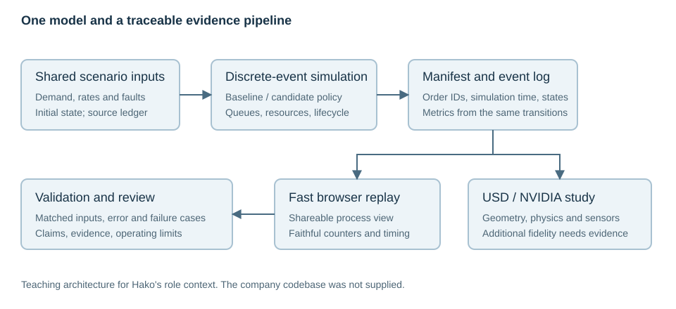

This book is for Aadil's engineering role at Hako: understanding and owning the warehouse simulation, strengthening orchestration evidence, and building a trustworthy shareable twin. You know Python and have NVIDIA GPU access. Robotics, spatial mathematics, simulation, and NVIDIA terminology begin from first principles.

The supplied engineer onboarding is the role-specific anchor. Its immediate priorities are the SimPy model, the policy comparison, and an event-driven web twin. The supplied learning path and roadmap add an NVIDIA specialization. This edition combines them in prerequisite order, corrects version-sensitive oversimplifications, and keeps company planning claims separate from independently observed results.

Read Chapter 2 first. Chapter 1 is an optional Python reference. Continue through Chapter 3 for the immediate simulation/replay work, then Chapters 4–6 for spatial and NVIDIA foundations. Read the conceptual sensor/ROS sections in Chapter 7 and use its implementation depth when a task requires it. Chapter 8 connects extensions, streaming, and agent tooling. Chapter 9 is optional learning/perception depth. Chapter 10 provides validation and the capstone.

The recurring warehouse example is a small synthetic teaching model. A scan-and-pick cell provides a manageable geometric subsystem. Neither reproduces Hako's unavailable code, site, robot assets, or measured operations. The advanced defect-detection example teaches evaluation mechanics and is not a newly inferred Hako requirement.

Use [the companion guide](COMPANION_GUIDE.md) for the eight-week core schedule, exact example commands, expected results, troubleshooting, and optional applications. Start the local browser companion with `node companion/server.mjs`. Every experiment states its model and limits. The actual implementation is included under `companion/` and `examples/`.

Conventions: meters, seconds, kilograms; right-handed Z-up world; radians for internal mathematical angles; explicit exceptions for degree-based APIs and optical camera frames. Times in teaching event logs are run-relative simulation seconds. Display interpolation, DES, physics, and live telemetry are distinct activities.

Documentation was checked for the November 12, 2026 edition. Native examples target Isaac Sim 6.2.0; CPU USD examples were executed with USD 26.5; SimPy examples with 4.1.1; Python with 3.12.14. Source access and version differences are recorded in [sources](SOURCES.md). See [verification](verification.md) for exactly what ran and what still requires native hardware/software.

You do not need to pass quizzes. Optional applications include reference code and observed outputs so you can inspect the reasoning at your pace. Take small sections as sessions; use a coach to explain any prerequisite before using it. The goal is understanding the relationships well enough to change a model and defend its results.
