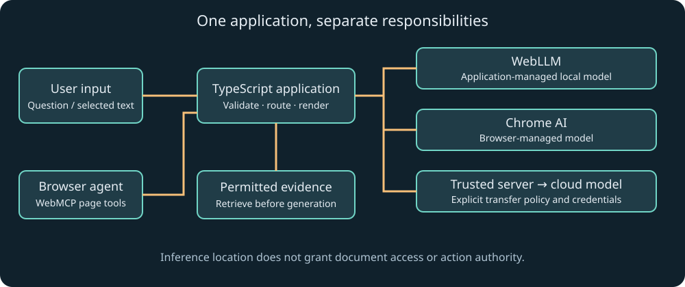

# 1. From text prediction to a language-model application

The central problem in this chapter is deceptively small: given some text, how can a program choose what comes next? If we understand that operation, we can reason about a chat interface, a document assistant, a local browser model, and an agent without treating any of them as magic. We will build a few numerical experiments in TypeScript, then connect them to the architecture of a real language model. The experiments are teaching models; none contains pretrained language-model weights.

You need only familiarity with variables, arrays, and function calls. A number array such as `[2, 1, 0]` is an ordered list of values. A function maps inputs to an output. A loop repeats an operation. We introduce probabilities and vectors when they first become useful. You do not need calculus or a machine-learning framework to follow the worked reasoning.

The companion's first experiment calculates sampling probabilities and a two-position attention mixture. The complete reusable implementation is in [core.ts](../src/core.ts), and [foundations.ts](../examples/foundations.ts) prints numerical results from Node. After installing the package as described in the README, run `npm run demo`. The first output is approximately `0.6652, 0.2447, 0.0900`. By the end of the chapter, each number will have a clear interpretation.

## Start with the job, then choose the machinery

Suppose a support application must turn a rough paragraph into a clear response. Traditional software can apply explicit substitutions: replace a known abbreviation, correct a known misspelling, or select a template. Those rules work well when the possible inputs and outputs are narrow. They become difficult to maintain when users describe the same problem in thousands of ways. A learned model supplies a flexible mapping whose behavior is determined by training examples and numerical parameters, rather than an exhaustive table of handwritten cases.

Artificial intelligence is the broad family of techniques used to perform tasks associated with perception, prediction, planning, and language. Machine learning is the subset in which behavior is learned from data. A neural network is a parameterized numerical program within machine learning. A language model assigns probabilities to sequences of language units. A large language model has enough learned capacity and training data to support many language tasks. These categories overlap; they do not describe interchangeable APIs.

The application around the model is equally important. It selects input, retrieves documents, constructs messages, invokes a runtime, validates output, and presents a result. A support assistant's decision to show a citation comes from application design. A model may propose the citation string, but your software must check that the identifier exists and the source supports the claim. The model is one component in a larger information system.

This distinction explains why buying access to a more capable model does not automatically fix bad document permissions, broken network handling, or an unsafe purchase workflow. Those failures occur outside the next-token computation. Conversely, a carefully bounded task with excellent evidence can work well with a relatively small model. Model quality and system quality interact, but they remain different engineering concerns.

## Characters, words, tokens, and bytes are different units

A computer stores encoded text as bytes. A browser string exposes UTF-16 code units through operations such as `.length`. A human sees characters and words. A tokenizer converts text into the sequence of integer identifiers consumed by a particular model. These layers have different boundaries. An emoji can occupy multiple string code units, and a familiar word can become several model tokens. A network chunk can split the bytes of one character.

Imagine a tiny tokenizer with the vocabulary `['<end>', 'The', ' browser', ' runs', ' locally', '.']`. It can represent `The browser runs locally.` as `[1, 2, 3, 4, 5]`. The spaces are deliberately included in several entries. A real tokenizer usually has a much larger vocabulary and a procedure for splitting unfamiliar text into available units. This example is a vocabulary lookup demonstration, not a description of every production tokenizer.

The model receives IDs, not an array of English words. Its tokenizer and output vocabulary must agree with its weights. Reusing a tokenizer from another model because its package is convenient can corrupt both input meaning and output decoding. When using WebLLM, keep the model configuration, tokenizer artifacts, compiled model library, and weights together as a compatible deployment unit. Chapter 4 develops that operational consequence.

Token counts matter because context limits and many service bills use tokens. A character estimate can be useful for an early user-interface warning, but it is not an exact token counter. The encoding used to measure this textbook's chapter length is also not automatically the encoding used by your chosen browser model. A measurement is meaningful only when you name what it measures.

To see the distinction without installing another tokenizer, execute this complete Node TypeScript example as an optional temporary file in the project:

```ts
const text = 'A café ☕';
const bytes = new TextEncoder().encode(text);
console.log({
  utf16CodeUnits: text.length,
  unicodeCodePoints: [...text].length,
  utf8Bytes: bytes.length
});
```

The values differ because each expression walks a different representation. `TextEncoder` produces UTF-8 bytes. Spreading the string iterates code points. Neither expression runs an LLM tokenizer. This small distinction will prevent a real streaming bug in the next chapter: concatenating independently decoded byte chunks can damage a split multibyte character.

## A model predicts a distribution, not a guaranteed fact

Suppose three possible next tokens have scores `[2, 1, 0]`. These scores, called logits, are unrestricted real numbers. They are not probabilities: they do not sum to one, and they could be negative. We want positive weights whose sum is one so we can interpret them as a distribution over alternatives.

Exponentiation turns each score into a positive weight. Dividing by the sum normalizes those weights. For logits 2, 1, and 0, the unnormalized weights are approximately 7.389, 2.718, and 1. Their total is 11.107. The resulting probabilities are about 0.6652, 0.2447, and 0.0900. Choosing the first token is likely, but another token remains possible when sampling.

For numerical stability, our implementation subtracts the largest logit before exponentiating. The shifted scores are `[0, -1, -2]`, producing weights `[1, 0.3679, 0.1353]`. Their normalized probabilities are unchanged because every original exponential was divided by the same constant. This avoids unnecessarily huge intermediate numbers for large positive logits.

Temperature changes the spread by dividing the shifted scores before exponentiation. A temperature below one sharpens differences; a value above one softens them. It does not add knowledge, inspect evidence, or verify arithmetic. Lower temperature may make a wrong answer more repeatable. The function below is the complete calculation used by the experiment:

```ts
export function probabilities(logits: number[], temperature = 1): number[] {
  if (!logits.length || temperature <= 0 ||
      !Number.isFinite(temperature) ||
      logits.some(value => !Number.isFinite(value))) {
    throw new RangeError('Use finite scores and positive temperature.');
  }
  const maximum = Math.max(...logits);
  const weights = logits.map(value =>
    Math.exp((value - maximum) / temperature));
  const total = weights.reduce((sum, value) => sum + value, 0);
  return weights.map(value => value / total);
}

console.log(probabilities([2, 1, 0]));
```

`map` constructs a new array by applying the callback to each entry. `reduce` accumulates a single sum. The explicit input checks keep impossible teaching inputs from quietly producing `NaN`. The actual project exports this operation as `softmax`. The name identifies the normalization operation, while this listing emphasizes its interpretation as a distribution.

Greedy decoding takes the highest-scoring token rather than sampling. Top-k sampling limits candidates to a fixed number. Top-p sampling keeps a set whose cumulative probability reaches a chosen threshold. Implementations differ in how these constraints interact. Do not copy a parameter set between providers without checking its contract. Chrome's current web Prompt API also does not share WebLLM's numerical sampling interface; chapter 5 treats that version-sensitive difference.

## Why the prediction becomes a response

Autoregressive generation repeats next-token prediction. Start with an input sequence, compute a distribution, select a token, append it, and repeat. Stop when a designated end token appears, a limit is reached, or the caller interrupts. A visible sentence is the decoded accumulation of many such decisions. The stream you render is usually text produced from these decisions, not one network event per token.

The probability of a complete sequence can be decomposed into conditional probabilities: the probability of the first output token given the prompt, multiplied by the probability of the next given the prompt and first token, and so on. If a two-token output has conditional probabilities 0.5 and 0.2, its sequence probability under that path is 0.1. This is a model likelihood, not a confidence score for the truth of the sentence.

This distinction matters for factual claims. A fluent continuation may be likely because it resembles common training patterns. The model need not possess a verified record that the claim is true. A fabricated reference can be linguistically plausible. Retrieval, tools, validators, and human review supply additional evidence and control, but none is created merely by setting temperature to zero.

The term hallucination commonly describes plausible-looking unsupported or false output. It is useful as a product-level symptom, but precise debugging needs more detail. Did retrieval miss the source? Did the source contain an error? Did the model ignore evidence? Did the interface attach the wrong citation? Each cause calls for a different fix. We will preserve those distinctions through the later evaluation chapter.

## Learned numbers: vectors before neural networks

A vector is an ordered list of numbers with a shared interpretation. In this book, `[1, 0]` and `[0, 1]` are two-dimensional vectors. They can represent toy directions, features, or internal states. Real language representations usually have many more dimensions, and their coordinates are learned rather than assigned English labels.

The dot product multiplies corresponding coordinates and adds the results. For `[1, 2]` and `[3, 4]`, it is `1×3 + 2×4 = 11`. This operation measures an alignment influenced by both direction and magnitude. A dense neural-network layer applies many weighted sums, then often a nonlinear function. A model parameter is one learned number participating in these transformations.

An embedding maps a discrete item, such as a token ID, into a vector. An embedding table is effectively a learned lookup table: ID 17 selects row 17. Contextual processing subsequently changes the representation according to neighboring tokens. The representation of a word in a sentence is therefore different from a timeless dictionary definition of that word.

Sentence embeddings used for search are a related but distinct application. Their training objective encourages useful relationships between whole passages or queries. You cannot assume that averaging arbitrary language-model token vectors yields a good search model. Chapter 3 uses a purpose-built embedding pipeline and keeps its vectors in a consistent space.

## Attention as a weighted information mixture

Consider a tiny document assistant deciding how strongly the current position should use two earlier positions. Represent the current information need as a query vector `q = [1, 0]`. Represent the two candidates as keys `k1 = [1, 0]` and `k2 = [0, 1]`. Their dot products with the query are 1 and 0. The first key aligns more strongly.

Scaled dot-product attention divides each score by the square root of the key dimension before applying softmax. Here the dimension is 2, so the scores become approximately `[0.7071, 0]`. Softmax produces weights near `[0.6698, 0.3302]`. Associate values `[10, 0]` and `[0, 10]` with the two keys. Their weighted mixture is approximately `[6.6976, 3.3024]`.

The output contains information from both values, with greater influence from the first. Keys determine compatibility; values supply the information being mixed. In a trained transformer, learned projections produce queries, keys, and values from internal representations. The toy vectors make the arithmetic visible but omit those projections and the many other layers of a language model.

The following integration listing runs against the included project and is complete:

```ts
import { attention } from '../src/core.ts';

const result = attention(
  [1, 0],
  [[1, 0], [0, 1]],
  [[10, 0], [0, 10]]
);

console.log(result.weights);
console.log(result.output);
```

Save it under `examples/` and run it with Node, or inspect the existing foundations example. The first argument has two coordinates, so each key must also have two. Each key has one matching value, and all values must share an output dimension. These shape relationships are part of the algorithm's contract, not incidental implementation details.

Multiple attention heads compute different mixtures, then combine their results. Positional information tells the network where tokens occur. Feed-forward sublayers transform each position's representation. Residual connections preserve pathways through the stack, and normalization manages numerical behavior. The original transformer paper is the historical source for the architecture; our two-vector calculation is an original simplification for learning. [Attention Is All You Need](https://arxiv.org/html/1706.03762v7) describes the full encoder-decoder model rather than every modern decoder variant.

## Causal masking and context

The information available at each position is part of the model's definition, not merely a user-interface preference.

For next-token training, a position must not use the future answer as input. A causal mask prevents attention to later positions. Otherwise a training system could appear to predict a token while directly reading it, a form of information leakage. At inference time, future tokens do not exist yet, so the allowed information naturally consists of the prompt and generated prefix.

A context window bounds the sequence the model can process in a particular invocation or session. The budget includes more than the user's latest sentence: system instructions, previous messages, retrieved evidence, tool descriptions, tool results, formatting tokens, and output reservation all consume capacity. Exact accounting depends on the model and runtime. A long advertised context does not promise equally good use of every position.

Attention also helps explain memory costs. During generation, runtimes often retain key and value states from earlier tokens instead of recomputing them from scratch. This KV cache grows with context length and architecture. It is separate from the fixed model weights. A small quantized model can still exhaust memory when its context is large or several sessions coexist.

The browser memory calculator later in the book estimates two lower bounds: compressed weights and the numerical KV tensor storage for a specified architecture. It intentionally omits scratch buffers, tokenizer state, GPU allocator behavior, and browser overhead. A lower bound is useful for ruling out impossible deployments; it is insufficient to certify that a model will fit.

## Training changes parameters; prompting changes inputs

During pretraining, a model processes many examples and updates its parameters to improve a learning objective, commonly predicting withheld or subsequent tokens. The loss quantifies prediction error. For a target token assigned probability `p`, negative log likelihood is `-ln(p)`. A probability of 0.5 gives a loss around 0.693, while 0.1 gives about 2.303. Assigning greater probability to the observed target lowers that example's loss.

Gradient-based optimization adjusts parameters in directions that reduce an estimated aggregate loss. You do not need to implement backpropagation to use browser inference, but you do need the boundary: training changes model weights, while an ordinary prompt call does not. A conversation remembered by a session is context retention, not automatic retraining of the foundation model.

Instruction tuning teaches response patterns from instruction-response examples. Preference optimization uses judgments about alternative responses to shape behavior. These stages can improve instruction following and usefulness, but they do not create a universal truth guarantee. [Training language models to follow instructions with human feedback](https://arxiv.org/abs/2203.02155) is an early primary account of one such pipeline, not a universal recipe for all current models.

Fine-tuning adapts a pretrained model using additional training. LoRA trains low-rank updates to selected weight matrices, reducing the number of trainable parameters relative to updating every weight. It still requires compatible tooling, data, evaluation, and deployment artifacts. The browser examples in this course perform inference; they do not train LoRA adapters or claim that arbitrary adapters work with every WebLLM build. See [LoRA](https://arxiv.org/abs/2106.09685) for the method's original motivation.

Retrieval changes what evidence enters the prompt. Tool use lets an application execute external operations. Fine-tuning changes learned behavior. These techniques solve different problems and can be combined. For a changing employee handbook, retrieval is often easier to update than weights. For a repetitive formatting behavior, supervised adaptation may be relevant. For checking an account balance, an authorized database operation is the appropriate source of truth.

## Multimodality and reasoning budgets

A multimodal model accepts more than text, such as images or audio. Input still needs preprocessing and a representation the model understands. An image may be resized and converted into visual features, while audio may be converted into sampled waveforms or features. Merely accepting a `Blob` in a JavaScript function does not prove that the selected model supports the content inside it.

Modalities affect performance and context accounting. A photographed page can introduce optical ambiguity, and a recorded conversation can contain personal data beyond the question being asked. A browser interface should show what is selected and let the user control it. The current Chrome Prompt API's supported input types and output limitations are a capability contract, treated separately in chapter 5.

Some model families spend additional computation producing intermediate reasoning before a final answer. Product interfaces and providers expose this in different ways. A larger generation budget can improve some tasks and still increase latency or cost. The application should evaluate the final task outcome, avoid displaying provider-designated internal reasoning as an ordinary answer, and use verified tools for calculations when correctness matters.

Neither a long response nor a persuasive explanation demonstrates that the underlying reasoning was correct. A practical assistant should expose evidence, calculations, and relevant uncertainty in a form the user can inspect. This is a system-design objective, not a request for the model to reveal inaccessible internals.

## Generalization, memorization, and uncertainty

A learned model can generalize when it applies patterns from training to a new input. It can also reproduce memorized fragments or fail on a distribution unlike its training data. These behaviors can coexist in the same model. A successful example does not tell you which mechanism produced it, and a fluent answer about an unfamiliar domain should not be treated as evidence of reliable expertise.

Consider a model trained on many ordinary support conversations. It may learn that “download failed” is often followed by advice about connectivity and storage. That pattern can be useful. If the real failure is an incompatible compiled model library, the familiar answer may be irrelevant. The application can improve the result by supplying actual error categories and relevant documentation rather than relying on generic completion patterns.

Uncertainty has several sources. The question may be ambiguous, the source collection incomplete, the model's learned representation inadequate, or the runtime output truncated. A model saying “I am 95 percent confident” does not identify or measure those sources. Prefer observable evidence: source coverage, validated calculations, known error rates on representative tasks, and explicit missing information.

A useful analogy is a skilled autocomplete system connected to an application. The autocomplete part predicts continuations; the application part can retrieve, calculate, validate, and act. The analogy is limited because modern models learn rich representations and can perform complex transformations. Its value is reminding us that the application must establish authority and evidence rather than accepting eloquence as proof.

For the rest of the course, treat every generated result as an output with a provenance and an intended use. A brainstorming suggestion can be accepted for inspiration. A quoted policy needs source support. A proposed action needs validation and authorization. This habit connects model understanding directly to engineering judgment.

## A map of the web AI ecosystem

There are three independent questions: where inference executes, who manages model artifacts, and how the application exposes actions. Cloud inference runs on a remote service. Application-managed local inference downloads model artifacts for a runtime such as WebLLM. Browser-managed inference delegates model management to built-in APIs. A hybrid application deliberately combines routes according to capability and data policy.

WebGPU is a browser compute and graphics API; it is not a language model. WebAssembly is a portable execution format; it does not automatically make an LLM fast enough. WebNN is a lower-level neural-network acceleration interface under standardization. Libraries such as ONNX Runtime Web, Transformers.js, and WebLLM sit at different abstraction levels and support different model formats and tasks.

WebMCP belongs on the action-exposure axis. It lets a page describe callable functionality to an agent-capable browser environment. It neither supplies a model nor makes the page into a network MCP endpoint. An application can expose a search tool through WebMCP while using a cloud model, a local model, or no embedded model at all. Keeping those axes separate prevents a large class of architectural confusion.

| Need | Relevant mechanism | What still belongs to the application |
| --- | --- | --- |
| Predict or rewrite language | Model inference | Input selection, validation, rendering |
| Find supporting passages | Retrieval | Permissions, provenance, freshness |
| Run locally with selected weights | WebLLM or another runtime | Downloads, compatibility, lifecycle |
| Use browser-managed task models | Chrome AI APIs | Capability checks, user experience |
| Expose page operations to agents | WebMCP | Runtime validation, authorization |

The table is a decision aid, not a ranking. A translator may be a better fit for a dedicated translation model than a general chat model. A deterministic rule can be better than either when the requirement is exact. Begin with the operation the product needs, then choose the smallest dependable mechanism that supports it.

## Follow the data rather than the branding

The architecture below separates user input, evidence selection, inference, and optional page tools. Arrows represent application-controlled data movement. A model's location can change without changing who is authorized to read a document or commit an action. This is the diagram to revisit whenever a new library claims to simplify the whole ecosystem.



## Use cases, mistakes, and a first application boundary

For a writing helper, the model produces a draft and the user reviews it. For a documentation assistant, retrieval supplies passages and the model synthesizes a cited answer. For an accessible interface, a page may expose meaningful operations through WebMCP so an agent can use application logic. For a privacy-sensitive offline notebook, local inference can keep selected text on the device after required downloads, provided the surrounding app also avoids transmitting it.

Common mistakes follow directly from the mental model. Treating token likelihood as truth creates overconfidence. Treating all browser APIs as available everywhere creates broken interfaces. Treating a TypeScript type as runtime validation trusts untrusted data. Treating a model-generated action as authorization delegates a security decision to probabilistic text. Each later chapter makes one of these boundaries concrete.

As an optional application, change the three logits in the companion, then lower and raise temperature. Observe the distribution rather than trying to memorize the formula. Next inspect the fixed attention example and compare its weighted output with the two value vectors. The result should lie between them because the nonnegative weights sum to one. This relationship is a useful mathematical check on the implementation.

The next chapter turns this conceptual machinery into an application boundary. We will use TypeScript to distinguish expected data from unknown data, separate local and remote execution, and stream text without confusing tokens, bytes, messages, or user authorization. Those are the practical foundations on which the more specialized browser APIs depend.
