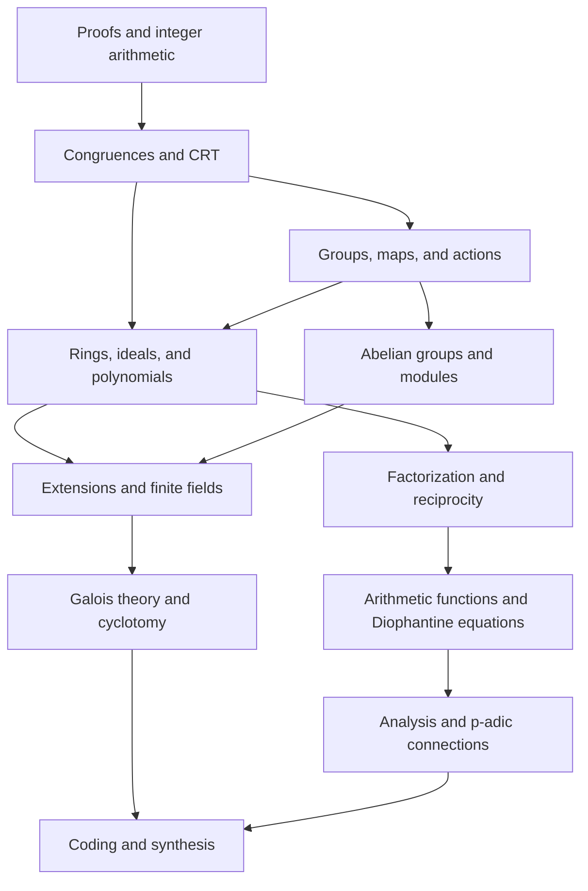

# Weekly syllabus and dependency map

This is an integrated thirty-week self-study plan. Each week has a number-theoretic question and an algebraic mechanism; the division into subjects is deliberately porous. Chapters include all teaching text, rather than only the outcomes below.

Plan several sessions per chapter. Read the main definitions, representative proofs, and worked examples first. Revisit optional deeper arguments over a longer calendar when needed. “Extension” describes material supplied in the chapter that can be delayed; it is not missing content. See the individual chapter for which proofs are complete and which general theorems are invoked.

## Semester 1

| Week | Chapter | What you should be able to explain |
| --- | --- | --- |
| 1 | [01 — Learning to prove: logic, sets, functions and induction](chapters/01-proofs-and-structures.md) | State quantified claims; distinguish examples from proof; use direct proof, contradiction, induction, and well-ordering. |
| 2 | [02 — Divisibility, Euclid and Bezout](chapters/02-euclidean-algorithm.md) | Run Euclid and extended Euclid; prove Bézout; solve a linear Diophantine equation and interpret all solutions. |
| 3 | [03 — Primes, unique factorization and valuations](chapters/03-primes-and-factorization.md) | Prove Euclid’s lemma and unique factorization without circularity; use valuations to compare divisibility. |
| 4 | [04 — Congruence, equivalence relations and residue classes](chapters/04-congruence-and-quotients.md) | Build an equivalence relation and define operations on residue classes independently of representatives. |
| 5 | [05 — Linear congruences and the Chinese remainder theorem](chapters/05-linear-congruences-and-crt.md) | Solve linear congruences; prove coprime CRT and the general compatibility criterion. |
| 6 | [06 — Groups, symmetry and subgroups](chapters/06-groups-and-symmetry.md) | Read group axioms through arithmetic and symmetry; distinguish an operation from its underlying set. |
| 7 | [07 — Cyclic groups, cosets and Lagrange](chapters/07-cyclic-groups-and-lagrange.md) | Use cyclic subgroups and cosets; prove Lagrange and identify its one-way implications. |
| 8 | [08 — Homomorphisms, normal subgroups and quotients](chapters/08-homomorphisms-and-quotient-groups.md) | Construct a homomorphism, kernel, normal subgroup and quotient; prove the first isomorphism theorem. |
| 9 | [09 — Units, orders, Fermat, Euler and RSA](chapters/09-units-orders-and-rsa.md) | Use modular orders and Euler/Fermat correctly; derive toy RSA and separate correctness from security. |
| 10 | [10 — Permutations, parity and alternating groups](chapters/10-permutations-and-alternating-groups.md) | Compose permutations right to left, calculate cycle type and parity, and recognize alternating groups. |
| 11 | [11 — Group actions, orbit-stabilizer and counting](chapters/11-group-actions-and-counting.md) | Compute orbits and stabilizers; derive Burnside’s lemma and the class equation. |
| 12 | [12 — Cauchy, Sylow and finite group structure](chapters/12-sylow-and-finite-groups.md) | Prove Cauchy/Sylow and use divisibility/congruence restrictions to constrain a finite group. |
| 13 | [13 — Rings, integral domains and fields](chapters/13-rings-domains-and-fields.md) | Distinguish rings, domains, fields, units and zero divisors; explain characteristic. |
| 14 | [14 — Ideals, quotient rings and ring CRT](chapters/14-ideals-and-ring-quotients.md) | Construct ideals and quotient rings; connect prime/maximal ideals to domains/fields and generalize CRT. |
| 15 | [15 — Polynomial arithmetic, roots and irreducibility](chapters/15-polynomial-arithmetic.md) | Divide polynomials over a field, prove root bounds, apply irreducibility tests and build a simple quotient field. |

## Semester 2

| Week | Chapter | What you should be able to explain |
| --- | --- | --- |
| 1 | [16 — Euclidean domains, PIDs, UFDs and Gaussian integers](chapters/16-ufds-and-gaussian-integers.md) | Explain Euclidean ⇒ PID ⇒ UFD and the failure of converses; factor in Gaussian integers. |
| 2 | [17 — Quadratic residues and the Legendre symbol](chapters/17-quadratic-residues.md) | Compute quadratic residues and Legendre symbols; derive Euler’s criterion and the supplementary laws. |
| 3 | [18 — Gauss lemma and quadratic reciprocity](chapters/18-quadratic-reciprocity.md) | Follow Gauss’s lemma and a full quadratic reciprocity proof; decide square solvability efficiently. |
| 4 | [19 — Arithmetic functions, convolution and Mobius inversion](chapters/19-arithmetic-functions.md) | Derive divisor-sum identities, Dirichlet convolution, multiplicativity, and Möbius inversion. |
| 5 | [20 — Diophantine equations, continued fractions and Pell](chapters/20-diophantine-and-continued-fractions.md) | Parametrize primitive Pythagorean triples; use continued fractions and Pell equations with justified existence. |
| 6 | [21 — Finite abelian groups, modules and Smith normal form](chapters/21-finite-abelian-groups.md) | Classify finite abelian groups; interpret generators/relations and a small Smith normal form. |
| 7 | [22 — Vector spaces, field extensions and constructibility](chapters/22-field-extensions.md) | Build bases and extension degrees; prove the tower law and use degree obstructions in construction problems. |
| 8 | [23 — Number fields, algebraic integers and failed factorization](chapters/23-number-fields-and-integers.md) | Work in a number field; distinguish algebraic numbers from algebraic integers and diagnose failed factorization. |
| 9 | [24 — Finite fields, Frobenius and polynomial factorization](chapters/24-finite-fields.md) | Construct finite fields, explain their existence/uniqueness and cyclic units, and calculate Frobenius. |
| 10 | [25 — Field automorphisms and the Galois correspondence](chapters/25-galois-correspondence.md) | Use normality, separability, fixed fields and the finite Galois correspondence with precise proof status. |
| 11 | [26 — Cyclotomic polynomials, roots of unity and regular polygons](chapters/26-cyclotomic-fields.md) | Derive cyclotomic polynomials and their irreducibility; connect roots of unity, modular units, and polygons. |
| 12 | [27 — Computing Galois groups and solvability by radicals](chapters/27-solvability-and-galois-computations.md) | Compute representative cubic/quartic/quintic groups; explain solvable groups and radical-solvability boundaries. |
| 13 | [28 — Analysis as needed: sums, limits, Euler products and primes](chapters/28-analysis-and-primes.md) | Rebuild limits, comparison, harmonic divergence and convergent Euler products; distinguish PNT evidence from proof. |
| 14 | [29 — Hensel lifting and a first look at p-adic integers](chapters/29-hensel-and-p-adic.md) | Prove simple-root Hensel lifting; interpret compatible residues and the elementary p-adic viewpoint. |
| 15 | [30 — Synthesis: finite-field coding and mathematical investigations](chapters/30-synthesis-and-coding.md) | Explain polynomial evaluation codes and erasure recovery; carry out investigations linking arithmetic and algebra. |

## Dependencies at the conceptual level

The detailed prerequisites are recorded by chapter number in `course-map.json`. A chapter can discuss a later destination without requiring its results. Local prerequisites are taught when needed: proof vocabulary in chapter 1, complex arithmetic in chapter 16, linear algebra in chapters 21–22, and limits/series in chapter 28.

## Optional deeper reading within the supplied course

- Chapter 12: Classification examples beyond the Sylow spine.
- Chapter 16: Longer Gaussian factorization investigations.
- Chapter 20: Deeper approximation and Pell-existence arguments.
- Chapter 21: Full Smith-form/classification proof.
- Chapter 23: Quadratic integers beyond basic examples.
- Chapter 25: Full general correspondence proof and extension lemmas.
- Chapter 26: Full regular-polygon classification.
- Chapter 27: General radical-solvability theorem and quintic computations.
- Chapter 28: Euler-product analysis beyond finite examples; PNT is stated, not proved.
- Chapter 29: The p-adic inverse-limit viewpoint.
- Chapter 30: Additional open-ended investigations.

## Completion evidence

A credible finish is a portfolio of explained solutions: at least one direct proof, contradiction proof, induction proof, quotient well-definition argument, non-example, field construction, and synthesis problem. The optional chapter exercises, `assessments.md`, and chapter 30 investigations supply choices. You need not complete every optional problem to follow the story; being able to explain a smaller set accurately is more useful than counting pages.
