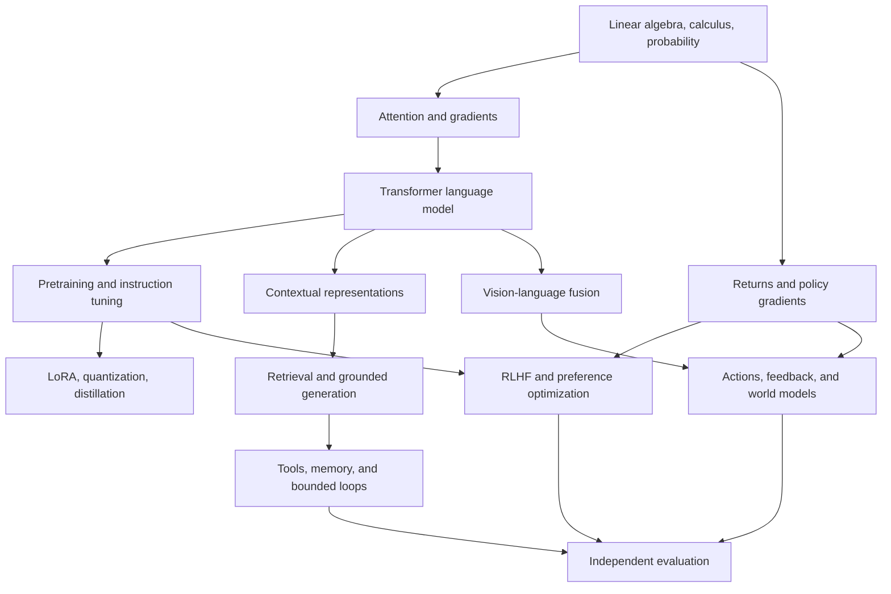

# How the pieces connect

Architecture describes the computation available to a model. Training determines which behaviors are learned from which data and feedback. Retrieval supplies external evidence at use time. An orchestration program chooses tool calls and maintains state. Evaluation measures whether the combined system satisfies a task. None of these layers alone substitutes for all the others.

Repeated depth inside a transformer, repeated model calls in an agent loop, and repeated training generations in an improvement experiment are three different forms of iteration. Their state, costs, persistence, and evidence requirements are different. Lessons 45, 49, and 50 separate them explicitly.
