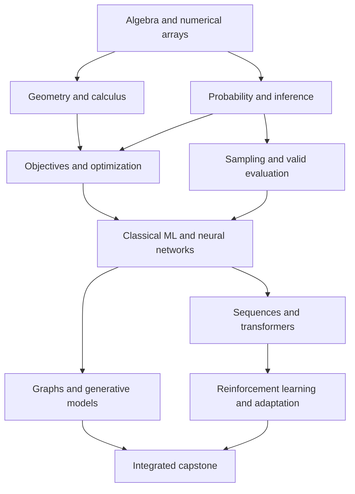

# Concept dependencies

The numbered reading order rebuilds all prerequisites before the corresponding model derivations. Framework workshops are optional alternative implementation treatments and retain their own internal section numbers. Cross references provide deeper treatment after the prerequisite definition has been introduced.
