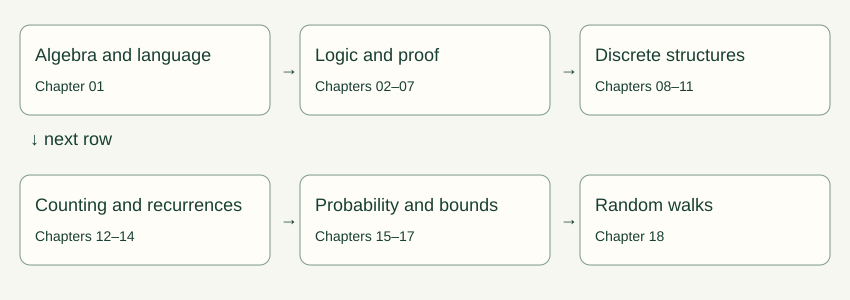
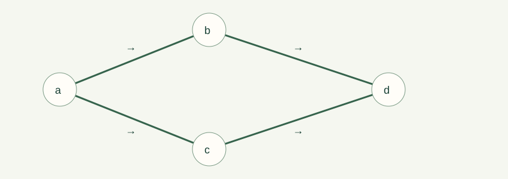
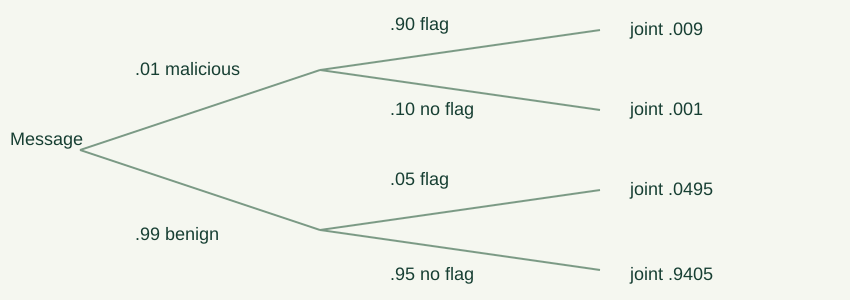

# Math for CS: From First Principles to Confident Reasoning

A beginner-oriented college curriculum and companion textbook

# Preface

A computer executes finite instructions, but our claims about it often cover infinitely many inputs. Testing a sorting routine on ten lists does not establish what it does on the eleventh. A graph drawing can suggest a route without proving it is shortest. A large average can coexist with an overwhelming chance of receiving almost nothing. Mathematics gives us a language for separating an observation, a model, and a conclusion justified by that model.

This book is for a beginner who wants to understand those distinctions without being rushed past the algebra. Each chapter begins with a problem, develops concrete examples, and then introduces the definitions that make the reasoning reusable. A formal proof is identified as a proof; a picture, analogy, or numerical experiment supports intuition but does not take its place. When a formula requires independence, positivity, finiteness, or an invertible quantity, that condition is part of the formula's meaning.

The original source is *Mathematics for Computer Science* by Eric Lehman, F. Thomson Leighton, and Albert R. Meyer, revision 3 March 2017. Its 22 chapters supply the scope. Our 18 chapters combine related topics, introduce prerequisites earlier, and use new explanations and small numerical examples. The [source crosswalk](coverage.md) records where every numbered instructional section belongs. Historical stories are treated as context, with the underlying mathematical lesson explained; references, glossary, and index are reading aids rather than additional mathematical units. The original exercise collections remain available in the user's source PDF and are assigned selectively in the curriculum.

## How to study

Read one section at a time. Before following a calculation, name the quantities and their domains: is a symbol an integer, a set, a proposition, or a probability? Copy one worked example, then alter a number and work it again. Optional chapter problems have stable labels, such as 03-A. Hints and full solutions are in separate files. A solution's conclusion matters less than the justification connecting one line to the next.

There are two kinds of laboratory result. Exact calculations enumerate a finite model or use integer arithmetic. Simulations generate samples and are labeled as estimates. A reset returns the same default parameters; seeded simulations also return the same sample sequence. A failed numerical conjecture is useful evidence against the conjecture. Agreement with a thousand samples does not prove a universal statement.

The curriculum schedules retrieval after one week and again after four weeks. Revisit a proof by reconstructing its plan, not by memorizing its wording. If a definition feels abstract, generate two examples and a non-example. If a proof feels mysterious, identify the statement available at each step and the statement needed next.

## Notation and conventions

We use $\mathbb N=\{0,1,2,\ldots\}$, $\mathbb Z$ for integers, $\mathbb Q$ for rational numbers, and $\mathbb R$ for real numbers. Positive integers are $\mathbb Z_{>0}$. Logarithms have a displayed base when it matters; $\ln$ means base $e$. For algorithm growth, changing a fixed logarithm base changes only a constant factor. Empty sums are zero and empty products are one. An empty string is $\varepsilon$. A function's domain and codomain are declared separately from the values it actually reaches.

Graphs are finite unless stated otherwise. A simple graph has no loops or parallel edges. Directed graphs can have loops when explicitly allowed. A walk can repeat vertices; a path cannot. Path length counts edges. Reachability includes length-zero walks unless a strict reachability relation is explicitly requested. Probability examples use discrete spaces; countably infinite sums are handled with convergence conditions stated where needed.

The source sometimes uses terminology differently. In particular, strict and weak partial orders are distinguished explicitly here; graph-network measurements state whether input/output terminal edges count. The source's minor characterization of planarity is conventionally called Wagner's theorem; Kuratowski's theorem uses subdivisions. Both appear with that distinction in Chapter 11.

This book teaches mathematical foundations for CS. It is not a complete degree in mathematics, and it does not add full courses in calculus, linear algebra, statistics, or numerical analysis that the PDF does not contain. Those are sensible subsequent studies once these discrete foundations are secure.

## Contents

- [01. Algebra and mathematical language](#chapter-01)
- [02. Logic: saying exactly what you mean](#chapter-02)
- [03. Building and checking proofs](#chapter-03)
- [04. Well ordering and induction](#chapter-04)
- [05. Sets, functions, relations, and finite size](#chapter-05)
- [06. State machines, invariants, and recursive objects](#chapter-06)
- [07. Infinity, diagonal arguments, and limits of computation](#chapter-07)
- [08. Number theory and modular arithmetic](#chapter-08)
- [09. Directed graphs, orders, and scheduling](#chapter-09)
- [10. Simple graphs and communication networks](#chapter-10)
- [11. Planarity, faces, and polyhedra](#chapter-11)
- [12. Sums, products, and growth rates](#chapter-12)
- [13. Counting without overcounting](#chapter-13)
- [14. Recurrences and generating functions](#chapter-14)
- [15. Probability spaces and conditional reasoning](#chapter-15)
- [16. Random variables and expectation](#chapter-16)
- [17. Variance, sampling, and tail bounds](#chapter-17)
- [18. Random walks and stationary distributions](#chapter-18)
- [References and included projects](#end-material)

# Language and proof

We begin with the language of quantities and statements, then learn how definitions and induction support guarantees about programs and mathematical objects.

## 01. Algebra and mathematical language

An algorithm doubles the size of its table whenever the table fills. After several doublings, how much space does it use? A probability calculation says that a chance is $3/8$. How large is that? A runtime analysis contains $\sum_{i=1}^n i$. What operation is the notation asking us to perform? These are different questions, but they share a small mathematical vocabulary. We build it here before using it in proofs.

### Numbers, operations, and exact answers

The nonnegative integers are $0,1,2,\ldots$. Integers also include their negatives. A rational number is $a/b$, with integers $a,b$ and $b\ne0$. The denominator names the size of a unit piece and the numerator counts those pieces. Thus $3/4$ is three pieces of size one quarter, not two unrelated numbers. Equivalent fractions describe the same quantity: $3/4=6/8$ because dividing every quarter into two eighths doubles both counts.

Addition needs a common unit. To add $2/3$ and $1/4$, use twelfths:

$$\frac23+\frac14=\frac8{12}+\frac3{12}=\frac{11}{12}.$$

Multiplication asks for a fraction of a quantity. Two thirds of three fifths is $(2\cdot3)/(3\cdot5)=2/5$. Division by a nonzero fraction multiplies by its reciprocal: $(3/4)/(2/5)=(3/4)(5/2)=15/8$. Division by zero is undefined because no number multiplied by zero can recover a nonzero dividend; even $0/0$ fails to specify a unique answer.

Exact fractions are especially useful in probability. The decimal $0.333$ is not exactly $1/3$. Rounding too early can make probabilities appear to sum to $0.999$ rather than $1$. Keep exact forms until interpreting a final result. The scientific notation $2.4\times10^6$ means $2{,}400{,}000$, while $2.4\times10^{-6}$ means $0.0000024$. A negative exponent does not make a number negative; it takes a reciprocal.

Signed numbers represent direction relative to zero. The quantity $-3+5$ is $2$. Multiplying two negative numbers gives a positive number, as required by distributivity: $0=(-1)(1+(-1))=(-1)+(-1)(-1)$, so $(-1)(-1)=1$. Parentheses matter: $(-3)^2=9$, whereas $-3^2=-(3^2)=-9$ under the usual order of operations. When in doubt, write parentheses rather than relying on a reader to infer them.

### Expressions are descriptions; equations are claims

An expression such as $2x+3$ describes a value after $x$ is specified. An equation such as $2x+3=11$ claims equality. Solving asks for all values in the stated domain that make the claim true. Subtracting three from both sides gives $2x=8$, and dividing both sides by two gives $x=4$. Substitution checks the result: $2(4)+3=11$.

Every transformation needs a reason. Adding the same quantity to both sides preserves equality. Multiplication by a nonzero number is reversible. Multiplication by zero is not reversible because it erases information. Squaring is also not reversible on all real numbers: $x=2$ implies $x^2=4$, but $x^2=4$ permits both $2$ and $-2$.

For example, solve $\sqrt{x+5}=x-1$ over the reals. The square root requires $x\ge-5$ and its nonnegativity requires $x\ge1$. Squaring yields $x+5=x^2-2x+1$, or $x^2-3x-4=0$. Factoring gives $(x-4)(x+1)=0$, so the candidates are $4$ and $-1$. Only $4$ satisfies the original equation. The candidate $-1$ arose because squaring forgot the sign condition.

An identity holds for every allowed input, such as $(x+1)^2=x^2+2x+1$. A conditional equation holds only for particular inputs, such as $x^2=9$. Writing a string of equal signs asserts that every item in the string has the same value. Do not write $x+2=7=5$ when you mean that the solution of $x+2=7$ is $x=5$.

### Distributivity, factoring, and cancellation

Distributivity states $a(b+c)=ab+ac$. It explains why $(x+2)(x+3)=x^2+5x+6$: each term in the first factor multiplies each term in the second. Factoring reverses that process. The difference of squares is $a^2-b^2=(a-b)(a+b)$ because the middle terms cancel when the product is expanded.

Cancellation applies to factors, not arbitrary pieces of sums. For $x\ne0$,

$$\frac{x^2+3x}{x}=\frac{x(x+3)}x=x+3.$$

But $(x+3)/x$ does not simplify to $3$. It is $1+3/x$. Likewise, $(x^2-1)/(x-1)=x+1$ only for $x\ne1$. The simplified expression is defined at $1$, but the original quotient is not. Algebraic simplification does not automatically enlarge a function's original domain.

Factoring helps proofs as much as calculations. To show $n^2+n$ is even, rewrite it as $n(n+1)$. One of two consecutive integers is even, so their product is even. The rewriting reveals structure that direct substitution at a few values would conceal. We will later supply the exact definitions that turn this observation into a proof.

### Inequalities and absolute distance

The statement $x<y$ places $x$ to the left of $y$ on the number line. Adding the same quantity preserves the order. Multiplying by a positive number preserves it; multiplying by a negative number reverses it. Thus $-2x<6$ gives $x>-3$. Dividing by an unknown $x$ requires knowing its sign, so split into cases before doing so.

Absolute value measures distance from zero: $|x|=x$ for $x\ge0$ and $|x|=-x$ for $x<0$. Consequently $|x-5|\le2$ means the distance from $x$ to five is at most two. It is equivalent to $3\le x\le7$. Later, $|X-\mu|\ge t$ will mean a random result is at least $t$ away from its mean in either direction.

Bounding can be more useful than solving exactly. If $0\le x\le1$, then $x^2\le x$ because multiplying $x\le1$ by the nonnegative $x$ preserves order. This fails for $x=2$. Conditions are part of the statement, not decorations around it. To estimate a sum of nonnegative terms, replacing each term by an upper bound gives an upper bound for the sum. Replacing one term by a smaller quantity gives the wrong direction.

### Exponents and logarithms

For a positive integer $k$, $a^k$ is the product of $k$ copies of $a$. For nonzero $a$, define $a^0=1$ and $a^{-k}=1/a^k$. These choices preserve $a^{u+v}=a^ua^v$. Also $(a^u)^v=a^{uv}$ and $(ab)^u=a^ub^u$ where the expressions are defined. Addition has no corresponding rule: generally $(a+b)^2\ne a^2+b^2$.

If a table begins with four cells and doubles $k$ times, its capacity is $4\cdot2^k$. After three doublings it is $4\cdot8=32$. To reach at least $100$ cells requires $2^k\ge25$. A logarithm reverses exponentiation. For $b>0$, $b\ne1$, and $x>0$, $\log_b x=y$ means $b^y=x$. Since $2^4<25<2^5$, the least integral $k$ is five.

The identities $\log_b(xy)=\log_bx+\log_by$ and $\log_b(x^r)=r\log_bx$ come from exponent laws. If $x=b^u$ and $y=b^v$, then $xy=b^{u+v}$; applying the inverse operation gives the first identity. There is no rule $\log(x+y)=\log x+\log y$. For example, $\log_2(4+4)=3$, while $\log_24+\log_24=4$.

Change of base gives $\log_b x=\ln x/\ln b$. Therefore base-two and natural logarithms grow at the same rate up to a fixed multiplier. This is why algorithm analysis often writes $O(\log n)$ without a base. Exact numerical calculations still require one. The number $e\approx2.71828$ is a special exponential base; properties needed for sum estimates will be introduced when used.

### Floors, ceilings, and integer constraints

The floor $\lfloor x\rfloor$ is the greatest integer at most $x$. The ceiling $\lceil x\rceil$ is the least integer at least $x$. Thus $\lfloor3.2\rfloor=3$, $\lceil3.2\rceil=4$, but $\lfloor-3.2\rfloor=-4$. Floor does not merely discard decimal digits for negative inputs.

Packing $23$ objects into boxes holding at most five requires $\lceil23/5\rceil=5$ boxes. Four boxes hold only twenty. Distributing the same objects among five boxes guarantees at least one box with $\lceil23/5\rceil=5$ objects. The second statement is the pigeonhole principle, which we will prove in its general form.

For integer $n$ and positive integer $d$, division with remainder writes $n=dq+r$ with $0\le r<d$. For $n=23,d=5$, we obtain $q=4,r=3$. For $n=-3,d=5$, we obtain $q=-1,r=2$ because $-3=5(-1)+2$. Programming languages differ in how a remainder operator handles negative operands. Our mathematical remainder always uses the displayed interval.

### Sequences, sums, and products

A sequence is an ordered collection of entries. Let $a_i=2i+1$ for $i=0,1,2,\ldots$. Its first entries are $1,3,5,7$. The subscript is an index, not an exponent. The notation

$$\sum_{i=0}^{3}a_i=a_0+a_1+a_2+a_3=1+3+5+7=16$$

uses $i$ as a temporary name. Replacing it throughout by $j$ changes nothing. The bounds include both endpoints, so the sum has four terms. In $\sum_{i=1}^n c=nc$, a constant appears $n$ times. In $\sum_{i=1}^n i$, the term changes with the index.

Linearity of finite sums follows from rearranging additions:

$$\sum_{i=1}^n(2i+3)=2\sum_{i=1}^n i+3n.$$

To find $1+2+\cdots+n$, add it to the reversed sum. Each of the $n$ pairs equals $n+1$, so twice the desired sum is $n(n+1)$. Therefore the sum is $n(n+1)/2$. For $n=5$, it gives $15$, matching $1+2+3+4+5$.

A product uses $\prod$. Thus $\prod_{i=1}^4 i=24$. The factorial $n!$ is this product through $n$, with $0!=1$. That convention is useful because there is one way to arrange no objects: do nothing. Empty sums equal zero, the identity for addition; empty products equal one, the identity for multiplication. These conventions make formulas continue to work at boundary cases.

### Functions and mathematical models

A function assigns one output to each input in a specified domain. If $f(n)=2n+1$ on $\mathbb N$, then $f(3)=7$. The parentheses indicate evaluation, not multiplication. A formula alone need not specify the domain: $1/x$ behaves differently if inputs are positive integers, nonzero reals, or residues modulo a number.

To model an operation count, first identify the input size. Suppose an algorithm compares every unordered pair among $n$ records exactly once. For the first record there are $n-1$ later partners, then $n-2$, down to zero. The count is $n(n-1)/2$. At $n=4$, the pairs are $12,13,14,23,24,34$, giving six. This is a mathematical model of the stated comparison pattern, not a claim about every program that handles four records.

A model has assumptions and consequences. If self-comparisons are included, add $n$; if ordered pairs are compared, the count changes to $n(n-1)$. Before manipulating a formula, describe what one term counts. This habit prevents many later errors in counting and probability.

### Reading nested notation without rushing

An unfamiliar formula becomes more manageable when read from its outermost operation inward. In $\sum_{i=1}^n(i^2+1)$, the outer operation adds one value for each index. The inner expression says how to obtain that value. At $n=3$, the values are two, five, and ten, so the total is seventeen. The parentheses are not a request to square the entire sum. In $(\sum_{i=1}^n i)^2$, by contrast, the sum is computed first and that one result is squared. At three, the answer is thirty-six.

The distinction can be explained through multiplication. Squaring $a+b$ produces $a^2+2ab+b^2$, so squaring a sum introduces cross terms. A sum of squares omits them. This is why variance later involves both a second moment and the square of a first moment: they are related but different quantities. An early habit of naming the outer operation prevents a later statistical misconception.

When several indices appear, assign them separate jobs. In $\sum_{i=1}^2\sum_{j=1}^3(i+j)$, hold $i$ fixed while the inner sum runs through $j=1,2,3$. At $i=1$, the row is two, three, four, totaling nine. At $i=2$, it is three, four, five, totaling twelve. The final result is twenty-one. Drawing a two-row, three-column table exposes what each ordered pair contributes.

### Rates, proportions, and units

A rate connects two kinds of quantity. If a process handles eight records per second, then processing twenty-four records takes three seconds under a constant-rate model. Dividing records by records per second leaves seconds. This dimensional check is useful even in abstract CS examples: bytes, bits, comparisons, seconds, and probabilities should not be silently mixed.

A percentage is a fraction with denominator one hundred. Twenty percent means one fifth. Increasing a quantity by twenty percent multiplies it by 1.2; decreasing the result by twenty percent multiplies it by 0.8. Their product is 0.96, so the two changes do not cancel. A rise from probability 0.1 to 0.2 is an increase of 0.1, or ten percentage points, and a relative increase of one hundred percent. Both descriptions are correct but answer different questions.

This matters when comparing algorithms. A runtime falling from ten seconds to five has decreased by fifty percent, while the processing rate has doubled. Before accepting a numerical improvement claim, identify which quantity is being compared and what denominator defines the percentage. Mathematics cannot repair an ambiguous measurement after the fact; the model must specify it.

### Approximation, rounding, and sanity checks

An exact answer such as $\sqrt2$ can be represented approximately as 1.4142. The approximation sign $\approx$ distinguishes this from equality. If an intermediate approximation is rounded repeatedly, the final error can accumulate. Keep several extra digits during a numerical calculation and round when communicating the final result, while preserving exact expressions when they are short enough to interpret.

Absolute error measures the difference from a target value; relative error divides that difference by the magnitude of the target, when nonzero. An error of one is small for a million but large for a value of two. Relative error is undefined relative to zero, so near-zero quantities often need an absolute tolerance. The companion's numerical reports use tolerances for this reason rather than demanding character-for-character equality of decimal strings.

Check scale before detailed arithmetic. A probability must lie between zero and one. The average of finitely many real values with nonnegative weights totaling one must lie between the minimum and maximum. A count of unordered pairs from ten objects cannot exceed the count of ordered pairs. Such bounds do not prove an answer correct, but they can disprove an impossible answer immediately and direct attention to the likely error.

### Testing a model at zero and one

A formula for unordered pairs, $n(n-1)/2$, gives zero at both zero and one objects. That matches the meaning: a pair needs two distinct objects. A formula $n^2/2$ would instead give one half at one object, exposing a modeling mistake even though its large-input scale is similar. Boundary checks are especially helpful when a sum's lower limit or a recurrence's initial condition is uncertain.

The same habit checks a doubling formula. After zero doublings, $a2^0=a$, which recovers the initial capacity. Writing $a2^{k+1}$ would fail that test unless the index had deliberately been shifted. Zero is not always a trivial case; it often determines the correct interpretation of an index. Always state whether an index counts operations already performed, the current stage, or the next stage to execute.

In a handwritten solution, place a short reason beside any step that changes the solution set or an inequality direction. This makes checking possible without guessing your intention. As the course progresses, these annotations become proof sentences; the underlying habit remains to connect every transformation with the law that permits it.

### Working habits and optional practice

Use a line for each substantial algebraic operation. Keep restrictions visible, especially denominators, square roots, and integer constraints. Check a proposed identity at an easy value to catch mistakes, while remembering that a successful check is not a proof. Draw a number line for inequalities and list a tiny instance before writing a general sum. These are ways to discover reasoning; the later proof must explain why the reasoning applies to all permitted inputs.

The companion's growth lab lets you change $n$ and compare $n$, $n\log_2 n$, $n^2$, and $2^n$. Compare ratios as well as absolute values. A graph at small $n$ cannot establish a statement about all large $n$.

**01-A.** Simplify $(x^2-4)/(x-2)$ and state its original domain. **01-B.** Solve $-3x+4\le10$. **01-C.** A table starts with six cells and doubles repeatedly. Find the least number of doublings needed for at least 150 cells. **01-D.** Expand $\sum_{i=0}^3(2i+2)$ and calculate it two ways. **01-E.** Explain why checking an identity at $x=0$ does not prove it for all real $x$.

Hints and answers are separated in the practice files. The next chapter uses these calculation skills to study statements themselves: what they mean, how they combine, and what follows from them.

[Back to contents](#contents)

## 02. Logic: saying exactly what you mean

A program grants access when a person is an administrator or owns a document. Does “or” allow a person who satisfies both conditions? If access is granted, must the person be an administrator? Mathematical logic makes questions like these precise. It describes which combinations of claims are true and which conclusions follow from assumptions.

Prerequisites are the distinction between an expression and an equation from Chapter 01. We need no special knowledge of circuits or programming. The source connections are Chapter 3 and the proposition/predicate material in Chapter 1.

### Propositions and connectives

A proposition is a declarative claim with a truth value once its context is fixed. “Nine is odd” is true; “nine is prime” is false. A command such as “open the file” is not a proposition. The expression “$x$ is odd” is a predicate whose truth depends on an input. Supplying $x=9$ produces a proposition.

For propositions $P,Q$, negation $\neg P$ is true exactly when $P$ is false. Conjunction $P\land Q$ requires both. Disjunction $P\lor Q$ requires at least one, including both. Exclusive or, $P\oplus Q$, requires exactly one. Unless explicitly qualified, mathematical “or” is inclusive.

The implication $P\Rightarrow Q$ excludes precisely the situation where $P$ is true and $Q$ false. It says that whenever the assumption holds, the conclusion holds. It does not assert that the assumption holds, or that the assumption causes the conclusion. Its truth table is:

| $P$ | $Q$ | $P\Rightarrow Q$ | $P\land Q$ | $P\lor Q$ |
|---|---|---|---|---|
| T | T | T | T | T |
| T | F | F | F | T |
| F | T | T | F | T |
| F | F | T | F | F |

Why count a false-premise implication as true? A universal rule about administrators is violated by an administrator denied access; it says nothing about what happens to a nonadministrator. An input outside the rule's hypothesis cannot refute the rule. This is called vacuous truth. It is a convention with useful and consistent consequences, not a claim that false assumptions reveal facts about the world.

“$P$ only if $Q$” means $P\Rightarrow Q$: $Q$ is necessary for $P$. “$P$ if $Q$” means $Q\Rightarrow P$: $Q$ is sufficient for $P$. “$P$ if and only if $Q$” means both directions, written $P\Leftrightarrow Q$. Translate these words carefully. “A number is divisible by four only if it is even” does not say every even number is divisible by four.

### Equivalence is agreement in every case

Two formulas are logically equivalent when every assignment of truth values gives them the same value. The identity

$$P\Rightarrow Q\quad\equiv\quad\neg P\lor Q$$

follows by checking the four rows above: both sides are false exactly at $P=\mathrm T,Q=\mathrm F$. It lets us rewrite implication using only negation and or. A tautology is true under every assignment, such as $P\lor\neg P$. A contradiction is false under every assignment, such as $P\land\neg P$. A satisfiable formula has at least one true assignment; it need not be a tautology.

De Morgan's laws are

$$\neg(P\land Q)\equiv\neg P\lor\neg Q,\qquad
\neg(P\lor Q)\equiv\neg P\land\neg Q.$$

To see the first, “not both” permits the first to fail, the second to fail, or both to fail. It does not demand both failures. For example, denying access under the rule $A\lor O$ means neither administrator nor owner: $\neg A\land\neg O$. Denying access under $A\land O$ means at least one condition fails.

The distributive law $P\land(Q\lor R)\equiv(P\land Q)\lor(P\land R)$ has the same structural shape as arithmetic distributivity. Logic also has the dual law $P\lor(Q\land R)\equiv(P\lor Q)\land(P\lor R)$. Do not transfer all arithmetic rules blindly: $P\lor P\equiv P$, whereas $x+x$ generally differs from $x$. Logical formulas describe truth, not numeric magnitude.

An equivalence may be justified by a truth table or by a sequence of known equivalences. For example,

$$\neg(P\Rightarrow Q)\equiv\neg(\neg P\lor Q)
\equiv P\land\neg Q.$$

Thus refuting an implication requires establishing the hypothesis and failing conclusion together. Merely showing a false conclusion when the hypothesis is false accomplishes nothing.

### Valid reasoning and seductive errors

A rule of inference is sound if true premises always yield a true conclusion. Modus ponens uses $P$ and $P\Rightarrow Q$ to infer $Q$. Hypothetical syllogism uses $P\Rightarrow Q$ and $Q\Rightarrow R$ to infer $P\Rightarrow R$. These rules justify proof steps.

Affirming the consequent is invalid: $P\Rightarrow Q$ and $Q$ do not imply $P$. If divisibility by four implies evenness, knowing that six is even does not make it divisible by four. Denying the antecedent is also invalid: $P\Rightarrow Q$ and $\neg P$ do not imply $\neg Q$.

The contrapositive $\neg Q\Rightarrow\neg P$ is equivalent to $P\Rightarrow Q$, because both fail only when $P$ is true and $Q$ false. The converse $Q\Rightarrow P$ is a different claim. This distinction will drive proof strategies in Chapter 03.

When evaluating a proposed rule, search for one truth assignment with all premises true and conclusion false. A single such assignment disproves validity. For instance, the rule “$P\lor Q$, therefore $P$” fails at $P=\mathrm F,Q=\mathrm T$. The task is not to find a story making the conclusion plausible; it is to test whether failure is logically possible.

### Predicates require domains

Let $E(n)$ mean “$n$ is even.” The notation $E(4)$ is true and $E(5)$ false. The statement $\forall n\in\mathbb Z,E(n)$ is false. The statement $\exists n\in\mathbb Z,E(n)$ is true. Universal quantification means every permitted input; existential quantification means at least one permitted input.

Domains matter. The claim $\forall x, x^2\ge x$ is true for integer $x$ but false over all reals, since $x=1/2$ gives $1/4<1/2$. State the domain before proving a quantified statement. A variable is free if no surrounding quantifier binds it. The formula $\forall x, x+y>0$ still depends on $y$; it is not a closed proposition until $y$ is fixed or quantified.

To prove $\forall x\in D,P(x)$, choose an arbitrary $x$ in $D$ and reason without assuming a special property absent from the domain. To prove $\exists x\in D,P(x)$, supply a witness and verify it, or use another argument establishing existence. To refute a universal statement, one counterexample suffices. To refute an existential statement, every possible witness must be ruled out.

The empty domain is a useful edge case. The claim $\forall x\in\varnothing,P(x)$ is true because there is no counterexample. The claim $\exists x\in\varnothing,P(x)$ is false because there is no witness. These conventions are compatible with the meaning of implication and make set-theoretic definitions work uniformly.

### Negating quantified statements

“Not every input succeeds” means “some input fails,” not “every input fails.” Formally,

$$\neg\forall x\in D,P(x)\equiv\exists x\in D,\neg P(x),$$
$$\neg\exists x\in D,P(x)\equiv\forall x\in D,\neg P(x).$$

Negation flips the quantifier and negates its body. For several quantifiers, work from the outside inward. The negation of

$$\forall n\in\mathbb N\ \exists m\in\mathbb N:\ m>n$$

is $\exists n\in\mathbb N\ \forall m\in\mathbb N:m\le n$. The original is true, witnessed by $m=n+1$; the negation claims a largest natural number.

For a program specification, “every request eventually receives some response” has the shape $\forall r\exists s,R(r,s)$. Its negation is $\exists r\forall s,\neg R(r,s)$: at least one request has no qualifying response. A response being late on some particular test does not by itself establish this negation unless “qualifying” includes the deadline and the test measures it.

### Quantifier order expresses dependency

The statements $\forall x\exists y,y>x$ and $\exists y\forall x,y>x$ are different. In the first, $y$ may depend on $x$; choose $x+1$. In the second, a single fixed $y$ must exceed every $x$, impossible over the integers. Think of a game: in the first statement, you see $x$ before choosing $y$; in the second, you must commit to $y$ before seeing $x$.

An equality such as $\forall x\exists y,x+y=0$ over integers is true with $y=-x$. Reversing the quantifiers asks for one integer that cancels every integer. Substituting $x=0$ requires $y=0$, while $x=1$ requires $y=-1$, a contradiction. This tiny pair of cases exposes the dependency error.

Quantifiers of the same kind commute: $\forall x\forall y$ can be reversed, as can $\exists x\exists y$. Mixed quantifiers generally cannot. Moving a quantifier through a connective can also require conditions, including whether a variable is free in the other expression. For beginning proofs, preserve scope with parentheses and avoid clever rearrangements unless justified.

### Boolean formulas, normal forms, and SAT

A Boolean variable takes values true or false. A literal is a variable or its negation. A clause is an or of literals. A formula in conjunctive normal form, or CNF, is an and of clauses. For example,

$$F=(P\lor Q)\land(\neg P\lor R)\land(\neg Q\lor R)$$

is satisfied by $P=\mathrm T,Q=\mathrm F,R=\mathrm T$. It is not satisfied by $R=\mathrm F$: the last two clauses would require both $P$ and $Q$ false, contradicting the first clause.

The satisfiability problem, SAT, asks whether some assignment satisfies a formula. With $k$ variables, exhaustive checking considers $2^k$ assignments. This is a correct decision procedure for a finite formula, though often costly. Saying that exhaustive checking is exponential does not prove every conceivable method requires exponential time. Distinguish the cost of one method from a lower bound on all methods.

Constraints can be encoded as formulas. Suppose exactly one of three tasks may run. “At least one” is $A\lor B\lor C$. “At most one” is $(\neg A\lor\neg B)\land(\neg A\lor\neg C)\land(\neg B\lor\neg C)$. Conjoining them expresses exactly one. Omitting the first clause would allow none; omitting pairwise exclusions would allow several.

Truth tables also produce a disjunctive normal form by taking an and describing each satisfying row and joining those terms with or. This representation proves every Boolean function can be described with standard connectives, but it may be large. Equivalent representations can differ greatly in size, a recurring concern in computing.

### Logic in programs and specifications

Many programming languages evaluate Boolean expressions from left to right with short-circuit behavior: after a false first operand, an and expression may skip the second operand. The truth function still matches conjunction for side-effect-free Boolean inputs. Evaluation behavior adds another issue when an operand changes state or is undefined.

Consider the mathematical guard $x\ne0\land 10/x>2$. The intended program should check $x\ne0$ before dividing. A mathematical conjunction describes truth; a concrete programming language also specifies evaluation order, types, overflow, and errors. Our proofs about a model must identify which programming behavior is represented. A proof over unbounded integers does not automatically certify fixed-width machine arithmetic.

Translate a specification in both directions. If access requires being logged in and either administrator or owner, write $L\land(A\lor O)$. An error such as $(L\land A)\lor O$ grants an owner access without login. Setting $L=\mathrm F,A=\mathrm F,O=\mathrm T$ separates the two formulas. Small counterexample assignments are a practical debugging tool.

### Translating a specification in stages

Consider the requirement “every stored file has an owner who can read it.” Let $F(f)$ mean that $f$ is a stored file, $U(u)$ that $u$ is a user, $O(u,f)$ that $u$ owns $f$, and $R(u,f)$ that $u$ can read $f$. One precise version is $\forall f\,(F(f)\Rightarrow\exists u\,(U(u)\land O(u,f)\land R(u,f)))$. The owner may differ from file to file. Moving the user quantifier outside would assert one user who owns and can read every file, a much stronger claim.

Negate the original step by step. A failure is some stored file for which no user is both an owner and a reader. That means every candidate user fails at least one of the required conditions. It does not mean that the file has no owner at all, since an owner might lack read permission. Naming the predicates prevents ordinary-language shortcuts from silently altering the requirement.

Uniqueness also requires an additional condition. “Every file has exactly one owner” is not expressed by an existential quantifier alone. It requires an owner $u$ and a statement that every other owner $v$ equals $u$. This distinction is directly analogous to existence and uniqueness of an equation's solution. A database with two owners satisfies “has an owner” while violating “has exactly one owner.”

### Constructing and auditing a full truth table

For three variables there are eight assignments. List them systematically by binary counting rather than inventing rows at random: FFF, FFT, FTF, FTT, TFF, TFT, TTF, TTT. Compute subexpressions in separate columns before the final expression. For $(P\lor Q)\land\neg R$, first calculate $P\lor Q$, then $\neg R$, then their conjunction. The formula is true exactly when at least one of the first two variables is true and the third is false.

To test whether two formulas are equivalent, compare their final columns on the same assignment rows. To test whether premises entail a conclusion, inspect only rows where every premise is true. A row where a premise is false does not refute the inference, even if the conclusion is false there. This distinction between formula evaluation and argument validity prevents a common misreading of truth tables.

A finite truth table is exhaustive for its declared Boolean variables. That exhaustiveness explains its proof status for propositional equivalence. It does not extend to an arbitrary domain of integers merely by replacing variables with sample values. The proof obligation changes when quantifiers range over an infinite set. Understanding why an exhaustive method is exhaustive matters as much as carrying out the entries.

### Local rules and global constraints

SAT encodings often introduce auxiliary variables for intermediate values. For an and gate with output $Z$ and inputs $P,Q$, the desired relationship is $Z\Leftrightarrow(P\land Q)$. It can be written as clauses $(\neg Z\lor P)\land(\neg Z\lor Q)\land(Z\lor\neg P\lor\neg Q)$. The first two clauses say a true output requires both true inputs; the third says both true inputs require a true output. Omitting either direction permits an incorrect gate state.

Joining such local clauses for every gate and requiring the final output true encodes the behavior of an entire finite circuit. A satisfying assignment must obey all local relations simultaneously. This is the bridge used later when multiplication is encoded as a constraint problem. The encoding is not a claim that every formula is easy to solve; it is a precise translation preserving which input choices can lead to a true output.

Before using a logical identity in a long proof, test a counterexample candidate that would separate the two formulas. This is a way to find an error quickly, not a replacement for an exhaustive truth table or valid equivalence derivation. The distinction between discovery and justification remains the same across all proof methods.

### Laboratory and practice

In the truth-table lab, toggle the displayed formula and inspect every row. Compare implication with its converse, or a formula with its negation. The lab exhausts all assignments for the displayed finite formulas; it is not an automatic proof assistant for arbitrary quantified mathematics.

**02-A.** Negate “every integer has a larger integer” with domains shown. **02-B.** Decide whether $(P\Rightarrow Q)\land P\Rightarrow Q$ is a tautology, with parentheses specifying the outer implication. **02-C.** Find a counterexample assignment to the inference from $P\Rightarrow Q$ and $Q$ to $P$. **02-D.** Encode exactly one of two variables as a CNF formula. **02-E.** Explain why $\forall x\in\mathbb Z\exists y\in\mathbb Z:x+y=0$ permits a different $y$ for different $x$.

Our next step is to organize logically valid deductions into readable proofs. Logic specifies what counts as a justified step; proof craft helps us find and communicate a useful sequence of steps.

[Back to contents](#contents)

## 03. Building and checking proofs

Suppose a program works on a million inputs. Why might it fail on another? A test gives information about the cases actually tested. A theorem gives a conditional guarantee about every case described by its hypotheses. The bridge is a proof: an argument using definitions, accepted assumptions, and valid deduction. This chapter develops proof patterns without treating them as incantations.

The source is Chapter 1, with logic from Chapter 02. We accept ordinary arithmetic laws as background. An axiom is an assumption accepted within a theory; a theorem is established from assumptions. A lemma is a useful supporting theorem, and a corollary follows quickly from another result. These labels describe roles rather than different degrees of truth.

### Read a claim before choosing a method

Separate hypotheses from conclusion and specify the domain. “For every integer $n$, if $n$ is even then $n^2$ is even” asks us to start with an arbitrary integer satisfying evenness. Even means $n=2k$ for some integer $k$. The definition provides a useful algebraic representation.

**Direct proof.** Let $n=2k$ for integer $k$. Then $n^2=4k^2=2(2k^2)$. Since $2k^2$ is an integer, $n^2$ is even. Each step addresses an obligation: represent the hypothesis, transform the expression, and match the definition of the conclusion.

The proof did not assume a particular even number. Checking $2^2,4^2,6^2$ could suggest the claim, but the arbitrary integer $k$ is what covers all cases. Conversely, finding one odd square of an even integer would refute the claim. Universal claims have asymmetric evidence requirements: one counterexample disproves them, while finitely many successes generally do not prove them.

Before writing formally, perform scratchwork. Substitute a small input, draw a picture, expand an expression, or reason backward from what is needed. Scratchwork can contain false starts. The final proof should show a valid forward chain, including enough explanation that the reader can check it without reconstructing all the discovery work.

### Direct implication and definitions

To prove $P\Rightarrow Q$, assume $P$ and derive $Q$. For example, if real $x$ satisfies $2\le x\le5$, then $(x-2)(5-x)\ge0$. Both factors are nonnegative by the hypotheses, so their product is nonnegative. Expanding yields $-x^2+7x-10\ge0$. The factorization explains why the inequality holds; a plot alone would leave open what happens between plotted points.

Definitions often tell you how to start. To prove a rational number is rational, express it as a quotient of integers with nonzero denominator. If $r=a/b$ and $s=c/d$ with integer numerators and nonzero integer denominators, then

$$r+s=\frac{ad+bc}{bd}.$$

The numerator is an integer and $bd\ne0$, so the sum is rational. Stating that the sum “looks like a fraction” would omit the closure and denominator conditions. The proof also demonstrates why the domain matters: arbitrary real inputs need not admit these representations.

When proving a statement about sets later, unfold membership definitions rather than manipulating pictures. When proving a probability identity, unfold events and the probability model. Definitions are tools that turn broad words into concrete obligations.

### Contrapositive

Because $P\Rightarrow Q$ is equivalent to $\neg Q\Rightarrow\neg P$, a proof may establish the contrapositive. Consider “if $n^2$ is even, then integer $n$ is even.” Starting from the parity of a square is awkward. The contrapositive says that if $n$ is odd then $n^2$ is odd.

Write $n=2k+1$. Then

$$n^2=4k^2+4k+1=2(2k^2+2k)+1.$$

The quantity in parentheses is an integer, so the square is odd. This completes the original implication. We did not prove the converse by accident: the initial direct result and this result together show that $n$ is even if and only if $n^2$ is even.

A useful test is to write the contrapositive in words before proving it. Negating “at least” gives “less than”; negating a universal statement introduces an existential counterexample. A method is only as sound as the translated statement it establishes.

### Equivalence requires both directions

An “if and only if” statement combines two implications. To prove that an integer $n$ is odd if and only if $n^2$ is odd, prove odd $n$ gives odd square, then prove odd square gives odd $n$. The latter follows by contrapositive from even $n$ giving even square.

Sometimes a chain of equivalent transformations is shorter. For real numbers $a,b$,

$$a=b\quad\Leftrightarrow\quad a-b=0
\quad\Leftrightarrow\quad(a-b)^2=0.$$

The last equivalence uses that a real square equals zero exactly when its base is zero. If a step is only an implication, the whole chain cannot be labeled equivalence. For instance, $a=b$ implies $a^2=b^2$, but the reverse allows $a=-b$.

For a finite nonempty list $x_1,\ldots,x_n$ with mean $\mu$, the sum $\sum_i(x_i-\mu)^2$ equals zero exactly when every $x_i=\mu$. Every term is nonnegative; if any were positive, the sum would be positive. This establishes why zero variance later means no variation. It also identifies the crucial assumptions: real values and a finite sum of nonnegative terms.

### Exhaustive cases

Some proofs split inputs into cases that cover the domain. To show that $n(n+1)$ is even for integer $n$, handle even $n$ and odd $n$. In the first case $n$ supplies a factor of two. In the second, $n+1$ supplies it. Both cases follow from the division algorithm modulo two, so there is no unhandled integer.

Cases may overlap; they need not form a disjoint partition unless counting is involved. They must be exhaustive. Splitting real numbers into positive and negative cases omits zero. Splitting integers into multiples of two and multiples of three omits one and five. Write the coverage argument explicitly when it is not immediate.

A richer example is the six-person acquaintance theorem: in any group of six, either three are mutual acquaintances or three are pairwise strangers, assuming acquaintance is symmetric. Choose one person $v$. Among the other five, at least three are acquaintances of $v$ or at least three are strangers to $v$. If three are acquaintances and any two know one another, those two with $v$ form a triangle of acquaintances. If no two know one another, the chosen three are strangers. The stranger case reverses the roles. Each branch establishes one permitted conclusion.

This argument anticipates graph coloring and the pigeonhole principle. Its significance is the structure of the proof, not the social story: a two-way classification forces a sufficiently large group, and then a second case split finishes the argument.

### Contradiction

To prove a statement $P$ by contradiction, assume $\neg P$ and derive a contradiction with established facts. This is especially effective when the denial gives a rigid structure. To show $\sqrt2$ is irrational, suppose it equals $a/b$ for coprime integers $a,b$ with $b>0$. Choosing lowest terms is justified because any rational representation can have its common factors removed.

Squaring gives $a^2=2b^2$, so $a^2$ is even and therefore $a$ is even by our parity theorem. Write $a=2k$. Substitution gives $4k^2=2b^2$, hence $b^2=2k^2$, so $b$ is also even. Thus two divides both $a$ and $b$, contradicting their coprimality. The contradiction rules out the original rational representation.

The proof does not conclude that every square root of an integer is irrational: $\sqrt9=3$. The specific factor two and parity argument matter. Nor does it conclude that an approximation such as $1.414$ is unusable. Irrationality is an exact statement about representation as a ratio of integers, independent of the usefulness of numerical approximations.

Do not confuse contradiction with contrapositive. A contrapositive proof directly establishes another implication. A contradiction proof assumes the full denial of the desired statement. Both may appear in one argument, but naming the assumptions clearly prevents circular reasoning.

### Existence, construction, and uniqueness

An existence proof can give a witness. The equation $3x+5y=1$ has integer solution $x=2,y=-1$, verified by substitution. That does not show uniqueness; in fact $x=2+5t,y=-1-3t$ works for every integer $t$.

To prove there is a unique object with property $P$, establish existence and then show any two objects with $P$ are equal. For example, for real $a\ne0$, the equation $ax=b$ has solution $x=b/a$. If $x$ and $y$ both solve it, $ax=ay$, so dividing by nonzero $a$ gives $x=y$. At $a=0$, this reasoning breaks: $0x=1$ has no solution, whereas $0x=0$ has infinitely many.

Nonconstructive existence proofs establish that an object must exist without exhibiting one. If more objects are mapped into fewer labels, two share a label, even if we do not know which two. Later we use this to show equal subset sums. A nonconstructive proof is still a proof, but it may not supply an efficient search algorithm.

### Finding the smallest counterexample

To test a conjecture, look at boundaries and cases where a hidden assumption fails. The statement “every integer $n$ has $n^2>n$” fails at zero and one; it also fails over reals at one half. A corrected claim might be $n^2>n$ for integers $n\ge2$, proved from $n(n-1)>0$.

The formula $n^2+n+17$ gives primes for several initial values but at $n=16$ gives $289=17^2$. More generally, for a polynomial with integer coefficients, divisibility patterns can expose failures missed by initial tests. We do not infer a theorem merely because early values are persuasive.

Counterexamples should satisfy every hypothesis. To refute “every positive integer has property $P$,” zero is inadmissible. To refute a claim about simple graphs, a loop-containing graph is inadmissible. State the violated conclusion and why the example lies in the domain.

### Proof quality and failure diagnosis

A readable proof states the claim, identifies the method where helpful, introduces each variable, and explains nontrivial transitions. Avoid pronouns with unclear referents and phrases such as “it follows” when several conclusions are possible. The reader should be able to distinguish an arbitrary input from a specially chosen witness.

Circular reasoning assumes what it is trying to prove. In an implication proof, assuming the conclusion and manipulating it into a true statement does not establish the conclusion unless every step is reversible and the proof explicitly says so. A false statement can imply a true statement. For example, $1=2$ implies $1^2=2^2$ and then various true consequences after information-destroying operations; this never validates the original equality.

Division by a potentially zero quantity is a common hidden error. In the classic false derivation from $a=b$ to $1=2$, cancellation of $a-b$ divides by zero. Another trap is using a picture to assume two drawn edges cannot cross in a different embedding. A diagram can suggest a lemma; the proof must establish the geometric or combinatorial condition it needs.

When reviewing an argument, annotate each sentence with its source: definition, hypothesis, previous theorem, algebraic law, or case assumption. A sentence with no available justification identifies the gap. This is a more useful response than saying a proof “feels wrong.”

### Planning a proof from the destination

Suppose the goal is to prove that the square of an odd integer leaves remainder one modulo eight. Begin by writing an arbitrary odd integer as $2k+1$. Expanding gives $4k^2+4k+1=4k(k+1)+1$. The destination asks for an integer multiple of eight plus one. Because consecutive integers include an even one, $k(k+1)=2t$ for an integer $t$. Substitution gives $8t+1$, exactly the needed form. The proof plan was guided by the target definition rather than by random algebraic expansion.

The final presentation should identify each dependency. We used the definition of oddness, distributivity, the parity of consecutive integers, and the definition of a remainder. We did not use the result for the first few odd numbers as an inference rule. Trying three or five was helpful for discovering the pattern but not the reason it continues.

Reasoning backward is especially useful with existential targets. To find integers satisfying a linear equation, first ask what combination would produce the desired remainder, then use an established construction such as extended Euclid. When the goal is an upper bound, ask which known inequality would imply it. Working backward supplies a strategy; the finished proof must still connect the actual hypotheses to the target in a valid direction.

### A proof-repair workshop

Consider this attempted proof: “Let $n$ be any integer. Since $n$ is even, $n=2k$, so $n^2$ is even. Hence every integer has an even square.” The algebra after the evenness assumption is correct, but the assumption is unavailable for an arbitrary integer. The repaired theorem adds the hypothesis that $n$ is even. Alternatively, a proof covering all integers must split even and odd cases and conclude that the square has the same parity as the original integer.

Another attempted argument says: “If $x^2=4$, then $x=2$ because taking the square root gives two.” The principal square root of $x^2$ is $|x|$, not always $x$. The conclusion should be $|x|=2$, hence $x=2$ or $x=-2$. If a separate hypothesis says $x\ge0$, the original conclusion becomes valid. The repair names the exact missing condition rather than merely replacing the answer.

A third argument says: “There is a smallest positive rational, call it $r$.” No such number exists, since $r/2$ is another positive rational and is smaller. A least-element argument needs an actual well-ordered domain. This example prepares the next chapter: powerful proof principles have hypotheses too.

### Universal claims about pairs and triples

The symmetry of a relation concerns every allowed pair, while transitivity concerns every allowed triple. To prove transitivity of divisibility, assume $a\mid b$ and $b\mid c$. Then $b=ak$ and $c=b\ell$ for integers $k,\ell$, so $c=a(k\ell)$ and $a\mid c$. Choose separate letters for witnesses unless equality is justified; using the same witness for both assumptions would accidentally strengthen them.

To disprove transitivity of “shares at least one course with,” construct three students where the first shares a course with the second, and the second shares a different course with the third, while the first and third share none. A counterexample to a three-variable property must supply a whole qualifying triple. Merely finding two students without a shared course would not address the transitivity implication.

### Writing for a reader

Proofs can be concise after their dependencies are clear, but a beginner benefits from explicit transitions. Introduce a witness before using it, explain why it belongs to the required domain, and mark the point where the goal has been obtained. A reader should not need to guess whether a symbol was chosen freely or solved from an equation. These are mathematical accuracy issues as well as writing issues: ambiguous dependency can turn a valid idea into an invalid argument.

An accepted theorem can be used as a lemma later without reproducing its whole proof. State the theorem and check its hypotheses on the current objects. This keeps arguments readable while preserving their logical dependencies. Reusing a theorem outside its domain, such as applying a finite-set pigeonhole conclusion to an infinite self-map, is a hypothesis error even if the theorem itself is perfectly correct.

### Practice and connection

The truth-table laboratory from Chapter 02 checks propositional transformations underlying proof methods. It cannot decide the truth of arbitrary number-theoretic claims. The next chapter introduces well ordering and induction, which organize infinitely many related cases into a finite proof.

**03-A.** Prove that the sum of two odd integers is even. **03-B.** Prove by contrapositive that if $3n+1$ is even then integer $n$ is odd. **03-C.** Give a counterexample to the claim that $x^2=y^2$ implies $x=y$ for all real $x,y$. State a domain restriction that repairs it. **03-D.** Prove uniqueness of the real solution to $5x+2=17$. **03-E.** Diagnose the missing hypothesis in cancellation from $ac=bc$ to $a=b$.

[Back to contents](#contents)

## 04. Well ordering and induction

How can a finite argument establish a statement for $0,1,2,\ldots$ without checking forever? The answer is not that infinitely many checks become unnecessary by magic. We prove a connection between cases that excludes every possible failure. This chapter develops two equivalent viewpoints: a hypothetical least failure and a guarantee that truth propagates from smaller cases.

Source Chapters 2 and 5 provide the scope. Prerequisites are integer arithmetic, quantifiers, and proof by contradiction. Our nonnegative integers begin at zero.

### The well-ordering principle

Every nonempty subset of $\mathbb N$ has a least element. This is the well-ordering principle. It does not say every subset has a least element: the empty subset has none. Nor is the same statement true for all integers, since the negative integers have no least member. The positive real numbers have no least member because half of any positive real is smaller and still positive.

A typical proof assumes some natural-number input fails, collects all failing inputs into a nonempty set, chooses its least member, then uses its minimality to derive a contradiction. The phrase “least counterexample” is doing work: every smaller input in the domain must succeed.

For example, every integer $n\ge2$ is a product of primes, allowing a product with one factor. Suppose there were a counterexample and let $m$ be least. If $m$ were prime, it would itself be a permitted product, so $m$ is composite: $m=ab$ with integers $2\le a,b<m$. By minimality, $a$ and $b$ are products of primes. Combining their products expresses $m$ as a product of primes, contradiction. This establishes existence of a factorization, not yet uniqueness; uniqueness needs an additional divisibility lemma in Chapter 08.

Well ordering can also prove division with remainder. Given integer $n$ and positive integer $d$, consider all nonnegative values of $n-dq$ with $q\in\mathbb Z$. The set is nonempty: sufficiently negative $q$ makes the expression nonnegative. Choose its least member $r=n-dq$. If $r\ge d$, then $r-d=n-d(q+1)$ is a smaller nonnegative member, contradiction. Hence $0\le r<d$. If two representations had remainders in that interval, subtracting them would make a multiple of $d$ equal a number strictly between $-d$ and $d$; only zero is possible, so both remainders and quotients agree.

Notice the steps: define the set precisely, establish nonemptiness, apply well ordering, and construct a forbidden smaller member. Merely writing “choose the least” is invalid if the chosen set could be empty or lacks a least member.

### Ordinary induction

To prove $P(n)$ for every integer $n\ge b$, establish the base case $P(b)$ and the inductive implication $P(k)\Rightarrow P(k+1)$ for arbitrary $k\ge b$. The temporary assumption $P(k)$ is the induction hypothesis. We are not assuming the entire theorem; we prove a conditional step that applies to any case where the hypothesis holds.

Why does this suffice? If failures existed, let $m$ be the least failing index. The base case excludes $m=b$, so $m>b$. Minimality gives $P(m-1)$, and the inductive implication gives $P(m)$, contradiction. Thus induction follows from well ordering. Conversely, induction proves that a nonempty set of naturals cannot lack a least member: if it had no least member, induction would show that no natural belongs to it.

The domino analogy is useful but limited. The base case tips the first domino; the inductive implication ensures each tips the next. The formal proof does not rely on a physical infinity of dominoes, timing, or collisions. It relies on the least-counterexample argument just given.

### A sum identity, step by step

We prove $\sum_{i=1}^n i=n(n+1)/2$ for all $n\in\mathbb N$, interpreting the empty sum at zero as zero.

At $n=0$, both sides are zero. Now assume the identity at an arbitrary $k\ge0$. Then

$$\sum_{i=1}^{k+1}i
=\left(\sum_{i=1}^ki\right)+(k+1)
=\frac{k(k+1)}2+(k+1)
=\frac{(k+1)(k+2)}2.$$

The first equality separates the last term. The second uses the induction hypothesis. The third factors $k+1$ and combines denominators. The result is exactly the claimed formula with $n=k+1$. This closes the step and therefore the proof.

At $k=3$, the step says $1+2+3=6$ allows $1+2+3+4=6+4=10$. The general proof repeats that relationship symbolically without having to enumerate all indices. An induction proof should show this connection, not only announce a base case and assert that the step is similar.

### Induction for inequalities

Consider $2^n\ge n+1$ for $n\ge0$. The base case is $1\ge1$. Assuming $2^k\ge k+1$, multiply by two to obtain $2^{k+1}\ge2k+2$. Since $k\ge0$, $2k+2\ge k+2$, which is the target. The second inequality is an additional needed argument; it does not follow merely from replacing $k$ by $k+1$.

Thresholds matter. The stronger claim $2^n\ge n^2$ fails at $n=3$ but holds at $n=4$. For $k\ge4$, the step from $2^k\ge k^2$ needs $2k^2\ge(k+1)^2$, or $k^2-2k-1\ge0$. At $k\ge3$ this is true, so the base at four launches the induction. A theorem valid eventually may require a carefully selected starting index.

An induction hypothesis can be too weak to support the desired step. Sometimes proving a stronger statement makes the step easier because it supplies more information. If an algorithm keeps two quantities related, proving only a bound on one may be insufficient; an invariant relating both may be the right statement. Strengthening must still leave a true base case.

### Strong induction

Strong induction assumes all earlier cases in the domain, $P(b),P(b+1),\ldots,P(k)$, to prove $P(k+1)$. It is useful when a construction breaks into smaller pieces of varying sizes. It is not a stronger foundation than ordinary induction. Apply ordinary induction to $Q(k)$ meaning “all cases from $b$ through $k$ hold,” and the strong form follows.

The prime-factorization existence proof can be written by strong induction on $n\ge2$. If $n$ is prime, stop. Otherwise write $n=ab$ with $2\le a,b<n$ and use earlier cases for both factors. Ordinary induction on only $n-1$ would give no direct information about $a$ and $b$; strong induction makes the available facts match the decomposition.

Another example uses postage of values four and seven. Every integer amount $n\ge18$ can be formed. The base cases are $18=7+7+4$, $19=7+4+4+4$, $20=4+4+4+4+4$, and $21=7+7+7$. For $n\ge22$, the amount $n-4\ge18$ is representable by strong induction. Add one four-unit stamp. Four consecutive base cases bridge the four-step dependency. Checking only eighteen would leave gaps at nineteen through twenty-one.

This reveals a design principle: inspect how far the inductive step reaches backward, then provide enough base cases to cover the initial gap. A recurrence depending on the previous two entries generally needs two initial values; a proof using $n-4$ needs an appropriate block of starting cases.

### Recursive definitions and existence

Induction proves properties; recursion defines objects from earlier objects. For example, define $a_0=3$ and $a_{n+1}=2a_n+1$. The first values are $3,7,15,31$. Guessing $a_n=2^{n+2}-1$ from those values is not a proof. Induction verifies it: at zero, $2^2-1=3$; if it holds at $k$, then $a_{k+1}=2(2^{k+2}-1)+1=2^{k+3}-1$.

Recursion must be well founded: dependencies move toward already defined cases. The equation $a_n=a_n+1$ does not define a sequence at all, and $a_n=a_{n+1}$ without a base does not determine a unique sequence. A recursive clause is not automatically meaningful merely because it resembles a familiar formula.

In algorithms, a recursive call should reduce a well-founded measure. Splitting a positive integer into two smaller positive integers works because no strictly descending chain of nonnegative integers can continue forever. Decreasing a positive real by half does not reach zero in finitely many steps, so “the input gets smaller” alone is insufficient for termination.

### Diagnosing false inductions

The classic false claim “all animals have the same color” starts correctly at groups of size one. It then removes the first animal and the last animal from a group of size $k+1$, invokes the induction hypothesis on the two groups of size $k$, and uses their overlap to equate colors. At the step from $k=1$ to $k+1=2$, the two groups have no overlap. The proposed implication fails exactly at the bridge needed to launch the proof.

Another error is assuming $P(k+1)$ during the step. Starting with the desired equation and manipulating backward is useful scratchwork; it becomes a proof only if the transformations are reversible and explained, or if the final presentation starts from established facts. A third error is proving the step for one convenient $k$ rather than an arbitrary allowed $k$.

Check three separate items: the exact predicate, the starting index, and the dependency of the step. Writing $P(n)$ vaguely as “the formula holds” conceals substitution errors. Write the formula with its index. If the claim concerns $n$ objects, make sure the inductive construction really produces every allowed configuration of $n+1$ objects, not only a convenient subclass.

### Choosing a method

Use direct induction when the next case extends the previous case, as in a sum. Use strong induction when an object splits into several smaller objects, as in factorization or divide-and-conquer. Use well ordering when a hypothetical least obstruction naturally yields a smaller obstruction. All three express the same absence of an infinite descent through natural-number indices.

Well ordering is not limited to the standard ordering on naturals, but generalizations need proof that the chosen order is well founded. Lexicographic order on pairs of naturals, with the first coordinate compared first, has no infinite descending chain; a process may decrease the first coordinate while resetting the second. In contrast, arbitrary lexicographic orders over all integers allow endless descent. We will use natural-valued measures in program termination before considering more general orders.

### Proving a divisibility pattern by induction

We prove that $7\mid(8^n-1)$ for every $n\ge0$. At zero the expression is zero, which is divisible by seven. Assume $8^k-1=7t$ for an integer $t$. Then $8^{k+1}-1=8(8^k-1)+7=7(8t+1)$. The new witness $8t+1$ is an integer, so divisibility holds at the next index. The decomposition is chosen to expose the previous expression; expanding the entire power would conceal the inductive connection.

This result will later become immediate in modular notation because eight is congruent to one modulo seven. The induction proof remains valuable: it derives the pattern before that shorthand exists and shows exactly how the divisibility witness evolves. Different proof methods can illuminate the same fact at different levels of abstraction.

### A structural counting induction before trees

Imagine cutting a rectangular sheet by straight cuts, where each cut passes through one existing piece and splits that piece into two. After $n$ such operations, there are $n+1$ pieces. The base case has one piece and zero cuts. Each legal operation increases the piece count by exactly one, so the claim follows by induction. If a single cut may pass through several stacked pieces, the transition rule changes and the theorem need not hold.

The important step is not algebra but choosing an operation count as the induction index. The result applies to every legal arrangement after that many cuts, not just one particular sequence. An induction hypothesis about “the picture shown” would be too narrow. This same issue arises when proving facts about graph growth or recursively constructed expressions.

### Strengthening a statement to close the step

Suppose a recursively defined process maintains two counters, and the next value of the first depends on the second. Proving a property of the first alone may leave no information about the second. A combined predicate can solve the problem. For Fibonacci numbers, one can prove consecutive bounds together rather than attempt to derive a next-value inequality from only one insufficient bound. The stronger hypothesis must be true initially and preserved, but then it carries the information the transition actually uses.

A concrete example is the identity $\sum_{j=0}^nF_j=F_{n+2}-1$. At $n=0$, the left side is zero and the right side is $F_2-1=0$. Assuming the identity at $k$, add $F_{k+1}$ to both sides. The recurrence combines $F_{k+2}+F_{k+1}$ into $F_{k+3}$, completing the step. The shifted index in the identity was selected because it matches the recurrence. Good induction statements often align their algebra with the construction rule.

### Where minimality is used

In a least-counterexample proof, do not write “by minimality” without naming the smaller object and showing it remains in the domain. In the prime-factorization proof, factors are at least two and smaller than the composite number, so they qualify. If one factor were one, the claimed reduction would not progress. If a proof allows negative factors but orders only natural inputs, the chosen smaller object may fall outside the ordered domain.

The same audit applies to recursive algorithms. A recursive call on $n-1$ is smaller for positive $n$, but at zero it would leave the natural-number domain. The base case must intercept that call. A recursive call on $\lfloor n/2\rfloor$ is smaller for $n\ge2$, while at one it equals zero and needs the appropriate base behavior. Specifying a measure and a base set turns informal “smaller input” language into a verifiable termination argument.

### A finite descent argument

Suppose positive integers $a,b$ satisfied $a^2=2b^2$ and were chosen with smallest positive $b$. Parity makes $a=2c$, then gives $b^2=2c^2$, so $b$ is even, say $b=2d$. Substitution yields $c^2=2d^2$ with a smaller positive denominator $d<b$, contradiction. This proves irrationality of the square root of two by infinite descent rather than explicitly choosing a lowest-terms fraction. Both proofs exploit the impossibility of endlessly decreasing positive integers.

The term “infinite descent” describes the contradiction that any solution would generate a smaller solution indefinitely. The proof does not actually perform infinitely many reductions. Well ordering says a nonempty solution set would already contain a least denominator, and one reduction contradicts that least choice. This is another example of a finite argument controlling an infinite domain.

### Choosing the base honestly

For the claim that every integer amount at least eighteen is a combination of four and seven, checking eighteen is not enough for a step that subtracts four. The next three amounts have no path back to eighteen using that step. Listing nineteen, twenty, and twenty-one closes those entry gaps. This is not an optional stylistic improvement; it supplies cases the propagation argument otherwise never reaches.

Likewise, an induction on even indices establishes only even-indexed cases unless a separate argument covers odd indices. The phrase “for all $n$” at the end cannot enlarge what the base and step actually reach. Draw arrows between indices if a proof uses an unusual increment or multiple dependencies. The resulting dependency picture often reveals a missing base case before any algebra is attempted.

The index is part of the theorem. Before finishing, check that the conclusion covers exactly the claimed starting point, increment, and domain, including any exceptional initial cases.

### Laboratory and practice

The recurrence lab computes initial terms and compares a recursive definition with a closed formula. Agreement helps catch a proposed formula's errors. The induction argument above explains why agreement persists at every index. A lab with a finite input bound cannot establish well ordering or a universal theorem by enumeration alone.

**04-A.** Prove $1+3+\cdots+(2n-1)=n^2$ for $n\ge0$. **04-B.** Prove $3^n\ge2n+1$ for $n\ge0$. **04-C.** Prove every integer $n\ge2$ has a prime divisor using a least counterexample. **04-D.** For $a_0=2,a_{n+1}=3a_n$, derive and prove a closed formula. **04-E.** Explain why a decreasing sequence of positive real numbers need not terminate at zero.

The next chapter builds the data types on which these proof methods operate: sets, sequences, functions, and relations. Later, structural induction extends the same idea from numeric indices to recursively constructed objects.

[Back to contents](#contents)

## 05. Sets, functions, relations, and finite size

A database contains records, a program accepts inputs, and a graph connects vertices. To reason about any of these, we must distinguish an object from a collection of objects, an ordered record from an unordered set, and a function from a general relationship. Source Chapter 4 supplies the main scope; relation classifications from Chapter 10 are introduced here and developed further in Chapter 09.

### Membership and set operations

A set is a collection specified by its members. Write $x\in A$ for membership. The sets $\{1,2,2,3\}$ and $\{3,2,1\}$ are equal: repetition and order do not change membership. The empty set $\varnothing$ has no members. The set $\{\varnothing\}$ has one member, namely the empty set, so these two sets differ.

Set-builder notation specifies a domain and a condition: $\{n\in\mathbb Z:n^2<5\}=\{-2,-1,0,1,2\}$. A subset $A\subseteq B$ means every member of $A$ belongs to $B$. Equality means both inclusions. Every set is its own subset; a proper subset is unequal to the containing set. The symbol $\in$ compares an element with a set, whereas $\subseteq$ compares sets. A set can itself be an element, so context and braces matter.

The union $A\cup B$ contains elements in either set; intersection $A\cap B$ contains those in both; difference $A\setminus B$ contains those in $A$ but not $B$. For $A=\{1,2,4\}$ and $B=\{2,3\}$, the union is $\{1,2,3,4\}$, intersection $\{2\}$, and difference $\{1,4\}$. Difference is not symmetric: $B\setminus A=\{3\}$.

A complement requires a declared universe $U$: $A^c=U\setminus A$. Complementing even integers within $\mathbb Z$ gives odd integers, while complementing them within $\mathbb R$ includes nonintegers. An unstated universe can change a statement's meaning.

### Proving set identities

To prove $A\cap(B\cup C)=(A\cap B)\cup(A\cap C)$, choose arbitrary $x$. Then $x$ belongs to the left side exactly when $x\in A$ and either $x\in B$ or $x\in C$. Logical distributivity makes that equivalent to either $x\in A\cap B$ or $x\in A\cap C$. That is membership in the right side. Since membership agrees for arbitrary $x$, the sets are equal.

The proof is the logic identity from Chapter 02 applied to membership predicates. De Morgan's laws similarly give $(A\cup B)^c=A^c\cap B^c$ and $(A\cap B)^c=A^c\cup B^c$. A Venn diagram can guide discovery, but elementwise equivalence establishes the identity for all sets, including empty and infinite ones.

For indexed families, $\bigcup_{i\in I}A_i$ means an element belongs to at least one indexed set, whereas $\bigcap_{i\in I}A_i$ means it belongs to every indexed set. De Morgan's law becomes a quantifier-negation law. With a fixed universe, the intersection of an empty family is the universe and the union of an empty family is empty. These conventions mirror vacuous universal truth and false existential truth over an empty index set.

The power set $\mathcal P(A)$ is the set of all subsets of $A$. If $A=\{u,v\}$, its power set is $\{\varnothing,\{u\},\{v\},\{u,v\}\}$. Elements of the power set are sets. It contains the empty subset even when $A$ itself is empty, so $\mathcal P(\varnothing)=\{\varnothing\}$.

### Ordered structures

An ordered pair $(a,b)$ distinguishes first and second coordinates. Thus $(1,2)\ne(2,1)$. A Cartesian product $A\times B$ contains all pairs with first coordinate in $A$ and second in $B$. If $A=\{r,s\}$ and $B=\{0,1,2\}$, there are six pairs. The number six is a count of distinct pairs, not a claim about the numerical values of their entries.

A finite sequence $(a_0,\ldots,a_{n-1})$ has length $n$, order, and allowed repetition. A string is a finite sequence over an alphabet, a set of permitted symbols. Over $\Sigma=\{0,1\}$, the strings $01$ and $10$ differ, and $00$ has length two although it uses one distinct symbol. The empty string $\varepsilon$ has length zero. Concatenation places one string after another: $01\cdot10=0110$.

A set of sequences differs from a sequence of sets. For example, $(\{a,b\},\{c\})$ has two positions; choosing one entry from each gives either $(a,c)$ or $(b,c)$. The distinction becomes essential in product rules, generating functions, and encodings of combinatorial objects.

### Functions: domain, codomain, image

A function $f:A\to B$ assigns exactly one element $f(a)\in B$ to every $a\in A$. The domain is $A$, codomain is $B$, and image is $f(A)=\{f(a):a\in A\}$. An input may have only one output, but several inputs may share an output. A rule leaving some domain input unanswered is not a total function on that domain.

Consider $f:\mathbb Z\to\mathbb Z$ defined by $f(n)=n^2$. It reaches nonnegative squares, so its image is smaller than its codomain. Restricting the codomain to the nonnegative squares changes a property of the function even though the calculation rule stays the same. A function is more than its formula.

Composition means applying one function after another. If $f:A\to B$ and $g:B\to C$, then $(g\circ f)(a)=g(f(a))$. For $f(x)=2x+1$ and $g(x)=x^2$, $g(f(2))=25$, while $f(g(2))=9$. Composition is generally not commutative. Its order is read from the inside out.

The preimage of $S\subseteq B$ is $f^{-1}(S)=\{a\in A:f(a)\in S\}$. This notation does not require an inverse function. For the squaring function, $f^{-1}(\{4\})=\{-2,2\}$. Images and preimages are sets, so a preimage can contain several elements even though each input has one output.

### Injective, surjective, bijective

Injective means distinct inputs have distinct outputs: $f(a)=f(a')$ implies $a=a'$. Surjective means every element of the codomain has an input: for every $b\in B$, there exists $a\in A$ with $f(a)=b$. Bijective means both. Injections prevent collisions; surjections leave no codomain element unreached; bijections create exact pairings.

The function $f:\mathbb Z\to\mathbb Z$, $f(n)=2n$, is injective because $2n=2m$ gives $n=m$, but not surjective because no integer maps to one. The map $g:\mathbb Z\to\mathbb N$, $g(n)=|n|$, is surjective but not injective, since $1$ and $-1$ share output one. The map $h:\mathbb Z\to\mathbb Z$, $h(n)=n+3$, is bijective; the unique preimage of $b$ is $b-3$.

A bijection has an inverse function $f^{-1}:B\to A$. Existence of an inverse implies both injectivity and surjectivity. If an output is never reached, its inverse is missing; if two inputs reach it, the inverse is ambiguous. This is why inverse-function notation must be distinguished from the always-defined preimage of a subset.

Composition preserves these properties in the expected direction: a composition of injections is injective, because equality of final outputs can be pulled backward through each injection; a composition of surjections is surjective, because a desired final output has a preimage at each stage. The converse implications need care and do not generally hold for both component functions.

### Relations and their properties

A binary relation from $A$ to $B$ is any subset of $A\times B$. It can associate an input with zero, one, or many outputs. A function is a relation with the additional exactly-one-output condition. On integers, divisibility relates $a$ to $b$ when $b=ak$ for some integer $k$; the relation “less than” relates many pairs but is not a function.

For a relation $R$ on $A$, reflexive means $aRa$ for every $a$. Irreflexive means no $aRa$. Symmetric means $aRb$ implies $bRa$. Antisymmetric means $aRb$ and $bRa$ together force $a=b$. Transitive means $aRb$ and $bRc$ imply $aRc$. Antisymmetric does not mean “never symmetric”; equality is both symmetric and antisymmetric.

The relation $\le$ is reflexive, antisymmetric, and transitive. The relation $<$ is irreflexive and transitive. “Has the same remainder modulo three” is reflexive, symmetric, and transitive; such a relation is called an equivalence relation. Its classes are the integers with remainders zero, one, and two. Chapter 09 develops equivalence classes and partial orders as structures in their own right.

Relation composition describes two-step connection: $a(S\circ R)c$ if some $b$ satisfies $aRb$ and $bSc$. The middle witness matters. In a directed graph, composing the edge relation with itself gives the relation “connected by a walk of length two,” not necessarily an edge of the original graph.

### Finite cardinality

The cardinality $|A|$ of a finite set is its number of elements. A bijection proves two sets have equal size without requiring a particular listing. An injection $A\to B$ proves $|A|\le|B|$ for finite sets, and a surjection $A\to B$ proves $|A|\ge|B|$. These statements formalize the pigeonhole principle.

If $A$ and $B$ have the same finite size, an injection between them is automatically surjective: distinct inputs occupy all available outputs. This fails for infinite sets; the map $n\mapsto n+1$ injects $\mathbb N$ into itself but misses zero. Chapter 07 explores why finite intuition must be revised.

For finite disjoint sets, $|A\cup B|=|A|+|B|$. Without disjointness, subtract overlap: $|A\cup B|=|A|+|B|-|A\cap B|$. If $|A|=8$, $|B|=7$, and overlap is three, the union has twelve. Summing $8+7$ counts those three elements twice.

The product rule $|A\times B|=|A||B|$ follows by grouping pairs by first coordinate: each of $|A|$ groups contains $|B|$ pairs. There are $|B|^{|A|}$ functions $A\to B$ when these are finite and $B$ nonempty, because each input independently chooses an output. Empty cases require conventions: there is one empty function from $\varnothing$ to any $B$, and no function from a nonempty $A$ to $\varnothing$.

Each subset of an $n$-element set corresponds to an $n$-bit membership string: one means include the element. This is a bijection, so the power set has $2^n$ elements. The result is not about how the elements are named. Fixing an order merely supplies a convenient encoding.

### Images and preimages preserve different operations

For a function $f:A\to B$, preimages commute with unions and intersections. An input lies in $f^{-1}(S\cap T)$ exactly when its output lies in both $S$ and $T$, which is exactly membership in $f^{-1}(S)\cap f^{-1}(T)$. This elementwise argument needs no injectivity or surjectivity. Complements also behave cleanly when the domain and codomain universes are fixed.

Images preserve unions, but intersections can shrink: $f(S\cap T)\subseteq f(S)\cap f(T)$. Equality need not hold. Under integer squaring, let $S=\{-1\}$ and $T=\{1\}$. Their intersection is empty, whose image is empty, but both images are $\{1\}$. The same output can be reached by different inputs on opposite sides. If $f$ is injective, that collision cannot occur, and equality of images of an intersection is restored.

This example explains a general proof habit: when an identity unexpectedly requires injectivity, locate the step where equal outputs were turned into equal inputs. That is exactly the content of injectivity. A property should be invoked where it supplies a needed inference, not attached to a theorem as an unexplained adjective.

### Counting functions with restrictions

Let $A$ have three elements and $B$ five. There are $5^3=125$ functions from $A$ to $B$, since each domain element selects one output. For injections, the choices are five, four, then three, yielding sixty. No surjection exists because three inputs cannot reach five different outputs. This small example separates “one output for each input” from “every possible output is used.”

Reverse the sizes, with five inputs and three outputs. There are $3^5$ functions but no injections. Surjections can be counted by excluding functions that miss one or more outputs: $3^5-3\cdot2^5+3\cdot1^5=150$. This previews inclusion–exclusion. Missing two designated outputs leaves only one output choice for every input, and missing all three is impossible for a nonempty domain. The count illustrates why an output-side condition is more involved than independent per-input choices.

With equal finite size $n$, bijections number $n!$. Their inverses are also bijections. Composition of bijections gives another bijection and therefore preserves the property of exact pairing. This algebra of reversible mappings appears in permutation routing, cryptographic toy examples, and relabeling graphs.

### Partitions are not arbitrary covers

A cover of a set is a family of subsets whose union is the set. A partition additionally requires the blocks to be nonempty and pairwise disjoint. For $\{1,2,3\}$, the family $\{\{1,2\},\{2,3\}\}$ is a cover but not a partition because two belongs to both blocks. The family $\{\{1,2\},\{3\}\}$ is a partition. Equivalence classes yield partitions precisely because overlap forces equality of classes.

An indexed family can repeat a block even when the underlying set of blocks would not. When summing over indices, repeated entries are counted repeatedly. This is another reason to distinguish sequences, sets, and families with specified indices. An argument using “all groups” should say whether groups are labeled and whether repetition is meaningful.

### Relations as data and as rules

A finite relation can be listed as pairs, displayed in a table, or drawn as arrows. These representations encode the same membership facts. For a relation on three vertices, a three-by-three Boolean table has a true entry precisely where the ordered pair belongs. Reflexivity asks for every diagonal entry true; symmetry asks that entries mirror across the diagonal. Transitivity concerns combinations of entries, not merely a visible diagonal pattern.

Take the relation with arrows $a\to b$ and $b\to c$ but no $a\to c$. It is not transitive. Adding the missing arrow repairs that particular triple, but larger examples may require repeated additions. The transitive closure is the relation connecting every pair joined by a positive-length walk. If a reflexive closure is also desired, add every length-zero pair explicitly. These closure operations anticipate reachability matrices in Chapter 09.

### An empty-domain audit

There is exactly one function from the empty domain to any codomain: it has no input-output pairs. It satisfies the function rule because there is no input lacking an output. This function is injective, since no two distinct inputs collide. It is surjective only when the codomain is also empty, because a nonempty codomain contains an unreached element. A function from a nonempty domain into the empty set cannot exist.

These cases are not artificial puzzles. They explain why combinatorial conventions work at zero size and why an implication may hold vacuously. Whenever a theorem claims that an injection or surjection exists, checking empty sets can reveal a missing nonemptiness condition. The familiar expression for the number of functions must be interpreted with the empty-function convention when both sizes are zero.

A relation on the empty set is reflexive, symmetric, antisymmetric, and transitive because each property universally quantifies over nonexistent inputs. It is also irreflexive. On a nonempty set, reflexivity and irreflexivity cannot both hold. This shows that the compatibility of relation properties can depend on the domain's size, another reason to keep domains explicit rather than treating adjectives as isolated labels.

For a new relation, test the definitions directly on a pair and a triple before assigning names to it. A small example often reveals whether symmetry, antisymmetry, and transitivity have been confused. It does not prove a universal property on an infinite domain, but it can expose a false claim immediately.

### Applying the distinctions

A list of user IDs may contain duplicates; a set of IDs does not. Converting a list to a set can lose multiplicity and order. A table mapping each ID to exactly one balance is a function; a table of friendships is a relation. A program specification should say which structure is intended before a proof or count begins.

In the counting lab, compare ordered selections with unordered subsets. In the graph lab, the adjacency matrix represents a relation; a single row may contain several ones, so it is generally not a function. These experiments reinforce the definitions rather than replace them.

**05-A.** List $\mathcal P(\{a,b,c\})$. **05-B.** Classify $f:\mathbb Z\to\mathbb Z$, $f(n)=n+5$, as injective and/or surjective, with proof. **05-C.** Compute the preimage of $\{1,4\}$ under integer squaring. **05-D.** Is “has the same absolute value” an equivalence relation on $\mathbb Z$? **05-E.** Explain why a five-entry list can produce a set with fewer than five members.

[Back to contents](#contents)

## 06. State machines, invariants, and recursive objects

A computation changes over time. A proof about its final answer must explain what remains true as intermediate states change, and why a final state is ever reached. A recursively built object poses a related question: what remains true each time a constructor adds another piece? Source Chapters 6 and 7 connect these ideas through induction.

### States and transitions

A state records all information relevant to the modeled process. A transition is an allowed change from one state to another. Initial states specify where runs may begin. A run is a finite or infinite sequence in which each consecutive pair is an allowed transition. A reachable state occurs after finitely many transitions from an initial state.

Consider transferring tokens between two boxes. A state is $(a,b)$ with $a,b\in\mathbb N$. Initially $(a,b)=(5,3)$. A legal move transfers one token from a nonempty box to the other. The total $a+b$ changes neither when $(a,b)$ becomes $(a-1,b+1)$ nor when it becomes $(a+1,b-1)$. Thus a state with total nine is unreachable from the initial total eight.

The model deliberately ignores token colors and transfer duration. If either affected legality or the property being proved, the state would need to include it. A state description that omits relevant information can make an apparent invariant meaningless. Modeling comes before algebra.

### The invariant principle

An invariant is a predicate $I(s)$ true in every reachable state. A standard proof establishes initialization, $I(s)$ for every initial state, and preservation, $I(s)\Rightarrow I(s')$ for every allowed transition $s\to s'$. Induction on the number of transitions then proves reachability implies $I$.

For the token example, $I(a,b)$ is $a+b=8$. Initialization is $5+3=8$. Preservation follows by cancellation of the transferred unit. Notice that an invariant need not characterize all reachable states. It may give a necessary condition only. In more constrained machines, some states satisfying $I$ may still be unreachable.

To prove a desired property, choose an invariant strong enough to imply it at termination. “All counters are integers” may be true but too weak to prove a computed gcd is correct. Useful invariants often express a relationship between changing variables and fixed original inputs.

### Euclid as a state machine

For nonnegative integers $A,B$, not both zero, use state $(a,b)$ initialized to $(A,B)$. While $b>0$, replace it by $(b,a\bmod b)$. The invariant is $\gcd(a,b)=\gcd(A,B)$.

Why is it preserved? Write $a=qb+r$. Any common divisor of $a,b$ divides $r=a-qb$. Conversely, a common divisor of $b,r$ divides $a=qb+r$. The two pairs therefore have exactly the same common divisors and the same greatest common divisor. At termination $b=0$, so $\gcd(a,0)=a$, giving the intended answer.

For $(A,B)=(84,30)$, the states are $(84,30)$, $(30,24)$, $(24,6)$, $(6,0)$. The invariant establishes that six is the gcd. The separate fact $0\le a\bmod b<b$ shows that the second coordinate strictly decreases whenever a move occurs. It is a nonnegative integer, so the machine terminates.

This separates partial correctness, “if the algorithm terminates, its result is correct,” from termination. Total correctness combines both. A machine can preserve an excellent invariant forever without finishing. For example, transferring a token back and forth preserves the total but loops.

### Ranking functions and hidden assumptions

A ranking function maps each nonterminal state to a nonnegative integer and strictly decreases at every step. Such a function proves no infinite run exists. It need not equal elapsed time or the number of remaining steps; it merely supplies a well-founded order.

For a loop with counter $i$ increasing until $i=n$, use rank $n-i$ while $0\le i\le n$. If the transition can increase $i$ by two and overshoot, that rank or loop condition needs revision. For nested loops, a lexicographic pair may work when one counter resets after the other decreases. Alternatively encode a bounded pair as one integer using a known bound on the inner counter.

Arithmetic overflow is outside an unbounded-integer model. If a program uses fixed-width counters, an increment can wrap around, invalidating monotonicity. The mathematical proof is conditional on the modeled arithmetic. This is a modeling limit, not an invitation to omit useful proofs.

### Stable matching

Suppose two equally sized groups each have a strict ranking of all members of the other group. A matching pairs each member with one partner. A blocking pair consists of two people not paired together who each prefer the other to their assigned partner. A matching is stable if it has no blocking pair. Stability does not mean everyone receives a first choice or total satisfaction is maximized.

Deferred acceptance proceeds as follows. An unmatched proposer applies to the highest-ranked receiver not yet approached. A receiver keeps the preferred of the new proposer and any current tentative partner, rejecting the other. Engagements remain tentative until no proposer is unmatched.

The process terminates after at most $n^2$ proposals because no ordered proposer–receiver pair repeats. An unmatched proposer cannot have exhausted all receivers while some receiver remains unmatched: every approached receiver retains some proposer thereafter, so exhausting all $n$ receivers would imply all are holding partners. Thus the final matching is complete under the equal-size, complete-list assumptions.

To prove stability, suppose proposer $p$ and receiver $r$ form a blocking pair. Since $p$ prefers $r$ to the final partner, $p$ must have approached $r$ earlier. Receiver $r$ rejected $p$ immediately or later. Receivers' tentative partners only improve in their ranking, so the final partner of $r$ is preferred to $p$. This contradicts blocking. The invariant “a receiver never trades down” is the central mechanism.

For two proposers $a,b$ both ranking $x$ before $y$, let $x$ rank $b$ before $a$ and $y$ rank $a$ before $b$. If $a$ first approaches $x$, $x$ tentatively holds $a$. When $b$ approaches, $x$ retains $b$, and $a$ then approaches $y$. The result $(a,y),(b,x)$ is stable even though $a$ did not receive a first choice.

The proposer-optimality theorem says each proposer receives the best partner available to that proposer in any stable matching. A useful proof lemma is that no rejected proposer–receiver pair can occur in a stable matching. Prove it by considering the first rejection that would violate the lemma. The receiver prefers the retained proposer; that proposer has already been rejected by all more-preferred receivers, which by the first-rejection assumption cannot be its stable partner. Therefore the retained proposer and this receiver would block the supposed stable matching. This proves the lemma and then proposer optimality. Reversing the proposing side can change the outcome.

### Recursive data types

A recursive definition specifies base objects and constructors, and says only objects obtainable by finitely many such applications are included. For arithmetic expressions, a base object might be an integer literal; constructors form $(E+F)$ and $(E\cdot F)$ from expressions $E,F$. Thus $(2+(3\cdot4))$ is valid, while $(2+)$ is not.

Structural induction proves a property for every base object and shows each constructor preserves the property assuming it for the immediate component objects. It is induction on construction, often equivalent to induction on the number of constructor applications. Unlike ordinary induction, the step may have several subobjects rather than one previous index.

For binary expression trees, define the number of leaves $L$ and internal nodes $I$. A literal has $L=1,I=0$. Joining two expressions under a binary operator yields $L=L_1+L_2$ and $I=I_1+I_2+1$. If $L_j=I_j+1$ holds in the children, then $L=I_1+I_2+2=I+1$. Hence every such expression has one more leaf than binary operator. The theorem would change if unary operators were allowed; constructor assumptions matter.

### Matched brackets and prefix balance

Define a language of balanced parentheses by: $\varepsilon$ is balanced; if $S,T$ are balanced, then $(S)T$ is balanced; nothing else is balanced. Examples are $()$, $(())$, and $()()$. The string $)( $ without its displayed space is not balanced even though its counts of opening and closing symbols agree.

For any prefix, define balance as openings minus closings. A balanced string has total balance zero and every prefix balance nonnegative. Structural induction proves necessity. The base string has zero balance. In $(S)T$, the initial opening provides one unit of buffer while traversing $S$, the matching closing restores zero, and $T$ then behaves as a balanced suffix.

For sufficiency, take a nonempty string with those numeric properties. Its first symbol must be an opening. Find the first later position where balance returns to zero; it exists because final balance is zero. The enclosed substring $S$ and remaining suffix $T$ each satisfy the same conditions and are shorter. Strong induction makes both balanced, so the original string $(S)T$ is balanced by the constructor. This proves the syntactic and numeric characterizations equivalent.

The first-return choice also supports unique parsing in this grammar. A grammar with arbitrary concatenation $ST$ as a constructor can give multiple construction histories for the same string. Recursive syntax and a unique tree representation are related but distinct claims.

### Recursive functions and evaluation

Define expression evaluation recursively: a literal evaluates to its numeric value; $E+F$ evaluates to the sum of child evaluations; $E\cdot F$ evaluates to their product. Define size as one for a literal and one plus the sizes of children for an operator. Each recursive call uses a strictly smaller expression, proving termination.

A second function may transform expressions, for example replacing $E\cdot1$ by $E$. Correctness means the transformed expression has the same evaluation. Structural induction assumes child transformations preserve their values, then uses arithmetic identities to show the parent does too. This separates syntax, meaning, and implementation cost. Two expressions can have the same meaning but different shapes and sizes.

Primitive recursive numerical definitions start from simple functions and use composition and recursion on a natural-number argument. Addition can be defined by $a+0=a$ and $a+(n+1)=(a+n)+1$; multiplication then uses repeated addition. Not every computable function has such a primitive recursive definition; a broader theory of recursion is needed for full computability. The point here is that a well-founded recursive specification supplies both a value and a natural proof method.

### Deriving an invariant for fast exponentiation

Suppose we want $A^N$ for fixed nonzero real $A$ and nonnegative integer $N$. Maintain a state $(r,b,e)$, initially $(1,A,N)$. The intended invariant is $rb^e=A^N$. If $e$ is even and positive, replace $(r,b,e)$ with $(r,b^2,e/2)$. The represented product remains $r(b^2)^{e/2}=rb^e$. If $e$ is odd, replace it with $(rb,b,e-1)$, again preserving the product. When $e=0$, the invariant gives $r=A^N$.

The nonnegative exponent decreases at every operation, proving termination. For $A=3,N=5$, the states can be $(1,3,5)$, $(3,3,4)$, $(3,9,2)$, $(3,81,1)$, and $(243,81,0)$. At each state the product represented by the invariant is 243. The changing variables have different roles: $r$ is accumulated output, $b$ the current power, and $e$ the remaining exponent. Naming those roles makes the invariant easier to discover.

Reducing every multiplication modulo $m$ preserves a congruence invariant instead of an equality. This gives the efficient exponentiation used in Chapter 08. The reasoning is structurally the same, but the algebraic environment changes. The proof must use valid modular multiplication laws rather than silently dividing residues.

### Safety, progress, and reachability

A safety property says something bad never occurs, such as “the balance never becomes negative.” An invariant can prove safety if the initial conditions and every transition preserve it. A progress property says something good eventually occurs, such as “a waiting request receives service.” Invariants alone usually cannot establish progress: a machine may remain forever in a safe state while doing nothing.

Termination is one progress property, established by a ranking function. For nondeterministic or concurrent systems, a transition system can include multiple possible next moves. To claim every run progresses, assumptions about which moves are eventually selected may be necessary. A scheduler that is allowed to ignore a request forever defeats an eventual-service claim even if a servicing transition is always available. We do not assume fairness of scheduling unless stated.

Reachability is also stronger than satisfying a preserved equation. In a machine that adds two to a counter starting at zero, every reachable value is nonnegative and even. The invariant “nonnegative” is true but includes unreachable odd values. The stronger parity invariant rules those out. Selecting a stronger invariant is often how one proves an impossibility that a weaker invariant cannot detect.

### A bracket-processing machine

To test a parenthesis string, scan left to right while maintaining balance. An opening adds one and a closing subtracts one. Reject immediately if balance becomes negative; accept at the end exactly when it is zero. The loop invariant says the counter equals openings minus closings in the consumed prefix and no consumed prefix has negative balance. Each transition preserves the counter relationship, while the rejection rule enforces the prefix condition.

The rank is the number of unread symbols, which decreases by one. At termination, the characterization proved earlier tells us the acceptance condition is equivalent to membership in the balanced language. This is a complete correctness argument combining a state invariant, a termination measure, and an independently established language theorem. Merely counting equal numbers of symbols at the end would miss a closing parenthesis that appears too early.

### Functions on trees and their cost

Evaluation of a binary expression visits each node once if subexpression results are computed once and stored during recursion. With constant-cost arithmetic at each node, the time is proportional to node count. If numeric values become huge, arithmetic may no longer be constant cost; if a tree actually shares repeated subexpressions as a graph, revisiting shared nodes can duplicate work. A proof of value correctness and a proof of runtime require different models, even when they describe the same program.

Structural induction can prove both kinds of claim, but each uses its own predicate. For correctness, the predicate compares returned value with mathematical meaning. For cost, it relates operation count to size. Keeping them separate helps avoid the mistake of treating a correct algorithm as automatically efficient or an efficient-looking routine as automatically correct.

When testing an implementation against an invariant, record the full state before and after every transition. A final correct answer can conceal a broken intermediate relationship that happened to repair itself on one input. Conversely, a failed invariant check may reflect a mistaken proposed invariant rather than a faulty program. The preservation proof helps distinguish those possibilities by stating exactly what the transition is supposed to preserve.

For recursive objects, record the construction tree when a property seems to fail. The relevant induction hypotheses apply to immediate component objects, not arbitrary substrings or unrelated earlier examples. Identifying the constructor at the root often makes both the proof obligation and a parsing error clear.

### Practice and companion

The invariant lab traces Euclid's states and checks their gcd relation; the bracket lab displays prefix balances. A failure to find an invariant violation on selected inputs is evidence about those inputs. The preservation proofs above establish the universal claims.

**06-A.** Trace Euclid on $(105,42)$, stating invariant and rank. **06-B.** Give a machine with a true invariant but an infinite run. **06-C.** Determine whether `(()())()` is balanced by prefix sums. **06-D.** Prove a full binary expression tree with $I$ operators has $2I+1$ total nodes. **06-E.** Explain why deferred acceptance does not allow a receiver to reject a proposer and later accept a less-preferred proposer under strict fixed rankings.

[Back to contents](#contents)

## 07. Infinity, diagonal arguments, and limits of computation

Finite sets cannot be placed in one-to-one correspondence with proper subsets of themselves. Infinite sets can. This is not a contradiction; it is a warning that a useful finite intuition depended on finiteness. Source Chapter 8 develops infinite cardinality, the halting problem, and the logical foundations of sets. We use the function language of Chapter 05 and contradiction from Chapter 03.

### Counting without finishing a count

Two sets have equal cardinality when a bijection pairs their members. The even naturals $\{0,2,4,\ldots\}$ pair with $\mathbb N$ by $n\mapsto2n$. Every even natural has a unique preimage, even though the even naturals form a proper subset. Equality of infinite size is a statement about a pairing, not about subtracting finite counts.

A set is countably infinite if it is in bijection with $\mathbb N$. We use “countable” to include finite sets as well. An enumeration is an infinite list reaching every element; repetitions are allowed for showing countability if they can be removed or skipped. The integers can be listed as $0,1,-1,2,-2,\ldots$. This supplies a bijection once positions are specified, so adding negative integers does not produce a larger cardinality.

Pairs of naturals can be enumerated by diagonals of constant sum: $(0,0)$; $(0,1),(1,0)$; $(0,2),(1,1),(2,0)$; and so on. Every pair $(a,b)$ appears in the finite diagonal with sum $a+b$. Consequently $\mathbb N\times\mathbb N$ is countable. Listing an entire infinite row before the next row would fail, because the first row would never finish.

Positive rational numbers are ratios $a/b$ with positive integers $a,b$. Enumerate pairs diagonally and output their ratios, skipping duplicates such as $1/2$ and $2/4$. Add zero and interleave negatives to enumerate all rationals. A dense set need not be uncountable: there is a rational between any two distinct real numbers, yet the rationals are countable.

### Countable unions and finite descriptions

A countable union of countable sets is countable when enumerations of the component sets are available. Arrange their lists in rows and traverse diagonally. For finite strings over a finite alphabet, group by length. Every length has finitely many strings, so listing length zero, then one, then two, and so on enumerates them all.

Programs written in a fixed finite character alphabet are finite strings, hence form a countable set. The subset of syntactically valid programs is still countable. This remains true even when programs may be arbitrarily long. “No fixed maximum length” differs from allowing an actually infinite program description.

There are countably many integer polynomials because each is described by a finite list of integer coefficients. Each nonzero polynomial has finitely many complex roots, so algebraic numbers form a countable set. We need not use this consequence later, but it illustrates how finite descriptions constrain the possible collection of objects.

### Cantor's power-set theorem

For every set $A$, there is no surjection $f:A\to\mathcal P(A)$. Suppose one existed. Define

$$D=\{a\in A:a\notin f(a)\}.$$

Since $D\subseteq A$, surjectivity gives $d\in A$ with $f(d)=D$. Now $d\in D$ holds exactly when $d\notin f(d)=D$, a contradiction. Therefore no such surjection exists. On the other hand, $a\mapsto\{a\}$ injects $A$ into its power set. Thus the power set has strictly larger cardinality.

The proof changes the diagonal decision at each input: membership of $a$ in the proposed corresponding set is reversed. It works for finite and infinite sets alike. It proves no largest cardinality exists, since taking a power set always produces a larger one.

The set of infinite bit sequences is in bijection with $\mathcal P(\mathbb N)$: use a one at position $n$ exactly when $n$ belongs to the subset. Hence infinite bit sequences are uncountable. A proposed list of all sequences fails because the sequence differing from row $n$ at position $n$ appears in no row.

### Real numbers and representation ambiguities

One can adapt diagonalization to real numbers in $(0,1)$. Decimal expansions require care because $0.4999\ldots=0.5000\ldots$. Choose the diagonal digits only from, say, two and seven, and choose the digit different from the corresponding digit in the proposed row. The constructed number has no tail of nines or zeros, so ambiguity cannot identify it with a listed number.

Alternatively encode infinite bit sequences using ternary expansions with digits zero and two, taking care at endpoints. The underlying lesson is the same: uncountability is about impossibility of enumeration, not merely having a large numerical interval. The interval $(0,1)$ and the entire real line have the same cardinality via a suitable bijection, despite different lengths in ordinary geometry. Cardinality and geometric length measure different features.

Do not infer that every infinite subset of the reals is uncountable. The integers and rationals are counterexamples. Nor does uncountability imply that a given number lacks a short description: $\pi$ is one named real among uncountably many reals. Cardinality arguments prove that most reals cannot all receive finite individual descriptions, without identifying every undescribable real.

### The halting problem

The halting problem asks for a program $H(P,x)$ that always terminates and correctly decides whether program $P$ eventually halts on input $x$. The impossibility theorem concerns a universal perfect decider. It does not say no program can ever be proved terminating, or that useful termination tools cannot exist for restricted cases.

Assume $H$ exists. Construct a program $D(y)$ that consults $H(y,y)$. If $H$ predicts that program $y$ halts on input $y$, then $D$ loops forever; if $H$ predicts nontermination, then $D$ halts immediately. Programs have finite encodings, so feeding a program's own encoding as data is meaningful within the standard model.

Now run $D$ on its own encoding. If $H(D,D)$ predicts halting, the definition makes $D(D)$ loop. If it predicts nonhalting, $D(D)$ halts. Either prediction is wrong, contradiction. Thus the assumed perfect total decider cannot exist.

The construction is a diagonal argument: $D$ deliberately disagrees with a prediction about its own behavior. It does not rely on insufficient memory or a currently slow machine. Giving the hypothetical decider more finite resources does not repair the logical contradiction. A tool that sometimes says “unknown” avoids the theorem's assumptions and can still be valuable.

### More functions than programs

Functions $\mathbb N\to\{0,1\}$ correspond to infinite bit sequences, so there are uncountably many. Programs are countable. Each program computes at most one such total function, so some functions are not computable by any program. This is an existence argument independent of the halting proof.

Countability alone does not give an algorithm listing all total computable functions with a usable evaluation procedure. Syntactically listing programs includes programs that fail to halt. Distinguish listing descriptions from effectively identifying the descriptions with a semantic property. Many subtle errors in computability come from treating those tasks as interchangeable.

The collection of languages over a finite alphabet is also uncountable: a language is any subset of the countable set of finite strings. There are therefore more languages than programs that decide them. This connects abstract cardinality directly to limits on computational recognition and decision.

### Russell's paradox

Naive unrestricted set formation says every property defines a set of all objects satisfying it. Apply it to $R=\{x:x\notin x\}$. Asking whether $R\in R$ yields $R\in R$ exactly when $R\notin R$, contradiction. The problem is unrestricted formation, not ordinary reasoning about a specified set's subsets.

In Cantor's proof, $D$ was selected from an existing set $A$. In Russell's paradox, the attempted collection ranges over all sets without a bounding set. That distinction motivates restricted comprehension: from an existing set, select members satisfying a property. There is no set of all sets in the standard framework.

Sets are foundational objects, not necessarily physical containers. Container analogies help with membership but fail if they encourage a universal container holding every possible set. A formal theory needs axioms determining which collections count as sets and which operations produce new ones.

### What ZFC supplies

Zermelo–Fraenkel set theory with choice, ZFC, is a common foundation. Extensionality says sets with the same members are equal. Empty-set and pairing principles provide basic small sets. Union collects members from the sets in a given set. Power set supplies all subsets of a given set. Infinity supplies an infinite set from which natural numbers can be constructed.

Separation permits selecting members of an existing set by a property, avoiding unrestricted comprehension. Replacement says images of a set under a definable functional rule form a set, supporting larger constructions. Foundation excludes certain membership cycles and infinite descending membership patterns. Choice says a family of nonempty sets admits a function selecting one member from each; unlike finite explicit selections, an arbitrary family may lack a displayed selection rule.

Some axiom lists derive the empty-set axiom from another axiom instead of listing it separately. We are explaining their roles, not presenting a complete formal language or deriving arithmetic line by line. The source likewise uses familiar mathematical facts for ordinary proofs. Foundations explain the legitimacy and limitations of the tools; they need not make every practical proof unreadably primitive.

Gödel's incompleteness results, in their applicable form, say sufficiently expressive consistent effectively axiomatized theories cannot prove every arithmetic truth, and cannot establish their own consistency under the usual formal assumptions. This is a statement with technical hypotheses, not a reason to abandon proof or treat all claims as equally uncertain. We cite it as a foundational limit rather than attempting its advanced proof here.

### An explicit enumeration of pairs

The diagonal pattern can be turned into an index formula. There are $1+2+\cdots+s=s(s+1)/2$ pairs in diagonals of sum less than $s$. Within diagonal $s=a+b$, order pairs by increasing first coordinate. Then the pair $(a,b)$ receives index $s(s+1)/2+a$, starting at zero. Every pair gets one finite index, and each index belongs to exactly one diagonal and one position within it.

This formula is useful because it checks both uniqueness and exhaustiveness. A vague instruction to “keep alternating” may accidentally repeat or omit entries. A countability proof needs a construction or argument ensuring every desired element appears, not just a long initial list that looks promising. The same scrutiny applies when listing rational numbers: duplicate ratios can be removed, but no rational can be omitted because its numerator and denominator occur far out in the table.

### Injections and cardinal comparison

For arbitrary sets, an injection from $A$ to $B$ expresses that $A$ has no larger cardinality than $B$. An injection each way implies a bijection by the Cantor–Schröder–Bernstein theorem. This useful theorem is stated here without its full set-decomposition proof. In finite settings the result follows from ordinary counts; for infinite sets it is a substantive theorem and should not be silently assumed from finite intuition.

For instance, naturals inject into rationals, and the diagonal enumeration gives a way to assign rational numbers natural indices after duplicates are removed. The resulting cardinal equality says nothing about arithmetic operations being preserved. A cardinality bijection need not preserve addition, order, or distance. This is why equal-size sets can have very different mathematical structures.

### Deciding, recognizing, and timing out

A decider must halt on every input with the correct yes-or-no answer. A recognizer for a language must halt and accept members, but may run forever on nonmembers. Running a program for a million steps and reporting that it has not halted is a correct observation about that finite interval. Reporting that it will never halt would add an unsupported universal claim about the future execution.

Some programs' termination is straightforward: a natural-number rank decreases. Some loops are proved nonterminating by an invariant and a transition that always remains enabled. The halting theorem does not invalidate either kind of proof. It rules out one algorithm that always decides all such cases. A practical analysis tool may deliberately sacrifice completeness, ask for annotations, restrict its input language, or return “unknown.” These choices avoid the impossible specification while retaining useful guarantees.

An uncomputable problem also differs from a computable but expensive problem. SAT for a finite formula is decidable by exhaustive assignment checking. Whether a much faster general method exists is a complexity question. Universal halting is not merely a case where exhaustive search is too slow; a search for a halting event has no finite stopping certificate in every nonhalting case. Separating decidability from efficiency is a central CS distinction.

### What diagonalization does and does not construct

In Cantor's proof, the new subset is explicitly defined relative to the alleged listing. This does not require an algorithm that computes membership in every listed set. The proof is set-theoretic: it reasons about arbitrary functions and memberships. In the halting proof, by contrast, the assumed decider is computational, so the constructed disagreeing program must itself be a legitimate finite program. The diagonal pattern is shared, while the surrounding framework differs.

Similarly, the statement that uncomputable functions exist does not supply a finite table of all their values. A function may be mathematically well defined without being computable. “Defined,” “described,” and “computed” have related but distinct meanings. Later mathematical models often use ideal objects even when only approximations are computationally available.

### Consistency and ordinary mathematical work

Axioms are not conclusions obtained from experiments. They specify a formal framework within which implications can be proved. A contradiction in that framework would be serious because classical logic would then allow every statement to be derived. Carefully restricting set formation is therefore part of making mathematics coherent, not an arbitrary inconvenience imposed on an otherwise harmless universal set.

At the same time, a beginner need not formalize every arithmetic operation in set theory before proving a sum identity. We work at a useful level of abstraction, openly accepting familiar number laws. Foundations explain what a full formal account would need and where its limits lie. This balance allows rigor without burying each useful idea under thousands of primitive derivation steps.

Countability also differs from having a physically writable completed list. An enumeration is a rule assigning a finite position to each element; no person finishes the infinite task. Uncountability says even such an ideal assignment of positions cannot exist. This distinction prevents an unhelpful objection that no infinite set can be listed because life is finite. The mathematical definitions concern functions and exhaustive coverage, not available handwriting time or computer storage.

A finite prefix of an enumeration illustrates the rule; its proof must establish that every permitted object eventually occurs.

### Practice and perspective

No finite simulation demonstrates an uncountable set or solves universal halting. The bracket and recursion experiments from Chapter 06 are useful examples of restricted systems where termination and membership are decidable. Knowing why these restricted algorithms work helps locate what the universal impossibility result actually excludes.

**07-A.** Give an explicit listing pattern for $\mathbb Z$. **07-B.** Explain why listing all pairs by completing row zero first fails. **07-C.** Reproduce the set $D$ in Cantor's proof and explain the contradiction. **07-D.** Identify the false assumption in a proposed program that promises perfect termination decisions for all programs. **07-E.** Distinguish “all finite binary strings” from “all infinite binary sequences” in countability and representation.

The next chapter returns to finite arithmetic. Infinite reasoning will still support it: a finite algorithm such as Euclid can be justified for every natural-number input by the induction methods already developed.

[Back to contents](#contents)

# Discrete structures

Arithmetic and graphs organize discrete information. Invariants, relations, and counting arguments become tools for designing and analyzing structures.

## 08. Number theory and modular arithmetic

Clocks wrap around, hash tables use remainders, and public-key arithmetic depends on the structure of integers. Number theory asks which operations remain valid under these constraints. Source Chapter 9 is unusually broad, so this chapter joins divisibility, Euclid's algorithm, prime factorization, modular arithmetic, and the mathematics behind toy cryptosystems. The cryptographic examples explain algebra; they are not deployment instructions.

### Divisibility and linear combinations

For integers $a,b$, write $a\mid b$ when $b=ak$ for some integer $k$. Thus $4\mid20$ but $4\nmid22$. Every nonzero integer divides zero. Under this definition $0\mid0$ is true, while $0$ divides no nonzero integer. Divisibility is a relation, not division as a numerical operation.

If $d\mid a$ and $d\mid b$, then $d\mid(ua+vb)$ for all integers $u,v$: substitute $a=dr,b=ds$ and factor $d(ur+vs)$. This linear-combination property explains both gcd algorithms and impossibility results. If jug operations only create amounts that are integer combinations of capacities six and ten, all obtainable amounts are divisible by two, so an odd target is impossible.

For positive integer capacities $a,b$ and an integer target $0\le t\le\max(a,b)$, the standard ideal jug model permits obtaining $t$ in one jug exactly when $\gcd(a,b)\mid t$, assuming unlimited filling, emptying, and pouring until a jug empties or fills. Necessity follows from an invariant on amounts. Sufficiency can be seen by repeatedly cycling pours, which visits residue classes in increments of one capacity modulo the other; the reachable residues are exactly multiples of the gcd. A linear combination alone does not describe a legal physical sequence, so a constructive pouring argument is still needed.

The gcd of integers not both zero is the greatest positive common divisor, written $\gcd(a,b)$. It is unchanged by signs. The least common multiple for positive $a,b$ is the smallest positive common multiple and satisfies $\operatorname{lcm}(a,b)=ab/\gcd(a,b)$. Prime exponents will explain that formula below.

### Euclid and Bézout coefficients

The identity $\gcd(a,b)=\gcd(b,a\bmod b)$ follows because the pairs have the same common divisors, as proved in Chapter 06. Apply repeated division to $252$ and $105$:

$$252=2\cdot105+42,\qquad105=2\cdot42+21,\qquad42=2\cdot21.$$

The gcd is twenty-one. Back-substitution, called the extended Euclidean algorithm or the source's “Pulverizer,” writes it as a linear combination:

$$21=105-2\cdot42=105-2(252-2\cdot105)=5\cdot105-2\cdot252.$$

Bézout's identity says $\gcd(a,b)=ua+vb$ for integers $u,v$. Extended Euclid constructs them. Its proof can track each remainder as an integer combination of the original inputs. The initial remainders have coefficient pairs $(1,0)$ and $(0,1)$; subtracting an integer multiple preserves the representation.

Consequently $ax+by=t$ has an integer solution exactly when the gcd divides $t$. Necessity is the linear-combination property. For sufficiency, multiply Bézout's identity by $t/d$ when $d=\gcd(a,b)\mid t$. For $6x+10y=14$, divide the gcd identity $2=2\cdot6-10$ into the target: multiply by seven to get $x=14,y=-7$. A smaller solution is $x=-1,y=2$. Negative coefficients are allowed algebraically.

Euclid is efficient because the remainder decreases rapidly, not just because it decreases eventually. Over two divisions, the relevant positive value falls by at least a factor of two: if a remainder is more than half its predecessor, the next remainder is their difference and is less than half. Thus the number of divisions is logarithmic in the input magnitude. The cost of each division also depends on the number of input bits; counting divisions is a particular cost model.

### Primes and unique factorization

A prime is an integer greater than one whose only positive divisors are one and itself. A composite integer greater than one has a nontrivial factorization. One is neither prime nor composite. Every integer at least two has a prime factorization by strong induction.

Euclid's lemma states that if prime $p$ divides $ab$, then $p\mid a$ or $p\mid b$. If $p\nmid a$, primality gives $\gcd(p,a)=1$, so Bézout gives $up+va=1$. Multiply by $b$: $upb+vab=b$. Both left terms are divisible by $p$, so $p\mid b$. This proof identifies why primality is essential: $6\mid2\cdot3$, but six divides neither factor.

For uniqueness, suppose a positive integer has two products of primes. The first prime in one product divides the other product, hence by repeated Euclid's lemma equals a prime factor there. Cancel equal nonzero factors and continue inductively. The prime multiset is therefore unique up to order. Existence and uniqueness are separate parts of the fundamental theorem of arithmetic.

For example, $360=2^3\cdot3^2\cdot5$ and $84=2^2\cdot3\cdot7$. Their gcd takes minimum exponents, $2^2\cdot3=12$, and their lcm takes maximum exponents, $2^3\cdot3^2\cdot5\cdot7=2520$. Minimum plus maximum equals the sum of exponents for each prime, proving $\gcd(a,b)\operatorname{lcm}(a,b)=ab$.

There are infinitely many primes. If $p_1,\ldots,p_k$ listed them all, the number $p_1\cdots p_k+1$ would have a prime divisor not on the list, since division by any listed prime leaves remainder one. The constructed number itself need not be prime. The source's “prime mysteries” illustrate the difference between proven theorems and conjectures about patterns. We do not use a historical numerical search limit as a current theorem.

### Congruence and remainder arithmetic

For modulus $m>1$, $a\equiv b\pmod m$ means $m\mid(a-b)$. Equivalently, $a$ and $b$ have the same remainder in $\{0,\ldots,m-1\}$. Thus $29\equiv5\pmod{12}$ and $-1\equiv11\pmod{12}$. Congruence is an equivalence relation: reflexivity, symmetry, and transitivity follow from corresponding properties of differences.

Addition and multiplication respect congruence. If $a\equiv b$ and $c\equiv d\pmod m$, then $a+c\equiv b+d$ and $ac\equiv bd$. For multiplication, $ac-bd=(a-b)c+b(c-d)$ is divisible by $m$. Therefore we can reduce after every operation without changing the final remainder.

The residue classes with these operations form $\mathbb Z_m$, a commutative ring: addition and multiplication are associative and commutative, distribute, and have identities zero and one; addition has inverses. The word “ring” names this package of laws. It does not promise that every nonzero element has a multiplicative inverse.

For $m=8$, $2\cdot4\equiv0$ even though neither factor is zero modulo eight. Such elements are zero divisors. This is why cancellation can fail. From $2\cdot1\equiv2\cdot5\pmod8$, one cannot conclude $1\equiv5\pmod8$.

### Inverses and cancellation

An inverse of $a$ modulo $m$ is a residue $b$ with $ab\equiv1\pmod m$. It exists exactly when $\gcd(a,m)=1$. If Bézout gives $ua+vm=1$, then $ua\equiv1$, so $u$ is an inverse. Conversely, $ab=1+km$ makes one an integer combination of $a,m$, forcing their gcd to divide one.

For the inverse of seven modulo twenty-six,

$$26=3\cdot7+5,\quad7=5+2,\quad5=2\cdot2+1.$$

Back-substitute to get $1=3\cdot26-11\cdot7$, so $7^{-1}\equiv-11\equiv15\pmod{26}$. Check $7\cdot15=105=4\cdot26+1$. To solve $7x\equiv9\pmod{26}$, multiply by fifteen: $x\equiv135\equiv5$.

Invertible elements are exactly cancellable elements. An inverse permits multiplication on both sides. If $d=\gcd(a,m)>1$, the distinct residues zero and $m/d$ have equal products with $a$ modulo $m$, proving noncancellability. For a prime modulus, every nonzero residue is invertible; this structure is a field.

More generally, $ax\equiv b\pmod m$ has solutions exactly when $d=\gcd(a,m)$ divides $b$. Dividing the integer equation $ax-my=b$ by $d$ reduces to a coprime problem, giving $d$ residue solutions modulo $m$. For $6x\equiv8\pmod{14}$, divide by two to get $3x\equiv4\pmod7$, hence $x\equiv6\pmod7$, yielding residues six and thirteen modulo fourteen.

### Euler's theorem and repeated squaring

Let $\varphi(m)$ count residues from zero through $m-1$ relatively prime to $m$. If $\gcd(a,m)=1$, then $a^{\varphi(m)}\equiv1\pmod m$. To prove this, multiply all invertible residues $r_1,\ldots,r_{\varphi(m)}$. Multiplication by $a$ permutes them because $a$ is invertible. Thus $a^{\varphi(m)}\prod r_i\equiv\prod r_i$. Cancel the invertible product to obtain the theorem.

For prime $p$, $\varphi(p)=p-1$, giving Fermat's little theorem. For a prime power, $\varphi(p^k)=p^k-p^{k-1}$ because the excluded numbers are exactly multiples of $p$. In general,

$$\varphi(m)=m\prod_{p\mid m}\left(1-\frac1p\right),$$

where the product is over distinct prime divisors. Chapter 13 derives this by inclusion–exclusion. For $m=36$, it gives $36(1/2)(2/3)=12$. The coprimality condition in Euler's theorem cannot be dropped: $2^{\varphi(8)}=16\equiv0$, not one modulo eight.

Large exponents are computed by repeated squaring. To calculate $3^{13}\pmod{17}$, use $13=8+4+1$. Successive squares give $3^2\equiv9$, $3^4\equiv13$, and $3^8\equiv16$. Multiply the selected powers: $16\cdot13\cdot3\equiv12\pmod{17}$. The number of squarings is proportional to the exponent's bit length, rather than to the exponent itself.

### Two insecure multiplication codes

The source presents hypothetical early Turing-style codes to expose algebraic attacks, while acknowledging uncertainty about historical details. In the first, a secret prime $k$ multiplies prime messages $m$ to produce $c=km$. Two distinct prime messages give ciphertexts with gcd $k$ if neither message equals the key. For example, $k=11$, $m_1=7$, $m_2=13$ yield $77,143$, whose gcd is eleven. Reusing a key defeats the hoped-for difficulty of factoring a single product.

The modular version sends $c\equiv km\pmod p$ for public prime $p$ and nonzero key $k$. Decryption uses $k^{-1}$. But a known nonzero message yields $k\equiv cm^{-1}\pmod p$. With $p=29,k=8,m=5$, the ciphertext is eleven; since $5^{-1}\equiv6$, an observer knowing the pair recovers $11\cdot6\equiv8$. Correct reversible arithmetic does not imply cryptographic security.

The historical Turing material connects mathematical invention with the wartime codebreaking context and the persecution he later faced. Those narratives motivate the subject but are not assumptions in the algebra. We retain the mathematical lessons without treating speculative details of a hypothetical cipher as established history.

### The mathematics of toy RSA

Choose distinct primes $p=5,q=11$, so $n=55$ and $\varphi(n)=40$. Choose $e=3$, coprime to forty, and $d=27$ because $3\cdot27=81\equiv1\pmod{40}$. The public arithmetic is $c\equiv m^e\pmod n$, and recovery is $m'\equiv c^d\pmod n$. For message seven, $c=343\bmod55=13$, and repeated squaring gives $13^{27}\bmod55=7$.

For messages coprime to $n$, Euler gives $m^{ed}=m^{1+40t}\equiv m$. For all residues, reason separately modulo $p$ and modulo $q$. If $p\mid m$, both $m^{ed}$ and $m$ are zero modulo $p$. Otherwise Fermat's theorem applies since $p-1$ divides $ed-1$. The same holds modulo $q$. Their difference is divisible by both distinct primes, hence by $pq$, proving recovery for every message residue.

Factoring $n$ reveals $\varphi(n)$ and permits calculation of $d$. This implication does not prove every way to recover plaintext is equivalent to factoring. The examples use tiny parameters and raw deterministic exponentiation to teach a theorem. They make no claim about the security of a real encryption format or modern implementation.

Finally, a polynomial-time SAT decision procedure would permit polynomial-time factoring through a multiplication circuit. Encode unknown factor bits, require a nontrivial product equal to the target, and ask whether some assignment exists. Recover a witness by fixing one bit at a time, keeping a bit value for which satisfiability remains possible. Use enough bits for both factors of a general input; a special balanced-semiprime setting permits smaller fixed widths. This explains the connection between efficient constraint solving and arithmetic search without claiming that factoring is known to be NP-complete.

### A complete jug trace

With capacities three and five, obtain four units in the five-unit jug as follows. Start empty, fill the five-unit jug, and pour into the three-unit jug, leaving two in the larger. Empty the smaller, pour the two into it, refill the larger, then pour one unit into the smaller to fill it. Four remain in the larger. Every operation obeys the fill/empty/pour rules stated earlier. This concrete trace supplements the divisibility criterion with a legal construction.

The total quantity currently held need not remain constant because filling and emptying are allowed. The useful invariant is that amounts remain multiples of the gcd, not conservation of water. Choosing the wrong invariant from an superficially similar token-transfer example would give an incorrect reachability argument. Model the actual transitions before selecting a property to preserve.

### Solving a modular equation with several answers

For $4x\equiv2\pmod6$, the gcd is two, which divides the right side, so solutions exist. Divide the integer divisibility statement by two to get $2x\equiv1\pmod3$. The inverse of two modulo three is two, giving $x\equiv2\pmod3$. In a complete residue system modulo six, the answers are two and five. Both check: four times either leaves remainder two modulo six.

We reduced the modulus along with the coefficients. Cancelling two while keeping modulus six would falsely suggest a unique solution to a different congruence. In modular arithmetic, noninvertible factors can sometimes be divided out, but the modulus and solution multiplicity must change appropriately. This example is a useful diagnostic whenever a cancellation step seems too easy.

### Primality is different from factoring

To prove an integer $n>1$ composite, a nontrivial factor is a short certificate. To test primality by trial division, it suffices to check divisors through the square root: if $n=ab$ with both factors greater than one, at least one is at most the square root. The resulting method is finite and correct. Its running time measured in the number of input bits can still be very large, because a number with $k$ bits can have magnitude near $2^k$.

The source discusses efficient primality tests and their historical development. The mathematical distinction is that deciding whether a number is prime need not output its prime factors when it is composite. Factoring supplies more information. A proof that a particular trial-division method is slow does not establish a lower bound on every primality or factoring method. We avoid converting the source's historical descriptions of computational difficulty into unqualified current security claims.

### Checking a toy RSA calculation independently

For message ten under the key $n=55,e=3,d=27$, encryption gives $10^3\bmod55=10$. Recovery again gives ten. This particular ciphertext equals the message, so correctness is easy to see but secrecy is absent. Small examples can contain such fixed points, which reinforces why the arithmetic theorem alone is not a security theorem.

For message seven, compute the recovery through powers: $13^2\equiv4$, $13^4\equiv16$, $13^8\equiv36$, and $13^{16}\equiv31\pmod{55}$. Since $27=16+8+2+1$, multiply $31\cdot36\cdot4\cdot13$ modulo fifty-five. The successive reduced products are sixteen, nine, then seven. This provides a transparent trace matching the general modular-exponentiation algorithm.

Every reduction is justified because multiplication respects congruence. We never construct the enormous ordinary integer $13^{27}$. A machine implementation can likewise reduce at each step, though arbitrary-size integer support or overflow-safe multiplication is needed for large inputs. The companion restricts its toy examples and uses exact integer arithmetic where necessary.

### From decision to search

The SAT factoring connection illustrates a reusable reduction pattern. A decision oracle tells whether a completion exists, not necessarily which completion. To recover a witness, ask whether one proposed first bit can be extended to a valid solution. Keep it if yes, otherwise choose the other bit, assuming the current partial assignment was known to be extendable. Repeat for each remaining bit. Each answer preserves the invariant that at least one valid completion remains.

At the end, the complete assignment is a witness because it satisfies all constraints. The number of oracle calls is linear in the witness length. This is a proof about hypothetical access to a correct solver and the size of the encoding; it does not claim that the solver itself is fast. Separating the reduction's cost from the oracle's cost prevents circular conclusions about efficiency.

A useful final audit for any congruence calculation is to substitute the proposed residues into the original statement and compare remainders in the declared range. This independently catches errors from negative representatives, a changed modulus, or an inverse computed for the wrong number. Verification of selected answers does not replace the theorem proving that all solutions have been found; completeness comes from the gcd criterion and the reduced congruence.

### Practice

The number-theory lab displays Euclid, modular inverses, repeated squaring, and toy RSA. All calculations use bounded integer examples; their correctness is checked against exact arithmetic.

**08-A.** Find Bézout coefficients for $84,30$. **08-B.** Solve $5x\equiv3\pmod{17}$. **08-C.** Explain why $4x\equiv3\pmod6$ has no solution. **08-D.** Compute $\varphi(60)$. **08-E.** For the toy RSA key above, encrypt and recover message ten, which is not coprime to fifty-five. **08-F.** Explain the known-plaintext weakness of multiplicative encryption.

[Back to contents](#contents)

## 09. Directed graphs, orders, and scheduling

A build cannot compile a program before its generated files exist. A course cannot be taken before its prerequisites. These constraints form a directed graph, and the graph's paths determine which tasks must precede others. Source Chapter 10 develops the connections among graph reachability, relations, partial orders, and parallel scheduling. We use sets and relation properties from Chapter 05.

### Vertices, edges, and degrees

A directed graph, or digraph, consists of vertices $V$ and directed edges $E\subseteq V\times V$. The edge $(u,v)$ points from $u$ to $v$. In a dependency graph it means $u$ must finish before $v$ begins. The direction convention must be stated; reversing every arrow changes which vertices are initial tasks.

The outdegree of $v$ counts edges leaving it, and indegree counts edges entering it. Every edge contributes one to total indegree and one to total outdegree, so

$$\sum_{v\in V}\operatorname{indeg}(v)=|E|
=\sum_{v\in V}\operatorname{outdeg}(v).$$

A loop contributes one to both counts under this convention. For $V=\{a,b,c,d\}$ and edges $a\to b,a\to c,b\to d,c\to d$, indegrees are $0,1,1,2$, while outdegrees are $2,1,1,0$. Both sums equal four.

### Walks, paths, and cycles

A walk is a sequence of vertices with an edge from each entry to the next. Vertices may repeat. A path has no repeated vertices. A directed cycle returns to its starting vertex with otherwise distinct vertices. Length counts edges, so $a,b,d$ has length two. A length-zero walk stays at its single vertex.

If a walk from $u$ to $v$ repeats a vertex, remove the segment between two appearances. The remaining sequence is still a walk with the same endpoints and fewer edges. Repeating this removal gives a path. Thus reachability by a walk implies reachability by a path, and a shortest walk never repeats a vertex except in a separate cycle question.

This gives a finite reachability bound: in a graph with $n$ vertices, if a distinct target is reachable, a path of at most $n-1$ edges reaches it. A breadth-first search explores vertices by increasing path length and finds shortest paths in an unweighted digraph. It must remember visited vertices to avoid cycling indefinitely.

The reachability relation $R^*$ includes all pairs linked by some walk, including length zero. It is reflexive and transitive. Positive-length reachability $R^+$ excludes the zero-length justification but can still relate a vertex to itself if a directed cycle exists. Keep this convention visible when translating graphs into orders.

### Adjacency matrices from first principles

Choose a vertex ordering $v_1,\ldots,v_n$. The adjacency matrix $A$ has $A_{ij}=1$ when $v_i\to v_j$ and zero otherwise. For the four-vertex example,

$$A=\begin{pmatrix}0&1&1&0\\0&0&0&1\\0&0&0&1\\0&0&0&0\end{pmatrix}.$$

Matrix multiplication is defined by $(AB)_{ij}=\sum_k A_{ik}B_{kj}$. For $A^2$, a term equals one precisely when $i\to k\to j$ is a two-edge walk. Therefore $(A^2)_{ad}=2$, counting the routes through $b$ and $c$. Induction shows $(A^\ell)_{ij}$ counts walks of exactly $\ell$ edges. The identity matrix $I=A^0$ counts length-zero walks.

Ordinary arithmetic counts walks; Boolean arithmetic, with or replacing sum and and replacing product, records only whether at least one exists. For shortest weighted paths, a different operation system takes minima over sums of edge weights, often called min-plus multiplication. Do not use ordinary matrix powers to claim shortest-path lengths: their entries count walks under a different algebra.

For the finite unweighted case, checking positive entries in $I+A+\cdots+A^{n-1}$ suffices for reachability. This follows from path shortening, even if cycles produce infinitely many longer walks. A matrix depends on the chosen vertex ordering, but the represented graph property does not.

### Directed acyclic graphs

A DAG is a directed graph with no directed cycle. Every nonempty finite DAG has a vertex of indegree zero. Otherwise repeatedly follow an incoming edge backward; finiteness forces a repeated vertex, creating a cycle. Finiteness is used exactly at that repetition step.

A topological ordering lists all vertices so every edge points from an earlier to a later entry. Repeatedly remove an indegree-zero vertex and output it. The remaining graph is still a DAG, so the process can continue until empty. This proves existence and supplies an algorithm. If the process gets stuck before all vertices are output, the remaining graph contains a cycle.

In our example, $a,b,c,d$ and $a,c,b,d$ are both valid. A topological order need not be unique. An edge tells us a required relation; missing an edge does not necessarily mean no dependency, because a longer path can impose one. Conversely, comparable vertices need not be joined by a direct edge.

### Partial orders

A weak partial order $\preceq$ is reflexive, antisymmetric, and transitive. A strict partial order $\prec$ is irreflexive and transitive. Convert a weak order to a strict one by requiring inequality, and a strict order to a weak one by adding equality. For a DAG, positive-length reachability is a strict partial order; adding equality gives its weak order.

Subset inclusion is a weak partial order on a collection of sets. Divisibility is a weak partial order on positive integers: if $a\mid b$ and $b\mid a$ with both positive, then $a=b$. On all integers it is not antisymmetric, since $2\mid-2$ and $-2\mid2$ but $2\ne-2$. Domain restrictions again determine structural truth.

Two elements are comparable when one precedes the other. A partial order need not compare every pair. The subsets $\{a\}$ and $\{b\}$ are incomparable under inclusion. A linear or total order compares every pair. A topological ordering is a linear extension of a finite partial order: it resolves incomparable pairs without violating required comparisons.

A minimal element has no strictly smaller element. A least element precedes every element. There can be several minimal elements but at most one least element in a nonempty partial order. The same distinction applies to maximal and greatest. In a set-inclusion order on $\{\{a\},\{b\},\{a,b\}\}$, the singleton sets are both minimal, and neither is least; $\{a,b\}$ is greatest.

### Representing orders by sets

Every partial order can be represented using containment of down-sets. For element $x$, let $D_x=\{z:z\preceq x\}$. If $x\preceq y$, transitivity gives $D_x\subseteq D_y$. Conversely, if $D_x\subseteq D_y$, reflexivity puts $x\in D_x$, so $x\in D_y$ and $x\preceq y$. Thus

$$x\preceq y\quad\Leftrightarrow\quad D_x\subseteq D_y.$$

The map is injective: equal down-sets imply $x\preceq y$ and $y\preceq x$, then antisymmetry gives equality. This is more than an analogy between precedence and containment; it is an exact structural representation.

Product orders compare coordinates. On pairs of naturals, $(a,b)\preceq(c,d)$ means $a\le c$ and $b\le d$. The pairs $(1,4)$ and $(2,3)$ are incomparable. Lexicographic order compares the first coordinate first, then the second only when the first agrees; it would place $(1,4)$ before $(2,3)$. These are different orders suited to different questions.

### Parallel schedules, chains, and antichains

A chain is a set whose elements are pairwise comparable. An antichain is a set with no two distinct comparable elements. In a dependency DAG, tasks in a chain must run sequentially; tasks in an antichain have no precedence relation between them. Resource conflicts may still prevent simultaneous execution, so precedence is only one part of a real scheduling model.

Assume each task takes one time unit and processors are unlimited. Define depth of a vertex as the maximum number of edges in a path ending there. Schedule all depth-zero tasks first, depth-one tasks next, and so on. Every edge increases depth by at least one, so prerequisites finish earlier. If a longest path contains $h$ vertices, this schedule takes $h$ steps.

No schedule can use fewer than $h$ steps because those $h$ tasks form a chain. Thus the optimal parallel time equals the largest chain size. Do not mix edges and vertices: a longest path of three edges contains four unit-time tasks and needs four time slots.

For $a\to c,b\to c,c\to d$, the depths are zero for $a,b$, one for $c$, two for $d$. The optimal schedule is $\{a,b\}$, then $\{c\}$, then $\{d\}$, requiring three steps and at most two processors. With only one processor, all four tasks take four steps. The critical-path lower bound persists, but is no longer the whole answer.

For positive task durations, earliest finish time satisfies $F(v)=t(v)+\max_{u\to v}F(u)$, with the maximum over an empty predecessor set taken as zero. This weighted version follows the same dependency logic. It assumes unrestricted processors and no communication overhead; it is not an optimizer for arbitrary resource-constrained projects.

### The chain–antichain bound

Depth layers are antichains: if $u$ reaches $v$ by a positive-length path, then $v$ has larger depth. If no chain has more than $h$ elements, there are at most $h$ depth layers. With $n$ total vertices, some layer has at least $\lceil n/h\rceil$ vertices. Therefore every finite partial order has either a chain longer than a chosen threshold $t$ or an antichain of size at least $n/t$.

The source calls this a Dilworth lemma; it is a consequence related to the general chain–antichain theory, not the full statement of Dilworth's theorem. A common rounded consequence is that an $n$-element order has a chain or antichain of size at least $\sqrt n$. The proof is a counting argument on depth layers, with a ceiling when an integer bound is needed.

### Equivalence relations and partitions

An equivalence relation is reflexive, symmetric, and transitive. Its equivalence class $[x]$ contains all elements related to $x$. Classes either coincide or are disjoint: if $z\in[x]\cap[y]$, symmetry and transitivity show $x$ and $y$ related, and then their classes contain exactly the same elements. Reflexivity ensures every element belongs to a class.

Thus classes partition the domain into nonempty disjoint blocks. Conversely, any partition defines an equivalence relation by “belongs to the same block.” Remainder modulo $m$ partitions integers into $m$ residue classes. This is why modular arithmetic can operate on classes rather than particular integer representatives.

An equivalence relation groups mutually interchangeable elements; a partial order compares elements directionally. Both are transitive and reflexive in their weak versions, but one uses symmetry and the other antisymmetry. Equality satisfies both. Memorizing the adjectives without examples often leads to mistakes; test each definition on a small pair or triple.

### A complete reachability calculation

For the diamond graph, $A^2$ has a two in the entry from $a$ to $d$ and zeros elsewhere. All walks of length three are absent, so $A^3$ is zero. The matrix $I+A+A^2$ therefore records every reachable pair, with the two retaining a count of the alternative two-edge routes. Replacing every positive entry by one gives a Boolean reachability matrix. Its diagonal ones come from length-zero walks, not directed cycles.

If we add an edge $d\to a$, the graph is no longer a DAG. A walk can go around a cycle repeatedly, so higher powers do not eventually become zero. Nevertheless the finite reachability bound remains: if a target is reachable, some simple path reaches it within $n-1$ edges. This separates the existence of arbitrarily long walks from the existence of short witnesses to reachability.

### Transitive reduction and redundant dependencies

A DAG may contain an edge $a\to c$ as well as a path $a\to b\to c$. For pure precedence, the direct edge is redundant because the path already forces the order. Removing it leaves the same reachability relation. A transitive reduction removes such redundant edges while preserving reachability. The resulting diagram can be easier to read, but it does not mean the removed relation became false.

A Hasse diagram of a finite partial order draws cover relations: $x\prec y$ with no intermediate $z$ satisfying $x\prec z\prec y$. Reflexive loops and transitively implied edges are omitted. Reading the diagram requires restoring reachability mentally. Two elements without a drawn edge can still be comparable through a path. This convention makes order diagrams compact while preserving the full relation they represent.

### Finite scheduling with a processor limit

The unlimited-processor critical-path formula gives a lower bound when processors are limited, but another lower bound is total work divided by processor count, rounded up for unit tasks. If ten independent unit tasks have no edges and there are three processors, the longest chain has size one, yet at least four time slots are needed. Both lower bounds must be considered.

A legal greedy schedule selects available tasks whose predecessors are finished. It always respects dependencies, but choosing among available tasks can affect total time under a processor limit. Finding a legal ordering and finding an optimal resource-constrained schedule are different problems. Our laboratory computes the unlimited-processor layering and labels that assumption instead of silently presenting it as an optimizer for every practical project.

With durations, include a concrete calculation. Let $a,b$ take two and five units, both precede $c$ taking three, and $c$ precede $d$ taking one. Earliest finishes are two, five, eight, and nine. The critical weighted path is $b,c,d$, total nine. Adding the duration of every task would give eleven, which ignores the allowed overlap of $a$ and $b$. Counting vertices alone would give three, which ignores unequal durations.

### Order embeddings and what they preserve

The down-set map preserves and reflects comparisons, so it is an order embedding. An arbitrary injection into a family of sets would preserve distinctness but need not preserve order. For the positive divisors of six, the down-sets are $\{1\}$, $\{1,2\}$, $\{1,3\}$, and $\{1,2,3,6\}$. Inclusion among these sets exactly matches divisibility among one, two, three, and six. The incomparable middle elements stay incomparable.

The product order on pairs offers a useful interpretation in optimization: one pair can dominate another coordinatewise while some pairs represent tradeoffs. A lexicographic order resolves every tradeoff by prioritizing the first coordinate absolutely. Neither choice is universally correct; the intended meaning determines which order represents the problem. Mathematics makes that choice explicit and then reasons from it.

### Equivalence classes as replacement objects

When grouping objects by an equivalence relation, one can work with the set of classes, called a quotient set. A function defined on classes must be independent of the representative chosen. Modular addition passes this test because congruent inputs have congruent sums. A rule such as “take the ordinary integer value of a residue class” fails because a class contains many integers.

This representative-independence requirement is a precise proof obligation. Before using a quotient construction, choose two representatives of the same class and check that the proposed outputs agree in the required sense. It is the same general habit of making hidden assumptions visible that we used in inverse functions and modular cancellation.

When a graph drawing and an adjacency matrix appear to disagree, compare the vertex order first. A permutation of labels simultaneously permutes rows and columns. The resulting matrix can look different while representing an isomorphic graph. Numerical entries should therefore be interpreted with the displayed vertex labels, never as unlabeled positions alone.

### Practice and laboratory

The graph lab computes indegrees, reachability, adjacency powers, and a topological schedule for a small graph. A cycle is reported as a scheduling obstruction rather than silently ignored. Its exact walk counts can be checked by listing routes in the four-vertex example.

**09-A.** Give both topological orders for the four-vertex diamond graph. **09-B.** Explain why $A^2_{ad}=2$ there. **09-C.** Find an order with two minimal elements and no least element. **09-D.** If a 30-vertex DAG has no chain longer than five, bound the size of an antichain. **09-E.** Prove two equivalence classes that intersect are equal. **09-F.** Explain why the critical-path time formula needs assumptions about task duration and processor count.

[Back to contents](#contents)

## 10. Simple graphs and communication networks

A graph can model friendship, conflicting exams, available job assignments, or physical links in a network. The same drawing may support different questions: can every job be assigned, how many time slots are needed, or where will traffic collide? Source Chapters 12 and 11 supply the scope. We study simple graph structure before switching networks so the matching and coloring arguments have established prerequisites.

### Simple graphs and the degree sum

A simple undirected graph has a vertex set and edges that are unordered pairs of distinct vertices. No loops or repeated edges are allowed. Adjacency is symmetric. The degree $\deg(v)$ is the number of neighboring vertices. Every edge has two endpoints, so

$$\sum_v\deg(v)=2|E|.$$

This handshaking lemma implies the number of odd-degree vertices is even: modulo two, the degree sum equals the count of odd terms and must be zero. A proposed degree list with exactly three odd entries cannot describe a finite undirected graph.

In a bipartite graph with sides $L,R$, every edge joins the sides. Counting edges from either side gives $\sum_{u\in L}\deg(u)=\sum_{v\in R}\deg(v)$. Therefore the average degrees obey $|L|\bar d_L=|R|\bar d_R$. The source's demographic example is an application of this identity: reported relationship averages cannot be interpreted without group sizes, a consistent relation, and sampling assumptions. The mathematical equality is exact for the defined graph; survey reports need not perfectly measure that graph.

Common graphs include $K_n$, the complete graph with $n(n-1)/2$ edges; a path $P_n$ with $n$ vertices and $n-1$ edges; a cycle $C_n$ for $n\ge3$; and $K_{a,b}$ with all $ab$ possible cross-edges between bipartite sides. The $d$-dimensional hypercube has binary strings of length $d$ as vertices, with an edge when strings differ in one coordinate. It has $2^d$ vertices and $d2^{d-1}$ edges by the degree sum.

### Isomorphism

Two graphs are isomorphic if a vertex bijection preserves adjacency in both directions. Labels and drawing positions do not matter. Equal vertex counts, edge counts, and degree multisets are necessary conditions, not sufficient ones. A six-cycle and two disjoint triangles both have six degree-two vertices, but one is connected and the other is not, so they are not isomorphic.

To prove isomorphism, exhibit the bijection and check all adjacency. To disprove it, find an invariant such as component count, triangle count, or degree pattern that differs. Failure to find a pleasing drawing is not a proof of nonisomorphism.

### Matchings and Hall's condition

A matching is a collection of edges sharing no endpoints. A matching saturating $L$ assigns every left vertex a distinct right neighbor. For $S\subseteq L$, let $N(S)$ be all right vertices adjacent to some vertex of $S$. Necessarily $|N(S)|\ge|S|$ for every $S$: the members of $S$ need that many distinct partners.

Hall's marriage theorem says this condition is sufficient in a finite bipartite graph. A proof uses augmenting paths. Begin with a maximum matching. If a left vertex $u$ is unmatched, follow alternating paths: unmatched edges from left to right and matched edges back from right to left. If an unmatched right vertex is reached, flipping matched status along the path increases the matching, contradiction.

If no unmatched right vertex is reached, let $S$ be the reached left vertices and $T$ the reached right vertices. Every neighbor of a reached left vertex is reached, so $N(S)=T$. Every vertex in $T$ is matched to a reached left vertex, while the initial $u$ is unmatched. Therefore $|S|=|T|+1$, violating Hall's condition. This contradiction proves sufficiency.

For applicants $a,b,c$ and jobs $1,2,3$ with neighborhoods $\{1,2\},\{2\},\{2,3\}$, a complete assignment is $a\mapsto1,b\mapsto2,c\mapsto3$. Checking only individual degrees is insufficient: three applicants each connected only to jobs one and two have positive degrees but fail Hall on the three-applicant subset.

A useful corollary uses degree constraints. If every left vertex has at least $d>0$ incident edges and every right vertex at most $d$, then $d|S|\le$ edges from $S\le d|N(S)|$, proving Hall. More generally use lower left degree $a$ and upper right degree $b$ with $a\ge b>0$.

### Coloring and conflict scheduling

A proper vertex coloring assigns colors so adjacent vertices differ. The chromatic number $\chi(G)$ is the fewest colors possible. A clique of $r$ mutually adjacent vertices forces at least $r$ colors. A greedy procedure uses at most $\Delta+1$ colors, where $\Delta$ is maximum degree: when coloring a vertex, at most $\Delta$ colors are forbidden by already colored neighbors.

Greedy coloring depends on order and need not be optimal. A triangle requires three colors; an even cycle needs two; an odd cycle needs three. A nonempty graph is bipartite exactly when it has no odd cycle. One direction follows because a walk in a two-coloring alternates sides and cannot close after an odd number of edges. For the other, color each connected component by parity of distance from a chosen root. An edge joining equal parities would, by comparing root paths, create an odd cycle.

Exam scheduling uses vertices for courses and edges for shared students. Colors are time slots. This models pairwise conflicts; room capacity or teacher availability requires additional constraints. Graph coloring is useful because its assumptions are explicit, not because every scheduling issue is automatically represented by an edge.

### Connectivity, trees, and spanning trees

A walk may repeat vertices; a path does not. A connected graph has a path between every pair of vertices. Connected components partition vertices by reachability. A graph is $k$-vertex-connected if it has more than $k$ vertices and deleting fewer than $k$ vertices leaves it connected. This measures resilience to vertex failures; edge connectivity is a different measure.

A tree is a connected acyclic simple graph; a forest is an acyclic graph. Between two vertices of a tree there is exactly one path. Existence follows from connectivity. If two distinct paths existed, following their divergence and reunion would create a cycle.

A finite tree on $n\ge1$ vertices has $n-1$ edges. For $n>1$, a longest path has leaf endpoints: an extra neighbor at an endpoint either extends the path or creates a cycle. Remove one leaf and its edge, preserving a smaller tree, then apply induction. A forest with $n$ vertices and $c$ components has $n-c$ edges by summing the tree formula.

Every connected graph has a spanning tree. Repeatedly delete an edge from a cycle; connectivity remains because the rest of the cycle provides an alternate route. The process stops with a connected acyclic graph on the same vertices. Thus every connected $n$-vertex graph has at least $n-1$ edges. A connected graph with exactly $n-1$ edges is already a tree.

Rooting a tree chooses a parent for each nonroot vertex: the next vertex toward the root on its unique path. Children point away from the root; leaves have no children. Rooted terminology adds structure but does not change the underlying edge set. In a one-vertex rooted tree, the root is also a leaf under this convention.

### Minimum-weight spanning trees

Give each edge a real weight. A minimum spanning tree, MST, minimizes total weight among spanning trees. It need not minimize the path between every pair of vertices; shortest-path trees solve a different problem.

The cut property says a minimum-weight edge crossing a cut can be included in some MST. To see why, take an MST $T$ that lacks the chosen edge $e$. Adding $e$ creates a cycle; that cycle contains another cut-crossing edge $f$. Since $w(e)\le w(f)$, replacing $f$ with $e$ preserves spanning-tree structure and does not increase weight. The new tree is also minimum.

Kruskal's algorithm considers edges in nondecreasing weight order and accepts an edge exactly when it connects different current components. The cut property justifies each safe addition. Prim's algorithm grows one tree by selecting the lightest outgoing edge from its vertex set. Tied weights can yield multiple MSTs, so uniqueness requires extra argument.

For a triangle with edge weights one, two, and four, an MST uses one and two, total three. Choosing the two smallest works here; the general algorithm must also avoid cycles. A four-vertex example may have its three smallest edges all within one triangle, so taking the globally smallest $n-1$ edges blindly can leave a vertex disconnected.

### Networks require measurement conventions

A switching network has input terminals, output terminals, switches, and directed connections. A permutation routing problem sends one packet from each input $i$ to distinct output $\pi(i)$. A solution chooses one route for each packet.

Diameter is the maximum, over input/output pairs, of the length of a shortest route. The congestion of chosen routes is the maximum number of their packets that visit one switch. The network's worst-case permutation congestion takes, for each permutation, the best achievable congestion, then the worst permutation. This order of minimization and maximization matters.

Latency in the source's static routing discussion concerns route lengths; real time additionally depends on buffering and a packet schedule. Low diameter does not imply low congestion: many short routes may collide at one central switch. Switch count and switch port size measure cost differently, so count both.

The following source-specific comparison includes the two terminal connection edges. Here $N=2^d$, and congestion is switch-based in the source's model:

| Design | Diameter | Switch count | Worst permutation congestion |
|---|---:|---:|---:|
| Complete binary tree | $2\log_2N+2$ | $2N-1$ | $N$ |
| Directed two-dimensional array | $2N$ | $N^2$ | $2$ |
| Butterfly | $\log_2N+2$ | $N(\log_2N+1)$ | $2^{\lfloor d/2\rfloor}$ |
| Beneš | $2\log_2N+1$ | $2N\log_2N$ | $1$ |

These exact counts apply to the source's layered conventions, not every device marketed under the same network name. Omitting terminals changes path lengths by two; merging boundary switches can change counts.

### Why the designs differ

In a complete binary tree, packets crossing from one half to the other all pass through the root. A permutation can force all $N$ packets through it, yielding congestion $N$. The tree has few switches and logarithmic distance, but centralization creates a bottleneck.

In the directed array, route packet $i$ horizontally along its input row, then vertically down its destination column. A switch handles at most the packet assigned to its row and the packet assigned to its column, yielding congestion at most two. A suitable permutation forces two at a boundary switch, so the worst-case value is exactly two. The price is quadratic switch count and linear path length.

A butterfly has $d+1$ switch columns with $N$ switches each. Each stage resolves one destination-bit choice, giving a unique route from an input to an output. For $N=16$, it uses eighty switches and has diameter six with terminals. The middle stage concentrates combinations of source and target prefixes; the maximum permutation congestion is $2^{\lfloor d/2\rfloor}$, four in this example. The exact lower bound is a source exercise extension; the unique-route bit structure explains the bottleneck mechanism.

### Beneš routing by coloring and induction

A Beneš network combines two butterfly-like halves and offers alternative routes through upper and lower subnetworks. To route a permutation, pair packets that share an input-side choice, and pair packets whose outputs share an output-side choice. These two collections of constraints form a graph on packets; each packet is incident to at most one edge of each kind.

Components are paths, even alternating cycles, or isolated doubled constraints. They can be two-colored. Send one color through the upper subnetwork and the other through the lower. Each input pair splits, and each output pair splits, so no boundary switch is shared by two packets. Within each smaller subnetwork, the induced routing is again a permutation. Induction routes it with congestion one.

The base case with two inputs is checked directly. The recursive step adds one input column and one output column, yielding $2d$ switch columns, $2Nd$ switches, and diameter $2d+1$ including terminals. The argument combines structural recursion, graph coloring, and a routing invariant. It is an example of earlier mathematics becoming a design method.

### Separating several kinds of graph question

A graph can have a spanning tree even when it has many cycles; the spanning tree uses only a selected subset of edges. A minimum spanning tree minimizes total selected weight, while a shortest path minimizes one route. A matching selects disjoint edges rather than connecting every vertex into one component. A coloring labels vertices rather than selecting edges. These different output types are a useful first check when choosing a theorem for an application.

For example, assigning three workers to three jobs asks for a matching, not a spanning tree of the worker–job graph. Connecting four offices with minimum cable asks for an MST when arbitrary chosen links are allowed and reliability requirements do not demand redundancy. Scheduling conflicting exams asks for a vertex coloring. Misidentifying the output structure can lead to a mathematically correct solution of the wrong problem.

### An augmenting-path trace

Suppose $a$ can take jobs one or two, while $b$ can take only job one. A partial matching assigning $a$ to one leaves $b$ unmatched. Greedily refusing to change earlier choices would fail. The alternating path $b,1,a,2$ starts and ends at unmatched vertices and alternates unused and used edges. Flip it to assign $b$ to one and $a$ to two. The matching grows from one edge to two without violating disjointness.

This trace explains why Hall's theorem is more than a count of individual choices. Existing assignments can be rearranged. In the proof, an unsuccessful search builds a whole set of applicants with too few collective neighbors, which is a certificate of impossibility. A successful search supplies a concrete improvement. Both outcomes have interpretable mathematical evidence.

### Why a greedy MST exchange remains safe

At a stage of Kruskal's algorithm, accepted edges form a forest. If a next candidate joins two different components, consider the cut separating one component from the rest. No earlier lighter edge crossing that cut was safely skipped: if it had connected components then, it would have been accepted. The selected edge is therefore a light safe connector for the current structure. The exchange argument shows there is still an MST containing every accepted edge.

The maintained claim is not “the current forest is already a spanning tree.” It is “some optimum can extend the current forest.” This is an invariant about the set of possible completions. Once the forest spans and is connected, the completion is the forest itself, so it is optimal. The pattern is related to the decision-to-search invariant in Chapter 08, though the mathematical objects differ.

### Numerical network comparison

At eight inputs, the tree uses fifteen switches, the array sixty-four, the butterfly thirty-two, and the source-convention Beneš forty-eight. Their diameters are eight, sixteen, five, and seven. Worst permutation congestion is eight, two, two, and one. No single number tells the entire design story: a Beneš spends more switches than the butterfly to obtain route flexibility and eliminate static switch conflicts.

The table's congestion one means selected packet paths are switch-disjoint in the modeled permutation routing, not that every physical network implementation has zero delay under all traffic. Terminal conventions, link bandwidth, switch timing, buffering, and repeated traffic rounds belong to additional engineering models. Precisely stating what a theorem measures makes it more useful, because its conclusion can be carried into a richer model without accidentally claiming more than was proved.

### Practice and companion

The graph lab supports degree counts, bipartite tests, and spanning-tree calculations on small graphs; the network lab compares the displayed source-specific formulas. It does not simulate a hardware packet scheduler or claim those formulas predict physical throughput.

**10-A.** Prove the number of odd-degree vertices is even. **10-B.** Give a bipartite graph with no isolated left vertices but no matching saturating the left side. **10-C.** Explain why a five-cycle needs three colors. **10-D.** Find the MST of a triangle weighted two, five, and six. **10-E.** Compute the four network switch counts at $N=8$. **10-F.** Explain why two matchings' union has no odd cycle of length at least three, and connect this to Beneš routing.

[Back to contents](#contents)

## 11. Planarity, faces, and polyhedra

A tangled graph drawing does not prove the graph inherently needs crossings. Planarity asks whether some crossing-free drawing exists. Source Chapter 13 develops a discrete account of embeddings, Euler's formula, edge bounds, coloring, and regular polyhedra. We assume the graph vocabulary, degree sum, and induction arguments already established.

### Graph versus embedding

A graph is planar if it can be drawn in the plane with edges meeting only at shared endpoints. A particular crossing-free drawing is a plane embedding. Curving or rerouting edges can remove crossings without changing adjacency. A drawing of a square with one diagonal is planar; a careless drawing may introduce crossings that are avoidable.

An embedding divides the plane into faces, including the unbounded outer face. A triangle has two faces: interior and exterior. A tree has only one face, even if its drawn edges look like boundaries of narrow regions. Faces belong to an embedding, not to a list of vertex degrees alone.

The sphere offers an equivalent view. Project a crossing-free plane drawing onto a sphere, leaving one point unused. Conversely, remove a point from a spherical face and project to the plane. The face containing the removed point becomes the outer face. “Outer” is therefore a feature of the chosen planar presentation rather than a mathematically privileged face.

### Discrete boundaries and recursive construction

One can record an embedding by a cyclic order of incident edges around each vertex. Following an edge with a consistently chosen side traces a face boundary. A bridge is encountered twice along the boundary of the same face, once on each side. Thus boundary length counts edge-side incidences, not necessarily distinct edges or vertices.

For connected plane graphs, a recursive construction starts with a single vertex, adds an edge to a new vertex without creating a face, or adds an edge between existing vertices along a face to split that face. The new edge's placement matters: an abstract edge between two vertices is not automatically drawable within a particular face if they are not both incident with it.

These operations explain the bookkeeping behind Euler's formula. A leaf addition increases both vertices and edges by one. A face-splitting edge increases edges and faces by one. Both preserve $v-e+f$. Establishing that a claimed combinatorial embedding corresponds to a geometric drawing requires consistent cyclic order and face structure; arbitrary cycle lists are not automatically a valid embedding.

### Euler's formula

For a connected finite plane graph,

$$v-e+f=2.$$

A tree has $e=v-1$ and $f=1$, so the formula holds. For a graph with a cycle, remove one cycle edge. Connectivity stays intact, while the two adjacent faces merge, reducing both $e$ and $f$ by one. Induct on the number of edges outside a spanning tree until the tree case is reached. Reversing the removals proves the formula for the original graph.

For a graph with $c$ connected components, the general formula is $v-e+f=1+c$. One may connect components through the outer face using $c-1$ new edges without creating faces, then apply the connected formula. The face count still includes one outer face for the whole drawing, not one separately counted outer face per component.

For a cube graph, $v=8,e=12,f=6$, giving $8-12+6=2$. For two disjoint triangles, $v=6,e=6,f=3$, giving three, equal to $1+c$ with $c=2$. Counting four faces by giving each triangle its own separate outer face would be the error.

### Edge bounds

Every edge contributes two sides to face boundaries, so the sum of boundary lengths is $2e$. In a connected simple planar graph with $v\ge3$, each face boundary has length at least three, counting repeated bridge sides as needed. Therefore $3f\le2e$. Substitute $f=2-v+e$:

$$3(2-v+e)\le2e\quad\Rightarrow\quad e\le3v-6.$$

The condition $v\ge3$ avoids tiny exceptions: a single edge has two vertices and violates the resulting numerical bound if applied blindly. Simplicity excludes loops and parallel edges that can create face boundaries of length one or two. The bound remains valid for disconnected simple planar graphs with $v\ge3$, by adding noncrossing edges to connect components if necessary.

If the graph is additionally bipartite, it has no odd cycles, so faces in the relevant nontrivial connected case have boundary length at least four. The same argument gives $e\le2v-4$ for simple bipartite planar graphs with $v\ge3$. Trees also satisfy the bound for $v\ge3$ even though their outer boundary may retrace bridges; the small edge cases can be checked directly.

$K_5$ has five vertices and ten edges, exceeding $3\cdot5-6=9$, so it is nonplanar. $K_{3,3}$ has six vertices and nine edges. The general bound allows twelve, so it does not refute planarity. But bipartiteness gives $e\le8$, which nine violates. Different structural information gives a sharper obstruction.

The converse of an edge bound is false. A graph satisfying $e\le3v-6$ may still be nonplanar. Subdividing edges of $K_{3,3}$ adds vertices while preserving nonplanarity and can make the count look sparse. Necessary conditions are not sufficient conditions.

### Low-degree vertices and planar coloring

The degree sum and $e\le3v-6$ give average degree $2e/v<6$, so some vertex has degree at most five. The same applies to every planar subgraph. Deleting a low-degree vertex, coloring the smaller graph inductively, then restoring it proves every planar graph is six-colorable: at most five colors appear among its neighbors, leaving one of six available.

Five-colorability needs extra reasoning when a restored vertex has five differently colored neighbors. A standard proof uses Kempe chains. In an embedding, list the five neighbors cyclically as $v_1,\ldots,v_5$, with colors one through five. Consider the connected component using only colors one and three that contains $v_1$. If it does not contain $v_3$, swap colors one and three throughout that component. This frees color one next to the removed vertex.

If such a two-color path does connect $v_1$ to $v_3$, joining its ends through the removed central vertex forms a separating closed curve. The cyclic positions put $v_2$ and $v_4$ on opposite sides. A colors-two-and-four path between them would have to cross that curve, which is impossible in a planar embedding without using a vertex of incompatible color. Thus their two-color components are separate, and a swap frees color two. Either way, the vertex can be restored using five colors.

The separation step uses the standard plane fact that a simple closed curve divides the plane into inside and outside. This is the geometric lemma underlying the proof, not a consequence of degree counting alone. The four-color theorem is stronger and is stated here as a known theorem; its substantial proof is beyond this introductory treatment, as in the source. A six-color proof is not a proof of four-colorability.

### Regular polyhedra

A convex regular polyhedron has congruent regular polygon faces and the same number of faces meeting at each vertex. Let each face have $p\ge3$ sides and let $q\ge3$ edges meet at a vertex. If there are $v,e,f$ vertices, edges, and faces, incidence counting gives $qv=2e$ and $pf=2e$.

Substitute $v=2e/q$ and $f=2e/p$ into Euler's formula:

$$\frac{2e}{q}-e+\frac{2e}{p}=2,
\qquad\frac1p+\frac1q=\frac12+\frac1e>\frac12.$$

Since $p,q\ge3$, if either is at least six while the other is at least three, the reciprocal sum is at most one half. Both must lie between three and five, and testing the possibilities leaves $(p,q)=(3,3),(4,3),(3,4),(5,3),(3,5)$.

| Faces have $p$ sides | $q$ meet at a vertex | $v$ | $e$ | $f$ | Solid |
|---:|---:|---:|---:|---:|---|
| 3 | 3 | 4 | 6 | 4 | Tetrahedron |
| 4 | 3 | 8 | 12 | 6 | Cube |
| 3 | 4 | 6 | 12 | 8 | Octahedron |
| 5 | 3 | 20 | 30 | 12 | Dodecahedron |
| 3 | 5 | 12 | 30 | 20 | Icosahedron |

The arithmetic limits possible incidence patterns. To finish classification, actual geometric constructions establish these five exist. Necessary integer solutions alone would not establish realizability for an arbitrary geometric classification problem. Convexity and regularity are essential: nonconvex or irregular polyhedra are not constrained to this list.

Duality exchanges vertices and faces, swapping $p$ and $q$. It pairs cube with octahedron and dodecahedron with icosahedron; tetrahedron is self-dual. This is why the table has a symmetric structure. It is a relationship between incidence patterns, not merely a visual resemblance.

### Minors and subdivisions

A graph minor is obtained by deleting vertices, deleting edges, and contracting edges. Contracting merges adjacent endpoints, followed by removing loops or duplicate edges if working with simple graphs. Planarity is preserved by these operations: a contracted edge can be shrunk within its drawing without creating a crossing.

Wagner's theorem states a finite graph is planar if and only if it has neither $K_5$ nor $K_{3,3}$ as a minor. Kuratowski's theorem instead states that planarity is equivalent to containing no subgraph that is a subdivision of either forbidden graph. A subdivision replaces edges by internally vertex-disjoint paths. The source labels its minor statement “Kuratowski”; we separate the two conventional forms to avoid a terminology error.

Both characterizations are stronger than edge-count tests. Their full proofs are outside our scope, as they are outside the source's introductory exposition. To show nonplanarity in an example, exhibiting a forbidden minor or subdivision is a valid certificate using the stated theorem. To show planarity, provide a crossing-free embedding; merely failing to spot a forbidden structure is not enough.

### Counting face boundaries with bridges

Draw a triangle and attach one extra leaf to one triangle vertex. There are four vertices and four edges. The embedding has the triangle's interior and a single exterior, so there are two faces. Euler gives four minus four plus two equals two. The interior boundary length is three; the exterior boundary follows the triangle's three sides and traverses the leaf edge out and back, giving length five. The total is eight, equal to twice the edge count.

This example shows why a face boundary need not be a simple cycle. Treating every boundary as a list of distinct edges would undercount bridges. It also shows why the degree of a face in the counting proof means the number of incident edge sides, including repeated incidences. A definition that looks fussy is protecting the theorem from a concrete edge case.

### Applying the disconnected formula

Take a square cycle and a separate isolated vertex. The graph has five vertices, four edges, two faces, and two components. Its Euler quantity is three, equal to one plus the component count. Add an edge from the isolated vertex to the square through the outer face. The component count falls to one, the edge count rises to five, and the face count remains two. The connected formula now gives two.

An isolated vertex does not divide a face into two. A bridge between components also does not create a new face. Only an edge that closes an appropriate cycle in an embedding splits a region. These observations supply the geometric meaning behind the algebraic adjustments, so the formulas need not be memorized as unrelated cases.

### Edge bounds can be tight

A planar triangulation has every face bounded by three edge sides, so equality holds in the general edge bound. Starting from a triangle, place a new vertex inside a triangular face and connect it to its three corners. This adds one vertex, three edges, and two net faces while preserving a triangulation. At each stage the equality $e=3v-6$ remains true.

Thus the coefficient three cannot be uniformly reduced for all simple planar graphs. A bipartite quadrangulation similarly motivates the coefficient two in the bipartite bound. Tight examples distinguish a bound that is merely convenient from one that captures the best possible universal scale. The source's graph-counting methods repeatedly pair an inequality proof with an example showing its sharpness.

### Planarity as a certificate problem

If someone supplies a crossing-free drawing, verifying its intended graph and absence of crossings is a direct route to establishing planarity. If someone supplies a forbidden minor, verify the sequence of deletions and contractions. Each operation is small and explicit, so the claimed obstruction can be checked locally. A long unsuccessful search for either type of certificate proves neither side by itself.

Subdividing an edge adds a degree-two vertex along it. The drawing can follow the same curve, so it preserves planarity in both directions: a planar subdivision can be smoothed at the added degree-two vertices to recover a planar drawing of the original. This explains why sparse subdivisions of nonplanar graphs remain nonplanar even when their edge-to-vertex ratios pass a simple bound.

Contraction differs from subdivision. It can create adjacency between the merged vertex and many neighbors, while a subdivision merely stretches an edge through extra degree-two vertices. The two forbidden-structure theorems organize different operations. Learning the definitions before using the names prevents the source's terminology shortcut from becoming a conceptual confusion.

### Why coloring uses the embedding

The six-color argument depends only on the existence of a low-degree vertex in every subgraph. The five-color argument also uses the cyclic order around that vertex and separation in the plane. A nonplanar graph may have the same local degrees but allow the alternating color paths to cross without contradiction. The improvement from six to five is therefore not a clever counting trick alone; it uses additional geometric information.

This is a useful guide for proof discovery. If a purely numerical argument stops one step short, inspect which structural information has not yet been used. Conversely, when a proof invokes planarity, identify the exact place where a crossing-free embedding matters. An unused hypothesis may signal either a stronger theorem or a missing justification in the intended proof.

### A useful boundary of the theory

Euler's formula in this form describes plane or sphere embeddings. Drawing a graph on a torus can change the relationship between vertices, edges, and faces because the surface has a handle. A nonplanar graph may admit a crossing-free drawing there. This does not contradict the planar theorem: the ambient surface is one of its hypotheses.

Similarly, an edge crossing in a physical wiring diagram may be harmless if wires occupy different layers, but the graph-theoretic question still asks for one plane. The abstraction is useful when the application matches it. Before translating a mathematical impossibility into an engineering impossibility, identify which geometric restrictions the real system actually imposes.

When applying Euler's formula, record components and the outer face before calculating. These two small bookkeeping choices account for many apparent contradictions in otherwise correct graph drawings.

### Laboratory and practice

The planar lab checks Euler's arithmetic and edge-bound obstructions for chosen counts. It deliberately reports “not ruled out” when an inequality passes. It does not claim that three numbers determine planarity. The graph lab supplies small structures you can draw and examine by hand.

**11-A.** Find $f$ for a connected plane graph with $v=10,e=15$. **11-B.** Use an edge bound to refute planarity of $K_6$. **11-C.** Explain why the ordinary edge bound alone fails to refute $K_{3,3}$. **11-D.** Derive the cube's counts using $p=4,q=3$. **11-E.** State the difference between a graph, a plane embedding, a minor, and a subdivision. **11-F.** Explain which step in the six-color proof cannot immediately be reused with only five colors.

[Back to contents](#contents)

# Counting and recurrences

Exact construction rules become sums, combinatorial counts, recurrence equations, and coefficient identities. We keep modeling and multiplicity explicit.

## 12. Sums, products, and growth rates

An algorithm repeats work, a payment model combines contributions at different times, and a stack of blocks accumulates tiny overhangs. All lead to sums. Sometimes an exact expression is available; sometimes a bound is more informative. Source Chapter 14 develops geometric and power sums, integral estimates, harmonic numbers, products, double sums, and asymptotic notation.

### Geometric sums by perturbation

Let $S=1+r+r^2+\cdots+r^{n-1}$. Multiply by $r$ to shift every exponent, then subtract:

$$rS=r+r^2+\cdots+r^n,\qquad S-rS=1-r^n.$$

For $r\ne1$, $S=(1-r^n)/(1-r)$. For $r=1$, every term equals one, so $S=n$. The exceptional case cannot be obtained by dividing by zero. This perturbation method creates a second version of the sum whose difference cancels nearly everything.

At $r=2,n=5$, the formula gives $(1-32)/(1-2)=31$, matching $1+2+4+8+16$. At $r=1/2,n=4$, it gives $(1-1/16)/(1/2)=15/8$. If $|r|<1$, then $r^n\to0$, so the infinite sum is $1/(1-r)$. If $|r|\ge1$, that convergence argument fails; the terms themselves generally do not even approach zero.

Index bounds matter. The sum $\sum_{i=0}^n r^i$ has $n+1$ terms and equals $(1-r^{n+1})/(1-r)$. The sum $\sum_{i=1}^n r^i$ subtracts the constant term from that expression. Writing the first and last few terms before applying a formula prevents off-by-one errors.

### A mathematical annuity model

Suppose a model deposits a fixed amount $a$ at the end of each of $n$ periods and multiplies a balance by $1+i$ each period. At the end of the final period, the oldest deposit has grown for $n-1$ periods and the newest for zero. Thus

$$V=a\sum_{j=0}^{n-1}(1+i)^j
=a\frac{(1+i)^n-1}{i},\qquad i\ne0.$$

For $a=100,i=0.1,n=3$, the contributions are $121,110,100$, total $331$. Depositing at the beginning instead multiplies the result by $1+i$. If $i=0$, the total is $an$. This is an algebra exercise with an explicitly assumed constant rate and timing, not a forecast or recommendation about an actual investment.

Present value reverses growth: a payment $a$ arriving in period $k$ is discounted by $(1+i)^k$ in this model. Again a geometric sum appears. The key teaching point is to draw the timeline first. Identical-looking formulas can differ by one power because they value payments at different moments.

### Weighted geometric sums

To evaluate $T=\sum_{k=1}^n kr^k$, multiply by $r$ and subtract. Coefficients cancel into an ordinary geometric sum:

$$T-rT=r+r^2+\cdots+r^n-nr^{n+1}.$$

Substituting the geometric formula and simplifying gives

$$T=\frac{r-(n+1)r^{n+1}+nr^{n+2}}{(1-r)^2},\qquad r\ne1.$$

For an infinite sum with $|r|<1$, the terms involving $nr^n$ vanish, yielding $\sum_{k\ge1}kr^k=r/(1-r)^2$. This later gives the mean of a geometric waiting time. The derivation can be done by finite subtraction, so calculus is unnecessary.

### Sums of powers and telescoping

Pairing terms gives $\sum_{k=1}^n k=n(n+1)/2$. To derive the sum of squares, use

$$k^3-(k-1)^3=3k^2-3k+1.$$

Sum from one to $n$. The left side telescopes to $n^3$, while the right side becomes $3\sum k^2-3\sum k+n$. Solve and substitute the linear sum:

$$\sum_{k=1}^n k^2=\frac{n(n+1)(2n+1)}6.$$

For $n=3$, this is $3\cdot4\cdot7/6=14$, matching $1+4+9$. Similar finite-difference identities derive higher power sums. Induction can then verify any proposed closed formula. Derivation and verification are different activities that support each other.

A telescoping sum has adjacent cancellation. Since $1/[k(k+1)]=1/k-1/(k+1)$,

$$\sum_{k=1}^n\frac1{k(k+1)}=1-\frac1{n+1}.$$

Writing three consecutive terms reveals the pattern. For a different denominator, partial fractions may expose a similar cancellation, but it should be derived rather than guessed.

### Estimating sums with area

An integral can be understood here as area under a nonnegative curve. For a decreasing function $f$, rectangles of width one with heights $f(k)$ can be compared with the curve. This yields

$$\int_1^{n+1}f(x)\,dx\le\sum_{k=1}^n f(k)
\le f(1)+\int_1^n f(x)\,dx.$$

The inequalities come from whether each rectangle sits above or below the curve. We use only two elementary area formulas: $\int_1^n1/x\,dx=\ln n$ and $\int_1^n x^p\,dx=(n^{p+1}-1)/(p+1)$ for $p\ne-1$. The latter can be justified by the standard power-area rule; readers wanting a full derivation can treat this as a locally stated calculus fact rather than an assumed previous course.

For the harmonic number $H_n=\sum_{k=1}^n1/k$, the comparison gives

$$\ln(n+1)\le H_n\le1+\ln n.$$

Thus $H_n$ grows without bound but very slowly. Grouping terms also proves divergence without integrals: terms from $2^{j-1}+1$ through $2^j$ each have size at least $1/2^j$, and there are $2^{j-1}$ of them, giving at least one half per group. Infinitely many groups force divergence.

For $\sum1/k^2$, the same area comparison gives a finite upper bound, because $\int_1^n x^{-2}\,dx=1-1/n$. Terms approaching zero are necessary but not sufficient for series convergence; the harmonic series supplies the counterexample.

### Block overhang

In an idealized model of equal uniform blocks of length one, a stack remains balanced when each supported collection's center of mass lies over its support. Place the top block with overhang $1/2$ relative to the next. The top two can extend another $1/4$ beyond the third; the top three another $1/6$ beyond the fourth. With $n$ blocks, the ideal maximum overhang is

$$\frac12\left(1+\frac12+\cdots+\frac1n\right)=\frac{H_n}{2}.$$

Why $1/(2k)$? Treat the top $k$ blocks as a combined mass of weight $k$. Position their center of mass just over the supporting edge; adding the next equal block changes the combined center according to the weighted average, yielding the next allowed shift. Induction on the stack size formalizes the construction.

Harmonic divergence permits arbitrarily large ideal overhang, but the required number of blocks grows exponentially in the desired overhang. Real stability margins, thickness, friction, and deformation are outside the model. A theoretical unbounded possibility and a practical construction cost are distinct conclusions.

### Products and factorials

The product $n!=1\cdot2\cdots n$ counts permutations. Taking logarithms turns multiplication into addition:

$$\ln(n!)=\sum_{k=1}^n\ln k.$$

Area comparison for the increasing function $\ln x$ shows $\ln(n!)=n\ln n-n+O(\ln n)$. This already gives the dominant scale. Stirling's formula sharpens it:

$$n!\sim\sqrt{2\pi n}\left(\frac ne\right)^n.$$

The notation $\sim$ means the ratio tends to one, not that the two values are equal for every $n$. We state Stirling's refined theorem without its longer proof; the logarithmic estimate explains why its main exponential term has that form. For numerical work, logarithms help avoid overflow from directly multiplying very large factors.

Products of probabilities often simplify by logarithms too. If $0\le x_i<1$, then $\prod_i(1-x_i)\le e^{-\sum_i x_i}$ using $1-x\le e^{-x}$. This inequality can be shown from the exponential series or its tangent-line property. Later it bounds collision-free samples and the probability that no independent failure occurs.

### Double sums

For finite sums, changing the summation order is safe when it counts the same index pairs. Consider

$$\sum_{i=1}^n\sum_{j=1}^i1=\sum_{i=1}^n i=\frac{n(n+1)}2.$$

The index region is $1\le j\le i\le n$. Reverse the order: for fixed $j$, $i$ ranges from $j$ through $n$, so the sum is $\sum_{j=1}^n(n-j+1)$. Drawing the triangular region makes the new bounds visible.

A more revealing example is $\sum_{i=1}^n\sum_{j=1}^i1/i$. Summing by rows gives $n$. Reversing gives $\sum_{j=1}^n\sum_{i=j}^n1/i$, still $n$. Replacing the changing denominator $i$ by $j$ would change the terms and is invalid. Reindexing changes names and bounds, not the value assigned to a pair.

Infinite rearrangements need additional conditions. Nonnegative series allow monotone interchange; absolutely convergent series allow rearrangement without changing value. Conditionally convergent series can behave differently. Our finite algorithm sums avoid that issue unless an infinite limit is explicitly introduced.

### Asymptotic notation with quantifiers

For eventually nonnegative functions, $f(n)=O(g(n))$ means there exist constants $C>0,n_0$ such that $f(n)\le Cg(n)$ for every $n\ge n_0$. It is an eventual upper bound. $f(n)=\Omega(g(n))$ is an eventual lower bound by a positive constant multiple. $f(n)=\Theta(g(n))$ means both. The equals sign is conventional notation for membership in a class of functions, not symmetric algebraic equality.

For $f(n)=3n^2+7n+2$, at $n\ge1$ we have $3n^2\le f(n)\le12n^2$. Thus $f=\Theta(n^2)$ with explicit constants. It is also $O(n^3)$, but that upper bound is less informative. Big O does not mean “exact growth” or “worst case” by itself; it can describe a best-case, average-case, or any other function once that function is specified.

Little o, $f=o(g)$, means that for every $\varepsilon>0$ there is $n_0$ after which $|f(n)|\le\varepsilon|g(n)|$. When $g$ is eventually positive, this is equivalent to $f/g\to0$. Thus $n=o(n^2)$, but $n^2$ is not $o(n^2)$. Asymptotic equivalence $f\sim g$ means $f/g\to1$, stronger than $\Theta$; $2n$ and $n$ are Theta-equivalent but not asymptotically equal.

For every fixed $k>0$ and fixed $a>1$, logarithms grow more slowly than positive powers, and fixed powers grow more slowly than $a^n$. These comparisons concern the limit as $n$ grows; crossover points can be large. Constants can dominate for realistic small inputs, so an asymptotic result is not a complete performance forecast.

### A complete operation-count derivation

Suppose an algorithm has an outer loop with indices one through $n$ and, for each $i$, performs $i$ unit operations. The count is the triangular sum $n(n+1)/2$. If each inner operation takes a fixed cost $c$ and each outer iteration adds overhead $d$, a more detailed model is $c\,n(n+1)/2+dn$. This is Theta of $n^2$ for fixed positive $c$ and nonnegative $d$. The simplified growth statement follows from the model; it does not erase the exact count when small inputs matter.

If the inner loop instead doubles an index until it exceeds $i$, the number of iterations is approximately a logarithm of $i$, with a floor or ceiling depending on initialization and the stopping test. The total is a sum of logarithms, connected to the logarithm of a factorial. Describing each loop before writing the sum prevents confusing a triangular pattern with a rectangular $n$-by-$n$ pattern.

### Comparing logarithms and powers without a graph

To see why a logarithm grows more slowly than a positive power, write $n=2^k$. The comparison becomes one between $k$ and $2^{\varepsilon k}$. A fixed-base exponential eventually outgrows every fixed-degree polynomial; this can be proved by bounding successive ratios or by the binomial theorem with a sufficiently high fixed-degree term. The conclusion applies between powers of two as well using monotonicity.

For a concrete inequality, $k^2$ is eventually smaller than $2^k$. The ratio of consecutive terms of $k^2/2^k$ is $((k+1)/k)^2/2$, which is bounded by a constant less than one once $k$ is sufficiently large. Repeated multiplication by that constant forces the ratio toward zero. This argument explains an eventual limit rather than relying on where two plotted curves happen to cross.

Changing a logarithm's base multiplies it by a positive constant. Therefore the asymptotic classes are unchanged for fixed bases greater than one. But a base depending on $n$ changes the function: $\log_n n$ equals one for $n>1$. Omitting a base is harmless only when the convention really is a fixed base.

### Using integral bounds carefully

For an increasing function, the rectangle inequalities reverse relative to the decreasing case. To estimate $\sum_{k=1}^n k^2$, the lower integral from zero to $n$ lies below the right-endpoint rectangles, while an integral over a shifted interval provides an upper bound. Both have cubic scale, agreeing with the exact formula. A sketch identifying which rectangle sits above the curve is safer than recalling an inequality sign from memory.

The area method can also establish convergence thresholds. For $p>1$, the integral of $x^{-p}$ from one to infinity is finite, so the corresponding decreasing positive series converges. For $0<p\le1$, the integral diverges and comparison yields divergence. These facts explain why the harmonic sum is a boundary case. They do not require the exact value of the convergent series.

An approximation can be interpreted through an error bound. The harmonic inequalities say the difference between $H_n$ and $\ln n$ lies in a bounded interval, so their ratio tends to one as the logarithm grows. This proves $H_n\sim\ln n$, not just $H_n=\Theta(\ln n)$. A stronger asymptotic statement needs correspondingly stronger control of the error relative to the main term.

### Asymptotic substitutions and domains

Suppose $f(n)=n+O(1)$. This means the difference between $f(n)$ and $n$ is eventually bounded in absolute value by some constant. It implies $f(n)/n$ tends to one. In contrast, $f(n)=O(n)$ allows zero, one half of $n$, twice $n$, and many oscillating functions. The notation records only what its definition guarantees.

When composing functions, verify the input enters the range where a bound holds. If $f(x)\le Cg(x)$ only for $x\ge x_0$, substituting $x=\log n$ is legitimate for sufficiently large $n$ because the logarithm tends to infinity. Substituting a bounded oscillating argument may never enter that range. Eventual statements are conditional on eventually reaching their domain of validity.

For nonnegative functions, adding two upper bounds is safe: constants add and thresholds can be replaced by their maximum. Multiplying bounds is also safe when the factors have the required signs. Dividing needs a lower bound on the denominator away from zero in the relevant comparison. These are the same algebraic safeguards from Chapter 01, now applied to classes of functions.

### A product estimate from a sum

Consider the collision-free product in a birthday model. Taking logarithms gives a sum of terms $\ln(1-i/m)$. For small ratios, each term is approximately $-i/m$, and the sum becomes $-k(k-1)/(2m)$. Exponentiating produces the familiar exponential approximation. The derivation reveals its regime: when many ratios approach one, the first-order logarithm approximation is poor, and at more than $m$ samples the exact collision probability is one.

This method connects several strands of the chapter: products become sums under logarithms, sums are approximated by simpler expressions, and the result is interpreted with an explicit domain. A compact final formula carries all of that reasoning. Learning the reasoning makes it possible to adapt the method to a different product rather than memorizing one isolated approximation.

### Exactness and scale answer different questions

The functions $n(n-1)/2$ and $n^2/2$ are asymptotically equivalent because their ratio tends to one. They are not equal, and the first gives zero at one while the second gives one half. If the task asks for an exact count, the lower-order term is essential. If the task asks how the count grows relative to $n^2$, the equivalence is sufficient. State which kind of answer is required before deciding which terms may be omitted.

An asymptotic upper bound can also be valid without being tight. Saying a linear function is big O of a cubic is correct under the definition, but may answer a performance question poorly. A proof of Theta supplies matching scale in both directions. A proof of little o says one function becomes negligible relative to another, a stronger comparison than merely being smaller for the first thousand inputs. The notation is a vocabulary of different claims, not interchangeable ways to say “approximately.”

When comparing experimental timings with an asymptotic model, remember that the input variable and the measured operation must match. Time versus number of digits differs from time versus the represented integer's magnitude. This distinction will matter for primality, modular exponentiation, and recurrence analysis throughout computer science.

For a final sum check, compare the answer with the number of terms times their minimum and maximum. Any exact value outside those bounds is impossible.

### Common errors and practice

Do not subtract big-O terms as though they had known signs or identical constants. $f=O(n)$ and $g=O(n)$ imply $f+g=O(n)$, but not $f-g=\Theta(n)$. They may cancel completely. Nor can one infer $2^{f(n)}=O(2^{g(n)})$ from $f=O(g)$: $f=2n,g=n$ is a counterexample.

The growth lab compares exact finite values, ratios, and harmonic bounds. It illustrates the eventual relationships; the quantified arguments above justify them. The sums lab also compares a finite geometric sum with its closed form and handles $r=1$ separately.

**12-A.** Evaluate $\sum_{k=0}^7 3^k$. **12-B.** Derive $\sum_{k=1}^n1/[k(k+1)]$. **12-C.** Give explicit constants proving $5n+9=O(n)$. **12-D.** Decide whether $n\log_2n=o(n^2)$ and explain. **12-E.** Reverse the bounds in $\sum_{i=1}^n\sum_{j=i}^n1$. **12-F.** Explain why $H_n/2$ grows unboundedly while each additional block contributes less overhang.

[Back to contents](#contents)

## 13. Counting without overcounting

Before calculating a probability, we must know what outcomes exist and whether each has the same weight. Counting is therefore a modeling discipline: identify the objects, construct them without ambiguity, and account for duplicate descriptions. Source Chapter 15 develops bijections, product and division rules, permutations, subsets, repeated objects, pigeonholes, inclusion–exclusion, and combinatorial proofs.

### Bijections and disjoint choices

A bijection transfers a difficult count to an easier collection. Subsets of an $n$-element set correspond to binary strings of length $n$ through membership bits, so there are $2^n$ subsets. The bijection must work both ways and be unique in both directions; a many-to-one encoding does not establish equal cardinality.

The sum rule adds sizes of disjoint alternatives. If a code begins either with one of four letters or one of three digits and the two cases cannot overlap, there are seven choices. If alternatives overlap, adding directly double-counts shared objects. For sets $A,B$, correct the sum by subtracting $|A\cap B|$.

The product rule counts staged choices when the number of next options is specified for every earlier choice. Four shirts and three trousers give twelve ordered outfits. Independence in probability is not required: counting can multiply successive conditional numbers of choices even when later possibilities depend on earlier choices, provided the count at each stage is correctly identified.

For length-four passwords over ten digits with no repeated digit, the choices are $10,9,8,7$, giving $5040$. With repetition, each stage has ten choices, giving $10^4$. If the first digit cannot be zero, the no-repetition count is $9\cdot9\cdot8\cdot7$: after selecting a nonzero first digit, nine digits remain, including zero.

### The generalized product rule

A construction tree can have different numbers of children in different branches. Then multiply along a branch and add across disjoint branches, or split into cases where branching factors are constant. Suppose a two-symbol code starts with either a letter from $\{A,B\}$ or a digit from $\{0,1,2\}$. After a letter, any of five symbols is allowed; after a digit, only a letter is allowed. The total is $2\cdot5+3\cdot2=16$, not $5\cdot5$.

When counting selections on a chessboard or defective-number patterns, state whether positions are ordered and whether constraints apply locally or globally. Count a tiny case by hand first. A product with plausible-looking factors can still count a different object than intended.

### Permutations and division

An ordered selection of $k$ distinct objects from $n$ has

$$n(n-1)\cdots(n-k+1)=\frac{n!}{(n-k)!}$$

possibilities for $0\le k\le n$. Setting $k=n$ gives $n!$ permutations. The case $k=0$ gives one empty selection, consistent with the empty-product convention.

An unordered $k$-subset has $k!$ orderings. Dividing the ordered-selection count by this constant multiplicity gives

$$\binom nk=\frac{n!}{k!(n-k)!}.$$

For five people choosing a two-person committee, the ordered pairs number $5\cdot4=20$, but each committee appears twice, giving ten. Dividing requires every target object to have the same number of descriptions. An irregular duplication pattern cannot be repaired by an arbitrary average factor.

For circular arrangements of $n$ distinct people, rotations are identified but reflections are not unless stated. Every circular arrangement has exactly $n$ linear representatives obtained by choosing the first position, so there are $n!/n=(n-1)!$. If repeated symbols or rotational symmetries occur, this constant-fiber argument may fail. Counting necklaces requires more careful symmetry analysis than dividing by $n$ blindly.

### Repeated objects and multinomial coefficients

The word BANANA has six positions containing three A's, two N's, and one B. Labeling repeated letters temporarily would give $6!$ permutations, but swapping A labels or N labels changes no visible word. Each visible arrangement has $3!2!$ labeled versions, so the count is $6!/(3!2!)=60$.

In general, arranging $n$ objects with type counts $n_1,\ldots,n_r$ summing to $n$ gives the multinomial coefficient $n!/(n_1!\cdots n_r!)$. The same formula counts partitioning labeled objects into labeled groups of specified sizes. Unlabeled groups introduce another symmetry issue and cannot always be handled by the same formula without changes.

Sequences of subsets can be counted position by position through membership patterns. For ordered pairs $(A,B)$ of subsets of an $n$-element universe, each element has four states: in neither, only $A$, only $B$, or both. Thus there are $4^n$ pairs. If $A\cap B=\varnothing$, omit the fourth state and obtain $3^n$.

### Stars and bars

To count nonnegative integer solutions of $x_1+\cdots+x_r=n$, represent $n$ identical stars separated into $r$ groups by $r-1$ bars. Choosing bar positions among $n+r-1$ positions gives

$$\binom{n+r-1}{r-1}.$$

Zero-sized groups correspond to adjacent bars or a bar at an endpoint. For $n=4,r=3$, there are $\binom62=15$ solutions. If all $x_i\ge1$, subtract one from each variable, leaving total $n-r$ and giving $\binom{n-1}{r-1}$ when $n\ge r$.

Upper bounds such as $x_i\le2$ are not built into the unrestricted formula. Handle them by inclusion–exclusion or generating functions. The method counts indistinguishable objects assigned to labeled bins; distributing distinct objects produces a different problem.

### The binomial theorem

In expanding $(x+y)^n$, each of the $n$ factors contributes either $x$ or $y$. To produce $x^ky^{n-k}$, choose the $k$ factors contributing $x$, giving coefficient $\binom nk$. Therefore

$$ (x+y)^n=\sum_{k=0}^n\binom nkx^ky^{n-k}.$$

At $x=y=1$, it gives $\sum_k\binom nk=2^n$, another count of all subsets. At $x=1,y=-1$ for $n\ge1$, it gives equal numbers of even- and odd-sized subsets. A direct bijection toggles one designated element, changing subset parity and reversing itself.

Pascal's identity $\binom nk=\binom{n-1}k+\binom{n-1}{k-1}$ follows by splitting committees according to whether they include a designated person. The two cases are disjoint and exhaustive. This explanation proves the identity and reveals why the indices have their particular offsets.

### Card-hand examples

A five-card hand from a standard 52-card deck is an unordered subset, so there are $\binom{52}5=2{,}598{,}960$ hands. A four-of-a-kind hand chooses the rank in thirteen ways, takes its four suits, and chooses a fifth card from the remaining forty-eight, giving $13\cdot48=624$.

A full house chooses the triple rank, its three suits, a different pair rank, and its two suits:

$$13\binom43\cdot12\binom42=3744.$$

Two pairs choose the two ranks without ordering them, choose two suits for each, and choose a kicker rank outside those two and one of four suits:

$$\binom{13}2\binom42^2\cdot11\cdot4=123{,}552.$$

Using $13\cdot12$ instead of $\binom{13}2$ would double-count which pair is called first. The kicker rank restriction prevents turning a two-pair hand into a full house or three-of-a-kind pattern.

A five-card hand containing every suit has suit counts $2,1,1,1$. Choose the doubled suit, two of its thirteen cards, and one card in each other suit: $4\binom{13}2 13^3=685{,}464$. These examples are counting models; probabilities follow only after a uniform random-hand assumption is stated.

### Pigeonholes and equal subset sums

If $n$ objects occupy $m>0$ boxes, some box contains at least $\lceil n/m\rceil$ objects. Otherwise each box would contain strictly less than the average needed to hold all $n$. In particular, more objects than boxes force a collision.

Among thirteen integers, two have the same remainder modulo twelve. Their difference is divisible by twelve. This proves existence without identifying the pair. Among $n+1$ integers, two prefix sums of a sequence can share a remainder modulo $n$, yielding a contiguous block with sum divisible by $n$ when the prefix-sum construction has the appropriate $n+1$ entries.

For $k$ positive integers each at most $M$, there are $2^k$ subsets but only $kM+1$ possible sums from zero through $kM$. If $2^k>kM+1$, two distinct subsets have equal sums. Removing their common elements gives disjoint subsets with equal sums; positivity ensures neither remaining subset can be empty unless both were, which would contradict distinctness. The proof guarantees a collision but does not itself find one efficiently.

Hair-count examples in the source use an assumed finite maximum hair count and a larger population to force equal counts. The logic depends on the bound; it does not require knowing the actual counts of individual people. The mathematical lesson is finite classification, not a biological estimate.

### Encoding a hidden card

Five selected cards include two of the same suit by pigeonhole. Arrange ranks cyclically. Of the two directions between distinct ranks, one has distance one through six. Reveal the starting card first and hide the card that lies that many forward steps away. Their common suit communicates the hidden suit.

The other three revealed cards have $3!=6$ orderings. Fix a public total order of cards and use those six permutations to encode the distance. For example, if the first revealed card is the seven of a suit and the last three cards encode distance four, the hidden card is the jack of that suit. The method combines a guaranteed same-suit pair, a modular rank distance, and a six-message channel.

A different existence proof models hands as left vertices and ordered four-card displays as right vertices. Each five-card hand has $5\cdot4!=120$ possible displays; each display belongs to forty-eight five-card hands. Degree counting establishes Hall's condition, so a unique-display encoding exists. The argument extends in principle to a 124-card deck, where the right degree becomes 120. It does not automatically give a memorable practical encoding.

For four selected cards with only three displayed, there are $\binom{52}4=270{,}725$ possible hands but only $52\cdot51\cdot50=132{,}600$ displays. No injection exists, so some display cannot uniquely identify the hand. The assistant's ability to choose which card to hide does not defeat the overall information bound.

### Inclusion–exclusion

For three finite sets,

$$|A\cup B\cup C|=|A|+|B|+|C|-|A\cap B|-|A\cap C|-|B\cap C|+|A\cap B\cap C|.$$

An element in exactly two sets is initially counted twice and subtracted once. An element in all three is counted three times, subtracted three times, then added once. The general formula alternates over nonempty intersections. An element in $r$ sets has net coefficient $\sum_{j=1}^r(-1)^{j+1}\binom rj=1$ by the binomial theorem.

Among integers one through one hundred, multiples of two number fifty, multiples of three number thirty-three, and multiples of six number sixteen. The union has $50+33-16=67$, so thirty-three numbers are divisible by neither. The intersection uses the lcm, not the product unless divisors are coprime.

To count permutations with no fixed point, exclude events $A_i$ that position $i$ is fixed. An intersection of $k$ designated fixed-position events leaves $(n-k)!$ permutations. Therefore the number of derangements is

$$D_n=\sum_{k=0}^n(-1)^k\binom nk(n-k)!
=n!\sum_{k=0}^n\frac{(-1)^k}{k!}.$$

The same principle counts strings containing forbidden substrings, but overlap must be handled explicitly. For example, occurrences of `00` can overlap in `000`; treating occurrence events as disjoint would fail. Small finite enumeration is a useful verification aid for such formulas.

Euler's totient formula follows by excluding numbers divisible by each distinct prime factor of $m$. Every intersection associated with primes $p_{i_1},\ldots,p_{i_j}$ contains $m/(p_{i_1}\cdots p_{i_j})$ residues in a complete residue system. Factoring the inclusion–exclusion expansion yields $m\prod_{p\mid m}(1-1/p)$, as used in Chapter 08.

### Combinatorial proofs

A combinatorial proof counts one well-defined collection in two ways. For instance,

$$\sum_{k=0}^n k\binom nk=n2^{n-1}$$

counts a committee with one distinguished chair. On the left, choose committee size $k$, the committee, then its chair. On the right, choose the chair first in $n$ ways and independently decide membership for the other $n-1$ people. The formula requires $n\ge1$ in this form.

Vandermonde's identity $\sum_k\binom ak\binom b{r-k}=\binom{a+b}r$ counts an $r$-person committee from disjoint groups of sizes $a,b$, splitting by the number selected from the first group. Define out-of-range binomial coefficients as zero to write the sum compactly. The proof explains both the range and the multiplication.

### A constrained stars-and-bars example

Count nonnegative solutions of $x+y+z=7$ with each variable at most three. Without upper bounds there are $\binom92=36$ solutions. If $x\ge4$, write $x'=x-4$; the remaining equation has total three, giving $\binom52=10$ solutions. The same count applies to each variable. Two variables cannot both be at least four because their sum would already exceed seven. Thus the answer is $36-3\cdot10=6$.

The six solutions are permutations of $(3,3,1)$ and $(3,2,2)$, three of each. Listing them independently confirms the formula and explains why two different-looking construction methods agree. A finite check is particularly useful for an inclusion–exclusion calculation because sign and intersection errors often survive a purely symbolic simplification.

### Counting forbidden substrings exactly

For binary strings of length four, count those containing at least one pair of consecutive zeros. Let $A_i$ mean positions $i,i+1$ are both zero for $i=1,2,3$. Each event has four strings. The intersections $A_1\cap A_2$ and $A_2\cap A_3$ each have two strings because they force three consecutive zeros. The intersection $A_1\cap A_3$ has one string, all zeros. The triple intersection also has that one string. Inclusion–exclusion gives $12-5+1=8$.

The complement therefore has eight strings. It can also be counted recursively: valid strings either end in one after any shorter valid string, or end in a one followed by zero after a valid prefix two positions shorter, with initial cases handled separately. This connects counting to Fibonacci-type recurrences. The same collection can often be studied by direct construction, recurrence, generating function, or inclusion–exclusion; choose the representation that makes the constraint simplest.

### Why unordered selection is not always a division problem

Suppose a bag contains repeated labels and we record only the visible label pair selected. Different pairs of physical objects can produce the same visible pair in unequal numbers. Dividing a count of physical pairs by two for order does not remove differences in label multiplicity. First decide whether objects are individually distinguishable or identified by type. Then determine what equivalence relation turns one description into another.

This issue also appears in probabilistic sampling. Uniformly selecting physical objects does not necessarily induce a uniform distribution on visible patterns. A type with many physical representatives receives more probability. Counting the number of patterns and treating them as equally likely silently changes the experiment. The next chapters repeatedly use this distinction between elementary outcomes and summaries of outcomes.

### A second double-counting argument

In a bipartite graph, count edge incidences from each side to recover the degree-sum identity. More generally, counting incidences between objects and features can produce identities that are hard to see algebraically. For committees, distinguish a chair and a deputy. Choosing their ordered identities first gives $n(n-1)2^{n-2}$ committees with two distinguished members, for $n\ge2$. Choosing committee size first gives $\sum_k k(k-1)\binom nk$. The two expressions are equal because they count the same structured object.

Notice that a chair and deputy are different roles, so their selection is ordered. Replacing $k(k-1)$ with $\binom k2$ would instead count an unordered distinguished pair and halve both sides. The story is a way to keep role distinctions explicit; the resulting identity follows from a bijection between two descriptions.

### Auditing a counting solution

Ask four questions before accepting a formula. What is one object being counted? Does every valid object arise from the construction? Can one object arise in more than one way? If so, is the multiplicity constant and correctly removed? A fifth useful check is whether the expression behaves sensibly at boundary values, including zero selections and selecting everything.

For example, a committee count should be one when the committee is empty and one when it includes the whole population. A password count may be zero if a no-repetition length exceeds the alphabet size. A formula with factorials of negative integers is not a signal to invent those factorials; it is a signal that the case conditions were omitted. State a piecewise result or a convention such as out-of-range binomial coefficients equal zero.

The counting lab computes these finite counts and can enumerate small cases independently. **13-A.** Count three-person committees from eight people. **13-B.** Count arrangements of MISSISSIPPI. **13-C.** Count nonnegative solutions of $x+y+z=7$. **13-D.** Count numbers one through sixty divisible by two or five. **13-E.** Prove $\binom nk=\binom n{n-k}$ by a bijection. **13-F.** Explain why dividing by a symmetry count requires constant multiplicity.

[Back to contents](#contents)

## 14. Recurrences and generating functions

A recursive algorithm's cost depends on smaller inputs. A sequence count can depend on shorter sequences. A recurrence records that dependency; a generating function packages the whole sequence into one algebraic object. Source Chapters 22 and 16 present these complementary tools. We introduce recurrences first so the generating-function calculations solve a recognizable problem.

### A recurrence needs initial values

The equation $a_n=2a_{n-1}$ alone describes many sequences. Adding $a_0=3$ selects $a_n=3\cdot2^n$. A recurrence and sufficient initial values define a sequence when dependencies are well founded. To solve it means finding a useful direct expression or a justified growth bound, not merely printing several terms.

Unrolling gives $a_n=2a_{n-1}=2^2a_{n-2}=\cdots=2^na_0$. Induction verifies the expression for every $n$. If a recurrence uses two previous values, two initial conditions usually determine it; more complicated conditions require checking rather than relying on a slogan.

### Towers of Hanoi and the upper-bound trap

Move $n$ different-sized disks between pegs, never putting a larger disk on a smaller one. A recursive strategy moves the top $n-1$ disks aside, moves the largest once, then moves the $n-1$ disks onto it. Its move count satisfies $H_0=0$ and $H_n=2H_{n-1}+1$, giving $H_n=2^n-1$ by unrolling or induction.

This construction proves an upper bound on the optimal number of moves. To prove equality for the optimum, show every solution must first move the $n-1$ smaller disks off the largest disk and ultimately move them onto it at the destination. Each phase requires at least $H_{n-1}$ optimal moves on the smaller instance, plus at least one move of the largest. Thus the optimum is at least $2H_{n-1}+1$, matching the strategy. Showing that one algorithm costs $T(n)$ does not prove no algorithm can do better.

For $n=3$, the formula gives seven. The recursive breakdown is three moves, one move, three moves. This small trace grounds the recurrence in actual actions rather than treating the equation as arbitrary algebra.

### Merge sort and recursion trees

For powers of two, a simplified merge-sort comparison/work model is $T(1)=1$ and $T(n)=2T(n/2)+n$. At each level, subproblem sizes sum to $n$, so the nonrecursive work is $n$. There are $\log_2n$ internal levels and $n$ unit-cost leaves, yielding

$$T(n)=n\log_2n+n.$$

The formula is exact for this defined cost model, not necessarily the exact comparison count of a concrete merge implementation. Floors and ceilings for general $n$ change details but preserve $\Theta(n\log n)$ under the standard linear merge-cost assumption.

A recursion tree is a discovery tool; verify the total by induction or by summing explicitly described levels. Be careful at leaves: continuing a recurrence below its base size invents nonexistent work. Count depth in levels consistently, separating internal work from base-case work.

### Linear constant-coefficient recurrences

For $a_n=c_1a_{n-1}+\cdots+c_ka_{n-k}$, try a solution $a_n=r^n$. Dividing by $r^{n-k}$ where appropriate leads to the characteristic polynomial $r^k-c_1r^{k-1}-\cdots-c_k=0$. Distinct roots yield combinations of exponential terms; repeated roots require polynomial factors in $n$.

For $a_n=3a_{n-1}-2a_{n-2}$, roots are one and two, so $a_n=A+B2^n$. If $a_0=2,a_1=3$, then $A+B=2$ and $A+2B=3$, giving $A=B=1$. Thus $a_n=1+2^n$. Substitute back into both recurrence and initial conditions to check.

For $a_n=2a_{n-1}-a_{n-2}$, the repeated root is one. Solutions have form $A+Bn$, not merely $A\cdot1^n$. Repeated roots produce $n^jr^n$ for $j$ below the multiplicity. One way to understand the linear example is that $a_n-a_{n-1}=a_{n-1}-a_{n-2}$, so consecutive differences are constant.

For a nonhomogeneous recurrence, add a particular solution to the homogeneous family. In $a_n=2a_{n-1}+3$, try constant $K$: $K=2K+3$, so $K=-3$. Hence $a_n=C2^n-3$. If the forcing term conflicts with a homogeneous solution, multiply the trial by an appropriate power of $n$. Always verify the proposed solution rather than treating a memorized guess rule as proof.

Fibonacci numbers satisfy $F_0=0,F_1=1,F_n=F_{n-1}+F_{n-2}$. The roots of $r^2-r-1$ are $\alpha=(1+\sqrt5)/2$ and $\beta=(1-\sqrt5)/2$. Initial conditions give $F_n=(\alpha^n-\beta^n)/\sqrt5$. Although irrational numbers appear in the expression, it is an integer because it equals the recursively defined integer sequence. The recurrence and initial values supply that guarantee.

### Divide-and-conquer growth

For $T(n)=aT(n/b)+f(n)$ with fixed integer $a\ge1$, $b>1$, first analyze powers of $b$. At level $j$, there are $a^j$ subproblems of size $n/b^j$, so nonrecursive work is $a^jf(n/b^j)$. The leaf count is $a^{\log_bn}=n^{\log_ba}$.

If $f(n)=\Theta(n^p)$, the level costs are $\Theta(n^p(a/b^p)^j)$. This is a geometric sum. If $a<b^p$, early levels dominate and $T(n)=\Theta(n^p)$. If $a=b^p$, every level has the same scale and $T(n)=\Theta(n^p\log n)$. If $a>b^p$, the leaves dominate and $T(n)=\Theta(n^{\log_ba})$. These conclusions assume a constant-cost base and comparable positive work; they follow directly from the geometric comparison.

The standard master theorem generalizes this under explicit conditions: if $f$ is polynomially smaller than $n^{\log_ba}$, leaves dominate; if $f=\Theta(n^{\log_ba}\log^kn)$ with $k\ge0$, gain one log factor; if $f$ is polynomially larger and satisfies a regularity bound $af(n/b)\le cf(n)$ for some $c<1$ eventually, then $T=\Theta(f)$. The regularity condition prevents oscillating large terms from breaking the simple root-dominated argument.

Not every recurrence fits. $T(n)=T(n-1)+n$ has linear depth and quadratic sum, not the logarithmic depth above. $T(n)=T(n/3)+T(2n/3)+n$ has unequal subproblems. A recursion-tree argument or substitution can still give $\Theta(n\log n)$, but applying the equal-size formula without justification is invalid. When guessing a bound by substitution, choose constants and a base threshold that close the induction.

### Generating functions as coefficient ledgers

For a sequence $a_0,a_1,\ldots$, its ordinary generating function is $A(x)=\sum_{n\ge0}a_nx^n$. The coefficient $a_n$ is stored beside the marker $x^n$. Initially $x$ is a formal symbol, not a chosen real input. Write $[x^n]A(x)=a_n$ for coefficient extraction.

The sequence $1,1,1,\ldots$ has generating function $1+x+x^2+\cdots=1/(1-x)$ in formal-series algebra because multiplication by $1-x$ leaves the constant one and cancels all higher coefficients. The sequence $1,r,r^2,\ldots$ similarly gives $1/(1-rx)$. Analytically these expressions converge only in suitable intervals, but the coefficient identities do not require choosing a numerical $x$.

Adding generating functions adds coefficients. Multiplication convolves them:

$$[x^n]\,(A(x)B(x))=\sum_{k=0}^na_kb_{n-k}.$$

Each coefficient uses finitely many terms even if both series are infinite. This is why formal multiplication is well defined without analytic convergence.

### Counting by products

If a type of object can occur zero, one, or two times, represent its allowed counts by $1+x+x^2$. If a second type can occur any nonnegative number of times, use $1/(1-x)$. The coefficient of $x^4$ in $(1+x+x^2)/(1-x)$ counts solutions $a+b=4$ with $0\le a\le2,b\ge0$: there are three, namely $(0,4),(1,3),(2,2)$.

For quantities restricted to multiples of two, use $1+x^2+x^4+\cdots=1/(1-x^2)$. A purchase total using one-unit and two-unit item types is counted by $1/[(1-x)(1-x^2)]$; the coefficient at $x^n$ is $\lfloor n/2\rfloor+1$. Generating functions encode count constraints, so the exponent must represent the quantity being totaled.

If each of $r$ labeled types can occur any nonnegative number of times, the product is $(1-x)^{-r}$ and the coefficient is $\binom{n+r-1}{r-1}$, reproducing stars and bars. If each of $n$ labeled objects is selected or omitted, use $(1+x)^n$, reproducing binomial coefficients. A strange story about item types is not the essence; the allowed coefficient choices are.

### Partial fractions and coefficient extraction

For

$$A(x)=\frac1{(1-x)(1-2x)}=\frac{-1}{1-x}+\frac2{1-2x},$$

the coefficients are $a_n=-1+2\cdot2^n=2^{n+1}-1$. Solve the partial fractions by multiplying through denominators: $1=C(1-2x)+D(1-x)$, then compare constant and linear coefficients to get $C=-1,D=2$.

A repeated denominator gives polynomial factors. Since $(1-x)^{-2}=(1+x+x^2+\cdots)^2$, the coefficient at $x^n$ counts pairs summing to $n$ and equals $n+1$. More generally $[x^n]\,(1-rx)^{-j}=\binom{n+j-1}{j-1}r^n$. This explains why repeated characteristic roots create polynomial multiples of exponentials.

### Solving a recurrence with a series

For Fibonacci, multiply the recurrence by $x^n$ and sum for $n\ge2$:

$$F(x)-x=xF(x)+x^2F(x),\qquad
F(x)=\frac{x}{1-x-x^2}.$$

The left side subtracts the initial terms $F_0=0$ and $F_1x=x$. The shifted sums on the right use those same initial values. Missing these boundary terms is the most common error in the method. Factoring the denominator and applying partial fractions recovers the root formula above.

For Hanoi, $H_0=0$ and $H_n=2H_{n-1}+1$ give $H(x)=2xH(x)+x/(1-x)$, so $H(x)=x/[(1-x)(1-2x)]$. Extracting coefficients gives $2^n-1$ for $n\ge0$. The extra $x$ shifts the coefficient index; omitting it gives the wrong initial value.

### Formal series and analytic series

Formal power series form a ring under coefficientwise addition and convolution. A series has a multiplicative inverse exactly when its constant coefficient is invertible in the coefficient system; over real coefficients, this means nonzero. Solve inverse coefficients successively: the constant term determines the first coefficient, and each later product coefficient gives a linear equation for the next.

The formal series $\sum_{n\ge0}n!x^n$ is meaningful as a coefficient ledger even though it diverges numerically for every real $x\ne0$. The ratio of consecutive absolute terms is $(n+1)|x|$, eventually greater than one. This distinction is central to the source's formal-series discussion: algebraic coefficient identities do not automatically license numerical substitution, rearrangement of arbitrary infinite sums, or analytic differentiation outside convergence domains.

### A coefficient table by hand

Take $A(x)=1+2x+x^2$ and $B(x)=1+x+x^2+x^3$. To multiply them, the constant coefficient is one. The coefficient of $x$ is one times one plus two times one, giving three. The coefficient of $x^2$ is one plus two plus one, giving four. The coefficient of $x^3$ is again four, followed by three at $x^4$ and one at $x^5$. Thus the product has coefficient list $(1,3,4,4,3,1)$.

This finite calculation is the convolution rule in action. Each pair of exponents contributes to their sum, so one should group terms by total exponent rather than multiply entries at the same list position. Entrywise multiplication would produce a different operation with no such counting interpretation. The coefficient lab exposes this grouping explicitly for small examples.

### Bounded inventory through polynomials

Suppose there are two types of identical units, with at most two units of the first type and at most three of the second. Their counting polynomial is $(1+x+x^2)(1+x+x^2+x^3)$. At total three, the allowed pairs are $(0,3),(1,2),(2,1)$, giving coefficient three. If the second type has weight two rather than one, replace its polynomial by $1+x^2+x^4+x^6$; now exponents record total weight rather than item count.

Labels and distinguishability determine coefficients. If choosing one of two distinct red objects can occur in two ways, the coefficient of the one-object term is two. If red objects are indistinguishable and only their count matters, that coefficient is one. A generating function does not decide the modeling convention for us; it faithfully encodes the convention we put into its coefficients.

### Solving a nonhomogeneous example completely

Let $a_0=0$ and $a_n=2a_{n-1}+n$. Unroll to get $a_n=\sum_{j=1}^n2^{n-j}j$. A particular solution of the form $An+B$ gives $An+B=2(A(n-1)+B)+n$, so comparing coefficients gives $A=-1$ and $B=-2$. The full solution is $C2^n-n-2$. The initial condition gives $C=2$, hence $a_n=2^{n+1}-n-2$.

Check the first terms: at zero the expression is zero, at one it is one, at two it is four, and at three it is eleven. These match repeated application of the recurrence. For a proof beyond finite checking, substitute the expression symbolically into the recurrence and verify the initial condition. Uniqueness of the recursively defined sequence then gives the formula at every index, or ordinary induction can state the same argument explicitly.

### A repeated-root coefficient extraction

For $A(x)=1/(1-2x)^2$, multiplying two geometric series shows the coefficient at $x^n$ is $(n+1)2^n$. There are $n+1$ pairs of nonnegative exponents adding to $n$, and every pair contributes $2^n$. This supplies a concrete repeated-root example without relying on a partial-fraction rule as a black box.

If a rational generating function has several repeated linear factors, split it into terms with denominators $(1-rx)^j$. Each term has the coefficient formula already derived. A polynomial numerator can also produce a finite polynomial part after division. Keep that finite part: it may alter initial terms even when it does not affect the eventual exponential growth. Boundary information is part of the exact sequence.

### Proving a guessed asymptotic bound by substitution

For $T(n)=2T(n/2)+n$ on powers of two, try an upper bound $T(n)\le Cn\log_2n+Dn$. Assuming it on the two children yields $T(n)\le Cn(\log_2n-1)+Dn+n$. This is at most the proposed bound when $C\ge1$. Choose $D$ to cover the base case. A lower bound follows from the nonnegative work of each internal level, or from an analogous induction.

The algebra reveals why a guess of $Cn$ fails: substituting it gives $Cn+n$, which cannot fit under $Cn$ for positive $n$. Failure to close an induction can indicate that the conjectured scale is wrong, not merely that a larger constant is needed. This is a valuable way to diagnose recurrence guesses before attempting a complicated proof.

### When a master-theorem shortcut is inappropriate

For $T(n)=T(n-1)+1$, repeated reduction takes linear depth, and unrolling gives linear growth. Pretending the subproblem is half-sized would incorrectly produce logarithmic growth. For $T(n)=2T(n/2)+n\log n$, the per-level costs decrease linearly in the remaining log-depth, so summing them gives the extra squared-log behavior. State the work function and recursion pattern before choosing a theorem case.

Even a valid asymptotic solution does not prove an algorithm correct. The recurrence records cost under an assumed execution pattern. Correctness still requires a separate invariant or recursive specification argument. Conversely, a correct recursive procedure can have an impractical exponential cost. This distinction connects the chapter back to the two proof obligations for state machines.

### Formal inverses one coefficient at a time

Let $A(x)=1-x-x^2$ and seek $B(x)=b_0+b_1x+b_2x^2+\cdots$ with product one. The constant equation gives $b_0=1$. The coefficient of $x$ gives $b_1-b_0=0$, so $b_1=1$. The coefficient of $x^2$ gives $b_2-b_1-b_0=0$, so $b_2=2$. Every later coefficient gives the Fibonacci recurrence. The inverse is constructed by finitely many arithmetic operations per coefficient, even before asking where the numerical series converges.

If the constant coefficient were zero, no product with a formal series could have constant one. That is the necessity part of the inverse criterion. If the constant coefficient is a nonzero real, each next equation can be solved by dividing by it, establishing sufficiency. The theorem's hypothesis has an exact algebraic job.

### Checking an initial-condition shift

For a sequence beginning $a_0=0,a_1=1$, the series $A(x)/x$ is meaningful as a formal series because the constant term of $A$ is zero. Its coefficient list begins with $a_1,a_2,a_3$, shifting the sequence left. If $a_0$ were nonzero, dividing by $x$ would introduce a negative power and leave the ordinary power-series ring. Subtract the initial constant first when performing that shift.

This explains the boundary subtractions in generating-function recurrence solutions. They are not cosmetic adjustments made to force an answer; they keep the index transformation within the stated algebraic objects. A careful derivation writes the starting index of every sum before replacing it with a shifted generating function.

The polynomial viewpoint also separates finite information from an infinite specification. Multiplying truncated series correctly determines product coefficients only through the truncation order when omitted higher coefficients cannot contribute to those low powers. It does not determine all later coefficients. The laboratory multiplies complete finite polynomials, so its full output is exact for those inputs. When using it to approximate infinite generating functions, interpret only the coefficients justified by the truncation. This is another place where an implementation limit should be stated in mathematical terms rather than hidden behind a plausible-looking list.

### Practice and companion

The recurrence lab computes Hanoi and Fibonacci terms; the coefficient lab performs finite convolution for bounded count restrictions. Their exact small outputs check index conventions and initial conditions, while proofs establish the general formulas.

**14-A.** Solve $a_0=4,a_n=2a_{n-1}+1$. **14-B.** Find $[x^5]\,(1+x+x^2)/(1-x)$. **14-C.** Solve $a_n=3a_{n-1}-2a_{n-2}$ with $a_0=0,a_1=1$. **14-D.** Find the growth of $T(n)=4T(n/2)+n$ on powers of two. **14-E.** Explain why a recursive construction gives an upper bound before an optimality proof. **14-F.** Distinguish formal equality of coefficients from convergence at $x=2$.

[Back to contents](#contents)

# Probability and stochastic models

We attach weights to outcomes, extract numerical variables, control deviations, and use recurrences and graph structure to study random processes.

## 15. Probability spaces and conditional reasoning

When a result is uncertain, the first task is to specify what can happen and how outcomes are weighted. A plausible story is not enough. Different rules for revealing information can produce different probabilities even when the visible result looks the same. Source Chapters 17 and 18 develop discrete probability, conditional probability, independence, Bayesian updating, and the interpretation of confidence.

### The four-step method

First define the sample space $\Omega$, a set of complete outcomes. Second define an event $A\subseteq\Omega$. Third assign nonnegative probabilities to outcomes with total one. Fourth sum the weights in $A$. The familiar formula $|A|/|\Omega|$ applies only for a finite uniform space, where all elementary outcomes have equal probability.

For two fair independent six-sided dice, use ordered pairs $(i,j)$, each with probability $1/36$. Sum seven occurs at $(1,6),(2,5),(3,4),(4,3),(5,2),(6,1)$, so its probability is $6/36=1/6$. Taking the possible sums $2,\ldots,12$ as eleven equally likely outcomes would be a different, incorrect model of the dice experiment.

An event's probability is a number in $[0,1]$. The empty event has probability zero and the whole space probability one. For disjoint events, probabilities add. Therefore $\Pr(A^c)=1-\Pr(A)$ and

$$\Pr(A\cup B)=\Pr(A)+\Pr(B)-\Pr(A\cap B).$$

The union bound $\Pr(\bigcup_i A_i)\le\sum_i\Pr(A_i)$ does not need independence. It may exceed one and become uninformative; a probability itself never exceeds one. An upper bound larger than one should be capped at one when reported.

### Countably infinite spaces

An infinite discrete space assigns probabilities $p_0,p_1,\ldots$ with $\sum_i p_i=1$. It cannot assign the same positive probability to every natural number, because the sum would diverge; assigning zero to each would sum to zero. There is no uniform probability distribution on $\mathbb N$ with countable additivity.

A valid example is the number $N$ of fair tosses until the first head: $\Pr(N=k)=2^{-k}$ for $k=1,2,\ldots$, whose total is one by the geometric series. The infinite all-tails outcome has probability zero, although it is a conceivable sequence in a richer infinite-sequence model. “Probability zero” and “logically impossible” are not synonyms in general probability spaces.

### Monty Hall and the information mechanism

Assume three doors, one uniformly placed prize, an initial contestant choice, and a host who knows the location, always opens a different losing door, and always offers a switch. Staying wins exactly when the initial choice was right, probability one third. Switching wins exactly when it was wrong, probability two thirds. The host's knowledge and mandatory behavior are hypotheses of the result.

If instead a person opens another door uniformly without knowing the prize and we condition on a losing reveal, the model changes. Fix the initial choice as door one. If the prize is behind door one, a losing reveal occurs with probability one; if behind door two or three, it occurs with probability one half. The weighted surviving probabilities are $1/3,1/6,1/6$, totaling $2/3$, so initial correctness conditional on a losing reveal is one half. The same visible “a losing door opened” carries different information under different host rules.

When a specific door is observed, the host's tie-breaking policy can also matter. Complete outcomes should include both prize location and host action. Conditioning on a broad event and conditioning on a particular observed action are different events. This is why declaring the mechanism before counting is essential.

### Nontransitive dice

It is possible for die $A$ to beat $B$ more than half the time, $B$ to beat $C$, and $C$ to beat $A$. “More likely to win” is not necessarily a transitive order. Consider four dice:

- $A=(0,0,4,4,4,4)$;
- $B=(3,3,3,3,3,3)$;
- $C=(2,2,2,2,6,6)$;
- $D=(1,1,1,5,5,5)$.

Then $\Pr(A>B)=2/3$, $\Pr(B>C)=2/3$, $\Pr(C>D)=2/3$, and $\Pr(D>A)=2/3$. For the third comparison, a six always wins, contributing $1/3$, and a two wins against a one, contributing $(2/3)(1/2)=1/3$. For the fourth, a five always wins, contributing one half, and a one beats zero with probability $(1/2)(1/3)=1/6$.

Rolling twice and comparing total scores creates a new random experiment. A single-roll win probability cannot simply be squared to obtain the chance of a larger sum. The sum can win despite one losing roll, and ties can matter. Enumerate ordered roll pairs or convolve score distributions. This captures the source's unusual-dice lesson with an independently specified example.

### Birthday collisions

Assume $k$ independent people choose uniformly among $m$ days, ignoring leap days and nonuniform real birthdays. For $k\le m$, no collision has probability

$$\prod_{i=0}^{k-1}\frac{m-i}{m};$$

the first person has no restriction, the second avoids one day, and each later person avoids all earlier distinct days. Collision probability is one minus that product. For $k>m$, a collision is certain by pigeonhole.

Using $1-x\le e^{-x}$ gives no-collision probability at most $\exp[-k(k-1)/(2m)]$. For $k$ small relative to $m$, this expression is also a useful approximation to the product, because $\ln(1-x)\approx-x$ for small $x$. Distinguish the proved inequality from the approximation. The threshold scale is $k\approx\sqrt m$, explaining why collisions occur well before $m$ samples.

### Conditional probability and trees

For $\Pr(B)>0$, define $\Pr(A\mid B)=\Pr(A\cap B)/\Pr(B)$. Conditioning restricts attention to $B$ and rescales its total mass to one. It is not generally the same as physically causing $B$, and it is undefined by this elementary ratio when $\Pr(B)=0$.

The multiplication rule is $\Pr(A\cap B)=\Pr(B)\Pr(A\mid B)$. A tree diagram represents successive conditionings. Multiply along a root-to-leaf path; add probabilities of disjoint leaves. For drawing two red balls without replacement from a bag with three red and two blue, the probability is $(3/5)(2/4)=3/10$. The second factor changes because the first draw changes the remaining composition.

Sampling a uniform size-$k$ subset can be represented by drawing without replacement and forgetting order. Every subset has $k!$ draw orders, all with equal probability, so the induced subset distribution is uniform. This connects the division rule in counting to probability models.

If $B_1,\ldots,B_r$ partition the sample space into positive-probability events, total probability gives

$$\Pr(A)=\sum_i\Pr(A\mid B_i)\Pr(B_i).$$

Bayes' rule reverses conditioning:

$$\Pr(B_j\mid A)=\frac{\Pr(A\mid B_j)\Pr(B_j)}{\sum_i\Pr(A\mid B_i)\Pr(B_i)},$$

provided $\Pr(A)>0$. The denominator counts every route to the observed event. Omitting the alternative routes is a base-rate error.

### A synthetic detector example

Suppose one percent of messages in a synthetic model are malicious. A detector flags 90 percent of malicious messages and five percent of benign ones. Among ten thousand modeled messages, expect one hundred malicious messages, ninety flagged, and 9900 benign messages, 495 flagged. Therefore

$$\Pr(\text{malicious}\mid\text{flag})=\frac{90}{90+495}=\frac2{13}\approx0.1538.$$

The 90 percent sensitivity is $\Pr(\text{flag}\mid\text{malicious})$, not the reverse probability. Natural frequencies make the denominator visible. These numbers are invented for teaching and do not describe a real detector or medical test.

Odds provide another form. Prior odds are $p/(1-p)$. A positive observation with likelihood ratio $\Pr(+\mid M)/\Pr(+\mid M^c)$ multiplies prior odds to produce posterior odds. Here prior odds are $1/99$ and likelihood ratio eighteen, giving posterior odds $2/11$, equivalent to posterior probability $2/13$. Sequential updates require likelihoods conditional on previous observations, unless the observations are conditionally independent under each hypothesis.

### Simpson's paradox

An overall rate can reverse subgroup comparisons because the groups receive different weights. Consider two procedures evaluated in easy and hard synthetic cases. Procedure A succeeds on $9/10$ easy cases and $20/100$ hard cases; B succeeds on $80/100$ easy cases and $1/10$ hard cases. A has the higher rate in both groups: $0.9>0.8$ and $0.2>0.1$.

Overall A succeeds on $29/110\approx0.264$, while B succeeds on $81/110\approx0.736$. The reversal occurs because A is used mainly on hard cases and B mainly on easy cases. There is no arithmetic contradiction. The overall rate averages conditional rates with different weights.

A comparison intended to answer a causal question needs a design accounting for why cases entered each group. Conditioning on a variable is not universally helpful; the relevant model determines which comparisons answer the question. Our arithmetic example demonstrates aggregation effects rather than proving a general causal method.

### Independence and mutual independence

Events $A,B$ are independent when $\Pr(A\cap B)=\Pr(A)\Pr(B)$. If $\Pr(B)>0$, this is equivalent to $\Pr(A\mid B)=\Pr(A)$. Independence means learning one event does not alter the other's probability within the stated model. It must be justified, not inferred merely from different names or physical distance.

Disjoint positive-probability events are not independent: their intersection probability is zero, while the product is positive. If one occurs, the other is ruled out. Independence also differs from lack of a known causal link. A shared hidden variable can correlate otherwise separate observations.

Mutual independence of events $A_1,\ldots,A_n$ requires the product rule for every subcollection, not just all pairs. Toss two independent fair bits $X,Y$ and let $Z=X\oplus Y$. Each pair of variables is independent, but all three are not: knowing $X,Y$ determines $Z$. The events $X=0,Y=0,Z=0$ each have probability one half and are pairwise independent, but their triple intersection has probability one quarter rather than one eighth.

This distinction matters in variance and tail bounds. Pairwise independence suffices for some variance calculations; strong exponential bounds generally need fuller independence or other explicit dependence controls. DNA-style matching examples in the source illustrate how multiplying probabilities across markers requires assumptions about their joint distribution. A small match probability is not automatically the posterior probability that a particular person is the source.

### Probability, belief, and confidence

A model probability is a mathematical consequence of assumptions. Confidence in the assumptions is a separate issue. A fair independent coin has next-head probability one half regardless of a long past run. If the fairness itself is uncertain, observations can update beliefs about its bias, and the predictive probability can change. These are different models, not conflicting probability rules.

A low-probability observation does not by itself prove a model false: rare events occur. Compare how likely the observation is under competing models, and account for selection among many possible “surprises.” If a million tests each look for a rare pattern, the chance that some test surprises us can be substantial even when each individual probability is small.

Frequentist confidence statements concern repeated-sampling coverage of a procedure; Bayesian posterior probabilities concern an unknown parameter under a prior-and-likelihood model. Neither should be silently substituted for the other. Chapter 17 develops explicit sampling bounds without requiring an advanced statistics course.

### A complete conditional table

Use the synthetic detector example to build a two-by-two probability table. The malicious-and-flagged cell is 0.009, malicious-and-unflagged is 0.001, benign-and-flagged is 0.0495, and benign-and-unflagged is 0.9405. All cells are nonnegative and sum to one. The flag column totals 0.0585, so dividing its malicious cell by that total gives the posterior probability. The table keeps every denominator visible.

Now change prevalence to ten percent while keeping the conditional flag rates. The cells become 0.09, 0.01, 0.045, and 0.855. Among flagged messages, the malicious fraction is $0.09/0.135=2/3$. The detector's conditional behavior is unchanged, while the posterior changes dramatically. This is why a predictive interpretation needs both detection properties and the population to which they are applied.

### Independence can change after conditioning

Two independent fair coin tosses are independent before additional information. Condition on the event that at least one toss is a head. The surviving outcomes are HH, HT, and TH, each equally likely. The conditional chance the first is heads is two thirds, as is the chance the second is heads, but the conditional chance both are heads is one third, not four ninths. Thus conditioning can create dependence.

If instead we condition on the first toss being heads, the second remains fair because of the original independence. These two examples are compatible: the conditioned events differ. A statement that variables are independent should specify the model or conditioning context. In Bayesian calculations, conditional independence under a hypothesis is not the same as unconditional independence after mixing hypotheses.

### Comparing a die twice

Let die $A$ show zero or four with equal probability, and die $B$ always show three. On one roll, $A$ beats $B$ with probability one half. On two independent rolls, $A$'s sum takes values zero, four, and eight with probabilities one quarter, one half, and one quarter, while $B$'s sum is six. The chance $A$ wins is now one quarter. Squaring the single-roll win probability happens to give one quarter here, but only because this particular threshold requires both wins.

Change $B$ to a constant two. A single roll still has win probability one half, but over two rolls there is a tie when $A$ totals four. The chance of strict victory is one quarter, and the chance of victory or tie is three quarters. The requested comparison and tie rule are part of the event. More varied dice can win a sum comparison with mixed single-roll wins and losses, so the general solution must use score distributions rather than only win indicators.

### Selection effects and surprising observations

Imagine searching many strings for an unusual run. The probability of a run at one preselected position differs from the probability that some position contains it. Define an event for each possible position and use inclusion–exclusion, a union bound, or another suitable calculation. Choosing the most striking position after inspecting the data does not preserve the original single-position probability.

The same issue appears in a claim that an observed coincidence was extraordinarily unlikely. Every particular long sequence of fair tosses has a tiny probability, but some sequence must occur. A useful test specifies a family of surprising outcomes before seeing the result, or accounts for the selection process. Probability answers a question about an event; it does not decide which event deserves attention after the fact.

### Reading a probability answer responsibly

An exact fraction can be a perfectly correct answer to the wrong sample space. Before checking arithmetic, ask whether complete outcomes were represented, whether their weights sum to one, and whether the observed information was conditioned on rather than ignored. Then ask whether the event matches the words “at least,” “exactly,” or “before.” These distinctions change sets of outcomes and therefore change probabilities.

A simulation uses the same model assumptions encoded in its random generator. Agreement with an analytic formula checks their consistency but does not validate that model against the real world. Real-world validation needs appropriate observations and a measurement design. In this course, synthetic examples keep that boundary visible so that probability is learned as conditional mathematical reasoning rather than as automatic certainty about any story that mentions randomness.

For a final sanity check, compute a complement or a total in a second way. A full conditional probability table must still sum to one after rescaling to the conditioned event. If a result lies outside zero and one, revisit event definitions and denominators before rounding. A small rounding error and a wrong model require different repairs.

### Practice and laboratory

The probability lab computes exact birthday and Bayes quantities from visible parameters. The Monty lab contrasts the informed host with a random opener. Seeded trials are estimates alongside exact model values; they are not proofs that real participants obey the model.

**15-A.** Compute the probability of at least one six in two independent fair-die rolls. **15-B.** Explain why equally likely sums are the wrong model for two dice. **15-C.** Recalculate the detector posterior when prevalence rises to ten percent, keeping the same detector rates. **15-D.** Give disjoint positive-probability events and show they are dependent. **15-E.** Explain the difference between pairwise and mutual independence using the XOR example. **15-F.** State the host assumptions needed for the two-thirds switching result.

[Back to contents](#contents)

## 16. Random variables and expectation

A probability space describes complete outcomes. Often we care only about a numerical feature: how many collisions occur, how long until success, or how much work an algorithm performs. A random variable is the function extracting that number. Source Chapter 19 develops distributions, expected values, indicators, conditional expectation, and infinite-expectation surprises.

### A random variable is a function

Given sample space $\Omega$, a real-valued random variable is $X:\Omega\to\mathbb R$. The variable is not an unspecified changing number; each complete outcome determines one definite value. For two dice, $X(i,j)=i+j$ gives the sum. The event $X=7$ is the subset $\{\omega:X(\omega)=7\}$.

The probability mass function, PMF, is $p_X(x)=\Pr(X=x)$. Some texts call a discrete mass function a “pdf”; we use PMF to avoid confusion with continuous densities. The cumulative distribution function is $F_X(t)=\Pr(X\le t)$. It is nondecreasing and ranges from zero to one. For a fair die, $F_X(3.5)=3/6$, while $p_X(3.5)=0$.

Different random variables can share a distribution without being the same function. The first die and second die each have a uniform distribution, but their values need not agree on an outcome. The pair's joint distribution records their dependence. Marginal distributions alone do not determine the joint model.

### Standard discrete distributions

A Bernoulli variable has value one with probability $p$ and zero with probability $1-p$. An indicator $I_A$ is Bernoulli with parameter $\Pr(A)$. Uniform on a finite set of $m$ distinct values assigns mass $1/m$ to each; uniformity is about probabilities, not necessarily equally spaced values.

A binomial variable $X\sim\operatorname{Bin}(n,p)$ counts successes in $n$ independent Bernoulli trials with the same success chance $p$. Exactly $k$ successes can occupy $\binom nk$ position sets, each with probability $p^k(1-p)^{n-k}$, so

$$\Pr(X=k)=\binom nkp^k(1-p)^{n-k},\qquad0\le k\le n.$$

The binomial theorem shows these masses sum to one. Varying success chances gives a different distribution even if trials remain independent; dependence can change it further. “Count of successes” is not sufficient by itself to justify a binomial model.

A geometric variable $G$ counting trials through the first success has $\Pr(G=k)=(1-p)^{k-1}p$ for $k\ge1$ and $0<p\le1$. A competing convention counts failures before success, taking values from zero; its mean differs by one. We always name the convention.

### Expected value

For a discrete variable with finite or absolutely convergent expectation,

$$\mathbb E[X]=\sum_x x\Pr(X=x)
=\sum_{\omega\in\Omega}X(\omega)\Pr(\omega).$$

The equivalence groups outcomes by their shared value. For nonnegative variables, the sum is well defined even if it is infinite. For signed variables, an undefined difference $+\infty-\infty$ is not an expected value.

A fair die has expectation $(1+2+3+4+5+6)/6=7/2$. That number is not a possible single-roll result; it is a probability-weighted center. A uniform variable on consecutive integers one through $n$ has mean $(n+1)/2$ by the arithmetic-sum formula. A uniform variable on $\{1,2,10\}$ has mean $13/3$, not the midpoint of its minimum and maximum.

Expected values do not commute with arbitrary functions. For a fair die $D$, $\mathbb E[1/D]=H_6/6=49/120$, while $1/\mathbb E[D]=2/7$. For a variable taking $-1,1$ equally, $\mathbb E[X]=0$ but $\mathbb E[X^2]=1$. Compute the transformed variable's weighted values rather than substituting the mean into a nonlinear formula.

### Linearity without independence

For variables with appropriate finite expectations,

$$\mathbb E[aX+bY+c]=a\mathbb E[X]+b\mathbb E[Y]+c.$$

Expand the outcome sum and distribute multiplication to prove it. No independence is used. If $Y=X$, then $\mathbb E[X+Y]=2\mathbb E[X]$ still holds, even though the variables are maximally dependent.

An indicator has expectation $0\Pr(A^c)+1\Pr(A)=\Pr(A)$. If a count is $X=\sum_i I_i$, then $\mathbb E[X]=\sum_i\Pr(I_i=1)$. This often avoids calculating the full distribution. It is one of the most useful methods in discrete probability.

For a binomial count, each trial indicator has mean $p$, so $\mathbb E[X]=np$. For a uniformly random permutation of $n$ objects, let $I_i$ indicate that position $i$ holds its original object. Each has chance $1/n$, hence the expected number of fixed points is one. The indicators are dependent, but linearity remains valid.

For birthday collisions among $k$ independent uniform days from $m$ possibilities, let one indicator represent each unordered pair. Each pair matches with probability $1/m$, so the expected number of matching pairs is $\binom k2/m$. This is not the same as the probability of any collision, since one outcome may contain several matching pairs.

### Conditional expectation

For an event $B$ of positive probability, $\mathbb E[X\mid B]$ is the expectation under the conditional distribution. If $B_1,\ldots,B_r$ partition the space, then

$$\mathbb E[X]=\sum_i\mathbb E[X\mid B_i]\Pr(B_i).$$

Expand each conditional mean and use total probability to justify it. The formula says to average subgroup means using the subgroup probabilities, not an unweighted average unless the groups are equally likely.

Suppose a synthetic algorithm takes ten steps for a small input class occurring with probability $0.8$ and fifty steps for a large class occurring with probability $0.2$. Its mean cost is $0.8\cdot10+0.2\cdot50=18$, not thirty. If those costs are themselves random, replace them with conditional expected costs; the same identity applies.

### Geometric waiting time and memorylessness

For $G$ counting trials through first success, condition on the first trial. With probability $p$, the cost is one; with probability $1-p$, one trial is spent and the process restarts independently. Writing $\mu=\mathbb E[G]$ gives $\mu=p\cdot1+(1-p)(1+\mu)$, hence $\mu=1/p$.

To justify finiteness before solving an equation involving $\mu$, derive the tail sum. For a nonnegative integer-valued $X$,

$$\mathbb E[X]=\sum_{k\ge1}\Pr(X\ge k).$$

Each outcome of value $j$ contributes one to the first $j$ tail indicators. Nonnegative sums can be interchanged. For geometric $G$, $\Pr(G\ge k)=(1-p)^{k-1}$, so the geometric sum gives $1/p<\infty$. The recurrence calculation is therefore legitimate.

Memorylessness means $\Pr(G>s+t\mid G>s)=\Pr(G>t)$ for nonnegative integer $s,t$. The probability of no success in $s+t$ independent trials factors as $(1-p)^{s+t}$. Dividing by $(1-p)^s$ leaves $(1-p)^t$. Real component lifetimes need not have this property; it belongs to the stated model.

### Coupon collection

Suppose each independent draw yields one of $n$ equally likely coupon types. After collecting $k$ distinct types, the chance of a new one is $(n-k)/n$. The waiting time for the next new type has expectation $n/(n-k)$. Summing stage means gives

$$\mathbb E[T]=\sum_{k=0}^{n-1}\frac{n}{n-k}=nH_n.$$

For four types, this is $4(1+1/2+1/3+1/4)=25/3$. The later stages dominate because the missing types become rare. We do not need independence between the stage times to add their expectations, though the independent-draw model helps identify each stage's geometric distribution.

The harmonic bounds show $n\ln(n+1)\le\mathbb E[T]\le n(1+\ln n)$. Thus collecting all types is on the scale $n\log n$, rather than $n$. The expected time to collect half the types is much smaller than the expected time to complete the final few.

### Products require extra conditions

If $X,Y$ are independent and expectations are well defined with suitable integrability, $\mathbb E[XY]=\mathbb E[X]\mathbb E[Y]$. For finite discrete variables, factor their joint masses and separate the double sum. Without independence this can fail: if $X=Y$ is one fair die, $\mathbb E[XY]=\mathbb E[X^2]=91/6$, while the product of means is $49/4$.

The product rule extends to mutually independent finite collections. Pairwise independence suffices for each pair product but does not automatically factor an arbitrary longer product. Always match the independence assumption to the formula being used.

### A numbers game with an adversary

Two envelopes hold fixed distinct integers $L<H$ from zero through $n$. You see one envelope chosen uniformly. Pick a random threshold uniformly from the $n$ half-integers $1/2,3/2,\ldots,n-1/2$. If the observed number is above the threshold, call it the larger; otherwise call the other envelope larger.

With probability $(H-L)/n$, the threshold lies between the numbers and the decision is always correct. Otherwise exactly one of the two possible observations leads to a correct decision, giving chance one half. Thus

$$\Pr(\text{win})=\frac12+\frac{H-L}{2n}\ge\frac12+\frac1{2n}.$$

The envelope contents need not be random. Randomness in your threshold creates a guaranteed advantage under the specified bounded range. There is no uniform positive gap independent of $n$ as the permitted range grows without bound. This example shows why distinguishing adversarial fixed inputs from random choices matters.

### Infinite expectation and gambling paradoxes

In a St. Petersburg-style game, toss a fair coin until the first head at trial $k$ and pay $2^k$. The expected payout is $\sum_{k\ge1}2^k2^{-k}=\sum_{k\ge1}1=\infty$. The game ends almost surely because the chance of surviving $k$ tosses is $2^{-k}\to0$. Almost-sure finite termination does not imply a finite expected payout or finite expected cost.

An infinite expectation is a feature of an ideal unbounded payout model, not a guarantee that a practical player will obtain a large amount on one play. Truncating the maximum trial at $N$ changes the expectation to a finite quantity that must be recalculated with the actual cap rule. Utility, available funds, and model realism are separate questions from the arithmetic mean.

Another trap is exchanging limit and expectation for signed or unbounded variables without a theorem. Finite linearity is safe under finite expectations; infinite linearity is safe for nonnegative terms or absolute convergence. A sequence can converge pointwise while its expected values do not converge to the expectation of its limit. State which condition permits the interchange.

### A joint-distribution example

Let $X$ be the first of two independent fair bits and let $S$ be their sum. The joint outcomes $(X,S)$ are $(0,0),(0,1),(1,1),(1,2)$, each with probability one quarter. Although the original bits are independent, $X$ and $S$ are not: observing $S=0$ forces $X=0$. A function of independent inputs can depend on one of those inputs. Independence is a relation between the specific variables under discussion, not a permanent label attached to the experiment.

The distribution of $S$ has masses one quarter, one half, one quarter at zero, one, two. Its mean is one. Conditional on $X=0$, the mean of $S$ is one half; conditional on $X=1$, it is one and a half. Weighting those conditional means equally gives one, verifying total expectation through an explicit table.

### Expected collision count versus collision chance

For three independent uniform birthdays among two possible days, a collision is certain by pigeonhole. Yet the expected number of matching pairs is $\binom32/2=3/2$, which exceeds one. This is not an invalid probability because it is an expected count. If all three birthdays agree, there are three matching pairs; otherwise there is one. Those outcomes have probabilities one quarter and three quarters, giving mean $3(1/4)+1(3/4)=3/2$.

An indicator of any collision has expectation one, while the sum of pair indicators has expectation one and a half. Naming the random variable makes the distinction precise. Markov's inequality later converts the expected pair count into an upper bound on the probability of at least one pair, but it need not be an exact formula.

### Fair individual predictions can yield an unfair shared pot

Three players each contribute two units to a pot. They independently predict a fair coin result, and correct predictors split the pot; if nobody is correct, all contributions are returned. Under independent fair predictions, symmetry and conservation give zero expected net gain to each player. Each individual prediction has success chance one half.

Now let two players coordinate opposite predictions. Exactly one of those two is correct on every toss. If you predict correctly, you share the six-unit pot with that player and gain one net unit. If you predict incorrectly, you lose your two-unit stake. With each case having probability one half, your mean gain is $(1/2)(1)+(1/2)(-2)=-1/2$. Every player's marginal correctness can still be one half; the dependence changed the payoff distribution.

This is the source's collusion lesson in a smaller algebraic form. In a shared-prize model, expected return depends on both your winning probability and how many others win with you. Choosing less popular entries can affect conditional sharing without changing the probability of the random draw itself. That mathematical observation is not a recommendation to gamble; it identifies which random variables a complete payoff model must include.

### The doubling paradox with a finite cap

In an ideal fair win-or-lose game, stake one unit, then two after a loss, then four, stopping at the first win. A win on trial $k$ returns net one because prior losses total $2^{k-1}-1$. If there is no cap and unlimited credit, a win eventually occurs almost surely, so the final net gain is one almost surely. Summing the zero expectations of individual fair bets to claim zero final gain would interchange an infinite signed sum without the required condition.

Cap the strategy at $K$ trials. With probability $1-2^{-K}$ there is a win and net gain one; with probability $2^{-K}$ all trials lose and the net is $-(2^K-1)$. The expected net is exactly zero. As $K$ grows, the rare loss becomes exponentially larger, balancing the increasingly likely gain. The final-gain variables converge almost surely to one, but their expectations remain zero. This is a concrete example where limit and expectation do not commute.

The expected absolute size of the contribution on each potential trial does not decay sufficiently, so the absolute-summability condition for infinite linearity fails. A finite bankroll restores a finite experiment and removes the apparent contradiction. The mathematics diagnoses the hidden unbounded-resource assumption rather than declaring a real-world guaranteed-profit method.

### A tail-sum calculation without a PMF

Suppose a nonnegative integer-valued cost has tail probabilities $\Pr(X\ge k)=1/2^{k-1}$ for $k\ge1$. The mean is the geometric sum two. To recover its mass function, subtract consecutive tails: $\Pr(X=k)=\Pr(X\ge k)-\Pr(X\ge k+1)=2^{-k}$. Either representation determines the distribution, but the tail form makes the mean particularly simple.

In algorithm analysis, it may be easier to bound the probability that a process survives at least $k$ steps than to calculate the probability it stops at exactly $k$. Summing tail bounds then bounds expected cost. The method rests on the indicator expansion of a nonnegative count, so no cancellation or unjustified signed rearrangement is involved. This is why tail probabilities are central in both expectation and concentration arguments.

Expected cost is not the cost of a typical individual run unless further distributional information supports that interpretation. In the coupon problem, late rare waits can pull the mean upward. In a bounded binomial problem, concentration may make the mean more representative. The next chapter supplies tools for stating that representativeness quantitatively instead of relying on the word “average.”

When reporting a mean from simulation, state the number of trials and any cap on duration or payout. A cap changes the random variable being averaged. If a theoretical expectation is infinite, every finite simulated sample still has a finite arithmetic mean, so finite output alone cannot refute the theory. The appropriate evidence is the analytical tail behavior and a precise account of the simulated truncation.

State whether a reported expectation counts trials, failures, visits, or elapsed transitions. An unmentioned one-step difference can otherwise appear to contradict an entirely correct formula.

### Practice and companion

The distribution lab displays exact binomial masses, CDF values, and mean. The coupon lab compares seeded simulation with the exact $nH_n$ expectation. Simulation means fluctuate and can be misleading for heavy-tailed games; the infinite expectation example is established analytically rather than claimed from a finite run.

**16-A.** Find the PMF and expectation of the number of heads in three fair tosses. **16-B.** Derive the expected number of matching pairs among ten uniform birthdays with $m=365$. **16-C.** Find the expected trials through first success when $p=1/5$. **16-D.** Explain why linearity does not require independence. **16-E.** Calculate the four-coupon expectation. **16-F.** Explain why a variable can be finite almost surely yet have infinite mean.

[Back to contents](#contents)

## 17. Variance, sampling, and tail bounds

An average alone does not describe reliability. Two tasks can have the same expected cost while one is nearly constant and the other occasionally becomes enormous. Source Chapter 20 develops deviation bounds, variance, random sampling, Chernoff bounds, load balancing, and a record-waiting paradox. We assume the probability and expectation definitions from Chapters 15 and 16.

### Markov's inequality

If $X\ge0$ and $a>0$, then

$$\Pr(X\ge a)\le\frac{\mathbb E[X]}a.$$

For every outcome, $X\ge aI_{\{X\ge a\}}$. Taking expectations preserves the inequality and gives $\mathbb E[X]\ge a\Pr(X\ge a)$. This proof identifies the nonnegativity requirement: without it, negative values could cancel large positive values in the mean.

If expected requests in a minute are twelve, Markov gives probability of at least sixty requests at most $12/60=0.2$. The bound does not need a detailed distribution. It can be sharp: take value sixty with probability $0.2$ and zero otherwise. A result using little information cannot generally promise a much stronger conclusion.

If $X\ge b$, apply Markov to $X-b$: for $a>b$, $\Pr(X\ge a)\le(\mathbb E[X]-b)/(a-b)$. For a variable bounded above, apply it to the nonnegative gap $M-X$ to bound the opposite tail. Translating a variable can turn a weak-looking theorem into the right tool.

### Variance and standard deviation

For finite second moment, define $\mu=\mathbb E[X]$ and

$$\operatorname{Var}(X)=\mathbb E[(X-\mu)^2].$$

Squaring prevents positive and negative deviations from cancelling. The standard deviation is $\sigma=\sqrt{\operatorname{Var}(X)}$, in the original units; variance has squared units. Expanding the square and using linearity gives $\operatorname{Var}(X)=\mathbb E[X^2]-\mu^2$.

A variable taking zero and two equally has mean one and variance one. A constant variable equal to one has the same mean and variance zero. A variable taking zero with probability $0.99$ and one hundred with probability $0.01$ also has mean one, but second moment one hundred and variance ninety-nine. Equal means can hide very different risks.

For constants $a,b$, $\operatorname{Var}(aX+b)=a^2\operatorname{Var}(X)$. Shifting changes the center but not deviations, and scaling multiplies each deviation by $a$. For Bernoulli $I$ with chance $p$, $I^2=I$, so variance is $p-p^2=p(1-p)\le1/4$.

For geometric $G$ counting trials through first success, the variance is $(1-p)/p^2$. One derivation conditions on the first trial to obtain a recurrence for $\mathbb E[G^2]$, using finiteness justified by the geometrically decaying tails. With $q=1-p$,

$$\mathbb E[G^2]=p+q\mathbb E[(1+G)^2]
=1+2q/p+q\mathbb E[G^2],$$

so $\mathbb E[G^2]=(2-p)/p^2$; subtracting $1/p^2$ gives the variance. At $p=1$, the variance is zero as expected.

### Chebyshev's inequality

Apply Markov to $(X-\mu)^2$. For $t>0$,

$$\Pr(|X-\mu|\ge t)\le\frac{\sigma^2}{t^2}.$$

Equivalently, probability of at least $k$ standard deviations is at most $1/k^2$ when $\sigma>0$. This is a general bound, not the tighter familiar percentages associated with a normal distribution. No bell-shaped assumption is made.

If mean cost is one hundred and variance twenty-five, then $\Pr(|X-100|\ge20)\le25/400=1/16$. A one-sided event such as $X\ge120$ is contained in the two-sided event and obeys the same upper bound, though a specialized one-sided inequality may improve it. Finite variance is required; a heavy-tailed variable may lack it.

### Covariance and sums

Define $\operatorname{Cov}(X,Y)=\mathbb E[(X-\mathbb E[X])(Y-\mathbb E[Y])]$. Expanding gives $\mathbb E[XY]-\mathbb E[X]\mathbb E[Y]$. Then

$$\operatorname{Var}\left(\sum_iX_i\right)
=\sum_i\operatorname{Var}(X_i)+2\sum_{i<j}\operatorname{Cov}(X_i,X_j).$$

Independence implies zero covariance when moments exist. Pairwise independence therefore suffices to add variances, while linearity of expectation needed no independence. Zero covariance does not in general imply independence; it describes only one product moment.

If $Y=X$, then $\operatorname{Var}(X+Y)=4\operatorname{Var}(X)$, not twice the variance. If $Y=-X$, the sum is constant and has variance zero. These cases show why ignoring covariance can err in either direction.

Birthday-pair indicators offer a subtle example. Distinct pair indicators are pairwise independent under independent uniform birthdays, including pairs sharing one person: both equalities among three people have probability $1/m^2$. Thus the variance of the number of matching pairs is $\binom k2(1/m)(1-1/m)$. The entire indicator collection is not mutually independent, since two equalities can force a third.

### Estimation by random sampling

Let $X_1,\ldots,X_n$ be independent Bernoulli observations with common unknown probability $p$. Their sample mean $\hat p=(1/n)\sum_iX_i$ has expectation $p$ and variance $p(1-p)/n\le1/(4n)$. Chebyshev gives

$$\Pr(|\hat p-p|\ge\varepsilon)\le\frac1{4n\varepsilon^2}.$$

To make this at most $\delta$, it suffices that $n\ge1/(4\delta\varepsilon^2)$. For error $0.05$ and failure probability at most $0.05$, the sufficient size is two thousand. This is conservative and distribution-free within the Bernoulli independence model.

The sample size does not depend directly on the population size when sampling independently from a population distribution. Bias in who can be sampled is not fixed by increasing $n$. A convenience sample of ten million users can still misrepresent a different target population. Sampling without replacement introduces dependence; finite-population corrections can improve variance, but require a clearly specified sampling design.

Pairwise independent samples preserve the variance calculation and Chebyshev guarantee even without full mutual independence. This can save randomness in algorithm design. It does not automatically permit applying every stronger concentration inequality.

### Confidence and coverage

The bound above implies the interval $[\hat p-\varepsilon,\hat p+\varepsilon]$, clipped to $[0,1]$, contains fixed $p$ in at least $1-\delta$ of repetitions of the sampling procedure. After one sample, the parameter is fixed in this frequentist model; the randomness lies in the interval produced. Interpreting it as a posterior probability for $p$ requires an additional prior model.

A guarantee of failure probability $0.05$ is not permission to repeatedly rerun a study until an attractive answer appears while still reporting the original single-run guarantee. Selection and stopping change the experiment. Likewise, inspecting many subgroups creates a collection of potential failures; the union bound accounts for multiplicity if each event has a valid bound.

### Exponential bounds from exponential moments

For $\lambda>0$, Markov applied to $e^{\lambda X}$ gives

$$\Pr(X\ge a)\le e^{-\lambda a}\mathbb E[e^{\lambda X}].$$

This is the Chernoff method. Choosing $\lambda$ well trades the threshold factor against the exponential moment. If $X$ is a sum of independent variables, the exponential moment factors, because $e^{\lambda\sum_iX_i}=\prod_i e^{\lambda X_i}$. This is where independence enters the proof.

For independent Bernoulli $X_i$ with means $p_i$, let $X=\sum_iX_i$ and $\mu=\sum_i p_i$. Then

$$\mathbb E[e^{\lambda X}]
=\prod_i(1-p_i+p_ie^\lambda)
\le\exp(\mu(e^\lambda-1)),$$

using $1+u\le e^u$. At threshold $(1+\eta)\mu$, choose $\lambda=\ln(1+\eta)$ to obtain

$$\Pr(X\ge(1+\eta)\mu)
\le\left(\frac{e^\eta}{(1+\eta)^{1+\eta}}\right)^\mu.$$

For $0<\eta\le1$, a convenient weaker form is $\exp(-\mu\eta^2/3)$. A corresponding lower-tail bound is $\Pr(X\le(1-\eta)\mu)\le\exp(-\mu\eta^2/2)$ for $0<\eta<1$. The constants differ because the bounding logarithmic inequalities differ. State the range of $\eta$ before choosing a simplified version.

### Comparing bounds and load balancing

For a sum of independent Bernoulli variables with mean one hundred, Markov bounds $\Pr(X\ge150)$ by $2/3$. Since variance is at most one hundred, Chebyshev bounds it by $100/50^2=0.04$. The Chernoff upper-tail form with $\eta=0.5$ gives at most $e^{-100(0.25)/3}\approx0.0002404$. The stronger conclusion uses stronger structural information, not a contradiction between the theorems.

In randomized load balancing, independently assign $m$ jobs uniformly among $b$ servers. A fixed server's load is binomial with mean $\mu=m/b$. A tail bound for one server does not directly bound the maximum load. Apply the union bound over servers: if each exceeds a threshold with probability at most $\delta/b$, then the chance that any server exceeds it is at most $\delta$.

For $m=10{,}000,b=100$, mean load is one hundred. At threshold 150, the simplified Chernoff bound per server is about $0.0002404$, so the chance any server reaches that threshold is at most about $0.02404$. These are sufficient upper bounds, not exact probabilities. Correlated assignments or unequal job sizes require a different model.

### A useful additive sampling bound

For independent variables in $[0,1]$ with common mean $p$, Hoeffding's inequality gives $\Pr(|\hat p-p|\ge\varepsilon)\le2e^{-2n\varepsilon^2}$. This is a convenient additional concentration theorem, stated with its assumptions. It yields sufficient $n\ge\ln(2/\delta)/(2\varepsilon^2)$. For $\varepsilon=0.05,\delta=0.05$, rounding up gives 738, much smaller than the conservative Chebyshev size two thousand.

We include it to connect sampling practice with the exponential-moment method, not to replace the source's Chernoff treatment. Its proof uses a bounded-variable exponential-moment lemma beyond the Bernoulli derivation shown above. A formula that needs an unproved auxiliary theorem is identified as such.

### Many opportunities for failure

For mutually independent events $A_i$, the chance none occurs is $\prod_i(1-p_i)\le e^{-\sum_i p_i}$. If the expected number of occurrences is ten, the probability of none is at most $e^{-10}$. This is the source's mathematical version of “Murphy's law”: many small independent risks can accumulate into a high chance that something happens.

Without independence the product step fails. If all events are the same event with probability $0.01$, summing their probabilities a thousand times gives ten but the chance none occurs remains $0.99$. The expectation of the count is still ten by linearity; the tail behavior differs radically. This example puts the role of independence in sharp focus.

### Record waiting and infinite means

Let an initial fair-coin run have $K$ tails before its first head. Then $\Pr(K=k)=2^{-(k+1)}$. After observing $K=k$, start independent trials, each trying to produce $k+1$ tails before a head. Each attempt succeeds with probability $2^{-(k+1)}$, so the expected number of attempts through success is $2^{k+1}$.

Average over the initial run:

$$\mathbb E[\text{attempts}]=\sum_{k\ge0}2^{k+1}2^{-(k+1)}=\infty.$$

Counting failed attempts instead subtracts one conditionally, leaving an infinite unconditional mean. For each fixed finite $k$, eventual success has probability one, and the initial $K$ is finite almost surely. Nevertheless the mixed waiting-time mean is infinite. The precise fee convention can change a finite additive constant, but not the divergence.

### A bound for a shifted variable

Suppose a nonnegative task cost is always at least five and has mean seven. Markov applied directly bounds the probability of cost at least fifteen by seven fifteenths. Apply it instead to $X-5$, whose mean is two, at threshold ten. The resulting upper bound is one fifth, much stronger. The lower endpoint supplied useful information that the direct application ignored.

If the assumed lower bound were incorrect, the shifted variable could be negative and the proof would fail. This is a reminder that sharpening a bound is not merely algebraic cleverness: it requires a valid additional fact about the distribution. If all we know is a mean, a supposedly better universal tail bound may be disproved by a two-point distribution.

### Estimating a mean of bounded costs

Suppose independent sampled costs lie between ten and thirty. Normalize with $Y=(X-10)/20$, so $Y$ lies in $[0,1]$. An error of one unit in estimating the mean of $X$ is an error of $1/20$ in estimating the mean of $Y$. A bounded-variable concentration bound can then be applied on the normalized scale and translated back. State the units before choosing an error tolerance.

Using an absolute tolerance as though it were a relative percentage changes the question. An error of one is five percent of a mean of twenty but fifty percent of a mean of two. A relative-error Chernoff bound depends on the mean scale, while an additive bounded-variable bound uses the interval width. The two formulas answer related but distinct accuracy requirements.

### A direct Chernoff optimization example

For a binomial variable with mean twenty and threshold forty, set $\eta=1$. The unsimplified Chernoff expression is $(e/4)^{20}$. Its logarithm is $20(1-2\ln2)$, approximately negative 7.7259, yielding a bound around 0.000441. The simplified expression $e^{-20/3}$ is larger, around 0.001273. Both are valid upper bounds; the simpler version sacrifices sharpness for convenience.

An implementation should not accidentally report a lower numerical approximation as a proved upper bound after rounding. Display enough digits or round conservatively when the distinction matters. The companion labels its decimal values as numerical evaluations of theoretical expressions and separately computes exact finite binomial sums to floating-point precision. It does not claim symbolic exactness for transcendental decimal outputs.

### Why pairwise independence is enough for one calculation

The variance expansion contains only single-variable square terms and two-variable cross terms. Therefore pairwise independence eliminates every covariance appearing in that particular expansion. The exponential moment of a sum, however, contains a product involving the whole collection. Factoring that product generally needs mutual independence. The needed assumption follows from the algebraic structure of the proof, not from a general ranking in which one theorem is simply “more probabilistic” than another.

The XOR example makes this visible. Three pairwise independent fair bits have a sum with the same mean and variance as three mutually independent fair bits, but not the same full distribution. Under the XOR construction, not all eight bit triples occur. A tail bound derived from the full independent-product moment cannot be imported solely because the first two moments agree.

### A simulation can miss a rare tail

If an event has probability one in a million, a thousand simulated trials are likely to observe zero occurrences. The resulting empirical frequency zero does not prove the event impossible. Exact enumeration or a valid analytical bound may be more informative than increasing a small simulation slightly. Conversely, observing one rare event in a small run does not establish a reliable estimate of its true rate.

Seeded simulations are reproducible examples, not additional independent evidence each time reset is clicked. Repeating the same seed reproduces the same observations. To study sampling variation, change the seed or run a larger declared collection of trials. The lab exposes this distinction so reproducibility does not accidentally become false confidence.

### From a single failure bound to a system claim

Suppose each of fifty components has a modeled failure probability at most one thousandth during a specified interval. The union bound gives system probability of at least one failure at most five percent, even if failures are dependent. If the failures are independent and all probabilities are exactly one thousandth, the exact probability is one minus $0.999^{50}$, slightly below five percent. The exact product needs assumptions the union bound did not need.

This example connects the chapter's tools. A mean count of failures is the sum of component probabilities by linearity. Markov applied to that count gives the union bound for at least one failure. Independence can then sharpen the answer through a product. Several apparently different formulas are instances of the same underlying relationship between indicators, counts, and events.

An inequality can remain valid while becoming numerically useless. Chebyshev with a threshold smaller than the standard deviation may produce an upper bound above one. Reporting the minimum of that expression and one preserves validity and communicates the lack of useful information. A negative bound, by contrast, signals a parameter or algebra error. The laboratory checks these elementary constraints before presenting a result.

For every concentration theorem, keep three items together: the event being bounded, the distributional assumptions, and the numerical expression. Separating them invites applying an attractive formula to a different event or a dependent process. A concise correct answer can include all three without reproducing the theorem's whole proof.

An applicable but loose bound is useful evidence about the theorem's information requirements. It is not an arithmetic failure that every bound differs from the exact probability.

### Practice and companion

The tail-bound lab shows exact binomial tails beside Markov, Chebyshev, and applicable Chernoff bounds, capped at one. It distinguishes exact probabilities from inequalities and rejects invalid parameters. The sampling lab computes sufficient sample sizes under the stated assumptions.

**17-A.** Derive Markov from the indicator inequality. **17-B.** Find the mean and variance of a Bernoulli variable with $p=1/4$. **17-C.** Use Chebyshev with variance nine to bound deviation at least twelve. **17-D.** Find the conservative sample size for $\varepsilon=0.1,\delta=0.05$. **17-E.** Explain why correlated server assignments can invalidate a binomial tail model. **17-F.** Explain the infinite mean in the record-waiting example despite eventual success.

[Back to contents](#contents)

## 18. Random walks and stationary distributions

A random walk changes state by a random local rule. The rule may be simple while long-term behavior is surprising: a fair walk can eventually hit a boundary with probability one but have infinite expected hitting time when the other boundary is removed. Source Chapter 21 connects gambler's ruin to graph walks and the mathematical idea behind PageRank. Recurrences from Chapter 14 and conditional probability from Chapter 15 supply the tools.

### A finite gambler's-ruin model

States are integers $0,1,\ldots,N$. Starting at $i$, each independent step increases the state by one with probability $p$ and decreases it by one with probability $q=1-p$. States zero and $N$ are absorbing: the walk stops there. Assume $0<p<1$ initially. This is a mathematical model of a bounded random process, not betting advice.

Let $h_i$ be the probability of hitting $N$ before zero. Boundary values are $h_0=0,h_N=1$. Conditioning on the first step gives

$$h_i=ph_{i+1}+qh_{i-1},\qquad1\le i\le N-1.$$

The equation is a weighted average of neighboring success chances. It uses the Markov property: once the new state is known, the future evolution follows the same rule and does not depend on the earlier route. Independence of step choices supplies that property here.

### Fair success probabilities

At $p=q=1/2$, rearrange to $h_{i+1}-h_i=h_i-h_{i-1}$. Consecutive differences are constant, so $h_i=A+Bi$. Boundary conditions give $A=0,B=1/N$, hence $h_i=i/N$.

Starting at three with target ten, success probability is $0.3$ and ruin probability $0.7$. Fair individual steps do not mean an equal chance of reaching unequal boundaries. The starting distance and target matter. The expected final fortune is $N(i/N)+0(1-i/N)=i$, consistent with fair increments, but that expectation alone would not prove termination or the hitting formula.

Why is absorption certain in a finite interval? From any interior state, a block of at most $N$ consecutive downward steps reaches zero, with probability at least $q^N>0$. Thus the probability of surviving $k$ blocks is at most $(1-q^N)^k\to0$. This also gives a finite, though loose, upper bound on expected absorption time. It justifies treating the boundary outcomes as exhaustive.

### Biased success probabilities

For $p\ne q$, try $h_i=A+Br^i$ in the recurrence. The characteristic equation $pr^2-r+q=0$ has roots one and $r=q/p$. Boundary conditions give

$$h_i=\frac{1-r^i}{1-r^N},\qquad r=\frac qp.$$

If $p=0.4,q=0.6,N=4,i=2$, then $r=1.5$ and $h_2=(1-2.25)/(1-5.0625)=4/13\approx0.307692$. The fair value would be one half, so a downward bias reduces the success chance.

Both numerator and denominator can be negative when $r>1$, leaving a positive ratio. Near $p=1/2$, numerical subtraction of nearly equal quantities can lose precision, so use the fair formula at exact equality and stable exponential forms near it. At $p=0$, every interior start reaches zero; at $p=1$, every positive interior start reaches $N$. These endpoints are separate cases rather than divisions by zero.

### Expected absorption time

Let $t_i$ be the expected number of steps until a boundary. Then $t_0=t_N=0$ and

$$t_i=1+pt_{i+1}+qt_{i-1}.$$

The added one counts the first step. For the fair case, try a quadratic $t_i=Ai^2+Bi+C$. Substitution shows $A=-1$, and the boundaries give $C=0,B=N$. Therefore $t_i=i(N-i)$.

At $i=3,N=10$, expected duration is twenty-one steps. Starting halfway maximizes it, around $N^2/4$. Doubling interval width while keeping relative position fixed multiplies the expected time by four, even though the number of states only doubles.

For a biased walk, a particular solution is $i/(q-p)$ and the homogeneous solutions are one and $r^i$. Applying boundaries yields

$$t_i=\frac{i-Nh_i}{q-p},\qquad p\ne q.$$

For the $p=0.4,N=4,i=2$ example, $t_2=(2-4(4/13))/0.2=50/13\approx3.846154$. Substitute into neighboring-state equations or solve the finite linear system to verify. A simulation mean should approach this value with sampling fluctuation, not equal it on every run.

### Removing the upper boundary

Let a walk start at positive integer $i$ and continue until zero, with no upper target. For $p\le1/2$, ruin occurs with probability one. One route to this statement uses the finite-boundary formula and lets $N$ grow: the probability of reaching $N$ before zero tends to zero. A path avoiding zero forever either reaches arbitrarily high states or remains forever in some finite interval; the latter event has probability zero by the same block argument used above.

For $p>1/2$, eventual ruin probability is $(q/p)^i<1$. The recurrence has multiple algebraic solutions, so boundary and limiting requirements are essential to select the probability solution. Solving a recurrence without those conditions can produce an irrelevant answer.

At $p<q$, expected time to zero is $i/(q-p)$. At fairness it is infinite despite almost-sure ruin. A clean lower-bound argument stops additionally at $N$: its expected duration is $i(N-i)$, and the unbounded walk's time to zero is at least that truncated stopping time. Letting $N\to\infty$ forces an infinite expectation. This distinguishes probability-one events from finite average waiting time.

### “Quit while ahead” and stopping rules

For a fair walk, stopping when one unit ahead eventually succeeds with probability one if unlimited losses and time are allowed in the mathematical model. But the stopping time has infinite mean and interim losses are unbounded. An argument that every fixed step has zero expected gain does not automatically justify exchanging an unbounded stopping rule with expectation.

Optional-stopping theorems provide conditions under which expected value is preserved, such as bounded stopping times or other suitable integrability bounds. We do not assume those hypotheses merely because a strategy sounds sensible. The lesson is about the validity of an interchange, not a claim that a clever stopping rule creates a practical guaranteed profit.

### Walks on graphs

For a finite graph, a transition matrix $P$ has entry $P_{ij}$ equal to the chance of moving from vertex $i$ to vertex $j$ in one step. Each row sums to one. We represent distributions as row vectors, so if $\pi^{(t)}$ describes the current location, then $\pi^{(t+1)}=\pi^{(t)}P$.

On a simple undirected graph with no isolated vertices, the standard walk chooses a neighbor uniformly, so $P_{ij}=1/\deg(i)$ on edges and zero elsewhere. On the three-vertex path $a-b-c$, the matrix is

$$P=\begin{pmatrix}0&1&0\\1/2&0&1/2\\0&1&0\end{pmatrix}.$$

Starting at $a$ gives distributions $(1,0,0)$, $(0,1,0)$, $(1/2,0,1/2)$, then $(0,1,0)$ again. The walk oscillates between the two sides of a bipartition. This warns us that a stationary distribution need not be the limit of the distribution at each exact time.

### Stationary distributions

A stationary distribution $\pi$ has nonnegative entries summing to one and satisfies $\pi P=\pi$. Once initialized with that distribution, one step leaves it unchanged. On a connected undirected graph, $\pi_i=\deg(i)/(2|E|)$ is stationary. For each edge, the probability flow $\pi_iP_{ij}=1/(2|E|)$ equals the reverse flow. Summing incoming flow yields the desired vertex probability.

For the three-vertex path, this gives $(1/4,1/2,1/4)$, which remains unchanged after multiplication. The walk is connected and has a unique stationary distribution, yet the earlier point-mass start oscillates. Uniqueness of stationarity and convergence from every start are different claims.

For finite irreducible chains, meaning all states communicate by positive-probability paths, a unique stationary distribution exists. Aperiodicity additionally ensures convergence of time-$t$ distributions from every start. A self-loop with positive probability in an irreducible chain is a sufficient way to break periodicity. Long-run empirical proportions can have their own convergence properties even when exact-time distributions oscillate; do not conflate these statements.

### Ranking a directed web graph

Indegree counts incoming links, but it gives every linking page the same weight and can be manipulated by making many pages. A random-walk ranking shares each page's probability mass across its outgoing links. For a non-dangling page $i$, a basic link-following rule sends $\pi_i/\operatorname{outdeg}(i)$ to each destination. This leads to the stationary equations described in the source.

Dangling pages have no outgoing links, so the simple rule needs a repair. Our companion replaces a dangling row by a uniform distribution over all pages. Then use damping: with probability $\alpha$ follow the repaired link rule, and with probability $1-\alpha$ jump uniformly to any page, including the current one. For $0<\alpha<1$,

$$P=\alpha L+(1-\alpha)J/n,$$

where $L$ is row-stochastic and $J$ is the all-ones matrix. Every entry of $P$ is positive, so the chain is irreducible and aperiodic. A unique stationary distribution exists and power iteration converges.

The source presents a supervertex restart description. We use the equivalent direct-jump style as an explicitly defined teaching model, rather than claim it reproduces any current search engine's ranking system. A restart construction must still be checked for periodicity; strong connectivity alone does not guarantee exact-time convergence.

### Power iteration and numerical evidence

Start with uniform $\pi^{(0)}$, repeatedly compute $\pi^{(t+1)}=\pi^{(t)}P$, and stop when the largest entrywise change is below a displayed tolerance or a fixed iteration limit is reached. Report both the normalization error and residual $\|\pi P-\pi\|_1$, where $\|x\|_1=\sum_i|x_i|$.

A small residual is numerical evidence of approximate stationarity, not a proof of every claimed digit. Convergence follows from the positive teleportation model; the implementation still needs checks for matrix orientation, missing dangling mass, and normalization. Confusing row-vector and column-vector conventions can produce results that look normalized but solve the wrong equations.

For a two-page graph with $a\to b$ and $b\to a$, direct link following oscillates. Adding a uniform jump permits staying in place and drives both starts toward $(1/2,1/2)$. For a directed graph with one absorbing sink and no restart, a stationary distribution may concentrate entirely at the sink. These contrasting examples explain the role of the model choices.

### Solving the smallest nontrivial walk

For target $N=3$ in a fair walk, the interior success probabilities satisfy $h_1=h_2/2$ and $h_2=(h_1+1)/2$. Substituting the first into the second gives $h_2=h_2/4+1/2$, so $h_2=2/3$ and $h_1=1/3$. This miniature linear system verifies the general linear formula and shows exactly how boundary values enter the equations.

Expected durations satisfy $t_1=1+t_2/2$ and $t_2=1+t_1/2$. Solving gives both equal to two, matching $i(3-i)$. The same method works for larger finite chains, although hand algebra becomes longer. The general recurrence solution is valuable because it explains a whole family at once; the small system is valuable as an independent numerical check.

### Probability mass conservation in matrix updates

If a row distribution has total one and each transition row sums to one, then the updated total is $\sum_j\sum_i\pi_iP_{ij}=\sum_i\pi_i\sum_jP_{ij}=1$. Nonnegative entries remain nonnegative. These two properties are invariants of the distribution-update machine. A numerical implementation can check them after every iteration and report an error if substantial mass disappears.

With a dangling vertex, leaving its transition row all zeros violates the row-sum condition and loses probability mass whenever a walker reaches it. Renormalizing afterward hides the modeling error by conditioning on survival rather than repairing the intended process. Replacing the row with a declared restart distribution supplies an actual transition rule and preserves the original meaning of total probability.

### Detailed balance and its limits

For an undirected graph walk, equal edge flow in both directions is called detailed balance. It implies stationarity by summing flows, but stationarity need not imply detailed balance for a directed chain. Consider a directed three-cycle that moves deterministically forward. The uniform distribution is stationary, yet flow along each forward edge has no reverse counterpart. The chain circulates probability around the cycle.

This distinction helps interpret a ranking. A stationary distribution says incoming mass balances outgoing mass at every vertex overall, not that every pairwise exchange is balanced. Undirected degree formulas do not automatically apply to directed graphs. There, solve the actual transition equations or use an appropriate theorem for the stated model.

### Why damping creates a contraction

Take two row distributions $u,v$ and a row-stochastic matrix $L$. The difference after a common uniform-teleport update is $\alpha(u-v)L$, because the teleport terms cancel. Stochastic multiplication cannot increase the sum of absolute differences: apply the triangle inequality and sum each row's transition probabilities. Therefore the distance after one update is at most $\alpha$ times the previous distance.

For $0<\alpha<1$, repeated updates contract differences geometrically. This gives a direct explanation of convergence and uniqueness for the damped model, without assuming a result merely because the graph looks well connected. It also explains why a damping parameter closer to one can require more iterations for a given tolerance. The result concerns this positive-teleport finite model; it does not assert a universal iteration count for every ranking implementation.

### Interpreting censored trials

A simulation may stop each trial after a fixed step cap to keep the interface responsive. If a walk has not reached a boundary by that cap, the result is unknown for that trial. Counting it as ruin biases success downward; counting it as success biases upward; discarding it can also bias an average duration. Report the number censored and describe any estimate as conditional on completed trials when that is what was calculated.

For small finite intervals, the cap can be large enough that censoring is rare, but rarity should be observed and reported rather than assumed. The exact formulas remain the reference values. A disagreement can indicate sampling fluctuation, censoring, a parameter mismatch, or an implementation error. The interface presents these quantities together to make those explanations distinguishable.

### Connecting the final chapter to the first

The fair-walk probability uses a linear recurrence, while its duration uses a quadratic solution. The stationary model uses a function on probability vectors and an invariant that total mass is one. The convergence argument uses a geometric decrease. Each idea was developed earlier in a simpler setting. This cumulative structure is why the course begins with equations, functions, and proof instead of presenting random-walk formulas as isolated facts.

When facing a new stochastic process, repeat the same sequence: define states, specify transitions, identify the target event or cost, condition on the first step, state boundary conditions, solve, and verify a small instance. This method is more transferable than memorizing a single gambler's-ruin expression.

The stationary vector is normalized because multiplying any stationary solution by a constant still satisfies the homogeneous balance equations. Without a total-mass condition, the all-zero vector would also qualify algebraically but would not be a probability distribution. Check nonnegativity and sum one as well as the balance equations. This is another example where solving equations is only part of verifying that the solution represents the intended mathematical object.

For a reducible finite chain, several closed classes can support different stationary distributions, and mixtures can also be stationary. A unique numerical result from one initial distribution does not prove uniqueness over all possible initializations. The positive teleportation model avoids this ambiguity by making every state communicate with every other in one step.

### Practice and synthesis

The random-walk lab displays exact finite-boundary success probability and expected duration beside a seeded simulation. Capped trials are reported as censored rather than silently treated as losses. The ranking lab computes stationary probabilities from a visible small graph and displays the residual; damping and iteration controls show their actual effect.

**18-A.** Find success probability and mean duration for a fair walk with $N=8,i=3$. **18-B.** Derive the fair solution from equal successive differences. **18-C.** Explain why almost-sure ruin can coexist with infinite mean duration. **18-D.** Find the stationary distribution of the three-vertex path. **18-E.** Explain why that walk can oscillate despite a unique stationary distribution. **18-F.** Identify how teleportation repairs both a dangling page and periodic behavior.

The full sequence now connects logic to proof, proof to program structure, structure to counting, counting to probability, and probability back to recurrences and graphs. The curriculum's final projects ask you to make these connections explicit in one coherent mathematical argument.

[Back to contents](#contents)

# References and included projects

See [the curriculum and projects](curriculum.md), [separate practice hints](practice/hints.md), and [separate practice solutions](practice/solutions.md). Complete runnable example source is in [the mathematical models](companion/math.mjs) and [the laboratories](companion/labs.mjs). These modules run in the included reader; the pure models can also be imported by Node.js. No account or remote API is used.

# Compact glossary and notation guide

| Term / symbol | Meaning | Chapter |
|---|---|---:|
| $\mathbb N,\mathbb Z,\mathbb Q,\mathbb R$ | Naturals including zero; integers; rationals; reals | 01 |
| $\lfloor x\rfloor,\lceil x\rceil$ | Greatest integer at most x; least integer at least x | 01 |
| $\sum,\prod,n!$ | Indexed sum; indexed product; factorial | 01 |
| Proposition / predicate | Fixed truth-valued statement / truth depends on inputs | 02 |
| $\forall,\exists$ | For every / there exists, over a specified domain | 02 |
| $\land,\lor,\neg,\Rightarrow,\Leftrightarrow$ | And, inclusive or, not, implication, equivalence | 02 |
| SAT | Existence of a satisfying Boolean assignment | 02 |
| Contrapositive | $\neg Q\Rightarrow\neg P$ for $P\Rightarrow Q$ | 03 |
| Well ordering | Every nonempty subset of naturals has a least member | 04 |
| Induction hypothesis | Temporary assumption used to prove a general next-step implication | 04 |
| $\in,\subseteq,\mathcal P(A)$ | Membership; subset; set of all subsets | 05 |
| Image / preimage | Outputs reached by a set / inputs mapping into a set | 05 |
| Injection / surjection / bijection | No collisions / reaches codomain / both | 05 |
| Invariant / ranking function | Reachable-state property / decreasing well-founded measure | 06 |
| Structural induction | Proof by bases and recursive constructors | 06 |
| Countable / uncountable | Finite or enumerable by naturals / not countable | 07 |
| Decider | Algorithm halting on every input with a correct decision | 07 |
| $a\mid b,\gcd(a,b)$ | Divisibility; greatest positive common divisor | 08 |
| $a\equiv b\pmod m$ | Their difference is divisible by m | 08 |
| $\varphi(m)$ | Number of invertible residues modulo m | 08 |
| Walk / path | Edge-following sequence / no repeated vertices | 09 |
| DAG / topological order | Acyclic digraph / order respecting every edge | 09 |
| Partial order / chain / antichain | Transitive directional comparison / comparable set / incomparable set | 09 |
| Equivalence class | All elements related to a given element under an equivalence relation | 09 |
| Matching / coloring / spanning tree | Disjoint edges / different colors at neighbors / tree using every vertex | 10 |
| Congestion / diameter | Largest switch route load / worst shortest terminal route length in the stated model | 10 |
| Face / planar embedding | Region including outer region / crossing-free plane drawing | 11 |
| Minor / subdivision | Deletions and contractions / edge replacement by paths | 11 |
| $O,\Omega,\Theta,o,\sim$ | Eventual upper, lower, two-sided bounds; negligible ratio; ratio tends to one | 12 |
| $H_n,\binom nk$ | Harmonic number; number of k-subsets of n labeled objects | 12–13 |
| Generating function / $[x^n]$ | Sequence stored as coefficients / coefficient extraction | 14 |
| $\Omega,A,\Pr(A)$ | Sample space; event; event probability | 15 |
| $\Pr(A\mid B)$ | Conditional probability for positive-probability B | 15 |
| PMF / CDF | Mass at a value / probability at or below a threshold | 16 |
| $I_A,\mathbb E[X]$ | Event indicator; probability-weighted mean | 16 |
| Variance / covariance | Mean squared deviation / mean product of centered variables | 17 |
| Tail bound | Inequality controlling a specified deviation or threshold event | 17 |
| Stationary distribution | Nonnegative mass-one vector unchanged by the transition matrix | 18 |
| Aperiodicity | No forced nontrivial common return-time cycle; needed with irreducibility for finite-chain convergence | 18 |

All graph, probability, and ordering conventions are stated in the preface and at their first substantive use. A symbol's domain is part of its meaning; the same letter may be reused locally for a different quantity after its scope ends.

# Sources and scope of inspection

The governing source is the user-provided *Mathematics for Computer Science* by Eric Lehman, F. Thomson Leighton, and Albert R. Meyer, revised **3 March 2017 at 11:21**, with a 2016 copyright notice and CC BY-SA 3.0 notice. It has **987 PDF pages**. Its source address is [the 2017 MIT course PDF](https://courses.csail.mit.edu/6.042/spring17/mcs.pdf); that URL was unavailable to the web reader in this session, so the supplied local PDF determines the edition and section numbering.

The full document was machine-extracted for indexing. Front matter and contents were inspected, instructional headings were indexed, and selected exposition/theorem/example pages were read, including material on network conventions, planarity, number-theoretic ciphers, dependence in shared pots, infinite sums, record waiting, and stationary distributions. This is **partial manual source inspection**, not a claim to have manually read every page or solved every source exercise. The PDF extraction and private working files are excluded from the deliverable. The SHA-256 fingerprint and exact access record are in [sources.json](sources.json).

The official [MIT OCW Spring 2015 readings page](https://ocw.mit.edu/courses/6-042j-mathematics-for-computer-science-spring-2015/pages/readings/) was checked on **12 November 2026** to confirm related course/textbook provenance. Its edition and chapter numbering differ, so it was not used to replace the supplied 2017 contents. Statements in the new textbook are original explanations of the mathematical subjects, with new worked examples rather than copied source passages.

The [coverage crosswalk](coverage.md) maps source section and subsection headings to the new chapters, including source page locators and explicit treatment notes. The instructional subject scope is complete; the package is not a full solutions manual for every source exercise and is not a line-by-line reproduction of the source. Original Practice, Class, Homework, and Exam Problems are assigned as optional extensions by their section groups.

Historical numerical search limits, speculative cipher history, and historical statements about computing practice are not presented as current empirical records. The new toy arithmetic examples make no recommendation about real security systems. The mathematical minor criterion for planarity is conventionally named Wagner's theorem; Kuratowski's subdivision criterion is distinguished. The random-walk chapter distinguishes strong connectivity, stationary uniqueness, and aperiodicity rather than treating them as the same property.

This course uses discrete mathematics from the source, with added algebra preparation and one explicitly labeled additional sampling theorem (Hoeffding). It does not claim to deliver full courses in calculus, linear algebra, or modern statistical inference. Theorems whose longer proofs are not provided are identified locally, including the four-color theorem, Stirling's refined formula, the planarity characterizations, and foundational incompleteness results.

No instructions embedded in the source document were treated as requests to run software, change files, upload content, or contact anyone. No source PDF or private workspace material is published or embedded in the learning package.
