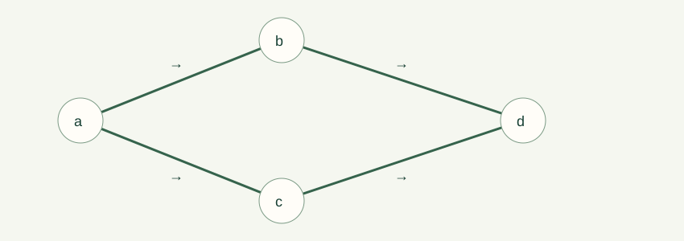

# 09. Directed graphs, orders, and scheduling

A build cannot compile a program before its generated files exist. A course cannot be taken before its prerequisites. These constraints form a directed graph, and the graph's paths determine which tasks must precede others. Source Chapter 10 develops the connections among graph reachability, relations, partial orders, and parallel scheduling. We use sets and relation properties from Chapter 05.

## Vertices, edges, and degrees

A directed graph, or digraph, consists of vertices $V$ and directed edges $E\subseteq V\times V$. The edge $(u,v)$ points from $u$ to $v$. In a dependency graph it means $u$ must finish before $v$ begins. The direction convention must be stated; reversing every arrow changes which vertices are initial tasks.

The outdegree of $v$ counts edges leaving it, and indegree counts edges entering it. Every edge contributes one to total indegree and one to total outdegree, so

$$\sum_{v\in V}\operatorname{indeg}(v)=|E|
=\sum_{v\in V}\operatorname{outdeg}(v).$$

A loop contributes one to both counts under this convention. For $V=\{a,b,c,d\}$ and edges $a\to b,a\to c,b\to d,c\to d$, indegrees are $0,1,1,2$, while outdegrees are $2,1,1,0$. Both sums equal four.

## Walks, paths, and cycles

A walk is a sequence of vertices with an edge from each entry to the next. Vertices may repeat. A path has no repeated vertices. A directed cycle returns to its starting vertex with otherwise distinct vertices. Length counts edges, so $a,b,d$ has length two. A length-zero walk stays at its single vertex.

If a walk from $u$ to $v$ repeats a vertex, remove the segment between two appearances. The remaining sequence is still a walk with the same endpoints and fewer edges. Repeating this removal gives a path. Thus reachability by a walk implies reachability by a path, and a shortest walk never repeats a vertex except in a separate cycle question.

This gives a finite reachability bound: in a graph with $n$ vertices, if a distinct target is reachable, a path of at most $n-1$ edges reaches it. A breadth-first search explores vertices by increasing path length and finds shortest paths in an unweighted digraph. It must remember visited vertices to avoid cycling indefinitely.

The reachability relation $R^*$ includes all pairs linked by some walk, including length zero. It is reflexive and transitive. Positive-length reachability $R^+$ excludes the zero-length justification but can still relate a vertex to itself if a directed cycle exists. Keep this convention visible when translating graphs into orders.

## Adjacency matrices from first principles

Choose a vertex ordering $v_1,\ldots,v_n$. The adjacency matrix $A$ has $A_{ij}=1$ when $v_i\to v_j$ and zero otherwise. For the four-vertex example,

$$A=\begin{pmatrix}0&1&1&0\\0&0&0&1\\0&0&0&1\\0&0&0&0\end{pmatrix}.$$

Matrix multiplication is defined by $(AB)_{ij}=\sum_k A_{ik}B_{kj}$. For $A^2$, a term equals one precisely when $i\to k\to j$ is a two-edge walk. Therefore $(A^2)_{ad}=2$, counting the routes through $b$ and $c$. Induction shows $(A^\ell)_{ij}$ counts walks of exactly $\ell$ edges. The identity matrix $I=A^0$ counts length-zero walks.

Ordinary arithmetic counts walks; Boolean arithmetic, with or replacing sum and and replacing product, records only whether at least one exists. For shortest weighted paths, a different operation system takes minima over sums of edge weights, often called min-plus multiplication. Do not use ordinary matrix powers to claim shortest-path lengths: their entries count walks under a different algebra.

For the finite unweighted case, checking positive entries in $I+A+\cdots+A^{n-1}$ suffices for reachability. This follows from path shortening, even if cycles produce infinitely many longer walks. A matrix depends on the chosen vertex ordering, but the represented graph property does not.

## Directed acyclic graphs

A DAG is a directed graph with no directed cycle. Every nonempty finite DAG has a vertex of indegree zero. Otherwise repeatedly follow an incoming edge backward; finiteness forces a repeated vertex, creating a cycle. Finiteness is used exactly at that repetition step.

A topological ordering lists all vertices so every edge points from an earlier to a later entry. Repeatedly remove an indegree-zero vertex and output it. The remaining graph is still a DAG, so the process can continue until empty. This proves existence and supplies an algorithm. If the process gets stuck before all vertices are output, the remaining graph contains a cycle.

In our example, $a,b,c,d$ and $a,c,b,d$ are both valid. A topological order need not be unique. An edge tells us a required relation; missing an edge does not necessarily mean no dependency, because a longer path can impose one. Conversely, comparable vertices need not be joined by a direct edge.

## Partial orders

A weak partial order $\preceq$ is reflexive, antisymmetric, and transitive. A strict partial order $\prec$ is irreflexive and transitive. Convert a weak order to a strict one by requiring inequality, and a strict order to a weak one by adding equality. For a DAG, positive-length reachability is a strict partial order; adding equality gives its weak order.

Subset inclusion is a weak partial order on a collection of sets. Divisibility is a weak partial order on positive integers: if $a\mid b$ and $b\mid a$ with both positive, then $a=b$. On all integers it is not antisymmetric, since $2\mid-2$ and $-2\mid2$ but $2\ne-2$. Domain restrictions again determine structural truth.

Two elements are comparable when one precedes the other. A partial order need not compare every pair. The subsets $\{a\}$ and $\{b\}$ are incomparable under inclusion. A linear or total order compares every pair. A topological ordering is a linear extension of a finite partial order: it resolves incomparable pairs without violating required comparisons.

A minimal element has no strictly smaller element. A least element precedes every element. There can be several minimal elements but at most one least element in a nonempty partial order. The same distinction applies to maximal and greatest. In a set-inclusion order on $\{\{a\},\{b\},\{a,b\}\}$, the singleton sets are both minimal, and neither is least; $\{a,b\}$ is greatest.

## Representing orders by sets

Every partial order can be represented using containment of down-sets. For element $x$, let $D_x=\{z:z\preceq x\}$. If $x\preceq y$, transitivity gives $D_x\subseteq D_y$. Conversely, if $D_x\subseteq D_y$, reflexivity puts $x\in D_x$, so $x\in D_y$ and $x\preceq y$. Thus

$$x\preceq y\quad\Leftrightarrow\quad D_x\subseteq D_y.$$

The map is injective: equal down-sets imply $x\preceq y$ and $y\preceq x$, then antisymmetry gives equality. This is more than an analogy between precedence and containment; it is an exact structural representation.

Product orders compare coordinates. On pairs of naturals, $(a,b)\preceq(c,d)$ means $a\le c$ and $b\le d$. The pairs $(1,4)$ and $(2,3)$ are incomparable. Lexicographic order compares the first coordinate first, then the second only when the first agrees; it would place $(1,4)$ before $(2,3)$. These are different orders suited to different questions.

## Parallel schedules, chains, and antichains

A chain is a set whose elements are pairwise comparable. An antichain is a set with no two distinct comparable elements. In a dependency DAG, tasks in a chain must run sequentially; tasks in an antichain have no precedence relation between them. Resource conflicts may still prevent simultaneous execution, so precedence is only one part of a real scheduling model.

Assume each task takes one time unit and processors are unlimited. Define depth of a vertex as the maximum number of edges in a path ending there. Schedule all depth-zero tasks first, depth-one tasks next, and so on. Every edge increases depth by at least one, so prerequisites finish earlier. If a longest path contains $h$ vertices, this schedule takes $h$ steps.

No schedule can use fewer than $h$ steps because those $h$ tasks form a chain. Thus the optimal parallel time equals the largest chain size. Do not mix edges and vertices: a longest path of three edges contains four unit-time tasks and needs four time slots.

For $a\to c,b\to c,c\to d$, the depths are zero for $a,b$, one for $c$, two for $d$. The optimal schedule is $\{a,b\}$, then $\{c\}$, then $\{d\}$, requiring three steps and at most two processors. With only one processor, all four tasks take four steps. The critical-path lower bound persists, but is no longer the whole answer.

For positive task durations, earliest finish time satisfies $F(v)=t(v)+\max_{u\to v}F(u)$, with the maximum over an empty predecessor set taken as zero. This weighted version follows the same dependency logic. It assumes unrestricted processors and no communication overhead; it is not an optimizer for arbitrary resource-constrained projects.

## The chain–antichain bound

Depth layers are antichains: if $u$ reaches $v$ by a positive-length path, then $v$ has larger depth. If no chain has more than $h$ elements, there are at most $h$ depth layers. With $n$ total vertices, some layer has at least $\lceil n/h\rceil$ vertices. Therefore every finite partial order has either a chain longer than a chosen threshold $t$ or an antichain of size at least $n/t$.

The source calls this a Dilworth lemma; it is a consequence related to the general chain–antichain theory, not the full statement of Dilworth's theorem. A common rounded consequence is that an $n$-element order has a chain or antichain of size at least $\sqrt n$. The proof is a counting argument on depth layers, with a ceiling when an integer bound is needed.

## Equivalence relations and partitions

An equivalence relation is reflexive, symmetric, and transitive. Its equivalence class $[x]$ contains all elements related to $x$. Classes either coincide or are disjoint: if $z\in[x]\cap[y]$, symmetry and transitivity show $x$ and $y$ related, and then their classes contain exactly the same elements. Reflexivity ensures every element belongs to a class.

Thus classes partition the domain into nonempty disjoint blocks. Conversely, any partition defines an equivalence relation by “belongs to the same block.” Remainder modulo $m$ partitions integers into $m$ residue classes. This is why modular arithmetic can operate on classes rather than particular integer representatives.

An equivalence relation groups mutually interchangeable elements; a partial order compares elements directionally. Both are transitive and reflexive in their weak versions, but one uses symmetry and the other antisymmetry. Equality satisfies both. Memorizing the adjectives without examples often leads to mistakes; test each definition on a small pair or triple.

## A complete reachability calculation

For the diamond graph, $A^2$ has a two in the entry from $a$ to $d$ and zeros elsewhere. All walks of length three are absent, so $A^3$ is zero. The matrix $I+A+A^2$ therefore records every reachable pair, with the two retaining a count of the alternative two-edge routes. Replacing every positive entry by one gives a Boolean reachability matrix. Its diagonal ones come from length-zero walks, not directed cycles.

If we add an edge $d\to a$, the graph is no longer a DAG. A walk can go around a cycle repeatedly, so higher powers do not eventually become zero. Nevertheless the finite reachability bound remains: if a target is reachable, some simple path reaches it within $n-1$ edges. This separates the existence of arbitrarily long walks from the existence of short witnesses to reachability.

## Transitive reduction and redundant dependencies

A DAG may contain an edge $a\to c$ as well as a path $a\to b\to c$. For pure precedence, the direct edge is redundant because the path already forces the order. Removing it leaves the same reachability relation. A transitive reduction removes such redundant edges while preserving reachability. The resulting diagram can be easier to read, but it does not mean the removed relation became false.

A Hasse diagram of a finite partial order draws cover relations: $x\prec y$ with no intermediate $z$ satisfying $x\prec z\prec y$. Reflexive loops and transitively implied edges are omitted. Reading the diagram requires restoring reachability mentally. Two elements without a drawn edge can still be comparable through a path. This convention makes order diagrams compact while preserving the full relation they represent.

## Finite scheduling with a processor limit

The unlimited-processor critical-path formula gives a lower bound when processors are limited, but another lower bound is total work divided by processor count, rounded up for unit tasks. If ten independent unit tasks have no edges and there are three processors, the longest chain has size one, yet at least four time slots are needed. Both lower bounds must be considered.

A legal greedy schedule selects available tasks whose predecessors are finished. It always respects dependencies, but choosing among available tasks can affect total time under a processor limit. Finding a legal ordering and finding an optimal resource-constrained schedule are different problems. Our laboratory computes the unlimited-processor layering and labels that assumption instead of silently presenting it as an optimizer for every practical project.

With durations, include a concrete calculation. Let $a,b$ take two and five units, both precede $c$ taking three, and $c$ precede $d$ taking one. Earliest finishes are two, five, eight, and nine. The critical weighted path is $b,c,d$, total nine. Adding the duration of every task would give eleven, which ignores the allowed overlap of $a$ and $b$. Counting vertices alone would give three, which ignores unequal durations.

## Order embeddings and what they preserve

The down-set map preserves and reflects comparisons, so it is an order embedding. An arbitrary injection into a family of sets would preserve distinctness but need not preserve order. For the positive divisors of six, the down-sets are $\{1\}$, $\{1,2\}$, $\{1,3\}$, and $\{1,2,3,6\}$. Inclusion among these sets exactly matches divisibility among one, two, three, and six. The incomparable middle elements stay incomparable.

The product order on pairs offers a useful interpretation in optimization: one pair can dominate another coordinatewise while some pairs represent tradeoffs. A lexicographic order resolves every tradeoff by prioritizing the first coordinate absolutely. Neither choice is universally correct; the intended meaning determines which order represents the problem. Mathematics makes that choice explicit and then reasons from it.

## Equivalence classes as replacement objects

When grouping objects by an equivalence relation, one can work with the set of classes, called a quotient set. A function defined on classes must be independent of the representative chosen. Modular addition passes this test because congruent inputs have congruent sums. A rule such as “take the ordinary integer value of a residue class” fails because a class contains many integers.

This representative-independence requirement is a precise proof obligation. Before using a quotient construction, choose two representatives of the same class and check that the proposed outputs agree in the required sense. It is the same general habit of making hidden assumptions visible that we used in inverse functions and modular cancellation.

When a graph drawing and an adjacency matrix appear to disagree, compare the vertex order first. A permutation of labels simultaneously permutes rows and columns. The resulting matrix can look different while representing an isomorphic graph. Numerical entries should therefore be interpreted with the displayed vertex labels, never as unlabeled positions alone.

## Practice and laboratory

The graph lab computes indegrees, reachability, adjacency powers, and a topological schedule for a small graph. A cycle is reported as a scheduling obstruction rather than silently ignored. Its exact walk counts can be checked by listing routes in the four-vertex example.

**09-A.** Give both topological orders for the four-vertex diamond graph. **09-B.** Explain why $A^2_{ad}=2$ there. **09-C.** Find an order with two minimal elements and no least element. **09-D.** If a 30-vertex DAG has no chain longer than five, bound the size of an antichain. **09-E.** Prove two equivalence classes that intersect are equal. **09-F.** Explain why the critical-path time formula needs assumptions about task duration and processor count.
