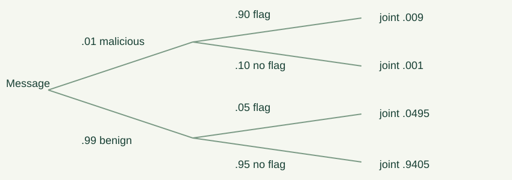

# 15. Probability spaces and conditional reasoning

When a result is uncertain, the first task is to specify what can happen and how outcomes are weighted. A plausible story is not enough. Different rules for revealing information can produce different probabilities even when the visible result looks the same. Source Chapters 17 and 18 develop discrete probability, conditional probability, independence, Bayesian updating, and the interpretation of confidence.

## The four-step method

First define the sample space $\Omega$, a set of complete outcomes. Second define an event $A\subseteq\Omega$. Third assign nonnegative probabilities to outcomes with total one. Fourth sum the weights in $A$. The familiar formula $|A|/|\Omega|$ applies only for a finite uniform space, where all elementary outcomes have equal probability.

For two fair independent six-sided dice, use ordered pairs $(i,j)$, each with probability $1/36$. Sum seven occurs at $(1,6),(2,5),(3,4),(4,3),(5,2),(6,1)$, so its probability is $6/36=1/6$. Taking the possible sums $2,\ldots,12$ as eleven equally likely outcomes would be a different, incorrect model of the dice experiment.

An event's probability is a number in $[0,1]$. The empty event has probability zero and the whole space probability one. For disjoint events, probabilities add. Therefore $\Pr(A^c)=1-\Pr(A)$ and

$$\Pr(A\cup B)=\Pr(A)+\Pr(B)-\Pr(A\cap B).$$

The union bound $\Pr(\bigcup_i A_i)\le\sum_i\Pr(A_i)$ does not need independence. It may exceed one and become uninformative; a probability itself never exceeds one. An upper bound larger than one should be capped at one when reported.

## Countably infinite spaces

An infinite discrete space assigns probabilities $p_0,p_1,\ldots$ with $\sum_i p_i=1$. It cannot assign the same positive probability to every natural number, because the sum would diverge; assigning zero to each would sum to zero. There is no uniform probability distribution on $\mathbb N$ with countable additivity.

A valid example is the number $N$ of fair tosses until the first head: $\Pr(N=k)=2^{-k}$ for $k=1,2,\ldots$, whose total is one by the geometric series. The infinite all-tails outcome has probability zero, although it is a conceivable sequence in a richer infinite-sequence model. “Probability zero” and “logically impossible” are not synonyms in general probability spaces.

## Monty Hall and the information mechanism

Assume three doors, one uniformly placed prize, an initial contestant choice, and a host who knows the location, always opens a different losing door, and always offers a switch. Staying wins exactly when the initial choice was right, probability one third. Switching wins exactly when it was wrong, probability two thirds. The host's knowledge and mandatory behavior are hypotheses of the result.

If instead a person opens another door uniformly without knowing the prize and we condition on a losing reveal, the model changes. Fix the initial choice as door one. If the prize is behind door one, a losing reveal occurs with probability one; if behind door two or three, it occurs with probability one half. The weighted surviving probabilities are $1/3,1/6,1/6$, totaling $2/3$, so initial correctness conditional on a losing reveal is one half. The same visible “a losing door opened” carries different information under different host rules.

When a specific door is observed, the host's tie-breaking policy can also matter. Complete outcomes should include both prize location and host action. Conditioning on a broad event and conditioning on a particular observed action are different events. This is why declaring the mechanism before counting is essential.

## Nontransitive dice

It is possible for die $A$ to beat $B$ more than half the time, $B$ to beat $C$, and $C$ to beat $A$. “More likely to win” is not necessarily a transitive order. Consider four dice:

- $A=(0,0,4,4,4,4)$;
- $B=(3,3,3,3,3,3)$;
- $C=(2,2,2,2,6,6)$;
- $D=(1,1,1,5,5,5)$.

Then $\Pr(A>B)=2/3$, $\Pr(B>C)=2/3$, $\Pr(C>D)=2/3$, and $\Pr(D>A)=2/3$. For the third comparison, a six always wins, contributing $1/3$, and a two wins against a one, contributing $(2/3)(1/2)=1/3$. For the fourth, a five always wins, contributing one half, and a one beats zero with probability $(1/2)(1/3)=1/6$.

Rolling twice and comparing total scores creates a new random experiment. A single-roll win probability cannot simply be squared to obtain the chance of a larger sum. The sum can win despite one losing roll, and ties can matter. Enumerate ordered roll pairs or convolve score distributions. This captures the source's unusual-dice lesson with an independently specified example.

## Birthday collisions

Assume $k$ independent people choose uniformly among $m$ days, ignoring leap days and nonuniform real birthdays. For $k\le m$, no collision has probability

$$\prod_{i=0}^{k-1}\frac{m-i}{m};$$

the first person has no restriction, the second avoids one day, and each later person avoids all earlier distinct days. Collision probability is one minus that product. For $k>m$, a collision is certain by pigeonhole.

Using $1-x\le e^{-x}$ gives no-collision probability at most $\exp[-k(k-1)/(2m)]$. For $k$ small relative to $m$, this expression is also a useful approximation to the product, because $\ln(1-x)\approx-x$ for small $x$. Distinguish the proved inequality from the approximation. The threshold scale is $k\approx\sqrt m$, explaining why collisions occur well before $m$ samples.

## Conditional probability and trees

For $\Pr(B)>0$, define $\Pr(A\mid B)=\Pr(A\cap B)/\Pr(B)$. Conditioning restricts attention to $B$ and rescales its total mass to one. It is not generally the same as physically causing $B$, and it is undefined by this elementary ratio when $\Pr(B)=0$.

The multiplication rule is $\Pr(A\cap B)=\Pr(B)\Pr(A\mid B)$. A tree diagram represents successive conditionings. Multiply along a root-to-leaf path; add probabilities of disjoint leaves. For drawing two red balls without replacement from a bag with three red and two blue, the probability is $(3/5)(2/4)=3/10$. The second factor changes because the first draw changes the remaining composition.

Sampling a uniform size-$k$ subset can be represented by drawing without replacement and forgetting order. Every subset has $k!$ draw orders, all with equal probability, so the induced subset distribution is uniform. This connects the division rule in counting to probability models.

If $B_1,\ldots,B_r$ partition the sample space into positive-probability events, total probability gives

$$\Pr(A)=\sum_i\Pr(A\mid B_i)\Pr(B_i).$$

Bayes' rule reverses conditioning:

$$\Pr(B_j\mid A)=\frac{\Pr(A\mid B_j)\Pr(B_j)}{\sum_i\Pr(A\mid B_i)\Pr(B_i)},$$

provided $\Pr(A)>0$. The denominator counts every route to the observed event. Omitting the alternative routes is a base-rate error.

## A synthetic detector example

Suppose one percent of messages in a synthetic model are malicious. A detector flags 90 percent of malicious messages and five percent of benign ones. Among ten thousand modeled messages, expect one hundred malicious messages, ninety flagged, and 9900 benign messages, 495 flagged. Therefore

$$\Pr(\text{malicious}\mid\text{flag})=\frac{90}{90+495}=\frac2{13}\approx0.1538.$$

The 90 percent sensitivity is $\Pr(\text{flag}\mid\text{malicious})$, not the reverse probability. Natural frequencies make the denominator visible. These numbers are invented for teaching and do not describe a real detector or medical test.

Odds provide another form. Prior odds are $p/(1-p)$. A positive observation with likelihood ratio $\Pr(+\mid M)/\Pr(+\mid M^c)$ multiplies prior odds to produce posterior odds. Here prior odds are $1/99$ and likelihood ratio eighteen, giving posterior odds $2/11$, equivalent to posterior probability $2/13$. Sequential updates require likelihoods conditional on previous observations, unless the observations are conditionally independent under each hypothesis.

## Simpson's paradox

An overall rate can reverse subgroup comparisons because the groups receive different weights. Consider two procedures evaluated in easy and hard synthetic cases. Procedure A succeeds on $9/10$ easy cases and $20/100$ hard cases; B succeeds on $80/100$ easy cases and $1/10$ hard cases. A has the higher rate in both groups: $0.9>0.8$ and $0.2>0.1$.

Overall A succeeds on $29/110\approx0.264$, while B succeeds on $81/110\approx0.736$. The reversal occurs because A is used mainly on hard cases and B mainly on easy cases. There is no arithmetic contradiction. The overall rate averages conditional rates with different weights.

A comparison intended to answer a causal question needs a design accounting for why cases entered each group. Conditioning on a variable is not universally helpful; the relevant model determines which comparisons answer the question. Our arithmetic example demonstrates aggregation effects rather than proving a general causal method.

## Independence and mutual independence

Events $A,B$ are independent when $\Pr(A\cap B)=\Pr(A)\Pr(B)$. If $\Pr(B)>0$, this is equivalent to $\Pr(A\mid B)=\Pr(A)$. Independence means learning one event does not alter the other's probability within the stated model. It must be justified, not inferred merely from different names or physical distance.

Disjoint positive-probability events are not independent: their intersection probability is zero, while the product is positive. If one occurs, the other is ruled out. Independence also differs from lack of a known causal link. A shared hidden variable can correlate otherwise separate observations.

Mutual independence of events $A_1,\ldots,A_n$ requires the product rule for every subcollection, not just all pairs. Toss two independent fair bits $X,Y$ and let $Z=X\oplus Y$. Each pair of variables is independent, but all three are not: knowing $X,Y$ determines $Z$. The events $X=0,Y=0,Z=0$ each have probability one half and are pairwise independent, but their triple intersection has probability one quarter rather than one eighth.

This distinction matters in variance and tail bounds. Pairwise independence suffices for some variance calculations; strong exponential bounds generally need fuller independence or other explicit dependence controls. DNA-style matching examples in the source illustrate how multiplying probabilities across markers requires assumptions about their joint distribution. A small match probability is not automatically the posterior probability that a particular person is the source.

## Probability, belief, and confidence

A model probability is a mathematical consequence of assumptions. Confidence in the assumptions is a separate issue. A fair independent coin has next-head probability one half regardless of a long past run. If the fairness itself is uncertain, observations can update beliefs about its bias, and the predictive probability can change. These are different models, not conflicting probability rules.

A low-probability observation does not by itself prove a model false: rare events occur. Compare how likely the observation is under competing models, and account for selection among many possible “surprises.” If a million tests each look for a rare pattern, the chance that some test surprises us can be substantial even when each individual probability is small.

Frequentist confidence statements concern repeated-sampling coverage of a procedure; Bayesian posterior probabilities concern an unknown parameter under a prior-and-likelihood model. Neither should be silently substituted for the other. Chapter 17 develops explicit sampling bounds without requiring an advanced statistics course.

## A complete conditional table

Use the synthetic detector example to build a two-by-two probability table. The malicious-and-flagged cell is 0.009, malicious-and-unflagged is 0.001, benign-and-flagged is 0.0495, and benign-and-unflagged is 0.9405. All cells are nonnegative and sum to one. The flag column totals 0.0585, so dividing its malicious cell by that total gives the posterior probability. The table keeps every denominator visible.

Now change prevalence to ten percent while keeping the conditional flag rates. The cells become 0.09, 0.01, 0.045, and 0.855. Among flagged messages, the malicious fraction is $0.09/0.135=2/3$. The detector's conditional behavior is unchanged, while the posterior changes dramatically. This is why a predictive interpretation needs both detection properties and the population to which they are applied.

## Independence can change after conditioning

Two independent fair coin tosses are independent before additional information. Condition on the event that at least one toss is a head. The surviving outcomes are HH, HT, and TH, each equally likely. The conditional chance the first is heads is two thirds, as is the chance the second is heads, but the conditional chance both are heads is one third, not four ninths. Thus conditioning can create dependence.

If instead we condition on the first toss being heads, the second remains fair because of the original independence. These two examples are compatible: the conditioned events differ. A statement that variables are independent should specify the model or conditioning context. In Bayesian calculations, conditional independence under a hypothesis is not the same as unconditional independence after mixing hypotheses.

## Comparing a die twice

Let die $A$ show zero or four with equal probability, and die $B$ always show three. On one roll, $A$ beats $B$ with probability one half. On two independent rolls, $A$'s sum takes values zero, four, and eight with probabilities one quarter, one half, and one quarter, while $B$'s sum is six. The chance $A$ wins is now one quarter. Squaring the single-roll win probability happens to give one quarter here, but only because this particular threshold requires both wins.

Change $B$ to a constant two. A single roll still has win probability one half, but over two rolls there is a tie when $A$ totals four. The chance of strict victory is one quarter, and the chance of victory or tie is three quarters. The requested comparison and tie rule are part of the event. More varied dice can win a sum comparison with mixed single-roll wins and losses, so the general solution must use score distributions rather than only win indicators.

## Selection effects and surprising observations

Imagine searching many strings for an unusual run. The probability of a run at one preselected position differs from the probability that some position contains it. Define an event for each possible position and use inclusion–exclusion, a union bound, or another suitable calculation. Choosing the most striking position after inspecting the data does not preserve the original single-position probability.

The same issue appears in a claim that an observed coincidence was extraordinarily unlikely. Every particular long sequence of fair tosses has a tiny probability, but some sequence must occur. A useful test specifies a family of surprising outcomes before seeing the result, or accounts for the selection process. Probability answers a question about an event; it does not decide which event deserves attention after the fact.

## Reading a probability answer responsibly

An exact fraction can be a perfectly correct answer to the wrong sample space. Before checking arithmetic, ask whether complete outcomes were represented, whether their weights sum to one, and whether the observed information was conditioned on rather than ignored. Then ask whether the event matches the words “at least,” “exactly,” or “before.” These distinctions change sets of outcomes and therefore change probabilities.

A simulation uses the same model assumptions encoded in its random generator. Agreement with an analytic formula checks their consistency but does not validate that model against the real world. Real-world validation needs appropriate observations and a measurement design. In this course, synthetic examples keep that boundary visible so that probability is learned as conditional mathematical reasoning rather than as automatic certainty about any story that mentions randomness.

For a final sanity check, compute a complement or a total in a second way. A full conditional probability table must still sum to one after rescaling to the conditioned event. If a result lies outside zero and one, revisit event definitions and denominators before rounding. A small rounding error and a wrong model require different repairs.

## Practice and laboratory

The probability lab computes exact birthday and Bayes quantities from visible parameters. The Monty lab contrasts the informed host with a random opener. Seeded trials are estimates alongside exact model values; they are not proofs that real participants obey the model.

**15-A.** Compute the probability of at least one six in two independent fair-die rolls. **15-B.** Explain why equally likely sums are the wrong model for two dice. **15-C.** Recalculate the detector posterior when prevalence rises to ten percent, keeping the same detector rates. **15-D.** Give disjoint positive-probability events and show they are dependent. **15-E.** Explain the difference between pairwise and mutual independence using the XOR example. **15-F.** State the host assumptions needed for the two-thirds switching result.
