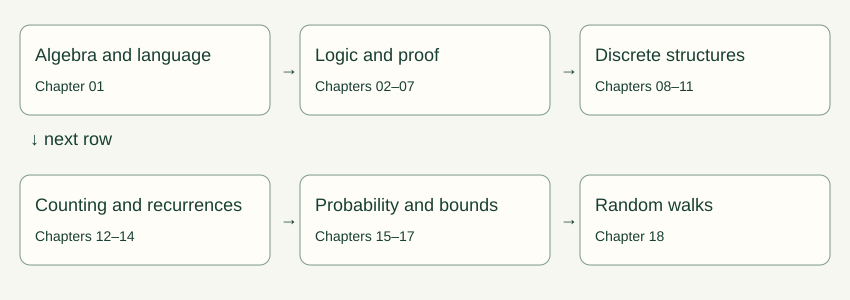

# Preface

A computer executes finite instructions, but our claims about it often cover infinitely many inputs. Testing a sorting routine on ten lists does not establish what it does on the eleventh. A graph drawing can suggest a route without proving it is shortest. A large average can coexist with an overwhelming chance of receiving almost nothing. Mathematics gives us a language for separating an observation, a model, and a conclusion justified by that model.

This book is for a beginner who wants to understand those distinctions without being rushed past the algebra. Each chapter begins with a problem, develops concrete examples, and then introduces the definitions that make the reasoning reusable. A formal proof is identified as a proof; a picture, analogy, or numerical experiment supports intuition but does not take its place. When a formula requires independence, positivity, finiteness, or an invertible quantity, that condition is part of the formula's meaning.

The original source is *Mathematics for Computer Science* by Eric Lehman, F. Thomson Leighton, and Albert R. Meyer, revision 3 March 2017. Its 22 chapters supply the scope. Our 18 chapters combine related topics, introduce prerequisites earlier, and use new explanations and small numerical examples. The [source crosswalk](coverage.md) records where every numbered instructional section belongs. Historical stories are treated as context, with the underlying mathematical lesson explained; references, glossary, and index are reading aids rather than additional mathematical units. The original exercise collections remain available in the user's source PDF and are assigned selectively in the curriculum.

## How to study

Read one section at a time. Before following a calculation, name the quantities and their domains: is a symbol an integer, a set, a proposition, or a probability? Copy one worked example, then alter a number and work it again. Optional chapter problems have stable labels, such as 03-A. Hints and full solutions are in separate files. A solution's conclusion matters less than the justification connecting one line to the next.

There are two kinds of laboratory result. Exact calculations enumerate a finite model or use integer arithmetic. Simulations generate samples and are labeled as estimates. A reset returns the same default parameters; seeded simulations also return the same sample sequence. A failed numerical conjecture is useful evidence against the conjecture. Agreement with a thousand samples does not prove a universal statement.

The curriculum schedules retrieval after one week and again after four weeks. Revisit a proof by reconstructing its plan, not by memorizing its wording. If a definition feels abstract, generate two examples and a non-example. If a proof feels mysterious, identify the statement available at each step and the statement needed next.

## Notation and conventions

We use $\mathbb N=\{0,1,2,\ldots\}$, $\mathbb Z$ for integers, $\mathbb Q$ for rational numbers, and $\mathbb R$ for real numbers. Positive integers are $\mathbb Z_{>0}$. Logarithms have a displayed base when it matters; $\ln$ means base $e$. For algorithm growth, changing a fixed logarithm base changes only a constant factor. Empty sums are zero and empty products are one. An empty string is $\varepsilon$. A function's domain and codomain are declared separately from the values it actually reaches.

Graphs are finite unless stated otherwise. A simple graph has no loops or parallel edges. Directed graphs can have loops when explicitly allowed. A walk can repeat vertices; a path cannot. Path length counts edges. Reachability includes length-zero walks unless a strict reachability relation is explicitly requested. Probability examples use discrete spaces; countably infinite sums are handled with convergence conditions stated where needed.

The source sometimes uses terminology differently. In particular, strict and weak partial orders are distinguished explicitly here; graph-network measurements state whether input/output terminal edges count. The source's minor characterization of planarity is conventionally called Wagner's theorem; Kuratowski's theorem uses subdivisions. Both appear with that distinction in Chapter 11.

This book teaches mathematical foundations for CS. It is not a complete degree in mathematics, and it does not add full courses in calculus, linear algebra, statistics, or numerical analysis that the PDF does not contain. Those are sensible subsequent studies once these discrete foundations are secure.
