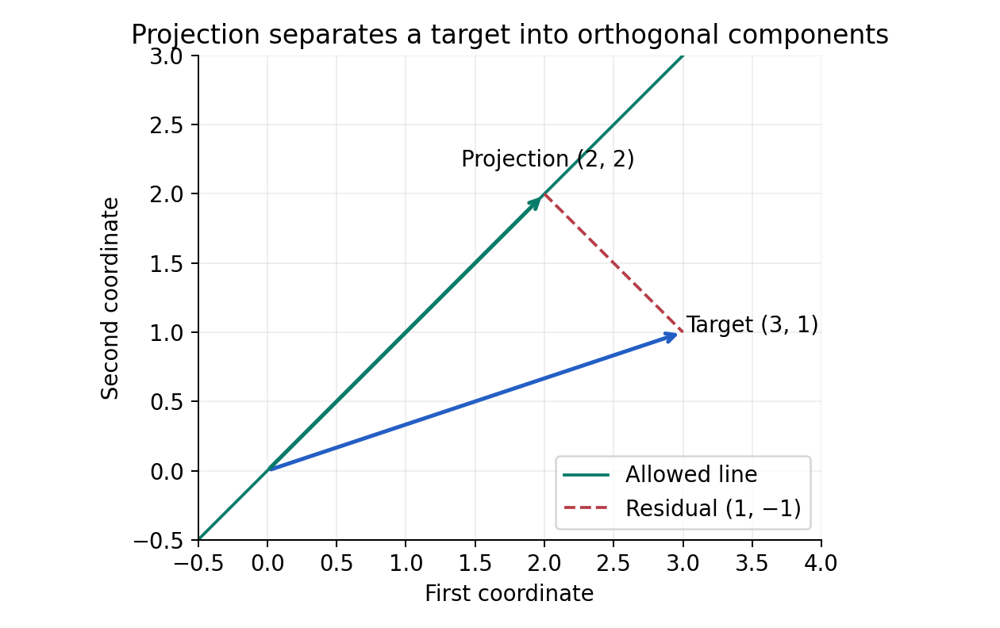
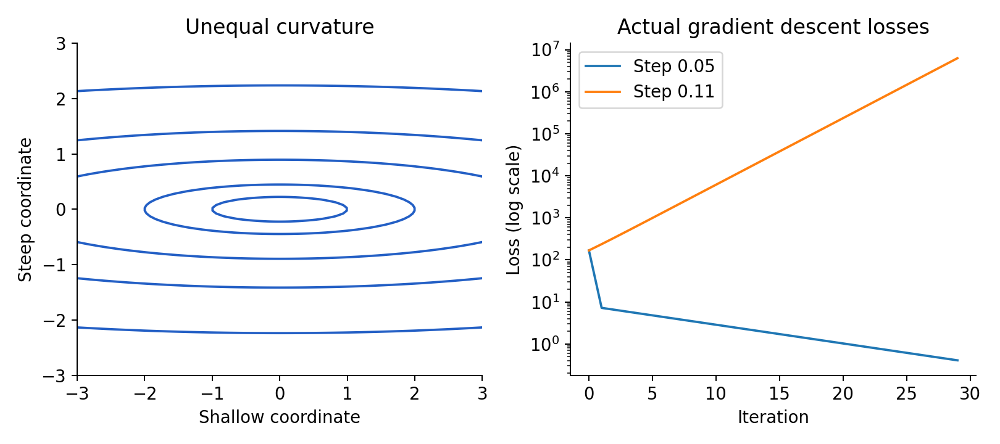
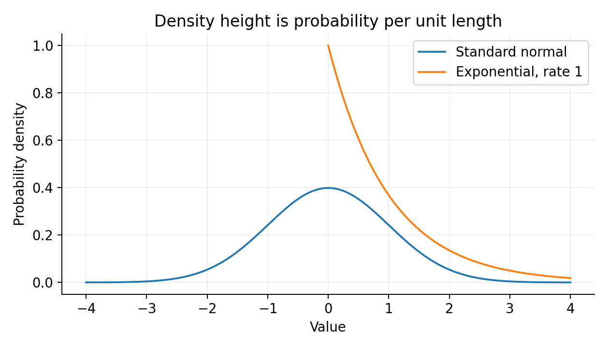

# From Equations to Learning

A guided mathematics textbook for machine learning: 48 sessions in 12 complete chapters

<a id="preface"></a>
## Preface

This book is for a developer or returning mathematics learner who wants to understand the mathematical machinery behind machine learning. We begin with functions and elementary algebra, rebuild vectors and calculus, and continue through probability, inference, optimization, and complete model derivations. Programming experience is helpful for the experiments but is not a substitute for any mathematical prerequisite.

The original 48-lesson outline is preserved as 48 guided sessions, grouped into 12 substantial chapters. Read a session, work through its small numbers, and stop whenever an equation needs another pass. Chapter 8's final session is divided into constraints, KKT conditions, Newton's method, and stochastic optimization; it is deliberately suitable for several sittings.

An equation is introduced with its objects and assumptions. Important elementary claims receive proofs; larger results are explicitly distinguished as stated theorems or proof sketches. Examples include intermediate calculations, units, counterexamples, and failure cases. Optional applications and supplied implementations support independent study without a required live conversation.

Throughout, vectors and gradients are columns. A data matrix has observations in rows and features in columns. Mathematical indices begin at one; Python indices begin at zero. Natural logarithms are the default, angles use radians, Gaussian scale parameters are standard deviations unless squared, and gamma parameters use the stated rate convention. Squared-loss normalization is written explicitly because it changes gradients and regularization scales.

The delivery-time example gives continuity across chapters, but every dataset is synthetic. Geometry is ordinary Euclidean geometry unless another inner product is named. Exact mathematical statements and approximate floating point calculations are kept distinct. A tiny numerical residual is checked with a tolerance, not treated as a new theorem.

The portable package contains the canonical chapter files, [curriculum mapping](CURRICULUM.md), complete [example source](examples/README.md), the [local laboratory](companion/index.html), [reference ledger](references.md), [optional project guide](PROJECTS.md), and [verification report](verification.md). The single-volume book is generated from the chapter files; edit those files and rebuild to keep the two forms aligned.

The laboratory needs Node.js and a browser and makes no external requests. Its source is included, with controls, numerical results, and deterministic resets. Python examples use the pinned NumPy and SciPy versions in the package. See [README.md](README.md) for Windows and Unix setup. The laboratory is an experiment gallery; the canonical reading format is Markdown with GitHub-compatible math, not a separately hosted website.

This is a broad, rigorous foundation for mainstream machine learning. It does not claim to exhaust every specialized mathematical field. The purpose is to make central relationships understandable enough to derive, implement, diagnose, and extend.


<a id="contents"></a>
## Contents

- [References and provenance](#references)
- [Optional projects](#projects)
- [Glossary and proof guide](#glossary)

- [Chapter 1: Mathematical language: turning a prediction problem into an equation](#chapter-01)
- [Chapter 2: Vectors and geometry: describing many features at once](#chapter-02)
- [Chapter 3: Matrices, information, and least squares](#chapter-03)
- [Chapter 4: Matrix structure: eigenvectors, singular values, and PCA](#chapter-04)
- [Chapter 5: Calculus from first principles: limits and local models](#chapter-05)
- [Chapter 6: Integration: accumulated change and transformed quantities](#chapter-06)
- [Chapter 7: Multivariable calculus: gradients, Jacobians, and backpropagation](#chapter-07)
- [Chapter 8: Optimization: when a parameter update improves a model](#chapter-08)
- [Chapter 9: Probability: reasoning about uncertain outcomes](#chapter-09)
- [Chapter 10: Distribution families and the behavior of repeated samples](#chapter-10)
- [Chapter 11: Statistical inference: learning from a finite dataset](#chapter-11)
- [Chapter 12: Putting the mathematics together: models, training, and generalization](#chapter-12)
- [Complete source listings](#source-appendix)

# I. Language and linear structure

We begin by specifying what an equation claims. Vectors then give inputs a geometry, matrices organize linear relationships, and their decompositions reveal which directions contain information. These ideas will reappear as gradients, covariance, regression, and numerical sensitivity.


<a id="chapter-01"></a>
## Chapter 1: Mathematical language: turning a prediction problem into an equation

### In this chapter

- [Session 1 — Functions, inputs, parameters, and models](#chapter-01-section-1)
- [Session 2 — Sets, logic, quantifiers, and proofs](#chapter-01-section-4)
- [Session 3 — Sums, products, indices, and shapes](#chapter-01-section-7)
- [Session 4 — Powers, exponentials, and logarithms](#chapter-01-section-10)


This chapter contains outline lessons 1–4. You need arithmetic, signed numbers, and a willingness to read one symbol at a time. Our central problem is predicting a delivery time from distance. By the end, an equation will be something you can interrogate: what varies, what is fixed, what is assumed, and what follows?

<a id="lesson-01"></a>
<a id="chapter-01-section-1"></a>
### Session 1 — Functions, inputs, parameters, and models

<a id="chapter-01-section-2"></a>
#### Start with a prediction you can check

A delivery travels four kilometers. A tentative rule allocates five minutes for preparation and three minutes for every kilometer. Its prediction is three times four plus five, or seventeen minutes. We write

$$
\widehat y=wx+b,\qquad x=4,\quad w=3,\quad b=5.
$$

The input is $x$, the distance. The parameters $w$ and $b$ choose the rule. The output $\widehat y$ is a predicted time. An observed time, denoted $y$ without a hat, might differ. Before manipulating this equation, check the units: minutes per kilometer multiplied by kilometers gives minutes; adding a preparation time in minutes is legitimate.

A function is a rule assigning exactly one output to every allowed input. The notation $f:D\to C$ states a domain $D$ of inputs and a codomain $C$ in which outputs live. For fixed parameters, take

$$
f:[0,\infty)\to\mathbb R,\qquad f(x)=3x+5.
$$

The interval $[0,\infty)$ includes zero and every positive real number. Its use expresses a modeling choice: distance is nonnegative. The actual attained outputs form the image $[5,\infty)$. To prove that image claim, first observe $3x+5\ge5$ when $x\ge0$. Conversely, every $t\ge5$ is attained at $x=(t-5)/3\ge0$. Both inclusions are needed when proving equality between sets.

The function $f$ and the value $f(4)$ are different objects. The former is an entire assignment; the latter is seventeen. Programming notation encourages this distinction: a function value is different from its return value after one call. Mathematical functions, however, do not need to have an efficient computer implementation.

Now permit parameters to vary and write $f_{w,b}(x)=wx+b$. The subscript identifies which member of a family we selected. Setting $w=0,b=10$ gives a constant function. Setting $w=2,b=8$ gives a different line. Every member still assumes a constant change in predicted time per kilometer. Parameter fitting cannot create a curved relationship from this family.

A transformation is linear if it preserves addition and scalar multiplication. In particular it must send zero to zero. The map $x\mapsto wx+b$ is affine, and is linear only when $b=0$. The conventional phrase “linear regression” includes an intercept. Keep the mathematical property separate from the statistical method's name.

<a id="chapter-01-section-3"></a>
#### Prediction and training change the variable

Use three observations: $(1,8),(2,11),(4,18)$. The rule with parameters $(3,5)$ predicts $8,11,17$. Define a residual as prediction minus observation, giving $0,0,-1$. A loss is a number expressing disagreement. One choice is mean squared error:

$$
L(w,b)=\frac13\left[(w+b-8)^2+(2w+b-11)^2+(4w+b-18)^2\right].
$$

The data are fixed arguments hidden inside this notation. The variables of this function are candidate parameters. At $(3,5)$ its value is $1/3$. At $(4,5)$, the predictions become $9,13,21$, residuals $1,2,3$, and the loss is $14/3$. Changing a parameter changed predictions and loss; it did not change the observed distances or times.

A short proof makes the meaning of squared loss precise. For $n\ge1$, every squared residual is nonnegative. If all residuals vanish, their average vanishes. Conversely, if their average is zero, their sum is zero. A positive term would make a sum of nonnegative terms positive, so every term must be zero. A real number has square zero only when it is zero. Thus zero squared loss is equivalent to exact agreement on every training observation. This says nothing yet about unseen deliveries.

A loss is a design choice. Squaring makes a large miss disproportionately expensive: misses of one and three have costs one and nine. Absolute error assigns costs one and three. Neither choice is universally correct. Later we will derive conditions under which squared error corresponds to a probabilistic noise model. For now, its role is to turn comparison between entire prediction rules into comparison between real numbers.

Composition means using one function's output as another's input. If $g(x)=x/1000$ converts meters to kilometers and $f(u)=3u+5$, then $(f\circ g)(x)=3x/1000+5$. The intermediate quantity must belong to the outer function's domain. Composition is also the skeleton of a neural network: multiple simpler transformations arranged into a larger one.

An inverse reverses a function on its image when that function is one-to-one. Here $f^{-1}(t)=(t-5)/3$ for $t\ge5$. A constant function cannot have such an inverse over a domain containing multiple inputs: its output does not identify which input occurred. This elementary loss of information will become null spaces and nonidentifiability in later chapters.

<a id="lesson-02"></a>
<a id="chapter-01-section-4"></a>
### Session 2 — Sets, logic, quantifiers, and proofs

<a id="chapter-01-section-5"></a>
#### A mathematical statement has a scope

A set collects objects. We write $x\in D$ for membership and $A\subseteq B$ when every member of $A$ belongs to $B$. Intersections describe simultaneous requirements; unions describe alternatives. For instance, the domain of $\log(x-1)$ over the reals is $\{x:x>1\}$, because the logarithm needs a positive argument.

A proposition is a statement with a truth value. “The loss is zero” becomes a proposition only after its data and parameters are fixed or quantified. An implication $P\Rightarrow Q$ asserts that whenever $P$ holds, $Q$ holds. It does not claim $P$ is true. Its converse $Q\Rightarrow P$ is a separate assertion. “Zero loss implies exact training fit” and “exact training fit implies zero loss” required separate arguments above.

The universal quantifier $\forall$ means “for every,” while $\exists$ means “there exists.” Compare

$$
\forall x\in\mathbb R\ \exists w\in\mathbb R:\ wx=1
$$

with the same claim restricted to $x\ne0$. The first is false because $x=0$ cannot work; the second is true by choosing $w=1/x$. Order also matters. The true statement $\forall x\ \exists b:x+b=0$ permits a different $b$ for each input. The statement $\exists b\ \forall x:x+b=0$ asks for one universal choice and is false.

This distinction appears in fitting. For every single observation there may exist a line passing through it. That does not imply one line passes through all observations at once. Confusing those quantifiers can turn an impossible learning problem into an apparently trivial one.

Negation changes quantifiers. The negation of “every residual is zero” is “at least one residual is nonzero.” It is not “every residual is nonzero.” Formally,

$$
\neg(\forall i\ P(i))\iff\exists i\ \neg P(i).
$$

To understand why, imagine checking the universal claim over a finite list. One failure is enough to refute it. For an infinite domain, the same logical principle holds even though exhaustive checking is unavailable.

<a id="chapter-01-section-6"></a>
#### How to build a proof

A direct proof begins with hypotheses and derives the conclusion. To prove an even integer has an even square, write the integer as $2k$; its square is $4k^2=2(2k^2)$. The definition of evenness supplies the structure that makes the conclusion follow.

A contrapositive proof establishes $\neg Q\Rightarrow\neg P$ instead of $P\Rightarrow Q$. These are logically equivalent. For example, to prove that $x^2=0$ implies $x=0$, one can show that $x\ne0$ implies $x^2>0$. In a contradiction proof, assume the hypotheses and the negation of the conclusion, then derive an impossibility. These techniques differ in organization, not in standards of evidence.

A counterexample refutes a universal statement. The claim $\sqrt{a+b}=\sqrt a+\sqrt b$ for all nonnegative $a,b$ fails at $a=b=1$: $\sqrt2\ne2$. One example can refute a universal claim, but many successful examples cannot prove one. Numerical experiments support debugging and conjecture formation; a proof explains why all allowed cases behave as claimed.

Induction proves a sequence of statements indexed by natural numbers. First establish a base case. Then assume the statement at $n$ and use that assumption to establish it at $n+1$. As an example, prove

$$
1+2+\cdots+n=\frac{n(n+1)}2,\qquad n\ge1.
$$

The base case is $1=1(2)/2$. Assuming the formula at $n$, add $n+1$ to both sides:

$$
\frac{n(n+1)}2+(n+1)
=\frac{(n+1)(n+2)}2.
$$

That is precisely the formula at the next integer. The base case starts the chain; the inductive step propagates it. Neither alone is sufficient. Induction will later justify recurrences such as iterative optimization updates.

A theorem's hypotheses are part of its meaning. “A stationary point is a minimum” is false without additional conditions: $f(x)=-x^2$ has derivative zero at zero and has a maximum there. “For a differentiable convex function on a convex open domain, a zero gradient gives a global minimum” is a stronger, conditional theorem. We will prove it once those words have been built.

When reading a proof, identify the domain, hypotheses, conclusion, and critical inference. Distinguish a definition, which establishes terminology, from a theorem, which needs an argument. An intuitive picture may suggest the critical inference but does not replace it. In higher dimensions, pictures become less reliable while definitions continue to work.

<a id="lesson-03"></a>
<a id="chapter-01-section-7"></a>
### Session 3 — Sums, products, indices, and shapes

<a id="chapter-01-section-8"></a>
#### Indexed notation compresses repeated work

The expression $\sum_{i=1}^n a_i$ asks us to add entries from the first through the $n$th. The letter $i$ is a bound index: replacing it everywhere inside the sum by $j$ changes no value. In contrast, $n$ controls how many terms participate and is not bound by that summation.

For the delivery data, let $r_i=wx_i+b-y_i$. Then

$$
L(w,b)=\frac1n\sum_{i=1}^n r_i^2.
$$

Expand this for $n=3$ before manipulating it. It is $(r_1^2+r_2^2+r_3^2)/3$. Squaring a sum instead would give $(r_1+r_2+r_3)^2/3$, including cross terms such as $2r_1r_2$. With residuals $1,-1$, mean squared error is one while the square of the mean residual is zero. Cancellation can hide large errors.

A product $\prod_{i=1}^n a_i$ multiplies rather than adds. For $a=(2,3,4)$ its value is $24$. By convention an empty sum is zero and an empty product is one. These values preserve identities when a collection is split into parts. They are conventions chosen for algebraic consistency, not claims that “nothing” has a mysterious size.

A double sum makes two indices vary:

$$
\sum_{i=1}^2\sum_{j=1}^3 a_{ij}
=(a_{11}+a_{12}+a_{13})+(a_{21}+a_{22}+a_{23}).
$$

Here $i$ might identify observations and $j$ features. Finite sums can be reordered because real addition is associative and commutative in exact arithmetic. Floating point addition approximates real addition, so different orders can produce tiny differences on a computer. We will revisit that practical qualification in the final chapter.

Summation distributes over addition:

$$
\sum_i(a_i+b_i)=\sum_i a_i+\sum_i b_i,
\qquad
\sum_i c a_i=c\sum_i a_i,
$$

provided $c$ does not depend on $i$. If $c=c_i$, pulling it outside the sum is generally invalid. A common derivation error is treating a variable term as a constant because the index is visually unobtrusive.

The average $\bar a=(1/n)\sum_i a_i$ has an important centering property:

$$
\sum_i(a_i-\bar a)
=\sum_i a_i-\sum_i\bar a
=n\bar a-n\bar a=0.
$$

The second sum contains the same value $\bar a$ repeated $n$ times. That identity explains why centered data have zero total displacement and later makes the intercept in least squares tractable.

<a id="chapter-01-section-9"></a>
#### Shape is a form of type checking

A scalar is one number; a vector is an ordered collection of numbers; a matrix is a rectangular arrangement. A dataset with $n$ observations and $d$ features will be a matrix $X\in\mathbb R^{n\times d}$. Each row represents one observation. Individual observation vectors will be columns, so row $i$ is $x_i^\top$; the superscript $\top$ means transpose.

Do not worry yet about matrix multiplication. At this stage, the shape declaration tells you how many numbers an expression contains and which index means what. In the entry $X_{ij}$, the first index selects a row and the second selects a column. Mathematical indices start at one in this book; Python arrays start at zero. Thus $X_{21}$ is `X[1, 0]`.

An expression can be dimensionally correct and still be semantically wrong. Averaging over features instead of observations may yield a valid vector with the wrong interpretation. Write units and index meanings beside unfamiliar formulas. That habit often catches mistakes earlier than evaluating random inputs.

<a id="lesson-04"></a>
<a id="chapter-01-section-10"></a>
### Session 4 — Powers, exponentials, and logarithms

<a id="chapter-01-section-11"></a>
#### Multiplicative change needs its own language

For a positive base $a$ and a positive integer $m$, $a^m$ is a repeated product. The identity $a^{m+n}=a^ma^n$ follows by joining two groups of factors. Extending exponents consistently requires $a^0=1$ and $a^{-m}=1/a^m$. Fractional powers are defined using positive roots when the base is positive. Negative bases require domain care: a real square root of a negative number does not exist.

Exponential functions let the exponent vary. In $a^x$, a one-unit increase in $x$ multiplies the output by $a$. For $a>1$ this describes growth; for $0<a<1$ it describes decay. A logarithm reverses this relationship:

$$
\log_a z=x\quad\Longleftrightarrow\quad a^x=z,
\qquad a>0,\ a\ne1,\ z>0.
$$

A logarithm answers an exponent question. If a quantity doubles every period, the periods needed for an eightfold increase are $\log_2 8=3$. Logarithms need dimensionless positive arguments; writing a logarithm of a physical time implicitly compares it to a reference unit or scale.

Let $u,v>0$. Write $u=a^p,v=a^q$. Their product is $a^{p+q}$, so taking the inverse function gives

$$
\log_a(uv)=\log_a u+\log_a v.
$$

This is a proof of the product rule, not a mnemonic. Similarly, a quotient becomes a difference and a positive power becomes multiplication by the exponent. A sum does not turn into a sum of logs: $\log_a(u+v)$ has no comparable elementary identity.

The natural base $e\approx2.71828$ is singled out because its exponential has instantaneous rate equal to its value. That characterization will become precise in calculus. We write $\exp(x)=e^x$ and $\log x=\ln x$ throughout. Changing bases uses

$$
\log_a z=\frac{\ln z}{\ln a}.
$$

For a derivation, let $z=a^x$, take natural logs, and obtain $\ln z=x\ln a$. Division is legal because $a\ne1$ ensures $\ln a\ne0$.

<a id="chapter-01-section-12"></a>
#### Why ML repeatedly uses logarithms

Suppose a model assigns probabilities $0.8,0.5,0.2$ to three independent observed outcomes. Their joint probability is the product $0.08$. Its natural logarithm is approximately $-2.52573$, which also equals $\ln0.8+\ln0.5+\ln0.2$. For hundreds of observations, products of small numbers can become too small to represent. A sum of logs is usually easier to compute and differentiate.

The logarithm is strictly increasing on positive inputs. Therefore a candidate maximizing a positive likelihood also maximizes its logarithm. Negating the log converts maximization into minimization. This explains the ubiquitous negative log likelihood without yet needing probability theory in full. The independence assumption is what justifies the product; applying the log alone cannot manufacture independence.

A stable way to combine exponentials is equally important. Define

$$
\operatorname{LSE}(z_1,\ldots,z_k)=\log\left(\sum_j e^{z_j}\right).
$$

Let $m=\max_jz_j$. Factor $e^m$ out of the sum and use the log product rule:

$$
\operatorname{LSE}(z)=m+\log\sum_j e^{z_j-m}.
$$

For $z=(1000,999)$, the original exponentials may overflow, but the shifted exponentials are $1$ and $e^{-1}$. The answer is $1000+\log(1+e^{-1})\approx1000.313262$. Subtracting the largest value changes intermediate numbers while preserving the exact real-number expression.

Do not confuse this exact identity with an approximation. Replacing LSE by its largest input is an approximation, bounded between $m$ and $m+\ln k$. The lower bound follows because the shifted sum includes one term equal to one. The upper bound follows because all $k$ shifted terms are at most one. We have obtained a useful error bound using only monotonicity and elementary inequalities.

<a id="chapter-01-section-13"></a>
#### A complete small Python experiment

This program uses only Python's standard library. Save it as a file and run it with Python 3.12 or later; the same code is included in the examples directory.

```python
from math import exp, log

observations = [(1.0, 8.0), (2.0, 11.0), (4.0, 18.0)]

def mse(slope, intercept):
    squared_errors = []
    for distance, observed_time in observations:
        prediction = slope * distance + intercept
        squared_errors.append((prediction - observed_time) ** 2)
    return sum(squared_errors) / len(squared_errors)

def logsumexp(values):
    largest = max(values)
    return largest + log(sum(exp(value - largest) for value in values))

print(round(mse(3.0, 5.0), 6))
print(round(mse(4.0, 5.0), 6))
print(round(logsumexp([1000.0, 999.0]), 6))
```

Expected output is `0.333333`, `4.666667`, and `1000.313262`, on separate lines. `** 2` squares a residual. The list stores one cost per observation, so `sum` implements a mathematical summation. The function's arguments are parameters; the observations outside it remain fixed. In `logsumexp`, the subtraction is performed before exponentiation, which is the step that avoids enormous intermediate values. This example requires a nonempty finite input list; production code should decide explicit behavior for empty or infinite inputs.

In the browser companion, use the model experiment to adjust the slope and intercept. The display computes predictions, residuals, and squared loss from those controls. This is the same function family we have just defined, made visible. The controls do not prove a universal theorem; they let you inspect particular members and relate formal symbols to numbers.

<a id="chapter-01-section-14"></a>
#### A worked reading of assumptions and edge cases

Suppose someone writes, “The delivery model predicts a positive time for every input.” Before deciding whether this is correct, restore the suppressed domain and parameter restrictions. For nonnegative distance, a nonnegative slope and positive intercept are sufficient. If the slope is negative, a sufficiently large distance makes the prediction negative. If distance is unrestricted over the reals, any nonzero slope eventually creates a negative output in one direction. The truth of a sentence about a formula can change when only its domain changes.

Now ask whether those sufficient restrictions are necessary. On the whole nonnegative half-line, positivity indeed excludes a negative slope. It also requires a positive intercept if zero distance is allowed. On the finite interval from one to four kilometers, however, some negative slopes still keep all predictions positive. For example, slope minus one and intercept five produce predictions from four down to one. A condition may be necessary for one domain and unnecessarily strong for another.

This kind of analysis is useful when a paper states a result “under standard assumptions.” Translate each assumption into an allowed input or parameter set, then seek the smallest example that breaks the conclusion if it is removed. If there is no apparent role for a hypothesis, the theorem may still require it at a subtle proof step. Read that step rather than discarding the condition because familiar examples happened to work.

There is also a difference between an equation and a definition. Writing a residual as prediction minus observation establishes a sign convention. Some sources reverse it. Squared loss is unchanged by that reversal, but formulas involving the unsquared residual must change consistently. If you copy one gradient formula from a source using the opposite convention, its sign may appear wrong even though both derivations are internally correct.

Finally, exact equality and approximate equality express different claims. Seventeen minutes is exactly the output of our chosen arithmetic rule at distance four; it is only a prediction of a real delivery time. A computer might represent an irrational expression approximately; a statistical estimate may differ from the population quantity even if its arithmetic is exact. Keep computational approximation, modeling error, and sampling uncertainty distinct. Later chapters give each its own mathematical treatment.

<a id="chapter-01-section-15"></a>
#### Bringing the language together

Consider the compact formula

$$
\widehat\theta\in\operatorname*{argmin}_{\theta\in\Theta}
\frac1n\sum_{i=1}^n\ell(f_\theta(x_i),y_i).
$$

Read it slowly. $\Theta$ is a set of allowed parameters. $f_\theta$ predicts using one parameter choice. $\ell$ compares a prediction and an observation. The sum averages that comparison across $n$ observations. `argmin` returns parameter choices attaining the smallest value, rather than the smallest value itself. We use membership because there may be more than one minimizing parameter.

A minimizer need not exist. The function $g(t)=e^t$ is positive for all real $t$, and its values approach zero as $t$ becomes very negative, but no finite $t$ attains zero. The greatest lower bound is called an infimum; it can exist without an attained minimum. Constraints, continuity, and compactness later help establish existence. This example already warns us that an optimization symbol is not an existence proof.

For optional practice, change the delivery data so every observed time is five. Choosing slope zero and intercept five yields zero loss; verify this numerically and then justify it without a computer. Next add the constraint $w\ge1$. Exact fit becomes impossible for different distances, illustrating how the parameter set changes what a model family can express. These are optional explorations, not gates before reading the next chapter.

We have established the grammar needed to discuss models: objects, maps, assumptions, quantifiers, indexed operations, and multiplicative scales. The next chapter gives structure to inputs with many features. Its central question is how combinations of directions describe data, and how geometry can be expressed by arithmetic.

[Curriculum](CURRICULUM.md) · [Next chapter](#chapter-02)

[Back to contents](#contents)

---


<a id="chapter-02"></a>
## Chapter 2: Vectors and geometry: describing many features at once

### In this chapter

- [Session 5 — Coordinates, vectors, and vector operations](#chapter-02-section-1)
- [Session 6 — Linear combinations, span, and independence](#chapter-02-section-4)
- [Session 7 — Bases, dimension, and changing coordinates](#chapter-02-section-6)
- [Session 8 — Dot products, trigonometry, and projections](#chapter-02-section-8)


This chapter contains outline lessons 5–8. We use the functions, sums, and proof language from Chapter 1. The central problem is to describe a prediction input with several features without losing track of what each number means. We will move from coordinate lists to geometric structure, then derive projections that later explain regression.

<a id="lesson-05"></a>
<a id="chapter-02-section-1"></a>
### Session 5 — Coordinates, vectors, and vector operations

<a id="chapter-02-section-2"></a>
#### From one input to several measurements

Suppose delivery time depends on distance and the number of stops. One observation becomes $x=(4,2)^\top$: four kilometers and two stops. The superscript indicates a column. The set $\mathbb R^2$ consists of all ordered pairs of real numbers, with coordinatewise addition and scalar multiplication. For example,

$$
\begin{pmatrix}4\\2\end{pmatrix}+
\begin{pmatrix}1\\3\end{pmatrix}=
\begin{pmatrix}5\\5\end{pmatrix},\qquad
2\begin{pmatrix}4\\2\end{pmatrix}=
\begin{pmatrix}8\\4\end{pmatrix}.
$$

These are definitions of operations, and their usefulness depends on interpretation. Adding displacement vectors describes successive movements. Adding feature vectors may produce a synthetic observation rather than any actual delivery. A feature vector is a mathematical representation, not a guarantee that every algebraic operation corresponds to a meaningful business action.

Geometrically, a vector can be pictured as a displacement from an origin. Moving the arrow without changing its direction and length preserves that displacement. A point is a location relative to the chosen origin; subtracting two points produces a displacement. This distinction matters in affine models: translating the origin changes coordinates of points but does not change differences between points.

For $u=(2,1)^\top$ and $v=(-1,3)^\top$, their sum is $(1,4)^\top$. A route taking displacement $u$ then $v$ reaches the same endpoint as one taking $v$ then $u$. That picture illustrates commutativity. A proof checks each coordinate: $(u+v)_j=u_j+v_j=v_j+u_j=(v+u)_j$. Coordinatewise equality proves equality of vectors.

The zero vector has every coordinate zero. Each $u$ has an additive inverse $-u$, so $u+(-u)=0$. Subtraction means adding this inverse. Scalar multiplication distributes: $a(u+v)=au+av$, and $(a+b)u=au+bu$. These properties let us use ordinary algebra with vectors while respecting the distinction between scalar and vector expressions.

A vector space abstracts these properties. Its elements need not be short numeric lists: polynomials and functions can also form vector spaces. For example, adding two continuous real-valued functions pointwise gives another continuous function, and multiplying one by a real constant preserves continuity. We will work mainly in finite-dimensional real coordinate spaces, where arithmetic and geometry can reinforce one another.

<a id="chapter-02-section-3"></a>
#### Coordinates come with a scale

Distance in kilometers and stops are different kinds of quantities. The raw Euclidean length $\sqrt{4^2+2^2}$ combines their numeric values without accounting for units. If distance is converted to meters, that length changes dramatically, even though the delivery did not. Geometry of feature data is therefore partly a modeling decision.

Standardization replaces a feature value $x_j$ by $(x_j-\mu_j)/s_j$, where $\mu_j$ is a reference mean and $s_j>0$ a reference scale. The result is dimensionless. A zero scale signals a constant feature and requires explicit handling; division by zero is not a valid normalization. In a learning pipeline, estimate those quantities on training data and reuse them for later data. Estimating them from a test set leaks information into the fitted procedure.

Centering subtracts a chosen origin. Scaling changes how much a movement in each coordinate counts. Neither operation discovers a universally correct geometry. A domain-specific cost may justify giving distance and stops very different weights even after standardization. We need to name the intended comparison before selecting its arithmetic.

<a id="lesson-06"></a>
<a id="chapter-02-section-4"></a>
### Session 6 — Linear combinations, span, and independence

<a id="chapter-02-section-5"></a>
#### What can a collection of directions express?

A linear combination has the form $a_1v_1+\cdots+a_kv_k$, where coefficients are real scalars. With $v_1=(1,0)^\top$ and $v_2=(0,1)^\top$, every $(p,q)^\top$ equals $pv_1+qv_2$. With only $v=(1,2)^\top$, combinations produce $(a,2a)^\top$, a line through the origin.

The span of vectors is the set of all their linear combinations. The word describes possible outputs, not a particular coefficient choice. The zero vector belongs to every span by setting all coefficients to zero. Spans are closed under addition and scalar multiplication because combining combinations gives another combination.

Take $v_1=(1,1)^\top$ and $v_2=(1,-1)^\top$. To express $x=(4,2)^\top$, solve

$$
a+b=4,\qquad a-b=2.
$$

Adding equations gives $2a=6$, so $a=3$ and $b=1$. The combination $3(1,1)+(1,-1)=(4,2)$ reconstructs the vector. The coefficients differ from its ordinary coordinates because the chosen directions differ.

Now replace $v_2$ by $2v_1=(2,2)^\top$. Every combination is $(a+2b,a+2b)^\top$, so $(4,2)^\top$ is impossible. Even representable vectors have many coefficient choices: $(3,3)=3v_1+0v_2=1v_1+1v_2$. Redundancy removes uniqueness without necessarily removing useful predictions.

Vectors $v_1,\ldots,v_k$ are linearly independent if

$$
a_1v_1+\cdots+a_kv_k=0
\quad\Longrightarrow\quad a_1=\cdots=a_k=0.
$$

They are dependent if a nonzero coefficient tuple gives zero. Why define independence using zero? If two combinations yield the same output, subtracting them produces a zero combination. Therefore independence is exactly the condition that coefficient representations, whenever they exist, are unique.

Here is the proof carefully. Suppose $\sum_i a_iv_i=\sum_i b_iv_i$. Subtract the right side to obtain $\sum_i(a_i-b_i)v_i=0$. Independence forces $a_i-b_i=0$ for every $i$, so the coefficients agree. Conversely, a nontrivial zero combination and the all-zero combination are two distinct representations of the same vector. This establishes both directions.

This is the first geometric version of identifiability. If two feature columns are multiples, a linear model can shift weight between them while preserving predictions. An algorithm might return one weight vector, but the data alone do not distinguish that vector from the others.

A subspace is a subset containing zero and closed under vector addition and scalar multiplication. A line through the origin is a subspace; the line $x_2=2x_1+1$ is not, because it excludes zero. Intersections of subspaces are subspaces: any two vectors in the intersection belong to each constituent subspace, so their linear combinations remain in each. A union need not be a subspace: the horizontal and vertical axes are individually subspaces, but their union excludes $(1,1)$ even though it contains $(1,0)$ and $(0,1)$.

<a id="lesson-07"></a>
<a id="chapter-02-section-6"></a>
### Session 7 — Bases, dimension, and changing coordinates

<a id="chapter-02-section-7"></a>
#### A basis removes both gaps and redundancy

A basis for a vector space is an independent collection spanning that space. Spanning ensures every vector has coordinates; independence ensures those coordinates are unique. The standard basis in $\mathbb R^d$ contains vectors $e_j$ with a one in position $j$ and zeros elsewhere. A vector $x$ then equals $\sum_{j=1}^d x_je_j$.

The dimension is the number of vectors in any basis. Why does “any” make sense? A finite-dimensional exchange argument shows that no independent set can contain more elements than a spanning set. Starting from a spanning set, insert an independent vector and remove a spanning vector with a nonzero coefficient in its representation. Repeat. If there were more independent vectors than spanning vectors, an additional independent vector would already lie in the span of its predecessors, a contradiction. Applying the comparison in both directions to two bases gives equal lengths. This is a proof sketch of the exchange theorem; its key step is solving for a spanning vector whose coefficient is nonzero.

Dimension counts independent directions, not the length of the ambient coordinate list. All vectors $(a,2a,3a)^\top$ form a one-dimensional subspace inside $\mathbb R^3$. Data can have many recorded features yet live near a much smaller-dimensional structure. Later, principal component analysis will estimate useful directions rather than assuming every coordinate contributes independent variation.

Use the alternative basis $b_1=(1,1)^\top,b_2=(1,-1)^\top$. The coordinate vector of $(4,2)^\top$ in that basis is $(3,1)^\top$, because we already solved for its coefficients. Changing coordinates does not move the represented physical vector. It changes the instructions for reconstructing it from reference directions.

To formalize this, place basis vectors into columns of a matrix $B$. Then $x=Bc$, where $c$ is the coordinate vector in that basis and $x$ is its standard coordinate vector. Chapter 3 will define that multiplication fully. Here the equation abbreviates the column combination $c_1b_1+c_2b_2$. Since a basis gives unique coefficients, the map from $c$ to $x$ has an inverse.

Coordinates and geometric lengths are not the same thing. In an orthonormal basis, squared length is the sum of squared coordinates. In an arbitrary basis it need not be. For example, $b_1=(2,0)^\top,b_2=(0,1)^\top$ gives the vector $(2,1)^\top$ coordinates $(1,1)^\top$. Its Euclidean length is $\sqrt5$, not $\sqrt2$. A coordinate system is bookkeeping; a metric specifies how to measure.

Feature engineering can be viewed as choosing new descriptive functions. For an input $t$, the vector $(1,t,t^2)$ allows a linear combination that is quadratic in $t$. The model is linear in its coefficients, though not in the original input. This distinction helps explain why “linear model” does not mean “only straight patterns in raw inputs.” The selected feature functions determine the representational space.

<a id="lesson-08"></a>
<a id="chapter-02-section-8"></a>
### Session 8 — Dot products, trigonometry, and projections

<a id="chapter-02-section-9"></a>
#### Measuring alignment algebraically

For $u,v\in\mathbb R^d$, their Euclidean dot product is

$$
u^\top v=\sum_{j=1}^d u_jv_j.
$$

It is a scalar. The squared Euclidean norm is $\|u\|_2^2=u^\top u$. Its square root is nonnegative, equals zero only at the zero vector, and scales by absolute scalar magnitude. For $u=(3,4)$, the norm is five. The dot product of $(3,4)$ and $(-4,3)$ is zero, indicating perpendicular directions.

An inner product generalizes these properties: it is symmetric, linear in each real argument, and positive on nonzero self-pairs. It connects algebra to geometry. Orthogonality means inner product zero. The zero vector is orthogonal to every vector, though it has no direction and no defined angle with another vector.

For a unit circle, a point at angle $\theta$ radians has coordinates $(\cos\theta,\sin\theta)$. A radian measures arc length divided by radius; a full revolution is $2\pi$ radians. The identity $\cos^2\theta+\sin^2\theta=1$ follows because the point lies on the unit circle. On a right triangle, these functions become adjacent-over-hypotenuse and opposite-over-hypotenuse ratios. Their signs beyond the first quadrant come from coordinates, rather than positive triangle side lengths.

Rotating coordinates so that a nonzero vector $u$ lies along a horizontal axis makes the component of $v$ along it equal to $\|v\|\cos\theta$. Multiplying by $\|u\|$ gives

$$
u^\top v=\|u\|_2\|v\|_2\cos\theta.
$$

This geometric argument motivates the angle formula. Algebraically, we must also know the quotient lies between minus one and one. That is guaranteed by Cauchy–Schwarz.

For $v\ne0$, consider the nonnegative squared norm of $u-tv$. Expanding and completing the square gives

$$
0\le\|u-tv\|^2
=\|v\|^2\left(t-\frac{u^\top v}{\|v\|^2}\right)^2
+\|u\|^2-\frac{(u^\top v)^2}{\|v\|^2}.
$$

Choose $t=(u^\top v)/\|v\|^2$ to remove the first term. Rearranging yields $(u^\top v)^2\le\|u\|^2\|v\|^2$. Taking square roots proves Cauchy–Schwarz. If $v=0$, both sides of its unsquared form are zero. Equality for nonzero vectors occurs exactly when one is a scalar multiple of the other, as the minimizing residual then vanishes.

Cosine similarity divides the dot product by both lengths. It compares direction while discarding scale. Two documents represented by frequency vectors may have similar direction even when one is much longer. That can be useful, but it loses information whenever magnitude matters. It is undefined for zero vectors; returning an arbitrary similarity there silently changes the mathematics.

<a id="chapter-02-section-10"></a>
#### Derive the closest point on a line

Suppose $u=(3,1)^\top$ and we can only approximate it by multiples of $v=(1,1)^\top$. Let the approximation be $tv$. The squared distance is

$$
\|u-tv\|^2=(3-t)^2+(1-t)^2
=2(t-2)^2+2.
$$

The unique minimum occurs at $t=2$. Thus the projection is $(2,2)^\top$, with residual $(1,-1)^\top$. Their dot product is zero. The unrepresentable part is perpendicular to the direction available for approximation.

In general the completed-square argument above gives

$$
\operatorname{proj}_v u=\frac{u^\top v}{v^\top v}v,\qquad v\ne0.
$$

We have derived a minimizer without calculus. Expanding the residual's dot product with $v$ proves orthogonality directly: $v^\top(u-tv)=v^\top u-t\,v^\top v=0$ at the chosen coefficient. For any other coefficient $s$, the new residual is the orthogonal residual plus $(t-s)v$. Its squared norm is the old squared error plus $(t-s)^2\|v\|^2$, so it cannot improve the fit.

For orthogonal vectors $a,b$, expanding $\|a+b\|^2$ gives $\|a\|^2+2a^\top b+\|b\|^2=\|a\|^2+\|b\|^2$. This is the Pythagorean theorem in any finite dimension. Projection splits a vector into an explained component and an orthogonal unexplained component. Chapter 3 extends that idea from one direction to a whole column space.

An orthonormal collection has unit-length vectors orthogonal in pairs. If $q_1,\ldots,q_k$ is such a collection, projection onto its span is $\sum_j(q_j^\top u)q_j$. To verify this, subtract the proposed projection from $u$ and dot the result with each $q_i$. All terms vanish except the matching coefficient, which cancels $q_i^\top u$. Orthogonality then proves minimum distance as before.



<a id="chapter-02-section-11"></a>
#### Orthogonalizing a pair of directions

Start with $v_1=(1,1)$ and $v_2=(1,0)$. Normalize the first: $q_1=(1,1)/\sqrt2$. Remove the part of the second along the first:

$$
u_2=v_2-(q_1^\top v_2)q_1
=(1,0)-(1/2,1/2)=(1/2,-1/2).
$$

Its norm is $1/\sqrt2$, so $q_2=(1,-1)/\sqrt2$. This is one step of Gram–Schmidt orthogonalization. If the remainder were zero, the new direction would add no dimension. For nearly dependent floating point data, a tiny remainder can be inaccurate; robust numerical routines use more stable variants such as Householder QR. The exact derivation and the recommended numerical implementation can differ while representing the same geometry.

<a id="chapter-02-section-12"></a>
#### A geometric diagnosis of feature redundancy

Consider a model recording distance in both kilometers and meters. The two coordinates are different numbers, but the second is always one thousand times the first. The observations therefore lie on one line through the origin in a two-dimensional feature space. Recording an extra coordinate has not created an extra independent direction of information.

Suppose the score is a coefficient times kilometers plus another coefficient times meters. Substituting the conversion shows that only the first coefficient plus one thousand times the second matters. Many coefficient pairs give exactly the same score for every physically consistent input. The redundancy is a property of the representation before any fitting method is chosen. Later a regularizer can prefer one pair, but it does so by an additional criterion rather than new evidence from the observations.

Contrast this with two features that are strongly correlated but not exact multiples, such as distance and fuel consumption. Their data may cluster near a line while still spanning the plane. The exact dimension is then two, yet one direction has little variation. This difference between exact and approximate redundancy will be quantified by singular values. A small amount of noise can make the exact span full-dimensional without making every direction reliably informative.

Changing feature units can also change nearest-neighbor comparisons. Compare observations A with distance two and stops ten, and B with distance three and stops one. A query with distance two and stops one is nine raw units from A and one raw unit from B if kilometers and stops are combined naively. Replacing kilometers with meters makes B one thousand distance units away while A remains nine stop units away, reversing the ordering. The observations did not change; the chosen numeric geometry did.

This example does not imply Euclidean distance is useless. It means a distance function is a declared model of similarity. Standardization, explicit weights, or learned metrics can each be appropriate when their assumptions match the task. A statement such as “these vectors are close” is incomplete until the metric and feature scales have been identified.

<a id="chapter-02-section-13"></a>
#### Orthogonality is relative to the inner product

The Euclidean dot product is natural when coordinate directions use a shared length scale. Other problems use a weighted inner product, defined by inserting a symmetric positive definite matrix between the two vectors. Positivity ensures a nonzero vector has positive squared length; symmetry ensures the order of the vectors does not change their inner product.

Under this geometry, two vectors perpendicular in the Euclidean picture may cease to be perpendicular. Conversely, a suitable weighted inner product can make nonperpendicular Euclidean directions orthogonal. This is not a contradiction: perpendicularity means zero under a specified inner product. Coordinate plots usually hide that specification because ordinary Euclidean geometry is assumed.

Projection still follows the same reasoning: choose a multiple of the allowed direction, expand its squared distance using the chosen inner product, and complete the square. The coefficient becomes the inner product of the target and direction divided by the direction's squared length, all measured in that geometry. The proof survives because it used the inner-product rules, rather than a special drawing of two-dimensional arrows.

That generality is useful later for weighted least squares, where some observations have greater precision than others. A residual in a high-precision observation can be assigned more cost. The closest fitted prediction then depends on the weighted geometry. We first teach ordinary Euclidean projection to establish the structure; weights modify the measurement rule while preserving the logic of orthogonal residuals.

<a id="chapter-02-section-14"></a>
#### Inspect the arithmetic in Python

The following program uses only the standard library and makes each summation explicit.

```python
from math import sqrt

u = [3.0, 1.0]
v = [1.0, 1.0]

def dot(a, b):
    if len(a) != len(b):
        raise ValueError("Vectors must have the same dimension")
    return sum(a_j * b_j for a_j, b_j in zip(a, b))

coefficient = dot(u, v) / dot(v, v)
projection = [coefficient * value for value in v]
residual = [a - b for a, b in zip(u, projection)]
print(coefficient, projection, residual)
print(dot(residual, v), sqrt(dot(residual, residual)))
```

The coefficient is `2.0`, projection `[2.0, 2.0]`, and residual `[1.0, -1.0]`. The second line reports zero dot product and distance approximately `1.4142135623730951`. `zip` pairs matching coordinates; the explicit length check prevents its usual behavior of silently stopping at the shorter list. We know $v$ is nonzero here. A general projection function must also reject a zero direction before division.

The geometry companion lets you change both vectors and inspect their projection and residual. Set the direction to zero to see the invalid-input explanation. Then choose parallel vectors: the residual becomes zero. Choose perpendicular vectors: the projection becomes zero. These cases connect the algebraic denominator, geometric picture, and equality conditions in the proof.

A useful optional application is to project $(4,0)$ onto the line spanned by $(2,2)$. The coefficient is one, giving $(2,2)$. Rescaling the direction to $(1,1)$ changes the coefficient to two but leaves the projected vector unchanged. This illustrates a distinction that will recur throughout ML: the fitted object can remain the same even when its coordinate description changes.

Our geometric language now has a chain of meaning. Combinations describe available directions; independence describes unique coefficients; a basis supplies a complete coordinate system; an inner product measures alignment; projection selects the closest representable vector. The next chapter packages many such combinations into a matrix and studies what information that transformation retains.

[Previous chapter](#chapter-01) · [Curriculum](CURRICULUM.md) · [Next chapter](#chapter-03)

[Back to contents](#contents)

---


<a id="chapter-03"></a>
## Chapter 3: Matrices, information, and least squares

### In this chapter

- [Session 9 — Matrices as functions and matrix multiplication](#chapter-03-section-1)
- [Session 10 — Systems of equations and elimination](#chapter-03-section-3)
- [Session 11 — Rank, null spaces, invertibility, and identifiability](#chapter-03-section-5)
- [Session 12 — Norms, orthogonality, and least squares geometry](#chapter-03-section-7)


This chapter contains outline lessons 9–12. Its prerequisites are combinations, independence, norms, and projections. Our central problem is fitting one linear rule to several observations. A matrix will first mean a function that combines columns, then a compact representation of all predictions at once.

<a id="lesson-09"></a>
<a id="chapter-03-section-1"></a>
### Session 9 — Matrices as functions and matrix multiplication

<a id="chapter-03-section-2"></a>
#### A matrix describes what happens to reference directions

Let

$$
A=\begin{pmatrix}2&1\\0&3\end{pmatrix},\qquad
x=\begin{pmatrix}4\\2\end{pmatrix}.
$$

The transformation $x\mapsto Ax$ takes four copies of the first column and two of the second. Therefore $Ax=(10,6)^\top$. Equivalently, its first output is $2(4)+1(2)$ and its second is $0(4)+3(2)$. The column-combination view explains geometry; the row-dot-product view explains each output.

For $A\in\mathbb R^{m\times d}$ and $x\in\mathbb R^d$,

$$
(Ax)_i=\sum_{j=1}^d A_{ij}x_j.
$$

The input dimension is the number of columns, and the output dimension the number of rows. Each column is the image of a standard basis vector, because multiplying by $e_j$ selects that column. Once those images are known, linearity determines the map on every input.

A linear transformation preserves sums and scalar multiplication. Distributivity in the entry formula proves $A(au+bv)=aAu+bAv$. Conversely, a linear map on $\mathbb R^d$ is represented by the matrix whose columns are its images of the standard basis. This is why matrices represent all finite-dimensional linear maps after choosing bases.

The identity matrix $I$ leaves a vector unchanged. A diagonal matrix scales each coordinate independently. A rotation in the plane is represented by

$$
R_\theta=\begin{pmatrix}\cos\theta&-\sin\theta\\
\sin\theta&\cos\theta\end{pmatrix}.
$$

Its columns are perpendicular unit vectors, so it preserves lengths and angles. At a quarter turn, $(1,0)$ becomes $(0,1)$ and $(0,1)$ becomes $(-1,0)$. A shear, such as $\begin{pmatrix}1&1\\0&1\end{pmatrix}$, preserves neither individual lengths nor angles even though it remains linear.

Matrix multiplication represents composition. If $B$ takes inputs to intermediate vectors and $A$ acts on those intermediates, then $AB$ represents “first $B$, then $A$.” The entry formula is

$$
(AB)_{ij}=\sum_k A_{ik}B_{kj}.
$$

Its inner dimensions must agree. If $A$ is $m\times r$ and $B$ is $r\times d$, the product is $m\times d$. Associativity follows because finite double sums can be regrouped. Commutativity generally fails because changing order changes the transformation.

For example, scale the horizontal coordinate by two using $S=\operatorname{diag}(2,1)$ and rotate by a quarter turn using $R$. Then $RS(1,0)=(0,2)$, while $SR(1,0)=(0,1)$. This concrete mismatch proves $RS\ne SR$. A matrix formula should always be read in operation order before being simplified.

The transpose exchanges rows and columns: $(A^\top)_{ji}=A_{ij}$. It satisfies $(AB)^\top=B^\top A^\top$, which you can check from the entry formula. For vectors, $u^\top v$ is a scalar while $uv^\top$ is a matrix, called an outer product. With $u=(1,2)$ and $v=(3,4)$, the outer product is $\begin{pmatrix}3&4\\6&8\end{pmatrix}$. The same symbols in a different order describe different objects.

<a id="lesson-10"></a>
<a id="chapter-03-section-3"></a>
### Session 10 — Systems of equations and elimination

<a id="chapter-03-section-4"></a>
#### Separate a mathematical system from a solving method

The equations

$$
2p+q=7,\qquad p-q=-1
$$

become $A\theta=y$ with $A=\begin{pmatrix}2&1\\1&-1\end{pmatrix}$, $\theta=(p,q)^\top$, and $y=(7,-1)^\top$. Adding the equations gives $3p=6$, hence $p=2$; substituting gives $q=3$. Solving finds a parameter vector whose column combination equals the target.

Gaussian elimination uses elementary row operations: exchanging rows, multiplying a row by a nonzero scalar, and adding a multiple of one row to another. Each operation preserves the solution set because it can be reversed. Multiplying a row by zero would destroy information and is excluded.

For the example, subtract half the first row from the second. The augmented system becomes

$$
\left(\begin{array}{cc|c}2&1&7\\0&-3/2&-9/2\end{array}\right).
$$

The second row gives $q=3$, followed by $p=2$. The leading nonzero coefficient in a row is a pivot. A column without a pivot can correspond to a free variable. Back-substitution recovers remaining unknowns once triangular structure is exposed.

Compare three systems. The equations $p+q=2$ and $2p+2q=4$ describe the same line and have infinitely many solutions. Replacing the last target by five makes them inconsistent: elimination gives $0=1$. The equations $p+q=2$ and $p-q=0$ have one solution. Counting equations alone does not establish any of these outcomes; their independent information matters.

A rectangular system can also have one solution. Three consistent equations in two unknowns may determine one parameter vector if the first two already identify it. Conversely, a square system can be singular. The geometry is whether the target lies in the column span and whether columns are independent.

In floating point arithmetic, dividing by a tiny pivot can amplify rounding errors. Partial pivoting chooses a sufficiently large available pivot in the current column before elimination. Exact algebra explains row equivalence, but a numerical algorithm must additionally manage error. This is one reason to use established solvers rather than hand-coded inverses in real data analysis.

<a id="lesson-11"></a>
<a id="chapter-03-section-5"></a>
### Session 11 — Rank, null spaces, invertibility, and identifiability

<a id="chapter-03-section-6"></a>
#### What a transformation forgets

The column space $\operatorname{col}(A)$ is the span of the columns, exactly the set of possible outputs $Ax$. The null space is

$$
\operatorname{null}(A)=\{v\in\mathbb R^d:Av=0\}.
$$

A null vector describes an input change invisible at the output. If $A\theta_0=y$ and $Av=0$, then $A(\theta_0+v)=y$. Conversely, subtract any two solutions and their difference lies in the null space. Thus the entire solution set, when nonempty, is $\theta_0+\operatorname{null}(A)$.

The rank is the dimension of the column space. The rank–nullity theorem states

$$
\operatorname{rank}(A)+\dim\operatorname{null}(A)=d.
$$

Here is a proof strategy made explicit. Choose a basis of the null space and extend it to a basis of the input space. The images of the added basis vectors span the column space, because every input decomposes in that full basis and null-space components map to zero. Those images are independent: a zero combination of them would place the same combination of added basis vectors inside the null space, contradicting independence of the extended basis. Their number is therefore the rank. Counting the original null basis and the added vectors gives $d$.

This theorem measures retained and lost directions. For $A=\begin{pmatrix}1&2\\2&4\end{pmatrix}$, rank is one and $(-2,1)$ spans the null space. The prediction $A\theta$ only depends on $\theta_1+2\theta_2$. Separate values of the two parameters cannot be identified from these outputs.

A square matrix is invertible if a matrix $A^{-1}$ exists with $A^{-1}A=AA^{-1}=I$. In finite dimension, this is equivalent to independent columns, trivial null space, full rank, and unique solvability for every target. These equivalences follow from rank–nullity and the definition of a bijection. An inverse is a mathematical object; explicitly computing it is rarely the best way to solve one linear system.

The determinant of a square matrix records signed volume scaling. For a $2\times2$ matrix $\begin{pmatrix}a&b\\c&d\end{pmatrix}$ it is $ad-bc$. A zero determinant means volume collapses and the matrix is singular. It is useful for geometric reasoning, but a determinant's magnitude alone is a poor practical conditioning diagnostic: rescaling a well-behaved matrix can make it tiny. Chapter 4 supplies singular values for that purpose.

In ML, identifiability asks whether different parameter choices imply different observable distributions or predictions. Matrix rank gives the linear deterministic version. Even when parameters are identifiable in exact mathematics, nearly dependent columns can make them extremely uncertain from noisy data. Exact uniqueness and practical reliability are distinct properties.

<a id="lesson-12"></a>
<a id="chapter-03-section-7"></a>
### Session 12 — Norms, orthogonality, and least squares geometry

<a id="chapter-03-section-8"></a>
#### When exact equations cannot all hold

For delivery times, use

$$
X=\begin{pmatrix}1&1\\1&2\\1&4\end{pmatrix},\quad
\beta=\begin{pmatrix}b\\w\end{pmatrix},\quad
y=\begin{pmatrix}8\\11\\18\end{pmatrix}.
$$

The first column supplies an intercept. The predictions $X\beta$ must lie in a two-dimensional subspace of $\mathbb R^3$. The target need not lie there. Least squares chooses $\beta$ to minimize $\|X\beta-y\|_2^2$. Dividing by $n$ changes the loss scale but not the minimizers.

A norm measures vector magnitude. The $\ell_1$ norm is $\sum_j|v_j|$, the Euclidean norm is $\sqrt{\sum_jv_j^2}$, and the $\ell_\infty$ norm is $\max_j|v_j|$. Each is positive except at zero, absolutely homogeneous, and satisfies a triangle inequality. The induced distance between $u,v$ is $\|u-v\|$.

For the Euclidean norm, the triangle inequality follows by expanding $\|u+v\|^2$ and using Cauchy–Schwarz to bound the cross term by $2\|u\|\|v\|$. The result is at most $(\|u\|+\|v\|)^2$; square roots preserve the inequality. The choice of norm matters: least absolute deviations and least squares solve different approximation problems because their error geometry differs.

<a id="chapter-03-section-9"></a>
#### Derive the normal equations without calculus

Let $\widehat\beta$ be a candidate fit and $e=y-X\widehat\beta$ its target-minus-prediction residual. For a parameter perturbation $h$,

$$
\|y-X(\widehat\beta+h)\|^2
=\|e-Xh\|^2
=\|e\|^2-2h^\top X^\top e+\|Xh\|^2.
$$

If $X^\top e=0$, the cross term vanishes, so no perturbation reduces the error. Conversely, if $g=X^\top e\ne0$, choose $h=tg$ with a sufficiently small positive $t$. The change is $-2t\|g\|^2+t^2\|Xg\|^2$, which is negative for small enough $t$. Therefore a least squares solution is characterized by

$$
X^\top(y-X\widehat\beta)=0,
\qquad X^\top X\widehat\beta=X^\top y.
$$

These are the normal equations. “Normal” refers to perpendicularity: the residual is orthogonal to every column, hence to the whole column space. It does not refer to a Gaussian distribution. Gaussian noise will provide a separate statistical interpretation later.

For the delivery example, compute every entry rather than relying on a memorized shape:

$$
X^\top X=\begin{pmatrix}3&7\\7&21\end{pmatrix},\qquad
X^\top y=\begin{pmatrix}37\\102\end{pmatrix}.
$$

The first right-hand entry is the sum of the three times. The second is their distance-weighted sum, $1(8)+2(11)+4(18)=102$. The equations are $3b+7w=37$ and $7b+21w=102$. Subtracting $7/3$ times the first equation from the second gives $(14/3)w=47/3$. Therefore


$$
X^\top y=\begin{pmatrix}37\\102\end{pmatrix},\quad
w=\frac{47}{14},\quad b=\frac92.
$$

The predictions are $55/7,157/14,251/14$. The target-minus-prediction residual is $(1/7,-3/14,1/14)^\top$. Its sum is zero, and its distance-weighted sum is $1/7-6/14+4/14=0$. The squared error is $1/14$; the mean squared error is $1/42$. Checking residual orthogonality supplies an independent diagnostic of the arithmetic. An incorrect weighted sum or transposed feature order will usually violate it.

<a id="chapter-03-section-10"></a>
#### Existence, uniqueness, and stable computation

In finite-dimensional Euclidean space, every vector has a unique orthogonal projection onto a subspace. One can construct it from an orthonormal basis using Chapter 2. Hence least squares fitted predictions always exist and are unique. Coefficients are unique only if $X$ has independent columns. With dependent columns, all coefficient minimizers differ by null vectors while producing the same projection.

If columns are independent, $v^\top X^\top Xv=\|Xv\|^2>0$ for nonzero $v$, so $X^\top X$ is positive definite and invertible. The formal solution is $(X^\top X)^{-1}X^\top y$. This formula is valuable for derivation. For numerical computation, forming $X^\top X$ can square a condition number, so QR or SVD-based least squares is preferable.

With a reduced QR factorization $X=QR$, the columns of $Q$ are orthonormal and $R$ is square upper triangular when $X$ has full column rank. The objective decomposes as

$$
\|y-X\beta\|^2
=\|Q^\top y-R\beta\|^2
+\|(I-QQ^\top)y\|^2.
$$

The second term cannot be changed by $\beta$. Solving $R\beta=Q^\top y$ minimizes the first. This derives an algorithm directly from projection geometry.

<a id="chapter-03-section-11"></a>
#### Fitted values and residuals as complementary projections

With independent columns, define the fitted-value matrix by applying the least squares formula to an arbitrary target. It sends the target to its projection on the column space. Applying it twice gives the same result as once, because a vector already in that space does not change under projection. A matrix with this property is called idempotent.

The fitted-value matrix is also symmetric under ordinary Euclidean least squares. Its complement, identity minus that projection, sends targets to residuals. These two outputs are perpendicular. Therefore the squared length of the target decomposes into squared fitted length plus squared residual length. This decomposition is an origin-based statement. When an intercept is present, centering the target gives the familiar decomposition around its mean used in regression summaries.

The diagonal entries of the fitted-value matrix are called leverages. They describe how much each observation's target can influence its own fitted value, holding the design fixed. A high-leverage observation has an unusual position in feature space. Leverage alone does not imply a bad observation: a legitimate extreme input can be informative. It does mean that checking only ordinary residual magnitude may miss an observation that strongly affects the fitted rule.

This distinction also separates outliers in targets from unusual inputs. A delivery with an ordinary distance but an extraordinary time may have a large residual. A delivery at an extreme distance can have high leverage even with a small residual. A careful analysis inspects both where an observation lies and how well it follows the fitted pattern.

<a id="chapter-03-section-12"></a>
#### Weighted least squares from the same geometric argument

Suppose each observation has a known positive precision weight. Minimize the sum of those weights times squared residuals. A weight twice as large assigns twice as much cost to the same squared miss. This does not mean duplicating a feature column; it changes the cost of disagreement in observation space.

Let the diagonal matrix of weights be W. The objective is the residual transpose times W times the residual. Its first-order condition is the weighted analogue of the normal equations, with the ordinary transpose product replaced by a weighted one. Equivalently, multiply every row of the design and corresponding target by the square root of its weight, then solve an ordinary least squares problem on the transformed data.

The square root is essential. Multiplying a residual by the weight itself before squaring would assign squared weights, a different objective. This is a frequent implementation mistake when a statistical precision is confused with an amplitude scale.

If observation noise variances are known and errors are independent with mean zero, inverse variances are natural precision weights. A noisy observation contributes less exact information about the mean than a precise one. These weights need scientific or measurement justification; setting them to make inconvenient observations disappear changes the question being answered.

The residual is now orthogonal to the feature columns under the weighted inner product. It need not be orthogonal under the unweighted dot product. Therefore a diagnostic must match the objective actually solved. Reusing an unweighted orthogonality assertion for a weighted solver would incorrectly report a valid fit as broken.

<a id="chapter-03-section-13"></a>
#### Distinguishing an algebra error from a modeling limitation

Suppose a solver returns a very small residual but unreasonable coefficients. First inspect column ordering and units: a slope for meters differs by a factor of one thousand from a slope for kilometers. Next inspect rank and singular values: nearly redundant features can make coefficients unstable while predictions remain accurate on observed inputs. Finally inspect the input range. Extrapolating beyond that range can amplify uncertainty in directions poorly constrained by training observations.

A small residual establishes agreement with the observed targets under the chosen norm. It does not establish that the chosen linear mean relationship is correct, that noise is independent, or that future inputs resemble the training design. Those questions require the later probabilistic and statistical framework.

Conversely, a large residual need not indicate a failed optimizer. The target may genuinely lie far from the column space because the model is too restrictive or the observations contain substantial noise. Normal-equation residual orthogonality can certify that the best available projection has been found while leaving a large unexplained component. This is a useful separation between solving the stated problem and choosing an adequate model.

A practical habit is to reconstruct the fitted target from the returned coefficients, calculate the objective independently, and check the relevant stationarity or orthogonality condition. Each check answers a different question: reconstruction catches a representation mismatch, the objective measures fit, and stationarity checks optimality within the stated family. Together they are more informative than trusting a solver's success label alone.

<a id="chapter-03-section-14"></a>
#### A complete executable fit

```python
import numpy as np

X = np.array([[1.0, 1.0], [1.0, 2.0], [1.0, 4.0]])
y = np.array([8.0, 11.0, 18.0])
beta, _, rank, singular_values = np.linalg.lstsq(X, y, rcond=None)
prediction = X @ beta
residual = y - prediction
print(beta)
print(np.mean(residual ** 2))
print(X.T @ residual)
```

The coefficients are approximately `[4.5, 3.35714286]`; their order is intercept, slope because that is the order of columns. Mean squared error is approximately `0.0238095238`. The last vector should be close to zero, within floating point rounding. `@` performs matrix multiplication; `*` would multiply array entries with broadcasting and has a different meaning. `X.T` is the transpose. The returned rank reports two independent columns for this example.

The official NumPy least squares reference documents the return values and rank cutoff; our pinned runtime and version notes appear in the references and verification files. Keep dimensions visible: `X` has shape `(3, 2)`, `beta` shape `(2,)`, and predictions shape `(3,)`. Mixing `(3,)` with `(3,1)` arrays can accidentally create a `(3,3)` residual through broadcasting. A valid Python operation can still encode the wrong mathematical object.

The companion's least squares experiment displays a fitted line and residuals while you change a target. A more advanced optional variation duplicates the distance column. The fitted predictions remain identifiable, but the returned weights split across redundant columns. That is a computational demonstration of the distinction between a unique projection and unique coordinates.

Matrices now describe several ideas at once: transformations, data tables, linear systems, and spaces of predictions. The next chapter studies their internal structure. Eigenvectors reveal directions preserved up to scale; singular values reveal which input directions are retained, amplified, or nearly lost.

[Previous chapter](#chapter-02) · [Curriculum](CURRICULUM.md) · [Next chapter](#chapter-04)

[Back to contents](#contents)

---


<a id="chapter-04"></a>
## Chapter 4: Matrix structure: eigenvectors, singular values, and PCA

### In this chapter

- [Session 13 — Eigenvalues and eigenvectors](#chapter-04-section-1)
- [Session 14 — Symmetry, the spectral theorem, and quadratic forms](#chapter-04-section-3)
- [Session 15 — Singular value decomposition and pseudoinverses](#chapter-04-section-5)
- [Session 16 — Low rank approximation, PCA, and conditioning](#chapter-04-section-7)


This chapter contains outline lessons 13–16. You need matrix multiplication, orthogonality, rank, and least squares. We want to answer two related questions: which directions does a matrix preserve, and which directions does it nearly erase? These questions explain dimensionality reduction and the sensitivity of fitted coefficients.

<a id="lesson-13"></a>
<a id="chapter-04-section-1"></a>
### Session 13 — Eigenvalues and eigenvectors

<a id="chapter-04-section-2"></a>
#### Directions that a transformation does not turn

Consider $A=\begin{pmatrix}2&1\\1&2\end{pmatrix}$. Applying it to $(1,1)^\top$ gives $(3,3)^\top$, while applying it to $(1,-1)^\top$ gives $(1,-1)^\top$. Those directions do not turn. Their scale factors are three and one. A nonzero vector $v$ is an eigenvector of $A$ with eigenvalue $\lambda$ if $Av=\lambda v$.

The nonzero restriction matters. The zero vector satisfies the equation for every $\lambda$ and therefore identifies no special scale. Eigenvalues can be zero: then their nonzero eigenvectors lie in the null space. Negative real eigenvalues reverse direction as well as scale. Eigenvectors are not unique vectors, because every nonzero scalar multiple gives the same direction and eigenvalue.

The equation rearranges to $(A-\lambda I)v=0$. A nonzero solution exists exactly when $A-\lambda I$ is singular. In two dimensions we can solve $\det(A-\lambda I)=0$:

$$
(2-\lambda)^2-1=0,
\qquad \lambda^2-4\lambda+3=(\lambda-3)(\lambda-1)=0.
$$

For $\lambda=3$, the equations require $v_1=v_2$. For $\lambda=1$, they require $v_1=-v_2$. Computing a scale factor does not finish the problem; solving for its directions supplies the geometry.

If $A$ has a basis of eigenvectors, place them in columns of $V$ and eigenvalues in a diagonal matrix $\Lambda$. Then $AV=V\Lambda$, so

$$
A=V\Lambda V^{-1},\qquad A^k=V\Lambda^kV^{-1}.
$$

The interpretation is change into eigenvector coordinates, scale each coordinate, and change back. Powers are easy because a diagonal matrix raises its entries independently. If all eigenvalues have magnitude below one and the matrix is diagonalizable, repeated application tends to zero. A component along a magnitude-greater-than-one eigenvalue grows instead.

Not every real matrix has a real eigenbasis. A quarter-turn rotation has no nonzero real direction that remains on its original line; its eigenvalues are complex. The shear $J=\begin{pmatrix}1&1\\0&1\end{pmatrix}$ has only one independent eigenvector despite a repeated eigenvalue one. It is not diagonalizable. Indeed $J^k=\begin{pmatrix}1&k\\0&1\end{pmatrix}$, showing that eigenvalues alone can miss transient or polynomial growth in a general matrix.

Trace is the sum of diagonal entries. For a diagonalizable matrix it equals the sum of eigenvalues, counting multiplicity; determinant equals their product. These are useful consistency checks, not substitutes for finding directions or examining conditioning. A matrix can have moderate eigenvalues yet badly aligned eigenvectors, making its behavior sensitive.

<a id="lesson-14"></a>
<a id="chapter-04-section-3"></a>
### Session 14 — Symmetry, the spectral theorem, and quadratic forms

<a id="chapter-04-section-4"></a>
#### Why symmetry gives a cleaner geometry

A real matrix is symmetric if $A^\top=A$. The spectral theorem says a real symmetric matrix has an orthonormal eigenbasis and real eigenvalues:

$$
A=Q\Lambda Q^\top,\qquad Q^\top Q=I.
$$

Unlike a general change of basis, the orthogonal change $Q$ preserves lengths. This lets us reason about the matrix using independent perpendicular directions. The theorem applies to Hessians under continuous second derivatives and to covariance matrices, which is why it appears throughout ML.

Here is a proof sketch showing the main mechanism. A real symmetric quadratic form $v^\top Av$ attains a maximum on the unit sphere because the sphere is compact and the form is continuous. At a maximizer $q$, consider an infinitesimal movement along any perpendicular unit direction $u$: $v(t)=q\cos t+u\sin t$. The derivative of $v(t)^\top Av(t)$ at zero is $2u^\top Aq$, which must vanish. Thus $Aq$ is parallel to $q$, giving a real eigenpair. Symmetry ensures the subspace perpendicular to $q$ is invariant: if $u\perp q$, then $q^\top Au=(Aq)^\top u=0$. Restrict to that smaller subspace and repeat by induction on dimension. This sketch uses compactness and a one-variable derivative; Chapters 5 and 8 explain those analysis tools in detail. You may use the stated theorem here without needing its proof to execute any calculation.

Orthogonality of different eigenspaces has a short algebraic proof. If $Au=\lambda u$ and $Av=\mu v$, symmetry gives

$$
\lambda u^\top v=(Au)^\top v=u^\top Av=\mu u^\top v.
$$

When $\lambda\ne\mu$, subtracting yields $u^\top v=0$. When eigenvalues repeat, arbitrary eigenvectors inside the same eigenspace need not be perpendicular, but one can choose an orthonormal basis there.

A quadratic form is the scalar $x^\top Ax$. In eigenvector coordinates $z=Q^\top x$,

$$
x^\top Ax=z^\top\Lambda z=\sum_j\lambda_j z_j^2.
$$

The matrix is positive semidefinite, abbreviated PSD, if that value is nonnegative for every $x$. For symmetric matrices, this is equivalent to all eigenvalues being nonnegative. Necessity follows by choosing an eigenvector; sufficiency follows from the displayed sum. Positive definite means strictly positive for all nonzero $x$, equivalent to all eigenvalues positive.

For $A=\begin{pmatrix}2&1\\1&2\end{pmatrix}$, normalized eigenvectors are $(1,1)/\sqrt2$ and $(1,-1)/\sqrt2$. Its quadratic form is $3z_1^2+z_2^2$. Equal-value curves are ellipses, narrower in the direction with larger coefficient. The inverse curvature direction is easier to move along. If one eigenvalue were negative, the form would curve upward in one direction and downward in another, producing a saddle.

The matrix $X^\top X$ is always PSD because $v^\top X^\top Xv=\|Xv\|^2$. It is positive definite exactly when $X$ has trivial null space. This links least squares uniqueness to eigenvalues. A tiny positive eigenvalue signifies a weakly constrained direction rather than complete nonidentifiability.

<a id="lesson-15"></a>
<a id="chapter-04-section-5"></a>
### Session 15 — Singular value decomposition and pseudoinverses

<a id="chapter-04-section-6"></a>
#### Separate input directions from output directions

Eigenvectors require a square matrix and compare a direction to itself after transformation. Data matrices are often rectangular, and their input and output spaces differ. Singular value decomposition, or SVD, gives

$$
A=U\Sigma V^\top.
$$

For a full SVD of an $m\times d$ matrix, $U$ is $m\times m$ orthogonal, $V$ is $d\times d$ orthogonal, and $\Sigma$ is $m\times d$ with nonnegative diagonal entries. The positive entries $\sigma_1\ge\cdots\ge\sigma_r>0$ are singular values, where $r$ is rank. Reduced SVDs omit unneeded directions; software shapes depend on that option.

Read the factorization from right to left. $V^\top$ expresses the input in orthonormal input directions. $\Sigma$ scales retained directions and may remove some. $U$ expresses the scaled result in orthonormal output directions. Thus every matrix transforms a unit sphere into an ellipsoid, possibly flattened into a lower-dimensional set.

Why does an SVD exist? The matrix $A^\top A$ is symmetric PSD, so choose orthonormal eigenvectors $v_j$ with eigenvalues $\lambda_j\ge0$. Define $\sigma_j=\sqrt{\lambda_j}$ and, for positive singular values, $u_j=Av_j/\sigma_j$. Then

$$
u_i^\top u_j=
\frac{v_i^\top A^\top Av_j}{\sigma_i\sigma_j}
=\frac{\lambda_j v_i^\top v_j}{\sigma_i\sigma_j},
$$

which is one when $i=j$ and zero otherwise. Extend these $u_j$ to an orthonormal output basis. Zero eigenvalues correspond to null directions. Expanding any input in the $v_j$ basis reconstructs the factorization. This proof gives the structure, though computing an SVD numerically by first forming $A^\top A$ is usually less accurate than direct routines.

For $A=\begin{pmatrix}3&0\\0&1\\0&0\end{pmatrix}$, input directions are the two coordinate axes. They become output vectors $(3,0,0)$ and $(0,1,0)$. Singular values are three and one. The output space contains a third direction that no input can reach. The nonzero part can be written as a sum of rank-one maps:

$$
A=\sum_{j=1}^r\sigma_j u_jv_j^\top.
$$

Each term measures one input coordinate with $v_j^\top x$, scales it, and sends it along $u_j$.

The pseudoinverse reverses nonzero singular values and leaves zero directions zero:

$$
A^+=\sum_{j=1}^r\frac1{\sigma_j}v_ju_j^\top.
$$

For any target $y$, $A^+y$ is a least squares solution with smallest Euclidean coefficient norm. To see this, write $y$ in output coordinates. For each retained direction, choose coefficient $(u_j^\top y)/\sigma_j$ to match it. Unreachable output components remain residual. Any extra input null-space component would not change the fit but would add squared norm orthogonally, so the minimum-norm choice sets it to zero.

A tiny singular value causes large inverse amplification. If $\sigma=10^{-6}$, an output perturbation of $10^{-3}$ along the matching direction changes an inverse coefficient by $10^3$. That does not mean the SVD failed; it reveals that the inverse problem itself is sensitive. A numerical cutoff or regularization expresses a decision not to invert directions unsupported at the available precision or noise level.

<a id="lesson-16"></a>
<a id="chapter-04-section-7"></a>
### Session 16 — Low rank approximation, PCA, and conditioning

<a id="chapter-04-section-8"></a>
#### Keep what contributes most

Truncate the SVD after $k$ terms:

$$
A_k=\sum_{j=1}^k\sigma_j u_jv_j^\top.
$$

The Frobenius norm is the square root of the sum of squared entries. Since these rank-one terms are orthonormal under the entrywise inner product, the squared truncation error is

$$
\|A-A_k\|_F^2=\sum_{j>k}\sigma_j^2.
$$

The Eckart–Young result says this is the smallest possible Frobenius error among rank-at-most-$k$ matrices. Its spectral-norm error is $\sigma_{k+1}$. A useful proof idea for the spectral claim is that any rank-$k$ approximation must annihilate some unit vector inside the $(k+1)$-dimensional span of the leading right singular vectors. On that vector, $A$ has norm at least $\sigma_{k+1}$, giving a lower bound attained by truncation. The full Frobenius optimality proof additionally compares retained orthogonal subspaces and their captured squared lengths; we give the operational derivation through PCA below rather than claiming that the one-vector argument proves both norms.

For data $X\in\mathbb R^{n\times d}$, center each column and call the result $X_c$. With $n>1$, define sample covariance

$$
C=\frac1{n-1}X_c^\top X_c.
$$

For a unit direction $v$, the projected observations are $X_cv$ and their sample variance is $v^\top Cv$. Write $v=\sum_j a_jq_j$ in the eigenbasis of $C$. Unit length gives $\sum_j a_j^2=1$, so

$$
v^\top Cv=\sum_j\lambda_j a_j^2\le\lambda_1.
$$

Equality is attained along a leading eigenvector. This proves the first principal component maximizes projected variance. Restricting later directions to be perpendicular to earlier ones gives the remaining eigenvectors. SVD of $X_c$ supplies the same directions because $C$ has eigenvalues $\sigma_j^2/(n-1)$ and eigenvectors equal to the right singular vectors.

For several orthonormal directions in columns of $W$, reconstructed centered data are $X_cWW^\top$. Squared error equals total squared data length minus captured squared projected length. If $P=WW^\top$ and $v_j$ are the right singular vectors, captured length is $\sum_j\sigma_j^2\|W^\top v_j\|^2$. Each weight lies in $[0,1]$, and their sum is $k$. The largest possible weighted sum places weight one on the $k$ largest squared singular values. This proves PCA's reconstruction optimality for orthogonal rank-$k$ projections and explains the Frobenius truncation formula geometrically.

As a concrete example, take observations $(2,0),(0,2),(-2,0),(0,-2)$. They are already centered and have equal variance in both coordinates. Covariance is $\operatorname{diag}(8/3,8/3)$. There is no unique first direction: every unit direction captures the same variance. An implementation may return either axis or another orthonormal basis without being wrong. Repeated eigenvalues make directions nonunique even when the principal subspace is meaningful.

If instead observations are $(2,0),(0,1),(-2,0),(0,-1)$, covariance is $\operatorname{diag}(8/3,2/3)$. The horizontal direction captures four-fifths of total variance. Keeping it reconstructs all vertical coordinates as zero. Variance explained is a geometric criterion; a low-variance feature could still be crucial for predicting a target. PCA never consults that target.

<a id="chapter-04-section-9"></a>
#### Measure sensitivity, then choose a response

For a full-column-rank matrix, the Euclidean condition number is $\kappa_2(A)=\sigma_{\max}/\sigma_{\min}$. For a square invertible system, relative solution sensitivity has an upper bound proportional to this number for sufficiently small perturbations. The bound is worst-case, not a promise that every perturbation causes that much error. Perturbations aligned with weak directions are especially damaging.

Normal equations square the condition number because singular values of $A^\top A$ are $\sigma_j^2$. If $\kappa(A)=10^6$, the corresponding Gram matrix has condition number $10^{12}$. Solving through that matrix can lose useful precision. Direct QR or SVD avoids adding this unnecessary numerical difficulty, though it cannot eliminate sensitivity inherent in the original data.

Ridge regularization solves $\|X\beta-y\|^2+\lambda\|\beta\|^2$ for $\lambda>0$. Its singular-direction multiplier is $\sigma_j/(\sigma_j^2+\lambda)$ rather than $1/\sigma_j$. Small singular values are damped. Truncated SVD discards weak directions sharply; ridge shrinks them smoothly. Both trade some fitting bias for less amplification. Chapter 12 derives the statistical consequences.

<a id="chapter-04-section-10"></a>
#### A two-coordinate PCA example with an off-axis direction

Axis-aligned examples make the variance calculation easy, but they can hide why eigenvectors are useful. Consider centered observations on the diagonal: one at coordinates two and two, one at minus two and minus two, one at one and one, and one at minus one and minus one. Every observation is a multiple of the direction one and one. The covariance has equal diagonal and off-diagonal entries, rather than being diagonal in the original coordinates.

The normalized diagonal direction has positive variance, while the perpendicular direction one and minus one has zero variance. PCA rotates the coordinate system so those two kinds of variation become separate. A single principal score reconstructs every observation exactly because the data have rank one. Adding small perpendicular noise makes reconstruction approximate rather than exact and gives the second singular value a small positive value.

Now consider what the scores mean. A point at coordinates two and two has score two times the square root of two along the unit diagonal direction. Its score is not two because the direction was normalized to length one. Multiplying the score by that direction reconstructs the original point. Forgetting normalization can produce a reconstruction with the correct direction and the wrong scale.

The original mean must be added after reconstructing centered data. Without that final translation, PCA reconstructs deviations from the mean rather than observations themselves. This is particularly easy to miss when a demonstration uses data centered at the origin. The example code stores the mean explicitly so the same implementation remains correct after a translation.

<a id="chapter-04-section-11"></a>
#### Covariance PCA and standardized PCA answer different questions

A feature measured in large units can dominate the covariance matrix. If one coordinate is kilometers and another a small probability, the largest numeric variance may largely reflect units. Standardizing every feature first performs PCA on a correlation-based geometry instead. It gives each nonconstant feature unit variance before looking for shared directions.

Neither version is automatically superior. If the numeric scale encodes genuine measurement magnitude, preserving it may be appropriate. If units are arbitrary and comparable relative variation is the target, standardization may be useful. A decision about preprocessing is therefore a decision about which reconstruction errors count most.

Training and test data must share the fitted transformation. Estimate the mean, scales, and principal directions on training observations, then apply those fixed quantities to held-out data. Recomputing directions on the test data changes the representation using information unavailable at the time of fitting. Even an unsupervised transform can leak information across an intended evaluation boundary.

When leading eigenvalues are close, individual component directions may rotate substantially under tiny data changes. The subspace spanned by a group of components can be much more stable than any one named component. Interpreting a particular loading vector as a permanent physical factor requires more evidence than its appearance in one decomposition.

<a id="chapter-04-section-12"></a>
#### Regularization as a controlled inverse

Consider a diagonal transformation with scales one and one-millionth. The first output coordinate identifies its input reliably at ordinary noise levels. The second output can be dominated by noise even when the input magnitude is ordinary. An exact inverse multiplies that noise by one million. Asking for more digits from the linear solver cannot create the missing measurement information.

Truncated inversion sets the weak component to zero. That introduces an explicit approximation: a real signal along that component is discarded too. Ridge inversion instead attenuates it continuously. Both procedures replace an unstable exact inversion with a more stable biased one. Selecting their strength should reflect noise, prediction goals, and validation, rather than a desire to make every coefficient small for its own sake.

A subtle point is that numerical rank is relative to a tolerance and scale. A matrix with a nonzero but tiny singular value has full algebraic rank. Software may treat that value as effectively zero relative to the largest singular value and machine precision. Reporting the cutoff and singular values makes the practical decision inspectable. Calling a matrix simply “rank deficient” without naming whether the statement is exact or numerical can conceal the reason two implementations differ.

In scientific computation, a residual check and a condition estimate belong together. A tiny residual means the returned solution nearly satisfies the equations. A large condition number means many very different solutions can correspond to nearly identical right-hand sides. Thus a tiny residual does not imply a small error relative to the unknown exact coefficients. The decomposition gives a direct explanation of that otherwise surprising combination.

<a id="chapter-04-section-13"></a>
#### A complete PCA calculation

```python
import numpy as np

X = np.array([[2., 0.], [0., 1.], [-2., 0.], [0., -1.]])
center = X.mean(axis=0)
Xc = X - center
U, singular, Vt = np.linalg.svd(Xc, full_matrices=False)
leading = Vt[0]
scores = Xc @ leading
reconstruction = np.outer(scores, leading) + center
fraction = singular[0] ** 2 / np.sum(singular ** 2)
print(fraction)
print(np.sum((X - reconstruction) ** 2))
```

The variance fraction is `0.8` and total squared reconstruction error is `2.0`. The sign of `leading` may differ across valid implementations. Flipping both a direction and its scores leaves reconstruction unchanged. `axis=0` means averaging rows within each column. `full_matrices=False` returns only the reduced singular-vector arrays needed here. These details connect the mathematical convention of observations in rows to actual array operations.

The matrix companion transforms a sampled unit circle using a controllable matrix, displaying its image and two singular values. Set one row to a multiple of the other: the image collapses to a line. In the PCA experiment, change the vertical scale of the synthetic cloud and observe how variance fractions and reconstruction change. The calculations, rather than a pre-recorded animation, determine the displayed results.

An optional extension adds measurement noise along the weak direction of a nearly singular matrix. Compare coefficient changes with prediction changes. Large weight movement accompanied by small prediction movement is exactly what the singular directions predict. This is often a more informative diagnostic than treating unstable coefficients as an optimizer bug.

We now understand a matrix as a collection of independently scaled orthogonal directions, even when its input and output dimensions differ. To understand how a model changes as parameters change continuously, we next need limits and derivatives. The geometric theme remains: complicated behavior will be approximated by simpler local structure, with explicit assumptions about the approximation.

[Previous chapter](#chapter-03) · [Curriculum](CURRICULUM.md) · [Next chapter](#chapter-05)

[Back to contents](#contents)

---


# II. Change, accumulation, and optimization

A model changes when its inputs or parameters move. Limits make that statement precise; derivatives build local approximations; integrals recover accumulated quantities. Combining derivatives with matrix geometry yields backpropagation and optimization rules whose assumptions can be checked.


<a id="chapter-05"></a>
## Chapter 5: Calculus from first principles: limits and local models

### In this chapter

- [Session 17 — Sequences, limits, continuity, and convergence](#chapter-05-section-1)
- [Session 18 — Derivatives as local linear approximations](#chapter-05-section-3)
- [Session 19 — Product, quotient, and chain rules](#chapter-05-section-5)
- [Session 20 — Higher derivatives, Taylor approximations, and error terms](#chapter-05-section-7)


This chapter contains outline lessons 17–20. Its central problem is estimating the effect of a small input change. We need no prior calculus. Algebra and functions are enough to begin; the definitions will tell us precisely what “small,” “near,” and “approximately linear” mean.

<a id="lesson-17"></a>
<a id="chapter-05-section-1"></a>
### Session 17 — Sequences, limits, continuity, and convergence

<a id="chapter-05-section-2"></a>
#### Approaching a value without reaching it

The sequence $a_n=1/n$ begins $1,1/2,1/3,\ldots$. Its terms never equal zero, yet they eventually become smaller than any positive tolerance. We define $a_n\to L$ if, for every $\varepsilon>0$, there is an integer $N$ such that $n\ge N$ implies $|a_n-L|<\varepsilon$.

Quantifier order is crucial. The threshold $N$ may depend on the requested tolerance, but it must work for all later terms. For $a_n=1/n$, choose $N>1/\varepsilon$. Then every $n\ge N$ gives $0<1/n\le1/N<\varepsilon$. This is a complete proof of convergence, not just a picture of shrinking numbers.

A convergent sequence need not decrease: $(-1)^n/n$ oscillates but still tends to zero because its absolute value is $1/n$. A bounded sequence need not converge: $(-1)^n$ keeps alternating between two values. Convergence concerns eventual closeness to one number, rather than monotonicity or boundedness alone.

Limits are unique. Suppose a sequence converged to distinct $L$ and $M$. Choose $\varepsilon=|L-M|/3$. Far enough along, both $|a_n-L|$ and $|a_n-M|$ would be smaller than $\varepsilon$. The triangle inequality would give $|L-M|<2|L-M|/3$, an impossibility. This proof illustrates how the ability to request an arbitrarily small tolerance produces a definite conclusion.

Function limits replace “large index” with “nearby input.” We write $f(x)\to L$ as $x\to a$ if every positive output tolerance can be guaranteed by a sufficiently small positive input tolerance, for inputs in the domain with $0<|x-a|<\delta$. The exclusion of $x=a$ means a limit can exist even if the function is undefined there.

For example,

$$
\frac{x^2-1}{x-1}=x+1\quad\text{when }x\ne1,
$$

so its limit as $x\to1$ is two. Cancelling the factor is legal at the nearby nonzero denominators, not at the missing point itself. Defining the function to equal two at the point would make it continuous there.

Continuity at $a$ means $f$ is defined at $a$ and $\lim_{x\to a}f(x)=f(a)$. It says small input changes give small output changes at that point. A step function that is zero for negative inputs and one for nonnegative inputs is not continuous at zero: no matter how close the negative input, its output remains a whole unit away from the value at zero.

Sums and products of finite limits have the expected limits. For products, write $a_nb_n-LM=(a_n-L)b_n+L(b_n-M)$. A convergent sequence $b_n$ is eventually bounded, so both terms can be made small. This decomposition explains why the rule works instead of treating it as symbolic substitution. Quotients require a nonzero denominator limit; that hypothesis prevents division from magnifying arbitrarily small denominator values without control.

Two important existence facts will be used later. A continuous real function on a closed bounded interval attains a minimum and maximum. A continuous function taking values on opposite sides of a level must attain that level somewhere between them. These are the extreme value and intermediate value theorems. We state them here; their full proofs rely on completeness of the real numbers. An open interval can fail the first theorem: $f(x)=x$ on $(0,1)$ has no attained minimum.

<a id="lesson-18"></a>
<a id="chapter-05-section-3"></a>
### Session 18 — Derivatives as local linear approximations

<a id="chapter-05-section-4"></a>
#### A slope for a curve

For $f(x)=x^2$, an input change $h$ produces

$$
f(x+h)-f(x)=(x+h)^2-x^2=2xh+h^2.
$$

Divide by $h\ne0$ to obtain the average rate $2x+h$. As $h\to0$, that rate tends to $2x$. The derivative is defined by

$$
f'(x)=\lim_{h\to0}\frac{f(x+h)-f(x)}h
$$

when the finite two-sided limit exists. At $x=3$, the derivative is six. For $h=0.01$, the predicted change from the derivative is $6(0.01)=0.06$, while the exact change is $0.0601$. The discrepancy is the second-order term $h^2$.

An equivalent definition expresses the key local model:

$$
f(x+h)=f(x)+f'(x)h+r(h),\qquad \frac{r(h)}{|h|}\to0.
$$

The remainder is negligible relative to the size of the input change. The notation $r(h)=o(|h|)$ abbreviates that limit. This is more informative than saying the tangent “looks like” the curve. It states the scale against which approximation error vanishes.

A derivative has units of output per input. If $f$ measures minutes and $x$ kilometers, $f'$ measures minutes per kilometer. A second derivative measures minutes per squared kilometer. Unit checks remain useful even when expressions become complicated.

Differentiability implies continuity: the local expansion gives $f(x+h)-f(x)=f'(x)h+r(h)$, and both terms tend to zero. The converse fails. At zero, $|x|$ is continuous, but its difference quotient is one for positive $h$ and minus one for negative $h$, so no common derivative exists. Choosing a computational convention at this point does not make the mathematical derivative exist.

A derivative of zero is not a claim that a function is constant near the point. For $x^2$, the slope at zero is zero although the function increases away from it. It says the leading first-order change vanishes. Higher-order terms then determine behavior.

If $f$ is differentiable on an interval and continuous at its endpoints, the mean value theorem states there is some interior $c$ with

$$
f(b)-f(a)=f'(c)(b-a).
$$

A proof uses a line connecting endpoint values: subtract that line from $f$, then apply Rolle's theorem to the resulting function with equal endpoint values. Rolle's theorem follows because a nonconstant continuous function attains an interior extremum, where differentiability forces derivative zero. This argument makes explicit why continuity, a closed interval, and interior differentiability are needed.

Consequently, if $|f'|\le M$ throughout an interval, then $|f(b)-f(a)|\le M|b-a|$. A derivative bound controls finite changes. This is a bridge from an infinitesimal definition to a practically useful error guarantee.

<a id="lesson-19"></a>
<a id="chapter-05-section-5"></a>
### Session 19 — Product, quotient, and chain rules

<a id="chapter-05-section-6"></a>
#### Rules are consequences of the local model

For differentiable $f,g$, add and subtract $f(x+h)g(x)$ inside a difference of products:

$$
\frac{f(x+h)g(x+h)-f(x)g(x)}h
=f(x+h)\frac{g(x+h)-g(x)}h
+g(x)\frac{f(x+h)-f(x)}h.
$$

Continuity gives $f(x+h)\to f(x)$, while the quotients tend to the respective derivatives. Therefore $(fg)'=f'g+fg'$. Both terms are necessary: two changing factors create two first-order contributions. The product of their changes is second order and disappears in the limit.

The reciprocal rule follows from

$$
\frac{1/g(x+h)-1/g(x)}h
=-\frac{g(x+h)-g(x)}{h\,g(x+h)g(x)}.
$$

If $g(x)\ne0$ and $g$ is differentiable, nearby denominators stay away from zero. Taking limits gives $(1/g)'=-g'/g^2$. Combining with the product rule yields $(f/g)'=(f'g-fg')/g^2$. The denominator restriction is part of the theorem, not a detail to add after manipulating an invalid expression.

For composition, let $u=g(x)$ and $\Delta u=g(x+h)-g(x)$. Local expansions give $\Delta u=g'(x)h+o(|h|)$ and

$$
f(u+\Delta u)=f(u)+f'(u)\Delta u+o(|\Delta u|).
$$

Differentiability of $g$ ensures $\Delta u=O(|h|)$, meaning its magnitude is bounded by a constant times $|h|$ nearby. Hence the final remainder is also $o(|h|)$. Substitution proves

$$
(f\circ g)'(x)=f'(g(x))g'(x).
$$

This proof handles even cases where $\Delta u=0$ for some nearby changes, avoiding an unjustified division by the intermediate change. The chain rule says sensitivities multiply along composition.

For $F(x)=(3x+1)^2$, the outer square has derivative $2u$ and the inner map derivative three. Thus $F'(x)=6(3x+1)$. At $x=2$, this is forty-two. Expanding $9x^2+6x+1$ gives derivative $18x+6$, the same result. Agreement between two derivations is a useful check.

By induction using the product rule, $(x^n)'=nx^{n-1}$ for positive integers $n$. Negative integers use reciprocals. General real powers on $x>0$ can be written $x^a=e^{a\ln x}$ and differentiated by the chain rule once exponential and logarithmic derivatives are established.

One rigorous construction of the natural logarithm is $\ln x=\int_1^x dt/t$, for $x>0$. Chapter 6 proves the fundamental theorem that gives derivative $1/x$. Its inverse $e^x$ then has derivative $e^x$ by differentiating $\ln(e^x)=x$. Here we state those derivatives with that construction in view rather than pretending that familiar identities alone prove them.

Standard trigonometric derivatives use radians: $(\sin x)'=\cos x$ and $(\cos x)'=-\sin x$. Their proofs use angle addition and the limit $\sin h/h\to1$. If angles were entered in degrees, a conversion factor $\pi/180$ would appear. The choice of angular unit affects derivatives even though the geometric rotations are the same.

For an example combining these ideas, let $q(x)=\exp(-(x-\mu)^2/(2s^2))$ with fixed $s>0$. The exponent's derivative is $-(x-\mu)/s^2$, so

$$
q'(x)=-\frac{x-\mu}{s^2}q(x).
$$

The sign indicates increasing density-shaped values left of the center and decreasing values right of it. We have not yet interpreted $q$ as a normalized density; that will require an integral and a constant factor.

<a id="lesson-20"></a>
<a id="chapter-05-section-7"></a>
### Session 20 — Higher derivatives, Taylor approximations, and error terms

<a id="chapter-05-section-8"></a>
#### A second local layer describes curvature

The second derivative is the derivative of the first. For $f(x)=x^3$, $f'=3x^2$ and $f''=6x$. At positive inputs, slopes increase; at negative inputs, slopes decrease. Curvature is local, and a changing sign of the second derivative can indicate an inflection rather than an optimum.

Taylor's theorem states that if $f$ has continuous derivatives through order $k+1$ on the interval between $a$ and $a+h$, then

$$
f(a+h)=\sum_{j=0}^k\frac{f^{(j)}(a)}{j!}h^j
+\frac{f^{(k+1)}(\xi)}{(k+1)!}h^{k+1}
$$

for some $\xi$ between the endpoints. The expression $j!$ is the product of positive integers through $j$, with $0!=1$. The polynomial matches value and successive derivatives at $a$. The remainder quantifies the effect of everything omitted.

For $f(x)=e^x$ around zero, the second-order approximation is $1+x+x^2/2$. On $|x|\le0.1$, the third derivative is at most $e^{0.1}$, so the absolute remainder is at most $e^{0.1}(0.1)^3/6\approx0.0001842$. At $x=0.1$, the polynomial gives $1.105$ while $e^{0.1}\approx1.1051702$, consistent with the bound. A bound is often larger than the actual error; it is a guarantee across the stated interval.

Taylor's theorem is finite-order and local. It does not automatically assert a function equals its infinite Taylor series on every input. The remainder must tend to zero as the order increases for that conclusion. Smooth functions can even have every derivative zero at a point without being zero nearby. Infinite-series representations require more than differentiability of all orders.

A useful proof idea for the first-order remainder comes from integration: $f(a+h)-f(a)=\int_0^h f'(a+t)dt$. Subtract $f'(a)h$ and integrate the change in slope. If $|f''|\le M$, then $|f'(a+t)-f'(a)|\le M|t|$, yielding remainder at most $Mh^2/2$. The full theorem follows by repeating this accumulation argument. Chapter 6 develops the integral identity, so this is a preview of a proof mechanism rather than a dependency required to use the stated theorem now.

<a id="chapter-05-section-9"></a>
#### Read little-o and big-O as different promises

The notation for approximation error is compact enough to look interchangeable, but its meanings differ. Saying a remainder is big-O of a scale means its magnitude is eventually bounded by a fixed constant times that scale. Saying it is little-o means the ratio to that scale tends to zero. Every little-o remainder is also big-O at that scale, but the reverse implication fails.

For example, three times h is big-O of the absolute value of h, yet it is not little-o of that value, because the ratio of magnitudes is always three. The square of h is little-o of the absolute value of h because their ratio is the absolute value of h, which tends to zero. This is why a quadratic remainder is harmless in a first-order derivative model while another nonzero linear contribution would change the derivative.

These statements describe a limiting neighborhood. They do not provide a numerical error guarantee at an arbitrary finite step unless a constant and interval have been established. A statement that error is quadratic does not tell you whether a step of one-tenth gives an error of one-hundredth or one million times one-hundredth. A derivative bound or explicit remainder supplies the missing constant.

This distinction matters when reading convergence rates. An algorithm with a stated asymptotic order may still be slower at practical sizes if its constants or startup costs are large. Likewise a higher-order approximation can be poor outside the region in which its error estimate is controlled. Always identify which variable tends to what limit and which other quantities are held fixed.

<a id="chapter-05-section-10"></a>
#### A proof of the derivative of a reciprocal, with domains visible

Take the concrete function one divided by x at a nonzero input a. The difference quotient subtracts one over a from one over a plus h, then divides by h. Combining the two fractions produces a numerator minus h and denominator a times a plus h. Cancelling the nonzero h leaves minus one divided by that denominator. As h tends to zero, the denominator tends to the nonzero number a squared, giving derivative minus one over a squared.

Two exclusions were necessary. The original input a cannot be zero, and nearby h values cannot make a plus h zero. The second exclusion is automatically satisfied in a sufficiently small neighborhood of a nonzero a. At a zero, there is no function value from which to form the derivative. A formula that tends to infinity near zero does not extend differentiability to the missing point.

For the square-root function at a positive a, rationalizing the difference quotient gives one divided by the sum of the two square roots. The limit is one divided by twice the square root of a. At zero the right-hand quotient is one over the square root of h, which grows without bound. There is no finite derivative there. The graph is continuous at the endpoint, but the behavior of its rate is different.

These elementary examples show why algebraic manipulations should preserve their domains. Cancelling a factor can simplify a limit on nearby points, but it does not retroactively define the original expression at an excluded point. In optimization, evaluating a derivative formula outside the original function's domain is an especially easy way to obtain plausible but meaningless updates.

<a id="chapter-05-section-11"></a>
#### What a tangent approximation predicts, and what it does not

Suppose a loss at the current parameter has derivative minus two. A small positive parameter step has predicted change minus two times that step, so the loss should initially decrease. The derivative alone does not tell us how far that decrease continues. If the second derivative is large and positive, curvature can reverse the improvement quickly.

A quadratic example makes this exact. For a function equal to ten times the square of x minus two times x, the derivative at zero is minus two. A step of one-hundredth gives a negative change, while a step of one gives a large positive change. Both moves follow the same initial descent direction. Their different outcomes come from the finite size of the second-order contribution.

This is the mathematical reason learning rate cannot be selected from gradient sign alone. The gradient supplies a local direction; smoothness or an actual function evaluation helps choose a safe distance. Chapter 8 turns that reasoning into a bound on step size. Understanding the local approximation first prevents the optimization rule from appearing as an unexplained recipe.

<a id="chapter-05-section-12"></a>
#### Numerical differentiation is an approximation with competing errors

A forward difference approximates $f'(x)$ by $[f(x+h)-f(x)]/h$. Taylor expansion gives truncation error about $f''(x)h/2$, so decreasing $h$ initially helps. But a computer rounds each function evaluation. Subtracting almost equal values can leave an error comparable to rounding precision divided by $h$. Making $h$ too small magnifies this error.

A central difference uses

$$
D_hf(x)=\frac{f(x+h)-f(x-h)}{2h}.
$$

Taylor expansion cancels the even-order terms and gives $D_hf(x)=f'(x)+f'''(x)h^2/6+O(h^4)$ with sufficient smoothness. Its leading truncation error is quadratic rather than linear. Still, rounding eventually dominates. There is no universal smallest safe step independent of function scale, input magnitude, and arithmetic precision.

For $f(x)=x^2$ at $x=3$, exact arithmetic gives the central difference exactly six for every nonzero $h$, since the quadratic terms cancel. Real floating point arithmetic may not. To see truncation as well, test $\sin x$, whose higher derivatives do not vanish.

```python
from math import sin, cos

x = 1.0
for h in [1e-1, 1e-3, 1e-5, 1e-7, 1e-9]:
    estimate = (sin(x + h) - sin(x - h)) / (2 * h)
    print(h, estimate, abs(estimate - cos(x)))
```

The estimates should approach $\cos1\approx0.5403023059$ before rounding begins to interfere. Exact final digits depend on the runtime. The point of this experiment is the error pattern, not a promised monotone sequence of improvements. The standard-library `sin` and `cos` functions take radians.

The companion's tangent experiment exposes the point $x$ and step $h$ for the quadratic function. It shows the true derivative, finite-difference estimate, and local tangent. Moving the point changes the derivative; reducing $h$ improves the secant's local interpretation. A separate Taylor display compares a quadratic approximation of the exponential with the exact function over a chosen interval.

<a id="chapter-05-section-13"></a>
#### What calculus gives a learner of ML

A derivative is a coefficient of a first-order approximation. Rules let us propagate that coefficient through arithmetic and composition. Higher derivatives describe how the coefficient itself changes. Remainder bounds tell us when the approximation is reliable. These are the ingredients behind parameter updates, backpropagation, and curvature-based optimization.

As an optional application, approximate the change of $\ln x$ near $x=1$ by $h-h^2/2$. For $h=0.1$, this gives $0.095$ versus $\ln1.1\approx0.0953102$. The third derivative is $2/x^3$ and is at most two on $[1,1.1]$, so the second-order remainder is at most $2(0.1)^3/6\approx0.0003333$. Every part of that error statement names a function, interval, order, and derivative bound.

Keep three distinctions clear as we continue: a finite difference is an approximation to a derivative; a derivative is an exact local property if its limit exists; and a Taylor polynomial is an approximation to the function over a stated neighborhood. The next chapter reverses the perspective, accumulating tiny changes into totals. That will connect calculus to areas, probability densities, and expectations.

[Previous chapter](#chapter-04) · [Curriculum](CURRICULUM.md) · [Next chapter](#chapter-06)

[Back to contents](#contents)

---


<a id="chapter-06"></a>
## Chapter 6: Integration: accumulated change and transformed quantities

### In this chapter

- [Session 21 — Integrals as accumulated quantities](#chapter-06-section-1)
- [Session 22 — The fundamental theorem of calculus](#chapter-06-section-3)
- [Session 23 — Substitution and integration by parts](#chapter-06-section-5)
- [Session 24 — Improper integrals, multiple integrals, and changes of variables](#chapter-06-section-7)


This chapter contains outline lessons 21–24. You need limits, derivatives, continuity, and basic geometry. The central question is how a continuously varying quantity produces a total: distance from velocity, probability from density, or an expectation from weighted values.

<a id="lesson-21"></a>
<a id="chapter-06-section-1"></a>
### Session 21 — Integrals as accumulated quantities

<a id="chapter-06-section-2"></a>
#### Add many small contributions

If a vehicle travels at two kilometers per minute for three minutes, its displacement is six kilometers. If velocity changes with time, multiplying one representative velocity by the whole duration can be inaccurate. Split the duration into intervals, multiply a sample velocity in each by its interval width, and add those small displacements.

For a function $f$ on $[a,b]$, choose a partition $a=t_0<t_1<\cdots<t_n=b$ and sample points $\xi_i\in[t_{i-1},t_i]$. A Riemann sum is

$$
\sum_{i=1}^n f(\xi_i)(t_i-t_{i-1}).
$$

If these sums approach the same number as the maximum interval width tends to zero, independently of sample choices, that number is the definite integral $\int_a^b f(t)dt$. Continuous functions on closed bounded intervals have this property. The symbol $dt$ identifies the integration variable and recalls the small widths being accumulated; it is not an ordinary standalone real number.

For $f(t)=t$ on $[0,1]$, right-endpoint equal-width sums give

$$
\frac1n\sum_{i=1}^n\frac in
=\frac{n(n+1)}{2n^2}=\frac12+\frac1{2n}\to\frac12.
$$

The limit matches the area of a triangle of base and height one. This calculation derives an integral from finite sums. For $f(t)=t^2$, using the finite identity $\sum_{i=1}^n i^2=n(n+1)(2n+1)/6$ gives an analogous limit $1/3$. That sum identity can be proved by induction in the same manner as Chapter 1's arithmetic sum.

Integrals are signed accumulations. A negative velocity gives negative displacement. The area between a curve and the axis, counting every piece positively, is $\int_a^b|f(t)|dt$, which differs from the signed integral if the curve crosses zero. Likewise, $\int_{-1}^1 t\,dt=0$ does not mean no values were present; negative and positive contributions cancel.

Linearity follows from linearity of the finite sums and passage to limits:

$$
\int_a^b(\alpha f+\beta g)=\alpha\int_a^bf+\beta\int_a^bg.
$$

Splitting an interval gives $\int_a^c f+\int_c^b f=\int_a^b f$. Reversing the bounds changes the sign. If $f\le g$ pointwise and both are integrable, their sums and therefore integrals preserve that order. These properties are tools for proving bounds even when no closed form is available.

A unit check clarifies meaning. Integrating a density of probability per minute over minutes gives probability. Integrating dollars per unit over units gives dollars. Integrating a dimensionless function over a time interval gives a quantity with time units. “Area” is a picture of multiplication and accumulation; physical interpretation depends on the axes.

<a id="lesson-22"></a>
<a id="chapter-06-section-3"></a>
### Session 22 — The fundamental theorem of calculus

<a id="chapter-06-section-4"></a>
#### Differentiation and accumulation undo one another

Let $f$ be continuous on an interval and define an accumulation function

$$
F(x)=\int_a^x f(t)dt.
$$

Increasing the upper limit by $h$ adds only the small strip from $x$ to $x+h$. Thus

$$
\frac{F(x+h)-F(x)}h=\frac1h\int_x^{x+h}f(t)dt.
$$

Subtract $f(x)$ and bound the difference by the largest value of $|f(t)-f(x)|$ over that tiny interval. Continuity makes that bound tend to zero. Therefore $F'(x)=f(x)$ at every interior point. This is the first part of the fundamental theorem, with continuity supplying the key hypothesis.

For the second part, suppose $G'=f$ and $f$ is continuous. Since $F'=G'$, the function $F-G$ has derivative zero throughout the interval. The mean value theorem implies it is constant. Evaluating at $a$ gives

$$
\int_a^b f(t)dt=G(b)-G(a).
$$

An antiderivative $G$ is therefore a way to calculate an accumulated total from endpoint values. The notation $\int f(x)dx=G(x)+C$ describes a family of antiderivatives; a definite integral is one number after bounds are specified. Confusing those two uses of the integral sign can hide constants or omit endpoint evaluation.

For $f(t)=t^2$, an antiderivative is $t^3/3$ because differentiation gives $t^2$. Hence $\int_0^1t^2dt=1/3$. For $f(t)=e^{-t}$ over $[0,2]$, an antiderivative is $-e^{-t}$, giving $1-e^{-2}\approx0.864665$. Differentiating a proposed antiderivative is an inexpensive correctness check.

The natural logarithm can now be defined by $\ln x=\int_1^xdt/t$ for $x>0$. The theorem gives derivative $1/x$. Applying substitution to this integral establishes $\ln(ab)=\ln a+\ln b$, providing a consistent construction of the logarithm used earlier. The inverse exponential then satisfies derivative equal to itself.

The theorem also gives an integral form of Taylor's first-order remainder. Write

$$
f(a+h)-f(a)-f'(a)h
=\int_0^h[f'(a+t)-f'(a)]dt.
$$

If the derivative is Lipschitz with constant $M$, meaning $|f'(s)-f'(t)|\le M|s-t|$, the absolute remainder is bounded by $Mh^2/2$. A bound on second derivative magnitude is sufficient for that Lipschitz property. This relationship will become the descent lemma for optimization.

<a id="lesson-23"></a>
<a id="chapter-06-section-5"></a>
### Session 23 — Substitution and integration by parts

<a id="chapter-06-section-6"></a>
#### Transform an integral by explaining what changes

Substitution is the chain rule in reverse. If $u=g(x)$ is continuously differentiable and $H'=f$, then the derivative of $H(g(x))$ is $f(g(x))g'(x)$. The fundamental theorem gives

$$
\int_a^b f(g(x))g'(x)dx
=\int_{g(a)}^{g(b)}f(u)du.
$$

The derivative factor and transformed limits are essential. For example,

$$
\int_0^1 2x\,e^{x^2}dx
=\int_0^1e^u du=e-1.
$$

The substitution $u=x^2$ sends endpoints zero and one to zero and one, and $du=2x\,dx$ is shorthand for the derivative factor in the theorem. Replacing $x^2$ by $u$ while forgetting that factor changes the integral.

A scale change illustrates units. Set $u=(x-\mu)/s$ with $s>0$, so $dx=s\,du$. Integrating a function of standardized distance requires multiplying by the original scale. This is exactly the factor that later appears in a normal probability density. A narrower distribution must grow taller to preserve total probability.

Integration by parts reverses the product rule. Integrate $(uv)'=u'v+uv'$ and rearrange:

$$
\int_a^b u(x)v'(x)dx
=[u(x)v(x)]_a^b-\int_a^b u'(x)v(x)dx.
$$

Choose $u=x$ and $v'=e^x$, so $u'=1,v=e^x$. Then

$$
\int_0^1xe^x dx=[xe^x]_0^1-\int_0^1e^xdx
=e-(e-1)=1.
$$

The boundary term carries real information and cannot be discarded by habit. On an unbounded interval it may vanish under decay assumptions, but that must be checked rather than presumed.

As another example, $\int_1^2\ln x\,dx$ becomes $[x\ln x-x]_1^2=2\ln2-1$. Here choosing $u=\ln x$ simplifies its derivative to $1/x$, while integrating the other factor one gives $x$. Integration techniques work by changing the problem into a simpler one; not every product benefits from every choice.

Some integrals have no elementary antiderivative. The function $e^{-x^2}$ is a central example. This does not mean its definite integral is undefined or impossible to estimate. A special function, numerical quadrature, or a geometric argument may be the appropriate tool. A symbolic formula in elementary functions is only one form of mathematical understanding.

<a id="lesson-24"></a>
<a id="chapter-06-section-7"></a>
### Session 24 — Improper integrals, multiple integrals, and changes of variables

<a id="chapter-06-section-8"></a>
#### Infinity and singularities require explicit limits

An integral over an unbounded interval is defined by a limit, such as

$$
\int_0^\infty e^{-x}dx
=\lim_{b\to\infty}(1-e^{-b})=1.
$$

For $p>0$, the integral $\int_1^\infty x^{-p}dx$ converges exactly when $p>1$. If $p\ne1$, endpoint evaluation gives $(b^{1-p}-1)/(1-p)$. This tends to $1/(p-1)$ for $p>1$ and diverges for $p<1$. At $p=1$, the antiderivative is $\ln b$, which diverges. A curve can tend to zero while its total area remains infinite.

An interior singularity must also be handled by separate one-sided limits. The ordinary improper integral of $1/x$ from minus one to one does not exist because both side integrals diverge. Symmetric cancellation gives a Cauchy principal value of zero, which is a different definition. Do not substitute a principal value for a probability expectation without stating and justifying the change.

A nonnegative density needs total integral one. If a proposed density is proportional to $e^{-x}$ for $x\ge0$, no additional scale is required. If it is proportional to $e^{-2x}$, its integral is one-half, so multiply by two. Normalization turns a relative weighting into a probability model.

<a id="chapter-06-section-9"></a>
#### Integrate over a region, one coordinate at a time

For a function on a rectangle, a double integral accumulates contributions over small area elements $dx\,dy$. Under suitable integrability conditions, iterated integrals compute the same result. For a nonnegative measurable function, Tonelli's theorem permits interchange, including infinite values. For an absolutely integrable function, Fubini's theorem permits interchange with a finite integral. These are stated theorems; full measure-theoretic proofs are beyond this finite-dimensional refresher.

For the triangular region $0\le x\le1$, $0\le y\le x$, its area is

$$
\int_0^1\int_0^x1\,dy\,dx
=\int_0^1x\,dx=\frac12.
$$

Reversing order requires redrawing the region: $0\le y\le1$ and $y\le x\le1$. Then $\int_0^1\int_y^1dx\,dy=\int_0^1(1-y)dy=1/2$. Merely swapping differential symbols while preserving the original variable limits would describe a different or invalid region.

For a joint density on a triangle, normalization proceeds the same way. A constant density two on this triangle integrates to one. The marginal density of $X$ is $\int_0^x2dy=2x$ for $0\le x\le1$. Longer vertical slices contain more probability even though the joint density is constant on its support.

<a id="chapter-06-section-10"></a>
#### Why a Jacobian determinant appears

In one dimension, stretching an interval by a factor $s$ multiplies its length by $|s|$. In two dimensions, a linear map multiplies tiny areas by the absolute value of its determinant. For a differentiable invertible coordinate transformation $x=T(u)$, the derivative matrix $J_T$ gives the local linear map. Subject to the usual smoothness, one-to-one, and nonzero-determinant conditions,

$$
\int_{T(D)}f(x)dx
=\int_D f(T(u))\,|\det J_T(u)|du.
$$

Chapter 7 develops the derivative matrix in detail. Here its role is area or volume conversion. The absolute value removes orientation signs because geometric area and probability are nonnegative. The theorem needs care if a parameterization covers the same region multiple times; naively integrating the whole parameter domain would overcount.

For polar coordinates $x=r\cos\theta,y=r\sin\theta$, the derivative matrix is

$$
J=\begin{pmatrix}\cos\theta&-r\sin\theta\\
\sin\theta&r\cos\theta\end{pmatrix},\qquad \det J=r.
$$

Thus $dx\,dy=r\,dr\,d\theta$. A thin ring has circumference approximately $2\pi r$, which gives the same area intuition. Integrating one over a radius-$R$ disk produces $\int_0^{2\pi}\int_0^R r\,dr\,d\theta=\pi R^2$.

To normalize the Gaussian, let $I=\int_{-\infty}^\infty e^{-x^2/2}dx$. The positive integrand allows a double-integral calculation:

$$
I^2=\int_{\mathbb R^2}e^{-(x^2+y^2)/2}dxdy
=\int_0^{2\pi}\int_0^\infty e^{-r^2/2}r\,dr\,d\theta=2\pi.
$$

Substitute $u=r^2/2$ in the radial integral to get one. Since $I>0$, $I=\sqrt{2\pi}$. Therefore $e^{-x^2/2}/\sqrt{2\pi}$ integrates to one. Shifting by $\mu$ and scaling by $s>0$ gives the density $e^{-(x-\mu)^2/(2s^2)}/(s\sqrt{2\pi})$. We have explained its often-mysterious constant through geometry and accumulation.

<a id="chapter-06-section-11"></a>
#### A complete change-of-variables probability calculation

Suppose a nonnegative waiting time has exponential density with rate two per minute. We want the distribution of the same wait measured in seconds. A time of s seconds corresponds to s divided by sixty minutes. Probability in a small seconds interval must equal probability in its matching minutes interval, whose width is one-sixtieth as large numerically.

Substituting the converted time into the original density is only half the calculation. We also multiply by one-sixtieth for the interval-width conversion. The resulting density is one-thirtieth times the exponential of minus s divided by thirty, for nonnegative seconds. Its mean is thirty seconds, consistent with the original mean of one-half minute. Omitting the width factor would make its total probability sixty rather than one.

This unit-conversion example is the simplest Jacobian calculation. It establishes why a density is not an intrinsic height independent of coordinates. Probability attached to a region is invariant, while the numeric density changes when the coordinate scale changes. The multivariate determinant factor performs exactly that conversion for volumes.

For a nonlinear example, start from a uniform variable on zero to one and square it. Values near zero are compressed: an interval of outputs near zero corresponds to a relatively wider interval of original inputs. Therefore the output density rises near zero. The inverse derivative quantifies that compression. The density can be unbounded there while each sufficiently small interval still carries a probability below one.

<a id="chapter-06-section-12"></a>
#### Probability density, cumulative probability, and expectation

Use a density that equals twice x between zero and one. At x equal to one-half, the density equals one. This does not assign probability one to that point. The cumulative probability to one-half is one-quarter, because the integral accumulates the whole triangular region below the density curve.

Now compute a mean by weighting each x by its density before integrating. This changes the integrand to twice x squared, yielding two-thirds. The mean exceeds one-half because larger values receive more density weight. It need not coincide with the point at which half the probability has accumulated. That median solves the cumulative probability equation x squared equals one-half, giving approximately 0.7071.

The mean, median, and mode answer different questions. The mean minimizes expected squared error; a median minimizes expected absolute error; a density mode identifies a highest-density location relative to the chosen coordinate. In this example the density rises toward the endpoint, so its mode is one. Distinct answers are not contradictory because the optimization criteria differ.

Expected squared deviation from the mean gives variance. The second moment is the integral of twice x cubed, equal to one-half. Subtracting the square of two-thirds gives one-eighteenth. Its square root is about 0.2357. This calculation previews how a few integrals provide interpretable summaries of an entire distribution, while still leaving details that those summaries cannot capture.

<a id="chapter-06-section-13"></a>
#### Infinite limits must be checked one side at a time

A normalizing constant can exist even when a moment does not. Consider a density proportional to one divided by x squared on x at least one. Its total integral is one, so it is a valid density. Multiplying by x to calculate the mean creates an integrand one over x, whose integral diverges. The model describes finite-valued outcomes but has an infinite expected value.

This is not an arithmetic contradiction. Every observation is finite with probability one, yet rare sufficiently large outcomes dominate the expectation. A finite simulation may look stable for a long time before one large draw changes its average dramatically. The law of large numbers with a finite-mean hypothesis cannot be invoked without checking that hypothesis.

In a two-sided heavy-tailed distribution, positive and negative contributions can each diverge. A symmetric plot does not make their ordinary expectation zero by cancellation. Ordinary expectation requires an appropriate integrability condition; a symmetric principal value uses a different limiting operation. This matters in both statistical theory and numerical integration routines that may sample a symmetric finite interval and produce a misleadingly tidy number.

<a id="chapter-06-section-14"></a>
#### A practical quadrature refinement check

For a smooth integrand, compute a trapezoidal approximation on n intervals, then on twice as many intervals. If the leading error is proportional to the square of interval width, halving the width reduces that leading error by about four. The difference between the two approximations can therefore suggest the size of the remaining discretization error.

This diagnostic depends on being in the expected smooth regime. A jump, endpoint singularity, narrow peak, or insufficient initial resolution can break the pattern. Merely agreeing at two coarse grids is not proof of accuracy if both grids miss the same small region. Adaptive methods inspect local error indicators and allocate more evaluations where the function is difficult.

In probability calculations, also check structural invariants. An integrated density should give a nondecreasing cumulative probability between zero and one. The total over its full support should be close to one under the chosen truncation and numerical tolerance. These checks do not prove every value is accurate, but they can expose a missing normalization factor or incorrect transformed bound immediately.

<a id="chapter-06-section-15"></a>
#### Numerical integration and an executable check

The trapezoidal rule connects adjacent sampled values by straight segments and sums their areas. A single segment of width $h$ contributes $h[f(a)+f(a+h)]/2$. Composite rules approximate the integral even when no elementary antiderivative exists. A finite grid is an approximation, so refinement or an error estimate is needed.

```python
from math import exp

n = 1000
step = 1.0 / n
total = 0.5 * (exp(0.0) + exp(1.0))
for i in range(1, n):
    total += exp(i * step)
approximation = step * total
exact = exp(1.0) - 1.0
print(approximation)
print(abs(approximation - exact))
```

The first output is close to `1.71828197`; error is about $1.4\times10^{-7}$. Endpoint values get half weight because they belong to only one trapezoid, while interior values belong to two. With a twice continuously differentiable function and a uniform grid, a standard absolute error bound is $(b-a)h^2\max|f''|/12$. For this example it is at most $e/(12n^2)$, consistent with the observed error.

The integration companion displays left rectangles and trapezoids for a selectable grid resolution. Their totals are computed from sampled function values, and the exact result for the example is shown separately. Increasing resolution lets you inspect convergence rather than treating a single approximation as an exact area.

An optional probability application uses density $f(x)=2x$ on $[0,1]$. Its total integral is one. The probability between zero and one-half is $\int_0^{1/2}2x\,dx=1/4$, not one-half. Its average value of $x$ under that weighting is $\int_0^1x(2x)dx=2/3$. These two calculations preview cumulative distributions and expectation.

We can now accumulate local values, reverse derivatives, transform coordinates, and identify when an unbounded integral exists. The next chapter combines local approximation with many inputs and outputs. A derivative will become a linear transformation, and its matrix will explain gradients and neural-network backpropagation.

[Previous chapter](#chapter-05) · [Curriculum](CURRICULUM.md) · [Next chapter](#chapter-07)

[Back to contents](#contents)

---


<a id="chapter-07"></a>
## Chapter 7: Multivariable calculus: gradients, Jacobians, and backpropagation

### In this chapter

- [Session 25 — Partial derivatives and total differentiability](#chapter-07-section-1)
- [Session 26 — Gradients and steepest ascent](#chapter-07-section-3)
- [Session 27 — Jacobians, composition, and backpropagation](#chapter-07-section-5)
- [Session 28 — Hessians, Taylor expansions, and matrix derivatives](#chapter-07-section-8)


This chapter contains outline lessons 25–28. It combines linear transformations with local approximation. Our central problem is determining how a scalar loss changes when many inputs or parameters move at once. We use column gradients and explicitly track the dimensions of each derivative.

<a id="lesson-25"></a>
<a id="chapter-07-section-1"></a>
### Session 25 — Partial derivatives and total differentiability

<a id="chapter-07-section-2"></a>
#### One coordinate at a time is a start

Let $f(x,y)=x^2+3xy+y^2$. Holding $y$ fixed and differentiating with respect to $x$ gives $f_x=2x+3y$. Holding $x$ fixed gives $f_y=3x+2y$. At $(1,2)$, these are eight and seven. The partial derivatives describe sensitivity along the two coordinate directions.

For a general scalar function $f:\mathbb R^d\to\mathbb R$, the partial derivative in coordinate $j$ is

$$
\partial_jf(x)=\lim_{h\to0}\frac{f(x+he_j)-f(x)}h.
$$

The direction vector $e_j$ changes only one coordinate. A directional derivative along a unit vector $v$ replaces $e_j$ by $v$ in that limit. We specify unit length when interpreting a rate per unit distance; algebraic directional derivatives can also be defined for nonunit vectors, in which case scale changes the rate.

For the quadratic above, move by $h=(h_1,h_2)$. Exact expansion gives

$$
f(1+h_1,2+h_2)=f(1,2)+8h_1+7h_2+h_1^2+3h_1h_2+h_2^2.
$$

The first-order change is the linear map $h\mapsto8h_1+7h_2$. The rest is quadratic and becomes negligible relative to $\|h\|$. Total differentiability formalizes this requirement:

$$
f(x+h)=f(x)+Df(x)[h]+r(h),\qquad
\frac{|r(h)|}{\|h\|}\to0.
$$

Here $Df(x)$ must be one linear map that approximates changes in every approaching direction, not a separate rule on each axis.

Partial derivatives alone do not guarantee this. Define

$$
g(x,y)=\begin{cases}xy/(x^2+y^2),&(x,y)\ne(0,0),\\0,&(x,y)=(0,0).\end{cases}
$$

Along either coordinate axis the function is zero, so both partial derivatives at the origin exist and equal zero. Along the diagonal $x=y=t\ne0$, it equals one-half, so it is not even continuous there. The axes missed behavior in other directions. A useful sufficient condition is that all first partial derivatives exist and are continuous in a neighborhood; then the function is totally differentiable there. This theorem is stated here, with the local linear expansion used as the defining standard.

For a differentiable vector-valued map $F:\mathbb R^d\to\mathbb R^m$, the same definition uses a linear map $DF(x)$ and a vector remainder. Choosing coordinates gives a matrix. This is the conceptual bridge: multivariable derivatives are matrices because their job is to linearly transform small input changes into small output changes.

<a id="lesson-26"></a>
<a id="chapter-07-section-3"></a>
### Session 26 — Gradients and steepest ascent

<a id="chapter-07-section-4"></a>
#### The gradient represents a linear functional

For a scalar differentiable function, put the partial derivatives into a column:

$$
\nabla f(x)=\begin{pmatrix}\partial_1f(x)\\\vdots\\\partial_df(x)\end{pmatrix}.
$$

Then $Df(x)[h]=\nabla f(x)^\top h$. At our point, a displacement $(0.01,-0.02)$ gives first-order change $8(0.01)+7(-0.02)=-0.06$. The exact quadratic remainder is $0.0001-0.0006+0.0004=-0.0001$, so the exact change is $-0.0601$. The derivative predicts both sign and approximate magnitude, with an explicit error scale.

For unit $v$, the directional derivative is $\nabla f(x)^\top v$. Cauchy–Schwarz bounds it by $\|\nabla f(x)\|$. Equality is attained by $v=\nabla f/\|\nabla f\|$ when the gradient is nonzero. Thus the gradient direction gives steepest first-order ascent under a Euclidean unit-length constraint; its negative gives steepest descent.

The Euclidean qualification matters. Suppose a step $h$ has cost $h^\top Mh$ for a symmetric positive definite matrix $M$. Maximizing the linear change under that cost produces a direction proportional to $M^{-1}\nabla f$. Changing the metric changes what counts as an equally sized step. Feature scaling and preconditioning therefore affect practical optimization geometry rather than merely renaming coordinates.

At a zero gradient, every differentiable directional derivative is zero, but a minimum need not occur. The function $x^2-y^2$ has zero gradient at the origin and decreases along the vertical axis while increasing along the horizontal. First-order information vanishes there; second-order information is necessary to classify the point.

A level set contains points with the same function value. If a smooth curve $x(t)$ stays in one level set, differentiating $f(x(t))$ gives $\nabla f(x(t))^\top x'(t)=0$. Thus the gradient is perpendicular to tangent directions along that level set. This is a local statement at regular points with nonzero gradient; singular level sets can have more complicated structure.

<a id="lesson-27"></a>
<a id="chapter-07-section-5"></a>
### Session 27 — Jacobians, composition, and backpropagation

<a id="chapter-07-section-6"></a>
#### Keep the derivative's input and output spaces visible

The Jacobian of $F:\mathbb R^d\to\mathbb R^m$ has entries

$$
J_F(x)_{ij}=\frac{\partial F_i}{\partial x_j},
\qquad J_F\in\mathbb R^{m\times d}.
$$

Its columns correspond to input coordinates and rows to output coordinates. For

$$
F(x,y)=\begin{pmatrix}x^2+y\\xy\end{pmatrix},
\qquad J_F(x,y)=\begin{pmatrix}2x&1\\y&x\end{pmatrix}.
$$

At $(1,2)$, a small displacement $(0.01,-0.02)$ maps to approximately $(0,0)^\top$: $2(0.01)-0.02=0$ and $2(0.01)-0.02=0$. Exact output changes need not vanish because quadratic terms remain. A derivative can erase a first-order direction without the nonlinear function being globally constant along it.

For differentiable $F:\mathbb R^d\to\mathbb R^m$ and $G:\mathbb R^m\to\mathbb R^k$, substitute local linear expansions to derive

$$
J_{G\circ F}(x)=J_G(F(x))J_F(x).
$$

The dimensions are $(k\times m)(m\times d)=k\times d$. The order matches composition. Local remainders remain negligible under fixed finite-dimensional linear maps, so the first-order parts compose exactly while higher-order errors disappear relative to input length.

If the final output is a scalar loss $L=\ell(F(x))$, then

$$
\nabla_xL=J_F(x)^\top\nabla_z\ell,\qquad z=F(x).
$$

Forward perturbations multiply by $J_F$. Backward sensitivities multiply by its transpose. These are different operations with compatible meanings: the scalar change $\nabla_z\ell^\top(J_Fh)$ equals $(J_F^\top\nabla_z\ell)^\top h$. This equality derives the backward rule rather than requiring memorized arrows.

<a id="chapter-07-section-7"></a>
#### Walk through a tiny neural computation

Let $z=wx+b$, $a=\tanh z$, and $L=\frac12(a-y)^2$. The hyperbolic tangent can be defined as $(e^z-e^{-z})/(e^z+e^{-z})$ and has derivative $1-\tanh^2z$. Build local sensitivities:

$$
\frac{\partial L}{\partial a}=a-y,\qquad
\frac{\partial a}{\partial z}=1-a^2,
$$

$$
\frac{\partial L}{\partial w}=(a-y)(1-a^2)x,
\qquad
\frac{\partial L}{\partial b}=(a-y)(1-a^2).
$$

At $x=2,w=0,b=0,y=1$, the forward pass gives $z=0,a=0,L=1/2$. The backward pass gives loss sensitivity $-1$, activation sensitivity one, weight gradient $-2$, and bias gradient $-1$. Every number has a local role. Gradient descent will increase both parameters, which increases the output toward the positive target.

Backpropagation applies this chain rule efficiently on a computation graph, saving needed forward values and accumulating sensitivities in reverse order. If one variable feeds two branches, contributions add. For $L=u^2+3u$ with $u=wx$, the two paths contribute $2u$ and three to $\partial L/\partial u$. Using only one path would omit part of the derivative.

For vector layers $z=Wx+b$, elementwise $a=\phi(z)$, and scalar loss, let $\delta=\nabla_zL$. Then

$$
\nabla_WL=\delta x^\top,\quad
\nabla_bL=\delta,\quad
\nabla_xL=W^\top\delta.
$$

The first expression is an outer product. If $W$ is $m\times d$, then $\delta$ has length $m$, $x$ length $d$, and their outer product has the right shape. For a batch loss averaged over observations, sum these sample contributions and divide by the batch size. Missing that division changes gradient scale and therefore the effective learning rate.

Reverse mode is especially efficient when there are many parameters and one scalar loss: one backward traversal computes all parameter derivatives. Forward-mode differentiation propagates input perturbations instead and can be attractive when the input dimension is small compared with the number of outputs. Neither method approximates derivatives by finite differences; both differentiate the executed operations, subject to their mathematical differentiability and arithmetic precision.

<a id="lesson-28"></a>
<a id="chapter-07-section-8"></a>
### Session 28 — Hessians, Taylor expansions, and matrix derivatives

<a id="chapter-07-section-9"></a>
#### Second-order structure is another matrix

The Hessian of a scalar function has entries $H_{ij}=\partial_i\partial_jf$. If second partial derivatives are continuous in a neighborhood, mixed partials agree and $H$ is symmetric. For $f(x,y)=x^2+3xy+y^2$,

$$
H=\begin{pmatrix}2&3\\3&2\end{pmatrix}.
$$

Its eigenvalues are five and minus one, so the function has both upward and downward curvature. Positive coefficients on $x^2$ and $y^2$ alone do not guarantee an overall bowl; the cross term matters.

For a twice continuously differentiable function,

$$
f(x+h)=f(x)+\nabla f(x)^\top h+\tfrac12h^\top H(x)h+o(\|h\|^2).
$$

For a quadratic this expansion is exact. For a general function it is local. Eigenvectors of a symmetric Hessian identify principal curvature directions. The Hessian's sign at one point classifies a strict local optimum only with the appropriate stationary-point conditions and definiteness, developed in Chapter 8.

A clean way to derive matrix gradients uses differentials. For a scalar function of a matrix, define its gradient by

$$
dL=\sum_{ij}\frac{\partial L}{\partial W_{ij}}dW_{ij}
=\operatorname{tr}((\nabla_WL)^\top dW).
$$

Trace sums diagonal entries. This identity expresses the ordinary entrywise inner product, not a new kind of derivative. It helps arrange matrix expressions into a recognizable gradient shape.

For $L(\beta)=\frac12\|X\beta-y\|^2$, set $r=X\beta-y$. The differential is $dL=r^\top dr=r^\top X\,d\beta$. Therefore

$$
\nabla_\beta L=X^\top(X\beta-y),\qquad
H=X^\top X.
$$

The factor one-half cancels the derivative of the square. If the objective is mean squared error without one-half, multiply the gradient and Hessian by $2/n$. Scaling conventions must match the stated objective.

For $q(x)=x^\top Ax$, expand $q(x+h)-q(x)=h^\top Ax+x^\top Ah+h^\top Ah$. The linear part gives $\nabla q=(A+A^\top)x$. It reduces to $2Ax$ only when $A$ is symmetric. Assuming symmetry without checking is a common source of matrix-calculus errors.

For elementwise activations, the Jacobian is diagonal: $\operatorname{diag}(\phi'(z_j))$. For softmax, by contrast, outputs interact through a shared denominator. With $p_i=e^{z_i}/\sum_ke^{z_k}$,

$$
\frac{\partial p_i}{\partial z_j}=p_i(\mathbf1_{i=j}-p_j),
\quad J=\operatorname{diag}(p)-pp^\top.
$$

The indicator $\mathbf1_{i=j}$ is one for equal indices and zero otherwise. Summing each column gives zero because probabilities always sum to one. This invariant is useful when checking implementations.

<a id="chapter-07-section-10"></a>
#### A worked vector-layer derivative with actual numbers

Take a two-input, two-output affine layer. Let the weight rows be one and two, then minus one and three. Let the input be two and one, and choose zero biases. The output is four and one, obtained by dotting each row with the input. Suppose a later scalar loss sends back output sensitivities three and minus two. These sensitivities describe the loss change per unit change in each layer output.

The input sensitivity is the weight transpose times that output-sensitivity vector. Its first component is one times three plus minus one times minus two, giving five. Its second is two times three plus three times minus two, giving zero. Thus a small change in the first input has a first-order effect on the loss, while the two paths from the second input cancel.

For a weight entry, the local output change equals that weight change multiplied by its incoming input. Therefore the first weight row receives three times the input, giving six and three. The second receives minus two times the input, giving minus four and minus two. Bias derivatives are three and minus two because a bias adds directly to its corresponding output.

This is the outer-product formula in ordinary arithmetic. It also shows why replacing the outer product with a dot product is wrong: a dot product would collapse all those independently meaningful parameter sensitivities into one scalar. Tracking the object each derivative must describe is a reliable way to catch a mistaken operation.

Now imagine this input was copied into two separate branches before their outputs were added. The backward input sensitivity must sum both branch contributions. A variable is one mathematical input even when it appears in several expressions. Reusing it in code does not make one of its paths disappear. Automatic differentiation systems implement that accumulation, but a hand derivation must also account for it explicitly.

<a id="chapter-07-section-11"></a>
#### A directional test is often cheaper than checking every coordinate

For a scalar function of many parameters, checking every partial derivative with central differences takes two function evaluations per coordinate. A random-direction check chooses one fixed vector of parameter perturbations and compares the analytic gradient's dot product with that vector against a central difference taken along the entire vector.

This check asks whether the derivative's predicted loss change agrees with an independent finite-difference approximation. It can reveal a wrong overall sign, missing batch average, or missing branch with only two perturbed forward passes. It does not certify every coordinate: an error orthogonal to the chosen direction can escape detection. Several deterministic directions or a full coordinate check on a tiny model provide stronger evidence.

Use the same data and randomness for both perturbed evaluations. If dropout masks or random sampling change between calls, the loss difference includes random changes unrelated to the parameter perturbation. Similarly, a stateful running average updated during each evaluation can make the function being compared different from the fixed mathematical objective.

Double precision and a moderate perturbation are useful for diagnostic examples. A perturbation so small that both function values round to the same number can falsely suggest a zero derivative. One so large that nonlinear effects dominate can falsely suggest an incorrect derivative. Varying the step over a short reasonable range helps distinguish a systematic formula error from finite-difference limitations.

<a id="chapter-07-section-12"></a>
#### The Hessian is a derivative of the gradient

There are two useful ways to understand a Hessian-vector product. First, differentiate the gradient along a chosen direction; the resulting first-order change is the Hessian applied to that direction. Second, read it as the curvature information relevant to that one direction, without needing to store the entire matrix.

For a model with a million parameters, a dense Hessian would contain a trillion entries. Yet an algorithm may only require products with a few directions. Automatic differentiation can compute such products by composing forward and reverse operations. The mathematical object is still the same derivative of a gradient; the computational representation changes to avoid materializing unused entries.

The scalar quadratic form formed by a direction, the Hessian, and the same direction describes second-order change along that direction. A positive value means local upward curvature along that line; a negative value means downward curvature. Zero means the quadratic approximation contributes nothing along it, leaving higher orders relevant. It does not automatically mean the function is constant there.

In least squares the Hessian does not depend on the current coefficients, because the objective is exactly quadratic. In logistic regression it depends on current predicted probabilities through a diagonal weight matrix. In a neural network, both activation sensitivities and residual-dependent terms can change with parameters. Treating every model's Hessian as a fixed Gram matrix would erase precisely the nonlinear structure being studied.

<a id="chapter-07-section-13"></a>
#### Differentiability of the executed computation has practical limits

A mathematical derivative describes a specified function. A program can contain rounding, clipping, conditional branches, sorting, or discrete indexing. These operations can make the executed function piecewise smooth, discontinuous, or locally constant. A framework's automatic derivative follows its implemented derivative rules; it does not invent a useful derivative for an arbitrary discrete decision.

For example, taking the index of the largest class score produces a predicted label. That index changes abruptly at score ties and is locally constant elsewhere, so differentiating it is unhelpful for training. Cross-entropy instead differentiates the smooth scores or probabilities before the label decision. This explains why prediction output and training objective often use different computational paths.

Clipping a probability before taking a logarithm prevents undefined arithmetic but changes the function and can create flat regions with zero derivative. A stable algebraic logit loss preserves the intended objective more faithfully than an arbitrary clipping threshold. The final chapter develops those stable expressions, building on the log-sum-exp identity from Chapter 1.

These details do not diminish the chain rule. They establish what function is actually being differentiated and whether its hypotheses hold. A careful implementation names nondifferentiable points and conventions, keeps diagnostic examples deterministic, and checks local sensitivities against the same stated objective.

<a id="chapter-07-section-14"></a>
#### Verify a gradient with an independent approximation

```python
import numpy as np

X = np.array([[1., 1.], [1., 2.], [1., 4.]])
y = np.array([8., 11., 18.])
beta = np.array([5., 3.])

def loss(parameters):
    residual = X @ parameters - y
    return 0.5 * (residual @ residual)

analytic = X.T @ (X @ beta - y)
step = 1e-5
numerical = np.zeros_like(beta)
for j in range(beta.size):
    offset = np.zeros_like(beta)
    offset[j] = step
    numerical[j] = (loss(beta + offset) - loss(beta - offset)) / (2 * step)
print(analytic)
print(numerical)
```

Both gradients are approximately `[-1., -4.]`. The forward residual is `[0., 0., -1.]`; multiplying by the intercept and distance columns gives the two entries. The central difference computes an independent approximate derivative, which is useful for detecting a missing transpose or scaling factor. It is a diagnostic, not a replacement for the analytic rule, and should use double precision on a small deterministic example.

The backpropagation companion lets you change the scalar network's input, weight, bias, and target, then shows both passes and finite-difference comparisons. At large positive or negative preactivation, $\tanh$ saturates and its derivative becomes small. A large output error can then coexist with a small parameter gradient, illustrating why loss magnitude and sensitivity are different quantities.

An optional extension replaces the activation by $\max(0,z)$, the rectified linear unit. Away from zero, its derivative is zero on the negative side and one on the positive side. At zero it has no ordinary derivative. Frameworks choose a convention for computation there; state it and avoid centered gradient checks exactly at the kink. A numerical mismatch at a nondifferentiable point does not establish that a smooth chain-rule derivation was wrong elsewhere.

We have built derivatives as linear maps, represented scalar sensitivities as gradients, composed derivatives as Jacobians, and accumulated reverse sensitivities through a network. The next chapter uses those derivatives to choose actual parameter changes, with guarantees that depend on curvature, step size, and assumptions about the objective.

[Previous chapter](#chapter-06) · [Curriculum](CURRICULUM.md) · [Next chapter](#chapter-08)

[Back to contents](#contents)

---


<a id="chapter-08"></a>
## Chapter 8: Optimization: when a parameter update improves a model

### In this chapter

- [Session 29 — Minima, stationary points, and curvature](#chapter-08-section-1)
- [Session 30 — Convex sets, convex functions, and global optimality](#chapter-08-section-3)
- [Session 31 — Gradient descent, step sizes, and convergence](#chapter-08-section-5)
- [Session 32A — Equality constraints and Lagrange multipliers](#chapter-08-section-7)
- [Session 32B — Inequalities and KKT conditions](#chapter-08-section-9)
- [Session 32C — Newton's method and stochastic optimization](#chapter-08-section-10)


This chapter contains outline lessons 29–32. It is intentionally divided into several small subsections because constraints, curvature, and random updates solve different problems. Prerequisites are gradients, Hessians, eigenvalues, and Taylor approximations. Our central question is what a training update can guarantee, and which assumptions make that guarantee valid.

<a id="lesson-29"></a>
<a id="chapter-08-section-1"></a>
### Session 29 — Minima, stationary points, and curvature

<a id="chapter-08-section-2"></a>
#### Local information does not automatically imply global success

A global minimizer $x_*$ has $f(x_*)\le f(x)$ for every feasible $x$. A local minimizer satisfies the same comparison only in some neighborhood. It is strict if nearby distinct feasible points have strictly larger values. An infimum is a greatest lower bound and may not be attained, as with $e^x$ on the real line.

If $f$ is differentiable and $x_*$ is an interior local minimizer, then $\nabla f(x_*)=0$. To prove this, choose any direction $v$ and consider $g(t)=f(x_*+tv)$. For sufficiently small positive and negative $t$, the point remains feasible. A one-variable interior minimum gives $g'(0)=0$, so $\nabla f(x_*)^\top v=0$ for every $v$. Choosing coordinate directions makes each gradient component zero.

The interior hypothesis matters. Minimizing $f(x)=x$ over $x\ge0$ gives $x_*=0$, even though its derivative is one. Feasible directions only point right there. Unconstrained stationary conditions cannot be applied to a boundary without modification.

A stationary point has zero gradient. The functions $x^2$, $-x^2$, and $x^3$ all have a stationary point at zero, with a minimum, maximum, and neither, respectively. In several dimensions, $x^2-y^2$ has a saddle at the origin. Thus stationarity is a necessary interior condition, not a general certificate of optimality.

If $f$ is twice continuously differentiable and $\nabla f(x_*)=0$, a positive definite Hessian gives a strict local minimum. The proof uses Taylor expansion: the positive quadratic term dominates the $o(\|h\|^2)$ remainder for sufficiently small nonzero $h$. A negative Hessian eigenvalue gives a direction of decrease, ruling out a local minimum. A PSD Hessian is necessary at an interior minimum but not sufficient: $f(x)=x^3$ and $f(x)=-x^4$ have zero second derivative at zero and fail to be minima.

These are local classifications. Even a strict local minimum can have a higher value than another distant region. To bridge local and global information, we need convexity.

<a id="lesson-30"></a>
<a id="chapter-08-section-3"></a>
### Session 30 — Convex sets, convex functions, and global optimality

<a id="chapter-08-section-4"></a>
#### Interpolate between feasible choices

A set $C$ is convex if $(1-t)x+ty\in C$ whenever $x,y\in C$ and $0\le t\le1$. The segment joining any two feasible points stays feasible. Balls, halfspaces, and intersections of convex sets are convex. A ring with a missing center is not, because a segment between opposite points crosses the missing region.

A function on a convex domain is convex if

$$
f((1-t)x+ty)\le(1-t)f(x)+tf(y).
$$

Its graph lies below the chord connecting two graph points. Squared norms are convex; $-x^2$ is concave, meaning its negative is convex. Affine functions are both. Convexity is a property of the whole domain and all segments, rather than visual bowl-like appearance near one point.

For differentiable convex $f$, the first-order inequality is

$$
f(y)\ge f(x)+\nabla f(x)^\top(y-x).
$$

To derive it, apply convexity at $x+t(y-x)$, rearrange to bound a directional difference quotient, and let $t\downarrow0$. Conversely, this inequality at all pairs implies convexity by applying it at the interpolated point and adding weighted versions. It says every tangent plane is a global lower support.

If $\nabla f(x)=0$, the inequality immediately gives $f(y)\ge f(x)$ for all $y$. This is why a stationary point of a differentiable convex function is globally optimal. Also, every local minimum of a convex function is global: a hypothetical lower point would create arbitrarily close lower values along its segment, contradicting local minimality.

Strict convexity makes a minimizer unique when one exists. If two distinct minimizers existed, the midpoint would have strictly smaller value. Strong convexity with parameter $\mu>0$ strengthens the support inequality to

$$
f(y)\ge f(x)+\nabla f(x)^\top(y-x)+\frac\mu2\|y-x\|^2.
$$

For a twice continuously differentiable function on a convex open domain, convexity is equivalent to a PSD Hessian everywhere; strong convexity follows from $H(x)\succeq\mu I$ everywhere. The symbol means $v^\top H(x)v\ge\mu\|v\|^2$ for every vector. Checking only one Hessian is insufficient for a global claim.

For $f(\beta)=\frac12\|X\beta-y\|^2$, Hessian $X^\top X$ is PSD, so the objective is convex. It is strongly convex if columns are independent. Adding $\lambda\|\beta\|^2/2$ makes the Hessian $X^\top X+\lambda I$, positive definite for $\lambda>0$ even when data columns are dependent.

<a id="lesson-31"></a>
<a id="chapter-08-section-5"></a>
### Session 31 — Gradient descent, step sizes, and convergence

<a id="chapter-08-section-6"></a>
#### Derive a safe update before choosing a number

Gradient descent takes $x^+=x-\eta\nabla f(x)$ with step size $\eta>0$. The negative gradient gives the largest first-order decrease for a Euclidean unit step. But a finite step can overshoot, because the local linear approximation eventually becomes inaccurate.

Assume the gradient is $L$-Lipschitz on the relevant segment:

$$
\|\nabla f(u)-\nabla f(v)\|\le L\|u-v\|.
$$

Integrate the directional derivative along $x+th$ to get

$$
f(x+h)-f(x)=\int_0^1\nabla f(x+th)^\top h\,dt.
$$

Subtract $\nabla f(x)^\top h$. Cauchy–Schwarz and Lipschitz continuity bound the remaining integral by $\int_0^1Lt\|h\|^2dt=L\|h\|^2/2$. Therefore

$$
f(x+h)\le f(x)+\nabla f(x)^\top h+\frac L2\|h\|^2.
$$

Substituting $h=-\eta\nabla f(x)$ yields the descent lemma:

$$
f(x^+)\le f(x)-\eta\left(1-\frac{L\eta}2\right)\|\nabla f(x)\|^2.
$$

For $0<\eta<2/L$, the coefficient is positive, so nonzero gradients give a strict decrease. This result does not require convexity. It requires a valid smoothness bound and a segment staying inside the domain. At $\eta=1/L$, the guaranteed decrease is $\|\nabla f(x)\|^2/(2L)$.

If $f$ is bounded below and that step is used repeatedly, summing the decreases bounds the sum of squared gradient norms. In particular, among the first $T$ iterates the smallest squared gradient norm is at most $2L[f(x_0)-f_{\inf}]/T$. This guarantees approximate stationarity, not a global minimum for an arbitrary nonconvex objective.

For a positive definite quadratic $f(x)=\frac12x^\top Hx-b^\top x$, the optimum solves $Hx_*=b$. Let error $e_t=x_t-x_*$. The update gives

$$
e_{t+1}=(I-\eta H)e_t.
$$

In an eigenvector direction of $H$, the error multiplier is $1-\eta\lambda_j$. All directions contract exactly when $|1-\eta\lambda_j|<1$, equivalent to $0<\eta<2/\lambda_{\max}$. With eigenvalues one and one hundred, $\eta=0.01$ eliminates the steep-direction error in one step but only multiplies the shallow-direction error by $0.99$. That slow progress is a conditioning issue.

For a general $\mu$-strongly convex, $L$-smooth function, a step $1/L$ gives the objective contraction

$$
f(x_t)-f(x_*)\le(1-\mu/L)^t[f(x_0)-f(x_*)].
$$

One derivation combines the descent lemma with $\|\nabla f(x)\|^2\ge2\mu[f(x)-f(x_*)]$, obtained by minimizing the strong-convexity lower quadratic in its second argument. We state the assumptions explicitly because changing to an arbitrary neural-network loss removes this global guarantee.

For convex smooth functions without strong convexity, gradient descent with step $1/L$ has the standard objective bound $f(x_T)-f(x_*)\le L\|x_0-x_*\|^2/(2T)$ when a minimizer exists. A proof telescopes squared distances to the optimum using convexity and the smoothness inequality. The order $1/T$ differs from the geometric contraction above. A smooth objective can be well behaved without having uniformly positive curvature.

Backtracking line search avoids knowing $L$ in advance. Start with a trial step and shrink it until an inequality such as $f(x-\eta g)\le f(x)-c\eta\|g\|^2$ holds for a chosen $0<c<1$. On a smooth function, sufficiently small steps pass. This is an actual check of improvement, with extra function evaluations, rather than a universal fixed learning-rate rule.

<a id="lesson-32"></a>


<a id="chapter-08-section-7"></a>
### Session 32A — Equality constraints and Lagrange multipliers

<a id="chapter-08-section-8"></a>
#### At a constraint, some movements are forbidden

Minimize $x^2+y^2$ subject to $x+y=1$. Write $y=1-x$: the objective becomes $2(x-1/2)^2+1/2$, minimized at $(1/2,1/2)$. The closest point on the line is also its orthogonal projection from the origin.

The Lagrangian is $\mathcal L(x,y,\lambda)=x^2+y^2+\lambda(x+y-1)$. Stationarity gives $2x+\lambda=0$, $2y+\lambda=0$, and feasibility $x+y=1$. Thus $x=y=1/2$ and $\lambda=-1$. The multiplier's sign depends on how the constraint is written; it is not meaningful without that convention.

Geometrically, feasible first-order movements lie in the tangent space to the constraint. At an optimum, the objective gradient has zero component along those movements, so it lies in the span of constraint normals. This explains the multiplier equation. For general nonlinear equalities $h(x)=0$, the rule requires a regularity condition such as independent constraint gradients at the candidate. Singular constraints can defeat the conclusion; $h(x)=x^2=0$ leaves only $x=0$ feasible but has zero constraint derivative there.

<a id="chapter-08-section-9"></a>
### Session 32B — Inequalities and KKT conditions

For constraints $g_j(x)\le0$ and equalities $h_i(x)=0$, use

$$
\mathcal L=f+\sum_j\lambda_jg_j+\sum_i\nu_i h_i.
$$

Karush–Kuhn–Tucker conditions combine stationarity, primal feasibility, dual feasibility $\lambda_j\ge0$, and complementary slackness $\lambda_jg_j(x)=0$. An inactive inequality has strict slack, so its multiplier must be zero. An active inequality can contribute a normal force.

Minimize $(x-2)^2$ subject to $x\le1$. Set $g=x-1$. Stationarity is $2(x-2)+\lambda=0$. The optimum $x=1$ has $\lambda=2$, satisfying every condition. The unconstrained optimum two is infeasible. If instead the objective is $(x-1/2)^2$, the constraint is inactive at its optimum, with multiplier zero.

For differentiable convex $f$ and convex inequality functions, with affine equalities, any feasible point satisfying KKT is globally optimal. Necessity generally needs a constraint qualification. Slater's condition, existence of a strictly feasible point relative to the affine equalities, is a common sufficient condition for the usual convex duality and KKT conclusions. In nonconvex problems, KKT is usually only a necessary local condition under regularity, not a global certificate.

<a id="chapter-08-section-10"></a>
### Session 32C — Newton's method and stochastic optimization

Newton's method minimizes the local quadratic model by solving

$$
H(x)p=-\nabla f(x),\qquad x^+=x+p.
$$

For a positive definite quadratic it reaches the optimum in one exact step. For a nonlinear objective, local quadratic accuracy and a nonsingular Hessian can give rapid convergence near a suitable optimum. An indefinite Hessian can produce an ascent direction, and a singular Hessian prevents an ordinary solve. Damping, line search, trust regions, or positive definite approximations address these issues. Explicitly inverting the Hessian is unnecessary; solve a system instead.

A finite dataset often gives $F(\theta)=(1/n)\sum_i\ell_i(\theta)$. Uniformly sampling an observation gives a stochastic gradient $g=\nabla\ell_I$ with expectation $\nabla F$. A minibatch average lowers noise when sampled appropriately. Randomness can make a particular step increase full loss even when its gradient estimate is unbiased.

For an $L$-smooth objective, conditioning on the current iterate gives

$$
\mathbb E[F(\theta-\eta g)]
\le F(\theta)-\eta\|\nabla F\|^2
+\frac{L\eta^2}2\mathbb E\|g\|^2.
$$

Noise adds a term proportional to the squared step. A fixed step can maintain persistent fluctuations near an optimum. Classical diminishing-step convergence results require additional assumptions, often including unbiasedness, bounded variance, and step schedules with $\sum_t\eta_t=\infty$ and $\sum_t\eta_t^2<\infty$. Those sums alone are not a theorem for every model and sampling scheme.

Momentum maintains a running direction, for example $v_{t+1}=\rho v_t+g_t$ and $\theta_{t+1}=\theta_t-\eta v_{t+1}$. It can reduce zigzagging but can also overshoot. Adam tracks exponential averages of gradients and squared gradients, with bias correction and a denominator stabilizer. These mechanisms adapt coordinate scales, yet they do not guarantee global optimality for arbitrary neural networks. The algorithms are engineering choices whose behavior depends on assumptions, implementation conventions, and hyperparameters.

<a id="chapter-08-section-11"></a>
#### Scaling a loss changes a learning rate convention

Suppose one source defines a loss as a sum of squared residuals, another as its average, and a third as half the average. They have the same minimizers for a nonempty fixed dataset, but their gradients differ by constant factors. Using the same numeric step size in all three therefore produces different updates.

This is why a learning rate cannot be interpreted independently of the objective convention. Multiplying the whole objective by a positive constant multiplies both gradient and curvature by that constant. The mathematical safe-step bound changes inversely. When comparing a derivation with code, check the factor of two from squaring, division by batch size, and scaling of regularization before diagnosing a deeper optimization failure.

A regularization parameter also depends on that convention. If only the data-fitting term is divided by sample size, leaving the penalty unchanged, the relative penalty strength changes. Two implementations can both say “ridge with lambda one” while solving different optimization problems. State the full objective, rather than only the algorithm name and parameter value.

<a id="chapter-08-section-12"></a>
#### A constrained optimum can have a nonzero gradient

Consider moving along a feasible interval. At its left endpoint, only rightward directions are allowed; a positive derivative prevents improvement in those directions even though the ordinary derivative is not zero. At its right endpoint, the analogous sign reverses. The unconstrained condition of zero gradient came from requiring no decrease in both a direction and its negative. A boundary removes one of those possibilities.

Projected gradient descent first takes an ordinary gradient step and then projects back onto a convex feasible set. For a nonnegative scalar parameter, projection replaces a negative trial value by zero. At a boundary optimum, the trial step may repeatedly point outside while projection leaves the parameter unchanged. That behavior is consistent with constrained optimality and should not be diagnosed as a frozen optimizer from the gradient alone.

For a Euclidean ball constraint, projection rescales an outside vector to the allowed radius while leaving inside vectors unchanged. The operation is determined by the nearest-point geometry from Chapter 2. For nonconvex feasible sets, projection can be nonunique, and many standard projected-gradient convergence statements no longer apply without additional analysis.

<a id="chapter-08-section-13"></a>
#### A useful stopping rule answers a specific question

A small gradient norm suggests approximate unconstrained stationarity for a differentiable objective. It does not certify a global minimum, good held-out performance, or a well-identified parameter vector. In a saturated neural network, gradients can be small far from a useful fit. In an ill-conditioned quadratic, a modest gradient may coexist with substantial parameter error along a shallow direction.

A small change in loss between iterations can mean progress has converged, but it can also mean the step size is too small or floating point precision hides the change. A small parameter step can arise from a small learning rate rather than a small gradient. Therefore stopping criteria should be paired with their scale and purpose.

For a deterministic educational example, track objective value, gradient norm, parameter change, and iteration count together. For stochastic training, evaluate a fixed reference batch or a held-out metric periodically rather than expecting the sampled minibatch loss to decrease monotonically. Random fluctuations are a feature of the sampling procedure, not immediate evidence of a sign error.

<a id="chapter-08-section-14"></a>
#### Why Newton can fail far from an optimum

Take a one-dimensional function with a region of negative second derivative. The Newton step divides minus the first derivative by the second derivative. If the denominator is negative, the step can point in the same direction as the gradient, increasing the objective locally. The method is trying to solve a local quadratic model, but that model is concave there and has no local minimum.

Even with positive curvature, an accurate local model may cover only a small neighborhood. A full Newton step can leave it. A line search scales the direction and checks actual improvement; a trust-region method explicitly limits the region in which the local model is trusted. These mechanisms connect optimization engineering directly to Taylor approximation error.

Solving a Newton system approximately can also be sufficient. Iterative linear solvers may use Hessian-vector products and stop before an exact solve. The resulting method trades computation per iteration against progress. The right comparison is total useful work to reach a stated objective accuracy, rather than iteration count alone.

This perspective helps compare optimization methods without declaring one universally best. First-order methods are cheap and scale well; curvature methods can move efficiently through poorly scaled geometry but cost more and need safeguards. The data, model, accuracy target, and available computation determine the practical tradeoff.

<a id="chapter-08-section-15"></a>
#### A small deterministic optimization experiment

```python
import numpy as np

H = np.diag([1.0, 20.0])
x = np.array([4.0, 4.0])
step = 0.05
for iteration in range(6):
    value = 0.5 * x @ H @ x
    print(iteration, value, x)
    x = x - step * (H @ x)
```

The steep coordinate becomes zero after the first update because its multiplier is $1-0.05(20)=0$. The shallow coordinate is multiplied by $0.95$ on every update, so the remaining objective decreases gradually. A step of $0.11$ makes the steep multiplier $-1.2$, producing alternating growth instead. The companion lets you change these curvatures and step size, reset, and observe the actual sequence and loss.

For optional practice, compare Newton and gradient descent on this same quadratic. Newton solves $Hp=-Hx$, hence $p=-x$, reaching zero in one step. That advantage comes at the cost of obtaining and solving with second-order structure. On a huge model, first-order updates can be cheaper even when they need more iterations.

Optimization answers how to choose parameters for a specified objective. It does not by itself say whether the objective reflects the real world or whether a fitted model generalizes. Probability and statistics supply the language for those questions, starting in the next chapter.

[Previous chapter](#chapter-07) · [Curriculum](CURRICULUM.md) · [Next chapter](#chapter-09)

[Back to contents](#contents)

---


# III. Uncertainty and inference

Arithmetic alone cannot say how representative a finite dataset is. Probability describes uncertain outcomes and their dependencies. Sampling theory connects averages to populations, while inference makes parameter uncertainty explicit. We keep observation noise, estimator variability, and model assumptions separate.


<a id="chapter-09"></a>
## Chapter 9: Probability: reasoning about uncertain outcomes

### In this chapter

- [Session 33 — Outcomes, events, counting, and axioms](#chapter-09-section-1)
- [Session 34 — Conditioning, independence, and Bayes' theorem](#chapter-09-section-3)
- [Session 35 — Random variables, masses, densities, and CDFs](#chapter-09-section-5)
- [Session 36 — Expectation, variance, covariance, and conditional expectation](#chapter-09-section-8)


This chapter contains outline lessons 33–36. You need sets, sums, and integrals. Our central problem is expressing uncertainty without confusing events, observations, model parameters, and numerical densities. We will derive the rules from a small finite example before using continuous variables.

<a id="lesson-33"></a>
<a id="chapter-09-section-1"></a>
### Session 33 — Outcomes, events, counting, and axioms

<a id="chapter-09-section-2"></a>
#### Name the experiment before assigning numbers

Imagine observing whether each of two deliveries is late. A possible sample space is $\Omega=\{00,01,10,11\}$, where one means late and order identifies the delivery. An outcome is one element; an event is a set of outcomes. The event “exactly one is late” is $\{01,10\}$, while “the first is late” is $\{10,11\}$.

A probability measure assigns nonnegative numbers to events, assigns one to the whole space, and is countably additive on pairwise disjoint events. In a finite space it is enough to assign nonnegative masses to outcomes summing to one and add those masses over events. Equal probability is an additional modeling assumption, not a consequence of listing outcomes.

From additivity, the empty event has probability zero and complements satisfy $P(A^c)=1-P(A)$. Decompose $A\cup B$ into disjoint pieces to derive

$$
P(A\cup B)=P(A)+P(B)-P(A\cap B).
$$

The intersection was counted twice in the sum and must be removed once. Dropping it gives the union bound $P(A\cup B)\le P(A)+P(B)$, extended to many events by induction or countable additivity. A bound can be useful even when exact dependence is unknown.

Counting computes probabilities only when equally likely outcomes have been justified. A sequence of $k$ choices from $n$ possibilities with repetition has $n^k$ ordered outcomes. Without repetition it has $n(n-1)\cdots(n-k+1)$. An unordered selection of $k$ distinct objects divides by the $k!$ orderings of each chosen subset, yielding

$$
{n\choose k}=\frac{n!}{k!(n-k)!}.
$$

For five deliveries, there are ${5\choose2}=10$ choices of which two are late. If each independent delivery is late with probability $p$, each particular two-late pattern has probability $p^2(1-p)^3$. Multiplying by ten gives the probability of exactly two. Independence and a common probability are both required for that argument.

Sampling without replacement is different. From a batch of ten items with three defects, the probability of two defective items in a two-item sample is ${3\choose2}/{10\choose2}=3/45=1/15$. It is not $(3/10)^2$, because the first selection changes the composition available for the second. The later hypergeometric family formalizes this finite-population case, though binomial models are our main independent-trial model.

On an uncountable space, events belong to a specified sigma-algebra, a collection closed under complements and countable unions. We will use ordinary intervals and sets built from them. This small measure-theoretic note explains why a probability model consists of more than a sample-space list. Full measure theory is outside our scope, but its distinction between point values and probabilities will matter immediately.

<a id="lesson-34"></a>
<a id="chapter-09-section-3"></a>
### Session 34 — Conditioning, independence, and Bayes' theorem

<a id="chapter-09-section-4"></a>
#### Conditioning changes the reference population

For $P(B)>0$, define $P(A\mid B)=P(A\cap B)/P(B)$. The event $B$ becomes the restricted reference population. This is a ratio of two probabilities, not a claim that $B$ causes $A$. Rearranging gives the multiplication rule $P(A\cap B)=P(A\mid B)P(B)$.

Suppose ten percent of deliveries use a distant route. Thirty percent of distant-route deliveries are late, while five percent of nearby-route deliveries are late. In a synthetic population of one thousand deliveries, expect one hundred distant and nine hundred nearby. The corresponding late counts are thirty and forty-five. Thus overall late probability is $75/1000=0.075$.

This is the law of total probability. If $B_1,\ldots,B_k$ partition the sample space,

$$
P(A)=\sum_jP(A\mid B_j)P(B_j).
$$

The partition means disjoint exhaustive cases. Overlapping cases would double count; nonexhaustive cases would omit probability. Terms with zero-probability conditioning events need a formulation through joint probabilities or a suitable conditional distribution, rather than the elementary ratio.

Among late deliveries, the distant-route share is $30/75=0.4$. Algebraically,

$$
P(B\mid A)=\frac{P(A\mid B)P(B)}{P(A)}.
$$

This is Bayes' theorem, derived by writing the joint probability in two orders. The prior $P(B)$ matters: a substantial conditional late rate does not by itself determine the probability a late delivery came from that route. The denominator normalizes all plausible explanations.

Independence means $P(A\cap B)=P(A)P(B)$. For positive $P(B)$ it is equivalent to $P(A\mid B)=P(A)$. Disjoint positive-probability events are not independent: learning that one occurred rules out the other. Independence expresses unchanged probabilities, while disjointness expresses inability to occur together.

Pairwise independence does not imply mutual independence. Let two fair bits be $U,V$ and a third bit be their parity $W=U\oplus V$. Each pair is independent, but knowing both $U,V$ determines $W$. A joint factorization over many variables requires mutual independence or a specified conditional factorization, not merely checks of pairwise relationships.

Conditional independence means the joint conditional distribution factors after a variable is given. Two symptoms might be independent within each disease state yet dependent overall because both reflect disease. Conversely, conditioning on a shared effect can introduce dependence. These examples warn us that “conditioning removes confounding” is not an automatic algebraic law.

<a id="lesson-35"></a>
<a id="chapter-09-section-5"></a>
### Session 35 — Random variables, masses, densities, and CDFs

<a id="chapter-09-section-6"></a>
#### A random variable is a function on outcomes

A random variable maps each outcome to a numerical value. For two late-delivery indicators, $X$ might count late deliveries, taking values zero, one, and two. Different outcomes can map to the same count. Its distribution describes probabilities of those numerical values, rather than changing the underlying experiment.

For a discrete variable, its probability mass function is $p_X(x)=P(X=x)$, with nonnegative entries summing to one. For two independent fair indicators, the count has masses $1/4,1/2,1/4$. A cumulative distribution function is

$$
F_X(t)=P(X\le t).
$$

It is nondecreasing, right-continuous, tends to zero at minus infinity and one at plus infinity. The mass at a point equals the jump there. For the count example, $F_X(0.5)=1/4$ and $F_X(1)=3/4$.

An absolutely continuous distribution has a density $f_X$ with $P(a<X\le b)=\int_a^bf_X(x)dx$. The density itself is not a point probability. For a uniform distribution on $[0,1/2]$, the density is two there, yet every individual point has probability zero. Densities can exceed one because they are probability per unit length, not probabilities.

A continuous CDF need not always have a density in full generality, and a distribution can mix point masses and a density. A waiting time that is exactly zero with some probability and otherwise positive is one such mixture. We mainly use discrete or absolutely continuous families, and name the distinction rather than treating them as exhaustive possibilities.

For density $f(x)=2x$ on $[0,1]$, the CDF is zero below zero, $x^2$ on that interval, and one above one. Thus $P(1/2<X\le3/4)=9/16-1/4=5/16$. On smooth portions the density is the derivative of the CDF, connecting the fundamental theorem of calculus to probability.

<a id="chapter-09-section-7"></a>
#### Transform a variable by conserving probability

If $Y=g(X)$ and $g$ is differentiable, strictly monotone, and invertible on the support, then

$$
f_Y(y)=f_X(g^{-1}(y))\left|\frac{d}{dy}g^{-1}(y)\right|.
$$

This is the change-of-variables theorem applied to probability. For $Y=\mu+sX$, $s>0$, its density is $f_X((y-\mu)/s)/s$. Stretching the axis spreads the same probability across a wider interval, so density height shrinks.

For $X$ uniform on $[0,1]$ and $Y=X^2$, the inverse is $\sqrt y$ for $0<y<1$. The density is $1/(2\sqrt y)$. It becomes unbounded near zero but integrates to one. A large density near an endpoint is not itself invalid. If a transformation is not one-to-one, contributions from all inverse branches must be added; ignoring the negative branch for a squared symmetric variable would lose half the probability.

A joint distribution describes several variables together. Marginalization sums or integrates out variables not needed. With a joint density $f_{X,Y}$, $f_X(x)=\int f_{X,Y}(x,y)dy$. A conditional density where $f_X(x)>0$ is $f_{Y\mid X}(y\mid x)=f_{X,Y}(x,y)/f_X(x)$. This is not the elementary ratio $P(Y=y,X=x)/P(X=x)$, whose denominator is zero for a continuous $X$. Conditional densities extend the idea appropriately.

<a id="lesson-36"></a>
<a id="chapter-09-section-8"></a>
### Session 36 — Expectation, variance, covariance, and conditional expectation

<a id="chapter-09-section-9"></a>
#### Averages weighted by a model

For a discrete variable, $\mathbb E[X]=\sum_xxp_X(x)$ when the sum is well defined. For a variable with density, use $\int xf_X(x)dx$. Absolute integrability is a clean sufficient condition for a finite expectation. A symmetric density does not guarantee a finite mean; heavy tails can make the positive and negative parts diverge separately.

More generally,

$$
\mathbb E[g(X)]=\sum_xg(x)p_X(x)
\quad\text{or}\quad
\int g(x)f_X(x)dx.
$$

This lets us average a transformed quantity without first deriving its entire distribution. Expectation is linear whether or not variables are independent. For the two-indicator count $X=I_1+I_2$, $\mathbb E[X]=\mathbb E[I_1]+\mathbb E[I_2]$. An indicator has expectation equal to its event probability, since it is one on the event and zero elsewhere.

Variance measures squared spread around the mean:

$$
\operatorname{Var}(X)=\mathbb E[(X-\mu)^2]
=\mathbb E[X^2]-\mu^2.
$$

The second identity follows by expanding the square and using linearity with $\mathbb E[X]=\mu$. Standard deviation is its square root and has the original variable's units. Variance has squared units. Adding a constant changes the mean but not variance; multiplying by $a$ multiplies variance by $a^2$.

Covariance is $\operatorname{Cov}(X,Y)=\mathbb E[(X-\mu_X)(Y-\mu_Y)]$. Expanding a sum gives

$$
\operatorname{Var}(X+Y)=\operatorname{Var}(X)+\operatorname{Var}(Y)+2\operatorname{Cov}(X,Y).
$$

Independence implies zero covariance when second moments exist, because expectations of products factor. The converse is false. For symmetric $X$ uniform on $[-1,1]$, let $Y=X^2$. Symmetry gives $\mathbb E[X]=\mathbb E[X^3]=0$, hence covariance zero. Yet $Y$ is completely determined by $X$.

Correlation divides covariance by both positive standard deviations. It lies in $[-1,1]$ by Cauchy–Schwarz applied to centered random variables. It measures normalized linear association, not every form of dependence. It is undefined when either variance is zero.

For a random vector $X$, covariance is the matrix $\Sigma=\mathbb E[(X-\mu)(X-\mu)^\top]$. It is symmetric PSD because $v^\top\Sigma v=\operatorname{Var}(v^\top X)\ge0$. Thus Chapter 4's eigenvalue geometry describes distributions too. Under a fixed affine transformation $Y=AX+b$, $\mathbb E[Y]=A\mu+b$ and $\operatorname{Cov}(Y)=A\Sigma A^\top$.

<a id="chapter-09-section-10"></a>
#### Conditional expectation is a prediction function

For discrete $Z$, $m(z)=\mathbb E[X\mid Z=z]$ is the average outcome within a conditioned group. The random quantity $m(Z)$ selects the appropriate average once the group is observed. The law of total expectation says $\mathbb E[\mathbb E[X\mid Z]]=\mathbb E[X]$. For finite groups, the proof expands the outer weighted sum and recovers the ordinary marginal expectation by total probability.

The law of total variance is

$$
\operatorname{Var}(X)=\mathbb E[\operatorname{Var}(X\mid Z)]
+\operatorname{Var}(\mathbb E[X\mid Z]).
$$

To derive it, write $X-\mu=(X-m(Z))+(m(Z)-\mu)$ and square. The cross term has expectation zero because $\mathbb E[X-m(Z)\mid Z]=0$. The two remaining terms are within-group variation and variation between group means. This decomposition is the conceptual foundation of several later statistical comparisons.

Conditional means also minimize squared prediction error. For any predictor $a(Z)$ and finite second moments,

$$
\mathbb E[(X-a(Z))^2]
=\mathbb E[(X-m(Z))^2]+\mathbb E[(m(Z)-a(Z))^2].
$$

The same zero conditional cross term proves it. The first term is unavoidable given $Z$; the second is extra error from using a different predictor. This is a population result under the true distribution, not a claim that a finite fitted model can know that mean exactly.

<a id="chapter-09-section-11"></a>
#### A joint table you can inspect completely

Suppose a population is divided by distant versus nearby route and late versus on-time delivery. Use the probabilities from the earlier example: distant and late has mass 0.03; distant and on-time has mass 0.07; nearby and late has mass 0.045; nearby and on-time has mass 0.855. These four nonnegative masses sum to one and specify the entire joint model.

Marginalization adds across the unwanted distinction. Adding the distant cells gives 0.10, while adding the late cells gives 0.075. Conditioning on lateness divides the two late cells by their total, producing 0.4 and 0.6. Conditioning on distance instead divides by the appropriate route total and returns the original late rates of 0.30 and 0.05.

The table also lets us check independence directly. If distance category and lateness were independent, their joint late-and-distant mass would be 0.10 times 0.075, or 0.0075. The actual mass 0.03 differs, so they are dependent. This is an algebraic conclusion about the stated model, not a causal explanation of why delays occur.

A useful habit is to reconstruct joint probabilities from whichever conditional and marginal quantities are given. A conditional number by itself is often ambiguous because its reference population is hidden in prose. A joint table forces the denominator and exhaustive cases into view. For more than two variables the same idea becomes a multidimensional table or a factorized probabilistic model.

<a id="chapter-09-section-12"></a>
#### Independence and identical distribution are separate assumptions

Repeated observations are identically distributed when each has the same marginal distribution. They are independent when their joint distribution factors. Neither property implies the other. Two consecutive copies of one fair coin result have identical fair marginals but are perfectly dependent. Two independent coin flips with different success probabilities are independent but not identically distributed.

The abbreviation iid requires both. A sampling theorem may use identical distribution to establish a common mean or variance and independence to remove covariance terms or factor expectations. If one assumption changes, inspect the proof rather than assuming the same conclusion survives unchanged.

In real datasets, deliveries from the same route, driver, or day can share conditions. Treating them as independent may underestimate uncertainty about an average. The sample size records how many rows were observed; it does not automatically count independent pieces of information. Later resampling and evaluation procedures must reflect that structure.

<a id="chapter-09-section-13"></a>
#### Expected loss connects probability to choosing a prediction

Fix observed features and let the outcome remain uncertain. For a proposed scalar prediction a, expected squared loss is the average of the squared difference between the outcome and a. Adding and subtracting the conditional mean separates this expected loss into conditional variance plus the square of a minus that mean. Since only the second term depends on a, the conditional mean is the best squared-error prediction.

Now change the loss to absolute error. The best prediction becomes a conditional median, because moving the prediction slightly right decreases costs for outcomes to the right and increases them for outcomes to the left. A balance occurs when neither side has more than half the probability. For a discrete distribution there can be a whole interval of optimal medians.

For a binary classification decision with equal error costs, choose the more probable class. With unequal costs, the threshold shifts: declaring a positive class should depend on the relative cost of false positives and false negatives, not only on which probability exceeds one-half. The probability model and the decision loss are separate ingredients.

This distinction explains why a calibrated probability can support several decisions. One application may tolerate missed positives but not false alarms, while another has the opposite costs. The underlying posterior probability need not change; the rule converting it into an action can. Our mathematical focus is how expected loss combines those ingredients, without assuming a particular application's cost structure.

<a id="chapter-09-section-14"></a>
#### Why a conditional mean can remain uncertain after fitting

The true conditional mean is a property of the population distribution. A learned regression function is an estimate based on finite observations and a restricted model family. Even if squared loss is appropriate, the learned function can differ from that mean because of approximation limits, sampling variability, or incomplete optimization.

These three causes produce different remedies. A richer family may reduce approximation error; more independent representative data may reduce sampling variability; a better numerical procedure may reduce optimization error. Changing the optimizer cannot repair a family that excludes the true pattern, and collecting repeated near-duplicate observations may add less information than expected.

Probability makes these distinctions precise enough to test. We can write a synthetic data-generating distribution, know its true conditional mean, fit a deliberately restricted model, and compare errors across independent samples. The final project uses exactly that transparent setup so theoretical quantities have a concrete interpretation.

<a id="chapter-09-section-15"></a>
#### A finite distribution in executable form

```python
outcomes = [0, 1, 2]
probabilities = [0.25, 0.50, 0.25]
mean = sum(x * p for x, p in zip(outcomes, probabilities))
variance = sum((x - mean) ** 2 * p
               for x, p in zip(outcomes, probabilities))
prior_distant = 0.10
late_probability = 0.30 * prior_distant + 0.05 * (1 - prior_distant)
posterior_distant = 0.30 * prior_distant / late_probability
print(mean, variance)
print(late_probability, posterior_distant)
```

The mean is one, variance one-half, total late probability $0.075$, and posterior distant-route probability $0.4$, up to representation rounding. The probability companion exposes prior and conditional rates, computes the implied population counts and posterior, and explains the denominator. Setting evidence probability to zero produces an undefined-condition message rather than an invented posterior.

For optional practice, change the distant-route prior to one percent while keeping both conditional late rates. The posterior becomes $0.003/(0.003+0.0495)\approx0.05714$. A rare route can account for only a small share of late deliveries even when its conditional late risk is much higher. The arithmetic makes the base-rate effect visible.

Probability now gives us a coherent language for outcomes, conditioning, distributions, and weighted averages. The next chapter introduces reusable distribution families and the theorems connecting repeated samples to population quantities. Each family will be chosen because its assumptions describe a data-generating mechanism, rather than because its name is familiar.

[Previous chapter](#chapter-08) · [Curriculum](CURRICULUM.md) · [Next chapter](#chapter-10)

[Back to contents](#contents)

---


<a id="chapter-10"></a>
## Chapter 10: Distribution families and the behavior of repeated samples

### In this chapter

- [Session 37 — Bernoulli, binomial, geometric, and Poisson models](#chapter-10-section-1)
- [Session 38 — Uniform, exponential, gamma, and beta models](#chapter-10-section-5)
- [Session 39 — Gaussian models and related sampling distributions](#chapter-10-section-7)
- [Session 40 — Sampling, laws of large numbers, CLT, and concentration](#chapter-10-section-10)


This chapter contains outline lessons 37–40. You need probability masses, densities, expectation, variance, and conditioning. Our central problem is choosing a plausible model for a type of observation, then understanding what repeated sampling does. A distribution is useful because of its assumptions, not because all data must resemble one named curve.

<a id="lesson-37"></a>
<a id="chapter-10-section-1"></a>
### Session 37 — Bernoulli, binomial, geometric, and Poisson models

<a id="chapter-10-section-2"></a>
#### One binary event and a count of many events

A Bernoulli random variable is one with probability $p$ and zero with probability $1-p$, where $0\le p\le1$. Its mass is $p^x(1-p)^{1-x}$ for $x\in\{0,1\}$, interpreted at boundary parameters by the underlying probabilities. Expectation is $p$ and variance is $p(1-p)$ because $X^2=X$.

If $X$ counts successes in $n$ mutually independent Bernoulli trials with the same success probability, it has a binomial distribution:

$$
P(X=k)={n\choose k}p^k(1-p)^{n-k},\qquad k=0,\ldots,n.
$$

The combinatorial coefficient counts which positions are successes. The binomial theorem shows the masses sum to $(p+(1-p))^n=1$. Linearity of expectation gives $np$; independence removes cross-covariances, giving variance $np(1-p)$. Without the common $p$, a count can still be a sum of independent indicators but is not generally binomial.

For five trials with $p=0.2$, exactly two successes have probability $10(0.2)^2(0.8)^3=0.2048$. The mean is one, which need not be the outcome in a particular batch. A mean is a weighted average across possible batches, not a promise about each one.

<a id="chapter-10-section-3"></a>
#### Waiting for the first success

In this book, a geometric variable $T$ counts trials through the first success, so support begins at one:

$$
P(T=t)=(1-p)^{t-1}p,\qquad t=1,2,\ldots,\quad0<p\le1.
$$

Some software instead counts failures and starts at zero; always check convention. The event $T>t$ means the first $t$ trials all fail, so $P(T>t)=(1-p)^t$. The geometric series normalizes the masses.

For a nonnegative integer-valued variable, counting how often each outcome contributes to the sum gives $\mathbb E[T]=\sum_{t=0}^\infty P(T>t)$. Here that is $\sum_{t=0}^\infty(1-p)^t=1/p$. Variance is $(1-p)/p^2$, obtained from differentiating the convergent geometric-series generating function or summing the second moment. For $p=0.25$, the mean waiting time is four trials, though arbitrarily long waits remain possible.

The model is memoryless: $P(T>s+t\mid T>s)=(1-p)^t=P(T>t)$. The cancellation follows from independent identical future trials. If chance of success improves with repeated attempts, geometric waiting is inappropriate.

<a id="chapter-10-section-4"></a>
#### Counts in a time or space window

A Poisson variable with parameter $\lambda\ge0$ has mass

$$
P(N=k)=e^{-\lambda}\frac{\lambda^k}{k!},\qquad k=0,1,\ldots.
$$

For $\lambda=0$ it is concentrated at zero. For positive $\lambda$, normalization follows from the exponential series. Shift the summation index in $\sum_k k\lambda^k/k!$ to derive $\mathbb E[N]=\lambda$. Similarly $\mathbb E[N(N-1)]=\lambda^2$, so variance is $\lambda$.

At rate $r$ events per hour over $t$ hours, the mean count is $\lambda=rt$. The standard homogeneous Poisson-process mechanism assumes independent counts in disjoint intervals and a constant event rate, with negligible probability of multiple events in an infinitesimal interval. Those assumptions are stronger than merely observing a sample mean near a sample variance.

The rare-event limit provides another derivation: if $N_n\sim\operatorname{Binomial}(n,\lambda/n)$, then for fixed $k$,

$$
{n\choose k}(\lambda/n)^k(1-\lambda/n)^{n-k}
\to e^{-\lambda}\lambda^k/k!.
$$

The factorial ratio tends to $1/k!$ after dividing by $n^k$, and the final power tends to $e^{-\lambda}$. For clustered arrivals or changing rates, a single Poisson model may underestimate variability. A model diagnostic should inspect the mechanism and dependence, not only fit a histogram.

<a id="lesson-38"></a>
<a id="chapter-10-section-5"></a>
### Session 38 — Uniform, exponential, gamma, and beta models

<a id="chapter-10-section-6"></a>
#### Uniform uncertainty is relative to a coordinate

A continuous uniform variable on $[a,b]$, $a<b$, has density $1/(b-a)$. Integrating $x$ and $x^2$ gives mean $(a+b)/2$ and variance $(b-a)^2/12$. Equal-length intervals get equal probability. A nonlinear transformation of a uniform variable is generally not uniform; “uninformative” depends on what coordinate is considered natural.

An exponential waiting time with rate $\lambda>0$ has density $\lambda e^{-\lambda t}$ for $t\ge0$. Its survival probability is $P(T>t)=e^{-\lambda t}$. Integration by parts gives mean $1/\lambda$ and variance $1/\lambda^2$. The rate has inverse-time units, so the mean has time units.

It is memoryless because $e^{-\lambda(s+t)}/e^{-\lambda s}=e^{-\lambda t}$. It describes the wait to the next event in a homogeneous Poisson process. If equipment gets more likely to fail with age, exponential waiting ignores that changing hazard and may be a poor lifetime model.

The gamma family extends exponential waiting. With shape $\alpha>0$ and rate $\beta>0$,

$$
f(t)=\frac{\beta^\alpha}{\Gamma(\alpha)}t^{\alpha-1}e^{-\beta t},\qquad t>0,
$$

where $\Gamma(\alpha)=\int_0^\infty u^{\alpha-1}e^{-u}du$. Integration by parts gives $\Gamma(\alpha+1)=\alpha\Gamma(\alpha)$, and $\Gamma(1)=1$, so integer shapes connect to factorials. Substituting $u=\beta t$ proves normalization. Taking one or two extra powers of $t$ in the integral gives mean $\alpha/\beta$ and variance $\alpha/\beta^2$.

For integer shape $k$, gamma describes a sum of $k$ independent exponential waits with the same rate, the time to the $k$th Poisson-process event. Shape one is exponential. Software often uses scale $s=1/\beta$ instead of rate, which changes formulas to mean $\alpha s$ and variance $\alpha s^2$. Confusing rate with scale reverses the effect of a parameter.

A beta variable lies between zero and one, with shape parameters $\alpha,\beta>0$:

$$
f(p)=\frac{p^{\alpha-1}(1-p)^{\beta-1}}{B(\alpha,\beta)},\qquad
B(\alpha,\beta)=\int_0^1p^{\alpha-1}(1-p)^{\beta-1}dp.
$$

Its mean is $\alpha/(\alpha+\beta)$ and variance is $\alpha\beta/[(\alpha+\beta)^2(\alpha+\beta+1)]$. These follow by taking ratios of beta integrals and their recurrence identities. The uniform distribution on $[0,1]$ is beta with both parameters one. Shapes below one can produce endpoint singularities that remain integrable.

A useful interpretation is a distribution over a Bernoulli probability, distinct from a distribution over a binary observation. With $p\sim\operatorname{Beta}(2,3)$, the mean probability is $0.4$ but observed Bernoulli outcomes remain zero or one. Increasing both shapes proportionally preserves the mean while concentrating uncertainty around it. Chapter 11 derives how observations update these shapes.

<a id="lesson-39"></a>
<a id="chapter-10-section-7"></a>
### Session 39 — Gaussian models and related sampling distributions

<a id="chapter-10-section-8"></a>
#### The normal density combines a center and a quadratic penalty

For $s>0$, a Gaussian variable has density

$$
f(x)=\frac1{s\sqrt{2\pi}}\exp\left[-\frac{(x-\mu)^2}{2s^2}\right].
$$

Chapter 6 derived its normalization. Standardizing gives $Z=(X-\mu)/s\sim N(0,1)$. Symmetry gives mean $\mu$ and an integration-by-parts calculation gives variance $s^2$. The CDF of the standard normal, $\Phi$, has no elementary closed form, but numerical routines compute it accurately.

For a time model with mean ten minutes and standard deviation two, the probability of being at most twelve is $\Phi(1)\approx0.841345$. This is a probability about an outcome under specified parameters. It is not a confidence statement about an estimated mean.

A multivariate Gaussian with mean $\mu\in\mathbb R^d$ and positive definite covariance $\Sigma$ has density

$$
f(x)=\frac{\exp[-\tfrac12(x-\mu)^\top\Sigma^{-1}(x-\mu)]}
{(2\pi)^{d/2}\sqrt{\det\Sigma}}.
$$

Write $X=\mu+AZ$ with independent standard normal coordinates and $AA^\top=\Sigma$. The linear transformation explains elliptical contours and the covariance formula. The determinant supplies the volume conversion. If covariance is singular, the Gaussian is concentrated on a lower-dimensional affine subspace and has no ordinary full-dimensional density of this form.

A linear combination of jointly Gaussian coordinates is Gaussian. In a jointly Gaussian vector, zero covariance between blocks implies independence. This implication is special; Chapter 9's $X,X^2$ example shows it fails for arbitrary distributions. Correlated Gaussian variables can be decorrelated by an orthogonal eigenbasis and standardized by dividing by square roots of positive covariance eigenvalues, a process called whitening.



<a id="chapter-10-section-9"></a>
#### Why chi-squared, t, and F distributions appear

If $Z_1,\ldots,Z_\nu$ are independent standard normals, then $Q=\sum_iZ_i^2$ has a chi-squared distribution with $\nu$ degrees of freedom. It is a gamma distribution with shape $\nu/2$ and rate $1/2$, so mean is $\nu$ and variance $2\nu$. Degrees of freedom count independent standardized squared components in this construction.

If $Z\sim N(0,1)$ and $Q\sim\chi^2_\nu$ are independent, then

$$
T=\frac{Z}{\sqrt{Q/\nu}}
$$

has Student's t distribution. The random denominator makes tails heavier than a standard normal. As $\nu$ increases, $Q/\nu$ concentrates near one, so the distribution approaches normal. Its mean exists for $\nu>1$ and is zero; variance exists for $\nu>2$ and equals $\nu/(\nu-2)$. At one degree of freedom it is Cauchy, which lacks a finite ordinary mean.

For independent $Q_1\sim\chi^2_{\nu_1}$ and $Q_2\sim\chi^2_{\nu_2}$,

$$
F=\frac{Q_1/\nu_1}{Q_2/\nu_2}
$$

has an F distribution. A squared $t_\nu$ variable is $F_{1,\nu}$. These constructions explain why variance estimates and regression sum-of-squares comparisons lead to t and F procedures. Their exact sampling statements require Gaussian data and the independence conditions in the construction.

<a id="lesson-40"></a>
<a id="chapter-10-section-10"></a>
### Session 40 — Sampling, laws of large numbers, CLT, and concentration

<a id="chapter-10-section-11"></a>
#### A random dataset is a mathematical object

Before data collection, $X_1,\ldots,X_n$ are random variables. After observation, $x_1,\ldots,x_n$ are realized numbers. An estimator such as $\bar X=(1/n)\sum_iX_i$ is random before sampling. Its sampling distribution describes repeated datasets from the same mechanism, not variability among entries within one fixed dataset.

For iid observations with finite variance $\sigma^2$ and mean $\mu$,

$$
\mathbb E[\bar X]=\mu,\qquad
\operatorname{Var}(\bar X)=\frac{\sigma^2}{n}.
$$

The variance calculation expands a sum and uses zero covariance from independence. Standard error is therefore $\sigma/\sqrt n$. Quadrupling sample size halves this scale; it does not reduce it by four. Dependence can invalidate this scaling by adding covariance terms.

Markov's inequality for nonnegative $Y$ states $P(Y\ge a)\le\mathbb E[Y]/a$ for $a>0$. The proof is $Y\ge a\mathbf1_{Y\ge a}$, followed by expectation. Apply it to $(X-\mu)^2$ to obtain Chebyshev's inequality:

$$
P(|X-\mu|\ge\varepsilon)\le\frac{\operatorname{Var}(X)}{\varepsilon^2}.
$$

For $\bar X$, the bound is $\sigma^2/(n\varepsilon^2)$, which tends to zero. This proves the weak law of large numbers under iid finite-variance assumptions: sample averages converge in probability to the population mean. Stronger laws give almost-sure convergence under other conditions; we state, rather than prove, the iid finite-first-moment strong law.

The central limit theorem addresses the shape of fluctuations:

$$
\frac{\sqrt n(\bar X-\mu)}\sigma
\xrightarrow{d}N(0,1)
$$

for iid variables with finite positive variance. The symbol denotes convergence in distribution, meaning convergence of CDF values at continuity points of the limiting CDF. It does not say the original data become Gaussian, nor that a fixed sample mean is random after observation. The limiting approximation concerns standardized random sample means across repeated samples.

A proof sketch uses characteristic functions. For centered standardized $Y$, finite variance yields $\mathbb E[e^{itY}]=1-t^2/2+o(t^2)$ near zero. Independence gives the characteristic function of $n^{-1/2}\sum_iY_i$ as $[1-t^2/(2n)+o(1/n)]^n\to e^{-t^2/2}$, the standard normal characteristic function. A continuity theorem then yields convergence in distribution. This sketch names an additional tool and its decisive expansion; it is not a complete proof of the characteristic-function theorem.

There is no universal sample size of thirty that makes every CLT approximation accurate. Severe skew, rare outcomes, heavy tails, or dependence can require different treatment. Infinite variance removes the stated theorem's hypotheses. For Bernoulli means, normal approximations are suspect near zero or one when expected counts are small.

For independent bounded variables $X_i\in[a,b]$, Hoeffding's inequality gives

$$
P(|\bar X-\mathbb E\bar X|\ge\varepsilon)
\le2\exp\left[-\frac{2n\varepsilon^2}{(b-a)^2}\right].
$$

We state this nonasymptotic theorem; its proof uses an exponential moment bound and Markov's inequality. Unlike CLT approximations, it gives a finite-sample upper bound under boundedness and independence, though the bound may be conservative. For Bernoulli data, making this bound at most $\delta$ requires $n\ge\log(2/\delta)/(2\varepsilon^2)$. At tolerance $0.05$ and failure bound $0.05$, the ceiling is 738 observations.

<a id="chapter-10-section-12"></a>
#### Choosing a family by a generative story

Suppose you record the number of late deliveries each day. A binomial model is plausible if the number of deliveries is fixed and each has an independent common late probability. A Poisson model instead describes a count over a fixed exposure window with a constant event rate and independent increments. The same numeric histogram can sometimes be fit reasonably by both, but their predictions under changed exposure differ.

If the number of deliveries doubles, a binomial count should use the new number of trials while preserving the assumed per-delivery probability. A Poisson arrival count doubles its mean when the observation window doubles under a constant rate. When lateness risk differs by route or day, a common-probability model may understate variation. The observation protocol and mechanism determine which parameter changes should occur.

For waiting times, geometric counts describe discrete attempts through a first success, whereas exponential times describe continuous waiting under a memoryless rate. Gamma waiting describes several such events rather than only the first. Recording units and the event that ends the wait prevents a superficial resemblance between curves from deciding the model.

A beta model can describe uncertainty over a probability or bounded continuous proportions, but those are distinct uses. A ratio measured with different denominators may have a sampling variance that depends on its denominator. Modeling all observed ratios as equally precise beta draws may ignore that information. A binomial model with known trial counts can better represent the observation mechanism in such a case.

<a id="chapter-10-section-13"></a>
#### Derive one moment instead of memorizing a table

For a Poisson count, the expectation sum has a factor k multiplying a factorial denominator. For positive k, that factor cancels the k in k factorial, leaving a shifted factorial. Factoring out the mean parameter and shifting the index leaves the exponential series that normalized the original distribution. The result is the parameter itself.

For the second factorial moment, multiply by k times k minus one. Cancelling two factorial factors leaves the square of the parameter times the same normalized series. Reconstruct the ordinary second moment by adding the first moment, then subtract the squared mean to obtain variance equal to the parameter.

This derivation is useful beyond its final answer. It shows how a distribution's algebraic form makes certain functions of the variable easier to average than others. Factorial moments are natural for counts; ordinary powers are natural for quadratic loss; exponential moments support concentration bounds. Choosing a helpful representation can simplify a proof without changing the underlying probability.

The gamma moment calculation works similarly, replacing a sum with an integral. Multiplying the density by the variable increases the power by one, turning the integral into a gamma function with shape increased by one. The recurrence then yields the mean. This is the same structural reasoning in a continuous family.

<a id="chapter-10-section-14"></a>
#### Standard error is not the spread of individual observations

For Bernoulli success probability 0.2, the standard deviation of an individual outcome is 0.4. Averaging one hundred independent outcomes gives standard error 0.04. The smaller number describes variability of sample averages across batches, not a claim that individual outcomes have moved closer to 0.2. They are still exactly zero or one.

A histogram of one large dataset's binary outcomes therefore remains two spikes. A histogram of many independently generated sample means becomes more concentrated and approximately bell shaped away from problematic boundary regimes. Mixing those two histograms is a common misunderstanding of the central limit theorem.

If observations are positively dependent, covariance terms enlarge the variance of an average. In the extreme case where every recorded outcome is a copy of the same underlying Bernoulli variable, averaging one hundred copies is identical to observing one variable. Its standard error remains 0.4, not 0.04. Counting rows as independent samples would overstate precision by a factor of ten in standard-error terms.

<a id="chapter-10-section-15"></a>
#### A bound, an approximation, and an empirical frequency

Chebyshev and Hoeffding provide upper bounds under stated assumptions. They need not match the actual probability closely. A normal approximation from the CLT may be much sharper numerically but is asymptotic and can be inaccurate at a given sample size. A simulation estimates the actual probability for a chosen model but itself has Monte Carlo variability.

These are three different kinds of evidence. If a simulation frequency lies far below Hoeffding's bound, the theorem has not failed; it promised an upper limit. If it differs modestly from a normal approximation, finite-sample effects may explain the discrepancy. If repeated simulations vary, the number of simulated batches determines another layer of sampling error.

A transparent experiment displays all three separately when available: an observed frequency, a theoretical finite-sample bound, and a labeled approximation. It also states the data-generating parameters and seed. This is why the companion does not present its histogram as a proof of the central limit theorem or a universal guarantee about arbitrary real data.

<a id="chapter-10-section-16"></a>
#### An executable sampling experiment

```python
import numpy as np

rng = np.random.default_rng(7)
probability = 0.2
sample_size = 100
repetitions = 10000
means = rng.binomial(sample_size, probability, size=repetitions) / sample_size
print(means.mean())
print(means.std())
print((probability * (1 - probability) / sample_size) ** 0.5)
```

The empirical mean should be near $0.2$ and standard deviation near $0.04$. The final line is the theoretical standard error. A fixed seed makes this experiment reproducible within the stated library environment, though cross-version random-number streams are not a universal contract. Sampling a binomial count directly is equivalent in distribution to counting successes in each batch of independent Bernoulli trials.

The companion sampling experiment uses a deterministic reset seed and displays a histogram of repeated Bernoulli sample means. Change the sample size while leaving the underlying success probability fixed. The individual outcome distribution remains binary, while the distribution of averages narrows. It also displays the finite-sample Hoeffding bound for a selected tolerance, making clear that a bound and an empirical frequency are different objects.

For optional exploration, compare geometric and exponential survival probabilities over matched time scales. Both are memoryless, but one counts discrete trials and the other continuous time. This comparison connects a shared structural property to distinct supports and parameter units.

We now have models for binary events, counts, waiting times, bounded probabilities, and Gaussian variation, together with rules for repeated sampling. The next chapter asks how to infer unknown parameters from one finite dataset while representing the uncertainty that remains.

[Previous chapter](#chapter-09) · [Curriculum](CURRICULUM.md) · [Next chapter](#chapter-11)

[Back to contents](#contents)

---


<a id="chapter-11"></a>
## Chapter 11: Statistical inference: learning from a finite dataset

### In this chapter

- [Session 41 — Estimators, bias, variance, consistency, and identifiability](#chapter-11-section-1)
- [Session 42 — Likelihood, maximum likelihood, and MAP](#chapter-11-section-3)
- [Session 43 — Bayesian updating and predictive distributions](#chapter-11-section-5)
- [Session 44A — Confidence intervals and hypothesis tests](#chapter-11-section-7)
- [Session 44B — Bootstrap, correlation, and ANOVA](#chapter-11-section-9)


This chapter contains outline lessons 41–44. You need likelihood-related products, expectation, sampling distributions, Gaussian and beta models, and the distinction between an observed value and a random variable. Our central problem is estimating an unknown feature of a data-generating process without treating one finite sample as the whole population.

<a id="lesson-41"></a>
<a id="chapter-11-section-1"></a>
### Session 41 — Estimators, bias, variance, consistency, and identifiability

<a id="chapter-11-section-2"></a>
#### A procedure is random before it sees data

Suppose $X_1,\ldots,X_n$ are iid Bernoulli observations with unknown success probability $p$. The estimator $\widehat p=\bar X$ is a function of the random sample. After observing seven successes in ten trials, its realized estimate is $0.7$. The parameter $p$, estimator $\widehat p$, and estimate $0.7$ are different objects.

Bias is $\mathbb E_p[\widehat\theta]-\theta$, where the expectation is over repeated datasets at a fixed true parameter. For the Bernoulli sample mean, expectation equals $p$, so it is unbiased. Its variance is $p(1-p)/n$. Unbiasedness alone is not a quality guarantee: an estimator can fluctuate wildly while averaging to the correct value.

Mean squared estimation error decomposes as

$$
\mathbb E[(\widehat\theta-\theta)^2]
=\operatorname{Var}(\widehat\theta)+\operatorname{Bias}(\widehat\theta)^2.
$$

Write the difference as $(\widehat\theta-\mathbb E\widehat\theta)+(\mathbb E\widehat\theta-\theta)$ and expand. The cross term vanishes because the first part has mean zero. This is a decomposition across repeated training samples, distinct from the average prediction error within one training set.

For iid real observations with finite variance, the sample variance

$$
S^2=\frac1{n-1}\sum_i(X_i-\bar X)^2,\qquad n>1,
$$

is unbiased for population variance. To derive the denominator, use

$$
\sum_i(X_i-\bar X)^2
=\sum_i(X_i-\mu)^2-n(\bar X-\mu)^2.
$$

Expectation gives $n\sigma^2-n(\sigma^2/n)=(n-1)\sigma^2$. Dividing by $n$ instead creates downward bias, though that choice can still arise from maximum likelihood. A correction called “unbiased” depends on its target and sampling assumptions.

Consistency means an estimator approaches the true parameter as sample size increases, often in probability. The weak law proves consistency of the iid sample mean under its stated assumptions. An estimator can be biased for each finite sample and still consistent. For example, $(n/(n+1))\bar X$ has shrinking finite-sample bias and tends to the same population mean.

Identifiability asks whether distinct parameters imply distinct distributions. If a model only depends on $a+b$, then no amount of data can identify $a$ and $b$ separately without extra constraints. Estimation difficulty due to finite samples differs from structural nonidentifiability. A prior or penalty can select a particular representation, but it does not make the data alone distinguish equivalent distributions.

<a id="lesson-42"></a>
<a id="chapter-11-section-3"></a>
### Session 42 — Likelihood, maximum likelihood, and MAP

<a id="chapter-11-section-4"></a>
#### Hold the observations fixed and vary the explanation

Given data $x$, likelihood is the joint probability mass or density viewed as a function of the model parameter: $L(\theta;x)=p_\theta(x)$. It is not a probability distribution over $\theta$ unless additional structure is supplied. In continuous models a density can exceed one; therefore a likelihood need not be bounded by one.

For $s$ successes in $n$ independent Bernoulli trials, ignoring factors constant in $p$,

$$
L(p)=p^s(1-p)^{n-s},\qquad
\ell(p)=s\ln p+(n-s)\ln(1-p).
$$

For $0<s<n$, differentiating gives $\ell'(p)=s/p-(n-s)/(1-p)$. Setting it to zero yields $s(1-p)=(n-s)p$, hence $\widehat p=s/n$. The second derivative is negative throughout $(0,1)$, giving a unique interior maximum. If every observation is a success or every one a failure, the constrained maximum occurs at the boundary one or zero; dividing by a boundary probability in the interior derivative is not valid.

For iid Gaussian observations with known variance, the log likelihood differs from $-\sum_i(x_i-\mu)^2/(2\sigma^2)$ only by constants independent of $\mu$. Maximizing it gives the sample mean. With both mean and variance unknown, the variance MLE divides the centered sum by $n$, while the unbiased estimator divides by $n-1$. Different optimization criteria can yield different finite-sample properties.

Maximum a posteriori estimation, MAP, maximizes likelihood times prior density. Equivalently, minimize negative log likelihood minus log prior, when these quantities are defined. A zero-mean Gaussian prior on coefficients contributes a squared-norm penalty; a Laplace prior contributes an absolute-value penalty. The scaling depends on noise variance, prior variance, and whether the likelihood is summed or averaged.

MAP is a point summary of a posterior, not the whole posterior distribution. It is also not generally invariant to reparameterization, because probability densities change by a Jacobian factor. Maximum likelihood is invariant under one-to-one parameter transformations in the ordinary sense of transforming its maximizer; posterior modes need not transform that way.

<a id="lesson-43"></a>
<a id="chapter-11-section-5"></a>
### Session 43 — Bayesian updating and predictive distributions

<a id="chapter-11-section-6"></a>
#### Update a distribution rather than only a point

A Bayesian model treats an unknown parameter as a variable with a prior distribution. Bayes' rule gives

$$
p(\theta\mid x)=\frac{p(x\mid\theta)p(\theta)}{p(x)},\qquad
p(x)=\int p(x\mid\theta)p(\theta)d\theta.
$$

The denominator is the marginal probability or density of the observed data under the model. A proper prior integrates to one. An improper prior does not, and can sometimes produce a proper posterior, but that requires checking; we use proper priors in the worked examples.

For Bernoulli data and prior $p\sim\operatorname{Beta}(\alpha,\beta)$, multiply the powers in prior and likelihood:

$$
p(p\mid x)\propto p^{\alpha+s-1}(1-p)^{\beta+n-s-1}.
$$

The posterior is $\operatorname{Beta}(\alpha+s,\beta+n-s)$. This is conjugacy: the family is preserved by updating. The posterior mean is $(\alpha+s)/(\alpha+\beta+n)$. With a uniform beta prior and seven successes in ten observations, it is $8/12=2/3$, compared with the MLE $0.7$.

If both posterior shapes exceed one, its mode is $(\alpha+s-1)/(\alpha+\beta+n-2)$. That interior-mode formula must not be used when a shape is at most one; the density can peak at a boundary or have multiple boundary singularities. A memorized expression without its domain can produce an invalid estimate.

The posterior predictive probability of success on the next conditionally independent trial is

$$
P(X_{n+1}=1\mid x)=\int p\,p(p\mid x)dp
=\mathbb E[p\mid x].
$$

For several future trials, integrating a binomial likelihood against the beta posterior gives a beta-binomial count distribution. Future outcomes are independent conditional on $p$, but become dependent after integrating over shared parameter uncertainty. This is an important distinction between conditional independence and marginal independence.

For a normal mean with known observation variance $\sigma^2$ and prior $\mu\sim N(m_0,\tau_0^2)$, completing the square gives posterior precision and mean

$$
\tau_n^{-2}=\tau_0^{-2}+n\sigma^{-2},\qquad
m_n=\tau_n^2\left(m_0\tau_0^{-2}+n\bar x\sigma^{-2}\right).
$$

Precision is inverse variance. The mean is weighted by information from prior and data, and the posterior variance shrinks as independent observations accumulate. The next observation's predictive variance is $\sigma^2+\tau_n^2$, combining observation noise and uncertainty about the mean.

A credible interval contains a stated posterior probability under the model and prior. A 95 percent equal-tailed beta interval leaves posterior probability 2.5 percent in each tail. This is a probability statement about the parameter conditional on observed data within the Bayesian model. Its interpretation differs from a frequentist confidence interval even if numerical endpoints sometimes coincide.

<a id="lesson-44"></a>
<a id="chapter-11-section-7"></a>
### Session 44A — Confidence intervals and hypothesis tests

<a id="chapter-11-section-8"></a>
#### Coverage is a property of a repeated procedure

A 95 percent confidence interval is a random interval construction whose coverage probability is 0.95 under stated sampling assumptions. Once a particular interval has been observed, the fixed frequentist parameter either belongs to it or does not. The 95 percent refers to the procedure over repetitions, not a newly assigned probability distribution on the fixed parameter.

For iid Gaussian observations with known $\sigma$, the statistic $(\bar X-\mu)/(\sigma/\sqrt n)$ is standard normal. Inverting its central 95 percent probability gives

$$
\bar X\pm1.959964\frac\sigma{\sqrt n}.
$$

When $\sigma$ is unknown and $n>1$, under iid Gaussian sampling the statistic $(\bar X-\mu)/(S/\sqrt n)$ has $t_{n-1}$ distribution. Replace the normal critical value by its t counterpart. Exact t coverage relies on Gaussian sampling; for other populations it is an approximation with validity depending on sample size and tail behavior.

For Bernoulli data, the elementary Wald interval $\widehat p\pm1.96\sqrt{\widehat p(1-\widehat p)/n}$ can perform poorly near boundaries or in small samples. Wilson's score interval is often a more reliable basic choice. For critical applications, choose a procedure justified for the design and required coverage rather than relying on a generic normal approximation. Here our focus is the mathematical distinction, not a domain-specific analysis recommendation.

A null hypothesis specifies a distribution or parameter restriction. A test statistic measures departure from it. A p-value is the null-model probability of a statistic at least as extreme as the observed one, with “extreme” defined by the test. It is not the probability the null is true and not the probability the result occurred by chance in every possible explanation.

For a two-sided normal mean test with known standard deviation, $z=(\bar x-\mu_0)/(\sigma/\sqrt n)$ and p-value $2[1-\Phi(|z|)]$. A significance threshold $\alpha$ controls type I error under the null for a valid test. Power is the chance of rejection under a specified alternative. A small p-value does not establish a large effect; large samples can detect tiny departures.

Repeatedly searching many hypotheses changes error rates. If $m$ valid tests each use level $\alpha/m$, the union bound limits the probability of any false rejection among true nulls to at most $\alpha$, without requiring test independence. This is Bonferroni control and can be conservative. Choosing tests after inspecting results or stopping when significance first appears requires procedures that account for that selection.

<a id="chapter-11-section-9"></a>
### Session 44B — Bootstrap, correlation, and ANOVA

<a id="chapter-11-section-10"></a>
#### Approximate repeated sampling using the empirical distribution

The ordinary nonparametric bootstrap draws a size-$n$ sample with replacement from the observed $n$ values, recomputes a statistic, and repeats. It approximates the sampling distribution by replacing the unknown population with its empirical distribution. The bootstrap standard error is the standard deviation of the replicated statistics.

For observations $[8,10,12,14]$, one resample might be $[8,8,14,10]$, with mean ten. Many resamples produce a distribution of means. A percentile interval takes empirical quantiles of those means. It can be useful, but does not automatically provide exact coverage. Heavy tails, boundaries, nonsmooth estimators, and small samples can undermine it. Time series need resampling that respects dependence, such as appropriate blocks, rather than independent shuffling of individual observations.

Correlation estimates standardized linear association. A positive sample correlation between route distance and delivery time does not establish that changing distance alone causes the observed change: route conditions or other variables may influence both. A curved deterministic relation can also have zero linear correlation. Always distinguish a descriptive coefficient, a probabilistic dependence claim, and a causal intervention claim.

One-way analysis of variance, ANOVA, compares group means under a model with independent Gaussian errors and a common variance. With $G$ groups and total sample size $N>G$, define

$$
SS_B=\sum_g n_g(\bar x_g-\bar x)^2,\qquad
SS_W=\sum_g\sum_i(x_{gi}-\bar x_g)^2.
$$

The identity $SS_T=SS_B+SS_W$ follows by writing each deviation as within-group plus group-mean deviation; the within-group cross terms sum to zero. Under the null of equal group means and the model assumptions,

$$
F=\frac{SS_B/(G-1)}{SS_W/(N-G)}\sim F_{G-1,N-G}.
$$

The numerator and denominator compare between-group and within-group variation per degree of freedom. A significant result indicates some mean difference under the model, not which groups differ or why. Follow-up comparisons and unequal-variance designs need their own appropriate procedures.

<a id="chapter-11-section-11"></a>
#### A confidence interval derivation you can reverse

Start from a standardized sample mean with a known normal sampling distribution. The central probability statement says that this random standardized error falls between two fixed critical values with probability 0.95. Multiply by the positive standard error, then rearrange the inequalities to place the unknown mean in the middle. The endpoints become random functions of the sample mean.

This inversion explains the frequentist interval. Before sampling, the endpoints move while the parameter stays fixed. After sampling, the observed endpoints are numbers. The coverage guarantee was about the random construction. This does not make the interval uninformative; it identifies exactly what kind of reliability the procedure supplies.

For unknown Gaussian variance, a random estimated standard error replaces the known one. The t distribution accounts for that additional randomness, producing wider critical values in small samples. Simply inserting an estimated standard deviation into the normal formula without changing the reference distribution discards that exact finite-sample adjustment.

A prediction interval for a new observation includes another noise contribution. Estimating a mean precisely does not make each new outcome nearly deterministic. Even with enormous sample size, a prediction interval retains the outcome's inherent variation, while an interval for the population mean can shrink. The normal posterior predictive example expresses the same distinction using Bayesian uncertainty.

<a id="chapter-11-section-12"></a>
#### Likelihood values are relative evidence within a model

Suppose two Bernoulli probabilities are candidates after observing seven successes in ten trials. Comparing their likelihoods means comparing how much probability each candidate assigns to that observed data pattern. A likelihood ratio is meaningful for this comparison even though neither likelihood is a posterior probability of the candidate.

To turn candidate parameters into posterior probabilities, supply prior probabilities or a prior density and normalize over the parameter space. A candidate with a larger likelihood can still have a smaller posterior probability if its prior support is sufficiently lower. This is an explicit part of Bayesian modeling, not a correction that can be inferred from likelihood alone.

For continuous parameters, posterior density at one point is also not the posterior probability of that exact point. Probability attaches to intervals or regions through integration. A sharply peaked density can exceed one while integrating to one. This parallels the distinction between observation density and point probability from Chapter 9.

<a id="chapter-11-section-13"></a>
#### Bootstrap uncertainty has two sample sizes

In a bootstrap calculation, the original dataset size determines how much information about the population is available. The number of bootstrap replications determines how accurately the resampling distribution is approximated computationally. Increasing replications from one thousand to one hundred thousand reduces Monte Carlo noise in quantiles, but it does not turn four original observations into a large informative dataset.

This distinction is easy to miss because both numbers describe loops or samples in code. One is a statistical information limit; the other is a numerical approximation budget. A very smooth bootstrap histogram can still be based on a poor empirical representation of the population.

For dependent observations, the ordinary bootstrap destroys the dependence by resampling entries independently. A block method can preserve local structure, but block size and the dependence assumptions matter. No resampling method automatically discovers the correct experimental unit. If multiple rows arise from the same person, route, or device, the resampling unit should reflect the inference question and data-generating design.

<a id="chapter-11-section-14"></a>
#### Interpret a comparison before interpreting its p-value

Imagine two route policies with a statistically detectable difference in average delivery time. The estimated effect and its interval describe the magnitude and uncertainty in minutes. The p-value describes compatibility with a specified null under the sampling model. These summaries complement each other; none alone determines whether a policy change is useful.

If assignment to policies was not randomized, route difficulty may differ between groups. A difference in means can reflect that imbalance as well as the policy. The algebra of a t test or ANOVA cannot by itself establish causal identification. A causal conclusion needs a design or assumptions connecting group comparisons to an intervention.

Similarly, failing to reject equality does not prove equality. A small sample can yield an imprecise interval covering both negligible and substantial effects. An equivalence claim requires a meaningful tolerance and an appropriate procedure, rather than interpreting a large p-value as confirmation of no difference.

This chapter's procedures are models of inference whose assumptions are visible. The goal is to know what question a calculation answers, which sampling mechanism supports it, and what remains uncertain after its arithmetic is correct.

<a id="chapter-11-section-15"></a>
#### A reproducible inference example

```python
import numpy as np
from scipy import stats

observed = np.array([8., 10., 12., 14.])
n = observed.size
mean = observed.mean()
standard_error = observed.std(ddof=1) / np.sqrt(n)
critical = stats.t.ppf(0.975, df=n - 1)
interval = mean + np.array([-1., 1.]) * critical * standard_error
posterior_mean = (1 + 7) / (1 + 1 + 10)
print(mean, standard_error)
print(interval)
print(posterior_mean)
```

The sample mean is eleven and standard error approximately $1.290994$. The t interval is approximately $[6.891479,15.108521]$. This interval is exact in its repeated-sampling coverage under the iid Gaussian model, a strong assumption for only four observations. The last output is the separate beta-binomial posterior predictive probability $2/3$; it is not inferred from those delivery times.

The companion inference experiment updates a beta prior using successes and failures. It displays the posterior mean, variance, and predictive probability. Changing the prior while holding observations fixed makes the model dependence visible. A second display simulates confidence-interval coverage under a stated Gaussian mechanism, distinguishing one realized interval from the repeated procedure.

For optional practice, compare a beta prior with shapes $(1,1)$ to one with shapes $(20,20)$ after seven successes and three failures. The means become $8/12$ and $27/50$. The stronger symmetric prior pulls the latter closer to one-half. This is an explicit modeling influence, whose suitability depends on the problem and evidence supporting that prior.

Inference connects finite data to population claims through a model and a sampling design. The final chapter combines our algebra, calculus, probability, and inference into complete ML derivations, then addresses generalization and numerical reliability.

[Previous chapter](#chapter-10) · [Curriculum](CURRICULUM.md) · [Next chapter](#chapter-12)

[Back to contents](#contents)

---


# IV. Mathematical machine learning

The final part follows complete models through representation, forward prediction, loss construction, differentiation, fitting, and evaluation. The same mathematical chain supports linear regression, classification, and neural networks, while generalization and stable arithmetic establish the limits of a successful training calculation.


<a id="chapter-12"></a>
## Chapter 12: Putting the mathematics together: models, training, and generalization

### In this chapter

- [Session 45 — Linear regression, Gaussian noise, ridge, and bias–variance](#chapter-12-section-1)
- [Session 46 — Logistic regression, softmax, entropy, and KL divergence](#chapter-12-section-4)
- [Session 47 — A complete neural forward and backward pass](#chapter-12-section-7)
- [Session 48 — Generalization, numerical stability, and an end-to-end workflow](#chapter-12-section-9)


This chapter contains outline lessons 45–48. It uses the entire preceding sequence. We will derive linear regression, ridge regression, logistic and softmax models, and a small neural network. Then we will distinguish optimization success from generalization and derive stable ways to compute the equations.

<a id="lesson-45"></a>
<a id="chapter-12-section-1"></a>
### Session 45 — Linear regression, Gaussian noise, ridge, and bias–variance

<a id="chapter-12-section-2"></a>
#### A statistical model makes least squares an inference procedure

Let a design matrix $X\in\mathbb R^{n\times d}$ be fixed, with targets

$$
y=X\beta+\varepsilon,\qquad \varepsilon\sim N(0,\sigma^2I).
$$

This assumes independent Gaussian errors with common variance and a mean representable by the chosen features. Under these assumptions, the likelihood is proportional to $\exp[-\|y-X\beta\|^2/(2\sigma^2)]$. Maximizing it over $\beta$ is equivalent to minimizing squared residuals. Chapter 3 derived the resulting estimator geometrically; we now understand one noise model that justifies it statistically.

With full column rank, $\widehat\beta=(X^\top X)^{-1}X^\top y$. Substitute the model:

$$
\widehat\beta=\beta+(X^\top X)^{-1}X^\top\varepsilon.
$$

Taking expectations gives unbiasedness, and covariance becomes $\sigma^2(X^\top X)^{-1}$. Gaussianity gives an exact Gaussian sampling distribution. Unbiasedness and this covariance formula need mean-zero homoskedastic uncorrelated errors, while exact Gaussian sampling statements need more. Distinguish which assumption supports which conclusion.

For the delivery data, the fitted intercept is $4.5$ and slope $47/14$. At distance three the predicted time is $4.5+141/14=102/7\approx14.571429$. That is a fitted conditional mean under the model. A future observation also contains new noise. A prediction interval is therefore wider than an interval for the mean response at that distance.

Ridge minimizes $\|X\beta-y\|^2+\lambda\|\beta\|^2$. Differentiating gives

$$
\widehat\beta_\lambda=(X^\top X+\lambda I)^{-1}X^\top y.
$$

For $\lambda>0$ this is unique even with redundant columns. A Gaussian prior $\beta\sim N(0,\tau^2I)$ and Gaussian observation noise lead to the MAP form with $\lambda=\sigma^2/\tau^2$ under this summed-loss convention. If the loss is averaged over $n$, the displayed regularization coefficient must be scaled accordingly.

In many regression applications the intercept is left unpenalized by centering features and targets or using a penalty matrix with zero at the intercept entry. The equation above penalizes every coordinate. State which convention you implement; otherwise two apparently identical ridge formulas can produce different answers.

If $X=U\Sigma V^\top$, each fitted coefficient direction has multiplier $\sigma_j/(\sigma_j^2+\lambda)$ on $u_j^\top y$. Shrinkage introduces bias but reduces variance in weakly supported directions. This is the same sensitivity tradeoff seen in Chapter 4, now connected to repeated noisy datasets.

<a id="chapter-12-section-3"></a>
#### Prediction error has several sources

At a fixed input $x$, let the true conditional mean be $f_*(x)$ and new outcome $Y=f_*(x)+\epsilon$ with zero-mean noise independent of the training dataset $D$, conditional on $x$. Let $\widehat f_D(x)$ be the fitted predictor. Then

$$
\mathbb E_{D,Y}[(Y-\widehat f_D(x))^2]
=\operatorname{Var}(Y\mid x)
+\left(\mathbb E_D\widehat f_D(x)-f_*(x)\right)^2
+\operatorname{Var}_D(\widehat f_D(x)).
$$

Derive it by adding and subtracting $\mathbb E_D\widehat f_D(x)$ and expanding the square. Noise has zero conditional mean, and the centered estimator fluctuation has zero mean over training samples, so cross terms vanish. These are irreducible outcome noise, squared prediction bias, and variance across fitted datasets. A single training-error number does not directly estimate all three.

A more flexible model can lower approximation bias while increasing sampling variability. Regularization can reverse part of that tradeoff. This is a useful framework under the stated squared-error setup, not a universal explanation of every modern overparameterized learning curve. Generalization also depends on data, algorithm, representation, and selection procedure.

<a id="lesson-46"></a>
<a id="chapter-12-section-4"></a>
### Session 46 — Logistic regression, softmax, entropy, and KL divergence

<a id="chapter-12-section-5"></a>
#### Build a probability from an unrestricted score

For a binary outcome, an affine score $z=w^\top x+b$ can take any real value. The sigmoid maps it to a probability:

$$
p=\sigma(z)=\frac1{1+e^{-z}}.
$$

Its odds are $p/(1-p)=e^z$, so log odds equal the affine score. This gives a direct interpretation of coefficients: increasing feature $x_j$ by one changes log odds by $w_j$, holding other features fixed. It does not mean the probability increases by a constant amount.

For a Bernoulli observation $y\in\{0,1\}$, negative log likelihood is

$$
\ell(z,y)=-y\log p-(1-y)\log(1-p)
=\log(1+e^z)-yz.
$$

Differentiate the score expression: $\partial\ell/\partial z=p-y$. For a dataset averaged loss, $\nabla_wL=X^\top(p-y)/n$ when the design matrix includes the relevant features and intercept convention. The Hessian is $X^\top DX/n$, with diagonal entries $p_i(1-p_i)\ge0$, proving convexity in coefficients.

Convexity does not guarantee a finite minimizer. With perfectly linearly separable binary data, increasing score magnitudes in a separating direction can drive loss toward zero without attaining it at finite coefficients. Regularization can restore a finite optimum. This is a concrete instance of the distinction between an infimum and a minimum introduced in Chapter 1.

For $K$ classes, softmax probabilities are $p_j=e^{z_j}/\sum_ke^{z_k}$. Adding the same constant to every score leaves the probabilities unchanged, so the score representation has a redundant direction. With a one-hot target vector $y$, cross-entropy is

$$
\ell(z,y)=\operatorname{LSE}(z)-\sum_jy_jz_j,
\qquad \nabla_z\ell=p-y.
$$

The gradient follows by differentiating LSE, whose derivative in coordinate $j$ is $p_j$. The Hessian $\operatorname{diag}(p)-pp^\top$ is PSD: for any $v$, its quadratic form is the variance of values $v_j$ under probabilities $p_j$. Its all-ones null direction reflects constant-shift invariance.

<a id="chapter-12-section-6"></a>
#### Information quantities explain the objective

For discrete probabilities $q_j$, entropy is $H(q)=-\sum_jq_j\log q_j$, with $0\log0$ defined by its limiting value zero. Cross-entropy against a predictive distribution $p$ is $H(q,p)=-\sum_jq_j\log p_j$. If $q_j>0$ where $p_j=0$, cross-entropy is infinite: the model declares an observed possibility impossible.

KL divergence is

$$
D_{\mathrm{KL}}(q\|p)=\sum_jq_j\log\frac{q_j}{p_j},
\qquad H(q,p)=H(q)+D_{\mathrm{KL}}(q\|p).
$$

To prove nonnegativity when supports are compatible, use $\log t\le t-1$ for $t>0$. Apply it to $p_j/q_j$ for positive $q_j$:

$$
-\sum_{q_j>0}q_j\log(p_j/q_j)
\ge\sum_{q_j>0}(q_j-p_j)\ge0.
$$

Equality requires matching probabilities, including no extra mass outside the support. The logarithm inequality follows by differentiating $t-1-\log t$, which has its minimum zero at one. This proves why the true distribution minimizes expected cross-entropy within an unrestricted family. KL is not a metric: it is asymmetric and does not satisfy a triangle inequality.

Mutual information measures dependence as $I(X;Y)=D_{\mathrm{KL}}(p_{X,Y}\|p_Xp_Y)$ in the discrete case, with a corresponding density integral when defined. Nonnegativity follows from KL, and zero means independence under the usual measure-theoretic conditions. This connects prediction to how much one variable can tell us about another, though estimating mutual information from finite high-dimensional data is itself difficult.

<a id="lesson-47"></a>
<a id="chapter-12-section-7"></a>
### Session 47 — A complete neural forward and backward pass

<a id="chapter-12-section-8"></a>
#### Write the dimensions before the equations

Take $x\in\mathbb R^2$, hidden width two, $W\in\mathbb R^{2\times2}$, $b\in\mathbb R^2$, $v\in\mathbb R^2$, and scalar $c$. Define

$$
a=Wx+b,\qquad h=\tanh(a),\qquad z=v^\top h+c,
\qquad p=\sigma(z).
$$

For binary cross-entropy, the backward equations are

$$
\delta_z=p-y,\quad
\nabla_v\ell=\delta_z h,\quad
\nabla_c\ell=\delta_z,
$$

$$
\delta_a=(\delta_z v)\odot(1-h\odot h),\quad
\nabla_W\ell=\delta_ax^\top,\quad
\nabla_b\ell=\delta_a.
$$

The symbol $\odot$ means elementwise multiplication. Each hidden activation receives sensitivity from the output coefficient connected to it, then multiplies by its local activation derivative. The outer product distributes that sensitivity over incoming weights.

Choose $x=(1,2)^\top$, $W=\begin{pmatrix}0.1&-0.2\\0&0.3\end{pmatrix}$, $b=0$, $v=(0.4,-0.5)^\top$, $c=0$, and $y=1$. The preactivation is $(-0.3,0.6)$, hidden output approximately $(-0.291313,0.537050)$, score approximately $-0.385050$, and probability approximately $0.404910$. The output sensitivity is therefore approximately $-0.595090$.

The hidden sensitivities are approximately $(-0.2178,0.2117)$ after multiplying by output weights and $1-h^2$. The first row of the weight gradient is that first sensitivity times $(1,2)$, and the second row uses the second sensitivity. To update, subtract a chosen step size times each gradient. Do not recompute one parameter's gradient using already-updated values of other parameters; all gradients in a single ordinary step refer to the same forward pass.

The included neural-network Python example computes these quantities and checks every parameter against central differences. It then takes one small step and verifies a decrease for this particular input. That observed decrease does not establish convergence for every starting point or step size; Chapter 8 explains the assumptions needed for broader guarantees.

For several observations, average losses and average their gradients. Matrix batches can implement the same arithmetic efficiently, but the single-observation derivation is the clearest place to establish meaning. Once that is correct, vectorization should preserve its numerical result.

<a id="lesson-48"></a>
<a id="chapter-12-section-9"></a>
### Session 48 — Generalization, numerical stability, and an end-to-end workflow

<a id="chapter-12-section-10"></a>
#### Population performance differs from empirical performance

For a fixed predictor $f$, population risk is $R(f)=\mathbb E[\ell(f(X),Y)]$ under a specified distribution. Empirical risk is the sample average. Training selects a predictor using the sample, so it can exploit random quirks in that same sample. A concentration result for one predictor chosen independently of the sample does not automatically apply to the predictor selected by searching many candidates on it.

For a finite class $\mathcal H$ of $M$ predictors and independent examples, suppose each loss lies in $[0,1]$. Applying Hoeffding to each predictor and a union bound gives

$$
P\left(\max_{f\in\mathcal H}|\widehat R(f)-R(f)|>\varepsilon\right)
\le2M e^{-2n\varepsilon^2}.
$$

Thus with probability at least $1-\delta$, all candidate risks differ from their empirical risks by at most $\sqrt{\log(2M/\delta)/(2n)}$. If $\widehat f$ minimizes empirical risk and $f_*$ minimizes population risk in the class, the same event gives

$$
R(\widehat f)\le\widehat R(\widehat f)+\varepsilon
\le\widehat R(f_*)+\varepsilon\le R(f_*)+2\varepsilon.
$$

This is a complete finite-class argument under bounded independent losses. Squared error is not generally bounded, and neural-network parameter spaces are not finite classes of a stated $M$, so this formula cannot be transplanted without extra reasoning. More general theories use capacity, stability, or complexity measures. The point is to see exactly how selection changes the proof obligation.

Use training data to fit parameters, validation data for choices such as regularization and architecture, and a held-out test for final evaluation. Repeatedly tuning on a test set turns it into another selection set. For time-ordered data, randomly mixing future and past can create leakage. The split should reflect the intended deployment question and dependence structure.

A distribution shift means deployment examples follow a different distribution from the one supporting the estimate or guarantee. More iid training data from the old distribution does not automatically repair that mismatch. Mathematical generalization statements always refer to a distributional setup, explicit or implicit.

<a id="chapter-12-section-11"></a>
#### Compute the intended equation without destroying it numerically

Binary loss should be evaluated as `logaddexp(0, z) - y*z` in NumPy, which is a stable softplus expression, rather than taking the logarithm of a rounded sigmoid. For very positive $z$ and $y=1$, direct subtraction can still lose tiny positive losses; a symmetric stable form is `max(z, 0) - y*z + log1p(exp(-abs(z)))`. The latter maintains the small correction without first forming an enormous exponential.

For softmax, subtract $m=\max_jz_j$ before exponentiation. Probabilities are unchanged, because the common $e^m$ factor cancels. Log probabilities are $z_j-m-\log\sum_ke^{z_k-m}$. This expression avoids taking a logarithm after a small probability has underflowed to zero.

For least squares, solve with QR or SVD instead of explicitly inverting $X^\top X$. For covariance, center data before multiplying; subtracting two huge nearly equal raw moments can lose precision. For comparisons, use tolerances tied to scale instead of expecting every mathematical zero to be represented by exactly `0.0`.

Conditioning concerns the sensitivity of the mathematical problem. Stability concerns how an algorithm's result responds to arithmetic error. A stable algorithm can accurately solve a nearby problem and still produce a sensitive answer when the original problem is ill-conditioned. These are complementary diagnostics, not competing explanations.

<a id="chapter-12-section-12"></a>
#### A complete stable logistic update

```python
import numpy as np

X = np.array([[1., -1.], [1., 0.], [1., 1.], [1., 2.]])
y = np.array([0., 0., 1., 1.])
beta = np.zeros(2)
step = 0.1

def objective(parameters):
    score = X @ parameters
    return np.mean(np.logaddexp(0.0, score) - y * score)

before = objective(beta)
score = X @ beta
probability = np.exp(-np.logaddexp(0.0, -score))
gradient = X.T @ (probability - y) / len(y)
beta = beta - step * gradient
print(before, objective(beta))
print(beta)
```

The initial loss is $\ln2\approx0.693147$. The gradient is $(0,-0.5)$, so the updated coefficients are $(0,0.05)$. The new loss is approximately $0.668616$. The intercept remains zero on this first step because initial positive and negative target errors balance. Later steps need not preserve it. This tiny dataset is separable, so without regularization its coefficients need not converge to a finite MLE even though loss can keep decreasing.

The companion includes this classification experiment and the small neural computation. Inputs change the actual probabilities, losses, and derivatives. Reset restores documented defaults. These experiments connect the theory to behavior, while the Python verification suite checks independent numerical invariants and gradient approximations.

<a id="chapter-12-section-13"></a>
#### Trace one complete modeling decision from start to finish

Suppose the goal is predicting delivery time from distance and stops. First choose a target in minutes and specify which deliveries belong to the intended population. Then decide whether the output should be a typical time, a conditional mean, or a high quantile for planning. Those choices can imply different losses even before choosing a model architecture.

For a squared-error mean predictor, define the feature map and intercept convention. Record whether distance is in meters or kilometers and how any transformations are fitted. A linear model in distance and stops represents additive effects; adding their product permits an interaction. Merely applying a better optimizer to the additive family cannot introduce that missing interaction.

Next split observations in a way matching intended use. If future deliveries are the target, a chronological split can expose temporal changes that a random split would hide. If several observations share a route-specific effect, splitting rows while placing the same route in both sets answers a different question from predicting entirely new routes. The mathematical risk being estimated depends on this design.

Fit preprocessing using training data only, then hold it fixed. Choose regularization using validation data. Once a final procedure is selected, evaluate it once on an untouched test set if possible. The fitted parameters, preprocessing, and model-selection rule together define the procedure being assessed. Reporting only the final weight vector omits part of what the data influenced.

<a id="chapter-12-section-14"></a>
#### Optimization error and statistical error can move independently

Imagine two training runs using the same data and objective. One stops early with a noticeable gradient; another reaches a much smaller gradient and lower training loss. The second solved the empirical optimization problem more accurately. Whether it predicts better on future data is a separate empirical and theoretical question.

With a misspecified model, both runs may converge to the best available approximation rather than the true conditional mean. With a very flexible model, the more optimized run may fit idiosyncratic noise. With strong regularization, additional optimization can still improve performance. There is no universal rule that more optimization always helps or always harms generalization.

A useful experimental table records training loss, validation loss, gradient norm, and the chosen regularization for each run. It distinguishes progress within the objective from selection across objectives. It also reveals cases where apparent optimization trouble is actually a scaling mismatch between implementations.

<a id="chapter-12-section-15"></a>
#### A numerical stability exercise with extreme scores

Consider class scores one thousand and nine hundred ninety-nine. Their probability ratio is the exponential of one, an ordinary number, even though exponentiating either raw score overflows in common double-precision arithmetic. Subtracting the largest score gives zero and minus one, preserving the ratio with safe intermediate values.

The resulting probabilities are about 0.7311 and 0.2689. A network can therefore produce perfectly ordinary class probabilities from extreme raw scores. Overflow is an implementation problem in the intermediate computation, not evidence that the probabilistic model itself requires an infinite output.

Likewise, binary loss for a confidently correct large positive score is tiny but positive. Computing a sigmoid can round the probability to exactly one, making a subsequent logarithm lose the small correction. A direct stable loss expression avoids that premature rounding. Deriving an equivalent real-number equation is only the first step; selecting an arithmetic path that preserves its useful information is another.

<a id="chapter-12-section-16"></a>
#### What a reproducible result needs

A seed makes a random experiment repeatable within a specified implementation, but it is not a complete reproducibility record. Record the generator, data construction, dependency versions, split rule, objective normalization, stopping criterion, and evaluation metric. A changed library or hardware backend can alter low-order floating point behavior even when the high-level method is unchanged.

For an educational mathematical example, the strongest checks compare invariants and independently derived quantities. Residuals should be orthogonal to a least squares column space; probabilities should be nonnegative and sum to one; central differences should approximately match smooth analytic gradients; a known convergent quadratic update should contract at its predicted rate. These checks explain why a result is credible rather than relying on a single printed success message.

No finite test suite proves every mathematical statement or every platform behavior. The verification report therefore distinguishes executed examples, numerical assertions, static structure checks, equation-rendering checks, and browser observations. This separation is part of the teaching: confidence should track the evidence actually obtained.

<a id="chapter-12-section-17"></a>
#### A guided final project

The included end-to-end project uses synthetic regression and binary-classification data with a fixed seed. It splits observations before fitting transformations, centers and scales using training statistics, fits a ridge model through a linear solve, trains regularized logistic regression, and evaluates held-out error. Its source explains shapes and objective conventions. The purpose is a small transparent mathematical pipeline, not an industrial benchmark.

Read its outputs in layers. Training loss measures fit on observed examples. Validation loss helps compare a stated small set of settings. Test loss estimates performance on independent examples from the same synthetic generator. A gradient norm diagnoses optimization stationarity, while singular values diagnose inverse sensitivity. Each number answers a different question.

As an optional extension, change the generator so the test slope differs from the training slope. Observe that an accurately solved training objective can still predict poorly on test data. Then return to a shared generator and reduce sample size; variation between seeds becomes more visible. These experiments separate distribution shift from finite-sample uncertainty.

You can now trace a complete chain: a model family defines possible functions; linear algebra describes representations; calculus describes local changes; optimization chooses parameters; probability defines uncertain outcomes; inference quantifies what finite data support; and generalization analysis asks how sample-based choices transfer. Specialized topics such as measure-theoretic probability, stochastic differential equations, causal identification, and advanced learning theory can extend this foundation. They are not silently assumed to have been exhausted by one refresher.

[Previous chapter](#chapter-11) · [Curriculum](CURRICULUM.md)

[Back to contents](#contents)

---


<a id="source-appendix"></a>
# Complete source listings

Run Python files with the documented Python environment. The JavaScript calculation module is imported by the browser laboratory. Each listing retains its documented environment contract.


<a id="neural-source"></a>
## Complete neural computation and gradient check

Source: `examples/neural_network.py`

```python
"""Chapter 12: a complete two-hidden-unit binary network and gradient check."""
import numpy as np

X_INPUT = np.array([1., 2.])
TARGET = 1.

def unpack(parameters):
    return parameters[:4].reshape(2, 2), parameters[4:6], parameters[6:8], parameters[8]

def forward_backward(parameters):
    W, b, v, c = unpack(parameters)
    preactivation = W @ X_INPUT + b
    hidden = np.tanh(preactivation)
    score = v @ hidden + c
    probability = np.exp(-np.logaddexp(0., -score))
    loss = max(score, 0.) - TARGET * score + np.log1p(np.exp(-abs(score)))
    delta_score = probability - TARGET
    delta_hidden = delta_score * v * (1 - hidden ** 2)
    gradient = np.concatenate([
        np.outer(delta_hidden, X_INPUT).ravel(),
        delta_hidden, delta_score * hidden, [delta_score]
    ])
    return loss, gradient, (preactivation, hidden, score, probability)

def gradient_check(parameters):
    loss, gradient, _ = forward_backward(parameters)
    numerical = np.empty_like(parameters)
    for j in range(len(parameters)):
        offset = np.zeros_like(parameters)
        offset[j] = 1e-5
        numerical[j] = (forward_backward(parameters + offset)[0]
                        - forward_backward(parameters - offset)[0]) / 2e-5
    np.testing.assert_allclose(gradient, numerical, rtol=1e-6, atol=1e-8)
    return float(np.max(np.abs(gradient - numerical)))

if __name__ == '__main__':
    parameters = np.array([.1, -.2, 0., .3, 0., 0., .4, -.5, 0.])
    loss, gradient, trace = forward_backward(parameters)
    print('preactivation, hidden, score, probability:', trace)
    print('gradient:', gradient)
    print('maximum gradient-check discrepancy:', gradient_check(parameters))
    updated_loss = forward_backward(parameters - .05 * gradient)[0]
    assert updated_loss < loss
    print('loss before / after one step:', loss, updated_loss)

```


<a id="capstone-source"></a>
## Complete end-to-end project

Source: `examples/end_to_end.py`

```python
"""Chapter 12 capstone. Synthetic data; preprocessing and selection use training/validation only."""
import numpy as np

rng = np.random.default_rng(23)
raw = rng.normal(size=(600, 2))
time = 5 + 3 * raw[:, 0] + 2 * raw[:, 1] + rng.normal(0, .5, 600)
true_score = -.3 + 1.8 * raw[:, 0] - 1.2 * raw[:, 1]
label = rng.binomial(1, np.exp(-np.logaddexp(0., -true_score)))
order = rng.permutation(len(raw))
train, valid, test = order[:360], order[360:480], order[480:]
center = raw[train].mean(axis=0)
scale = raw[train].std(axis=0)
assert np.all(scale > 0)
X = np.column_stack([np.ones(len(raw)), (raw - center) / scale])

# Leave the intercept unpenalized. Augmentation avoids forming normal equations.
def ridge_fit(strength):
    penalty = np.diag([0., 1., 1.])
    design = np.vstack([X[train], np.sqrt(strength) * penalty])
    target = np.concatenate([time[train], np.zeros(3)])
    return np.linalg.lstsq(design, target, rcond=None)[0]

candidates = [.01, .1, 1., 10.]
ridge = min(((np.mean((X[valid] @ ridge_fit(s) - time[valid]) ** 2), s)
             for s in candidates))
beta = ridge_fit(ridge[1])
print('ridge selected strength / test MSE:', ridge[1],
      np.mean((X[test] @ beta - time[test]) ** 2))

# Average logistic loss plus strength/2 times squared nonintercept coefficients.
def fit_logistic(strength):
    coefficients = np.zeros(3)
    lipschitz = np.linalg.norm(X[train], 2) ** 2 / (4 * len(train)) + strength
    step = 1 / lipschitz
    for _ in range(1000):
        score = X[train] @ coefficients
        probability = np.exp(-np.logaddexp(0., -score))
        penalty_gradient = strength * coefficients
        penalty_gradient[0] = 0
        gradient = X[train].T @ (probability - label[train]) / len(train) + penalty_gradient
        coefficients -= step * gradient
        if np.linalg.norm(gradient) < 1e-8:
            break
    return coefficients

def binary_loss(indices, coefficients):
    score = X[indices] @ coefficients
    return np.mean(np.maximum(score, 0) - label[indices] * score
                   + np.log1p(np.exp(-np.abs(score))))

selection = min((binary_loss(valid, fit_logistic(s)), s) for s in [.001, .01, .1, 1.])
coefficients = fit_logistic(selection[1])
predicted_class = (X[test] @ coefficients >= 0).astype(int)
print('logistic selected strength / test log loss:', selection[1], binary_loss(test, coefficients))
print('logistic test accuracy:', np.mean(predicted_class == label[test]))

```


<a id="laboratory-source"></a>
## Interactive laboratory calculation source

Source: `companion/core.mjs`

```javascript
// Pure mathematical functions shared by the UI and numerical checks.
export const dot=(a,b)=>a.reduce((s,x,i)=>s+x*b[i],0);
export const norm=a=>Math.sqrt(dot(a,a));
export function projection(u,v){const q=dot(v,v);if(q<1e-20)throw Error('Choose a nonzero direction vector.');const t=dot(u,v)/q,p=v.map(x=>t*x);return {t,p,r:u.map((x,i)=>x-p[i])};}
export const mse=(x,y,w,b)=>x.reduce((s,v,i)=>s+(w*v+b-y[i])**2,0)/x.length;
export function lineFit(x,y){const mx=x.reduce((s,v)=>s+v,0)/x.length,my=y.reduce((s,v)=>s+v,0)/y.length;const xx=x.reduce((s,v)=>s+(v-mx)**2,0);if(xx===0)throw Error('Distances must vary to identify a slope.');const w=x.reduce((s,v,i)=>s+(v-mx)*(y[i]-my),0)/xx;return {w,b:my-w*mx};}
export function singular2(a,b,c,d){const s=a*a+b*b+c*c+d*d,det=(a*d-b*c)**2;const disc=Math.sqrt(Math.max(0,s*s-4*det));return [Math.sqrt((s+disc)/2),Math.sqrt(Math.max(0,(s-disc)/2))];}
export function pca(points){const n=points.length,m=[0,1].map(j=>points.reduce((s,p)=>s+p[j],0)/n);const z=points.map(p=>p.map((x,j)=>x-m[j]));const a=z.reduce((s,p)=>s+p[0]**2,0)/(n-1),b=z.reduce((s,p)=>s+p[0]*p[1],0)/(n-1),d=z.reduce((s,p)=>s+p[1]**2,0)/(n-1);const angle=.5*Math.atan2(2*b,a-d),v=[Math.cos(angle),Math.sin(angle)],r=z.map(p=>{const t=dot(p,v);return [m[0]+t*v[0],m[1]+t*v[1]]});const gap=Math.hypot(a-d,2*b),l1=(a+d+gap)/2,l2=(a+d-gap)/2;return {m,v,r,variance:[l1,l2],fraction:l1/(l1+l2),error:points.reduce((s,p,i)=>s+norm(p.map((x,j)=>x-r[i][j]))**2,0)};}
export function derivative(x,h){if(h<=0)throw Error('The difference step must be positive.');return {value:x*x,derivative:2*x,forward:((x+h)**2-x*x)/h,central:((x+h)**2-(x-h)**2)/(2*h)};}
export function quadrature(n){let left=0,trap=0;const h=1/n;for(let i=0;i<n;i++){left+=Math.exp(i*h)*h;trap+=(Math.exp(i*h)+Math.exp((i+1)*h))*h/2;}return {left,trap,exact:Math.E-1};}
export function backprop(x,w,b,y){const z=w*x+b,a=Math.tanh(z),loss=.5*(a-y)**2,dz=(a-y)*(1-a*a);const h=1e-5;const f=q=>.5*(Math.tanh(q*x+b)-y)**2;return {z,a,loss,dw:dz*x,db:dz,numeric:(f(w+h)-f(w-h))/(2*h)};}
export function descent(curvature,step,count=40){let x=[4,4];const history=[];for(let t=0;t<=count;t++){history.push({x:[...x],loss:.5*(x[0]**2+curvature*x[1]**2)});x=[(1-step)*x[0],(1-step*curvature)*x[1]];}return history;}
export function bayes(prior,sensitivity,background){const evidence=prior*sensitivity+(1-prior)*background;if(evidence===0)throw Error('The conditioning event has probability zero; its posterior is undefined.');return {evidence,posterior:prior*sensitivity/evidence};}
export function rng(seed=7){let a=seed>>>0;return ()=>{a=(Math.imul(a,1664525)+1013904223)>>>0;return a/4294967296;};}
export function sampleMeans(p,n,reps=1000){const random=rng(7),means=[];for(let r=0;r<reps;r++){let sum=0;for(let i=0;i<n;i++)sum+=random()<p;means.push(sum/n);}const mean=means.reduce((s,x)=>s+x,0)/reps;return {means,mean,sd:Math.sqrt(means.reduce((s,x)=>s+(x-mean)**2,0)/reps),theory:Math.sqrt(p*(1-p)/n)};}
export function posterior(alpha,beta,successes,failures){if(alpha<=0||beta<=0)throw Error('Prior shapes must be positive.');const a=alpha+successes,b=beta+failures;return {a,b,mean:a/(a+b),variance:a*b/((a+b)**2*(a+b+1))};}
export const softplus=z=>Math.max(z,0)+Math.log1p(Math.exp(-Math.abs(z)));
export const sigmoid=z=>z>=0?1/(1+Math.exp(-z)):Math.exp(z)/(1+Math.exp(z));
export function logistic(z,y){return {p:sigmoid(z),loss:Math.max(z,0)-y*z+Math.log1p(Math.exp(-Math.abs(z))),gradient:sigmoid(z)-y};}
export function coverage(n,reps=500){const random=rng(19),intervals=[];let count=0;for(let r=0;r<reps;r++){let sum=0;for(let i=0;i<n;i++){const u=Math.max(random(),1e-12),v=random();sum+=Math.sqrt(-2*Math.log(u))*Math.cos(2*Math.PI*v);}const m=sum/n,radius=1.95996398454/Math.sqrt(n),ok=Math.abs(m)<=radius;count+=ok;intervals.push([m-radius,m+radius,ok]);}return {intervals,frequency:count/reps};}

```


<a id="references"></a>
# References and provenance

Access date: **2026-11-12**. The agreed 48-session outline is the organizing input. The textbook's explanations, numerical examples, proofs, and source are original syntheses of standard mathematics. No full external page, book chapter, or source extraction is redistributed.

| ID | Resource | Inspection status and role |
|---|---|---|
| A | [Aman’s AI Journal — Math primer](https://aman.ai/primers/math/) | Partially inspected: topic index, vector material, and opening differential-calculus sections. Establishes the requested topic families: vectors, calculus, probability families, inference, regression, and trigonometry. No claim that every linked section was exhaustively audited. |
| B | [Goodfellow, Bengio, Courville — Deep Learning, Chapter 2](https://www.deeplearningbook.org/contents/linear_algebra.html) | Opening section inspected as a primary textbook orientation for ML linear algebra. The authored treatment extends far beyond this inspected excerpt. |
| C | [Deep Learning, Chapter 3](https://www.deeplearningbook.org/contents/prob.html) | Opening section inspected for probability/information-theory framing. No source prose is copied. |
| D | [Deep Learning, Chapter 4](https://www.deeplearningbook.org/contents/numerical.html) | Opening numerical-computation and overflow/underflow material inspected. Stable formulas in the package are also derived and tested independently. |
| E | [Boyd and Vandenberghe — Convex Optimization](https://web.stanford.edu/~boyd/cvxbook/) | Author-hosted book landing page inspected; it identifies the book and supporting material. The full linked PDF was not read in this run. Offered as an authoritative next reference, not an assertion of exhaustive source verification. |
| F | [NumPy 2.3 `linalg.lstsq`](https://numpy.org/doc/2.3/reference/generated/numpy.linalg.lstsq.html) | Version-matched reference inspected; actual calls executed under NumPy 2.3.5. The live stable documentation resolved to a newer release, so the 2.3 branch is linked deliberately. |
| G | [SciPy 1.17 statistical functions](https://docs.scipy.org/doc/scipy-1.17.0/reference/stats.html) | Version-matched module reference inspected; t quantiles, Gaussian CDF, distribution moments, and ANOVA were checked under SciPy 1.17.0. The reference index is not evidence of reading every distribution page. |

## Original coverage and source boundaries

The primer supplies a starting subject inventory. Functions, proof language, integration, full matrix structure, constrained optimization, error bounds, and generalization arguments were added to make the prerequisite path coherent. Chapter 2 teaches trigonometry locally before it is used in geometric formulas. Chapters 6 and 9 establish density normalization and transformations before the distribution families.

The spectral theorem, change-of-variables theorem, Fubini/Tonelli results, strong law, CLT machinery, Hoeffding bound, and exact sampling laws require substantial supporting theory. Their treatment explicitly distinguishes full elementary derivations, proof sketches, and stated theorems. A numerical check does not promote a sketch to a complete proof.

The ML synthesis derives its objectives from the stated models rather than relying on an external library's fit API. The companion is authored for this subject and evaluates actual formulas. The continuous volume is assembled from the same chapters used for the curriculum.

## Version and redistribution record

Python 3.12.14, NumPy 2.3.5, SciPy 1.17.0, and Node.js 24.22.1 were executed here. Matplotlib is used only to regenerate included figures; its installed version is pinned separately. No third-party runtime or dependency folder is bundled. Users installing dependencies receive them under their own published licenses.

External references remain external links. Their availability is not guaranteed offline. Core prose, equations, images, experiments, and examples remain available in the package. No license is asserted for an external work beyond what its publisher provides. See [NOTICES.md](NOTICES.md).

<a id="projects"></a>
# Optional projects

These projects are self-contained learning activities. They require no response in chat and do not block progress through the textbook. The supplied source is a reference you can inspect before or after modifying it.

## 1. Reconstruct the delivery fit

Read Chapters 1–3. Run `examples/03-matrices-and-least-squares.py`. Recover the intercept 4.5 and slope 47/14, then calculate predictions and both residual inner products by hand. Change the final target from 18 to 20 and refit. The projection changes, but residual orthogonality should remain near zero. This tests an invariant rather than a fixed answer copied from one dataset.

Next duplicate the distance column. Coefficients can be nonunique, while the projection stays unique. Compare the minimum-norm solution returned by least squares to another solution formed by adding a null vector. Explain which part is data-supported and which part is a coefficient convention.

## 2. A low-dimensional reconstruction

Read Chapters 2–4. Run the PCA example and the laboratory's PCA experiment. Translate every observation by a fixed vector, refit centering, and reconstruct. The mean shifts while centered geometry is preserved. Then rescale one feature and compare covariance-based PCA with PCA after standardizing features.

Reference calculation: the axis-aligned four-point cloud in Chapter 4 has leading variance fraction 0.8 and squared rank-one reconstruction error 2. Sign flips of a principal vector are valid if its score flips too. A small eigenvalue gap can make a direction unstable without making the leading subspace equally unstable.

## 3. Local error and safe updates

Read Chapters 5–8. Use the tangent and integration experiments, then the quadratic-descent experiment. For curvature twenty, step 0.05 removes the steep coordinate immediately and contracts the shallow coordinate by 0.95. Step 0.11 makes the steep multiplier −1.2, causing alternating growth.

Reference derivation: each error coordinate is multiplied by one minus step times its curvature. Compare predicted multipliers with actual iterates. A loss plot alone shows the outcome; the coordinate formula explains why it occurred.

## 4. Estimation and uncertainty

Read Chapters 9–11. Change the prior in the beta-posterior experiment while keeping seven successes and three failures fixed. Compare posterior mean, posterior variance, and predictive probability. Separately run `examples/bootstrap_and_anova.py` and inspect how bootstrap replications are generated.

The bootstrap example's percentile interval is a demonstration of a procedure, not an exact coverage guarantee for arbitrary populations. Increasing replication count improves its Monte Carlo approximation without increasing original sample information. The ANOVA program verifies the sum-of-squares identity and matches an independently implemented SciPy F statistic.

## 5. Every derivative of a tiny neural model

Read Chapters 7 and 12. Run `examples/neural_network.py`. Its nine parameters include a two-by-two weight matrix, two hidden biases, two output weights, and one output bias. The script checks each analytic derivative against a central difference, then verifies that one small update lowers this particular loss.

Trace the shape of every quantity before editing. Changing the hidden activation requires changing its derivative as well. A large preactivation can saturate tanh and produce small gradients. If a gradient check fails, compare moderate step sizes and avoid nondifferentiable points before concluding the formula is wrong.

## 6. End-to-end mathematical ML

Run `examples/end_to_end.py`. It generates 600 synthetic inputs, uses 360 for training, 120 for validation, and 120 for test. Training-only means and scales transform all three groups. Ridge is solved through an augmented least squares system, with the intercept unpenalized. Logistic regression uses average stable cross-entropy plus a squared nonintercept penalty and a step derived from a smoothness upper bound.

The validation split selects among four explicit strengths. The test split is evaluated only after that choice. In the tested environment, ridge test MSE was about 0.2362; logistic test log loss was about 0.5435 and accuracy 0.675. These are example outputs from the fixed synthetic generator, not general performance claims.

Change one factor at a time: sample size, noise, feature redundancy, class-score scale, or test-generation coefficients. Label whether the change affects optimization, inverse sensitivity, sampling uncertainty, approximation error, or distribution shift. Keep test data out of preprocessing and parameter selection. Explain the observed result using the appropriate mathematical object rather than a single generic label such as “overfitting.”

<a id="glossary"></a>
# Glossary and proof guide

| Term | Working meaning | Chapter |
|---|---|---|
| Model family | Set of functions indexed by allowed parameters | 1 |
| Domain / image | Allowed inputs / outputs actually attained | 1 |
| Quantifier | Specifies every object or existence of an object | 1 |
| Span | All linear combinations of selected directions | 2 |
| Independence | Only the zero coefficient combination produces zero | 2 |
| Basis | Independent spanning collection | 2 |
| Inner product | Positive symmetric bilinear measurement of alignment | 2 |
| Projection | Closest representable vector in a stated geometry | 2–3 |
| Rank / nullity | Retained output dimension / invisible input dimension | 3 |
| Identifiability | Distinct parameters imply distinct observables | 3, 11 |
| Eigenvector | Nonzero direction preserved up to scaling | 4 |
| Singular value | Nonnegative scale between orthogonal input/output directions | 4 |
| Conditioning | Sensitivity of the mathematical answer to changed inputs | 4, 12 |
| Derivative | Linear coefficient of a locally accurate approximation | 5 |
| Taylor remainder | Error after a stated finite-order local polynomial | 5, 7 |
| Integral | Limit of accumulated contributions | 6 |
| Jacobian | Output-by-input matrix of a total derivative | 7 |
| Gradient | Column representing a scalar derivative in Euclidean coordinates | 7 |
| Hessian | Matrix describing change in a gradient | 7 |
| Convexity | Segment inequality that connects local to global optimization | 8 |
| KKT conditions | Feasibility, stationarity, multiplier signs, complementary slackness | 8 |
| Probability density | Probability per coordinate volume, integrated over regions | 9 |
| Conditional expectation | Average outcome after conditioning on information | 9 |
| Standard error | Spread of an estimator across repeated samples | 10–11 |
| Consistency | Approach to the target as sample information grows | 11 |
| Likelihood | Data mass/density viewed as a function of candidate parameters | 11 |
| Posterior predictive | Future-outcome distribution averaged over posterior parameters | 11 |
| Confidence coverage | Repeated-sampling reliability of a random interval procedure | 11 |
| Cross-entropy | Expected negative log predictive probability | 12 |
| KL divergence | Excess cross-entropy relative to the target entropy | 12 |
| Generalization | Transfer from sample-based fitting to distributional performance | 12 |
| Numerical stability | Reliability of the algorithm's arithmetic path | 12 |

## Proof landmarks

| Claim | Treatment | Location |
|---|---|---|
| Zero squared loss iff exact training fit | Complete elementary proof | Chapter 1 |
| Sum of first n integers | Induction proof | Chapter 1 |
| Independent directions give unique coordinates | Complete proof | Chapter 2 |
| Cauchy–Schwarz and line projection | Completed-square proofs | Chapter 2 |
| Rank–nullity | Basis-extension proof | Chapter 3 |
| Normal equations characterize least squares | Perturbation proof | Chapter 3 |
| Spectral theorem | Clearly labeled proof sketch | Chapter 4 |
| SVD structure | Construction using the stated spectral theorem | Chapter 4 |
| PCA variance maximization | Eigenbasis proof | Chapter 4 |
| Derivative rules | Limit and local-expansion proofs | Chapter 5 |
| Fundamental theorem | Continuity and mean-value argument | Chapter 6 |
| Gaussian normalization | Polar integral derivation | Chapter 6 |
| Gradient is Euclidean steepest ascent | Cauchy–Schwarz proof | Chapter 7 |
| Backpropagation | Jacobian chain-rule derivation | Chapter 7 |
| Smooth descent lemma | Integral proof | Chapter 8 |
| Convex stationary points are global | Supporting-plane proof | Chapter 8 |
| Bayes and total probability | Joint-event derivations | Chapter 9 |
| Conditional-mean squared-loss optimality | Orthogonal decomposition proof | Chapter 9 |
| Weak law with finite variance | Chebyshev proof | Chapter 10 |
| CLT | Characteristic-function proof sketch | Chapter 10 |
| Sample variance denominator | Expectation identity | Chapter 11 |
| Beta-binomial update | Direct density multiplication | Chapter 11 |
| KL nonnegativity | Logarithm inequality proof | Chapter 12 |
| Finite-class generalization | Hoeffding plus union bound | Chapter 12 |

Some proofs invoke a clearly stated supporting theorem rather than rebuilding all of analysis or measure theory. The distinction is made in the chapter, and numerical checks are described separately in verification.md.
