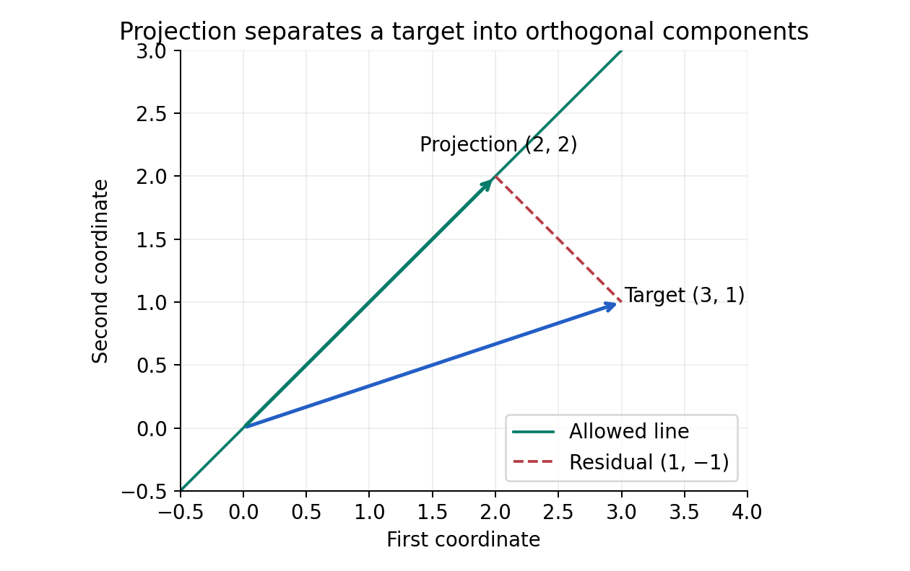

# 2. Vectors and geometry: describing many features at once

This chapter contains outline lessons 5–8. We use the functions, sums, and proof language from Chapter 1. The central problem is to describe a prediction input with several features without losing track of what each number means. We will move from coordinate lists to geometric structure, then derive projections that later explain regression.

<a id="lesson-05"></a>
## Session 5 — Coordinates, vectors, and vector operations

### From one input to several measurements

Suppose delivery time depends on distance and the number of stops. One observation becomes $x=(4,2)^\top$: four kilometers and two stops. The superscript indicates a column. The set $\mathbb R^2$ consists of all ordered pairs of real numbers, with coordinatewise addition and scalar multiplication. For example,

$$
\begin{pmatrix}4\\2\end{pmatrix}+
\begin{pmatrix}1\\3\end{pmatrix}=
\begin{pmatrix}5\\5\end{pmatrix},\qquad
2\begin{pmatrix}4\\2\end{pmatrix}=
\begin{pmatrix}8\\4\end{pmatrix}.
$$

These are definitions of operations, and their usefulness depends on interpretation. Adding displacement vectors describes successive movements. Adding feature vectors may produce a synthetic observation rather than any actual delivery. A feature vector is a mathematical representation, not a guarantee that every algebraic operation corresponds to a meaningful business action.

Geometrically, a vector can be pictured as a displacement from an origin. Moving the arrow without changing its direction and length preserves that displacement. A point is a location relative to the chosen origin; subtracting two points produces a displacement. This distinction matters in affine models: translating the origin changes coordinates of points but does not change differences between points.

For $u=(2,1)^\top$ and $v=(-1,3)^\top$, their sum is $(1,4)^\top$. A route taking displacement $u$ then $v$ reaches the same endpoint as one taking $v$ then $u$. That picture illustrates commutativity. A proof checks each coordinate: $(u+v)_j=u_j+v_j=v_j+u_j=(v+u)_j$. Coordinatewise equality proves equality of vectors.

The zero vector has every coordinate zero. Each $u$ has an additive inverse $-u$, so $u+(-u)=0$. Subtraction means adding this inverse. Scalar multiplication distributes: $a(u+v)=au+av$, and $(a+b)u=au+bu$. These properties let us use ordinary algebra with vectors while respecting the distinction between scalar and vector expressions.

A vector space abstracts these properties. Its elements need not be short numeric lists: polynomials and functions can also form vector spaces. For example, adding two continuous real-valued functions pointwise gives another continuous function, and multiplying one by a real constant preserves continuity. We will work mainly in finite-dimensional real coordinate spaces, where arithmetic and geometry can reinforce one another.

### Coordinates come with a scale

Distance in kilometers and stops are different kinds of quantities. The raw Euclidean length $\sqrt{4^2+2^2}$ combines their numeric values without accounting for units. If distance is converted to meters, that length changes dramatically, even though the delivery did not. Geometry of feature data is therefore partly a modeling decision.

Standardization replaces a feature value $x_j$ by $(x_j-\mu_j)/s_j$, where $\mu_j$ is a reference mean and $s_j>0$ a reference scale. The result is dimensionless. A zero scale signals a constant feature and requires explicit handling; division by zero is not a valid normalization. In a learning pipeline, estimate those quantities on training data and reuse them for later data. Estimating them from a test set leaks information into the fitted procedure.

Centering subtracts a chosen origin. Scaling changes how much a movement in each coordinate counts. Neither operation discovers a universally correct geometry. A domain-specific cost may justify giving distance and stops very different weights even after standardization. We need to name the intended comparison before selecting its arithmetic.

<a id="lesson-06"></a>
## Session 6 — Linear combinations, span, and independence

### What can a collection of directions express?

A linear combination has the form $a_1v_1+\cdots+a_kv_k$, where coefficients are real scalars. With $v_1=(1,0)^\top$ and $v_2=(0,1)^\top$, every $(p,q)^\top$ equals $pv_1+qv_2$. With only $v=(1,2)^\top$, combinations produce $(a,2a)^\top$, a line through the origin.

The span of vectors is the set of all their linear combinations. The word describes possible outputs, not a particular coefficient choice. The zero vector belongs to every span by setting all coefficients to zero. Spans are closed under addition and scalar multiplication because combining combinations gives another combination.

Take $v_1=(1,1)^\top$ and $v_2=(1,-1)^\top$. To express $x=(4,2)^\top$, solve

$$
a+b=4,\qquad a-b=2.
$$

Adding equations gives $2a=6$, so $a=3$ and $b=1$. The combination $3(1,1)+(1,-1)=(4,2)$ reconstructs the vector. The coefficients differ from its ordinary coordinates because the chosen directions differ.

Now replace $v_2$ by $2v_1=(2,2)^\top$. Every combination is $(a+2b,a+2b)^\top$, so $(4,2)^\top$ is impossible. Even representable vectors have many coefficient choices: $(3,3)=3v_1+0v_2=1v_1+1v_2$. Redundancy removes uniqueness without necessarily removing useful predictions.

Vectors $v_1,\ldots,v_k$ are linearly independent if

$$
a_1v_1+\cdots+a_kv_k=0
\quad\Longrightarrow\quad a_1=\cdots=a_k=0.
$$

They are dependent if a nonzero coefficient tuple gives zero. Why define independence using zero? If two combinations yield the same output, subtracting them produces a zero combination. Therefore independence is exactly the condition that coefficient representations, whenever they exist, are unique.

Here is the proof carefully. Suppose $\sum_i a_iv_i=\sum_i b_iv_i$. Subtract the right side to obtain $\sum_i(a_i-b_i)v_i=0$. Independence forces $a_i-b_i=0$ for every $i$, so the coefficients agree. Conversely, a nontrivial zero combination and the all-zero combination are two distinct representations of the same vector. This establishes both directions.

This is the first geometric version of identifiability. If two feature columns are multiples, a linear model can shift weight between them while preserving predictions. An algorithm might return one weight vector, but the data alone do not distinguish that vector from the others.

A subspace is a subset containing zero and closed under vector addition and scalar multiplication. A line through the origin is a subspace; the line $x_2=2x_1+1$ is not, because it excludes zero. Intersections of subspaces are subspaces: any two vectors in the intersection belong to each constituent subspace, so their linear combinations remain in each. A union need not be a subspace: the horizontal and vertical axes are individually subspaces, but their union excludes $(1,1)$ even though it contains $(1,0)$ and $(0,1)$.

<a id="lesson-07"></a>
## Session 7 — Bases, dimension, and changing coordinates

### A basis removes both gaps and redundancy

A basis for a vector space is an independent collection spanning that space. Spanning ensures every vector has coordinates; independence ensures those coordinates are unique. The standard basis in $\mathbb R^d$ contains vectors $e_j$ with a one in position $j$ and zeros elsewhere. A vector $x$ then equals $\sum_{j=1}^d x_je_j$.

The dimension is the number of vectors in any basis. Why does “any” make sense? A finite-dimensional exchange argument shows that no independent set can contain more elements than a spanning set. Starting from a spanning set, insert an independent vector and remove a spanning vector with a nonzero coefficient in its representation. Repeat. If there were more independent vectors than spanning vectors, an additional independent vector would already lie in the span of its predecessors, a contradiction. Applying the comparison in both directions to two bases gives equal lengths. This is a proof sketch of the exchange theorem; its key step is solving for a spanning vector whose coefficient is nonzero.

Dimension counts independent directions, not the length of the ambient coordinate list. All vectors $(a,2a,3a)^\top$ form a one-dimensional subspace inside $\mathbb R^3$. Data can have many recorded features yet live near a much smaller-dimensional structure. Later, principal component analysis will estimate useful directions rather than assuming every coordinate contributes independent variation.

Use the alternative basis $b_1=(1,1)^\top,b_2=(1,-1)^\top$. The coordinate vector of $(4,2)^\top$ in that basis is $(3,1)^\top$, because we already solved for its coefficients. Changing coordinates does not move the represented physical vector. It changes the instructions for reconstructing it from reference directions.

To formalize this, place basis vectors into columns of a matrix $B$. Then $x=Bc$, where $c$ is the coordinate vector in that basis and $x$ is its standard coordinate vector. Chapter 3 will define that multiplication fully. Here the equation abbreviates the column combination $c_1b_1+c_2b_2$. Since a basis gives unique coefficients, the map from $c$ to $x$ has an inverse.

Coordinates and geometric lengths are not the same thing. In an orthonormal basis, squared length is the sum of squared coordinates. In an arbitrary basis it need not be. For example, $b_1=(2,0)^\top,b_2=(0,1)^\top$ gives the vector $(2,1)^\top$ coordinates $(1,1)^\top$. Its Euclidean length is $\sqrt5$, not $\sqrt2$. A coordinate system is bookkeeping; a metric specifies how to measure.

Feature engineering can be viewed as choosing new descriptive functions. For an input $t$, the vector $(1,t,t^2)$ allows a linear combination that is quadratic in $t$. The model is linear in its coefficients, though not in the original input. This distinction helps explain why “linear model” does not mean “only straight patterns in raw inputs.” The selected feature functions determine the representational space.

<a id="lesson-08"></a>
## Session 8 — Dot products, trigonometry, and projections

### Measuring alignment algebraically

For $u,v\in\mathbb R^d$, their Euclidean dot product is

$$
u^\top v=\sum_{j=1}^d u_jv_j.
$$

It is a scalar. The squared Euclidean norm is $\|u\|_2^2=u^\top u$. Its square root is nonnegative, equals zero only at the zero vector, and scales by absolute scalar magnitude. For $u=(3,4)$, the norm is five. The dot product of $(3,4)$ and $(-4,3)$ is zero, indicating perpendicular directions.

An inner product generalizes these properties: it is symmetric, linear in each real argument, and positive on nonzero self-pairs. It connects algebra to geometry. Orthogonality means inner product zero. The zero vector is orthogonal to every vector, though it has no direction and no defined angle with another vector.

For a unit circle, a point at angle $\theta$ radians has coordinates $(\cos\theta,\sin\theta)$. A radian measures arc length divided by radius; a full revolution is $2\pi$ radians. The identity $\cos^2\theta+\sin^2\theta=1$ follows because the point lies on the unit circle. On a right triangle, these functions become adjacent-over-hypotenuse and opposite-over-hypotenuse ratios. Their signs beyond the first quadrant come from coordinates, rather than positive triangle side lengths.

Rotating coordinates so that a nonzero vector $u$ lies along a horizontal axis makes the component of $v$ along it equal to $\|v\|\cos\theta$. Multiplying by $\|u\|$ gives

$$
u^\top v=\|u\|_2\|v\|_2\cos\theta.
$$

This geometric argument motivates the angle formula. Algebraically, we must also know the quotient lies between minus one and one. That is guaranteed by Cauchy–Schwarz.

For $v\ne0$, consider the nonnegative squared norm of $u-tv$. Expanding and completing the square gives

$$
0\le\|u-tv\|^2
=\|v\|^2\left(t-\frac{u^\top v}{\|v\|^2}\right)^2
+\|u\|^2-\frac{(u^\top v)^2}{\|v\|^2}.
$$

Choose $t=(u^\top v)/\|v\|^2$ to remove the first term. Rearranging yields $(u^\top v)^2\le\|u\|^2\|v\|^2$. Taking square roots proves Cauchy–Schwarz. If $v=0$, both sides of its unsquared form are zero. Equality for nonzero vectors occurs exactly when one is a scalar multiple of the other, as the minimizing residual then vanishes.

Cosine similarity divides the dot product by both lengths. It compares direction while discarding scale. Two documents represented by frequency vectors may have similar direction even when one is much longer. That can be useful, but it loses information whenever magnitude matters. It is undefined for zero vectors; returning an arbitrary similarity there silently changes the mathematics.

### Derive the closest point on a line

Suppose $u=(3,1)^\top$ and we can only approximate it by multiples of $v=(1,1)^\top$. Let the approximation be $tv$. The squared distance is

$$
\|u-tv\|^2=(3-t)^2+(1-t)^2
=2(t-2)^2+2.
$$

The unique minimum occurs at $t=2$. Thus the projection is $(2,2)^\top$, with residual $(1,-1)^\top$. Their dot product is zero. The unrepresentable part is perpendicular to the direction available for approximation.

In general the completed-square argument above gives

$$
\operatorname{proj}_v u=\frac{u^\top v}{v^\top v}v,\qquad v\ne0.
$$

We have derived a minimizer without calculus. Expanding the residual's dot product with $v$ proves orthogonality directly: $v^\top(u-tv)=v^\top u-t\,v^\top v=0$ at the chosen coefficient. For any other coefficient $s$, the new residual is the orthogonal residual plus $(t-s)v$. Its squared norm is the old squared error plus $(t-s)^2\|v\|^2$, so it cannot improve the fit.

For orthogonal vectors $a,b$, expanding $\|a+b\|^2$ gives $\|a\|^2+2a^\top b+\|b\|^2=\|a\|^2+\|b\|^2$. This is the Pythagorean theorem in any finite dimension. Projection splits a vector into an explained component and an orthogonal unexplained component. Chapter 3 extends that idea from one direction to a whole column space.

An orthonormal collection has unit-length vectors orthogonal in pairs. If $q_1,\ldots,q_k$ is such a collection, projection onto its span is $\sum_j(q_j^\top u)q_j$. To verify this, subtract the proposed projection from $u$ and dot the result with each $q_i$. All terms vanish except the matching coefficient, which cancels $q_i^\top u$. Orthogonality then proves minimum distance as before.



### Orthogonalizing a pair of directions

Start with $v_1=(1,1)$ and $v_2=(1,0)$. Normalize the first: $q_1=(1,1)/\sqrt2$. Remove the part of the second along the first:

$$
u_2=v_2-(q_1^\top v_2)q_1
=(1,0)-(1/2,1/2)=(1/2,-1/2).
$$

Its norm is $1/\sqrt2$, so $q_2=(1,-1)/\sqrt2$. This is one step of Gram–Schmidt orthogonalization. If the remainder were zero, the new direction would add no dimension. For nearly dependent floating point data, a tiny remainder can be inaccurate; robust numerical routines use more stable variants such as Householder QR. The exact derivation and the recommended numerical implementation can differ while representing the same geometry.

### A geometric diagnosis of feature redundancy

Consider a model recording distance in both kilometers and meters. The two coordinates are different numbers, but the second is always one thousand times the first. The observations therefore lie on one line through the origin in a two-dimensional feature space. Recording an extra coordinate has not created an extra independent direction of information.

Suppose the score is a coefficient times kilometers plus another coefficient times meters. Substituting the conversion shows that only the first coefficient plus one thousand times the second matters. Many coefficient pairs give exactly the same score for every physically consistent input. The redundancy is a property of the representation before any fitting method is chosen. Later a regularizer can prefer one pair, but it does so by an additional criterion rather than new evidence from the observations.

Contrast this with two features that are strongly correlated but not exact multiples, such as distance and fuel consumption. Their data may cluster near a line while still spanning the plane. The exact dimension is then two, yet one direction has little variation. This difference between exact and approximate redundancy will be quantified by singular values. A small amount of noise can make the exact span full-dimensional without making every direction reliably informative.

Changing feature units can also change nearest-neighbor comparisons. Compare observations A with distance two and stops ten, and B with distance three and stops one. A query with distance two and stops one is nine raw units from A and one raw unit from B if kilometers and stops are combined naively. Replacing kilometers with meters makes B one thousand distance units away while A remains nine stop units away, reversing the ordering. The observations did not change; the chosen numeric geometry did.

This example does not imply Euclidean distance is useless. It means a distance function is a declared model of similarity. Standardization, explicit weights, or learned metrics can each be appropriate when their assumptions match the task. A statement such as “these vectors are close” is incomplete until the metric and feature scales have been identified.

### Orthogonality is relative to the inner product

The Euclidean dot product is natural when coordinate directions use a shared length scale. Other problems use a weighted inner product, defined by inserting a symmetric positive definite matrix between the two vectors. Positivity ensures a nonzero vector has positive squared length; symmetry ensures the order of the vectors does not change their inner product.

Under this geometry, two vectors perpendicular in the Euclidean picture may cease to be perpendicular. Conversely, a suitable weighted inner product can make nonperpendicular Euclidean directions orthogonal. This is not a contradiction: perpendicularity means zero under a specified inner product. Coordinate plots usually hide that specification because ordinary Euclidean geometry is assumed.

Projection still follows the same reasoning: choose a multiple of the allowed direction, expand its squared distance using the chosen inner product, and complete the square. The coefficient becomes the inner product of the target and direction divided by the direction's squared length, all measured in that geometry. The proof survives because it used the inner-product rules, rather than a special drawing of two-dimensional arrows.

That generality is useful later for weighted least squares, where some observations have greater precision than others. A residual in a high-precision observation can be assigned more cost. The closest fitted prediction then depends on the weighted geometry. We first teach ordinary Euclidean projection to establish the structure; weights modify the measurement rule while preserving the logic of orthogonal residuals.

### Inspect the arithmetic in Python

The following program uses only the standard library and makes each summation explicit.

```python
from math import sqrt

u = [3.0, 1.0]
v = [1.0, 1.0]

def dot(a, b):
    if len(a) != len(b):
        raise ValueError("Vectors must have the same dimension")
    return sum(a_j * b_j for a_j, b_j in zip(a, b))

coefficient = dot(u, v) / dot(v, v)
projection = [coefficient * value for value in v]
residual = [a - b for a, b in zip(u, projection)]
print(coefficient, projection, residual)
print(dot(residual, v), sqrt(dot(residual, residual)))
```

The coefficient is `2.0`, projection `[2.0, 2.0]`, and residual `[1.0, -1.0]`. The second line reports zero dot product and distance approximately `1.4142135623730951`. `zip` pairs matching coordinates; the explicit length check prevents its usual behavior of silently stopping at the shorter list. We know $v$ is nonzero here. A general projection function must also reject a zero direction before division.

The geometry companion lets you change both vectors and inspect their projection and residual. Set the direction to zero to see the invalid-input explanation. Then choose parallel vectors: the residual becomes zero. Choose perpendicular vectors: the projection becomes zero. These cases connect the algebraic denominator, geometric picture, and equality conditions in the proof.

A useful optional application is to project $(4,0)$ onto the line spanned by $(2,2)$. The coefficient is one, giving $(2,2)$. Rescaling the direction to $(1,1)$ changes the coefficient to two but leaves the projected vector unchanged. This illustrates a distinction that will recur throughout ML: the fitted object can remain the same even when its coordinate description changes.

Our geometric language now has a chain of meaning. Combinations describe available directions; independence describes unique coefficients; a basis supplies a complete coordinate system; an inner product measures alignment; projection selects the closest representable vector. The next chapter packages many such combinations into a matrix and studies what information that transformation retains.

[Previous chapter](01-mathematical-language.md) · [Curriculum](../CURRICULUM.md) · [Next chapter](03-matrices-and-least-squares.md)
