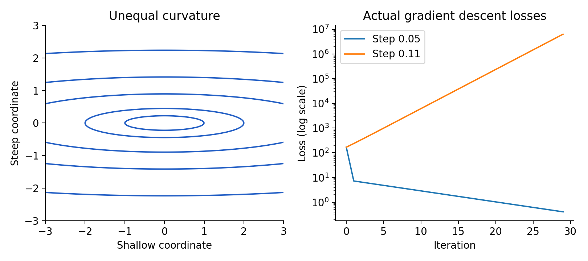

# 8. Optimization: when a parameter update improves a model

This chapter contains outline lessons 29–32. It is intentionally divided into several small subsections because constraints, curvature, and random updates solve different problems. Prerequisites are gradients, Hessians, eigenvalues, and Taylor approximations. Our central question is what a training update can guarantee, and which assumptions make that guarantee valid.

<a id="lesson-29"></a>
## Session 29 — Minima, stationary points, and curvature

### Local information does not automatically imply global success

A global minimizer $x_*$ has $f(x_*)\le f(x)$ for every feasible $x$. A local minimizer satisfies the same comparison only in some neighborhood. It is strict if nearby distinct feasible points have strictly larger values. An infimum is a greatest lower bound and may not be attained, as with $e^x$ on the real line.

If $f$ is differentiable and $x_*$ is an interior local minimizer, then $\nabla f(x_*)=0$. To prove this, choose any direction $v$ and consider $g(t)=f(x_*+tv)$. For sufficiently small positive and negative $t$, the point remains feasible. A one-variable interior minimum gives $g'(0)=0$, so $\nabla f(x_*)^\top v=0$ for every $v$. Choosing coordinate directions makes each gradient component zero.

The interior hypothesis matters. Minimizing $f(x)=x$ over $x\ge0$ gives $x_*=0$, even though its derivative is one. Feasible directions only point right there. Unconstrained stationary conditions cannot be applied to a boundary without modification.

A stationary point has zero gradient. The functions $x^2$, $-x^2$, and $x^3$ all have a stationary point at zero, with a minimum, maximum, and neither, respectively. In several dimensions, $x^2-y^2$ has a saddle at the origin. Thus stationarity is a necessary interior condition, not a general certificate of optimality.

If $f$ is twice continuously differentiable and $\nabla f(x_*)=0$, a positive definite Hessian gives a strict local minimum. The proof uses Taylor expansion: the positive quadratic term dominates the $o(\|h\|^2)$ remainder for sufficiently small nonzero $h$. A negative Hessian eigenvalue gives a direction of decrease, ruling out a local minimum. A PSD Hessian is necessary at an interior minimum but not sufficient: $f(x)=x^3$ and $f(x)=-x^4$ have zero second derivative at zero and fail to be minima.

These are local classifications. Even a strict local minimum can have a higher value than another distant region. To bridge local and global information, we need convexity.

<a id="lesson-30"></a>
## Session 30 — Convex sets, convex functions, and global optimality

### Interpolate between feasible choices

A set $C$ is convex if $(1-t)x+ty\in C$ whenever $x,y\in C$ and $0\le t\le1$. The segment joining any two feasible points stays feasible. Balls, halfspaces, and intersections of convex sets are convex. A ring with a missing center is not, because a segment between opposite points crosses the missing region.

A function on a convex domain is convex if

$$
f((1-t)x+ty)\le(1-t)f(x)+tf(y).
$$

Its graph lies below the chord connecting two graph points. Squared norms are convex; $-x^2$ is concave, meaning its negative is convex. Affine functions are both. Convexity is a property of the whole domain and all segments, rather than visual bowl-like appearance near one point.

For differentiable convex $f$, the first-order inequality is

$$
f(y)\ge f(x)+\nabla f(x)^\top(y-x).
$$

To derive it, apply convexity at $x+t(y-x)$, rearrange to bound a directional difference quotient, and let $t\downarrow0$. Conversely, this inequality at all pairs implies convexity by applying it at the interpolated point and adding weighted versions. It says every tangent plane is a global lower support.

If $\nabla f(x)=0$, the inequality immediately gives $f(y)\ge f(x)$ for all $y$. This is why a stationary point of a differentiable convex function is globally optimal. Also, every local minimum of a convex function is global: a hypothetical lower point would create arbitrarily close lower values along its segment, contradicting local minimality.

Strict convexity makes a minimizer unique when one exists. If two distinct minimizers existed, the midpoint would have strictly smaller value. Strong convexity with parameter $\mu>0$ strengthens the support inequality to

$$
f(y)\ge f(x)+\nabla f(x)^\top(y-x)+\frac\mu2\|y-x\|^2.
$$

For a twice continuously differentiable function on a convex open domain, convexity is equivalent to a PSD Hessian everywhere; strong convexity follows from $H(x)\succeq\mu I$ everywhere. The symbol means $v^\top H(x)v\ge\mu\|v\|^2$ for every vector. Checking only one Hessian is insufficient for a global claim.

For $f(\beta)=\frac12\|X\beta-y\|^2$, Hessian $X^\top X$ is PSD, so the objective is convex. It is strongly convex if columns are independent. Adding $\lambda\|\beta\|^2/2$ makes the Hessian $X^\top X+\lambda I$, positive definite for $\lambda>0$ even when data columns are dependent.

<a id="lesson-31"></a>
## Session 31 — Gradient descent, step sizes, and convergence

### Derive a safe update before choosing a number

Gradient descent takes $x^+=x-\eta\nabla f(x)$ with step size $\eta>0$. The negative gradient gives the largest first-order decrease for a Euclidean unit step. But a finite step can overshoot, because the local linear approximation eventually becomes inaccurate.

Assume the gradient is $L$-Lipschitz on the relevant segment:

$$
\|\nabla f(u)-\nabla f(v)\|\le L\|u-v\|.
$$

Integrate the directional derivative along $x+th$ to get

$$
f(x+h)-f(x)=\int_0^1\nabla f(x+th)^\top h\,dt.
$$

Subtract $\nabla f(x)^\top h$. Cauchy–Schwarz and Lipschitz continuity bound the remaining integral by $\int_0^1Lt\|h\|^2dt=L\|h\|^2/2$. Therefore

$$
f(x+h)\le f(x)+\nabla f(x)^\top h+\frac L2\|h\|^2.
$$

Substituting $h=-\eta\nabla f(x)$ yields the descent lemma:

$$
f(x^+)\le f(x)-\eta\left(1-\frac{L\eta}2\right)\|\nabla f(x)\|^2.
$$

For $0<\eta<2/L$, the coefficient is positive, so nonzero gradients give a strict decrease. This result does not require convexity. It requires a valid smoothness bound and a segment staying inside the domain. At $\eta=1/L$, the guaranteed decrease is $\|\nabla f(x)\|^2/(2L)$.

If $f$ is bounded below and that step is used repeatedly, summing the decreases bounds the sum of squared gradient norms. In particular, among the first $T$ iterates the smallest squared gradient norm is at most $2L[f(x_0)-f_{\inf}]/T$. This guarantees approximate stationarity, not a global minimum for an arbitrary nonconvex objective.

For a positive definite quadratic $f(x)=\frac12x^\top Hx-b^\top x$, the optimum solves $Hx_*=b$. Let error $e_t=x_t-x_*$. The update gives

$$
e_{t+1}=(I-\eta H)e_t.
$$

In an eigenvector direction of $H$, the error multiplier is $1-\eta\lambda_j$. All directions contract exactly when $|1-\eta\lambda_j|<1$, equivalent to $0<\eta<2/\lambda_{\max}$. With eigenvalues one and one hundred, $\eta=0.01$ eliminates the steep-direction error in one step but only multiplies the shallow-direction error by $0.99$. That slow progress is a conditioning issue.

For a general $\mu$-strongly convex, $L$-smooth function, a step $1/L$ gives the objective contraction

$$
f(x_t)-f(x_*)\le(1-\mu/L)^t[f(x_0)-f(x_*)].
$$

One derivation combines the descent lemma with $\|\nabla f(x)\|^2\ge2\mu[f(x)-f(x_*)]$, obtained by minimizing the strong-convexity lower quadratic in its second argument. We state the assumptions explicitly because changing to an arbitrary neural-network loss removes this global guarantee.

For convex smooth functions without strong convexity, gradient descent with step $1/L$ has the standard objective bound $f(x_T)-f(x_*)\le L\|x_0-x_*\|^2/(2T)$ when a minimizer exists. A proof telescopes squared distances to the optimum using convexity and the smoothness inequality. The order $1/T$ differs from the geometric contraction above. A smooth objective can be well behaved without having uniformly positive curvature.

Backtracking line search avoids knowing $L$ in advance. Start with a trial step and shrink it until an inequality such as $f(x-\eta g)\le f(x)-c\eta\|g\|^2$ holds for a chosen $0<c<1$. On a smooth function, sufficiently small steps pass. This is an actual check of improvement, with extra function evaluations, rather than a universal fixed learning-rate rule.

<a id="lesson-32"></a>


## Session 32A — Equality constraints and Lagrange multipliers

### At a constraint, some movements are forbidden

Minimize $x^2+y^2$ subject to $x+y=1$. Write $y=1-x$: the objective becomes $2(x-1/2)^2+1/2$, minimized at $(1/2,1/2)$. The closest point on the line is also its orthogonal projection from the origin.

The Lagrangian is $\mathcal L(x,y,\lambda)=x^2+y^2+\lambda(x+y-1)$. Stationarity gives $2x+\lambda=0$, $2y+\lambda=0$, and feasibility $x+y=1$. Thus $x=y=1/2$ and $\lambda=-1$. The multiplier's sign depends on how the constraint is written; it is not meaningful without that convention.

Geometrically, feasible first-order movements lie in the tangent space to the constraint. At an optimum, the objective gradient has zero component along those movements, so it lies in the span of constraint normals. This explains the multiplier equation. For general nonlinear equalities $h(x)=0$, the rule requires a regularity condition such as independent constraint gradients at the candidate. Singular constraints can defeat the conclusion; $h(x)=x^2=0$ leaves only $x=0$ feasible but has zero constraint derivative there.

## Session 32B — Inequalities and KKT conditions

For constraints $g_j(x)\le0$ and equalities $h_i(x)=0$, use

$$
\mathcal L=f+\sum_j\lambda_jg_j+\sum_i\nu_i h_i.
$$

Karush–Kuhn–Tucker conditions combine stationarity, primal feasibility, dual feasibility $\lambda_j\ge0$, and complementary slackness $\lambda_jg_j(x)=0$. An inactive inequality has strict slack, so its multiplier must be zero. An active inequality can contribute a normal force.

Minimize $(x-2)^2$ subject to $x\le1$. Set $g=x-1$. Stationarity is $2(x-2)+\lambda=0$. The optimum $x=1$ has $\lambda=2$, satisfying every condition. The unconstrained optimum two is infeasible. If instead the objective is $(x-1/2)^2$, the constraint is inactive at its optimum, with multiplier zero.

For differentiable convex $f$ and convex inequality functions, with affine equalities, any feasible point satisfying KKT is globally optimal. Necessity generally needs a constraint qualification. Slater's condition, existence of a strictly feasible point relative to the affine equalities, is a common sufficient condition for the usual convex duality and KKT conclusions. In nonconvex problems, KKT is usually only a necessary local condition under regularity, not a global certificate.

## Session 32C — Newton's method and stochastic optimization

Newton's method minimizes the local quadratic model by solving

$$
H(x)p=-\nabla f(x),\qquad x^+=x+p.
$$

For a positive definite quadratic it reaches the optimum in one exact step. For a nonlinear objective, local quadratic accuracy and a nonsingular Hessian can give rapid convergence near a suitable optimum. An indefinite Hessian can produce an ascent direction, and a singular Hessian prevents an ordinary solve. Damping, line search, trust regions, or positive definite approximations address these issues. Explicitly inverting the Hessian is unnecessary; solve a system instead.

A finite dataset often gives $F(\theta)=(1/n)\sum_i\ell_i(\theta)$. Uniformly sampling an observation gives a stochastic gradient $g=\nabla\ell_I$ with expectation $\nabla F$. A minibatch average lowers noise when sampled appropriately. Randomness can make a particular step increase full loss even when its gradient estimate is unbiased.

For an $L$-smooth objective, conditioning on the current iterate gives

$$
\mathbb E[F(\theta-\eta g)]
\le F(\theta)-\eta\|\nabla F\|^2
+\frac{L\eta^2}2\mathbb E\|g\|^2.
$$

Noise adds a term proportional to the squared step. A fixed step can maintain persistent fluctuations near an optimum. Classical diminishing-step convergence results require additional assumptions, often including unbiasedness, bounded variance, and step schedules with $\sum_t\eta_t=\infty$ and $\sum_t\eta_t^2<\infty$. Those sums alone are not a theorem for every model and sampling scheme.

Momentum maintains a running direction, for example $v_{t+1}=\rho v_t+g_t$ and $\theta_{t+1}=\theta_t-\eta v_{t+1}$. It can reduce zigzagging but can also overshoot. Adam tracks exponential averages of gradients and squared gradients, with bias correction and a denominator stabilizer. These mechanisms adapt coordinate scales, yet they do not guarantee global optimality for arbitrary neural networks. The algorithms are engineering choices whose behavior depends on assumptions, implementation conventions, and hyperparameters.

### Scaling a loss changes a learning rate convention

Suppose one source defines a loss as a sum of squared residuals, another as its average, and a third as half the average. They have the same minimizers for a nonempty fixed dataset, but their gradients differ by constant factors. Using the same numeric step size in all three therefore produces different updates.

This is why a learning rate cannot be interpreted independently of the objective convention. Multiplying the whole objective by a positive constant multiplies both gradient and curvature by that constant. The mathematical safe-step bound changes inversely. When comparing a derivation with code, check the factor of two from squaring, division by batch size, and scaling of regularization before diagnosing a deeper optimization failure.

A regularization parameter also depends on that convention. If only the data-fitting term is divided by sample size, leaving the penalty unchanged, the relative penalty strength changes. Two implementations can both say “ridge with lambda one” while solving different optimization problems. State the full objective, rather than only the algorithm name and parameter value.

### A constrained optimum can have a nonzero gradient

Consider moving along a feasible interval. At its left endpoint, only rightward directions are allowed; a positive derivative prevents improvement in those directions even though the ordinary derivative is not zero. At its right endpoint, the analogous sign reverses. The unconstrained condition of zero gradient came from requiring no decrease in both a direction and its negative. A boundary removes one of those possibilities.

Projected gradient descent first takes an ordinary gradient step and then projects back onto a convex feasible set. For a nonnegative scalar parameter, projection replaces a negative trial value by zero. At a boundary optimum, the trial step may repeatedly point outside while projection leaves the parameter unchanged. That behavior is consistent with constrained optimality and should not be diagnosed as a frozen optimizer from the gradient alone.

For a Euclidean ball constraint, projection rescales an outside vector to the allowed radius while leaving inside vectors unchanged. The operation is determined by the nearest-point geometry from Chapter 2. For nonconvex feasible sets, projection can be nonunique, and many standard projected-gradient convergence statements no longer apply without additional analysis.

### A useful stopping rule answers a specific question

A small gradient norm suggests approximate unconstrained stationarity for a differentiable objective. It does not certify a global minimum, good held-out performance, or a well-identified parameter vector. In a saturated neural network, gradients can be small far from a useful fit. In an ill-conditioned quadratic, a modest gradient may coexist with substantial parameter error along a shallow direction.

A small change in loss between iterations can mean progress has converged, but it can also mean the step size is too small or floating point precision hides the change. A small parameter step can arise from a small learning rate rather than a small gradient. Therefore stopping criteria should be paired with their scale and purpose.

For a deterministic educational example, track objective value, gradient norm, parameter change, and iteration count together. For stochastic training, evaluate a fixed reference batch or a held-out metric periodically rather than expecting the sampled minibatch loss to decrease monotonically. Random fluctuations are a feature of the sampling procedure, not immediate evidence of a sign error.

### Why Newton can fail far from an optimum

Take a one-dimensional function with a region of negative second derivative. The Newton step divides minus the first derivative by the second derivative. If the denominator is negative, the step can point in the same direction as the gradient, increasing the objective locally. The method is trying to solve a local quadratic model, but that model is concave there and has no local minimum.

Even with positive curvature, an accurate local model may cover only a small neighborhood. A full Newton step can leave it. A line search scales the direction and checks actual improvement; a trust-region method explicitly limits the region in which the local model is trusted. These mechanisms connect optimization engineering directly to Taylor approximation error.

Solving a Newton system approximately can also be sufficient. Iterative linear solvers may use Hessian-vector products and stop before an exact solve. The resulting method trades computation per iteration against progress. The right comparison is total useful work to reach a stated objective accuracy, rather than iteration count alone.

This perspective helps compare optimization methods without declaring one universally best. First-order methods are cheap and scale well; curvature methods can move efficiently through poorly scaled geometry but cost more and need safeguards. The data, model, accuracy target, and available computation determine the practical tradeoff.

### A small deterministic optimization experiment

```python
import numpy as np

H = np.diag([1.0, 20.0])
x = np.array([4.0, 4.0])
step = 0.05
for iteration in range(6):
    value = 0.5 * x @ H @ x
    print(iteration, value, x)
    x = x - step * (H @ x)
```

The steep coordinate becomes zero after the first update because its multiplier is $1-0.05(20)=0$. The shallow coordinate is multiplied by $0.95$ on every update, so the remaining objective decreases gradually. A step of $0.11$ makes the steep multiplier $-1.2$, producing alternating growth instead. The companion lets you change these curvatures and step size, reset, and observe the actual sequence and loss.

For optional practice, compare Newton and gradient descent on this same quadratic. Newton solves $Hp=-Hx$, hence $p=-x$, reaching zero in one step. That advantage comes at the cost of obtaining and solving with second-order structure. On a huge model, first-order updates can be cheaper even when they need more iterations.

Optimization answers how to choose parameters for a specified objective. It does not by itself say whether the objective reflects the real world or whether a fitted model generalizes. Probability and statistics supply the language for those questions, starting in the next chapter.

[Previous chapter](07-multivariable-calculus-and-backpropagation.md) · [Curriculum](../CURRICULUM.md) · [Next chapter](09-probability-foundations.md)
