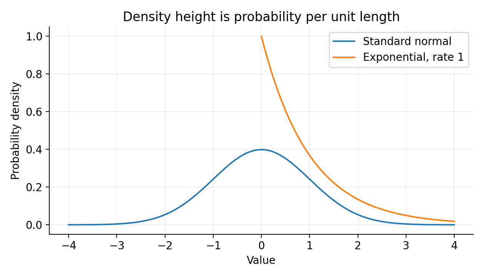

# 10. Distribution families and the behavior of repeated samples

This chapter contains outline lessons 37–40. You need probability masses, densities, expectation, variance, and conditioning. Our central problem is choosing a plausible model for a type of observation, then understanding what repeated sampling does. A distribution is useful because of its assumptions, not because all data must resemble one named curve.

<a id="lesson-37"></a>
## Session 37 — Bernoulli, binomial, geometric, and Poisson models

### One binary event and a count of many events

A Bernoulli random variable is one with probability $p$ and zero with probability $1-p$, where $0\le p\le1$. Its mass is $p^x(1-p)^{1-x}$ for $x\in\{0,1\}$, interpreted at boundary parameters by the underlying probabilities. Expectation is $p$ and variance is $p(1-p)$ because $X^2=X$.

If $X$ counts successes in $n$ mutually independent Bernoulli trials with the same success probability, it has a binomial distribution:

$$
P(X=k)={n\choose k}p^k(1-p)^{n-k},\qquad k=0,\ldots,n.
$$

The combinatorial coefficient counts which positions are successes. The binomial theorem shows the masses sum to $(p+(1-p))^n=1$. Linearity of expectation gives $np$; independence removes cross-covariances, giving variance $np(1-p)$. Without the common $p$, a count can still be a sum of independent indicators but is not generally binomial.

For five trials with $p=0.2$, exactly two successes have probability $10(0.2)^2(0.8)^3=0.2048$. The mean is one, which need not be the outcome in a particular batch. A mean is a weighted average across possible batches, not a promise about each one.

### Waiting for the first success

In this book, a geometric variable $T$ counts trials through the first success, so support begins at one:

$$
P(T=t)=(1-p)^{t-1}p,\qquad t=1,2,\ldots,\quad0<p\le1.
$$

Some software instead counts failures and starts at zero; always check convention. The event $T>t$ means the first $t$ trials all fail, so $P(T>t)=(1-p)^t$. The geometric series normalizes the masses.

For a nonnegative integer-valued variable, counting how often each outcome contributes to the sum gives $\mathbb E[T]=\sum_{t=0}^\infty P(T>t)$. Here that is $\sum_{t=0}^\infty(1-p)^t=1/p$. Variance is $(1-p)/p^2$, obtained from differentiating the convergent geometric-series generating function or summing the second moment. For $p=0.25$, the mean waiting time is four trials, though arbitrarily long waits remain possible.

The model is memoryless: $P(T>s+t\mid T>s)=(1-p)^t=P(T>t)$. The cancellation follows from independent identical future trials. If chance of success improves with repeated attempts, geometric waiting is inappropriate.

### Counts in a time or space window

A Poisson variable with parameter $\lambda\ge0$ has mass

$$
P(N=k)=e^{-\lambda}\frac{\lambda^k}{k!},\qquad k=0,1,\ldots.
$$

For $\lambda=0$ it is concentrated at zero. For positive $\lambda$, normalization follows from the exponential series. Shift the summation index in $\sum_k k\lambda^k/k!$ to derive $\mathbb E[N]=\lambda$. Similarly $\mathbb E[N(N-1)]=\lambda^2$, so variance is $\lambda$.

At rate $r$ events per hour over $t$ hours, the mean count is $\lambda=rt$. The standard homogeneous Poisson-process mechanism assumes independent counts in disjoint intervals and a constant event rate, with negligible probability of multiple events in an infinitesimal interval. Those assumptions are stronger than merely observing a sample mean near a sample variance.

The rare-event limit provides another derivation: if $N_n\sim\operatorname{Binomial}(n,\lambda/n)$, then for fixed $k$,

$$
{n\choose k}(\lambda/n)^k(1-\lambda/n)^{n-k}
\to e^{-\lambda}\lambda^k/k!.
$$

The factorial ratio tends to $1/k!$ after dividing by $n^k$, and the final power tends to $e^{-\lambda}$. For clustered arrivals or changing rates, a single Poisson model may underestimate variability. A model diagnostic should inspect the mechanism and dependence, not only fit a histogram.

<a id="lesson-38"></a>
## Session 38 — Uniform, exponential, gamma, and beta models

### Uniform uncertainty is relative to a coordinate

A continuous uniform variable on $[a,b]$, $a<b$, has density $1/(b-a)$. Integrating $x$ and $x^2$ gives mean $(a+b)/2$ and variance $(b-a)^2/12$. Equal-length intervals get equal probability. A nonlinear transformation of a uniform variable is generally not uniform; “uninformative” depends on what coordinate is considered natural.

An exponential waiting time with rate $\lambda>0$ has density $\lambda e^{-\lambda t}$ for $t\ge0$. Its survival probability is $P(T>t)=e^{-\lambda t}$. Integration by parts gives mean $1/\lambda$ and variance $1/\lambda^2$. The rate has inverse-time units, so the mean has time units.

It is memoryless because $e^{-\lambda(s+t)}/e^{-\lambda s}=e^{-\lambda t}$. It describes the wait to the next event in a homogeneous Poisson process. If equipment gets more likely to fail with age, exponential waiting ignores that changing hazard and may be a poor lifetime model.

The gamma family extends exponential waiting. With shape $\alpha>0$ and rate $\beta>0$,

$$
f(t)=\frac{\beta^\alpha}{\Gamma(\alpha)}t^{\alpha-1}e^{-\beta t},\qquad t>0,
$$

where $\Gamma(\alpha)=\int_0^\infty u^{\alpha-1}e^{-u}du$. Integration by parts gives $\Gamma(\alpha+1)=\alpha\Gamma(\alpha)$, and $\Gamma(1)=1$, so integer shapes connect to factorials. Substituting $u=\beta t$ proves normalization. Taking one or two extra powers of $t$ in the integral gives mean $\alpha/\beta$ and variance $\alpha/\beta^2$.

For integer shape $k$, gamma describes a sum of $k$ independent exponential waits with the same rate, the time to the $k$th Poisson-process event. Shape one is exponential. Software often uses scale $s=1/\beta$ instead of rate, which changes formulas to mean $\alpha s$ and variance $\alpha s^2$. Confusing rate with scale reverses the effect of a parameter.

A beta variable lies between zero and one, with shape parameters $\alpha,\beta>0$:

$$
f(p)=\frac{p^{\alpha-1}(1-p)^{\beta-1}}{B(\alpha,\beta)},\qquad
B(\alpha,\beta)=\int_0^1p^{\alpha-1}(1-p)^{\beta-1}dp.
$$

Its mean is $\alpha/(\alpha+\beta)$ and variance is $\alpha\beta/[(\alpha+\beta)^2(\alpha+\beta+1)]$. These follow by taking ratios of beta integrals and their recurrence identities. The uniform distribution on $[0,1]$ is beta with both parameters one. Shapes below one can produce endpoint singularities that remain integrable.

A useful interpretation is a distribution over a Bernoulli probability, distinct from a distribution over a binary observation. With $p\sim\operatorname{Beta}(2,3)$, the mean probability is $0.4$ but observed Bernoulli outcomes remain zero or one. Increasing both shapes proportionally preserves the mean while concentrating uncertainty around it. Chapter 11 derives how observations update these shapes.

<a id="lesson-39"></a>
## Session 39 — Gaussian models and related sampling distributions

### The normal density combines a center and a quadratic penalty

For $s>0$, a Gaussian variable has density

$$
f(x)=\frac1{s\sqrt{2\pi}}\exp\left[-\frac{(x-\mu)^2}{2s^2}\right].
$$

Chapter 6 derived its normalization. Standardizing gives $Z=(X-\mu)/s\sim N(0,1)$. Symmetry gives mean $\mu$ and an integration-by-parts calculation gives variance $s^2$. The CDF of the standard normal, $\Phi$, has no elementary closed form, but numerical routines compute it accurately.

For a time model with mean ten minutes and standard deviation two, the probability of being at most twelve is $\Phi(1)\approx0.841345$. This is a probability about an outcome under specified parameters. It is not a confidence statement about an estimated mean.

A multivariate Gaussian with mean $\mu\in\mathbb R^d$ and positive definite covariance $\Sigma$ has density

$$
f(x)=\frac{\exp[-\tfrac12(x-\mu)^\top\Sigma^{-1}(x-\mu)]}
{(2\pi)^{d/2}\sqrt{\det\Sigma}}.
$$

Write $X=\mu+AZ$ with independent standard normal coordinates and $AA^\top=\Sigma$. The linear transformation explains elliptical contours and the covariance formula. The determinant supplies the volume conversion. If covariance is singular, the Gaussian is concentrated on a lower-dimensional affine subspace and has no ordinary full-dimensional density of this form.

A linear combination of jointly Gaussian coordinates is Gaussian. In a jointly Gaussian vector, zero covariance between blocks implies independence. This implication is special; Chapter 9's $X,X^2$ example shows it fails for arbitrary distributions. Correlated Gaussian variables can be decorrelated by an orthogonal eigenbasis and standardized by dividing by square roots of positive covariance eigenvalues, a process called whitening.



### Why chi-squared, t, and F distributions appear

If $Z_1,\ldots,Z_\nu$ are independent standard normals, then $Q=\sum_iZ_i^2$ has a chi-squared distribution with $\nu$ degrees of freedom. It is a gamma distribution with shape $\nu/2$ and rate $1/2$, so mean is $\nu$ and variance $2\nu$. Degrees of freedom count independent standardized squared components in this construction.

If $Z\sim N(0,1)$ and $Q\sim\chi^2_\nu$ are independent, then

$$
T=\frac{Z}{\sqrt{Q/\nu}}
$$

has Student's t distribution. The random denominator makes tails heavier than a standard normal. As $\nu$ increases, $Q/\nu$ concentrates near one, so the distribution approaches normal. Its mean exists for $\nu>1$ and is zero; variance exists for $\nu>2$ and equals $\nu/(\nu-2)$. At one degree of freedom it is Cauchy, which lacks a finite ordinary mean.

For independent $Q_1\sim\chi^2_{\nu_1}$ and $Q_2\sim\chi^2_{\nu_2}$,

$$
F=\frac{Q_1/\nu_1}{Q_2/\nu_2}
$$

has an F distribution. A squared $t_\nu$ variable is $F_{1,\nu}$. These constructions explain why variance estimates and regression sum-of-squares comparisons lead to t and F procedures. Their exact sampling statements require Gaussian data and the independence conditions in the construction.

<a id="lesson-40"></a>
## Session 40 — Sampling, laws of large numbers, CLT, and concentration

### A random dataset is a mathematical object

Before data collection, $X_1,\ldots,X_n$ are random variables. After observation, $x_1,\ldots,x_n$ are realized numbers. An estimator such as $\bar X=(1/n)\sum_iX_i$ is random before sampling. Its sampling distribution describes repeated datasets from the same mechanism, not variability among entries within one fixed dataset.

For iid observations with finite variance $\sigma^2$ and mean $\mu$,

$$
\mathbb E[\bar X]=\mu,\qquad
\operatorname{Var}(\bar X)=\frac{\sigma^2}{n}.
$$

The variance calculation expands a sum and uses zero covariance from independence. Standard error is therefore $\sigma/\sqrt n$. Quadrupling sample size halves this scale; it does not reduce it by four. Dependence can invalidate this scaling by adding covariance terms.

Markov's inequality for nonnegative $Y$ states $P(Y\ge a)\le\mathbb E[Y]/a$ for $a>0$. The proof is $Y\ge a\mathbf1_{Y\ge a}$, followed by expectation. Apply it to $(X-\mu)^2$ to obtain Chebyshev's inequality:

$$
P(|X-\mu|\ge\varepsilon)\le\frac{\operatorname{Var}(X)}{\varepsilon^2}.
$$

For $\bar X$, the bound is $\sigma^2/(n\varepsilon^2)$, which tends to zero. This proves the weak law of large numbers under iid finite-variance assumptions: sample averages converge in probability to the population mean. Stronger laws give almost-sure convergence under other conditions; we state, rather than prove, the iid finite-first-moment strong law.

The central limit theorem addresses the shape of fluctuations:

$$
\frac{\sqrt n(\bar X-\mu)}\sigma
\xrightarrow{d}N(0,1)
$$

for iid variables with finite positive variance. The symbol denotes convergence in distribution, meaning convergence of CDF values at continuity points of the limiting CDF. It does not say the original data become Gaussian, nor that a fixed sample mean is random after observation. The limiting approximation concerns standardized random sample means across repeated samples.

A proof sketch uses characteristic functions. For centered standardized $Y$, finite variance yields $\mathbb E[e^{itY}]=1-t^2/2+o(t^2)$ near zero. Independence gives the characteristic function of $n^{-1/2}\sum_iY_i$ as $[1-t^2/(2n)+o(1/n)]^n\to e^{-t^2/2}$, the standard normal characteristic function. A continuity theorem then yields convergence in distribution. This sketch names an additional tool and its decisive expansion; it is not a complete proof of the characteristic-function theorem.

There is no universal sample size of thirty that makes every CLT approximation accurate. Severe skew, rare outcomes, heavy tails, or dependence can require different treatment. Infinite variance removes the stated theorem's hypotheses. For Bernoulli means, normal approximations are suspect near zero or one when expected counts are small.

For independent bounded variables $X_i\in[a,b]$, Hoeffding's inequality gives

$$
P(|\bar X-\mathbb E\bar X|\ge\varepsilon)
\le2\exp\left[-\frac{2n\varepsilon^2}{(b-a)^2}\right].
$$

We state this nonasymptotic theorem; its proof uses an exponential moment bound and Markov's inequality. Unlike CLT approximations, it gives a finite-sample upper bound under boundedness and independence, though the bound may be conservative. For Bernoulli data, making this bound at most $\delta$ requires $n\ge\log(2/\delta)/(2\varepsilon^2)$. At tolerance $0.05$ and failure bound $0.05$, the ceiling is 738 observations.

### Choosing a family by a generative story

Suppose you record the number of late deliveries each day. A binomial model is plausible if the number of deliveries is fixed and each has an independent common late probability. A Poisson model instead describes a count over a fixed exposure window with a constant event rate and independent increments. The same numeric histogram can sometimes be fit reasonably by both, but their predictions under changed exposure differ.

If the number of deliveries doubles, a binomial count should use the new number of trials while preserving the assumed per-delivery probability. A Poisson arrival count doubles its mean when the observation window doubles under a constant rate. When lateness risk differs by route or day, a common-probability model may understate variation. The observation protocol and mechanism determine which parameter changes should occur.

For waiting times, geometric counts describe discrete attempts through a first success, whereas exponential times describe continuous waiting under a memoryless rate. Gamma waiting describes several such events rather than only the first. Recording units and the event that ends the wait prevents a superficial resemblance between curves from deciding the model.

A beta model can describe uncertainty over a probability or bounded continuous proportions, but those are distinct uses. A ratio measured with different denominators may have a sampling variance that depends on its denominator. Modeling all observed ratios as equally precise beta draws may ignore that information. A binomial model with known trial counts can better represent the observation mechanism in such a case.

### Derive one moment instead of memorizing a table

For a Poisson count, the expectation sum has a factor k multiplying a factorial denominator. For positive k, that factor cancels the k in k factorial, leaving a shifted factorial. Factoring out the mean parameter and shifting the index leaves the exponential series that normalized the original distribution. The result is the parameter itself.

For the second factorial moment, multiply by k times k minus one. Cancelling two factorial factors leaves the square of the parameter times the same normalized series. Reconstruct the ordinary second moment by adding the first moment, then subtract the squared mean to obtain variance equal to the parameter.

This derivation is useful beyond its final answer. It shows how a distribution's algebraic form makes certain functions of the variable easier to average than others. Factorial moments are natural for counts; ordinary powers are natural for quadratic loss; exponential moments support concentration bounds. Choosing a helpful representation can simplify a proof without changing the underlying probability.

The gamma moment calculation works similarly, replacing a sum with an integral. Multiplying the density by the variable increases the power by one, turning the integral into a gamma function with shape increased by one. The recurrence then yields the mean. This is the same structural reasoning in a continuous family.

### Standard error is not the spread of individual observations

For Bernoulli success probability 0.2, the standard deviation of an individual outcome is 0.4. Averaging one hundred independent outcomes gives standard error 0.04. The smaller number describes variability of sample averages across batches, not a claim that individual outcomes have moved closer to 0.2. They are still exactly zero or one.

A histogram of one large dataset's binary outcomes therefore remains two spikes. A histogram of many independently generated sample means becomes more concentrated and approximately bell shaped away from problematic boundary regimes. Mixing those two histograms is a common misunderstanding of the central limit theorem.

If observations are positively dependent, covariance terms enlarge the variance of an average. In the extreme case where every recorded outcome is a copy of the same underlying Bernoulli variable, averaging one hundred copies is identical to observing one variable. Its standard error remains 0.4, not 0.04. Counting rows as independent samples would overstate precision by a factor of ten in standard-error terms.

### A bound, an approximation, and an empirical frequency

Chebyshev and Hoeffding provide upper bounds under stated assumptions. They need not match the actual probability closely. A normal approximation from the CLT may be much sharper numerically but is asymptotic and can be inaccurate at a given sample size. A simulation estimates the actual probability for a chosen model but itself has Monte Carlo variability.

These are three different kinds of evidence. If a simulation frequency lies far below Hoeffding's bound, the theorem has not failed; it promised an upper limit. If it differs modestly from a normal approximation, finite-sample effects may explain the discrepancy. If repeated simulations vary, the number of simulated batches determines another layer of sampling error.

A transparent experiment displays all three separately when available: an observed frequency, a theoretical finite-sample bound, and a labeled approximation. It also states the data-generating parameters and seed. This is why the companion does not present its histogram as a proof of the central limit theorem or a universal guarantee about arbitrary real data.

### An executable sampling experiment

```python
import numpy as np

rng = np.random.default_rng(7)
probability = 0.2
sample_size = 100
repetitions = 10000
means = rng.binomial(sample_size, probability, size=repetitions) / sample_size
print(means.mean())
print(means.std())
print((probability * (1 - probability) / sample_size) ** 0.5)
```

The empirical mean should be near $0.2$ and standard deviation near $0.04$. The final line is the theoretical standard error. A fixed seed makes this experiment reproducible within the stated library environment, though cross-version random-number streams are not a universal contract. Sampling a binomial count directly is equivalent in distribution to counting successes in each batch of independent Bernoulli trials.

The companion sampling experiment uses a deterministic reset seed and displays a histogram of repeated Bernoulli sample means. Change the sample size while leaving the underlying success probability fixed. The individual outcome distribution remains binary, while the distribution of averages narrows. It also displays the finite-sample Hoeffding bound for a selected tolerance, making clear that a bound and an empirical frequency are different objects.

For optional exploration, compare geometric and exponential survival probabilities over matched time scales. Both are memoryless, but one counts discrete trials and the other continuous time. This comparison connects a shared structural property to distinct supports and parameter units.

We now have models for binary events, counts, waiting times, bounded probabilities, and Gaussian variation, together with rules for repeated sampling. The next chapter asks how to infer unknown parameters from one finite dataset while representing the uncertainty that remains.

[Previous chapter](09-probability-foundations.md) · [Curriculum](../CURRICULUM.md) · [Next chapter](11-statistical-inference.md)
