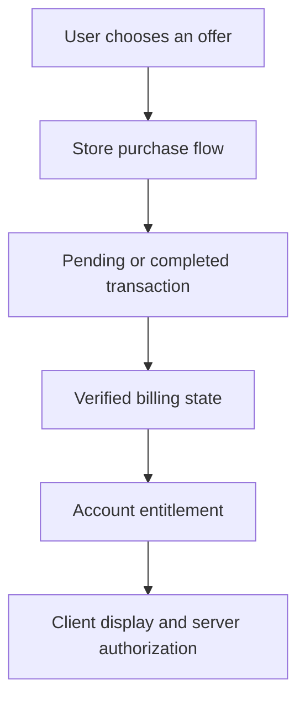

# 07 — RevenueCat, Stripe, store billing, and subscription UX

[Previous](06-amplify-and-appwrite.md) · [Course home](../README.md) · [Next](08-pocketpilot-capstone.md)

**Planned time: 100 hours.** Use 14 hours for payment concepts and policy research, 28 for RevenueCat sandbox integration, 18 for a separate Stripe test-mode lab, 22 for lifecycle and webhook testing, and 18 for pricing and paywall design. All financial transactions in the learning work remain sandbox or test-mode operations.

## 1. Start by classifying what the customer buys

“Payments” describes several different jobs. A customer can buy digital app functionality, pay for a physical product, purchase a real-world service, send money to another person, or pay a bill. The allowed payment infrastructure depends on that classification, the distribution channel, the storefront, and current policy.

PocketPilot Premium unlocks digital app features. The conservative global baseline is store billing on iOS and Google Play-distributed Android, with a service such as RevenueCat managing the integration. Stripe is appropriate for permitted web purchases and other eligible payment categories. Apple Pay and Google Pay are wallet interfaces and payment methods; they are not substitutes for StoreKit or Play Billing simply because their names mention the platforms.

The current [Apple review guidelines](https://developer.apple.com/app-store/review/guidelines/) and [Google Play payments policy](https://support.google.com/googleplay/android-developer/answer/9858738?hl=en) include region-specific exceptions and alternative-payment programs. As of this course's research date, Apple describes different external-link treatment for the United States storefront. Do not turn that into a worldwide rule. Recheck the exact program and storefront before implementing a purchase route.

## 2. Understand the four layers of a purchase

The product is what you sell, such as monthly Premium. The store transaction records a purchase or renewal. The entitlement represents the access your application grants, such as `premium`. The user identity determines which account receives that access. These layers are related but should not be collapsed into one Boolean stored by the phone.

A monthly and annual product can both grant the same entitlement. A canceled subscription can remain entitled until its paid period ends. A purchase can be pending rather than complete. A refund or revocation can remove access. A customer can restore a purchase on another device. A local success callback is therefore only one event in a longer lifecycle.



The server must protect expensive or sensitive premium operations independently of the client UI. Hiding an export button is not enough if the export endpoint accepts any signed-in caller. Use a verified billing state or a trusted synchronized entitlement record on the server.

## 3. Compare the implementation choices

| Choice | What it supplies | What remains your responsibility |
| --- | --- | --- |
| RevenueCat + store billing | Cross-platform purchase SDK, subscription state, entitlement tooling, optional paywall tooling | Product setup, identity mapping, server checks, UX, policy, support |
| Direct store integration through a maintained IAP library | Client access to StoreKit and Play Billing | Verification, notifications, lifecycle reconciliation, acknowledgment, entitlement backend |
| Stripe | Payment processing and billing APIs for eligible purchases | Allowed purchase category, server integration, fulfillment, tax/business setup, disputes |
| Apple Pay / Google Pay through a processor | Wallet-based payment experience | Processor and merchant setup, eligible category, server fulfillment |
| Custom raw payment collection | Maximum responsibility and compliance scope | Nearly everything; usually inappropriate for a solo app |

For this course's digital subscription, RevenueCat is the default because it reduces the infrastructure needed to handle a complicated lifecycle. Direct store integration is a useful advanced learning path when you need control and can maintain the backend. “Roll it yourself” should mean understanding and implementing the store protocol, not attempting to bypass it with an ordinary card form.

Current vendor pricing and store fees change and can vary by program and region. Build the business model with variables, then fill them from current official pricing and your actual eligibility. Do not assume every developer qualifies for a particular reduced commission or that one headline percentage captures taxes, refunds, and operational costs.

## 4. Configure products before writing the purchase button

Create your app records in App Store Connect and Play Console. Set up the required agreements, banking, tax, and subscription configuration in your own business accounts. Create product identifiers that are stable and understandable, such as a monthly and annual Premium product. The identifiers are not display prices; the store supplies localized pricing and eligibility.

In RevenueCat, connect the store apps, configure the current required store credentials, create a `premium` entitlement, attach products, and place them in an offering. An offering is a presentation grouping, which lets you choose which packages the app displays. Keep development and production setup clearly separated.

Product availability depends on store configuration as well as code. A package can be absent because an agreement is incomplete, a product is not available in the relevant region, the bundle identifier is wrong, or the build is not using the intended environment. Diagnose those conditions before assuming the SDK method is broken.

## 5. Use a development build for real purchase testing

The [RevenueCat Expo guide](https://www.revenuecat.com/docs/getting-started/installation/expo) requires a development build for actual native purchase testing. Expo Go can be useful for some mocked preview behavior, but it is not evidence that StoreKit or Play Billing works in your app.

```sh
npx expo install expo-dev-client react-native-purchases react-native-purchases-ui
```

Rebuild after adding native purchase modules. Register the correct bundle ID and Android package. Use the current store testing paths, including sandbox accounts, license testers, TestFlight, or internal testing as appropriate. Do not test a real charge merely to prove a button can be pressed.

Keep public RevenueCat SDK keys in client configuration and secret administrative keys on the server. Platform-specific SDK keys are not interchangeable. A test configuration should never silently select the production key because an environment variable was missing. Fail visibly during setup when required configuration is absent.

## 6. Map billing identity to your application user

Use a stable, opaque application user ID as the RevenueCat app user ID after the user signs in. Avoid email addresses because they can change and expose personal information. Decide whether anonymous purchases are supported. For a finance app with an account-based data model, requiring sign-in before purchase often simplifies ownership and support.

Configure the SDK once under a clearly owned billing service. When the application identity changes, use the SDK's documented login/logout lifecycle rather than calling configure repeatedly in arbitrary screens. Test purchase restoration and account switching carefully because store accounts and app accounts are different identities.

```ts
// Billing service fragment; call once when a stable signed-in user is available.
import { Platform } from 'react-native';
import Purchases from 'react-native-purchases';

export function configureBilling(appUserId: string) {
  const apiKey = Platform.OS === 'ios'
    ? process.env.EXPO_PUBLIC_REVENUECAT_IOS_KEY
    : process.env.EXPO_PUBLIC_REVENUECAT_ANDROID_KEY;
  if (!apiKey || !appUserId) throw new Error('Missing billing configuration');
  Purchases.configure({ apiKey, appUserID: appUserId });
}
```

This fragment intentionally does not implement the full service lifecycle. In your app, guard initialization, serialize identity changes, and attach customer-info listeners once. On logout, clear user-scoped UI and server caches. Review RevenueCat's current transfer and restore behavior so a store account cannot unexpectedly attach purchases to the wrong application account under your chosen policy.

## 7. Load offerings and purchase a package

```ts
import Purchases, { type PurchasesPackage } from 'react-native-purchases';

export async function loadPackages(): Promise<PurchasesPackage[]> {
  const offerings = await Purchases.getOfferings();
  return offerings.current?.availablePackages ?? [];
}

export async function buyPackage(selected: PurchasesPackage): Promise<boolean> {
  const result = await Purchases.purchasePackage(selected);
  return Boolean(result.customerInfo.entitlements.active['premium']);
}

export async function restorePremium(): Promise<boolean> {
  const info = await Purchases.restorePurchases();
  return Boolean(info.entitlements.active['premium']);
}
```

The package object comes from the configured offering. Display its localized product price and duration using the SDK's current product fields. Do not hardcode `$4.99` while the store charges a different localized amount. Product metadata and trial eligibility can differ by account and region.

The purchase method can reject for cancellation, pending state, configuration failure, or other errors. Classify documented error codes in the adapter. Cancellation is a normal outcome and should not trigger a scary error banner. A pending purchase should not grant access merely because the user completed part of the platform UI.

Use returned customer information to update the local presentation, then reconcile server authorization through the trusted billing path. Client data can improve responsiveness, but a premium API should not accept a Boolean supplied by the phone. A modified client can set any local variable it wants.

## 8. Restores, management, and customer support are core features

Provide a visible Restore purchases action. Restore is especially important after reinstalling or moving devices. Explain when a store account differs from the app account, and provide a support path that does not ask for passwords or payment-card details. A purchase that cannot be restored creates more harm than a slightly less polished paywall.

Provide subscription management using the appropriate store or provider-supported destination. Cancellation generally stops future renewal while leaving access through the already-paid period, but exact lifecycle states should come from the billing system. Do not immediately revoke access merely because auto-renew is off.

Support needs a safe lookup process based on internal user and transaction references. Keep the minimum necessary billing metadata, avoid collecting raw card information, and restrict administrative access. Document how to investigate “paid but no access,” “restored to another account,” and “refund completed but still premium.” These are predictable operations cases.

## 9. Treat webhooks as authenticated, repeated messages

A billing webhook is a server-to-server message. Verify the configured authentication or signature mechanism for the provider before trusting its contents. Record a stable event ID, deduplicate processing, and update the entitlement through a transaction or durable workflow. A webhook can be retried or arrive out of order.

Do not simply let every event overwrite the entitlement with whatever status it mentions. An old expiration event arriving after a new renewal can incorrectly remove access. Prefer reconciling the current authoritative subscriber state or applying events with a well-defined ordering and version model. Keep a durable record of processed events and the source state used for the projection.

For RevenueCat, configure the currently documented webhook authentication and subscriber API access. For direct Apple and Google integrations, implement their server notification and verification requirements. A single generic endpoint called `/webhook` does not make different providers' authentication rules interchangeable.

Return promptly after durable acceptance and do longer work in a worker when appropriate. If you acknowledge before storing anything and the process crashes, the event can be lost. If you block the response on a slow multi-step operation, the provider may retry and amplify the load. A durable inbox plus idempotent worker is a useful pattern.

## 10. Model entitlement state instead of a permanent premium flag

An entitlement projection can include user ID, source, product ID, status, expiry, last verified time, and source transaction reference. Keep the raw provider lifecycle separate from the application's access decision. The access decision should express how trial, active, grace period, billing retry, expiration, refund, and revocation affect specific features.

```ts
type Entitlement = {
  status: 'active' | 'grace' | 'expired' | 'revoked';
  expiresAt: string | null;
  verifiedAt: string;
};

export function mayUsePremium(value: Entitlement | null, now: Date): boolean {
  if (!value || value.status === 'expired' || value.status === 'revoked') return false;
  if (value.expiresAt === null) return false; // No lifetime entitlement in this product.
  const expiry = Date.parse(value.expiresAt);
  return Number.isFinite(expiry) && expiry > now.getTime();
}
```

This is a deliberately narrow local policy function for the course's expiring subscription product. The server should calculate expiry and grace behavior from verified provider state. A client clock can be manipulated, so local checks do not authorize server features. The packaged domain lab tests this pure decision function with a controlled clock.

Define outage behavior explicitly. A user with recently verified paid access may receive a bounded offline grace period for local features. A costly server export may require a current server entitlement. Do not fail every paid screen closed during a brief provider outage without considering the customer experience, and do not grant indefinite access from an ancient cached flag.

## 11. Learn direct store integration as an advanced branch

If you build without RevenueCat, use a maintained IAP library compatible with your Expo and React Native versions. The exact API can change significantly across library versions, so this course does not invent a universal purchase call. Start from the current library's TypeScript quickstart and implement the following explicit protocol.

The client loads products, starts the store purchase flow, receives a transaction, and sends the required proof to your server. The server verifies with the platform, binds the result to the correct app user, records the transaction idempotently, and grants the entitlement. The client completes or acknowledges the transaction through the supported library flow only at the appropriate point. Platform notifications keep future renewals and revocations synchronized.

StoreKit and Play Billing have different concepts, tokens, and completion requirements. Google purchase acknowledgment and Apple transaction finishing are not interchangeable names for the same call. Follow current platform documentation and test interrupted completion, duplicate delivery, pending approval, restoration, renewal, refund, and account changes.

The direct branch is complete only when the backend lifecycle works, not when a sandbox purchase sheet appears. This is why a managed entitlement service can be economical for a solo developer. Compare ongoing maintenance and support effort as well as SDK invoice cost.

## 12. Build a separate Stripe test-mode lab

Use Stripe for an eligible payment scenario, such as a physical merchandise purchase or a permitted web checkout. Keep it separate from the native Premium subscription until you have verified the relevant store policy. The [React Native PaymentSheet guide](https://docs.stripe.com/payments/mobile/accept-payment?platform=react-native&type=payment) documents the current client/server integration.

```sh
npx expo install @stripe/stripe-react-native
```

Configure the Stripe native plugin and wallet capabilities according to the current Expo and Stripe guides. Apple Pay needs merchant configuration and entitlements. Google Pay has its own environment and merchant requirements. A card-only test can be simpler than adding wallet configuration immediately.

The server chooses the amount and currency from trusted product data. The phone sends a product or order ID, not an authoritative price. The server creates a PaymentIntent using a secret key, and returns the client secret needed for the client interaction. The secret key never enters the app bundle.

## 13. Create the PaymentIntent on the server

The following is a teaching handler for a server that has already authenticated the caller. The fixed synthetic item replaces a real product lookup; it is not a production order system.

```ts
import Stripe from 'stripe';

const stripeSecret = process.env.STRIPE_SECRET_KEY;
if (!stripeSecret) throw new Error('Missing server Stripe key');
const stripe = new Stripe(stripeSecret);

type OrderRequest = { orderId: string; productId: string };

export async function createTestIntent(userId: string, input: OrderRequest) {
  if (input.productId !== 'demo-physical-notebook') throw new Error('Unknown product');
  if (!/^[a-zA-Z0-9_-]{1,80}$/.test(input.orderId)) throw new Error('Invalid order ID');
  const intent = await stripe.paymentIntents.create({
    amount: 1500, currency: 'usd',
    automatic_payment_methods: { enabled: true },
    metadata: { userId, orderId: input.orderId },
  }, { idempotencyKey: `${userId}:${input.orderId}` });
  if (!intent.client_secret) throw new Error('No payment client secret');
  return { clientSecret: intent.client_secret };
}
```

The handler's caller must derive `userId` from a verified session. A production server also verifies order ownership, locks or versions the order, validates inventory and price, and records the PaymentIntent relationship durably. The idempotency key is scoped to the authenticated user and logical order. Reusing an order ID with changed purchase details requires an explicit policy rather than accidental duplicate charging.

Pin the Stripe SDK version and record the API-version behavior used by your deployment. Do not copy an outdated hardcoded API-version string from another project without checking compatibility. Test-mode keys and webhook secrets are separate from production credentials.

## 14. Present PaymentSheet and confirm fulfillment on the server

```tsx
import { useState } from 'react';
import { Button, Text, View } from 'react-native';
import { StripeProvider, useStripe } from '@stripe/stripe-react-native';

function Checkout({ createIntent }: { createIntent: () => Promise<{ clientSecret: string }> }) {
  const { initPaymentSheet, presentPaymentSheet } = useStripe();
  const [message, setMessage] = useState('');
  const [busy, setBusy] = useState(false);
  async function pay() {
    setBusy(true);
    try {
      const { clientSecret } = await createIntent();
      const initialized = await initPaymentSheet({
        merchantDisplayName: 'PocketPilot Demo',
        paymentIntentClientSecret: clientSecret,
        returnURL: 'pocketpilot://stripe-redirect',
      });
      if (initialized.error) throw new Error(initialized.error.message);
      const presented = await presentPaymentSheet();
      setMessage(presented.error ? 'Payment was not completed.' : 'Payment submitted. Checking order status.');
    } catch {
      setMessage('Checkout is unavailable. Please try again.');
    } finally {
      setBusy(false);
    }
  }
  return <View><Button title="Pay for demo notebook" disabled={busy}
    onPress={() => { void pay(); }} /><Text>{message}</Text></View>;
}

export function StripeDemo({ publishableKey, createIntent }: {
  publishableKey: string; createIntent: () => Promise<{ clientSecret: string }>;
}) {
  return <StripeProvider publishableKey={publishableKey} urlScheme="pocketpilot">
    <Checkout createIntent={createIntent} />
  </StripeProvider>;
}
```

The injected `createIntent` calls your authenticated server. The UI does not declare the order fulfilled merely because PaymentSheet closes without an error. The server processes the verified payment event and records fulfillment. The client then loads the order status. This protects against interrupted app sessions and asynchronous payment methods.

For Stripe webhooks, verify the signature against the raw request body using the endpoint's webhook secret. JSON parsing before verification can alter the bytes and break signature validation. Mount the raw-body route appropriately in your framework, deduplicate events, and keep fulfillment idempotent. A webhook secret is not the same as the API secret key.

## 15. Pricing should reflect recurring value and recurring cost

PocketPilot's bank aggregation, support, infrastructure, and data processing can create ongoing costs. A lifetime purchase can be risky if it promises unlimited costly service indefinitely. A monthly or annual subscription can align with ongoing value, but only if the product continues to provide that value and communicates the terms clearly.

Define the free product before the paywall. A useful free tier can let people understand and trust the app. Premium can add meaningful recurring benefits such as richer history, custom alerts, advanced comparisons, or multiple supported connections. Do not paywall the ability to delete an account, manage a subscription, or understand what the app is charging.

Annual pricing can improve cash flow and commitment, but it is not automatically better for every user. Display the full amount billed and period clearly, along with any monthly equivalent as secondary context. If there is a trial, explain when it ends, what will be charged, and how to cancel. Avoid deceptive countdowns or a preselected plan that obscures the total commitment.

## 16. Build an ethical, measurable paywall

A useful paywall answers who the plan is for, which specific benefits it unlocks, what it costs, when billing occurs, and how the user can restore or manage access. It should be accessible with large text and screen readers. Its close or back behavior should match the product's actual free access model.

Place the offer after a meaningful value moment, such as a completed budget setup or an explanation of a premium comparison. Showing a paywall before the user sees any useful information can produce curiosity-driven trials with poor retention. The right timing depends on your product and should be tested with guardrails.

Measure exposure, selection, store-flow start, purchase completion, entitlement activation, trial conversion, refunds, cancellations, and retention. A purchase completion event should be deduplicated and, where possible, confirmed by trusted billing data. Do not optimize only tap-through rate while ignoring users who feel misled or cannot restore access.

## 17. Unit economics with explicit assumptions

Suppose a hypothetical monthly plan produces 8 dollars of recognized net revenue per payer after modeled fees and refunds. Variable bank and infrastructure cost is 2 dollars, leaving 6 dollars of contribution before fixed costs and acquisition. These are illustrative numbers, not current vendor prices. If average paid lifetime is five months, the simplified contribution lifetime value is 30 dollars.

That estimate is fragile. Churn can vary by cohort, annual plans change cash timing, support costs can rise, and refunds can cluster. A simple `monthly contribution / monthly churn` formula assumes a stable geometric retention model that may not fit early data. Use cohort observations and confidence ranges rather than presenting a single exact lifetime value from a small launch.

Customer acquisition cost should include the actual channel expense and, when relevant, production effort. A 20-dollar acquisition cost against a speculative 30-dollar contribution value leaves little room for error. Scale paid acquisition only after retention, entitlement reliability, and support are reasonably understood. Chapter 10 develops the launch measurement plan.

## 18. Lifecycle test matrix

Test a new purchase, user cancellation, pending approval, successful trial, trial expiration, renewal, failed renewal, grace period, auto-renew cancellation, refund, revocation, restore after reinstall, restore on another device, and account switching. Include a user with no available offerings and a device whose store account cannot purchase.

Test duplicate and out-of-order webhooks. Test a server outage after the store completed a purchase. Test the app closing before the local callback runs. Test a user who buys on iOS and signs into Android with the same app account under your cross-platform entitlement policy. Verify that server premium endpoints follow the same intended access state as the UI.

Keep a sandbox transaction reference and expected entitlement result for each case. Do not record payment credentials or raw receipts in public learning artifacts. The local domain lab can verify policy functions, but only store sandbox testing can validate the actual native purchase lifecycle.

## 19. A worked support case: paid but not premium

First identify the application account and the store purchase reference through safe support information. Check whether the purchase is complete, pending, or refunded. Check whether RevenueCat or your direct backend associated it with the expected app user ID. Check whether the webhook projection is delayed or stale. Check whether the client is showing old cached entitlement data.

Do not ask the customer to repurchase as the first troubleshooting step. Restore purchases or a supported reconciliation action may recover the entitlement. If the purchase belongs to another app account under your policy, explain the supported transfer or recovery path. Avoid manually editing a client flag that will be overwritten by the next verified billing update.

After resolving the case, identify the missing automation or UX. A clearer sign-in-before-purchase flow, a restore button, an entitlement refresh after foreground entry, or a durable webhook inbox may prevent recurrence. Support incidents are evidence about the system's weakest boundary.

## 20. Project work and acceptance evidence

Integrate RevenueCat with two sandbox products granting one entitlement. Implement a paywall, purchase, restore, subscription management, local customer-info refresh, and server-side premium authorization. Build the separate Stripe test-mode notebook checkout and fulfill only from verified server state. Keep the purchase categories distinct in your documentation.

Acceptance evidence includes store product configuration notes, a sanitized lifecycle matrix, duplicate-event tests, a recording of restore, and proof that a free user cannot call a premium server endpoint directly. Include a policy decision record listing target storefronts, purchase type, payment path, source links, and the date checked.

## 21. Deeper walkthrough: account switching and restoration

A store account can own a purchase while the app has its own account system. If Alice purchases while signed into PocketPilot account A, then signs out and Bob signs into account B on the same device, the app must not casually treat the store's purchase history as proof that B should receive A's financial subscription. The provider's transfer and restore settings determine part of this behavior, and your product policy determines the intended result.

Define the policy before launch and test it with sandbox accounts. If purchases are transferable under supported conditions, explain how transfer affects access on the old app account. If they remain bound, provide a recovery path for the legitimate owner. Avoid collecting email addresses as billing identity because an address can change and is not the store's transaction identity.

The server entitlement projection should reference the stable app identity and verified provider relationship. On account change, clear local premium presentation before loading the new account's state. A brief stale premium badge may seem harmless, but a stale server request context can become a real authorization error. Serialize identity transitions and cancel work tied to the previous user.

Restore is a user action that can change identity associations depending on the provider configuration. Treat it as a meaningful operation with clear feedback, not a background loop that runs constantly. If restoration finds no active entitlement, say so calmly and offer the appropriate support path rather than claiming the customer never purchased anything.

## 22. Further detail: experiments that improve revenue without damaging trust

Test one hypothesis at a time. For example, “Showing the premium comparison after a user creates their first budget will improve activated-to-paid conversion without increasing seven-day cancellations.” Define the eligible cohort, exposure event, primary metric, and guardrails before changing the screen. A visual variant without a decision rule produces anecdotes rather than learning.

Keep price and term disclosures correct in every variant. A/B testing does not justify hiding renewal information or making cancellation harder. Watch refunds, support contacts, and retained use alongside conversion. An offer that produces more purchases and substantially more regret can reduce long-term revenue and damage your developer brand.

Small samples require patience. If ten users see each variant, a difference of one purchase can look dramatic as a percentage while conveying little reliable evidence. Use qualitative feedback and funnel diagnostics to identify obvious friction, then run a larger test when traffic supports it. Do not declare a universal pricing law from one small launch.

An optional AI review prompt is: “Review my payment architecture and paywall. Classify the purchase type and storefront assumptions, trace verified transactions into server entitlements, inspect restore and account switching, and propose lifecycle tests for pending, refund, revocation, duplicate, and out-of-order events. Evaluate conversion together with retention and refund guardrails. Flag any policy claim that needs current primary-source verification.”

## 23. Webhook lab: build a durable inbox before a projection

Create a server table for received billing events with provider, event ID, received time, processing state, attempt count, and a carefully controlled payload reference. A unique provider/event-ID constraint makes duplicate delivery visible and harmless. Store only what is needed for reconciliation and apply an appropriate retention policy; billing event payloads can contain personal information.

The HTTP handler first verifies the provider's documented authentication. It then inserts the event durably and returns the expected success response. A worker claims unprocessed events, retrieves current authoritative subscriber state when needed, and updates the account entitlement. If the worker crashes, the event remains retryable. If the HTTP handler crashes before durable insertion, the provider's retry can deliver it again.

Test duplicate delivery by sending the same authenticated synthetic event twice. There should be one logical inbox record and one effective entitlement transition. Test an old expiration event after a newer renewal. The projection should remain consistent with current verified state. Test a transient provider API failure and confirm backoff rather than an immediate infinite retry loop.

Now test an unknown app user ID. Do not create a privileged account or attach access to an arbitrary email from the payload. Resolve the stable identity through your defined billing mapping. Put unresolved events into a visible operational state with a safe support procedure. Silently dropping them can leave a paying user without access.

Finally, test a deletion in progress. A late billing event must not recreate a deleted profile or reconnect financial data. You may need a minimal retained billing relationship or deletion tombstone under your actual policy, but that record should not grant normal application access. Account lifecycle and billing reconciliation must cooperate deliberately.

## 24. Store lab: distinguish cancellation, expiry, and refund

Create a sandbox subscriber and record the entitlement state after purchase. Turn off renewal through the supported store management path. Confirm that access remains until the paid period ends under the applicable lifecycle. The UI can say that renewal is off without saying Premium has already expired. The server should make the same distinction.

Next, test an actual expiry in the sandbox's accelerated lifecycle. Confirm that the client refreshes customer information and the server projection removes the appropriate access. Test a refund or revocation using the supported sandbox tools. A refund can have different access consequences from simply disabling renewal, so do not map all three events into one `canceled` Boolean.

Test a pending purchase or approval flow. The app should explain that access is not yet confirmed and should recover after a later verified completion. Do not repeatedly open the purchase sheet or invite the user to pay twice. A clear pending state and a restore/recheck action reduce unnecessary support requests.

Then reinstall the app and restore. Verify the relationship between the current store account and the signed-in application account under your chosen transfer policy. This is stronger evidence than restoring immediately after a purchase in the same process, because reinstalling exercises persistence and identity recovery.

## 25. Product lab: compute a sustainable offer

Make a worksheet with plan price, modeled store proceeds, expected refunds, bank-data cost, infrastructure cost, support allowance, and contribution margin. Use current official prices when filling it and record the date. Keep fixed operating costs separate from per-user variable costs. A plan can have positive variable contribution while the business remains unprofitable at a small scale.

Compare monthly and annual plans using both cash timing and service obligations. An annual payment supplies cash earlier but commits you to supporting the customer through the period. A large annual discount may improve conversion while reducing the contribution available to cover bank-data costs. Test with explicit assumptions rather than repeating a generic discount percentage.

Choose a premium benefit that corresponds to a recurring user decision. “Advanced insights” is vague; “compare this month's category spending with the previous three months” is concrete. Verify that the feature is correct, understandable, and useful before placing it at the center of a paywall. Revenue depends on sustained value as well as a successful transaction sheet.

Keep a release note for every billing change. Record the product configuration, entitlement mapping, tested storefronts, sandbox cases, and server deployment involved. A future “paid but no access” investigation should identify the relevant version quickly rather than depend on memory.
