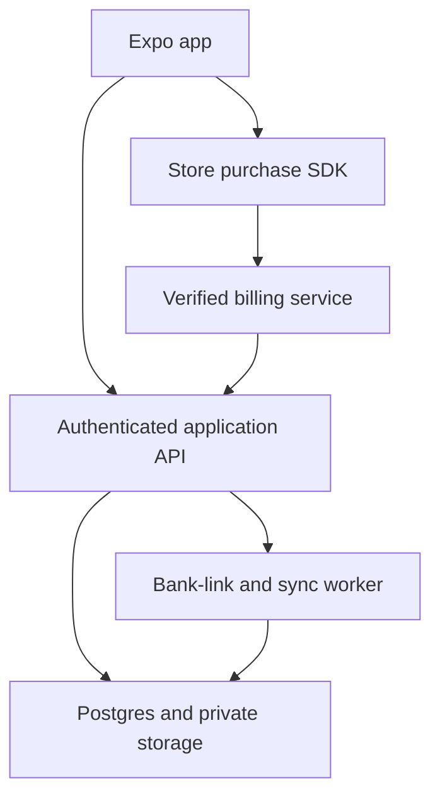

# 08 — Build PocketPilot, the personal-finance capstone

[Previous](07-payments-and-subscriptions.md) · [Course home](../README.md) · [Next](09-quality-security-and-release-engineering.md)

**Planned time: 140 hours.** Allocate 14 hours to specification and architecture, 28 to the finance domain and fixture UI, 28 to the chosen backend, 24 to sandbox banking, 20 to premium and privacy workflows, and 26 to reconciliation and end-to-end acceptance. Earlier chapters contribute working components; this chapter integrates them into one coherent product.

## 1. Define the clone as a learning objective

Rocket Money's public product describes subscription management and personal-finance workflows. PocketPilot learns from that problem category while using original branding, screen design, copy, and synthetic data. The capstone's required scope is transaction review, budgets, recurring-charge estimates, savings goals, subscription tracking, sandbox bank linking, premium access, exports, and account lifecycle.

Do not claim that a demo cancels a real merchant subscription, negotiates a bill, transfers money, or monitors credit unless you have actually implemented the required authorized service. The course represents those more complex workflows as clearly labeled prototypes or future extensions. A “request cancellation” screen in a learning app must not tell the user their real bill has been canceled.

The core product promise is modest and testable: “See your spending, plan budgets, and review recurring commitments.” A truthful promise supports better engineering than an ambitious interface that implies capabilities the backend does not provide. The [capstone specification](../capstone/specification.md) turns that promise into acceptance evidence.

## 2. Choose one production architecture

Use Expo Router and TypeScript for the app, TanStack Query for server state, a small domain layer for calculations, and the selected backend from earlier chapters. The default track uses Supabase Auth and Postgres. RevenueCat manages the native Premium subscription. A server worker owns bank-provider credentials and synchronization. SQLite supports defined offline behavior rather than acting as an accidental second authority.



The diagram separates trust boundaries. The phone can request a bank-link session, but cannot read a long-lived bank access token. The store SDK can report customer information, but the server decides access to premium endpoints from trusted billing state. The database enforces ownership, and privileged workers enforce their own caller and connection scope.

Keep the code organized by responsibility. Route files assemble feature screens. Feature components coordinate queries and actions. Repositories map transport records into domain values. Domain functions calculate budgets and reconcile transactions without importing React. Server modules own privileged SDKs and secrets. This structure makes tests meaningful and reduces accidental secret bundling.

## 3. Specify the data model and its invariants

| Entity | Essential fields | Invariant |
| --- | --- | --- |
| User/profile | Internal ID, display preferences | Identity is verified; profile fields do not grant privileges |
| Connection | Owner, provider item ID, encrypted token reference, cursor, status | Client never reads long-lived token |
| Account | Owner, connection, provider ID, currency, name | Connection and account ownership agree |
| Provider transaction | Account, source ID, amount, currency, dates, pending link | Source identity is unique within connection |
| Annotation | Owner, transaction ID, category, note, exclusion, version | User edits cannot change provider facts |
| Budget | Owner, category, period, currency, limit, version | Currency and period are explicit |
| Recurring candidate | Evidence IDs, estimated interval, amount range, confidence | Estimate remains distinguishable from confirmed bill |
| Savings goal | Owner, target, manual progress, currency | Manual tracking does not imply money was transferred |
| Entitlement | Owner, source state, expiry, verified time | Server projection comes from verified billing |

Use composite ownership constraints where records refer to other owned records. Unique provider IDs prevent duplicate imports. Store source and normalization metadata so you can explain how an amount reached the app. If a provider changes its categorization, preserve the user's annotation rather than overwriting it silently.

Keep timestamps and dates distinct. A transaction's posted date may be a date-only accounting value. A webhook arrival is an instant. A budget month is a defined calendar period. A device time zone change should not move a date-only transaction into another month accidentally.

## 4. Normalize money once at the provider boundary

The app uses negative amounts for spending and positive amounts for income. If the provider uses positive amounts for money leaving an account, invert the sign during normalization and record the convention. Never make each chart decide its own sign conversion.

```ts
export function parseUsdDecimal(text: string): number {
  const match = /^(-?)(\d+)(?:\.(\d{1,2}))?$/.exec(text.trim());
  if (!match) throw new Error('Expected a USD decimal string');
  const magnitude = BigInt(match[2]) * 100n + BigInt((match[3] ?? '').padEnd(2, '0'));
  const signed = match[1] ? -magnitude : magnitude;
  if (signed > BigInt(Number.MAX_SAFE_INTEGER) || signed < BigInt(Number.MIN_SAFE_INTEGER)) {
    throw new Error('Amount exceeds supported safe-integer range');
  }
  return Number(signed);
}

console.log(parseUsdDecimal('42.35')); // 4235
console.log(parseUsdDecimal('-12.5')); // -1250
```

The parser uses decimal text and integer arithmetic rather than multiplying a floating-point number and hoping rounding is harmless. It is deliberately USD-specific. A production adapter needs the currency exponent and a precise contract for the provider's numeric representation. If an SDK returns a number, inspect the documented precision and convert through a deliberate decimal strategy rather than asserting that every amount has two digits.

Do not add different currencies without a conversion model. A chart can show separate USD and CAD totals. If you introduce conversion, record the rate source, effective date, rounding rule, and whether the figure is an estimate. A converted net-worth display must not look like a guaranteed spendable balance.

## 5. Define spending and budgets precisely

Posted spending includes qualifying posted expenses in the selected period. Decide whether refunds reduce spending, whether transfers are excluded, and how manual exclusions work. Keep those rules in one domain function. The UI should display enough explanation that a user can understand a surprising total.

```ts
type FinanceRow = {
  id: string; amountMinor: number; currency: string; postedOn: string;
  pending: boolean; categoryId: string; excluded: boolean;
};

export function categorySpending(rows: readonly FinanceRow[], input: {
  currency: string; categoryId: string; from: string; until: string;
}): number {
  let net = 0;
  for (const row of rows) {
    if (row.currency !== input.currency) continue;
    if (row.pending || row.excluded || row.categoryId !== input.categoryId) continue;
    if (row.postedOn < input.from || row.postedOn >= input.until) continue;
    if (!Number.isSafeInteger(row.amountMinor)) throw new Error('Invalid amount');
    net += row.amountMinor;
    if (!Number.isSafeInteger(net)) throw new Error('Total exceeds supported range');
  }
  return Math.max(0, -net);
}
```

This function assumes validated ISO date-only strings, so lexicographic ordering corresponds to chronological ordering. It nets positive refunds against negative expenses in the same category and floors the displayed spending at zero. That is a product rule, not a universal accounting law. A different product might show a negative net category amount explicitly. State the rule and test it.

Budget remaining is `limitMinor - spendingMinor`, which can be negative. Do not clamp that value before displaying the overage. A visual progress bar can clamp its width while adjacent text says “25 dollars over.” The calculation and the drawing have different responsibilities.

## 6. Transfers and refunds can distort naive totals

A transfer between the user's accounts is not new income or ordinary consumption. If both sides appear in the ledger, summing them can cancel at the portfolio level, but category charts can still misclassify them. Mark transfer candidates and allow review. Avoid automatic irreversible decisions based solely on equal amounts on nearby dates.

A refund may arrive in another period or with a different merchant label. Decide whether the budget view follows cash activity in the current period or attributes the refund to the original purchase period. Both approaches can be useful, but mixing them silently creates inconsistent reports. Start with an explicit cash-activity model for the learning capstone.

Pending authorizations can change amount, merchant, and identity when posted. A restaurant tip or fuel authorization illustrates why pending values are not final. Show pending status and exclude it from the default posted-spending total, while offering a separate estimated pending impact if useful.

## 7. Recurring detection is an estimate with evidence

Group candidate expenses by normalized merchant, currency, and appropriate account scope. Sort posted dates and inspect intervals and amount variation. Three similar monthly charges provide evidence of recurrence, but do not prove an active subscription or its exact next bill date. Annual charges require much more history than weekly charges.

Begin with a transparent heuristic. Normalize whitespace and case, retain the original merchant label, calculate day gaps in UTC date-only arithmetic, and compare median gaps with a tolerance. Treat the result as a candidate for user confirmation. Avoid calling a charge a subscription merely because it appears twice.

```ts
type Charge = { postedOn: string; amountMinor: number };

export function monthlyCandidate(charges: readonly Charge[]): boolean {
  if (charges.length < 3) return false;
  const sorted = [...charges].sort((a, b) => a.postedOn.localeCompare(b.postedOn));
  const gaps = sorted.slice(1).map((current, index) => {
    const previous = sorted[index];
    return (Date.parse(`${current.postedOn}T00:00:00Z`) -
      Date.parse(`${previous.postedOn}T00:00:00Z`)) / 86_400_000;
  });
  const values = sorted.map(charge => Math.abs(charge.amountMinor));
  const maximum = Math.max(...values);
  const minimum = Math.min(...values);
  return gaps.every(gap => gap >= 25 && gap <= 35) &&
    maximum > 0 && (maximum - minimum) / maximum <= 0.15;
}
```

This complete heuristic is intentionally limited. It can miss variable utilities, confuse installment payments, and fail when a month is skipped. The lab's more explicit result includes reasons and confidence rather than a bare Boolean. User confirmation should create a separate recurring rule that can be edited without rewriting the original transaction history.

## 8. Predict dates with calendar logic

Adding thirty days is not the same as adding one month. January 31 plus a calendar month requires a policy for February. Daylight-saving changes also make local millisecond arithmetic unsuitable for many date-only calculations. Use a well-maintained date library or carefully tested UTC calendar helpers.

Store the observed billing day and the chosen end-of-month rule. A rule can say “last day of the month” rather than repeatedly drifting from January 31 to February 28 to March 28. Label the next date as estimated unless confirmed by a provider or user. Show an amount range when charges vary.

The recurring screen should let the user confirm, dismiss, or correct a candidate. A dismissal should not immediately reappear after every refresh without a reason. Preserve the evidence IDs and heuristic version so you can explain why a candidate was created and improve the algorithm later.

## 9. Savings goals are tracking, not money movement

A manual savings goal can store a target and a progress amount. It should clearly say that changing the progress number does not transfer money. If you later add real movement, that becomes a different regulated and operational capability with provider authorization, error handling, and financial obligations.

The UI can show progress and estimated completion based on a user-entered monthly contribution. Present it as a planning estimate. Do not imply an investment return or guaranteed savings outcome. Keep calculations transparent and let the user change assumptions.

Test a zero target, a completed goal, overfunding, a negative input, a currency mismatch, and a very large supported value. Avoid dividing by zero in the progress bar. Keep manual adjustments auditable enough that the user can understand why progress changed.

## 10. Build a fixture-first end-to-end flow

Create synthetic accounts, transactions, budgets, recurring candidates, and goals in a fixture module. Build the full navigation flow before connecting banking: overview, transaction list, detail and category edit, budget edit, recurring review, goal edit, Premium, and Settings. The packaged mobile overlay demonstrates the initial fixture route structure.

Add deterministic fixture states for an empty account, a failed refresh, stale cached data, a disconnected bank, an expired session, and an unavailable offering. A fixture switch or story-like screen lets you review these states without waiting for a provider to fail. Keep the switch out of the production navigation unless it is a clearly separated developer build tool.

Once the fixture flow works, connect the chosen repository. Keep the domain calculations unchanged. If the backend integration changes the spending total for the same records, investigate mapping, sign convention, date parsing, or filtering. The fixture implementation is your reference behavior.

## 11. Bank linking has short-lived and long-lived credentials

A common aggregation flow uses a server-created link token to start a native bank-link interface. A successful link returns a public token that the server exchanges for a long-lived access credential. That long-lived credential stays on the server, encrypted or otherwise protected through your deployment's secret-management design.

The researched [Plaid React Native guide](https://plaid.com/docs/link/react-native/) describes SDK 13 and a session-based API. It requires a custom native build and documents platform requirements that you must reconcile with Expo SDK 58's actual build settings. A provider supporting an older minimum Expo version does not prove every newer toolchain combination has been tested. Compile and test the exact combination before committing to it.

Use Sandbox for the course. Production access, institution coverage, pricing, consent, security requirements, and operational approval are separate work. Do not collect a user's bank password in your own form. Use the provider's authorized linking experience.

## 12. Create a link token on the server

```ts
// Server-only Plaid Sandbox example.
import { Configuration, PlaidApi, PlaidEnvironments, Products, CountryCode } from 'plaid';

const clientId = process.env.PLAID_CLIENT_ID;
const secret = process.env.PLAID_SANDBOX_SECRET;
if (!clientId || !secret) throw new Error('Missing server Plaid configuration');

export const plaid = new PlaidApi(new Configuration({
  basePath: PlaidEnvironments.sandbox,
  baseOptions: { headers: { 'PLAID-CLIENT-ID': clientId, 'PLAID-SECRET': secret } },
}));

export async function createBankLink(userId: string, platform: 'ios' | 'android') {
  const response = await plaid.linkTokenCreate({
    user: { client_user_id: userId },
    client_name: 'PocketPilot Learning',
    products: [Products.Transactions],
    country_codes: [CountryCode.Us],
    language: 'en',
    ...(platform === 'android' ? { android_package_name: 'com.example.pocketpilot' } : {}),
  });
  return { linkToken: response.data.link_token };
}
```

The caller must verify the application's user session before passing `userId`. Register the actual Android package and configure the provider's OAuth redirect requirements for your supported institutions and platforms. The example identifier is a placeholder configuration value, not a real registered app. Rate-limit link creation and associate the session with the caller so a token exchange cannot be attached to another account.

Return only the short-lived link token to the phone. Do not return the provider secret or any existing access token. Keep development logs free of tokens. A sanitized request ID is enough to trace a failed attempt through the server and provider support tooling.

## 13. Open the native link session

```sh
npm install react-native-plaid-link-sdk
```

Rebuild the development client and follow the current native configuration. The following is a client integration fragment for the researched session-based SDK. `exchange` is your authenticated application endpoint, not a Plaid client method.

```ts
import { createPlaidLinkSession } from 'react-native-plaid-link-sdk';

export async function openBankLink(linkToken: string, exchange: (publicToken: string) => Promise<void>) {
  const session = await createPlaidLinkSession({
    token: linkToken,
    onSuccess: success => {
      if (!success.publicToken) return;
      void exchange(success.publicToken).catch(() => {
        // Report a sanitized failure through the feature's error state.
      });
    },
    onExit: _exit => {
      // Cancellation is normal. Update feature state according to the SDK result.
    },
  });
  session.open();
  return session;
}
```

This fragment illustrates the boundary and intentionally delegates UI status handling. Your feature must show linking, exchanging, connected, canceled, and failed states. Do not declare the bank connected when the native UI succeeds but the server exchange has not completed. Keep the session lifecycle aligned with the installed SDK's cleanup guidance.

Older tutorials use different create/open calls. Follow the current SDK reference and installed TypeScript declarations. If a callback property differs in your resolved version, update the adapter and tests rather than casting the entire object to `any`.

## 14. Exchange and persist the connection safely

The server receives the public token from an authenticated caller, validates the request, exchanges it through the provider SDK, and stores the resulting item identity and protected access credential under that caller. Use a stable connection record and handle a repeated exchange request deliberately. A duplicate client callback should not create two independent connections without explanation.

The database record can contain a token reference or ciphertext, but never expose it through a client-readable table or broad API response. Limit decryption access to the worker that needs it. Keep token rotation, revocation, and deletion in the operational design. A database encryption flag alone does not define who can read secrets through application code.

After exchange, enqueue initial synchronization and return a connection status. The first transaction import may not be ready immediately. Show “Connected, preparing transactions” with a refresh path rather than presenting an empty account as though the bank has no history.

## 15. Synchronize added, modified, and removed records

Plaid's [Transactions Sync documentation](https://plaid.com/docs/transactions/sync-migration/) describes cursor-based changes, including additions, modifications, and removals. The worker must apply all relevant change types and update the cursor only with a consistent database state. Treat the cursor as part of the transaction-processing protocol.

The following is architecture pseudocode expressed in TypeScript notation. `database` and `provider` are intentionally abstract interfaces you implement with your chosen stack; this is not a callable vendor SDK example.

```ts
// PSEUDOCODE: one exclusive worker per connection.
async function synchronize(connectionId: string) {
  const lease = await database.acquireConnectionLease(connectionId);
  const initialCursor = lease.cursor;
  let cursor = initialCursor;
  const changes = [];
  do {
    const page = await provider.sync(lease.token, cursor);
    changes.push(page);
    cursor = page.nextCursor;
    if (!page.hasMore) break;
  } while (true);
  await database.transaction(async transaction => {
    await transaction.assertLeaseAndCursor(lease, initialCursor);
    await transaction.applyAllChanges(changes);
    await transaction.setCursor(connectionId, cursor);
  });
}
```

Real implementation needs bounded page handling, lease renewal, retry behavior, and the provider's documented pagination-mutation recovery. If the provider requires restarting a changed pagination window, restart from the original cursor and discard the incomplete batch. Do not commit half the pages and advance past records you never applied.

For very large histories, use a staging table or another bounded durable approach rather than accumulating unlimited pages in memory. The core invariant remains: the cursor must describe exactly the changes committed to the authoritative database. A failed page must not leave the cursor ahead of the data.

## 16. Reconcile pending and posted identities

A posted transaction can reference a previous pending transaction. Remove or supersede the pending record according to the provider's model and preserve user annotations where the relationship is known. If both remain visible and included in totals, spending is duplicated. If you delete the pending row without migrating its annotation, the user's category choice disappears.

Use provider identity scoped by connection and account where required. A merchant/date/amount tuple is not a reliable unique key; two identical purchases can happen legitimately. Heuristic deduplication can be offered for manual imports, but it must not silently erase valid transactions.

Apply removals as tombstones or controlled deletes according to your audit and retention model. A removed provider transaction should leave derived summaries consistent. Rebuild affected budget and recurring views after a batch. The packaged reconciliation lab demonstrates deterministic additions, updates, removals, and pending replacement with synthetic IDs.

## 17. Webhooks trigger work; they do not replace verification

Verify bank-provider webhook signatures using the documented key and claim checks. A webhook's item ID must map to a stored connection; do not accept a user ID supplied by an unverified payload. Deduplicate the event, enqueue a sync job, and return promptly after durable acceptance.

The worker uses the stored connection credential and current cursor to retrieve authoritative changes. This design avoids trusting a webhook as a complete transaction dataset. It also supports manual refresh and scheduled reconciliation through the same idempotent worker path.

Handle connection errors explicitly. A login-required state should offer the provider's update-mode flow. A disconnected connection should stop scheduled work. A temporary institution issue should show a useful status without asking the user to re-enter credentials unnecessarily. Never retry an invalid credential forever without backoff and an operational alert.

## 18. Manual import remains a valuable fallback

A CSV import can support learning and users whose institutions are unavailable. Define a documented schema with date, merchant, amount, currency, and optional source ID. Use a real CSV parser that handles quoting, delimiters, embedded commas, and line endings. Do not split each line on commas and call it complete parsing.

Validate file size and row count before expensive processing. Preview the mapping and totals before committing. Assign an import batch ID and stable row identity so repeating the same batch does not duplicate every transaction. Preserve original text for diagnostics where appropriate, without exposing it in public logs.

CSV exports can contain spreadsheet formula injection if cells begin with characters interpreted as formulas. Escape exported text according to the intended spreadsheet use and document the behavior. A merchant name is untrusted input even when it originally came from a financial provider.

## 19. Premium features and privacy controls

Choose a small set of premium benefits that you can reliably support. Advanced period comparisons, custom recurring alerts, or additional connection capacity are plausible examples. The server must verify entitlement before expensive premium operations. Basic account management, data deletion, and purchase restoration remain accessible regardless of plan.

Settings should include connected institutions, last sync status, notification controls, balance visibility, local unlock, export, subscription management, support, privacy information, and deletion initiation. Explain the difference between disconnecting a bank and deleting historical app data. A user should not have to infer data retention from a vague toggle.

Redact app-switcher previews where your platform approach supports it, avoid sensitive notification text, and exclude transaction content from analytics. Crash reports should carry sanitized context such as route, build version, and error category. A developer does not need a customer's merchant history to diagnose most navigation or rendering failures.

## 20. Build milestones with concrete evidence

Milestone one is the fixture product: all major screens and calculations work offline with synthetic data. Milestone two adds the chosen auth and database with two-user isolation tests. Milestone three adds sandbox bank linking and a resumable sync worker. Milestone four adds verified Premium and restore. Milestone five completes export, disconnect, deletion, and release-quality testing.

Each milestone should have a short demonstration and automated evidence for its domain or server invariants. Do not let a beautiful overview screenshot hide a missing deletion flow or an unprotected premium endpoint. A production-grade capstone is assessed by behavior under failure as well as visual completeness.

The final demonstration starts from a fresh install, creates an account, links a sandbox institution, loads transactions, edits a category, creates a budget, confirms a recurring candidate, updates a goal, purchases and restores sandbox Premium, exports synthetic data, disconnects the bank, and initiates deletion. Repeat representative paths on iOS and Android release-like builds.

## 21. A worked reconciliation incident

The user sees a 100-dollar restaurant authorization as pending. Later the provider removes it and adds a 120-dollar posted transaction including a tip. A naive importer inserts the posted row and leaves the pending row, causing the estimated total to show 220 dollars. The fix is not a UI subtraction; it is correct source-state reconciliation.

The worker processes the removal and posted relationship, updates the authoritative ledger, and transfers a user category annotation if the provider relationship supports it. The posted-spending total now includes 120 dollars. The pending-impact display no longer includes the old authorization. The recurring detector receives only the appropriate posted data and does not mistake the two records for repeated charges.

If the worker crashes after writing the posted row but before advancing the cursor, retrying must be safe. An upsert keyed by provider identity and an atomic cursor commit prevent duplication. If the cursor advances before the write, the record can be lost permanently from that sync path. This incident illustrates why cursor state belongs to the same consistency boundary as the applied changes.

## 22. A worked privacy incident prevention exercise

Alice signs out while a transaction query and receipt download are in flight. Bob signs in on the same device. If the app reuses a query key without identity or leaves a signed receipt URL in a global store, Bob can briefly see Alice's data. Server authorization may be correct while local state still leaks information.

Cancel old work, change the repository scope, clear user-specific caches, remove temporary sensitive files according to policy, and ensure late callbacks cannot update the new session. Test this sequence with artificial delays. A screenshot after a normal logout is insufficient evidence because the leak occurs during a race.

Apply the same reasoning to push notifications and deep links received for an old account. Validate the target under the current session and display an unavailable result if access no longer exists. Do not automatically switch accounts based on an untrusted notification payload.

## 23. Quality gates before calling the capstone production-capable

The domain suite must cover money parsing, overflow, date boundaries, refunds, transfers, pending replacement, removals, recurrence false positives, budget overage, and entitlement expiry. The backend suite must cover unauthorized access, cross-owner references, duplicate operations, webhook authentication, and account deletion retries. The device suite must cover permissions, deep links, keyboard, accessibility, purchases, and background/foreground transitions.

Performance evidence should include a release-like build with a large synthetic ledger, measured startup, list scrolling, memory behavior, and a bounded import. Security evidence should include a secret scan and a review of public configuration. Operational evidence should include a failed-sync runbook, an entitlement-reconciliation runbook, and a tested backup/restore plan for the chosen backend.

Store submission readiness is separate from these engineering checks. Chapter 10 covers listings, privacy declarations, policy review, tester requirements, and launch measurement. A course archive does not constitute store approval, live bank-provider approval, or a legal assessment of a financial business model.

## 24. Further detail: making the capstone your own product

Use your developer strengths to choose a focused audience rather than presenting PocketPilot as a generic replacement for every finance app. One direction is a simple budgeting tool for independent developers with irregular income. Another is a subscription-review tool for people managing many software services. Validate the audience through interviews and synthetic demos before adding specialized features.

Keep financial claims conservative. A screen can help someone identify recurring costs without promising a specific savings amount. A marketing demo can show an invented developer-tool subscription and a transparent budget workflow. Never present a synthetic testimonial or simulated result as a real customer outcome.

Build a public case study around engineering decisions: why you chose Postgres, how you prevented pending duplication, how you tested restores, and how you made the form accessible. That supports your teaching and freelance brand while demonstrating judgment. Avoid publishing provider credentials, real transaction histories, or screenshots from private accounts.

An optional AI review prompt is: “Act as a reviewer of my PocketPilot capstone. Trace money and identity from bank-provider input through normalization, storage, annotations, budgets, recurring estimates, billing entitlements, and deletion. Identify places where a plausible UI can conceal incorrect or unauthorized behavior. Propose a prioritized acceptance plan using synthetic data and distinguish a prototype action from an implemented live service.”

## 25. Capstone lab: recurring false positives

Seed three monthly charges from the same merchant and confirm that the heuristic produces a candidate. Then seed three one-off purchases at a grocery store that happen to fall about a month apart. The same heuristic may also produce a candidate. This is not a reason to hide the algorithm's limitations; it is evidence that the UI must support confirmation and dismissal.

Add a variable utility bill whose amount changes substantially while the interval remains monthly. A strict amount-tolerance rule may miss it. Add an annual subscription with only one year of history, a monthly subscription with a skipped month, and two separate subscriptions sharing one merchant label. Record which cases the simple model handles and which require richer evidence or user input.

The recurring screen should explain why a candidate exists: observed dates, typical amount, and an estimated next date. Let the user correct the name, interval, and amount range. Store their confirmed rule separately from the heuristic result. A future algorithm update should not silently erase an explicit user decision.

Do not automatically cancel or pay anything based on the estimate. Even an accurate pattern does not establish the legal or operational state of a merchant agreement. The capstone's useful action is review and planning. More powerful actions require a separately authorized and implemented workflow.

## 26. Capstone lab: a complete disconnect and deletion rehearsal

Link a sandbox institution, import transactions, add an annotation and receipt, create a budget, and activate sandbox Premium. Then disconnect the institution. Verify that new sync jobs stop and the provider access is removed through the supported server operation. Check whether historical records remain according to the product's stated choice, and make that choice visible in the interface.

Next, initiate account deletion. Simulate a temporary failure while removing a receipt or revoking a provider credential. The deletion request should remain durable and retryable. The app should not claim full completion before the required steps finish. Prevent new imports while deletion is in progress so the system does not recreate data it is trying to remove.

After completion, attempt API access with the old session, open an old transaction deep link, retry an old queued category command, and process a delayed webhook. None should restore ordinary access or recreate the deleted account. Check local caches and temporary files on the device as well as remote rows.

Finally, review subscription management separately. The user needs accurate information about any store-managed renewal and a supported cancellation path. Deletion should remain straightforward while the billing relationship is handled honestly. This rehearsal integrates identity, storage, banking, billing, workers, and UI into one production-level lifecycle test.

## 27. Preserve the evidence that makes the result credible

Keep the synthetic fixture set, test commands, migration history, build identifiers, and known limitations beside the capstone. A reviewer should be able to reproduce an important calculation and understand which integrations were actually exercised. Separate screenshots of intended UI from recordings of working behavior. This distinction makes the portfolio more credible and makes later maintenance easier when a provider or operating-system update changes the environment.
