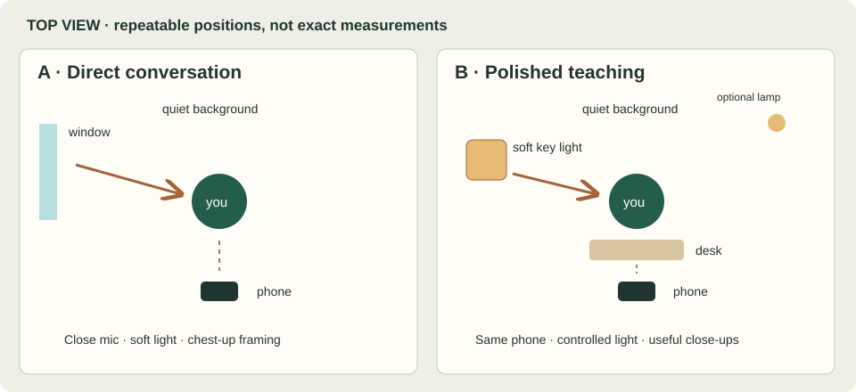

# Equipment: buy for a diagnosed problem

Prices are US dollars, checked or estimated on 13 November 2026. Estimates are planning allowances, not retailer quotes. Tax, shipping, existing equipment, local availability, and compatibility can change the total.

| Stage | Setup | Cost treatment | Buy only when |
|---|---|---|---|
| Start today | Existing phone, daylight, stable safe support, built-in mic | $0 new spending | Use this to identify the real limitation |
| Repeatable raw setup | Existing phone + phone tripod/clamp + compatible close mic | Tripod allowance $30–60; checked RØDE Wireless Micro phone variants $99 | Framing or speech quality is stopping useful recordings |
| Controlled polished setup | Raw setup + one soft key light, compatible diffusion, stable stand | Additional planning allowance $150–300 | You need repeatable evening light or consistent filming conditions |
| Later camera system | Camera, lens, batteries, storage, audio path | No price estimate or specific model prescribed | Several finished videos reveal a phone limitation that matters to viewers |

**Raw setup planning total:** $30–60 + $99 = **$129–159**, before tax/shipping, assuming the phone is already owned. **Polished setup planning total:** $129–159 + $150–300 = **$279–459**. A mount may require a phone clamp not included in the tripod; check the actual bundle before buying.

[RØDE Wireless Micro product page](https://rode.com/en-us/products/wireless-micro) lists the checked USB-C and Lightning phone versions at $99. This guide has not tested the product with your phone. Confirm connector, physical clearance, operating-system/app support, and the recorded input. The camera kit is a different configuration; do not assume every version connects to every camera.

No dedicated camera, teleprompter, gimbal, green screen, RGB lighting, or paid editing plugin is necessary to start. A quiet room and a close speech test are more informative than an aspirational shopping list.

## Two simple layouts

**Raw:** window slightly to your left → you facing the phone → quiet background behind you. Place the phone at eye height and keep the mic close enough for clear speech. Start with a chest-up frame.

**Polished:** one soft key light above and to one side → you at a desk → phone at eye height → modest separation from the background. Add a background lamp only after the face looks good. Record a notebook close-up with the same phone after the main take.

Save a photo of your setup and mark the tripod and chair positions. Record the time of day for daylight filming. Repeatability is an equipment feature you can create without another purchase.
