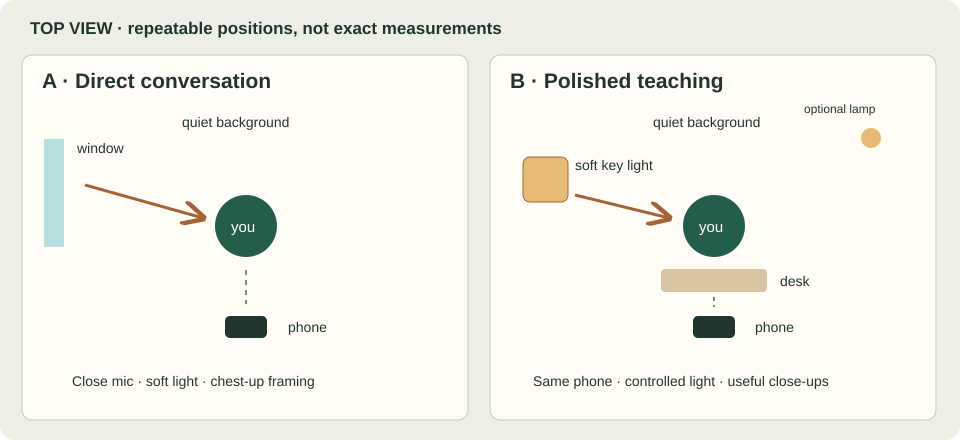

# Make progress. Show the work.

A practical self-improvement YouTube playbook

Prepared for Aadil · 8–10 hours a week · Edition 13 November 2026

## Start here

You do not need to become an established guru before you can make something useful. You do need a clear audience, a problem you understand, and an honest way of showing what helped, what failed, and what remains uncertain.

For you, the most credible starting point is **turning learning into action**: finishing projects, learning deliberately, managing attention after work, and building a life beyond the screen. Your software and learning interests give you concrete examples. They do not require every video to be about programming. A video about choosing one project can help a designer, student, or analyst as well as a developer.

This guide combines the directness of a personal conversation with the clarity of a well-made lesson. Start with the direct format. Add polished episodes when a real demonstration, comparison, or experiment benefits from visuals. Your first 90 days are a production and audience-learning cycle, not a promise of a particular subscriber count or income.

The sequence matters: choose the viewer before the idea; choose the idea before the script; make the script useful before adding effects. Each chapter explains a decision, shows an example, and gives you a concrete output. The daily plan turns those outputs into six planned uploads over 90 days. If a beginner edit takes longer, reduce the scope or publish fewer complete videos rather than borrowing hours from your life indefinitely.

## Contents

- [Choose your audience](#positioning)
- [Find and package useful ideas](#ideas)
- [Make direct advice](#raw)
- [Build polished teaching](#polished)
- [Set up and record](#filming)
- [Edit for understanding](#editing)
- [Publish and grow](#growth)
- [Follow the 90-day plan](#action-plan)
- [Start today](#start-today)
- [Two production checklists](#production-playbooks)
- [Original sample scripts](#sample-scripts)
- [Equipment decisions](#equipment)
- [90 daily actions](#daily-actions)
- [Reusable templates](#templates)
- [Sources and research limits](#sources)

---

## 1. Choose the viewer before the aesthetic

Your channel begins with a recurring human problem. A viewer has a job or studies, wants to become more capable, consumes advice, and struggles to turn that advice into a finished piece of work. A useful channel helps that person make a small, visible change. Attractive footage can make the explanation easier to watch, but it cannot supply the missing problem.

Self-improvement is too broad to be your initial promise. It includes fitness, studying, career, confidence, relationships, money, spirituality, and mental health. One person may care about several of these, but a stranger still needs a reason to choose your particular video today. Narrow the first ten videos by the viewer’s situation and the action they want to take.

### Your strongest starting hypothesis

**Audience:** ambitious students and early-career knowledge workers who keep learning and planning but want to follow through.

**Promise:** practical experiments and clear advice that help you turn learning into finished work, without making your whole life a productivity project.

**Working channel description:** “I explore how to learn deliberately, finish meaningful projects, and build a better life after work. Expect practical advice, honest experiments, and systems you can try without rebuilding your entire routine.”

That description is a proposal, not a claim that you have already achieved a transformation. Your advantages are familiarity with difficult learning, projects, and technical work. Begin where you can demonstrate a task or describe a real difficulty accurately. Do not invent a history of addiction, burnout, wealth, fitness transformation, or extraordinary discipline because those stories appear in successful channels.

Use your own name as a flexible working channel name if you are comfortable doing so. “Learning into Action” can be the series name. Spend at most 30 minutes on the initial banner and bio. The first video’s usefulness matters more than an elaborate logo.

### Three viable channel directions

| Direction | Viewer and promise | Your possible edge | Main risk | First useful test |
|---|---|---|---|---|
| Learning into action — recommended | Learners who want to finish projects | Real learning/project artifacts; clear explanations | Becoming another generic productivity channel | Show how to choose one finishable project |
| Better life after work | People with a demanding desk job who want energy for personal goals | Realistic constraints and modest experiments | Unqualified health advice or an unrealistic routine | Design and test a small after-work starting ritual |
| Thoughtful digital life | People who want technology to support their attention | Understanding of software, tools, and defaults | Turning into gadget reviews or exaggerated brain claims | Compare a simple paper plan with an app for one task |

Start with the first direction and treat the other two as adjacent pillars. Do not launch three channels simultaneously. It would split your production practice and make audience feedback harder to interpret within eight hours a week.

### What the creator research actually supports

The inspected HamzaUnfiltered sample, [“5 things I wasted my time/energy on”](https://www.youtube.com/watch?v=aumbQkr8t-w), opens with a specific promise and direct personal judgment. Selected frames at approximately 0:01, 11:26, and 34:18 show a seated speaker, a close handheld microphone, and a consistent domestic background. These observations support a simple visual model; they do not prove the video was unscripted, uncut, or made without an editor. Its long runtime is not evidence that a new channel should start with hour-long videos.

The inspected Ali Abdaal sample, [“How to Stop Procrastinating and Finally Take Action”](https://www.youtube.com/watch?v=8urzOH10LEM), establishes a problem, proposes several experiments, and includes personal explanation and animation. Sampled frames show a composed talking-head setup, keyword text, and illustrative animated scenes. His [public YouTube guide](https://aliabdaal.com/youtube/the-ultimate-guide-to-youtube/) also discusses scripting and staged editing. This supports a structured teaching approach; it does not establish the exact current camera, editor, budget, or team workflow for that particular video.

These are two production paradigms, not exhaustive descriptions of either creator. Hamza has more produced work; Ali has simpler work. Selected samples cannot establish which individual technique caused either channel to grow. What follows is an original beginner workflow informed by those observations.

### Borrow the function of a technique

| Visible or documented technique | What it helps accomplish | Your adaptation |
|---|---|---|
| Direct second-person address | Makes the problem feel personally relevant | Speak to one person facing one concrete situation |
| A clear stance | Gives the viewer a reason to consider the argument | Make a bounded claim you can explain, including an exception |
| Personal examples | Makes abstract advice inspectable | Show a real plan, attempt, mistake, or decision |
| A consistent talking-head frame | Keeps attention on the speaker | Use one repeatable phone position and soft light |
| Structured sections | Helps the viewer follow an explanation | Give each section a question and a practical answer |
| Supporting visuals | Makes an invisible process understandable | Show your actual calendar, notebook, or demonstration |
| A next step | Extends the usefulness beyond the video | Link the next lesson or one matching worksheet |

Borrowing a function gives you room to develop your own voice. Copying catchphrases, insults, identity labels, thumbnails, or a creator’s personal story gives you a fragile imitation. Directness can come from precision: “A plan with six priorities gives you six decisions to avoid” is stronger than calling the viewer weak.

### Two formats, one relationship

**R: Direct advice.** Start with a 3–7 minute seated conversation. Use one thesis, one concrete example, one method, and one limitation. Make a simple edit. This format helps you practice speaking and respond to an audience problem efficiently.

**P: Polished teaching or experiment.** Aim initially for 5–8 minutes. Use a real question, a demonstration or documented test, a structured explanation, and a useful conclusion. Add B-roll—supporting footage placed over narration—and simple graphics where they make the explanation clearer.

These durations are planning limits, not algorithm rules. If the idea is complete in four minutes, end there. If the subject needs an hour of context, choose a smaller first question rather than stretching your beginner production budget.

Four R episodes and two P episodes are a sensible first 90-day target. Both should serve the same viewer. An R video about choosing a project can lead to a P video showing what happened when you attempted a smaller project. The connection is useful even when the aesthetics differ.

### Trust is part of production quality

A self-improvement viewer may act on what you say. Separate three kinds of statement in your script:

- **Experience:** “On these four evenings, I opened the document sooner when I wrote the first action in advance.” Show the record and its limits.
- **Opinion:** “I would choose a smaller project before buying another planning app.” Explain the reasoning and who might choose differently.
- **Research claim:** “A study found…” Read the underlying research, identify what was measured, and link it. Do not promote a book summary or an AI answer into scientific proof.

You can make useful videos without biological explanations. Show the practical effect of putting a phone in another room without claiming to reset dopamine. Discuss your own work habits without diagnosing a viewer. If a proposed video needs clinical authority you do not have, narrow it to a personal workflow or collaborate with a qualified source.

### Your first output

Write a one-page channel brief using [the template](#templates): one viewer, one repeated difficulty, three topic pillars, two formats, and five subjects outside your current competence. Then choose the first video: **“Before you start another course, choose one thing to finish.”** It suits your interests, needs no fictional transformation, and can be filmed today with a notebook.

After six uploads, revisit the promise using viewer language and your actual production experience. You are choosing a starting direction, not signing a permanent identity contract.

[Back to contents](#contents)

---

## 2. Find a specific problem and make a clear promise

A good idea contains more than a subject. “Discipline” is a subject. “How to start your side project after a mentally tiring workday” describes a person, a moment, and a desired change. That specificity helps you decide what to film and helps a viewer recognize themselves.

The goal of research is to discover questions and develop an answer you can honestly support. It is not to collect successful titles and substitute synonyms. Your evidence, examples, and point of view must supply a reason to watch your version.

### A 45-minute research session

**First 10 minutes: your own friction.** Look at a real unfinished task, abandoned plan, difficult learning decision, or repeatedly postponed activity. Write what happened, the constraint, and the smallest useful question. Do not turn a private difficulty into a public story until you are comfortable sharing it.

**Next 15 minutes: viewer language.** Search YouTube for that question. Read public comments under a few relevant videos. Record questions in anonymous paraphrase: “I can plan on Sunday but cannot start on Tuesday.” Notice what the existing answers leave unresolved. Do not collect usernames, contact people without a reason, or treat a handful of comments as a representative survey.

**Next 10 minutes: adjacent videos.** Study a small channel and an established channel addressing a similar problem. Record the promise, opening, evidence, and ending. A large view count may reflect an established audience, external traffic, timing, or a strong premise. It does not isolate a successful editing trick.

**Final 10 minutes: your contribution.** Write a proposed title and your answer in one sentence. List the artifact you can show: a decision sheet, a real plan, a demonstration, or a future experiment. If you have no answer or evidence yet, save it as a research question rather than forcing it into a finished claim.

YouTube’s official guidance treats viewer choice, engagement, and satisfaction as useful dimensions of performance. It also emphasizes clear packaging and an opening that fulfills the promise. Use that as a reason to align the title and the actual video. [YouTube: content performance](https://support.google.com/youtube/answer/16559650?hl=en).

### Turn one subject into several different videos

Take “learning.” A beginner might make “How to learn faster,” then struggle to offer anything distinctive. Narrow it through a practical sequence:

1. Viewer: someone who keeps starting online courses.
2. Moment: choosing what to study after work tonight.
3. Friction: too many courses and no definition of enough.
4. Desired change: pick one small application before continuing the course.
5. Evidence: demonstrate converting a course chapter into an output.
6. Promise: “Before you start another course, choose one thing to finish.”

A later video could test that approach over two weeks. Another could compare a notes-only session with a practice session. Those are different answers with different evidence, rather than three titles attached to the same advice.

### A useful idea filter

Score ideas from 1 to 5 on audience fit, specificity, evidence you can obtain, and your ability to finish within the time budget. Use the total to organize your thinking; it is not a demand forecast. Reject an idea regardless of score if the promised result would require fabricated evidence or expertise you do not possess.

For example, “How I became permanently disciplined” may sound dramatic but fails the evidence test. “A simple way to decide what to work on tonight” is narrower and demonstrable. A viewer can leave with a useful action even if they know nothing about your personal history.

### Thirty original starting ideas

R means a direct advice episode. P means a visual lesson or prospective experiment. A result-based title must be rewritten after the experiment to match what actually happened.

| # | Premise / working title | Format | What the viewer gets | Evidence or preparation |
|---|---|---|---|---|
| 1 | Before you start another course, choose one thing to finish | R | A finishable outcome | Demonstrate a real or clearly labeled example project |
| 2 | Make a plan for your tired self | R | A smaller after-work starting action | Show an honest plan with a fallback |
| 3 | I’m testing one project for two weeks | P | An experiment design they can adapt | Film the baseline before the test; publish results later |
| 4 | Stop making every evening a self-improvement exam | R | A realistic boundary for personal goals | Explain your actual constraint and limits |
| 5 | Your next action should fit on one line | R | Concrete first steps | Transform three vague tasks on paper |
| 6 | What I learned from tracking project starts | P | Observed patterns, including failures | At least a clearly described recording period |
| 7 | You can like learning and still avoid practice | R | A useful distinction | Show consumption and application examples |
| 8 | A weekly review for people who dislike planning | P | A short review demonstration | Use a redacted real week or labeled demonstration |
| 9 | Choose a project you can finish badly | R | A lower-risk first attempt | Define a useful minimum result |
| 10 | One notebook page instead of another productivity app | P | A practical comparison | Compare the same task; disclose personal preference |
| 11 | How to restart after missing a week | R | A restart procedure | No claim that it fixes every cause of inconsistency |
| 12 | The hidden cost of too many side projects | R | A method for choosing a priority | Show a decision, not an invented cost calculation |
| 13 | A phone-free work block: what actually happened | P | Honest observations | Capture the baseline and all attempts |
| 14 | A better question than “Am I motivated?” | R | A concrete obstacle check | Demonstrate on a real task |
| 15 | How to read advice without adopting a new personality | R | A test for using advice selectively | Compare a claim with your context |
| 16 | Build a learning plan around a question | P | A worked learning session | One question, sources, attempt, and answer |
| 17 | The difference between a goal and tonight’s work | R | Translation from ambition to action | Show a specific goal broken down |
| 18 | What belongs on your “not now” list | R | A way to defer ideas calmly | Use your own safe-to-share examples |
| 19 | I tried ending work with a restart note | P | Results of a modest workflow test | Predefine what counts as a start |
| 20 | Stop using your best day as your daily standard | R | A realistic planning assumption | Show normal constraints; avoid universal claims |
| 21 | A project finish line that cannot keep moving | P | A written definition of done | Use an actual small project |
| 22 | How to ask for feedback before you feel ready | R | A respectful, specific request | Show the request without exposing others |
| 23 | What a messy first draft is actually for | R | Permission plus a concrete drafting method | Create a rough artifact on camera |
| 24 | Two ways to spend a learning hour | P | A side-by-side demonstration | Clearly illustrative unless genuinely measured |
| 25 | How to keep hobbies from becoming performance metrics | R | A boundary-setting example | Personal values, not a clinical prescription |
| 26 | Planning a week with room for a life | P | A realistic calendar | Include rest and real obligations |
| 27 | You do not need to optimize every habit | R | A filter for choosing what matters | Give one improvement and one deliberate non-goal |
| 28 | What my unfinished projects have in common | P | A careful retrospective | Inspect actual projects; do not invent a history |
| 29 | How to tell whether a tool is helping you | R | A simple keep/remove decision | Compare task outcomes, not feature counts |
| 30 | What I would change after my first six videos | P | A transparent creator retrospective | Six actual videos and production records |

### Package the result before writing the script

Write three distinct titles before recording. They should describe different honest ways into the same video, not promise different videos. For the first episode:

- “Before you start another course, choose one thing to finish.”
- “How to turn a course into a finished project.”
- “Learning a lot, finishing little? Try this first.”

The first speaks to a decision; the second emphasizes an outcome; the third names a recognizable frustration. Choose the one that best matches the actual script. Avoid “This will change your life” when you are teaching a modest planning exercise.

Design one thumbnail concept. For the first video, photograph yourself with a single page marked “FINISH THIS” beside a messy stack of your own notes. Keep it readable at small size. One focal object and a few words are sufficient. Use a genuine expression; do not fabricate a distressed before-and-after life transformation. The title supplies the context while the image supplies a visible contrast.

### Study a creator with a worksheet, not passive admiration

For each reference video, write: who is addressed, what is promised, where the answer first appears, how the speaker proves a point, what a visual explains, and what the final action is. Study the opening and one middle section. If you count cuts, label the exact sample and count manually; do not infer an entire channel’s editing rate from it.

Then produce an original 60-second practice explanation using the same function: a concrete problem, a clear answer, and one demonstration. Do not reuse the source’s words, voice, personal story, or images. The transferable skill is making your own idea clear.

### Output for this chapter

Choose three ideas for the same viewer. Prepare the first title, thumbnail sketch, one-sentence answer, and evidence list. Ask one willing target viewer, “What would you expect to learn from this title?” Their answer tests clarity. It does not validate market size. Move to scripting once your promise and actual answer agree.

[Back to contents](#contents)

---

## 3. Make direct advice worth listening to

A simple talking-head video places most of the burden on the argument and delivery. If the viewer cannot follow your point, there is little visual support to rescue it. That is why “raw” should describe the presentation, not the amount of thinking you put in beforehand.

The HamzaUnfiltered sample makes the subject and personal stance apparent early. That is a useful lesson for a beginner: give the viewer something specific to consider immediately. The recording and scripting method below is an adaptation, not a verified description of how Hamza prepares his videos. [Reference sample](https://www.youtube.com/watch?v=aumbQkr8t-w).

### Build the argument in six moves

Start with a one-sentence claim. For the recurring example: **“Before choosing another learning resource, define one small thing you will use it to finish.”** This is narrow enough to explain and does not promise a total personality change.

Then write six cards. A card is a short speaking prompt, not necessarily a physical index card.

1. **Situation:** You have an hour tonight and several unfinished courses.
2. **Claim:** Choose an output before choosing more input.
3. **Example:** Replace “learn web development” with “publish one page that explains a topic.”
4. **Method:** Define the output, choose the next necessary lesson, make the smallest attempt.
5. **Limit:** Exploration and learning for enjoyment do not always need a product.
6. **Action:** Write one finish line before your next study session.

The example is essential. Without it, “choose an output” is another slogan. The limit also improves the explanation: your advice concerns someone seeking a practical result, not everyone who reads for pleasure.

### Script the beginning and ending; outline the middle

For your first videos, write the first two sentences exactly. They are difficult to improvise because you are simultaneously thinking about the camera, posture, and whether recording has started. A prepared opening removes one decision.

Example opening: “If you keep starting courses but cannot name what you have finished, try making one decision before your next lesson: what will exist when you are done?” Then show the page you will use. You have already begun answering the title.

In the middle, speak from the six cards. If you lose the thread, stop, look at the next card, and repeat the whole sentence. Do not restart the whole video. Pause for two seconds before the restart so you can recognize the edit point later.

Write the final action exactly: “Before you open the next lesson, write the smallest useful thing you could finish with it.” End after the action or a relevant next-video invitation. A long farewell can weaken an otherwise decisive ending.

At approximately 130–160 spoken words per minute, 600 words will often occupy roughly four to five minutes including pauses. This is an estimating range, not a target speed. Time your own read aloud. If you need eight minutes to say 600 words comfortably, use that reality rather than racing to match a reference creator.

### Speak as if one person asked you for help

Choose one imagined viewer who fits the situation. Put a small note beside the lens: “One person. One useful decision.” Look at the lens when making the point, not at your own preview. It is fine to glance down at a notebook while demonstrating it. Occasional natural movement is easier to watch than an unbroken, anxious stare.

Use shorter sentences than you would in an essay. Say the claim, pause, give the example. Emphasize the important contrast with your voice rather than shouting. Record one sentence three ways: your normal speaking voice, a slightly more energetic version, and a slower explanatory version. Listen without looking at the screen. Choose the version that sounds clear and like you.

Directness does not require aggression. “Choose a smaller promise you can keep tonight” is concrete. “You are pathetic if you cannot do this” substitutes judgment for help and ignores circumstances you cannot know. A viewer can feel challenged while still being treated with dignity.

### Use a real story when you have one

A useful story has a scene, an attempted action, a difficulty, a decision, and an outcome. “I used to procrastinate” does not give the viewer much to picture. “I sat down with three course tabs open and spent the session choosing between them” is a scene—but use it only if it happened.

If you do not have a relevant story yet, demonstrate the method now. Say “Here is an example” or “I’m testing this over the next two weeks.” A prospective experiment can be interesting precisely because you do not yet know the result. You do not need to manufacture retrospective authority.

When a real outcome is disappointing, explain it. Perhaps the chosen project was still too big, or an evening was unavailable. A bounded failure with a sensible revision is more useful than an edited story in which the system always works.

### A 45-minute recording session

Prepare the room and do the short camera/audio test from Chapter 5 before the timer starts. Keep the setup marked so this preparation gets faster.

| Minutes | Action | Why it earns its place |
|---|---|---|
| 0–5 | Read the six cards aloud once | Finds missing transitions before filming |
| 5–10 | Record three openings | Gives you options without repeating the whole video |
| 10–25 | Record the body in sections | Keeps a mistake from spoiling every previous sentence |
| 25–30 | Record the ending and one thumbnail photo | Avoids rebuilding the setup later |
| 30–38 | Film the notebook demonstration | Makes the advice inspectable |
| 38–45 | Review a section with headphones; copy files | Finds unusable audio while you can still fix it |

This is a timebox, not a requirement to stop while the recording is unusable. If the example needs more explanation, shorten the argument or schedule a pickup. If you use the entire session recording openings, accept a clear one and move on.

### The minimal edit

Make a first assembly with the best complete version of each section. Remove failed starts, duplicated explanations, and long searches for words. Keep breaths, short pauses, and some natural phrasing. A conversational delivery does not need every gap removed.

Show the notebook at the point where it answers a question. Use one short text card if the three-step method is hard to remember. Music is optional; clean speech can carry the whole video. If you include music, do not use dramatic rises to imply that ordinary advice has proved something profound.

Finish by checking intelligibility on a phone speaker. A technically sharp image with hard-to-understand speech is an unfinished video. Chapter 6 explains the editor operations.

### Common problems and fixes

| Symptom | Likely issue | Fix to try before buying anything |
|---|---|---|
| You ramble for 20 minutes | Several claims or no concrete example | Keep one thesis; cut the weakest two cards |
| You sound as if you are reading an essay | Long sentences and memorized paragraphs | Reduce to prompts; explain one example naturally |
| You keep apologizing for being new | Attention is on yourself rather than the task | Open with the viewer’s situation |
| The advice feels generic | No observable decision or artifact | Show the exact page, choice, or attempt |
| You are performing someone else’s confidence | Borrowed language or exaggerated certainty | Use your ordinary words and state the limit |
| Every cut feels abrupt | Over-trimming or mismatched gestures | Restore a breath; use the notebook shot over one transition |

### A realistic production budget

An early R episode might need 45 minutes of idea work, 45 minutes of outlining, 30 minutes of setup/practice, 45 minutes of recording, 90 minutes of editing, 30 minutes of packaging, and 30 minutes of upload checks. That is **315 minutes, or 5 hours 15 minutes**, before additional research and audience review. Beginners may need more. The fortnightly schedule deliberately leaves room for learning and documenting experiments.

The quality gate is simple: a clear promise, an honest example, intelligible audio, a coherent middle, and an action the viewer can take. Publish a modest complete lesson when those conditions hold. Do not postpone it for decorative effects.

Use [the complete original demonstration script](#sample-scripts) if you want a starting example. Adapt it to your own words and facts. It is a teaching sample, not a claim about your personal history.

[Back to contents](#contents)

---

## 4. Make a polished video by designing the explanation

Polished teaching begins before the camera. Each section needs a purpose, and each visual needs a reason to appear. A desk scene, good lighting, and animated words can look professional while leaving the underlying lesson vague. Your first polished video should make one practical question easier to understand.

Ali’s public teaching materials describe working from an initial spoken assembly into supporting footage and finishing details. The sampled procrastination video also uses structured sections and illustrative animation. You can learn from that structure without reproducing expensive animation or claiming to know its production budget. [Public guide](https://aliabdaal.com/youtube/the-ultimate-guide-to-youtube/) · [Sample video](https://www.youtube.com/watch?v=8urzOH10LEM).

### Choose a question with visible evidence

Your first P episode can ask: **“Does choosing one smaller project help me start after work?”** Before recording results, define the test. A useful personal experiment has a question, a planned method, a record, and a conclusion limited to the observations.

For example, choose one small project for a two-week period. Define a “start” as doing the first concrete project action for at least five minutes. Log the evenings you planned to work, whether you started, approximate duration, and one contextual note. Define those rules before looking at the results. Record missed attempts too.

This cannot establish a general causal law about productivity. Workload, mood, expectations, deadlines, and the project itself may change. It can give you a truthful story and help the viewer understand how to run a modest test. Say what the record supports, and avoid replacing missing evidence with dramatic editing.

### Design the story before writing full sentences

Use seven beats:

1. **The question:** Can a smaller finish line make starting easier?
2. **The constraint:** Work and other commitments leave limited time.
3. **The plan:** Choose one output and define a small start.
4. **The attempts:** Show selected moments and the complete record.
5. **The complication:** Explain where the plan did not work.
6. **The finding:** Describe the pattern and its limits.
7. **The application:** Show how the viewer could adapt the method.

Tension comes from a real uncertainty, not a fake crisis. You can say, “The plan looked sensible. I did not know whether I would follow it on an ordinary Tuesday.” If you already know the result, do not pretend the outcome is happening live. Narrate it as a retrospective.

### Write a two-column script

The left column contains what the viewer hears. The right contains what they need to see. This prevents the common mistake of finishing a voiceover and then searching for decorative footage to cover it.

| Approximate section | Spoken purpose | Visual plan |
|---|---|---|
| Opening, 0:00–0:25 | State question and give one concrete reason to care | Talking head plus the actual project finish line |
| Context, 0:25–1:00 | Explain the constraint and test | Calendar with private details removed |
| Method, 1:00–2:00 | Define output and start rule | Overhead notebook; three simple labels |
| Attempts, 2:00–3:30 | Show what happened | Actual work clips and dated log |
| Complication, 3:30–4:30 | Explain a missed or difficult attempt | Talking head, no manipulative failure montage |
| Interpretation, 4:30–5:30 | Separate observations from guesses | Plain table or small chart made from the actual record |
| Application and ending, 5:30–6:30 | Offer an adaptable action | A blank copy of the one-page plan |

These times are a planning example. Edit to the actual story. A six-minute target at 145 spoken words per minute suggests around 870 spoken words, but demonstrations and pauses change the total. Read the script aloud with a timer before recording.

### Make the opening specific without overclaiming

Before the test, a truthful opening is: “I have a question: will choosing one small project make it easier to start after work? For the next two weeks, I’m defining the finish line in advance and recording what happens.” This is suitable for an announcement or process video.

After the test, write the opening from the actual result. If you started on five of eight planned evenings, say that. Do not write “This fixed my discipline” or show a perfect streak. A result can be modest and still worth watching if the explanation reveals a useful decision.

Do not spend the first minute describing your channel biography. Give any relevant context when it helps the viewer interpret the evidence. A first-time viewer needs to know why this particular lesson is worth their time, not your entire origin story.

### Capture purposeful B-roll

B-roll is supporting footage. It can demonstrate a physical action, show an artifact, or create a transition while the narration continues. It should add information the talking head cannot show as efficiently.

For this episode, you need only eight useful shots: writing the finish line, opening the chosen project, crossing out an overlarge task, starting a timer, doing the first action, entering a log, pointing to the completed result, and marking the next step. Record five to ten steady seconds per shot, with a little stillness before and after the action. You can film these with the same phone after the main recording.

If you reconstruct a planning action later, do not imply the footage proves it happened on a particular test day. A label such as “demonstration” can make that clear when the distinction matters. A beautifully shot reenactment is not a measurement.

### Build a small visual language

Use one plain font family, one accent color, and three reusable graphics: a section heading, a short key idea, and a simple comparison. A clean white or dark card with readable text can replace complex 3D animation. For the recurring project example, reveal “Finish line → Next action → Review” one item at a time as you explain it.

On-screen text should be shorter than your narration. Put “Define enough” on screen while you explain the full concept. A paragraph creates a reading task that competes with listening. Leave a diagram long enough to understand it, even if that means holding the same image for several seconds.

### Record in blocks and collect pickups

Film the main explanation one section at a time. Record the opening twice: one energetic, one calmer. Before changing the setup, record likely fixes: the test definition, a clean transition into results, the final action, and a thumbnail photo.

A pickup is an additional recording used to fix or clarify the main take. Match the camera height, light, clothing if continuity matters, and microphone position. If conditions differ visibly, use a labeled voiceover over the relevant artifact rather than trying to hide a confusing jump.

### Spend polish where it helps

Prioritize, in order: clear argument, truthful evidence, good speech recording, logical edit, useful visuals, comfortable sound, consistent color. Extra transitions come last. The first polished episode might take a whole fortnight: roughly three hours researching and planning, two writing/storyboarding, two recording, five editing, one packaging, one checking/uploading, and three on learning, evidence capture, and review. That totals **17 hours**.

If editing expands beyond five hours, simplify the visual plan. Keep the real demonstration and replace custom animation with a still card. The lesson is not damaged because the notebook does not fly onto the screen.

### How to know it is ready

Play the spoken assembly without supporting visuals. The argument should still make sense. Then view the visuals with the sound muted. Their role should be apparent and any charts should match the record. Finally, watch the combined video on a small screen. If you must pause to read text, shorten it or extend its display.

Before publishing an experiment, compare the final script with the original log. Check every number, date, and result-based sentence. The final product should be more understandable than the raw record while remaining faithful to it. That combination is the useful part of high production quality.

[Back to contents](#contents)

---

## 5. Build a setup you can use again tomorrow

The best beginner setup is one you can repeat without spending an hour rebuilding it. A quiet corner, soft light, stable phone, and close microphone can produce a clear direct-advice video. A more polished look uses the same foundations with more control over light, background, and supporting shots.

Your previous preference for screen recordings does not automatically translate into comfort on camera. Treat speaking to a lens as a new practice. A handful of short recordings will teach you more about your room and delivery than shopping for a camera before you have recorded anything.

### Setup A: the direct conversation

Choose the quietest suitable room. Sit facing slightly toward a window, with the phone between you and the light but not blocking it. Turn so the light comes from around 30–45 degrees to one side of your face. The exact angle is less important than seeing both eyes and avoiding a bright window behind you.

Put the phone at eye level, roughly an arm’s length or a little farther away, and frame from the middle of the chest upward. If using the built-in microphone, moving the phone closer can improve speech relative to the room sound. Keep enough space for gestures. Remove distracting private information and objects that appear to grow out of your head.

Use a plain, real background. A tidy wall, shelf, or room corner is sufficient. If possible, sit a little away from the wall to reduce a flat, passport-photo effect. Do not sacrifice a quiet room for a more impressive background.

**No-purchase version:** existing phone, stable books or a safe support, daylight, built-in microphone, and a close framing. Verify stability before recording; do not balance a valuable phone precariously. Use the first recording to learn what is actually inadequate.

### Setup B: polished teaching

Keep the same camera height, but compose a slightly wider frame that includes a desk or a small part of your working environment. Place one soft key light around 45 degrees to one side and a little above eye height, aimed down gently. “Key light” simply means the main light on your face. A window can do this job; a controlled light makes evening recording more consistent.

Turn off overhead lighting if it creates harsh eye shadows or a mixture of orange and blue light on your face. Keep the background a little darker than your face when possible. A normal lamp can add depth to the background, but do not make the face too dark in order to show off the lamp.

Use only stable, rated stands and diffusion designed for the fixture. Do not drape household fabric over a hot lamp. A large soft source close to you generally gives softer-looking shadows than a tiny bare light far away. You do not need multiple colored lights to demonstrate a planning exercise.

### Phone settings without a technical detour

Start with landscape orientation and **1080p at 30 frames per second**, using the native camera application. This is a practical starting choice for a US-based talking-head workflow. Record and edit at matching rates; 29.97 and 30 are close but distinct options, so retain the actual source rate when choosing the timeline. The rear camera may give a better image, but the front camera is acceptable if it makes framing and recording reliable.

Clean the lens. Turn off beauty filters. Start with standard color rather than Log or a complex HDR workflow. If your phone records HDR by default and the image looks washed out or overly bright in the editor, check its recording mode and the editor’s color interpretation. Standard SDR recording is simpler for the first videos.

Tap your face to focus, and use the native app’s focus/exposure lock if available. Make a short test because phone controls differ. If exposure keeps changing when you gesture, move bright objects out of the frame or lock the exposure after setting it. Avoid digital zoom; reposition the phone instead.

An optional later step is the free [Blackmagic Camera app](https://www.blackmagicdesign.com/products/blackmagiccamera), on a supported device. It exposes controls such as frame rate, white balance, and exposure. You do not need its cloud workflow or maximum-resolution formats for this guide. Check device support before installing.

If you later use manual exposure at 30 fps, a shutter around 1/60 second is a common starting point for natural motion. Test under your actual lights; LEDs and local electrical conditions can still cause flicker. In a 50 Hz environment, a 25 fps/1/50 workflow may be easier. Do not adopt another creator’s frame rate without considering your location and lighting. Daylight avoids many artificial-light flicker problems.

### Record speech close to the microphone

Room echo and microphone distance often matter more than the microphone’s price. Curtains, a rug, upholstered furniture, and a less empty room can reduce reflections. Turn off a noisy fan or appliance when practical. Choose a time without loud traffic if your window faces a road.

With a clip-on microphone, begin near the upper chest, roughly a handspan below the mouth. Keep it clear of necklaces, hair, and rubbing fabric. This is a starting placement, not a universal rule: record a test while turning your head and gesturing. With a handheld microphone, keep the distance consistent and avoid tapping or changing your grip noisily.

If manual meters are available, conversational peaks around −12 to −6 dBFS are a useful recording starting range, leaving room for louder words. dBFS measures level relative to digital clipping at zero. Do not confuse this peak range with a final loudness target. Automatic-gain devices behave differently; listen to the test rather than relying only on numbers.

For a phone-compatible wireless option, the [RØDE Wireless Micro](https://rode.com/en-us/products/wireless-micro) was listed at **US$99** for the checked USB-C and Lightning phone versions on 13 November 2026. Choose the right connector, check case clearance, and test that the camera app actually uses it. This is one compatible-category option, not a claim that either reference creator uses it or that it outperforms every alternative. Prices and device compatibility can change.

### The mandatory 30-second test

Record your ordinary speaking voice, one emphatic sentence, a gesture, and a quiet sentence. Watch the clip, then listen with headphones and on a phone speaker. Check focus on the eyes, consistent exposure, clothing noise, echo, clipping, and whether the external microphone was used. An apparent microphone connection is not proof the correct input was recorded.

If speech is unclear, move closer and improve the room before buying a new camera. If the image is dark, move toward soft light. If the face is bright but the background is distracting, change the angle. Fix one cause at a time and repeat the short test.

### A repeatable session checklist

Before recording: charge the phone and mic, free enough storage, clean the lens, silence notifications, check orientation and settings, stabilize the phone, remove private information, and open your speaking cards. Record a clap if you are using separate audio, then record several seconds of room sound for editing.

During recording: pause between sections, restart whole sentences after mistakes, and keep hands clear of the microphone. Say a section label out loud if it helps identify takes; remove it in the edit. If the phone gets hot or stops recording, reduce demanding formats, allow it to cool, and verify the last saved file before continuing.

After recording: capture a thumbnail photo before dismantling the setup, copy the files to your computer, and keep a second copy until the project is safely archived. Do not delete the only source copy because the editor shows a thumbnail. Editors often reference files in their original locations.

### Practice without publishing everything

For five sessions, record one minute answering a concrete question. Session one is about looking at the lens; session two about speaking in short sentences; session three about a specific example; session four about varying emphasis; session five combines them. Watch once, choose one improvement, and stop. Repeatedly scrutinizing your appearance is not a useful practice method.

These recordings can remain private. Their purpose is to lower the effort of communicating clearly, not to fill the channel with disconnected practice clips.

### When to upgrade

Use the decision table in [equipment.md](#equipment). Add a tripod when stability or repeatability is the issue. Add a microphone when distance or room noise limits speech. Add a soft light when daylight timing prevents recording. Consider a camera only after several finished videos show a persistent limitation your phone cannot reasonably solve. A camera introduces lens, focus, battery, storage, and transfer decisions; it does not fix an unclear script.

[Back to contents](#contents)

---

## 6. Edit for understanding, then add polish

Editing decides what the viewer experiences and in what order. A useful cut removes confusion, makes an example visible, or preserves the rhythm of a thought. An effect that does none of those things is optional.

Use one editor for the first six videos. This guide uses **DaVinci Resolve’s free version** as the default. Some current AI features require Studio or specific hardware; none are required here. Blackmagic’s current site identifies Resolve 21, while some official training files still refer to version 20. Core operations carry across, but button names and panels can vary. Use the lessons labeled Introduction to Editing and Introduction to Audio first. [Official training and practice files](https://www.blackmagicdesign.com/products/davinciresolve/training).

If your computer struggles even with small 1080p files, use a simpler editor you already have. Learning the sequence below is more important than adopting a particular brand.

### Set up the project once

Create folders named Footage, Audio, Graphics, Exports, and Project. Copy your source files into them before importing. Give the project a clear name such as `V01-Course-To-Project`. In project settings, set the timeline to the actual recording frame rate and 1920×1080 for the initial workflow. Resolve may offer to match the source frame rate on import; decide before substantial editing.

Import the footage through the Media or Edit page. The media pool is your library of source files. The timeline is the arranged sequence that will become the video. A video track holds picture; an audio track holds sound. Keep spoken audio on one or two clearly named tracks so you can adjust it consistently.

If playback stutters, generate proxy media or use the editor’s lower-resolution playback options. Proxies are smaller working copies linked to the originals; they are not an excuse to delete the originals. Do not spend a full session color grading a clip that cannot play smoothly yet.

### Pass one: assemble the argument

Place the best full take of each section in order. Use the viewer to find the beginning and ending of the useful part, then trim or split around it. Remove a failed take only after checking that the replacement contains the whole sentence.

A **ripple delete** closes the gap left by a removed section. It is useful for removing a failed start, but check the downstream timing. Clips placed on other tracks may shift unexpectedly depending on selection and track settings. Review every join rather than assuming the operation did what you intended.

Listen to the assembly without music or B-roll. Does the claim lead to an example, then a method, then a limit and action? If not, fix the order. A finished spoken assembly is often called an A-cut or radio edit: the core explanation works through sound before decoration.

### Pass two: make the speaking rhythm comfortable

Trim distracting pauses, repetitions, and verbal detours. Retain enough silence to let an important sentence land. Cutting every breath can make a calm lesson feel anxious. If one point is repeated three times, keep the clearest version rather than hiding the repetition under different camera crops.

A jump cut is an obvious change within the same camera angle. It is acceptable when it removes dead time without damaging meaning. If it interrupts a gesture awkwardly, cut at a more natural pause or cover the join with a relevant demonstration.

#### Recipe 1: a gentle change of framing

For a new section, select the clip and adjust Zoom and Position in the Inspector for a slightly tighter composition. A small crop can distinguish a new beat. If the source is only 1080p, large crops will soften it; do not rely on the ability to magnify indefinitely. A genuine wider shot or full-screen notebook is often a better alternative.

Use a crop when the thought changes, not on a timer. There is no evidence-based requirement to zoom every few seconds.

### Pass three: add visuals that answer a question

Put supporting footage on a video track above the talking head while leaving narration below. Trim the support clip to the part of the sentence it explains. If it contains irrelevant camera noise, mute or remove that clip’s audio without deleting the main narration.

#### Recipe 2: cover a cut with an actual demonstration

Suppose you say, “Write a finish line you can recognize,” then cut to the next sentence. Place a shot of writing that finish line above both sides of the cut. The speech remains continuous, and the viewer sees the action being described. The shot earns its place even if the underlying cut were invisible.

#### Recipe 3: a J-cut or L-cut

A J-cut starts the next scene’s sound before its picture. An L-cut lets the previous scene’s sound continue after the picture changes. For example, continue your sentence while showing the notebook; that is an L-cut in this context. To create one, separate picture and audio trimming carefully or place B-roll above continuous narration. Keep lip-sync intact when returning to the speaker.

These are continuity tools, not effects you must use in every scene. If separating clips makes the timeline confusing, use the simpler B-roll-above-narration method first.

#### Recipe 4: a clean three-step graphic

Create a plain background using a solid-color generator or an image you made. Add a basic Text title for “Finish line,” then another for “Next action,” then “Review.” Align them consistently and reveal each when you mention it. Static appearance or a short fade is enough.

If using motion, keyframe Position or Zoom between a starting and ending value. A keyframe stores a value at a specific time, allowing the editor to interpolate between them. Keep the movement modest and stop it before the viewer needs to read. Do not learn an elaborate Fusion animation before you can make a readable static card.

#### Recipe 5: a truthful results chart

If your actual record contains eight planned evenings and five starts, show those counts directly. Label the observation period and definition of a start. A simple row of eight boxes may be clearer than a dramatic rising line. If numbers are illustrative, label them “illustrative”; do not let a polished chart imply measurement you did not perform.

### Pass four: make speech easy to hear

Open the audio mixer or Fairlight page. Balance clip levels so the viewer does not need to change volume between sections. Avoid red clipping indicators. If one word is unusually loud, adjust that section rather than crushing the entire track.

Use equalization only to solve a problem you can hear. A gentle high-pass filter can reduce low rumble; setting it too high can thin the voice. Compression reduces the difference between loud and quiet portions; excessive compression can emphasize room noise or make speech tiring. Start with a light voice preset if available, compare before and after at similar volume, and trust the recording over the preset’s name.

#### Recipe 6: keep music behind the voice

For R videos, begin without music. For P videos, add it only if it improves the sequence. Lower music beneath speech and fade it at transitions. You can automate volume with points on the audio clip or track. There is no universal fader number that guarantees intelligibility because source tracks have different loudness. Check on a phone speaker at low volume.

YouTube’s [Audio Library](https://support.google.com/youtube/answer/3376882?hl=en) is a useful starting source. Check each track’s license and include required attribution. Keep the attribution text and track details with the project. “Royalty-free” does not mean every item found elsewhere is unrestricted.

### Pass five: match the image and add accessibility

Correct obvious brightness and white-balance differences before applying a stylized look. Skin should look plausible and important text should stay readable. Do not add a strong color preset to fix poor exposure; it often makes the problem more noticeable.

For captions, use a tool available to you or YouTube’s automatic caption draft, then correct names, punctuation, and misleading word errors. Captions are valuable for accessibility. Full-screen animated word-by-word subtitles are an aesthetic choice, not a substitute for an available corrected caption track. If you use burned-in captions, keep them away from important on-screen objects and interface controls.

### Export and inspect the actual file

For the initial 1080p SDR workflow, export an MP4 using H.264 video and AAC audio, at the source frame rate. YouTube lists 8 Mbps as a reference bitrate for standard-frame-rate 1080p SDR; an appropriate editor preset can also be a practical starting point. Use 48 kHz audio. These are delivery settings, not a requirement to change already-recorded speech to achieve a particular number. [YouTube upload settings](https://support.google.com/youtube/answer/1722171?hl=en).

Play the exported file, not just the timeline. Check the start, a middle section, all new graphics, and the end. Watch the whole file before publishing when practical. An export can reveal missing media, black frames, truncated audio, or unreadable text that the editing preview did not make obvious. Upload privately or unlisted for processing checks before making it public. Verify the processed playback and captions.

### Use AI on specific bottlenecks

An assistant can critique a script for vague claims, suggest alternative openings, or turn your outline into a shot checklist. Give it your actual evidence and instruct it not to invent experience or research. Treat every factual addition as unverified until checked.

Audio enhancement may help a difficult recording, but it can produce metallic sound or alter speech. [Adobe Enhance Speech](https://podcast.adobe.com/en/enhance) is one optional service to investigate; its page was reachable but plan details were not available in readable research output. No free quota or account access is assumed here. Use a short comparison before relying on any enhancer. Keep the untouched recording and avoid uploading sensitive material unnecessarily.

Automatic clipping, generative B-roll, and avatar tools are not priorities for your first six videos. They can increase output without improving the idea. Do not generate fake evidence of a personal experiment. Spend saved time on real examples and better explanations.

### Stop rules for both formats

For R: one clean spoken assembly, useful demonstration, balanced voice, corrected captions, and an inspected export. For P: the same foundation plus the small planned set of visuals and matching results. When the timebox is exhausted, remove optional effects. Never remove the evidence check or speech check to make room for animation.

[Back to contents](#contents)

---

## 7. Build a growth loop around useful videos

Growth is the result of repeated viewer choices: someone encounters a video, chooses it, gets something worthwhile, and has a reason to return. You cannot control all those choices, but you can improve the promise, the experience, and the connection to the next useful video.

For a self-improvement channel, the strongest recurring relationship is often “this person understands my situation and helps me do something useful.” Constant escalation—more extreme advice, more dramatic identity claims, bigger promises—can attract attention while making the channel harder to trust or sustain.

### Create a connected first season

Organize the first six uploads around learning and follow-through:

| Upload | Format | Working promise | Natural connection |
|---|---|---|---|
| 1 | R | Choose one thing to finish before another course | Introduces the project finish line |
| 2 | R | Make a plan for your tired self | Helps the viewer actually begin |
| 3 | P | What happened when I chose one smaller project | Tests part of the first two lessons with real observations |
| 4 | R | Restart after missing a week | Handles the predictable interruption |
| 5 | R | Decide whether a tool is helping you | Removes unnecessary complexity |
| 6 | P | What changed after my first six videos | Honest retrospective; prepare as “first five,” then include the sixth production process accurately |

For Upload 6, avoid a logical trap: you cannot have public post-publication results for the sixth video before making that same video. Use “What I learned making my first six videos” for production lessons, or “What I learned from my first five uploads” for published performance. Finalize the title to match the evidence. Another option is a completed two-week restart-note experiment.

Build each episode so it works for a new viewer. Explain the essential method again briefly rather than requiring someone to have watched the entire season. At the ending, recommend the one next video that addresses the next difficulty. If it does not exist yet, give the practical action and add the link later when it does.

### Publish deliberately

Before uploading, compare the title with the first thirty seconds and the actual conclusion. If the video teaches a modest planning exercise, the title should not promise a complete life transformation. Choose one thumbnail that makes the situation recognizable at small size.

Write a short description containing the practical promise, important sources, relevant attribution, and one useful next link. Add chapters when they help navigation. Check captions, visibility, copyright checks, end-screen links, and processed playback before publishing. Mark audience settings accurately for the content. Use a consistent, realistic release rhythm for your own planning; no particular weekday or time guarantees distribution.

The first public upload is a meaningful milestone, not a referendum on your potential. A new channel may have little data. Keep a production record so even a lightly viewed video tells you whether your workflow is becoming clearer and more efficient.

### Read analytics as questions, not verdicts

An **impression** is a counted display of the thumbnail on eligible YouTube surfaces. **Impressions click-through rate** is the proportion of those counted impressions that led to a view. Not every view comes from a counted impression. **Average view duration** describes average time watched; **average percentage viewed** scales time watched against video length. Interpret them within the relevant report and format. [YouTube CTR guidance](https://support.google.com/youtube/answer/7628154?hl=en).

A six-minute video with 40% average viewed implies roughly 2.4 minutes, while a ten-minute video at 35% implies roughly 3.5 minutes, if the measures refer to the same relevant viewing set. These hypothetical numbers demonstrate why percentage alone is insufficient. They do not establish that the longer video is better: the audience, promise, traffic source, and satisfaction may differ.

At **48–72 hours**, check for technical problems, whether impressions are appearing, what traffic sources exist, and whether any comments reveal confusion. At **seven days**, record a snapshot. At **28 days**, review the older videos together, if there is enough data. These are workflow checkpoints, not deadlines after which a video has finished growing.

Do not compare an external share to your friends with a later broad Browse audience as if they were the same test. Do not compare Shorts and long-form averages as if they represented identical behavior. When possible, compare similar length, format, topic, traffic source, and age since publication.

### Diagnose one bottleneck at a time

| Observation | Possible explanations | Useful next action |
|---|---|---|
| Very few impressions | New channel, narrow demand, unclear audience, distribution still developing | Improve next premise; seek qualitative feedback; do not declare a thumbnail failure from tiny data |
| Impressions but weak clicks relative to comparable videos | Unclear promise, indistinct image, topic mismatch, broader audience | Try a meaningfully clearer title/thumbnail while keeping the promise truthful |
| People click then leave early | Slow opening, mismatch, poor speech, wrong expectation | Watch the opening next to the title; remove the biography or missing context |
| A dip during the method | Repetition, confusing explanation, viewers skipping to what they need | Rewatch the exact section and read comments before choosing a fix |
| A spike on a diagram | Useful moment, replay, or confusion | Check legibility and whether the explanation was clear |
| Good engagement but no return path | One-off topic or unclear next question | Make a connected follow-up and relevant end screen |
| More views but weak audience fit | Broad curiosity or a promise outside the channel’s main purpose | Decide whether that audience is one you can continue serving |

The retention report can show dips and spikes, but a spike is not automatically praise: replay can reflect confusion. Some highlights require enough viewing data and may not appear on a new upload. Treat missing reports as missing evidence. [YouTube retention documentation](https://support.google.com/youtube/answer/9314415?hl=en).

### Use title and thumbnail tests carefully

When available on your desktop Studio account with advanced features, YouTube supports tests of up to three titles, thumbnails, or combinations. The documented test aims at watch-time performance and can take up to two weeks; inconclusive results are normal. It is not a machine for guaranteeing a high CTR. [Official A/B testing documentation](https://support.google.com/youtube/answer/16391400?hl=en).

Test meaningfully different interpretations of the same honest promise. For example: a finished-project object, a “one thing” decision sheet, and a before/after planning contrast. Changing a border color tests very little. At low traffic, prioritize a clear concept and future videos over endless tiny experiments. Do not repeatedly stop a native test to react to early fluctuations.

If you make a manual sequential change, record the date and what changed. The audience and distribution can also change over time, so you cannot confidently assign every later difference to the new thumbnail. Native concurrent tests offer a cleaner comparison when available.

### Community work that earns its time

Spend a few minutes answering substantive comments after publishing. Ask one specific question such as “Which part of choosing a project is hardest: the idea, the scope, or the first session?” Use the responses to improve the next explanation. Do not request vulnerable personal disclosures merely to increase comments.

Respond to disagreement with clarification and evidence. Remove abusive or unsafe comments using available moderation tools. You do not need to provide private coaching to every viewer or create dependence on your approval. A useful community helps people take action outside the channel.

Seek collaboration once you have a few examples of your work and a clear shared audience. Offer a concrete joint topic, such as comparing two approaches to learning a skill. Do not send generic mass requests or presume the recipient owes you access to their audience. No outreach has been sent as part of this guide.

### Shorts, trends, and distribution

A Short can be useful if it delivers one complete insight and reaches the same intended viewer. A dramatic fragment that omits the limitation may misrepresent the full lesson. Short-form viewers may not become long-form viewers; measure the actual behavior rather than assuming a funnel.

For your first 90 days, Shorts are optional and must replace another task within the time budget. Do not add daily Shorts on top of six long-form videos and your full-time obligations. If you try one, make it from a self-contained example, correct its captions, and give it a relevant next step where the platform supports it.

Share a video in a relevant community only where it is welcome and genuinely answers the question. Explain the useful point in the post instead of dropping a link. Avoid paid views, engagement exchanges, or repeated unrelated self-promotion; they do not teach you whether your intended viewers value the work.

### A small audience-to-product path

Your earlier interest in notes, tutoring, and communities can fit this channel if the next offer solves the same problem. A self-improvement video about finishing a learning project can lead to a free one-page project plan, then a useful email with an example, and eventually an optional workshop about scoping a learning project.

Do not push coding notes on every general-life video. Connect coding-specific notes to coding-specific learning episodes. Freelancing fits when you demonstrate a capability someone needs; it need not become the call to action on a habit video. A paid community adds moderation and delivery work, so validate repeated questions and willingness to participate before building one.

Use one main call to action per video: take the action, watch the next relevant lesson, or download the matching resource. Track the path in modest numbers: relevant video viewers, link visits, opt-ins, replies, and paid customers if an offer exists. Views alone cannot establish purchase intent. A channel may become a meaningful business, but this plan does not predict a date or income level.

### The weekly learning loop

Choose one production improvement and one viewer question for the next cycle. Example: “Use a clearer notebook example” and “What prevents a small project from feeling worth doing?” Record the hypothesis, make the next video, and compare evidence. After several cycles, keep the useful changes and reconsider weak assumptions. That is a more reliable practice than changing your entire channel identity after every upload.

[Back to contents](#contents)

---

## 8. Follow a 90-day plan that fits your actual week

Your first goal is to build the ability to finish useful videos consistently and learn which problems your audience wants you to address. Six uploads over 90 days is a planning target, not a guaranteed growth threshold. You may finish five excellent beginner videos or discover that the polished format needs a smaller scope. Record what happened and adjust the schedule deliberately.

### Your weekly time budget

| Relative weekday | Minutes | Typical use |
|---|---:|---|
| Monday | 45 | Research, outlining, or assembly |
| Tuesday | 45 | Script or targeted edit |
| Wednesday | 45 | Evidence capture or visual work |
| Thursday | 45 | Delivery practice or sound work |
| Friday | 30 | Packaging or a focused check |
| Saturday | 180 | Recording or a substantial edit |
| Sunday | 120 | Assembly, upload checks, or review |
| **Total** | **510** | **8 hours 30 minutes** |

Day 1 can be any weekday; these labels describe a rhythm you may shift. Move the larger blocks to days that fit your life. At eight hours, remove 30 minutes of optional polish or resource watching. At ten hours, use the extra 90 minutes for evidence capture, a meaningful improvement, or a buffer. Do not assume every extra hour needs another upload.

### The six production cycles

| Cycle | Days | Format and aim | Public release target |
|---|---|---|---|
| 1 | 1–14 | R: one finishable output before another course | Day 14 |
| 2 | 15–28 | R: a plan for a normal, tired evening | Day 28 |
| 3 | 29–42 | P: observations from one smaller project | Day 42 |
| 4 | 43–56 | R: restarting after interruption | Day 56 |
| 5 | 57–70 | R: deciding whether a tool helps | Day 70 |
| 6 | 71–84 | P: a documented second experiment or honest production retrospective | Day 84 |
| Review | 85–90 | Review the first season and plan the next three videos | No extra upload required |

Start collecting the first project experiment on Day 15. Write the method first, then record actual attempts through Day 28. That gives Cycle 3 real evidence to interpret. If you do not have sufficient evidence, make the polished demonstration lesson from the sample scripts instead and title it accordingly.

For Cycle 6, start a small restart-note or planning experiment during Days 57–70, or use the actual records from making the first five uploads. Do not claim public results for an upload before it has been published. The two experiment choices are alternatives, not extra content obligations.

Each fortnight contains 1,020 minutes, or 17 hours. Six cycles use 102 hours; the final six days add 6.5 hours using the same daily rhythm. The full plan totals **108.5 hours over 90 days**, averaging about 8.4 hours per week.

### What to learn, and exactly when to use it

| Stage | Skill to learn | Resource | Produce immediately afterward |
|---|---|---|---|
| Cycle 1 | Basic framing, speech recording, and a clear opening | Chapter 5; a short section of [Ali’s public guide](https://aliabdaal.com/youtube/the-ultimate-guide-to-youtube/) | A 60-second camera test and a six-card outline |
| Cycle 1 | Importing, trimming, and exporting | [Blackmagic official editing training](https://www.blackmagicdesign.com/products/davinciresolve/training) | Your first spoken assembly |
| Cycle 2 | Story specificity and direct delivery | Chapter 3 and your own rehearsal | A real example, not three abstract claims |
| Cycle 3 | Two-column scripting and purposeful B-roll | Chapter 4; one official editing lesson as needed | A shot list with no decorative filler |
| Cycle 3 | Voice balance and simple graphics | [Official audio/editing training](https://www.blackmagicdesign.com/products/davinciresolve/training) | A readable three-step card and clear voice |
| Cycle 4 | Reading audience retention cautiously | [YouTube retention help](https://support.google.com/youtube/answer/9314415?hl=en) | One timestamped diagnosis, if enough data exists |
| Cycle 5 | Clearer packaging | Chapter 2; [YouTube testing help](https://support.google.com/youtube/answer/16391400?hl=en) | Distinct, truthful title/thumbnail concepts |
| Cycle 6 | Accurate evidence and a coherent interpretation | Chapter 4 and your actual records | A bounded conclusion and one next question |

Watch only the resource section needed for the task. A 30-minute lesson followed by an hour using it is more valuable than collecting eight editing tutorials without opening the editor. No paid course is a prerequisite.

### Daily actions

The [90-day action sheet](#daily-actions) assigns a task, a timebox, and a visible completion condition to every day. It is a work plan you can adapt, not a streak competition. Evidence capture and ordinary project work should overlap where appropriate; you are documenting life, not staging a second life to feed the channel.

On a very busy day, the minimum useful action might be recording one honest observation, rewriting one unclear sentence, or checking the audio of a short clip. That preserves continuity but does not secretly replace a missed three-hour editing block. Reschedule the substantial work or reduce the episode scope.

### Start today in 90 minutes

1. **0–10:** Choose the first promise: one finishable output before another course. Write the viewer and the action.
2. **10–25:** Adapt the R sample into six speaking cards. Remove anything that does not match your beliefs or experience.
3. **25–40:** Set up the phone by a window. Make and review a short audio/image test.
4. **40–60:** Record the opening and body in sections. Restart sentences when needed.
5. **60–70:** Film the notebook example and a thumbnail photo.
6. **70–90:** Copy and back up the files. Make a rough assembly if the editor is ready; otherwise label the useful takes and reserve the next edit block.

This session replaces the first two 45-minute days; it is not extra time above the weekly plan. You can publish sooner if the quality gate is met, but the default Day 14 release leaves room to learn the editor and check the result. Recording today is a concrete start even when publication happens later.

### Milestones you can control

**By Day 14:** a public first video, a working basic setup, and a production-time record. Success means completing the full cycle honestly. It does not require a view target.

**By Day 42:** three related uploads, one visual lesson, a clearer sense of your speaking style, and a real evidence record. Look for repeated questions and signs that the same viewer would want the next episode.

**By Day 70:** five related uploads and at least one meaningful improvement carried across multiple videos. If every episode takes too long, simplify the format before adding volume.

**By Day 90:** six planned uploads, or an honest account of the adjusted output; a comparison of production time and audience response; and three next ideas grounded in what you learned. Decide which format offers the best combination of usefulness, audience fit, and sustainable effort.

### Decide what to do next

If direct videos produce thoughtful responses and take less time, keep them as the base and make one polished episode per month or less. If visual experiments clearly improve understanding and you enjoy making them, keep the fortnightly rhythm and reduce custom graphics. If the audience responds more to practical learning than broad life advice, narrow the next season toward learning projects. If data is sparse, keep a clear direction for another small batch rather than inventing a numerical conclusion.

You are building a body of useful work and the skill to make the next piece better. The repeatable process is the asset you can start creating today.

[Back to contents](#contents)

---

## Record your first useful video today

**Your first promise:** “Before you start another course, choose one thing to finish.” Audience: a learner who wants a practical result but keeps collecting resources.

You need your existing phone, a quiet place, soft daylight, a stable support, and a notebook. Buying equipment is not a prerequisite.

### A 90-minute start

| Minutes | Do this | Done looks like |
|---|---|---|
| 0–10 | Write the viewer, problem, and action | One sentence each |
| 10–25 | Adapt the [original direct-advice sample](guide.html#sample-scripts) into six speaking cards | Situation, claim, example, method, limit, action |
| 25–40 | Put the phone at eye height, facing soft light; record and listen to a test | Clear speech and stable focus |
| 40–60 | Record the explanation in sections | A complete useful version of each section |
| 60–70 | Film the notebook and a thumbnail photo | One visible example and a packaging option |
| 70–90 | Copy the files and make an initial assembly | Safe files and a clear next editing step |

This replaces Days 1 and 2 of the 90-day plan if you do it in one sitting. It is not extra work added to the weekly budget.

### Opening you can adapt

“If you keep starting courses but cannot name what you have finished, try making one decision before your next lesson: what will exist when you are done?”

Show how “learn web development” becomes “make one page explaining a topic.” Then teach three steps: define the output, write the next action, and review what you can now do. Explain that learning for enjoyment does not always need an output. End by asking the viewer to write one finish line.

Do not add a story about your past unless it is true. A clear demonstration is enough for a first video.

### Before making it public

- The title matches the actual lesson.
- Speech is understandable on a phone speaker.
- The example is visible and labeled accurately.
- There are no missing sections, private details, or unlicensed media.
- The exported file and processed upload play correctly.
- Captions have been reviewed and corrected.

If those conditions are met, a simple finished video is ready to serve someone. Continue with [the complete guide](guide.html) and [the production checklists](production-playbooks.html).

[Back to contents](#contents)

---

## Two repeatable production playbooks

These are original workflows informed by public creator examples. They are not claims about either creator’s exact current private process.

### R — direct advice

**Use when:** one bounded opinion or method can help a specific viewer. Initial scope: 3–7 minutes. Basic production estimate: 5 hours 15 minutes, with additional learning and research time available in the fortnightly plan.

1. **Pick the situation.** Write who is watching and what decision they need to make. A subject such as “confidence” is not enough.
2. **Make one claim.** State the answer in one sentence. Remove a second major thesis or save it for the next video.
3. **Prepare six cards.** Situation → claim → example → method → limit → action. Write the opening and ending exactly if that helps.
4. **Check the evidence.** Mark experience, opinion, and research separately. Replace invented history with a demonstration or prospective test.
5. **Set the phone.** Landscape, eye height, soft light, quiet background, stable support, close speech recording.
6. **Review a short test.** Listen for echo, clothing noise, clipping, and the correct microphone input. Check focus and exposure.
7. **Record in sections.** Pause after mistakes, restart the whole sentence, and keep useful takes. Capture the example and thumbnail photo before resetting the room.
8. **Assemble the voice.** Keep the best complete sections. Cut failed starts and duplicate points; retain natural breathing and meaningful pauses.
9. **Add only useful support.** One notebook demonstration or short method card may be sufficient. Music is optional.
10. **Finish and publish.** Balance voice, correct captions, inspect the export and processed upload, and match title to promise.
11. **Review at planned checkpoints.** Record a 48–72-hour technical/audience check, a seven-day snapshot, and a later comparison if enough data exists.

**Stop editing when:** the argument is complete, speech is clear, the example is understandable, and the export passes review. Decorative effects do not need another evening.

### P — polished teaching or experiment

**Use when:** showing a process, comparison, or real observation improves the lesson. Initial scope: 5–8 minutes, planned within a 17-hour fortnight.

1. **Choose the question.** Name what the viewer will understand or be able to try afterward.
2. **Plan the evidence.** For an experiment, define the method and measurements before starting. Save failed attempts too. For a demonstration, label illustrative material accurately.
3. **Write seven beats.** Question → constraint → plan → attempts → complication → finding → application. Omit a beat that does not genuinely apply; do not invent a crisis.
4. **Write a two-column script.** Narration on one side, necessary visuals on the other. Read aloud and time it.
5. **Limit the visual package.** Plan approximately eight purposeful supporting shots and three reusable graphic styles. This is a planning allowance, not an editing formula.
6. **Record the main lesson.** Use soft controlled light and close speech audio. Record section by section. Get pickups and the thumbnail before dismantling.
7. **Capture supporting shots.** Film the real notebook, task, calendar, result, and process. Reenactments must not imply evidence they do not supply.
8. **Make the spoken assembly.** Fix the story before adding visuals.
9. **Add demonstrations and cards.** Each visual must answer a question, show evidence, or clarify a transition. Replace costly animation with a readable still if needed.
10. **Polish speech and picture.** Balance audio, place music quietly if useful, match brightness/color, and correct captions.
11. **Audit truth and usability.** Match claims to the log, numbers to the actual record, and title to the conclusion. Read graphics on a small screen.
12. **Inspect and publish.** Check the exported file, processed upload, captions, sources, and next step. Record the time spent by stage.

**When over budget:** remove custom animation, an extra scene, or an optional Short. Keep the truthful explanation, speech check, and export inspection.

### A ten-minute weekly review

Record what you finished, what took longer than expected, one repeated viewer question, one production improvement, and the next concrete action. If analytics are sparse, say so. Keep a sustainable promise and make the next piece clearer.

[Back to contents](#contents)

---

## Original scripts you can adapt

These are original teaching samples. They are not transcriptions or imitations of either creator. The first can be filmed as a demonstration today; it makes no claim that you completed a past transformation. Keep only statements that match your beliefs and situation.

### R sample: Before you start another course, choose one thing to finish

**Spoken draft — roughly a four-minute starting point; time your own read.**

If you keep starting courses but cannot name what you have finished, try making one decision before your next lesson: what will exist when you are done?

I don’t mean that every book or video needs to become a side hustle. Learning for its own sake can be enjoyable. I mean the situation where you want a practical skill, keep collecting resources, and still do not know what to do with them.

Here is an example. “Learn web development” sounds like a plan, but it leaves a lot undecided. What are you going to build? How much is enough? When you sit down tonight, what do you actually open?

Compare that with: “Make one page that explains a topic I understand.” It does not need accounts, payments, or an impressive design. It needs a heading, an explanation, and a way for someone to read it.

[Show a page with those three requirements.]

Now the learning has a job. If you do not know how to put a heading on a page, find that lesson. If you do not know how to publish it, learn that step. You can still explore later. But tonight you have a reason to choose one piece of information instead of collecting ten possibilities.

You can use this outside coding too. If you are learning to draw, your output could be three attempts at the same object. If you are learning to explain an idea, record a two-minute explanation. The important part is making the finish line visible enough that you can recognize it.

I would do this in three steps.

First, name the smallest useful output. Make it smaller than the version you would like to show off. “A draft someone can understand” is a finish line. “Something impressive” is a moving target.

Second, write the next action. “Work on the project” is still vague. “Write the first paragraph” tells you what to do when you sit down. If the action needs several decisions before you can begin, make it more specific.

Third, stop and review when that small output exists. Ask what you can now do, where you got stuck, and what you need next. That review gives your next lesson a purpose.

[Show a card: Output. Next action. Review.]

There is a trap here. You can spend so long designing the perfect project that planning becomes another form of collecting. Give yourself a short decision window. Choose something small enough that the first attempt can be rough.

This will not solve every reason someone struggles to start. Sometimes the task is genuinely difficult. Sometimes there is not enough time, or another problem deserves attention first. The point is simply to remove one avoidable decision: what am I trying to make?

Before your next study session, write this sentence: “When I finish, I will have…” Then describe one thing you could show someone. Under it, write the first action you can take tonight.

You do not need a new system to try it. One page is enough. Use the next lesson to help you make the thing you chose.

**Edit map:** camera for the opening; notebook at the vague/specific comparison; camera through the three steps; one short three-part card; camera for the limitation; notebook for the final sentence. No music is required. Add a relevant next-video link only if that video actually exists.

### P sample: A plan for your tired self — demonstration episode

**This is a fully usable lesson structure without claiming an experiment has already happened.** Turn it into a results video only after collecting evidence. Suggested spoken opening:

“A plan made on Sunday can assume a lot about Tuesday evening. Let’s build one that still makes sense when you have less time and energy than you hoped. I’ll show a normal version, a smaller fallback, and a way to decide what counts as enough.”

| Section | Spoken example | Shot or graphic |
|---|---|---|
| Problem | “Here is a demonstration calendar. The original plan says ‘work on project for two hours.’ That leaves the starting decision until the end of the day.” | Clearly label the example calendar “demonstration” |
| Define the outcome | “Replace the vague session with one output: a first draft of the introduction. Now we can choose a smaller first action.” | Replace the calendar label with “draft introduction” |
| Normal plan | “If the evening is available, open the document, draft the three main points, and write a rough introduction.” | Three written steps, revealed as mentioned |
| Fallback | “If only fifteen minutes are available, write the three points and the next sentence you will start with. That is a different, smaller result. Do not record it as a completed introduction.” | Two boxes: normal result and fallback result |
| Boundary | “If tonight is unavailable, move the task deliberately. A fallback is useful only when it respects your actual obligations.” | Talking head; quiet, unhurried delivery |
| Demonstration | “Here is the restart note: open this file, answer this question, write the first rough paragraph. It tells the next version of you where to begin.” | Write the note on paper or in a clean document |
| Review | “At the end of the week, compare the plan with what happened. If every evening used the fallback, change the plan instead of pretending you had five normal sessions.” | A clearly illustrative week, no invented personal results |
| Action | “Choose one task this week. Give it a normal version, a smaller fallback, and a clear finish line. Then see which version actually fits.” | One-page template; optional download when it is available |

Expand the explanation with a second example only if it resolves a real confusion. The production value comes from showing the distinction clearly, not extending the runtime. For a later experiment episode, replace the demonstration with your actual plan, attempts, and observations, including unsuccessful ones.

[Back to contents](#contents)

---

## Equipment: buy for a diagnosed problem

Prices are US dollars, checked or estimated on 13 November 2026. Estimates are planning allowances, not retailer quotes. Tax, shipping, existing equipment, local availability, and compatibility can change the total.

| Stage | Setup | Cost treatment | Buy only when |
|---|---|---|---|
| Start today | Existing phone, daylight, stable safe support, built-in mic | $0 new spending | Use this to identify the real limitation |
| Repeatable raw setup | Existing phone + phone tripod/clamp + compatible close mic | Tripod allowance $30–60; checked RØDE Wireless Micro phone variants $99 | Framing or speech quality is stopping useful recordings |
| Controlled polished setup | Raw setup + one soft key light, compatible diffusion, stable stand | Additional planning allowance $150–300 | You need repeatable evening light or consistent filming conditions |
| Later camera system | Camera, lens, batteries, storage, audio path | No price estimate or specific model prescribed | Several finished videos reveal a phone limitation that matters to viewers |

**Raw setup planning total:** $30–60 + $99 = **$129–159**, before tax/shipping, assuming the phone is already owned. **Polished setup planning total:** $129–159 + $150–300 = **$279–459**. A mount may require a phone clamp not included in the tripod; check the actual bundle before buying.

[RØDE Wireless Micro product page](https://rode.com/en-us/products/wireless-micro) lists the checked USB-C and Lightning phone versions at $99. This guide has not tested the product with your phone. Confirm connector, physical clearance, operating-system/app support, and the recorded input. The camera kit is a different configuration; do not assume every version connects to every camera.

No dedicated camera, teleprompter, gimbal, green screen, RGB lighting, or paid editing plugin is necessary to start. A quiet room and a close speech test are more informative than an aspirational shopping list.

### Two simple layouts

**Raw:** window slightly to your left → you facing the phone → quiet background behind you. Place the phone at eye height and keep the mic close enough for clear speech. Start with a chest-up frame.

**Polished:** one soft key light above and to one side → you at a desk → phone at eye height → modest separation from the background. Add a background lamp only after the face looks good. Record a notebook close-up with the same phone after the main take.

Save a photo of your setup and mark the tripod and chair positions. Record the time of day for daylight filming. Repeatability is an equipment feature you can create without another purchase.

[Back to contents](#contents)

---

## 90 daily actions

Relative days, not scheduled dates. Shift the starting weekday to fit your life. Each timebox includes the review checkpoints appended to it. The plan uses 510 minutes per seven-day week. If you do the 90-minute start-today session, it replaces Days 1–2.

### Cycle 1: V01 · Choose one thing to finish (R)

| Day | Minutes | Action | Completion condition |
|---|---:|---|---|
| 1 | 45 | Write the channel viewer and V01 promise. Choose a project example you can demonstrate honestly. | One audience sentence and one practical promise. |
| 2 | 45 | Research the question for 20 minutes; draft three truthful titles and a thumbnail sketch. | An idea card with a clear answer and original example. |
| 3 | 45 | Turn the example into a visible finish line and first action. Collect no private information. | A notebook page ready to show. |
| 4 | 45 | Write six speaking cards and an exact opening. Remove any invented personal history. | A complete situation-to-action outline. |
| 5 | 30 | Read aloud, time the outline, and record one minute looking at the lens. | One specific delivery improvement recorded. |
| 6 | 180 | Set up by a window, test speech, record V01 in sections, and capture the notebook and thumbnail. | Complete source takes plus a reviewed audio test. |
| 7 | 120 | Learn only import and trim operations; assemble the best complete sections. | A beginning-to-end spoken assembly. |
| 8 | 45 | Remove duplicate points and failed starts. Preserve breaths and the limitation. | A coherent direct-advice edit. |
| 9 | 45 | Place the notebook demonstration over the relevant explanation. | The abstract method has a visible example. |
| 10 | 45 | Balance speech and check joins on headphones and a phone speaker. | No distracting level changes or broken sentences. |
| 11 | 45 | Make one readable method card and review captions or a caption draft. | Short graphics and corrected important words. |
| 12 | 30 | Choose the honest title and thumbnail; draft sources and description. | A packaging set that matches the opening. |
| 13 | 180 | Finish, export, inspect, and upload privately/unlisted for processing checks. | A checked file and processed upload; fix defects found. |
| 14 | 120 | Publish V01 when ready, ask one useful question, and record production time. | First public video and the next concrete task. |

### Cycle 2: V02 · A plan for your tired self (R)

| Day | Minutes | Action | Completion condition |
|---|---:|---|---|
| 15 | 45 | Define V02 around one realistic evening; begin the two-week smaller-project experiment for V03. | A written test method and an honest V02 example. |
| 16 | 45 | Research normal-plan and fallback questions. Draft three titles that avoid a discipline cure claim. | An idea card and a clearly bounded answer. |
| 17 | 45 | Record the first project attempts and outline the normal/fallback distinction. Include a brief 48–72-hour check of V01; inspect technical issues and available feedback, not a growth verdict. | An experiment log plus a concrete V02 distinction. |
| 18 | 45 | Write V02 speaking cards with a normal action, smaller fallback, and boundary. | A script that does not count fallback work as a full result. |
| 19 | 30 | Rehearse the example aloud and prepare two notebook boxes. | The explanation fits your natural speaking pace. |
| 20 | 180 | Record V02 and the notebook example; continue the project log within the block. | Usable takes, thumbnail, and current evidence record. |
| 21 | 120 | Assemble V02 speech and note which sentences repeat the same idea. Include the seven-day V01 snapshot, marking sparse data. | A complete assembly with one clear method. |
| 22 | 45 | Tighten the argument and improve the one production issue selected after V01. | A targeted improvement, not a full format overhaul. |
| 23 | 45 | Add the normal/fallback page as the only necessary supporting visual. | The viewer can see the difference. |
| 24 | 45 | Balance audio, review the opening against the title, and log the project attempt. | Clear speech and a matching promise. |
| 25 | 45 | Review captions and remove vague or overconfident sentences. | A qualified, understandable lesson. |
| 26 | 30 | Prepare thumbnail and description with the actual useful next step. | A complete, truthful packaging set. |
| 27 | 180 | Export, inspect, process-check V02, and summarize the completed project experiment record. | A checked upload and real observations ready for V03. |
| 28 | 120 | Publish V02; close the original experiment period without changing its rules. | Two public videos and an intact evidence log. |

### Cycle 3: V03 · One smaller project — real observations (P)

| Day | Minutes | Action | Completion condition |
|---|---:|---|---|
| 29 | 45 | Read the entire experiment log, including missed attempts. Choose a title supported by the result. | A bounded finding or a decision to use a demonstration instead. |
| 30 | 45 | Write question, constraint, method, attempts, complication, interpretation, and application. | Seven story beats grounded in the record. |
| 31 | 45 | Draft the two-column script and identify the exact log entries each claim uses. Include a brief 48–72-hour check of V02; inspect technical issues and available feedback, not a growth verdict. | A script whose result claims can be traced. |
| 32 | 45 | Plan at most eight purposeful shots and a simple results table. | A shot list that explains rather than decorates. |
| 33 | 30 | Read aloud and simplify any section that needs too much setup. | A realistic runtime and a record-based conclusion. |
| 34 | 180 | Record the lesson, log close-ups, real project result, pickups, and thumbnail. | All essential footage without fabricated evidence. |
| 35 | 120 | Make the spoken assembly before learning any new visual effect. Include the seven-day V02 snapshot, marking sparse data. | A complete story that works as sound. |
| 36 | 45 | Fix the order and remove weak explanations; retain the failed attempt and limitation. | A clear interpretation, not a success-only montage. |
| 37 | 45 | Add actual supporting shots and a plainly labeled results table. | Viewers can inspect the observations. |
| 38 | 45 | Add a small set of section cards and balance voice/music if used. | Readable structure and comfortable speech. |
| 39 | 45 | Audit numbers, dates, and claims against the original log. | Every result-based sentence verified or qualified. |
| 40 | 30 | Choose a title and thumbnail that show the real finding. | Packaging does not claim a universal transformation. |
| 41 | 180 | Inspect the full export and processed upload; fix chart or caption errors. | A ready polished lesson with correct evidence. |
| 42 | 120 | Publish V03, link the relevant earlier lesson, and record the full production time. Include a 28-day V01 review if data permits a useful comparison. | Three connected uploads and a documented polished workflow. |

### Cycle 4: V04 · Restart after interruption (R)

| Day | Minutes | Action | Completion condition |
|---|---:|---|---|
| 43 | 45 | Choose a real restart question from your record or viewer feedback. | One specific interruption and a useful next decision. |
| 44 | 45 | Research the question and separate ordinary workflow advice from clinical claims. | A bounded premise and three honest title options. |
| 45 | 45 | Write a concrete restart example without pretending everyone has the same constraints. Include a brief 48–72-hour check of V03; inspect technical issues and available feedback, not a growth verdict. | A restart note you can demonstrate. |
| 46 | 45 | Draft six speaking cards: smaller action, permission to revise, and a limit. | A complete direct-advice outline. |
| 47 | 30 | Rehearse the opening and practice one calmer emphasis pattern. | Clear delivery without borrowed catchphrases. |
| 48 | 180 | Record V04 with the now-repeatable setup, plus its demonstration and thumbnail. | Usable takes with one setup improvement. |
| 49 | 120 | Assemble the argument and compare its clarity with your first raw episode. Include the seven-day V03 snapshot, marking sparse data. | A complete edit and one meaningful comparison. |
| 50 | 45 | Remove repeated reassurance and keep the concrete restart method. | A focused lesson instead of a motivational monologue. |
| 51 | 45 | Add the restart note where it answers the viewer’s question. | One useful supporting visual. |
| 52 | 45 | Balance speech and check the opening/title agreement. | A technically clear and honestly packaged opening. |
| 53 | 45 | Correct captions and check that the advice respects unavailable time. | No implication that every missed day is a character flaw. |
| 54 | 30 | Finish title, thumbnail, description, and the relevant next-video link. | One main call to action. |
| 55 | 180 | Export, inspect, and process-check V04. Simplify any optional effect. | A complete upload that passes the quality gate. |
| 56 | 120 | Publish V04 and review whether the raw workflow is becoming sustainable. Include a 28-day V02 review if data permits a useful comparison. | Four uploads and an updated time record. |

### Cycle 5: V05 · Is this tool actually helping? (R)

| Day | Minutes | Action | Completion condition |
|---|---:|---|---|
| 57 | 45 | Choose one tool decision you can explain. Begin the optional second small experiment for V06. | A specific task, comparison rule, and written test method. |
| 58 | 45 | Research the viewer question without turning the video into a feature list. | A promise based on a task outcome. |
| 59 | 45 | Prepare a fair demonstration of the task with and without the tool. Include a brief 48–72-hour check of V04; inspect technical issues and available feedback, not a growth verdict. | Comparable examples, labeled illustrative if not measured. |
| 60 | 45 | Write the six-card argument including when the tool is useful. | A balanced method for deciding keep, change, or remove. |
| 61 | 30 | Rehearse, check names and screenshots, and remove private details. | A safe, readable demonstration. |
| 62 | 180 | Record V05, its task example, thumbnail, and current experiment observations. | Complete takes and a current evidence record. |
| 63 | 120 | Assemble the spoken lesson before adding screen footage. Include the seven-day V04 snapshot, marking sparse data. | The decision process makes sense without flashy software. |
| 64 | 45 | Cut feature detours and make the keep/remove criteria explicit. | A clear practical answer. |
| 65 | 45 | Add the few screen or notebook shots needed to show the task. | Evidence that serves the lesson, with no exposed data. |
| 66 | 45 | Balance voice and continue the second experiment record. | Comfortable speech and accurate observations. |
| 67 | 45 | Review captions and make any sponsorship/affiliate relationship clear if one exists. | Accurate names and appropriate disclosure; no relationship invented. |
| 68 | 30 | Create distinct truthful packaging; plan a native test only if available and useful. | A title/thumbnail set with a recorded hypothesis. |
| 69 | 180 | Export, inspect, process-check V05, and organize V06 evidence. | Checked upload and a complete experiment or production record. |
| 70 | 120 | Publish V05 and close the second experiment period honestly. Include a 28-day V03 review if data permits a useful comparison. | Five uploads and usable evidence for the final cycle. |

### Cycle 6: V06 · A documented lesson from the first season (P)

| Day | Minutes | Action | Completion condition |
|---|---:|---|---|
| 71 | 45 | Choose either the completed second experiment or a production retrospective of five published videos. | One real question and a title that matches available evidence. |
| 72 | 45 | Review all records; separate observations, interpretations, and missing data. | A conclusion with explicit limits. |
| 73 | 45 | Write the two-column story using only actual footage, records, or labeled demonstrations. Include a brief 48–72-hour check of V05; inspect technical issues and available feedback, not a growth verdict. | A complete evidence-led script. |
| 74 | 45 | Plan the simplest visuals that explain the change or comparison. | A focused shot list and one readable table. |
| 75 | 30 | Read aloud; remove claims about future performance or unavailable V06 results. | A truthful, filmable script. |
| 76 | 180 | Record V06, supporting artifacts, pickups, and thumbnail. | All necessary footage within a controlled session. |
| 77 | 120 | Assemble the spoken story and check that the finding appears clearly. Include the seven-day V05 snapshot, marking sparse data. | A complete argument before polish. |
| 78 | 45 | Improve the transition from observation to application without overstating causality. | A useful lesson with a qualified interpretation. |
| 79 | 45 | Place supporting footage and the actual comparison table. | Every important visual is readable and accurate. |
| 80 | 45 | Balance sound, match the image, and add only essential section cards. | Polish that improves comprehension. |
| 81 | 45 | Audit every number and result sentence against the original record. | No invented personal change or future analytics. |
| 82 | 30 | Choose the final honest title and thumbnail, plus one relevant next step. | A complete packaging set. |
| 83 | 180 | Inspect the export, captions, sources, and processed playback. | A checked final-season upload. |
| 84 | 120 | Publish V06 and record production time and remaining questions. Include a 28-day V04 review if data permits a useful comparison. | Six planned uploads completed or an honest revised count. |

### Days 85–90: learn from the first season

| Day | Minutes | Action | Completion condition |
|---|---:|---|---|
| 85 | 45 | Inventory published videos, source files, exports, and production-time records. | A safe archive and an accurate upload count. |
| 86 | 45 | Compare related videos by format, topic, traffic source, and age when the data permits. | A comparison with sparse or incomparable data clearly marked. |
| 87 | 45 | List repeated audience questions and review the newest video for technical issues. Include the 48–72-hour technical and feedback check for V06; later seven- and 28-day reviews fall after this plan. | Three viewer questions or three clearly labeled hypotheses. |
| 88 | 45 | Choose the next three ideas from evidence and your ability to produce them sustainably. | Three complete idea cards for one audience. |
| 89 | 30 | Decide the next cadence and equipment change, if a persistent problem justifies one. | A realistic calendar with no automatic spending. |
| 90 | 180 | Review the season, improve the reusable templates, and outline the next video. | A documented lesson and a concrete next production action. |

The plan totals 6,510 minutes (108.5 hours). Do not add optional Shorts, extra experiments, or equipment shopping outside these timeboxes by default. If a video runs long, cut optional polish or move the release deliberately.

[Back to contents](#contents)

---

## Reusable templates

These are intentionally blank working forms. They are not unfinished sections of the guide. Copy only the form you need for the current video.

### Channel brief

| Field | Your answer |
|---|---|
| One viewer and situation | |
| Repeated difficulty | |
| Useful channel promise | |
| Three topic pillars | |
| What I can demonstrate honestly | |
| Subjects outside my competence | |
| Direct-advice format | |
| Polished format | |
| Weekly time available | |

### Idea card

| Field | Your answer |
|---|---|
| Viewer’s specific question | |
| My one-sentence answer | |
| Original example or evidence | |
| What existing answers leave unclear | |
| Title options — three truthful angles | |
| Thumbnail concept | |
| R or P and why | |
| Can I finish within the time budget? | |
| What would make this claim misleading? | |

### R speaking cards

| Card | What to write |
|---|---|
| Situation | The moment the viewer recognizes |
| Claim | One specific position or method |
| Example | A real story or clearly labeled demonstration |
| Method | Two or three explained actions |
| Limit | When the advice does not apply |
| Action | One useful thing to do next |

### P two-column script

| Beat | Spoken draft | What the viewer sees | Evidence or source |
|---|---|---|---|
| Question | | | |
| Constraint | | | |
| Plan | | | |
| Attempts / demonstration | | | |
| Complication | | | |
| Finding / explanation | | | |
| Application | | | |

### Personal experiment record

Before starting, write: question, duration, what you will change, what counts as an attempt, what you will record, and what the result cannot establish. Decide what is safe to film and what should remain private.

| Date | Planned action | Attempted? | Observable result | Context / missed attempt | Footage reference |
|---|---|---|---|---|---|
| | | | | | |

Do not rewrite the original rules to make the result look better. If you change the method, note the change and date.

### Claim audit

| Script sentence | Experience, opinion, or research? | Supporting record or source | Limitation | Keep, qualify, or remove |
|---|---|---|---|---|
| | | | | |

### Shot list

| Shot | What it explains | Framing | Planned action | Sound needed? | File / take |
|---|---|---|---|---|---|
| | | | | | |

### Production-time record

| Stage | Planned minutes | Actual minutes | What caused the difference? |
|---|---:|---:|---|
| Research / evidence | | | |
| Script / outline | | | |
| Setup / rehearsal | | | |
| Recording | | | |
| Editing | | | |
| Packaging | | | |
| Checks / upload | | | |
| Review / learning | | | |

### Upload review card

| Checkpoint | What to record |
|---|---|
| Release | Title, thumbnail concept, format, runtime, main promise, production time |
| 48–72 hours | Technical problems, traffic sources, useful comments; mark sparse data |
| Seven days | Views, eligible impressions/CTR, average view duration, available retention observations |
| 28 days | Similar-video comparison, audience questions, relevant next-video behavior if available |
| Next action | One hypothesis and one specific change |

### Viewer feedback request

“I’m making a video for people who want to turn learning into a finished project. From this title, what would you expect to learn? After watching, was there a point where the example became unclear?”

Ask willing people who fit the intended situation. Their feedback is qualitative input, not a statistical test.

### AI critique prompt

“Review this self-improvement video script for a beginner channel serving ambitious learners. Identify vague advice, unsupported research claims, invented or implied personal history, unnecessary repetition, and places where a concrete demonstration would help. Do not add studies, statistics, diagnoses, or experiences. Preserve my voice. Return the five most useful changes, explain each, and separate factual questions I must verify from writing suggestions. Here is my actual evidence and script: [paste only material you are comfortable sharing].”

This is a suggested prompt, not an action performed or a guarantee that the assistant’s critique is correct. Verify factual suggestions before using them.

[Back to contents](#contents)

---

## Research, resources, and evidence limits

Research date: **13 November 2026**. Source pages can change. This ledger distinguishes direct inspection, published process advice, and original recommendations. It contains links and brief descriptions rather than redistributing source media or full transcripts.

### Creator evidence

| Source | What was actually inspected | What it supports / does not establish |
|---|---|---|
| [HamzaUnfiltered — 5 things I wasted my time/energy on](https://www.youtube.com/watch?v=aumbQkr8t-w) | Public video page; opening auto-caption excerpt; frames around 0:01, 11:26, and 34:18. Observed runtime approximately 1:54:23. | Direct-address opening and simple sampled visual presentation. Not a full cut analysis, behind-the-scenes workflow, verified mic model, or causal explanation of growth. Content claims were not accepted as scientific evidence. |
| [HamzaUnfiltered channel](https://www.youtube.com/@HamzaUnfiltered/videos) | Public channel/video listing in browser | Establishes which channel the raw-format sample belongs to. Not a claim that all Hamza work follows this format. |
| [Ali Abdaal — How to Stop Procrastinating and Finally Take Action](https://www.youtube.com/watch?v=8urzOH10LEM) | Public video page and opening auto-captions; frames around 0:00, 1:39, and 4:57 | Structured promise and sampled mix of talking head, text, and illustration. Not a full frame-by-frame analysis or verification of the video’s psychological explanations. |
| [Official page for Ali’s sample video](https://aliabdaal.com/videos/how-to-stop-procrastinating-and-finally-take-action/) | Official page, dated 7 February 2025, and embedded video link | Connects the sample to the creator’s official site. |
| [Ali — The Ultimate Guide to YouTube](https://aliabdaal.com/youtube/the-ultimate-guide-to-youtube/) | Public guide, including scripting, setup, and editing sections; published date shown as 21 February 2023 | Published advice about getting started and staged production. It contains dated examples and promotional claims; current gear, income, and beginner outcomes were not inferred. |
| [Ali — How to Start a YouTube Channel](https://aliabdaal.com/youtube/how-to-start-a-youtube-channel/) | Retrieved earlier in the research session; a later repeat fetch failed | Producer-authored public process advice. It is corroborating context, not required to follow the guide. The repeat-fetch failure is recorded rather than treated as new evidence. |
| [Ali — YouTube Gear for Different Budgets](https://aliabdaal.com/youtube/youtube-gear-for-different-budgets/) | Dated public gear guide, 21 May 2021 | Historical context only. Specific old camera recommendations and prices were not carried forward as current shopping advice. |

**Important interpretation:** the two paradigms in this guide are teaching models. All six-card outlines, seven-beat story structures, budgets, daily plans, examples, and checklists are original adaptations. Neither creator’s private analytics, scripting documents, current team process, or conversion data was available. No subscriber or income figures are used as proof that a technique works. Auto-captions can contain errors; exact source quotations are not needed for the lesson.

### Platform guidance — primary sources

| Resource | Use in this guide | Access detail |
|---|---|---|
| [Understand content performance](https://support.google.com/youtube/answer/16559650?hl=en) | Align the promise, opening, and viewer experience | Page inspected |
| [Measure key moments for retention](https://support.google.com/youtube/answer/9314415?hl=en) | Diagnose specific sections cautiously | Page inspected; availability depends on data |
| [Impressions and CTR](https://support.google.com/youtube/answer/7628154?hl=en) | Understand what a click-through measure covers | Page inspected; metric definitions should also be checked in the account’s current report |
| [A/B test titles and thumbnails](https://support.google.com/youtube/answer/16391400?hl=en) | Understand eligible tests and inconclusive results | Page inspected; your account was not accessed |
| [Recommended upload encoding](https://support.google.com/youtube/answer/1722171?hl=en) | Match frame rate and use a simple export workflow | Page inspected |
| [YouTube Audio Library](https://support.google.com/youtube/answer/3376882?hl=en) | Find music and check attribution | Page inspected; no individual track licensed or downloaded |

### Learn the production skills

| Resource | What to do with it | Cost / limitation |
|---|---|---|
| [Blackmagic official Resolve training](https://www.blackmagicdesign.com/products/davinciresolve/training) | Start with Introduction to Editing and Introduction to Audio; use official practice files | Free learning resources. Site identifies Resolve 21; some books/projects are labeled 20. No editor was installed or operated for this guide. |
| [Blackmagic Camera](https://www.blackmagicdesign.com/products/blackmagiccamera) | Optional manual phone controls after the native camera workflow works | Free app on supported devices; check your exact device. No device compatibility test performed. |
| [RØDE Wireless Micro](https://rode.com/en-us/products/wireless-micro) | One example of a phone-compatible close-mic solution | US phone connector variants listed $99 on research date; manufacturer specifications, not a hands-on comparison. |
| [Adobe Enhance Speech](https://podcast.adobe.com/en/enhance) | Optional investigation for difficult audio | Page reachable but readable content and plan details unavailable. No quota, price, feature entitlement, or quality claim assumed. |

### A small learning queue

1. Read the two creator examples using the worksheet in Chapter 2. Observe structure and evidence rather than copying language.
2. Watch the official editing introduction only until you can import, trim, arrange, and export. Make a rough assembly immediately.
3. Use the audio introduction when balancing the first video’s speech.
4. Read the retention documentation after publishing, when there is a real video to diagnose.
5. Learn a simple title or diagram only when the current lesson needs it.

There are no paid-course requirements or affiliate links. This guide’s production techniques are recommendations to try, not measured findings about your channel. Growth, audience fit, and revenue remain uncertain until you publish and gather evidence. Some linked services require an account; none has been connected or used on your behalf.

[Back to contents](#contents)
