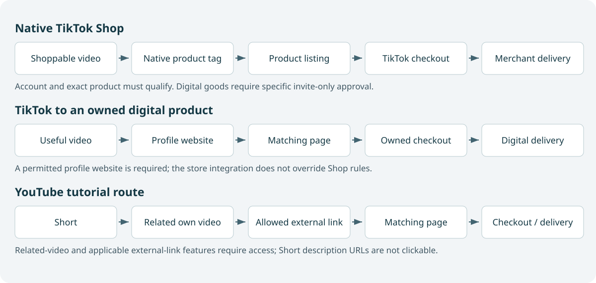

# From Short Videos to Customers

## A practical course in video craft, affiliate marketing, and digital-product funnels

Written for Aadil's strengths in software development, teaching, and technical writing. Start with an original demonstration that helps a viewer understand something useful. Then build an appropriate next step: an affiliate product, a free lesson, an ebook, or a working software experience.

This book assumes no filming, editing, or marketing experience. Basic development knowledge helps with the examples but is not required to understand the marketing principles. The examples use browser extensions and coding education because they offer a credible way to connect your ability to build with your ability to explain. Product names, prices, scripts, and business datasets are hypothetical unless identified as a documented source case.

The first half teaches ideas, scripting, filming, sound, screen demonstrations, editing, deliberate practice, learning resources, and AI assistance. The second half teaches affiliate economics, TikTok Shop, owned Shopify routes, email, YouTube Shorts handoffs, SaaS activation, measurement, and operations. Complete chapters are included; the course is not just an outline.

Read in order the first time. Use the resource map to select one editing path and make projects while studying. The optional 180-hour plan includes production and experimentation time, not 180 hours of lecture text. Its practice blocks overlap the suggested chapter apprenticeships; they are not additional mandatory schedules. The ninety-day plan is an alternative implementation rhythm.

**Research baseline:** November 13, 2026, primarily United States rules. Account access, regions, categories, agreements, and software tiers differ. The source appendix explicitly distinguishes inspected policy text, partially inspected pages, course indexes, and unavailable material. No training course is claimed completed merely because its index was read. A separate Deep Research job was not available; research used multi-query web retrieval and official sources.

**Your starting experiment:** make a small series for developers learning useful browser projects; offer one strong sample lesson; validate a finished narrow ebook; recommend only tools you can evaluate honestly. A SaaS route is taught as another option, with activation and retention as central requirements. This is a suggested sequence to test, not an earnings promise.

Use the offline workbook to estimate script timing, inspect a vertical caption layout, explore funnel economics, construct campaign links, model SaaS retention, and examine conversion uncertainty. The workbook performs the displayed arithmetic locally. It does not inspect actual footage, operate a checkout, publish videos, or predict virality.

The standalone HTML edition contains both the complete textbook and the workbook. The portable package also contains the numbered Markdown chapters, sources, templates, readable companion source, and verification evidence. Named vendor tools and live commerce services were researched but not executed; the local companion is tested separately.

## Contents

- [Make a video worth watching, then learn to repeat it](#chapter-01)
- [Record pictures and sound that make the explanation easy](#chapter-02)
- [Learn editing through finished projects and careful use of AI](#chapter-03)
- [Affiliate marketing and the TikTok Shop funnel](#chapter-04)
- [Build owned funnels for ebooks, courses, and useful software](#chapter-05)
- [Measure the whole route and build a sustainable growth process](#chapter-06)
- [Course plan](#course-plan)
- [Toolkit](#toolkit)
- [Templates](#templates)
- [Sources](#source-appendix)

# Part I — Make useful videos

Build the communication before the commercial machinery. These chapters move from a useful idea to a dependable finished export.

# 1. Make a video worth watching, then learn to repeat it

A stranger opens TikTok or YouTube for something interesting. Your video appears between two unrelated videos. They do not know that you can program, that you worked hard on an ebook, or that your extension solves a useful problem. They see a frame, hear a few words, and decide whether to stay. The first production problem is therefore an explanation problem: make one useful change understandable to someone who has given you almost no context.

Imagine a developer who saves educational videos but cannot find the relevant moment later. You could start a video with your biography and an explanation of browser-extension architecture. You could instead show a video reopening at a saved timestamp and say, “I stopped scrubbing through tutorials to find one line of code.” The second opening makes a problem and an outcome visible. You still owe the viewer evidence. What matters is not merely attracting a glance; it is fulfilling the reason that glance became attention.

This chapter teaches that design process before introducing cameras or editing software. You will develop a narrow audience hypothesis, turn observed problems into scripts, distinguish a strong hook from a misleading promise, and build a practice process that improves specific skills. A useful finished artifact is a small set of filmed ideas that can be understood without your personal explanation. You need no existing followers and no paid tools to begin.

## 1.1 Start with one viewer in one situation

An audience is more useful as a situation than as a demographic. “Developers aged eighteen to thirty-five” includes students, senior engineers, hobbyists, founders, and people who have no intention of buying educational materials. “A developer who knows JavaScript but cannot finish their first browser extension” gives you a more concrete teaching and selling problem. You can show a manifest, a permission error, a first popup, and a finished example. Those demonstrations address a recognizable gap.

For your initial channel, a reasonable hypothesis is practical software projects explained clearly. It uses your ability to build and teach. Within that hypothesis, select one series before broadening. A series might explain common extension mistakes, demonstrate useful browser workflows, or show small tools built from scratch. Each attracts a different mix of learners and potential customers. A series about entertaining gadgets may attract many people while creating little demand for a technical ebook. That does not make the series bad; it makes its commercial purpose different.

Write a working sentence: “I help JavaScript learners finish a useful browser extension by showing small working examples and explaining the confusing parts.” This is a testable positioning statement, not a permanent identity. It tells you what to include, what examples to choose, and what evidence to collect. If viewers repeatedly ask about deployment instead, that is a reason to investigate a different series. Do not interpret a single popular comment as a complete market study.

A viewer can be a learner, a tool buyer, or a business customer. Avoid changing among all three within one short video. A student wants a first success. A tool buyer wants confidence that the product fits their workflow. A business customer wants evidence of reliability and a business outcome. Shared technology does not make these identical audiences.

## 1.2 Understand the job of a short video

A short video can demonstrate one result, correct one misconception, compare two choices, or make one problem newly visible. It rarely needs to teach an entire subject. Compression becomes harmful when it removes the step that makes an explanation true. For example, “add this permission and your extension works everywhere” may omit security restrictions or site compatibility. A concise video should say enough to establish the boundary of its result.

Separate the viewer outcome from your business outcome. The viewer outcome might be understanding why an extension cannot access a page. Your business outcome might be a visit to a free debugging checklist. These can support each other when the checklist continues the same task. They conflict when you interrupt a useful explanation with a completely unrelated offer. Begin every brief with both outcomes, then ensure the viewer receives something complete even if they never click.

Think of a short video as a promise followed by observable progress. Progress can be visual: a broken popup starts working. It can be conceptual: two similar code snippets behave differently and you explain why. It can be comparative: a microphone sounds different at two distances. The movement from uncertainty to a useful answer is the core story. Effects, captions, music, and editing support that movement.

There is no universal duration that makes a video successful. A very short demonstration may need fifteen seconds; a careful comparison may need a minute or longer. Choose the shortest duration that preserves the promised understanding and necessary context. The training examples in this book often use thirty to forty-five seconds because that constraint makes planning manageable, not because an algorithm requires it.

## 1.3 Research questions instead of copying topics

Start a research notebook with the exact problems you encounter while building, teaching, or supporting people. A useful entry includes the situation, the attempted solution, the failure, and the desired outcome. “Extension permissions” is a topic. “My popup works until I navigate to another tab” is a possible story. The second gives you something to demonstrate and a reason for someone to care.

Use public search suggestions, relevant community questions, comments on your own videos, support conversations you are permitted to discuss, and official documentation. Treat these as signals rather than representative surveys. Search results reflect the query, location, history, and platform. A highly liked complaint may come from people who would never buy your product. Record the source and date so you can revisit your interpretation.

TikTok's Creative Center is a useful official research starting point for ad examples and creative patterns. Its Top Ads collection is selected advertising material, not a random sample of all videos. Use it to inspect how a creator reveals a problem or demonstrates a product, rather than assuming the visible creative alone caused sales. The official overview is listed as [S01](#s01) in the source appendix. This book does not claim access to private campaign economics.

When examining a video, write three separate notes: what is observable, what you infer, and what remains unknown. “The product appears in the first shot” is observable. “This may reduce uncertainty about the demonstration” is an inference. “This opening increased profit by twenty percent” is unknown unless credible evidence establishes it. Keeping those categories separate makes your research much more reliable.

## 1.4 Build a small reference collection

Save examples for a reason, not because they are popular. One might show excellent lighting on a desk product. Another might explain a technical idea with a clear diagram. Another might give a natural transition to a purchase. Tag the craft decision you want to learn. A reference collection with ten carefully annotated examples is often more useful than hundreds of unexamined saves.

Use a compact observation table: opening frame, first spoken sentence, promised outcome, proof, transitions, call to action, and unanswered questions. Note whether the example appears to be an organic post, a paid placement, a brand partnership, or a product-tagged video. These distribution contexts differ. Do not compare their public view counts as if they were controlled experiments.

Recreate the principle using your own subject, footage, and language. If an example shows a messy desk becoming organized, you might show a cluttered bookmarks folder becoming a searchable set of timestamps. You are transferring a before-and-after structure, not copying the person's script, identity, assets, or distinctive expression. This also forces you to understand why the structure works.

A practical ethical boundary improves originality: you should be able to explain the general technique without showing the reference. “Reveal the result first, then show the mechanism” is transferable. “Use that creator's exact opening, gestures, and joke” is dependence. Your advantage as a technical teacher comes from credible explanation and working examples, which are difficult to fake and more durable than imitation.

## 1.5 A hook establishes relevance and a question

A hook is the opening that gives a viewer a reason to continue. It may be a surprising visual, a precise problem, a contrast, or a useful result. The hook should identify enough context to attract the intended viewer. “You need to see this” could apply to anything. “Your extension popup forgets its state for a reason” speaks to a smaller group with a specific frustration.

A strong hook contains an unresolved question that the video can actually answer. Show a saved timestamp reopening instantly: the question is how that happened. Show two clips with different microphone distances: the question is why one sounds clearer. Promise a particular outcome, then provide evidence within the same video. Delaying an obvious answer purely to extract watch time can make viewers distrust the next promise.

Three useful opening patterns for your work are result-first, mistake-first, and decision-first. Result-first: “This button takes me back to the exact moment I saved.” Mistake-first: “This permission error is caused by a different problem than the message suggests.” Decision-first: “Use local storage for this extension state; use a backend when you need it across devices.” Each pattern implies a different middle section, so do not choose the opening in isolation.

Avoid claims you cannot defend. “This extension will save you ten hours every week” needs a basis, a defined user, and a realistic task. “Here is the sequence of clicks it removes from my workflow” is inspectable. A narrow truthful claim often creates stronger confidence than a large vague promise. Especially for educational products, credibility is a commercial asset.

## 1.6 Write the middle before polishing the opening

A compelling opening can conceal a weak idea while you are writing. To prevent this, draft the useful explanation first. What exactly changes? What can be shown? Which step connects the problem to the result? If you cannot identify the evidence, the opening may be promising something that the footage cannot deliver.

For a debugging video, the middle might be: show the failing behavior, isolate the relevant line, change one setting, and rerun. For a product review, it might be: define the task, demonstrate the product under that task, show a limitation, and state who it fits. For an ebook preview, it might be: show a confusing concept, teach a small example, and reveal how the paid guide develops that example further.

Write an explanation at normal length before compressing it. Suppose your first draft says, “I built an extension because I wanted to remember particular points in long tutorials without keeping a separate document of links.” You can compress that to “I kept losing the useful moment inside long tutorials.” The shortened sentence preserves the situation and frustration. Removing the problem entirely would leave only an unexplained product demonstration.

After the middle works, write several openings that accurately frame it. Choose among them based on clarity and fit, not just drama. A useful test is whether a stranger could describe what they expect to learn after hearing the first sentence. If their expectation differs from the actual lesson, revise the promise or the lesson before filming.

## 1.7 Use a visible sequence of beats

A beat is one meaningful change in information or action. A thirty-five-second tutorial may contain five beats: problem, result, mechanism, boundary, next step. This is a planning tool, not a mandatory formula. The beats should feel like a coherent explanation rather than five unrelated scenes.

Consider a fictional ebook, *Your First Useful Browser Extension*. A short video could open with a popup that loses a note, then show a persistent note. The explanation identifies transient popup memory, demonstrates saving to extension storage, and shows the note surviving a reopen. The boundary is that this example stores locally rather than syncing to a server. The next step is a free working example. Every beat continues the same problem.

Plan what changes visually at each beat. A spoken explanation over a static screen can be effective when the viewer knows where to look. When the visual remains unchanged while the explanation names three new things, the viewer must imagine too much. Add a crop, cursor movement, annotation, or contrasting example because it directs attention to the explanation, not because movement is required every second.

Use a two-column script with audio on one side and visuals on the other. This reveals impossible production plans early. If the spoken line describes an error that you never recorded, add the shot or rewrite the line. A script that works on the page but has no corresponding evidence will be expensive to rescue during editing.

## 1.8 A complete worked script

Here is an original forty-second planning example. It is an estimate that must be read aloud; the exact timing will depend on your delivery.

| Approximate moment | Spoken idea | What the viewer sees |
|---|---|---|
| Opening | “I kept losing the useful moment inside long tutorials.” | A long timeline and unsuccessful scrubbing |
| Result | “So I made this timestamp button.” | Save action, then reopen at the saved moment |
| Explanation | “The saved item keeps the video address and the time together.” | Two large labeled fields with synthetic values |
| Demonstration | “Choose the item and it opens the video at that time.” | A second real end-to-end example |
| Boundary | “This version is for desktop Chrome.” | Compatibility note beside the browser |
| Next step | “The free build checklist is on my profile.” | Clear checklist preview and destination label |

Notice what is absent. There is no biography, no claim that the product changes everyone's life, and no requirement to follow before receiving the answer. The video demonstrates value before requesting another action. The compatibility boundary prevents an inaccurate impression that the feature is a universal mobile app.

The wording should change if the destination is a paid extension rather than an educational checklist. The same footage could support a product sale, but the promise and destination need to match. A buyer expects installation, compatibility, pricing, and support information. A learner expects source explanations and prerequisites. Do not use identical calls to action for both and then wonder why the landing page feels disconnected.

## 1.9 Make technical material legible

Your background gives you technical fluency, but the viewer cannot pause mentally every time you introduce a new abstraction. Identify the one concept that must become clear. If the concept is persistence, show the state before closing and after reopening. A full architecture diagram is unnecessary unless the distinction depends on it.

Use examples with visible differences. Two functions that differ only in an unhighlighted character are difficult to compare on a phone. Enlarge the relevant line, name what changes, and show the behavioral consequence. The explanation should connect cause and effect. “This is better” is less useful than “This survives reopening because it is saved outside the popup's temporary memory.”

Read every code label aloud during review. A label such as `chrome.storage.local` may be meaningful to you and unreadable to a novice. The caption can preserve the exact API while the narration says “extension storage.” You are not removing rigor; you are giving the viewer an accessible entry point. Link the complete context from an appropriate destination instead of squeezing all of it into one frame.

Be explicit about simulations. If you accelerate a slow installation or show a prerecorded result, do not imply that the product performed the task instantly in a live session. A brief “sped up” or “recorded demo” note can preserve the visual pacing while maintaining accuracy. Technical audiences often notice hidden simplifications, and clear boundaries strengthen trust.

## 1.10 Design the ending as a continuation

A call to action is a request for a next step. It should tell the viewer what they will get and where to get it. “Link in bio” describes a location but no benefit. “Get the free permission-debugging checklist from my profile” gives a reason and a destination. The action should continue the demonstrated problem.

Choose one primary action. Asking someone to follow, comment, share, subscribe, download, and buy creates unnecessary decisions. You can still respond to conversation naturally, but the scripted ending should emphasize the action relevant to the video's purpose. A purely educational video may need no commercial ending. Finishing the explanation cleanly can be enough.

For TikTok, the exact outbound route depends on the profile's available website-link feature or native product-tag eligibility. For YouTube Shorts, an external URL typed into the Short's description is not a clickable path. The platform-route details are taught in Chapters 4 and 5. At the writing stage, name a route you can actually configure instead of assuming every platform supports the same action.

Avoid artificial urgency when nothing changes at a deadline. A real workshop date, a genuine enrollment limit, or a documented promotion can justify timing. An ebook that remains available tomorrow does not need a fabricated countdown. A better reason to act is that the resource helps with the problem the viewer already cares about.

## 1.11 Learn through constrained repetitions

Learning improves when you can identify what changed and judge the result. Making ten unrelated videos with different topics, tools, lengths, and styles gives you little basis for diagnosis. A constrained practice block isolates one skill while keeping the rest manageable.

For example, record the same twenty-second explanation with three different openings. Keep the middle, framing, and destination constant. Ask a few representative viewers what they think the video promises and where they become confused. Their feedback does not estimate an algorithm's preferences, but it reveals communication failures that you can fix immediately. Then make a new video applying the lesson rather than endlessly polishing the same one.

Use a progression: first make the idea clear without effects; then make the spoken delivery comfortable; then improve framing and sound; then improve editing; then evaluate how the video supports a commercial next step. Trying to learn every skill simultaneously makes it difficult to distinguish a weak idea from poor audio or unreadable text.

A useful practice log records the intended skill, the version, the observed problem, the change made, and the evidence used. “I am bad on camera” is not actionable. “I look away during the key phrase because I am reading a full paragraph below the lens” suggests a specific fix: shorter prompt lines closer to the lens or filming one sentence at a time.

## 1.12 Review in four separate passes

First review the story without distractions. Read the transcript and ask whether the promise is answered. Remove repetitions, unexplained transitions, and claims that lack evidence. A clean transcript will not guarantee a good video, but a confusing transcript often reveals a story problem before you start adjusting color.

Second review the picture with the sound muted. Can you identify the task, the important action, and the result? Captions may provide meaning, but they should not compensate for a screen recording that never shows the relevant action. If the viewer cannot tell where to look, improve framing or annotation.

Third listen without watching. Is the voice understandable? Do sentences sound natural? Does a music cue mask a technical term? Audio problems often become obvious when you stop watching attractive footage. Fourth review the complete export on a phone in the actual platform draft preview. This catches interface overlays, tiny captions, and awkward pauses that are less visible on a large editing monitor.

Keep the passes distinct because each requires different attention. If you try to judge story, microphone noise, fonts, product claims, and music rights at once, some problems will escape notice. A repeatable review process is more valuable than a vague impression that the video feels professional.

## 1.13 Give and request useful feedback

Feedback should describe an observed response before prescribing a solution. “I did not understand what changed after you clicked” is useful. “Add more transitions” is a proposed fix that may not address the actual issue. Ask viewers to identify the point where they lost track and what they expected to happen next.

Select feedback sources deliberately. A beginner can reveal jargon that you missed. An experienced editor can reveal pacing or continuity issues. A potential customer can tell you whether the demonstrated problem matters. These are different judgments. A polished video that impresses other editors may still fail to reach the person who would use your product.

Show the video without a long introduction. If you explain the concept beforehand, you remove the uncertainty that the video itself must solve. Give only the context a normal viewer would have. Ask what the video helped them understand, what claim seemed unsupported, and whether the proposed next resource felt relevant. These are optional feedback activities, not examinations.

Do not redesign your entire style after every opinion. Look for repeated confusion and conflicts with the video's stated purpose. A viewer who dislikes all programming content is not necessarily evidence that your extension tutorial needs a different niche. A viewer who fits your audience and cannot read the result is evidence of a production problem worth fixing.

## 1.14 Build series with a commercial relationship

A series makes production easier because the format becomes familiar. It also helps an interested viewer recognize what they will receive from another video. For your developer-teacher positioning, start with three types of episode: a mistake repaired, a useful tool demonstrated, and a concept made visible. Keep them within one subject family for the first production block.

Suppose the future product is an extension-building ebook. Mistake videos can address permissions, persistence, packaging, and browser testing. Demonstrations can show the finished features that those lessons enable. Concept videos can explain the difference between a popup and a background context. Each video should stand alone, while the collection makes the paid guide's larger promise plausible.

A series can also reveal whether the proposed product is misaligned. If viewers love demonstrations but ask only where to install the tool, they may prefer a utility over a build guide. If they ask for explanation and source code, educational demand is more plausible. Neither signal proves willingness to pay. It tells you what to investigate through a sample, a small offer, or customer conversations.

Avoid turning the series into an advertisement with no independent value. Teaching a real step gives viewers evidence of your instructional quality. The paid product can provide organization, depth, tested examples, and a coherent project. You do not need to hide the useful part to create a reason to buy.

## 1.15 Separate platform observations from folklore

You will encounter rules such as “post at exactly this time,” “cut every second,” and “never use a commercial label.” Treat universal claims skeptically. Platform distribution is complex, accounts differ, and public success stories rarely isolate one cause. Your operational decisions should be supported by current rules and observations from your own audience.

A sensible starting schedule is one you can sustain while making improvements. Three carefully produced videos each week may teach you more than daily rushed posts if the latter leave no time for review. Conversely, perfectionism can prevent you from obtaining any feedback. Set a production budget and publish when the video meets your quality standard, then learn from the response.

Retention is evidence about attention, not a full explanation of why distribution occurred. A high completion rate on a very short loop does not establish customer interest. A low completion rate may arise because the video reached people outside its intended audience. Later chapters combine attention metrics with visits, leads, activation, purchases, and refunds so that production decisions serve an actual business purpose.

Use benchmarks as questions rather than verdicts. If one format consistently holds your intended audience longer, inspect its clarity and relevance. Do not assume that copying its duration will reproduce the result. The purpose of measurement is to improve your understanding of the relationship between viewer, promise, delivery, and next step.

## 1.16 Read a video by reconstructing its decisions

When you study a reference, pause at the first frame and describe the information available before the narration begins. Is the subject recognizable? Does the image imply a task or merely provide decoration? Then listen to the first sentence and write the expectation it creates. Finally, watch the result and decide whether that expectation was fulfilled. This separates the promise from the evidence.

Next reconstruct the sequence without copying its wording. A reference might move from a visible frustration to an unexpectedly small solution, then show the mechanism and a limitation. Write that as an abstract sequence. Apply it to a different task you understand well, such as debugging a browser permission or organizing a study session. If the sequence no longer works, identify which part depended on the original product rather than the general craft.

The final step is to identify the missing evidence. A reference may show many likes without showing purchases, or a customer reaction without revealing the conditions. Your reconstruction should not fill those gaps with assumptions. You can learn framing, pacing, and visual explanation from a video without endorsing its commercial claims. This habit is especially useful when researching creators who sell courses about making money from content.

## 1.17 Revise an opening through evidence

Consider this first draft: “This incredible extension will completely transform how you learn coding.” It names no specific problem and promises a broad personal outcome. You cannot prove transformation in a short demonstration. Replacing “incredible” with another adjective will not repair the underlying claim.

A second draft might be: “I built an extension that saves timestamps from coding tutorials.” This is more specific and testable, but it describes the product before explaining why the viewer should care. A third draft is: “I kept losing the useful moment inside long coding tutorials, so I made this timestamp button.” The problem, audience context, and mechanism now connect. The next shot should show the button producing the promised result.

The third draft is not universally best. If the viewer already searches for a timestamp extension, a direct product opening may be more useful. If the video is about learning storage APIs, the opening should frame the teaching problem instead. The revision process is therefore conditional: identify the viewer's situation, choose a truthful promise, and select footage that answers it. Test whether the opening clarifies the actual video rather than merely sounding more exciting.

## 1.18 A four-week craft apprenticeship

In the first week, work on ideas and spoken clarity. Select one audience situation, collect a small set of problem statements, and write six scripts. Film three with the camera you already own. The deliverable is not a perfect channel; it is three complete explanations whose promises and evidence can be inspected. Keep notes on where you hesitate or add unnecessary context.

In the second week, work on recording. Refilm one useful explanation with a cleaner background, more consistent lighting, and closer microphone placement. Compare the exports rather than the equipment specifications. Record a separate screen demonstration using synthetic data. Chapter 2 explains how to make that recording readable in a vertical frame.

In the third week, work on editing. Choose one editor and complete its introductory training while rebuilding one of your videos. Practice trimming, arranging shots, caption correction, simple audio balancing, and export. Chapter 3 gives a researched learning path and explains what each resource is for. Do not install five editors in the hope that one will replace practice.

In the fourth week, work on continuity from video to resource. Create one free checklist or sample lesson that solves the same problem as your strongest series. Write a matching call to action, test the destination on mobile, and publish a small set of related videos. Judge progress by the clarity of the communication and the quality of responses, then investigate commercial demand in the second half of the book.

## 1.19 Use AI as a critical reader

AI can help expose missing context, propose alternate wording, or turn your notes into a shot list. It cannot establish whether a product demonstration is true without evidence. Give it the actual script, intended viewer, and verified claims. Ask it to distinguish wording suggestions from factual corrections.

A useful prompt is: “Act as an editor for a beginner JavaScript learner. Here is my forty-second script and its intended outcome. Identify every term that needs context, every claim not supported by the described footage, and every moment where the visuals do not match the narration. Suggest three openings that preserve the same truthful promise. Do not invent product capabilities, testimonials, or performance numbers. Return a revised two-column script and a list of facts I must verify.” This is a prompt you may use in a chosen assistant; no external assistant action has been performed by this book.

You can also ask for a compression pass that protects meaning. Specify the exact limitation that must remain, such as desktop-only compatibility or local storage. Then compare the revised script against the original evidence. Fluent wording can quietly broaden a claim, which is particularly risky in affiliate reviews and technical instruction.

Your final judgment remains essential. A generic assistant may make every script sound like the same motivational advertisement. Preserve your natural way of explaining a mechanism. Your personal voice can emerge from what you notice, how you test it, and the details you include, rather than from exaggerated phrasing.

## 1.20 Your first production brief

Before moving to recording, assemble one page with the intended viewer, concrete problem, promised change, evidence, script, shot list, limitation, and next action. If you cannot fill a field, identify whether you need research, footage, or a smaller idea. This makes the next chapter's technical decisions purposeful.

For the extension example, the evidence is a real save-and-reopen sequence. The essential shots are the initial frustration, the save action, the reopened timestamp, and a readable representation of the stored information. The limitation is the supported browser and device. The destination might be a free build checklist. None of those decisions requires an expensive camera or a synthetic avatar.

Use the companion's script-planning experiment to estimate speaking duration from your word count and chosen speaking rate. The estimate is arithmetic, not an analysis of emotional impact or an algorithmic quality score. Read the script aloud afterward, leave space for the demonstration, and adjust. A forty-second plan that needs fifty-five seconds in your natural voice needs rewriting or a longer duration.

You are ready for Chapter 2 when the video has a clear promise, the evidence exists or can be recorded, and the next step continues the same problem. The recording process will now serve a story you understand, which makes decisions about framing, lighting, microphones, and screen capture much easier.

Companion experiments: [Script timing](companion/index.html#script). In the HTML edition use the embedded workbook below.

# 2. Record pictures and sound that make the explanation easy

You have a script about a browser tool that saves timestamps. On your laptop, the demonstration looks obvious. After placing the recording in a vertical video, the interface becomes tiny, the cursor moves too quickly, and the viewer cannot see the result. Meanwhile, your voice sounds distant even though the microphone was expensive. These are production problems with understandable causes. You can fix them by designing the recording around the final viewing conditions.

This chapter takes you from a basic phone-and-computer setup to a repeatable recording process. It assumes no photography or audio knowledge. The goal is not cinematic equipment mastery. It is reliable footage: a viewer can see the relevant action, hear the explanation, and distinguish the actual result from editing. The same principles apply to an affiliate product demonstration, a tutorial, an ebook preview, or an introduction to a SaaS workflow.

Begin with equipment you already own. A stable phone, daylight, a quiet room, and a readable screen capture can produce useful educational videos. Buy something only after identifying a repeated limitation that prevents a clear result. Later in the chapter, you will learn how to compare equipment through controlled recordings instead of purchasing based on promotional examples.

## 2.1 Design for a small vertical frame

An aspect ratio describes the relationship between image width and height. A common vertical working frame is 9:16. A 1080-by-1920 image has that ratio because both dimensions can be divided by 120. It gives you a tall frame suited to phone viewing. This is a practical production default, not a claim that every platform accepts only those dimensions.

The available image is smaller than the canvas suggests. Platform buttons, account information, captions, and device interfaces can cover parts of it. Keep critical information away from the outer edges and inspect the actual draft preview before publishing. There is no single safe rectangle guaranteed across every device and app version. The companion includes an adjustable overlay to teach the tradeoff, not an official specification.

For a talking-head shot, leave room for captions without placing them over your mouth or the important product action. For a screen demonstration, create a composition where one region contains the enlarged interface and another can hold explanation. You do not need your face visible at all times. If it competes with the detail the viewer must understand, let the demonstration occupy the frame.

Plan the final frame before recording. Hold a phone at your usual viewing distance and imagine the exported video. Could you read a variable name? Could you see the product texture or the button state? Designing for this condition prevents the common mistake of capturing a whole desktop and hoping automatic cropping will make it legible later.

## 2.2 Resolution, frame rate, and useful detail

Resolution is the number of pixels in the image. More pixels can preserve detail when cropping, but they do not fix poor focus, unreadable source text, or a badly composed shot. Recording a screen at high resolution while showing a tiny application window can still produce an unclear final crop. Enlarge the relevant interface first.

Frame rate describes how many frames are recorded each second. Thirty frames per second is a reasonable starting point for spoken tutorials and ordinary demonstrations. Faster movement may benefit from a higher rate, but higher rates require more light, storage, and processing. Match your editing project to the main footage when possible so that motion remains predictable. Avoid converting settings merely because a tutorial calls them professional.

A camera's shutter controls how long each frame receives light. Very short exposure can make movement look sharp and staccato; longer exposure introduces blur. For a simple tutorial, consistent exposure and readable motion matter more than achieving a particular cinematic look. If automatic settings flicker under indoor lights, try changing the lighting, the frame rate, or the camera's anti-flicker option before assuming the editor can repair it.

Use a short test to decide. Record your face, a hand movement, and a screen action, then export a representative vertical segment. Inspect it on a phone. This reveals whether additional resolution or a different frame rate solves a visible problem. You are testing the delivery chain, not just the camera's specification sheet.

## 2.3 A minimal setup with a clear purpose

A useful starter setup contains a stable camera, a light source, a way to capture clear speech, and a computer or phone that can edit the footage. Stability might come from a simple tripod or a securely supported phone. Light might come from a window. Audio might come from a phone close to your mouth or a microphone you already have. The exact brand is secondary to the physical arrangement.

Place the camera near eye level for an ordinary explanatory shot. A low laptop camera often emphasizes the ceiling and places the screen below the lens, encouraging you to look down. Raise the device safely or use the phone as the main camera. Keep a comfortable distance and check the composition before every recording session.

Choose a background that does not compete with the subject. A neutral wall, a tidy desk area, or a small amount of contextual equipment can work. You do not need a fake studio backdrop. Avoid bright windows directly behind you unless you understand how to expose for both the face and the background. A large brightness difference can leave the face dark or the window featureless.

If you have a small production budget, prioritize the limitation you actually observe. A distant voice may justify improving microphone placement before buying lights. A shaking overhead product shot may justify a stable mount. A slow computer may justify simpler projects or proxy files before a subscription to another editor. The purpose of equipment is to remove a bottleneck you can describe.

## 2.4 Light the face or product deliberately

A light source has direction, size relative to the subject, brightness, and color. A large source close to the subject often creates softer shadow transitions than a small source far away. A window can therefore be a useful starting point. Sit facing it or at an angle and compare the resulting shadows. Avoid direct sun that changes rapidly or produces harsh patches across the face.

For a simple one-light arrangement, place the main light somewhat to one side of the camera and slightly above eye level. This creates shape without leaving half the face unreadable. The exact angle is a choice, not a universal rule. Turn the subject or move the light until the important features remain clear. For a product, consider which surface needs to show texture, buttons, or reflections.

Mixed light colors can produce distracting differences. Daylight from a window and a warm indoor bulb may render opposite sides of a face differently. Turn off a conflicting source or choose lights that match more closely. White balance is the camera's interpretation of neutral color. Locking it during a session can prevent visible shifts between takes when the camera changes its guess.

Test the darkest and brightest important areas. If a white ebook page is so bright that the printed detail disappears, reduce exposure or change the angle. If a black product merges into the background, add separation through lighting or composition. The goal is information, not merely brightness. Good lighting makes the evidence in your video easier to inspect.

## 2.5 Exposure and focus without a photography course

Exposure is the amount of light represented in the recorded image. Automatic exposure adjusts it as the scene changes. This is convenient, but a hand entering the frame or a bright screen changing can cause the image to pulse brighter and darker. Many phones allow you to lock focus and exposure after selecting the subject. Use that option when the scene remains fixed.

Focus determines which distances appear sharp. A face can look soft even in a high-resolution recording if the camera focuses on the background. Check the eyes in a talking-head shot and the relevant surface in a product shot. If the camera repeatedly searches for focus, increase light, simplify the composition, or lock focus at the correct distance.

Do not inspect only the small preview while recording. Play back a short segment at a larger size and at the final phone size. Look for blurred text, clipped highlights, flicker, and inconsistent brightness. An attractive thumbnail frame does not guarantee that the moving sequence is usable. Also check whether the footage stays consistent when you gesture or move the product.

Use manual settings gradually. A beginner does not need to control every camera parameter immediately. Start with automatic settings, identify a specific instability, and lock the relevant control. This teaches cause and effect while avoiding a complicated setup that you cannot reproduce next week.

## 2.6 Clear audio begins before software

A microphone captures the voice and the room. When the microphone is far away, the direct voice becomes weaker relative to reflections and background noise. Increasing the recorded volume later raises both. An expensive microphone across the room can therefore sound worse than an ordinary microphone placed appropriately near the speaker.

Choose a quiet space and reduce obvious noise sources. Close a window if traffic dominates. Move away from a loud fan. Soft furnishings can reduce reflections compared with an empty room with hard surfaces. You do not need to build a studio; even changing the recording position can make speech more intelligible.

Place a microphone close enough to capture a clear voice while avoiding distracting breath noise or clothing contact. Speak slightly across the microphone rather than directing every breath into it. If using a clip-on microphone, check for rubbing when you turn or gesture. If using a desk microphone, avoid touching the table during important lines and listen for keyboard noise.

Record a test containing your quietest and loudest normal phrases. Listen through headphones. The test should include a pause so that you can hear the room. If the recording distorts on loud words, lower the input level or change placement. If it sounds hollow and distant, move closer before adding processing. These changes usually preserve a more natural voice than aggressive repair.

## 2.7 Levels, clipping, and a useful recording target

Digital audio has a maximum representable level. A meter often displays zero decibels full scale, written 0 dBFS, at that ceiling. A signal that exceeds the available range can clip, producing distortion. Lowering the volume afterward makes the distortion quieter; it does not restore the missing waveform.

As a working recording practice, leave headroom so ordinary speech peaks comfortably below that ceiling. Peaks around minus twelve to minus six dBFS can be a useful starting region, depending on the device and recording format. This is a practical recording suggestion, not a platform upload requirement. The important result is a clean voice with room for unexpectedly loud words.

The meter alone cannot judge quality. A noisy recording may have apparently healthy peaks. Listen for crackling, wind, hum, echo, and sudden pumping from automatic processing. Compare the raw recording with the processed version at similar loudness. The louder version can seem better even when it has lost detail, so level matching makes the comparison fairer.

Keep the raw source. If a noise-reduction setting damages consonants or produces a watery sound, you should be able to return to the original. Save processing for the editing stage when possible. A clean source with modest processing gives you more flexibility than a heavily altered source that cannot be repaired further.

## 2.8 Record performance in manageable units

You do not need to deliver a forty-second script perfectly in one take. Break it into meaningful sentences or beats, leaving a small pause before and after each. This gives the editor room to trim. Keep posture, camera position, and microphone distance consistent so that the takes can fit together.

Read the sentence for meaning before recording it. A line that looks concise may contain too many ideas to say naturally. If you stumble repeatedly, rewrite it instead of assuming the problem is your confidence. Replace abstract constructions with concrete actions. “Persist the state across invocation boundaries” may become “Save the note so it is still there when the popup reopens.”

Record a few alternate openings while the setup is ready. Use different wording, not exaggerated performances that do not suit your voice. Label the takes or say a short slate before them: “opening two.” This creates a clear editing reference. You can remove the slate from the finished video.

A teleprompter can help when used for short prompts near the lens, but reading a dense paragraph often produces unnatural eye movement and rhythm. Try a few key phrases, then explain the idea as you would to a learner beside you. The result may be warmer and clearer than a perfectly recited script. Preserve your ability to explain rather than training yourself to imitate a generic advertisement.

## 2.9 Capture screen demonstrations for the final composition

Prepare a dedicated demonstration environment. Use a clean browser profile, synthetic accounts, sample data, and a desktop with notifications disabled. Check the bookmarks bar, browser history suggestions, terminal output, window titles, and open tabs. A technically correct recording can still be unusable if it exposes customer information or unrelated personal messages.

Increase application zoom and font size before recording. For code, show the few lines that matter rather than the entire editor. For a browser interface, narrow the window or arrange it so the important area fits a vertical crop. Test the crop while planning; automatic reframing cannot infer every important detail in a dense software interface.

Record the action slowly and deliberately. Move the cursor to the relevant control, pause briefly, click, and allow the result to appear. The editor can remove unnecessary delay while retaining the sequence. Rapid cursor movements and unexplained keyboard shortcuts are difficult for a beginner to follow, especially on a small screen.

For your timestamp example, capture separate clips: the original search problem, adding a timestamp, the saved list, and reopening at the correct point. Also record a second example to show the behavior is repeatable. Keep an uninterrupted end-to-end take for your own verification, even if the final short uses tighter cuts. That makes the edited demonstration traceable to actual behavior.

## 2.10 An OBS recording workflow

OBS Studio is a useful free recording option across common desktop systems. Its official quick-start guide, [S05](#s05), introduces scenes, sources, audio configuration, and a test recording. The exact appearance varies by operating system and version. This book describes a conceptual workflow rather than claiming that every menu label remains fixed.

A scene is a composition of sources. A source can be a window, a display, a camera, an image, or audio. Create a scene for the application demonstration and add only the sources you need. Window capture can reduce the chance of accidentally showing another application, though you must still check what appears inside the captured window. Confirm the capture works after changing windows or display scaling.

Choose the microphone explicitly and watch its meter while speaking. Check whether desktop audio should be included. If the demonstration does not need system sound, avoid capturing unrelated notification sounds. Make a short recording, stop, and play it back. Confirm the file exists, the picture is visible, the cursor is captured as intended, and the correct microphone is audible.

If recording fails or drops frames, reduce unnecessary sources, simplify the scene, or use a lower recording resolution that still preserves the final detail. Keep a note of the configuration that worked. The purpose is a dependable source clip, not an elaborate streaming layout. For a vertical video, you can record a readable application region and place it into your editor's vertical sequence afterward.

## 2.11 Show physical products with fair evidence

An affiliate product video should reveal the task the product is supposed to improve. If reviewing a small microphone, record the same sentence in the same room with a defined placement. If reviewing a phone stand, show the setup, the range of motion, and what happens during a typical interaction. A dramatic reaction shot is less useful than observable use.

Control relevant conditions. Comparing one microphone close to your mouth with another across the room does not isolate microphone quality. Comparing a new tool against an intentionally awkward workflow can exaggerate the benefit. You can still demonstrate realistic differences, but describe the conditions so viewers understand what the comparison establishes.

Record limitations as footage. A stand may block a charging port in one position. A microphone may pick up clothing noise. A keyboard may be too loud for shared spaces. Showing a limitation makes the recommendation more useful to the right buyer and reduces disappointment. It also gives you a distinctive perspective beyond repeating a product listing.

Do not create a fake personal experience with generated footage or a synthetic testimonial. If the demonstration is illustrative, label it accordingly and keep it separate from evidence of actual performance. Your relationship to the seller and any compensation also needs clear disclosure, discussed in Chapter 4. Recording honestly makes that disclosure part of a credible review rather than an awkward interruption.

## 2.12 Capture coverage that supports editing

Coverage means the additional shots needed to assemble the story clearly. For a product demonstration, this can include a wide view establishing the task, a close view of the important action, a detail of the result, and a comparison. For a tutorial, it can include a screen close-up, a simple diagram, and a short on-camera explanation.

Do not record random decorative footage just to have more material. Ask what each shot explains. A close-up of the saved timestamp helps establish the result. A slow pan across your keyboard may look attractive but add no meaning. Decorative shots can support mood, but they should not crowd out evidence in a short instructional video.

Maintain continuity where the sequence depends on it. If a product changes position or a screen state changes between shots, the viewer may become confused. Record the necessary before and after states. When you intentionally skip a long process, use an annotation or transition that makes the omission understandable. The edit should reduce waiting without misrepresenting the task.

Leave a few seconds around important actions. Starting the recording exactly at the click can cut off context. Stopping immediately after the result can prevent a readable pause. Small handles at the beginning and end of clips make editing easier and help you preserve a natural rhythm.

## 2.13 Record a software action as a small scene

A reliable demonstration has a beginning state, an action, and an observable end state. Write those states before pressing record. For the timestamp tool, the beginning state is an empty saved list and a known video position. The action is saving that position. The end state is a labeled saved item that reopens the same position. If the recording starts after the item already exists, you have not shown the complete causal sequence.

Reset between takes. A second recording may otherwise show different data, a cached result, or a setting left over from the previous attempt. Use a small preparation checklist that restores the relevant state. This is analogous to setting up a reproducible software test, but the purpose is a comprehensible visual explanation rather than automated coverage.

Capture a verification take with no editorial shortcuts. Keep it in the source project so that you can confirm what actually happened. Then record closer views for the finished short. The final edit can compress waiting while remaining faithful to the verified sequence. If a step fails unpredictably, investigate the product instead of hiding every failure behind a cut.

## 2.14 Record a product scene with stable geometry

For a desk product, first place the camera where the important relationship is visible. An overhead angle can show hand movements and object placement, while a side angle can show height or tilt. Choose the angle based on the claim. A stand's stability cannot be evaluated from a close-up that excludes its base, and a small control cannot be understood from a distant wide shot.

Mark positions with removable tape or a simple desk reference so that alternate takes remain comparable. Keep the light and camera stable while changing the product condition. If showing a before-and-after sound recording, retain the microphone distance and speaking conditions unless distance itself is the variable you are teaching. State the variable clearly so the viewer understands what changed.

Watch reflections. A glossy device or monitor can reveal lights, the camera, or unrelated information behind you. Move the light or camera rather than relying on an elaborate repair later. Check that your hands do not cover the feature at the exact moment it matters. Record a slow clean action first; decorative motion can be added only if the evidence remains readable.

## 2.15 Avoid preventable screen-capture artifacts

Display scaling, browser zoom, and the editor's scaling all affect the final image. A source can look crisp in its native window and become soft after being repeatedly resized. Capture a large enough relevant region, place it into the final composition, and avoid unnecessary round trips through intermediate exports. Keep the original recording as the source for revisions.

Fine patterns and tiny text can shimmer or become difficult to read after compression. Increase font size, simplify the visible interface, and use high-contrast labels. Do not rely on a complex code theme whose distinction disappears at phone size. If the lesson needs one function, show that function and enough context to understand it, then provide the complete file through the appropriate resource.

If the capture is black, blank, or missing a window, test a different permitted capture method and check the operating system's screen-recording permissions. Certain applications or protected media may not be capturable through your chosen route. Do not interpret a blank preview as proof the application is broken. The recording system and the demonstrated product are separate stages, and troubleshooting should identify which one failed.

## 2.16 Organize footage before it becomes a burden

Use one folder per production project. Within it, separate raw camera footage, screen recordings, audio, graphics, project files, and exports. Choose names that tell you what a file contains: `timestamp-save-take-02` is more useful than a long sequence of unrelated camera numbers. Keep the original files even if you rename working copies.

Record the relationship among footage, script, product version, and destination. A demonstration of a beta feature may become inaccurate after a release. An affiliate price may change before publication. A small project note can identify the date, version, claim, and source you need to recheck. This is especially valuable when batching multiple videos.

Keep at least one separate backup of material that would be costly to recreate. A working editor project often references source files rather than embedding them. Moving or deleting those files can break the project. If you transfer a project to another machine or editor, use the application's collection or media-management process where available and verify that the transferred project opens.

For recurring production, maintain a reusable template with folders and a brief, but do not let organization become a substitute for making videos. The system should make it easier to find the correct take and regenerate an export. A complicated hierarchy that requires constant maintenance is unnecessary for a small creator operation.

## 2.17 A controlled equipment comparison

Suppose your voice sounds distant. Before buying a microphone, record three versions of the same twenty-second passage. In version one, keep the current arrangement. In version two, move the existing microphone closer while maintaining a safe level. In version three, record in a softer, quieter part of the room. Keep your speaking volume and wording similar.

Listen at comparable playback loudness without knowing which version is selected, if practical. Note intelligibility, room echo, background noise, distortion, and comfort. If proximity solves most of the problem, a new microphone may not be necessary. If the existing device introduces persistent noise even with good placement, a different microphone becomes a more defensible purchase.

Apply the same method to lighting. Compare the current desk setup, a window-facing setup, and a modified background position. Do not change camera, lighting, color treatment, and wardrobe simultaneously if you want to learn which factor mattered. A useful experiment narrows uncertainty rather than producing an attractive but uninterpretable comparison.

Your buying rule can be concrete: purchase when a repeated limitation prevents the required shot, a lower-cost arrangement has failed, and the proposed tool directly addresses that limitation. This rule protects your budget and improves your craft because it requires you to understand the problem first.

## 2.18 Accessibility begins in production

Clear speech, meaningful visuals, and readable composition help a broad range of viewers. Captions are important, but they cannot recover an explanation that depends on an invisible cursor movement or a color distinction with no label. Plan redundancy between spoken explanation and visible evidence.

If comparing two states, label them in words rather than relying only on red and green. If an action happens off screen, describe it or record it. If the important result is a small number, enlarge it and leave enough time to read. Avoid intense flashing or constant unnecessary movement, especially when it adds no instructional value.

Consider people watching with sound muted and people listening while looking away. The video does not have to carry every detail perfectly in both modes, but the main sequence should remain understandable. Captions should preserve technical terms, and narration should explain important visual changes. This is a production design problem as much as an editing task.

When demonstrating an ebook or code sample, show enough of the actual product to establish its format and readability. A rotating cover mockup does not tell a buyer whether the material is usable. A close view of a sample page, a visible prerequisite list, and a completed result provide more useful information.

## 2.19 Troubleshoot the failure you can observe

If the image is soft, inspect focus and source quality before applying sharpening. If the color changes between takes, inspect white balance and mixed light. If indoor footage flickers, inspect the light source and recording settings. If the export stutters, compare the source playback with the exported playback to locate the stage where the issue appears.

If the voice is quiet but clean, gain adjustment may help. If it is quiet and noisy, investigate placement and room noise. If it distorts only on loud syllables, inspect clipping or overload. If automated enhancement makes the voice sound artificial, reduce the effect and compare with the original. These distinctions prevent you from applying a generic fix to unrelated problems.

If screen text is unreadable, check the source application zoom, the crop, and the final output dimensions. Increasing export bitrate cannot restore detail that was already too small in the composition. If the cursor is difficult to follow, slow the recorded action or use a more deliberate annotation. Avoid adding a large animated cursor that covers the control you are trying to show.

Keep a short diagnostic note after each session. Describe the symptom, the likely stage, the change made, and the observed result. Over time, this becomes a personal production manual. You will spend less time searching for generic advice because you have evidence about your own room, hardware, voice, and content.

## 2.20 The recording session from start to finish

Begin by checking the script's promise and the required evidence. Prepare the product or software in a known state. Set the frame, light, and microphone, then record a short test. Watch and listen to the test before committing to a full session. This step is inexpensive compared with discovering that every take used the wrong microphone.

Record the essential demonstration first if it is fragile or depends on a particular state. Then record narration or on-camera explanation in manageable beats. Capture alternate openings and the useful close-ups while the setup is ready. Finish with any missing transitions or result shots identified in the brief.

Review the media before dismantling the setup. Confirm that each required beat has at least one usable take. Check the end-to-end result, not just isolated attractive shots. If a claim depends on seeing a timestamp reopen correctly, verify that the actual recorded sequence shows it. A missing proof shot is much easier to capture now than after the project has changed.

Finally, copy the material into the project folder and create a backup when appropriate. Write a short note identifying the preferred takes and any caveats. Chapter 3 will turn these sources into a finished edit. Your goal at this stage is dependable, organized evidence that supports the story, not a fully polished video.

## 2.21 A complete practical application

Create a thirty-to-forty-five-second demonstration of one useful software action. Use the script from Chapter 1 or a similarly narrow idea. Record a camera introduction, a readable screen sequence, and a result shot. Produce two screen compositions: one showing the full interface and one showing only the relevant region. Place both into a vertical frame and compare readability on a phone.

Then record the same spoken line at two microphone distances with safe levels. Compare the direct voice, echo, and background noise. Keep the better recording as your reference. This application isolates the two common beginner problems: an interface captured for a desktop instead of a phone, and audio recorded from too far away.

Use the companion's frame-layout experiment to move a caption block and change its size. Observe how text can obscure the result even when it remains inside an assumed safe area. The experiment uses an illustrative phone frame; the final platform draft preview remains the authority for your actual layout.

You do not need to publish this practice video immediately. The useful outcome is a reproducible recording recipe: where the camera sits, where the microphone sits, which lights are on, how the screen is arranged, and what a successful test looks like. Once you can repeat that recipe, editing becomes a process of explanation and selection instead of emergency repair.

Companion experiments: [Vertical frame](companion/index.html#frame). In the HTML edition use the embedded workbook below.

# 3. Learn editing through finished projects and careful use of AI

You now have usable footage, but the explanation is spread across several takes. Editing turns those fragments into a sequence that preserves meaning. It is not primarily the addition of effects. It is deciding what the viewer needs to see and hear, in what order, for how long, and with what supporting context.

A useful first project is the timestamp demonstration from the previous chapters. You have a problem shot, a result shot, a screen recording, an explanation, and an ending. The editing task is to make those pieces feel like one understandable event. The result should remain truthful: you may remove waiting, but you must not manufacture a capability or disguise a failed demonstration.

This chapter teaches an editor-independent workflow, then gives practical paths through CapCut, DaVinci Resolve, Premiere, and transcript-based editing. It also maps official learning resources to concrete projects. Product features, paid tiers, regional availability, and menu labels can change. The source appendix records what was inspected on November 13, 2026. No named editor or AI service was installed or exercised as part of writing this guide; the instructions are grounded in documentation and general editing principles.

## 3.1 Learn the timeline model

A timeline represents the sequence of pictures and sounds over time. Clips are pieces of source media placed on that sequence. Tracks or layers allow multiple elements to appear together: a screen recording can sit under captions, while narration and music occupy separate audio tracks. The playhead indicates the current moment being previewed.

Trimming changes where a clip begins or ends without changing the original source file. Splitting divides a timeline clip into sections so that you can remove or rearrange part of it. A ripple operation closes a gap after a deletion, shifting later material earlier. Learn these operations before advanced effects because almost every edit depends on them.

The source and the timeline are different things. A one-minute source clip may contribute only five seconds to your video. The editor generally stores instructions about which segment to use, rather than destroying the original. Keep your raw files because the project depends on them and because later revisions may require a different portion.

Create a small practice sequence with three clips: problem, action, result. Arrange them in that order and remove the waiting between them. Preview the sequence. If the result seems to happen before the action, or the problem is no longer understandable, the edit has damaged the explanation. This small experiment teaches more than memorizing every toolbar icon.

## 3.2 Choose one primary editor

The best starting editor is the one that lets you repeatedly finish the kind of video you intend to make. It should run acceptably on your device, support the necessary layout and captions, and allow you to export a clean file. A more powerful editor can be a worse starting choice if its complexity prevents regular practice.

CapCut is a reasonable first experiment for quick social edits when it is available to you. Resolve is a strong path when you want deeper control over editing, audio, and color and can invest in learning it. Premiere is appropriate when you already use Adobe tools or expect to collaborate in that environment. Descript is worth testing when your work is dominated by spoken explanations and transcript-based revisions. These are fit judgments, not a universal ranking.

Before committing, use the same short project as a trial. Import your own camera and screen clips, trim them, add a simple caption, adjust audio, and export. Check whether required features are included in the tier you intend to use. A tutorial that shows automatic captions or an AI effect may rely on a paid plan. Confirm export restrictions and asset licensing before building your process around it.

Do not subscribe to several overlapping tools at the beginning. Choose one primary editor and, only if a specific need appears, one supporting tool. Your first learning milestone is a complete understandable video. Changing applications repeatedly can create the feeling of progress while postponing the craft decisions that every editor requires.

## 3.3 Organize the edit in passes

Start with a story assembly. Place the necessary ideas in order without polishing. Remove irrelevant takes and repeated explanations. Watch the sequence for continuity: does the viewer know the problem, see the evidence, understand the mechanism, and receive a sensible ending? If not, fix the structure before color or animation.

Next perform a clarity pass. Tighten pauses that add no meaning, enlarge important screen regions, and add labels where the spoken explanation needs a visual reference. Preserve enough time to read and observe the result. A pause while a saved item appears may be necessary evidence rather than dead time.

Then perform sound and picture passes. Balance the voice, reduce distracting noise modestly, add any justified music, correct obvious color mismatches, and refine captions. Finally, perform an export review. Watch the finished file rather than assuming that the timeline preview represents the final output. A codec, scaling, or caption issue may appear only after export.

These passes reduce wasted work. A beautifully animated caption is expensive to rebuild if you later remove its entire sentence. A polished audio mix cannot rescue a story whose promised result never appears. Moving from structure to detail makes each decision serve an explanation you have already tested.

## 3.4 Build the first rough cut

Create a vertical sequence using your chosen editor's project or canvas settings. Import the source files into sensible bins or folders. Place the core narration and demonstration in the timeline, then arrange the problem and result shots around them. Keep the opening clear enough that a stranger can identify the subject immediately.

For the timestamp video, a rough sequence might be: unsuccessful scrubbing, saved timestamp reopening, explanation of what is stored, a second demonstration, compatibility note, and checklist invitation. This is not the same as the order in which you recorded. Editing allows you to reveal the result before explaining the mechanism when that makes the story clearer.

Remove false starts and duplicate ideas. Do not remove every breath automatically. Speech needs rhythm, and technical explanations need moments for comprehension. An edit that sounds like a continuous rush can make a simple concept feel difficult. Listen for meaning rather than chasing a predetermined number of cuts.

Mark missing information while you work. If the narration mentions a saved list but the footage shows only the popup, identify the missing shot. You may record it, replace it with a truthful diagram, or rewrite the sentence. Avoid filling the gap with unrelated stock footage. The rough cut is a diagnostic tool that shows what the story actually needs.

## 3.5 Understand cuts and transitions

A straight cut switches directly from one shot to another. It is often sufficient for instructional video. A jump cut removes time within a similar camera view, causing a visible shift. It can tighten a spoken explanation, but too many abrupt shifts may distract. Use it when it improves the delivery and consider covering some edits with relevant demonstration footage.

A transition is an effect between clips, such as a dissolve. It can indicate a change of time, place, or section. Adding a different transition to every cut usually introduces visual noise. Ask what the transition communicates. If the answer is only “the software offers it,” a straight cut is probably a better starting choice.

Audio can lead or continue across a picture change. For example, you can begin describing the result while the previous shot remains briefly visible, then cut to the result. This creates continuity when done clearly. Do not overlap unrelated phrases or conceal a missing causal step. The viewer should understand which action produced which outcome.

Use transitions sparingly in product evidence. A dramatic wipe between a broken state and a working state may make the demonstration feel less trustworthy if it hides the actual change. A clear cut with an explanation of the omitted waiting can be more convincing. Editing should help the viewer inspect the claim, not make inspection impossible.

## 3.6 Direct attention with crops and motion

A crop selects a portion of the image. In a screen tutorial, cropping is often necessary because the whole desktop cannot be read vertically. Choose the region containing the relevant action and preserve enough context for orientation. A button floating without its surrounding interface can become confusing even when it is large.

Keyframes describe values at different moments, allowing the editor to animate position, scale, or other properties between them. A slow crop movement can follow the action from a saved item to a result. Use it to reveal information, not to keep everything moving constantly. Motion should settle when the viewer needs to read.

Consider a screen with a list on the left and a player on the right. Rather than shrinking both to fit, show the list while explaining the selection, then move to the player as the result appears. A brief label can maintain orientation. This is a sequence of attention decisions, not merely an aesthetic zoom.

Avoid scaling low-resolution material beyond usefulness. If the source contains too little detail, record again with larger interface elements. Sharpening and AI upscaling can alter appearance but cannot reliably reconstruct the exact text or state of an interface. For technical evidence, a new accurate capture is often the better solution.

## 3.7 Captions are an editorial responsibility

Automatic captions are a draft. They can mishear product names, code terms, numbers, and negation. A caption that turns “does not sync” into “does sync” changes the product claim. Review the transcript against the actual speech before applying animated styles or exporting.

Use short readable groups that follow meaning. Breaking a sentence at a natural phrase is often easier to read than displaying a rapid sequence of unrelated single words. Keep sufficient contrast and avoid placing captions over the exact control or result being demonstrated. The best font size depends on the final frame and viewing device, so test the export on a phone.

Distinguish open captions, which are burned into the picture, from platform subtitle tracks, which can be toggled where supported. Open captions offer consistent appearance but cannot be turned off and may collide with interface elements. Subtitle tracks support accessibility and language options but may display differently. When practical, preserve a clean master and a corrected subtitle file as well as the captioned export.

For code, preserve exact identifiers in the appropriate visual while using accessible language in the narration. Do not overload every frame with the full transcript, explanatory labels, code, a logo, and a sales message. The viewer has limited attention. Decide which element carries the main idea at each moment and make the other elements support it.

## 3.8 Make a simple voice-first sound mix

Begin with the voice alone. Remove obvious unwanted sections, adjust clip levels so sentences remain reasonably consistent, and listen for abrupt changes between takes. Repair clicks or distracting noise when possible. If processing damages the voice, reduce it or return to the recording stage rather than stacking more effects.

Music is optional. It can support tone and pacing, but it must not mask speech or imply rights you do not hold. Start quietly and compare the mix on headphones and a phone speaker. Listen specifically to consonants and technical words. If the music makes them difficult to understand, lower it or remove it.

Ducking reduces background audio while speech is present. You can do it manually or with an editor's automation. The result should feel natural rather than pumping dramatically with every word. Adobe's official audio tutorial, [S08](#s08), describes relevant tools, but you can apply the same listening principle in any editor. The brand of the tool is less important than the audible result.

Keep processing restrained. Noise reduction, equalization, and compression each solve different problems. If you are new to them, make one change at a time and compare before and after at similar loudness. An aggressively processed voice can be harder to understand than the original. A clean recording with a modest level adjustment is often sufficient for an educational short.

## 3.9 Correct color before applying a look

Color correction aims to make shots coherent and readable. A creative look changes their mood or style. Begin with correction: make the face reasonably exposed, neutralize obvious color casts, and reduce distracting differences between takes. You do not need a dramatic cinematic grade to explain a browser workflow.

Compare adjacent clips. If one is warm and dark while the next is cool and bright, the cut can feel jarring even when each shot looks acceptable alone. Adjust them in relation to each other. Keep screen recordings accurate; a stylized color treatment should not make interface states or product colors misleading.

A preset or lookup table can create a look, but it is not a substitute for understanding the source. The same preset may produce different results on differently exposed footage. Apply it cautiously and inspect skin tones, highlights, and dark details. If the product's appearance matters to a buying decision, prioritize faithful representation.

For your initial channel, a consistent clean image is enough. Spend more learning time on story, sound, and legibility before complex grading. Resolve's training resources include deeper color instruction when the need arises. The resource path below tells you when to use that material instead of making it a prerequisite for your first post.

## 3.10 Export a clean master and platform versions

Export means generating a finished media file from the timeline. A common practical starting point is an MP4 file with H.264 video, a vertical 1080-by-1920 frame, and the frame rate used for the main recording. These are working defaults, not a guarantee for every platform or editor version. Check the platform's current upload guidance when changing format or duration.

Preserve a clean master without another platform's interface or watermark. If you add music through a platform's library, the permission may not cover exporting that track to another service or using it in advertising. Keep your spoken audio and picture master separate enough to produce versions with appropriately licensed sound. TikTok's commercial music guidance and YouTube's Shorts music rules are recorded in [S18](#s18) and [S19](#s19).

Watch the actual export from beginning to end. Check the first frame, last frame, voice level, caption timing, screen detail, and whether any media is missing. Upload privately or use the draft preview where available and inspect interface coverage. A desktop preview cannot predict every mobile overlay.

Name exports clearly, such as `timestamp-demo-tiktok-v03` and `timestamp-demo-shorts-v03`. Record the script version and destination. Different platforms may require different endings because their clickable routes differ. Cross-posting a clean core video is efficient; copying an ending that points to a nonexistent link is a funnel failure.

## 3.11 The first CapCut project

Use CapCut as an initial experiment if it runs on your device and its current terms and availability fit your situation. The official desktop guide, [S09](#s09), describes import, timeline work, automatic captions, and export. The page is product documentation and marketing material, not independent evidence of growth results.

Create a new project, import your own clips, and set the intended vertical composition. Arrange problem, demonstration, and result. Practice splitting and trimming before adding templates. Add a simple crop to make the interface readable. Generate captions if your tier supports it, then correct technical vocabulary manually.

Adjust the narration level, add only licensed audio you actually need, and use a consistent caption style. Export a local file and inspect it. If an effect introduces a paid-tier requirement, remove or replace it before treating the project as reusable. A project can become dependent on assets that are unavailable to a collaborator or future version of your account.

Your learning milestone is a clean thirty-to-forty-five-second export using ordinary cuts, one readable screen crop, corrected captions, and understandable speech. Do not begin by recreating a complex template. Once that milestone is reliable, learn one advanced function to solve an observed problem, such as tracking a moving detail or creating a reusable text layout.

## 3.12 The Resolve learning path

Blackmagic Design's official training hub, [S06](#s06), provides introductory editing videos, delivery instruction, audio material, and downloadable training books with project resources. The inspected index included both a newer product navigation label and books labeled for Resolve 20. Match the material to your installed release; do not assume an older book's screenshots match the newest interface.

Start with the introductory editing material and reproduce the fundamental operations using the supplied learning media for personal practice. Then rebuild your own short from your own footage. Move to delivery instruction to understand export, and use the introductory Fairlight material when audio becomes the limiting factor. These are selected starting points; this guide has not watched or reproduced every linked lesson.

Resolve can be attractive for a developer who enjoys understanding systems, but do not let its depth consume the entire production schedule. You do not need advanced compositing, multicamera workflows, or elaborate grading to teach one extension concept. Build competence in media organization, the edit timeline, titles, basic audio, and delivery before expanding.

A useful second project is a before-and-after microphone comparison. It forces you to align clips, label conditions, balance playback fairly, and preserve the actual evidence. A third project can turn a two-minute explanation into two self-contained shorts. Each project should introduce a craft problem rather than a random effect.

## 3.13 The Premiere and transcript-editing paths

Adobe's official learning guide, [S07](#s07), introduces the workspace and a sequence of basic editing tutorials. Start there if Premiere is already part of your work or collaboration environment. Complete a small project involving imports, a sequence, trims, titles, audio, and export. Add its audio tutorial only after you have a real recording to improve.

For transcript-driven work, Descript's learning material, [S10](#s10), is relevant. A transcript editor connects spoken words to their corresponding media. Deleting a sentence can remove the associated video and audio, which is useful for explanatory content. You still need to inspect picture continuity, timing, and the meaning of every removed phrase.

Try transcript editing on a short talking-head lesson rather than a dense software demonstration first. Removing a sentence may also remove the moment when the screen shows an important action. A textual improvement can create a visual gap. Review the complete sequence after every structural pass and restore context when needed.

These paths are alternatives, not a required stack. Learning Resolve, Premiere, CapCut, and Descript simultaneously is unnecessary. Choose based on your footage, device, collaborators, and preferred editing model. The concepts in this chapter transfer across them, which makes switching later easier when a concrete reason emerges.

## 3.14 Modern AI assistance by production job

Evaluate AI by the task it performs. Transcription can produce a caption draft. Speech enhancement can reduce some recording problems. Clipping tools can suggest candidate excerpts from longer material. Generative tools can create illustrative graphics or footage. Script assistants can propose wording. Each output needs a different kind of review.

For transcription, verify names, numbers, technical terms, and negation. For enhancement, compare the voice with the raw source at similar loudness. For clipping, check whether the excerpt contains enough context and fulfills a complete promise. For generated imagery, check factual accuracy, rights, and whether a viewer might mistake illustration for evidence. For scripts, verify every capability and commercial claim.

Descript documents transcript editing and AI-assisted cleanup. Adobe Podcast documents speech-enhancement capabilities [S37](#s37). CapCut documents automated captioning and other AI functions. Treat those pages as capability descriptions, not proof that the output will suit your voice or that every feature belongs to a free tier. Test with one representative project before paying for a longer commitment.

A clipping service such as OpusClip belongs on a shortlist when you already have substantial original long-form recordings. It is less useful as a substitute for learning to make a good short from the beginning. This research did not establish a reliable basis for its proprietary virality scoring, so this book does not use such scores as business evidence or promise their accuracy.

## 3.15 AI workflows that preserve your advantage

Your strongest material is a real working demonstration with a clear explanation. Build an AI workflow around that evidence. Record the genuine task, transcribe it, ask for possible cuts, edit the result, and inspect every claim against the source. This uses automation to reduce repetitive labor while preserving what makes the video credible.

For an ebook preview, provide the actual sample chapter and ask an assistant to identify one teachable example. Require it to quote the relevant source passage to you during drafting, then write an original short script. Verify that the sample really contains the promised explanation. Do not let the assistant invent a complete course outcome from a table of contents.

For a SaaS demonstration, supply a capability list with supported and unsupported behaviors. Ask for a shot list that proves only supported behaviors. Use real application footage for proof. Generated footage can illustrate a concept or mood, but it should not impersonate a screen recording of a functioning feature.

For affiliate work, draft the limitation section before the sales language. Ask the assistant to identify who should not buy and which claims depend on the merchant's documentation. This creates a more useful recommendation and reduces the temptation to exaggerate. Always retain a human review of the final disclosure, destination, and product conditions.

## 3.16 A resource map with an assignment for each source

The following is a learning sequence, not a ranking of every available course. Cost descriptions refer to the visible learning resources, not a promise that the associated software is free. Access or accounts may still be required. Full direct links and inspection limits appear in the source appendix.

| Resource | Best use now | Practical output |
|---|---|---|
| TikTok Creative Center and Creative Tips Finder, [S01](#s01)–[S02](#s02) | Observe commercial structure and platform-native presentation | Annotate five openings and rebuild one principle with your own footage |
| OBS official quick-start guide, [S05](#s05) | Learn a dependable desktop recording setup | Record a clean application window and microphone test |
| Blackmagic official training hub, [S06](#s06) | Learn timeline editing with a deeper long-term path | Finish one short, then an audio comparison |
| Adobe Premiere learning guide, [S07](#s07) | Learn the Adobe workflow when already relevant | Rebuild the same short with ordinary cuts and titles |
| Adobe audio tutorial, [S08](#s08) | Improve an existing spoken recording | Compare a restrained processed mix with the raw source |
| CapCut desktop guide, [S09](#s09) | Begin practical social-video editing | Export a captioned vertical demonstration |
| Descript learning material, [S10](#s10) | Learn transcript-oriented explanation editing | Cut a spoken lesson without losing visual context |
| HubSpot content and email courses, [S11](#s11)–[S12](#s12) | Learn the commercial continuation after production | Write a matching landing page and permission-based email sequence |

Do not consume the full table before making anything. Pick the row that solves your current bottleneck, complete the output, and return to production. The proof of learning is an improved project you can explain, not the number of tutorials watched.

## 3.17 A six-week editing apprenticeship

In week one, learn imports, the timeline, splits, trims, and export. Finish a simple sequence with no effects. In week two, improve caption accuracy and screen readability. Rebuild the same idea with one purposeful crop and a clean text system. Keep the source footage similar so that you can see the effect of the new decisions.

In week three, focus on audio. Record a controlled comparison, adjust levels, and test modest cleanup. In week four, focus on pacing and continuity. Take a longer explanation and make two complete short videos, each with its own promise and evidence. Do not merely cut the recording at arbitrary time limits.

In week five, test one AI-assisted operation against your manual process. Measure total time, including corrections and export review. In week six, build a reusable project template and produce a small series. Your template should reduce repetitive setup while allowing the story to vary.

The schedule is a proposed practice framework, not a requirement to spend six weeks before publishing. You can publish suitable work throughout. Adjust the pace to your available time and current skills. If a specific task remains confusing, repeat it with a new example rather than watching increasingly advanced tutorials that assume the foundation is secure.

## 3.18 Judge AI by accepted minutes, not generated minutes

A tool that generates ten clips in a minute may still require an hour of correction. Measure the time from source footage to an accepted export. Include transcript correction, crop repair, claim review, music replacement, and any work required because the tool chose an incomplete excerpt.

Suppose manual editing takes ninety minutes and an AI workflow takes forty minutes plus twenty minutes of cleanup. The time saved is thirty minutes, not fifty. If the supporting subscription costs thirty dollars per month and you make four such videos, the direct tool cost is seven dollars and fifty cents per video before other expenses. These are hypothetical planning numbers, not current vendor prices.

Also track quality. Did the tool remove an essential limitation? Did it crop out the result? Did enhancement change the apparent product sound in a microphone review? A faster process that weakens the evidence can damage customer trust. Some tasks should remain manual because the consequence of an error is significant relative to the time saved.

Retain a simple acceptance rule: use automation when the reviewed output meets your standard and the complete workflow saves meaningful time or enables a necessary capability. Reassess when the tool, your footage, or your skill changes. A tool decision is part of an operating process, not a permanent identity.

## 3.19 Add generative tools only for a defined missing asset

Runway's official academy, [S32](#s32), is a relevant optional resource for learning generated or transformed video. Its inspected course index includes advertising and visual-effects learning paths. Use such a resource after you understand ordinary editing and have a specific illustrative need, such as a clearly fictional concept shot. The index was inspected; completing or quality-rating its full course videos was not part of this research.

Before generating, write an asset brief: what the image should explain, whether it represents a real event, where it will appear, and how you will prevent confusion. A stylized animation of information moving into storage can illustrate a concept. A generated screen that appears to prove an unbuilt SaaS feature is unsuitable evidence. The same visual appeal has a different meaning depending on its role.

For synthetic speech, inspect the provider's exact voice rules rather than assuming consent alone permits every feature. ElevenLabs' Professional Voice Cloning guidance, [S33](#s33), specifically limits that workflow to a verified clone of your own voice; another person must use its supported sharing process. This is a product-specific rule, not a statement about every voice tool. Your ordinary recorded narration remains a strong starting choice for technical teaching.

## 3.20 Make a reusable template without making repetitive videos

A useful editing template contains the vertical sequence settings, a restrained caption style, a few text layouts, organized bins, and an export reference. It may include a placeholder for a compatibility note or disclosure. Replace every placeholder and inspect the result. A template should preserve production consistency, not force every story into the same timing.

Keep the opening, evidence, and pacing specific to the idea. A permission-error lesson may need a close-up of code; a product comparison may need alternating samples; an ebook preview may need a readable page. Reusing the same transition package does not make those explanatory needs identical. Good consistency is recognizable typography and reliable clarity, with enough flexibility to show the relevant proof.

After three projects, remove unused layers and effects from the template. Save a clean version and a short note explaining its assumptions. If another editor receives it, they should understand which assets require separate licenses and which captions or notes must be changed. This small amount of documentation reduces accidental commercial or factual errors while making the workflow faster.

## 3.21 Rights, synthetic content, and commercial reuse

Keep a record of the origin and permitted use of footage, music, fonts, templates, and generated assets. Access to an asset inside an editor does not automatically establish permission for every commercial use or platform. Check the terms relevant to the actual use, especially when repurposing an organic video as an advertisement.

Use real footage for product evidence and clearly identify illustrative material when confusion is plausible. A synthetic presenter or voice can be a production choice, but it should not fabricate a customer testimonial or imply personal experience that did not occur. Obtain permission before using another person's likeness or voice. Your own narration is a strong default for teaching because it makes correction and personal credibility straightforward.

YouTube's inspected guidance [S39](#s39) distinguishes production assistance from realistic generated or meaningfully altered content that requires disclosure. TikTok also maintains AI-content rules; the direct page did not yield readable text in this research session, so recheck the current in-app policy before publishing realistic synthetic material. The source ledger records this limitation rather than treating an inaccessible page as verified.

A clean master with original narration, your own demonstration footage, and appropriately licensed supporting assets is easier to reuse. Save the license or permission evidence with the project. If an affiliate partner later wants to run the video as an ad, negotiate usage, duration, placement, and compensation separately from ordinary affiliate commission.

## 3.22 The finished edit as a learning artifact

Your first finished video should have one clear promise, readable evidence, natural speech, corrected captions, a truthful limitation, and a working next step. It does not need to demonstrate every feature of the editor. The best project for learning is small enough to finish and specific enough to diagnose.

Keep a short edit note describing the strongest decision and the next improvement. For example: “The crop made the saved timestamp readable; the opening still takes too long to reveal the result.” This is more useful than deciding the entire video is good or bad. The next project can preserve the successful crop and test a clearer opening.

Use the included editing checklist and script template to repeat the process. The companion helps estimate pacing and inspect caption placement, but it does not render your actual footage or certify platform compliance. Your phone playback, editor review, and platform draft preview remain necessary.

You now have the craft foundation needed for commercial video. Chapters 4 through 6 will connect that craft to an offer, a real click path, delivery, and measurement. The goal is a viewer who understands the product well enough to make an appropriate decision, followed by a customer experience that fulfills the video's promise.

Companion experiments: [Vertical frame](companion/index.html#frame). In the HTML edition use the embedded workbook below.

# Part II — Build the commercial continuation

Preserve the viewer's task across every handoff. These chapters move from an evaluated offer to delivery, activation, and honest measurement.

# 4. Affiliate marketing and the TikTok Shop funnel

A viewer watches your demonstration and decides the product might help. What happens next depends on the commercial model. They might tap a native product tag and buy inside TikTok. They might visit your profile, open a comparison page, and follow an affiliate link to a software vendor. They might buy your own ebook. These routes look similar from the creator's camera, but they have different eligibility rules, economics, customer relationships, and measurement limits.

Affiliate marketing means earning compensation for a defined referral or qualifying action under an agreement. The merchant supplies the product and normally controls checkout, fulfillment, support, and refunds. You supply useful discovery or evaluation. A commission is not the same as the customer's full purchase amount, and a tracked order is not always a payable commission.

This chapter teaches the affiliate model first, then works through native TikTok Shop, external affiliate links, product selection, demonstrations, and operations. It uses a United States baseline and sources inspected on November 13, 2026. Platform access can differ by region, account, product category, and pilot program. The examples are planning scenarios, not claims that you or another beginner will earn a specified amount.

## 4.1 Know which business you are operating

A creator affiliate recommends a merchant's product and receives a defined reward. A merchant affiliate program recruits creators to sell the merchant's product. A service creator may be paid a fixed fee to make a video regardless of referrals. A sponsored creator may receive payment for distribution or endorsement. One agreement can combine these arrangements, but each component should be explicit.

For example, a microphone seller might offer you a sample and commission on qualifying purchases. A separate agreement might pay for the video itself or for permission to use it in advertising. Receiving a sample does not necessarily mean the merchant owes a production fee. Earning commission does not automatically give the merchant unlimited rights to your face, footage, or advertising account.

Your own digital product is a different business. If you sell an extension-building ebook, you control the product promise and delivery. If other creators promote it, you become the merchant managing commissions and partner conduct. If you demonstrate another company's tool and link to its subscription, you are the affiliate. Keeping these roles separate prevents confusing revenue reports and customer expectations.

A good starting choice for your background is a small number of developer or creator tools you genuinely use, alongside a narrowly focused educational offer. That is a strategic hypothesis based on your strengths, not proof of existing demand. Broad physical-product promotion is an optional experiment when the product is relevant to the same audience, such as recording equipment used in your tutorials.

## 4.2 A funnel is a sequence of decisions

A marketing funnel describes how a group moves through stages: encountering content, understanding relevance, taking an action, evaluating an offer, purchasing, and receiving value. The term is a model, not a physical object or a requirement to build many pages. A native product tag followed by checkout can be a short funnel. An ebook sample followed by email lessons and a purchase can be a longer one.

Each step should reduce a specific uncertainty. The video establishes the problem and shows evidence. A product page clarifies compatibility, contents, price, and terms. Checkout enables payment. Delivery provides the promised product. Support resolves problems. If a step adds effort without improving understanding or enabling the transaction, question whether it belongs.

A native TikTok Shop route can be summarized as a shoppable demonstration, a product listing, in-app checkout, and merchant fulfillment. An external software affiliate route may require a profile visit, a useful resource page, an approved affiliate link, the merchant's offer, and a qualifying purchase. The second route has more handoffs, but it can support more complex evaluation.

Do not judge routes only by their number of steps. A technical subscription may require a longer demonstration to produce a well-informed customer who stays. Removing explanation can increase clicks while lowering fit. Your task is to reduce unnecessary friction while preserving the information needed for an appropriate decision.

## 4.3 Choose a product by fit and evidence

Begin with the viewer's task. If the audience is learning to make technical videos, a microphone or editing application may fit. A random household item with a high commission may attract a different audience and weaken the channel's coherence. Relevance affects both communication and long-term trust.

Evaluate the product itself. Can you use it or inspect reliable evidence? Can you demonstrate a meaningful benefit in a small frame? What are the limitations, compatibility requirements, ongoing costs, and alternatives? Does the merchant deliver and support it reliably? A high advertised commission cannot compensate for a product you cannot recommend truthfully.

Then evaluate the program. Determine the qualifying event, attribution method, window, excluded customers, return or cancellation treatment, payment schedule, minimum payout, and permitted promotional methods. Check whether the program allows email, paid advertising, trademark bidding, comparison pages, bonuses, and social links. Do not assume a practice is permitted because another creator appears to do it.

Create an offer card with one row for each of these facts and the date checked. If a fact is unknown, keep it unknown rather than filling it with an industry average. You can still draft a demonstration while investigating, but do not publish a compensation claim or build a paid campaign around terms you have not verified.

## 4.4 Calculate commission economics step by step

Suppose a hypothetical physical product costs forty dollars and pays a fifteen-percent commission on the eligible amount. For a qualifying forty-dollar base, the gross commission is six dollars. If ten percent of tracked orders are later reversed under the program's rules, the expected retained commission per initially tracked order is five dollars and forty cents. This is a simplified planning model, not a description of any current program.

Now suppose a video generates twenty thousand views. If one percent produce product-page visits, that is two hundred visits. If four percent of those visits become initially tracked orders, that is eight orders. Eight times six dollars gives forty-eight dollars in gross tracked commission. Applying the assumed reversal rate gives forty-three dollars and twenty cents in expected retained commission.

If producing the video costs thirty dollars in direct expenses and allocated tools, the expected contribution before your labor and other overhead is thirteen dollars and twenty cents. If you also value two hours of work at twenty dollars per hour for planning, the economic result becomes negative. The video may still be useful as a learning project or reusable asset, but the initial commission figure is not profit.

This arithmetic explains why views alone are insufficient. Product fit affects visit and purchase rates. Program terms affect eligible commission. Returns affect settlement. Production efficiency affects cost. The companion's funnel experiment lets you vary these assumptions and see where the result changes. Treat the output as sensitivity analysis, not a prediction engine.

## 4.5 Compare two offers using expected value per relevant visit

Imagine two hypothetical affiliate offers. Offer A pays six dollars per qualifying sale, converts four percent of relevant product-page visits, and retains ninety percent of initially tracked commissions. Its expected retained commission per visit is six times 0.04 times 0.90, or twenty-one point six cents. Offer B pays fifteen dollars, converts one percent, and retains ninety-five percent. Its expected retained commission per visit is fourteen point two five cents.

The larger commission does not automatically produce the stronger result. These calculations still omit production cost, audience fit, attribution loss, payment timing, and customer outcomes. They are useful because they make the relevant relationship visible. If you cannot estimate conversion with evidence, keep a range and test rather than selecting the offer solely from the payout.

Now consider a merchant changing its terms. If Offer A's commission drops to four dollars, expected retained commission per visit becomes fourteen point four cents under the same other assumptions. A previously attractive offer can become marginal without any change in your videos. This is why you should review program terms periodically and avoid building a fragile business around one payout figure.

Do not confuse this visit-based quantity with revenue per thousand video views. The latter also depends on how many viewers reach the product page. A useful demonstration can improve the quality of those visits while attracting fewer total viewers. Keep the stages separate so you can see whether a problem comes from the creative, the route, or the merchant's conversion experience.

## 4.6 Understand attribution and settlement

Attribution is the rule used to decide which referral receives credit. A program may use a tracked link, a product tag, a code, or another approved mechanism. Cookies, device changes, competing referrals, browser restrictions, and purchase timing can affect recognition. The merchant's system, not your expectation, determines the payable record under the agreement.

A pending commission represents a possible payment that may depend on approval, return periods, cancellation, fraud review, or other conditions. A settled commission is closer to money you can rely on, though ordinary payment issues can still exist. Keep pending, approved, reversed, and paid amounts separate in your records.

A coupon code can help some customers and measurement, but codes can be shared outside the intended audience. They can also interact with other attribution rules. Do not count every code use as a person who watched your video. Conversely, a viewer may see the video, search for the merchant later, and buy without creating a tracked referral. Your affiliate dashboard cannot observe every influence.

Maintain a simple ledger of video identifiers, product identifiers, approved links, tracked clicks if available, pending orders, reversals, settled commission, and payments received. Reconcile it periodically with the program dashboard. This gives you a better basis for deciding what to produce than screenshots of a single day's pending revenue.

## 4.7 Native TikTok Shop: verify the gates first

TikTok Shop is native commerce with its own seller, creator, product, and content requirements. The inspected United States creator policy distinguishes affiliate creators, marketing creators bound to a shop, and official shop creators. It lists self-application and a minimum of one thousand followers for affiliate creators, alongside age, location, identity, and account requirements. Bound-account roles have different rules and permissions. Verify your actual in-app eligibility; meeting a follower threshold alone does not guarantee approval. See [S13](#s13).

A practical onboarding sequence is to confirm your country and age eligibility, inspect the creator-commerce application available to your account, complete required verification through the platform, and review product access. Do not buy followers or treat a bound account as a shortcut around requirements. Product-category access can also depend on creator performance and account health.

An affiliate creator promotes eligible merchant products. An official shop account is tied to its own seller relationship. These are not interchangeable. If your purpose is recommending other sellers' products, check the affiliate path. If your purpose is selling your own goods, check seller eligibility and the correct account relationship.

Record what your account actually exposes. Generic tutorials may show another region, an older interface, or an account with different permissions. If a product-tag option is absent, investigate eligibility and product approval rather than adding a misleading graphic that looks like a real tag. The route must function for the viewer, not merely resemble a tutorial screenshot.

## 4.8 Build the native product funnel

Choose one eligible product and inspect its listing. Confirm the exact variant you will demonstrate, price, shipping conditions, compatibility, merchant identity, and return information available to buyers. Order or obtain a legitimate sample when practical. Use the product enough to identify an honest demonstration and a meaningful limitation.

Create a video brief around a task: a desk recording with distracting echo, a phone stand that makes overhead filming possible, or a tool that organizes cables. Show the starting problem, demonstrate the product under a fair condition, reveal the result, and state the relevant boundary. Add the approved product tag through the actual platform workflow before publication.

The call to action should point to the native destination you configured: inspect the tagged product and its current terms. Do not promise that the price or promotion will remain unchanged. A clean demonstration helps the viewer recognize whether the listing matches the product shown. If the listing changes materially, reassess the content and link.

After publication, monitor both content response and commerce outcomes available to your account. Questions about compatibility may suggest missing information. High clicks with poor purchases may indicate listing or offer problems. Purchases followed by complaints may indicate product or expectation problems. The funnel continues through fulfillment; a sale that disappoints the customer is not a successful recommendation.

## 4.9 TikTok Shop and digital goods require a specific distinction

The current United States prohibited-products policy does not support a blanket statement that all digital goods are always banned. It prohibits virtual or digital products unless approved under the Virtual Goods category. The separate virtual-goods policy inspected for this guide makes that category invite-only and describes permitted types with additional conditions. This is a restricted route, not general permission to list any ebook or subscription. See [S14](#s14)–[S15](#s15).

For your initial ebook or SaaS, use an owned external funnel unless your seller account and exact product have the required approval. A software category appearing in a policy does not establish that a recurring SaaS plan, a course, or your particular ebook is eligible. Confirm the actual product type, approval, fulfillment method, and current seller rules before planning native commerce.

Do not disguise a digital download as a shipped object or create a fake tracking number. Do not assume that connecting Shopify makes a restricted product eligible. The store integration connects systems; it does not override TikTok Shop's catalog rules. Your product and account still need to qualify.

This distinction changes the strategy. A physical-product affiliate video can use a native tag when eligible. A digital teaching product can use a permitted profile website route to your own page. An approved virtual-goods seller may have another option, but that should be treated as an account-specific opportunity rather than the foundation of a beginner's plan.

## 4.10 External affiliate funnels from TikTok

For a software tool or an offer outside TikTok Shop, the viewer may need to visit your profile and follow a website link. The inspected account guidance states that personal accounts with at least one thousand followers can post a website link. Business and regional eligibility can differ; verify the actual field available to your account rather than assuming any account switch guarantees access. See [S16](#s16).

The simplest useful external route is a focused page that continues the video. A video about caption correction can lead to a captioning workflow page with examples, limitations, and an appropriately disclosed affiliate link to the relevant tool. A generic page with twenty unrelated offers creates additional decisions and can weaken the relationship between the video and the product.

Your page should add value beyond a redirect when the program requires a substantive destination or the buyer needs comparison. Explain the task, show your own result, identify who the tool fits, and provide alternatives where helpful. Check the program's rules before using redirects, link shorteners, discounts, or paid traffic.

If your account lacks a clickable website route, keep building useful content and investigate legitimate eligibility. A memorable domain can be mentioned when appropriate, but it adds manual effort and is not equivalent to a clickable link. Do not use spam comments or repeated unsolicited messages as a substitute. You can also prioritize YouTube's configured profile route while the TikTok account develops.

## 4.11 Disclose the relationship where it matters

For United States viewers, FTC guidance calls for material relationships to be clear and hard to miss. Put an understandable disclosure with the endorsement, not only on a profile or hidden page. For video, a visible and spoken disclosure is a practical implementation. “I may earn a commission if you buy through this link” explains the relationship; gifted products and sponsorships also matter. See [S17](#s17).

TikTok separately requires its content-disclosure setting for promotional content, including your own business. Use the applicable platform setting and clear language; a platform label is not a reason to omit needed context. See [S20](#s20). YouTube also provides branded-content declarations where applicable; review the current upload setting for your arrangement.

Integrate disclosure naturally before or alongside the recommendation. For example: “This microphone was supplied for review, and the tagged purchase can earn me a commission. Here is the same recording at two distances.” The rest of the video should remain a fair demonstration. Disclosure does not make an unsupported performance claim acceptable.

For your own ebook, make ownership obvious: “This is my extension-building guide.” For an affiliate tool used inside that guide, identify that relationship at the point of recommendation. Readers should understand which product you sell and which referral may compensate you. Clear relationships help them evaluate the recommendation on its merits.

## 4.12 An affiliate demonstration that helps the right buyer

Suppose you make a video about a compact microphone for desk tutorials. Begin with the actual noisy or distant recording problem, then establish test conditions. Use the same sentence, a consistent room, and a stated distance. Show the microphone and connection setup so viewers can judge compatibility with their own devices.

Present the result without processing that changes the claimed comparison. If you apply enhancement, say so and distinguish raw from processed samples. A product review that quietly applies AI repair to only one microphone misrepresents the evidence. The production techniques from Chapters 2 and 3 should make the comparison clearer rather than artificially favoring the affiliate product.

Include one relevant limitation. It might require an adapter, pick up clothing noise, or be unnecessary for someone whose current microphone already sounds clear. This helps the appropriate buyer self-select. It also gives your content a useful distinction from a product listing that only enumerates benefits.

End with the actual route and a reminder to check current compatibility and terms. Measure questions, product-page visits, retained commissions, and customer feedback where available. A video can be commercially successful with modest views if it reaches people with the right task. Conversely, a spectacularly popular comparison can produce little commission if the audience has no buying intent.

## 4.13 A software affiliate funnel for your teaching channel

Choose a tool that appears naturally in a real workflow: recording, editing, documentation, or a developer utility. Teach a small result first. A video might show how to correct technical captions and preserve a code identifier. The continuation could be a longer walkthrough and an independent resource page comparing the manual and assisted workflows.

Apply to the program only through its official route and inspect approval conditions. Descript's public affiliate terms, [S21](#s21), illustrate why this matters: they discuss approved channels, qualifying purchases, attribution, and promotional restrictions. The page carries an older stated update date while containing program-specific language, so use the live agreement and dashboard as the operational authority. This guide does not promise a commission rate or recurring payout.

On your resource page, show the actual workflow, explain who benefits, identify limitations, and disclose the affiliate relationship near the recommendation. Use only approved links. Do not invent a coupon or promise a bonus if the program disallows incentives. If you later add a paid campaign, recheck whether that traffic method is permitted.

Treat the content as durable evaluation material. A useful comparison can continue helping viewers even if the affiliate arrangement ends. Keep a process for replacing dead links and updating changed capabilities. Your audience relationship should be stronger than your dependence on one merchant's compensation terms.

## 4.14 Learn from documented funnels without copying outcomes

TikTok's Finn case study, [S22](#s22), describes a merchant using affiliate creators, shoppable content, and paid amplification leading to product listings and native purchases. The transferable structure is creator demonstration followed by a direct commerce path, with paid distribution extending selected content. It is a publisher's selected success story, not an independent controlled experiment or a forecast for a new creator.

Shopify's historical SendAFriend interview, [S23](#s23), describes product experience, unboxing-style creative, creator content, repeated variations, and paid acquisition. It predates the current TikTok Shop landscape. Use it to understand how a visible product experience can supply creative material for an owned-store business, not as evidence of today's account rules or a purely organic path to the reported scale.

These cases share a pattern: the content makes the product experience concrete, and the commercial destination continues that experience. Your ebook equivalent is showing a real sample lesson and a finished project. Your SaaS equivalent is showing an actual task completed. The emotional or practical benefit should be observable rather than replaced by a generic sales claim.

Do not copy a brand's reported return on ad spend into your own budget. The public case may omit costs, attribution details, existing audience, merchant operations, and failed creative. Learn the architecture and questions to ask. Build your own economics from your own settled results.

## 4.15 Shopify-connected TikTok Shop versus an external Shopify store

A Shopify merchant can connect eligible products and operations to TikTok Shop through the relevant sales channel. The inspected Shopify guidance describes product synchronization and managing orders while customers purchase on TikTok. That is different from a video sending someone to a Shopify website for checkout. See [S24](#s24)–[S25](#s25).

In the native route, TikTok Shop's catalog, checkout, and commerce rules govern the platform transaction, and the integration helps synchronize operations. In the external route, your website handles the product page and checkout experience, subject to applicable platform, payment, and legal requirements. Do not describe these as one interchangeable funnel just because Shopify appears in both.

For an eligible physical product you own, native commerce may reduce handoffs. For an ebook or SaaS that lacks native virtual-goods approval, an external owned page is the practical starting route. Connecting a catalog is not a workaround for product restrictions. Keep the channel eligibility of each product explicit in your store setup.

If you later operate both routes, compare their full customer economics. Native conversion may be easier while customer communication, fees, returns, or data access differ. External checkout may provide more control but require more explanation and clicks. Choose based on product fit, operational capacity, and measured contribution rather than the appeal of a shorter diagram.

## 4.16 Recruit affiliates for your own digital offer

Once your ebook has a reliable product page, fulfillment process, and evidence of customer fit, other creators may become a distribution channel. You now act as the merchant. Define the product, commission base, excluded transactions, refund treatment, attribution, payment timing, approved claims, and usage rights. Do not ask partners to make earnings or learning guarantees you cannot support.

Choose creators whose audience faces the specific problem. A small JavaScript teaching channel may be more appropriate for an extension guide than a broad technology entertainment account. Give the creator a real review copy, a sample lesson, the prerequisites, and a clear description of who should not buy. Let the demonstration reflect their actual experience while keeping factual boundaries explicit.

Shopify Collabs is one possible management tool. Its merchant documentation, [S34](#s34), describes recruitment, links, and creator payments. The inspected creator Discover page, [S35](#s35), says open new creator signups are currently closed while merchant invitations and applications can still operate. Therefore, do not build your recruitment plan around every partner simply joining a public marketplace today. Check merchant-plan eligibility and the current invitation workflow.

Begin with a small pilot relationship and manually review the customer experience before increasing volume. Track not only attributed orders but refunds, support issues, and whether the partner's promise matches the product. A partner who generates many poor-fit customers can create more cost than value. You are responsible for the offer and for appropriately managing the program you operate.

## 4.17 Samples, partnerships, and usage rights

When asking a merchant for a sample, describe your audience, the intended demonstration, and the scope you can actually deliver. Do not promise sales. Explain whether the arrangement is sample-only, commission-based, paid production, or a combination. Keep the agreement in writing so both parties understand expectations.

Separate content ownership from permission to use it. A merchant may want to repost the video, edit it, run it as an ad, or use your likeness in different placements. Define duration, platforms, geographic scope, approval, and payment when those rights matter. Affiliate commission alone should not be assumed to settle all of these questions.

Check who can change the product claim. A merchant's suggested script may contain language you cannot verify. Ask for evidence or revise it to match your demonstration. You remain responsible for what you say to your audience. A request to omit a material limitation or hide the relationship is a reason to decline or renegotiate the brief.

Track samples and paid costs as part of operations. A free product still requires time to evaluate and may create a disclosure obligation. If your channel begins accepting many samples, protect production time by choosing those that serve the same audience. A stack of unrelated free items can turn a focused teaching channel into an unfocused review obligation.

## 4.18 Common funnel failures and their likely causes

If people watch but do not visit the product, investigate relevance, demonstrated value, and the next-step instruction. A video can be entertaining without creating a reason to evaluate the product. Inspect whether the product appears as a useful solution or merely as a prop in the story.

If people visit but do not buy, inspect price, listing clarity, compatibility, shipping, trust, and whether the video created the right expectation. Do not immediately rewrite the opening. The failure occurs later in the route and may have little to do with the first three seconds. If the merchant controls the page, your options may be improved expectation-setting, feedback to the merchant, or choosing a different offer.

If purchases reverse, investigate the reason where available. Returns may indicate poor fit, fulfillment issues, misleading claims, or normal customer behavior. Compare settled results across comparable periods. A creator who optimizes pending commission can accidentally favor products with high cancellation rates.

If a link or tag disappears, check product availability, account status, eligibility, and policy changes. Keep a record of the approved route and review it periodically. The best creative cannot convert through a broken destination. Operational maintenance is part of affiliate marketing, not an administrative task to postpone indefinitely.

## 4.19 A complete review record before publication

For each affiliate video, preserve a short evidence record. Identify the product version, exact listing, test conditions, observed benefit, limitation, compensation arrangement, approved destination, and terms-check date. This is not a public legal document; it is a practical way to keep your own claims accurate as offers change.

Suppose a phone stand appears stable in your demo. Record the phone model or weight range you tested, the surface, and the relevant orientation. Do not silently extend that observation to every tablet or device. Suppose an editing tool generated captions correctly in your sample. Record the language and technical vocabulary used, and do not transform that result into a universal accuracy claim.

Before publishing, compare the script and captions with the record. If the script says the product works on every browser but you tested one, narrow the statement or gather the required evidence. If the merchant changed the listing, confirm that the product shown still matches it. A few minutes of focused review can prevent a video from sending many viewers toward an inaccurate expectation.

After publication, add meaningful changes to the record: a discontinued product, revised feature, repeated customer complaint, or changed compensation terms. You cannot revise every historical impression, but you can update available links, add an appropriate correction, or stop directing new traffic to an unsuitable offer. Maintenance protects both viewers and the value of your channel.

## 4.20 Check the merchant experience before committing a series

A creator cannot control every merchant operation, but can inspect the buyer experience before recommending it. Read the current listing carefully, verify the product identity, and test the support route with a legitimate question when needed. Look for a clear explanation of compatibility, delivery, and returns. Treat unresolved ambiguity as a reason for more investigation, not as a detail the video can ignore.

For a physical product, your own sample reveals only one delivery experience. It does not establish that every buyer receives the same quality or timing. Use appropriately qualified language and monitor patterns in credible feedback. For software, test the setup and cancellation information relevant to the offer. A polished homepage does not demonstrate that onboarding or billing is understandable.

Decide in advance what would make you stop recommending the product: a materially misleading listing, repeated unresolved customer problems, an unsupported claim request, or economics that no longer justify the work. This prevents the effort already spent on a series from becoming a reason to continue a poor recommendation. Your channel is an ongoing relationship with viewers, while an individual affiliate offer is replaceable. Protect the former when the two conflict.

## 4.21 Your first affiliate experiment

Choose one relevant product you can evaluate honestly. Complete its offer card, record a fair demonstration, and configure the approved route. Produce three different videos that answer different buyer questions: the task it improves, a practical comparison, and a limitation or fit decision. These are distinct useful pieces, not identical uploads with minor cosmetic changes.

Use a modest predefined production budget and a review period appropriate to the program's attribution and settlement timing. Record views, destination activity where observable, tracked orders, reversals, and settled commission. Keep observations and hypotheses separate. If there are few visits, you have limited evidence about purchase conversion.

At the review, decide whether to improve the explanation, change the offer, improve the destination, or stop. Do not scale paid traffic because one video generated pending orders. Confirm promotion permissions and contribution first. The purpose of the first experiment is to learn whether your audience, demonstration, product, and route fit together.

The next chapter applies the same reasoning to products you own. You will gain more control over the promise, price, delivery, and customer relationship, along with responsibility for making the entire experience work. Your craft advantage remains the same: show something real and explain it clearly.

Companion experiments: [Funnel economics](companion/index.html#funnel). In the HTML edition use the embedded workbook below.

# 5. Build owned funnels for ebooks, courses, and useful software

A viewer has just learned why an extension popup loses temporary state. They want the working example. Your video tells them to get a starter project, the profile link opens a generic store full of unrelated products, and the sample is difficult to find. The video did its job; the next page broke the relationship. A useful funnel preserves the same task across every handoff.

This chapter builds three concrete routes for your developer and teaching background: an ebook funnel, a SaaS or paid-utility funnel, and a disclosed software-affiliate resource funnel. Shopify is one possible owned storefront, not a mandatory component of all three. A simpler hosted checkout may be appropriate for a single download; an existing application may handle its own subscription billing. Choose architecture based on delivery and customer needs.

Every product, name, price, and performance number used in the worked examples is hypothetical. The recurring educational offer is *Your First Useful Browser Extension*, a twenty-nine-dollar guide with a tested starter project. The recurring software offer is a fictional tool that turns saved tutorial timestamps into organized study notes. These examples illustrate a strategy you can validate; they do not assert that such a paid product, audience, or funnel already exists.

## 5.1 Begin with the paid outcome

A digital file is not automatically a compelling product. A collection of notes becomes easier to sell when a buyer understands the problem it solves, the knowledge it assumes, the result it enables, and how it differs from scattered free material. Organization, tested examples, explanation, and a coherent sequence can be valuable when they help someone complete a task.

For the extension guide, define the result narrowly: build a small desktop Chrome extension that saves and reopens tutorial timestamps. State prerequisites such as basic JavaScript and access to a supported desktop browser. State what is excluded, such as mobile support, a full backend, or guaranteed store approval. The narrower promise makes your demonstrations more credible and your delivery more manageable.

Develop a sample that reflects the actual teaching quality. A table of contents alone gives little evidence. A working example with an explanation of one confusing step gives a prospective buyer something to judge. If the sample is polished but the paid material is mostly unfinished notes, the funnel creates an inaccurate expectation.

A small validation offer can precede a larger course. Sell a finished guide or a clearly described pilot with truthful delivery dates, then learn from customer questions and completion. Do not collect money for an implied finished product that does not exist. If you offer a preorder, make the status, deliverables, timing, and applicable cancellation terms explicit.

## 5.2 Use a product ladder only when the steps fit

A product ladder is a sequence of related offers at different commitments. For your teaching work, a free starter lesson might lead to an ebook, then a workshop, then bounded mentorship. The ladder is useful only if each step solves a deeper version of the same problem. Adding unrelated upsells can reduce trust and create support obligations you do not want.

A coherent example is: free permission-debugging checklist, paid extension project guide, small-group build workshop, and optional project review. The free resource helps the learner diagnose a problem. The guide organizes a complete project. The workshop adds live support. The review adds individualized feedback. Each offer adds a specific form of value rather than merely a higher price.

Keep the first launch small. You do not need every rung before selling the guide. An elaborate product ladder can become an excuse to delay customer contact. Finish the core offer and its delivery, then add another option when actual customers ask for a form of help you can provide reliably.

For SaaS, the ladder may be different: a useful free result, a paid plan with a recurring capability, and perhaps a team plan. Do not use an ebook funnel as a substitute for product activation. A software buyer needs to experience the task improvement, understand ongoing costs, and keep receiving value.

## 5.3 Choose the shortest useful owned route

There are three common starting architectures. A direct offer route sends the viewer to a focused product page and checkout. A lead-resource route sends them to a sample or checklist, then offers permission-based follow-up. A demonstration route sends them to a longer tutorial or interactive product experience before purchase. None is inherently superior.

Use a direct route when the product is easy to understand, the demonstration provides sufficient evidence, and the buyer can decide without extensive explanation. Use a lead-resource route when the audience needs a small success or more context before evaluating the paid material. Use a demonstration route when the product's value becomes clear through use or a more complete walkthrough.

Every extra step creates a handoff where people can leave. It should earn its place by improving understanding, fit, or capability. A free download that attracts people who never need the paid guide can increase the size of your email list while reducing its usefulness. A focused product page may produce fewer leads but more relevant buyers.

Start with one main route per series. If a debugging series promotes the starter lesson, keep the call to action and destination consistent while learning whether the resource fits. Once you have enough observations, compare another route deliberately. Changing the offer, page, price, and audience at once makes interpretation difficult.

## 5.4 Route TikTok viewers without assuming unavailable links

For an owned digital product that is not approved for native TikTok Shop, use the legitimate website route available to your account. Chapter 4 explains the eligibility distinction. The practical design is a relevant video, a profile that clearly names the resource, and a focused mobile page. A link hub is optional; it should not become a directory that hides the promised item.

Make the destination recognizable. If the video says “free extension checklist,” use that phrase on the profile and landing page. A page titled “Aadil's resources” with a different-looking offer creates doubt. Message continuity reduces the mental effort needed to confirm that the viewer reached the right place.

Test the route in the app's browser as well as an ordinary browser. Check loading, text size, form behavior, checkout, and access to the delivered resource. A desktop page can work perfectly while a mobile form is awkward or a download is difficult to open. Ask a tester to complete the route without your explanation.

When the account lacks a clickable website field, choose an honest interim strategy. Continue publishing useful content, make the profile coherent, and prioritize a route you can configure elsewhere. A spoken memorable address can be an additional instruction, but it has more friction and weaker attribution. Do not build a plan that depends on viewers tapping a link that does not exist.

## 5.5 The YouTube Shorts route needs its own design

YouTube's official link guidance states that URLs in Shorts descriptions and comments are not clickable. A pinned comment containing your store address does not solve that limitation. Channel profile links are clickable, and a related-video link can point to an eligible video from your own channel. Related-video configuration requires advanced feature access. See [S26](#s26)–[S27](#s27).

For a direct ebook route, use a clear channel profile link labeled with the resource and a Short that tells viewers where to find it. For a more complex tutorial, use a Short that introduces the problem and points to a genuinely helpful related video. That longer video can explain the project and use an allowed external link in its description, subject to the channel's feature access and YouTube's link policies.

The related video is not a direct external-store button. It adds an internal viewing step. Make that step worthwhile by teaching the promised continuation. If the Short promises a complete demonstration and the related video is only a sales pitch, the handoff creates disappointment. A useful longer tutorial can build confidence while also explaining the paid guide.

YouTube Shopping is another distinct program with channel and product requirements. It is not a general-purpose way for every new channel to attach a checkout link to an ebook or SaaS. Check the current eligibility and catalog rules [S36](#s36) before treating native shopping tags as an option. Your external affiliate arrangement is also separate from membership in YouTube's native Shopping affiliate program.

## 5.6 Build the ebook funnel from the lesson outward

Start with the sample lesson. Teach one complete step, such as saving and retrieving an item from extension storage. Include the minimal setup, the visible result, and a common error. The sample should be useful independently while revealing the value of a coherent full project.

Now create three short videos from different entry points. One shows the frustration of losing a tutorial timestamp. One explains the storage mistake. One shows the finished extension and the small sequence of concepts needed to build it. Each points to the same starter lesson, but each gives a different reason to care. This is more substantive than changing the color of the same advertisement.

The landing page promises the exact sample and explains what the visitor will receive. If you also offer a short email series, make that expectation explicit and obtain appropriate permission. Deliver the requested resource promptly. The next messages can help the learner use it, address a related obstacle, and introduce the paid guide as a continuation.

The product page then explains the complete outcome, contents, prerequisites, examples, version coverage, support scope, price, and terms. Checkout collects payment, and fulfillment supplies the actual files and access instructions. A purchase confirmation should help the buyer start, not bury the download beneath unrelated offers.

## 5.7 A complete landing-page example

Use the following as original draft copy to adapt after the resource exists. The offer is hypothetical, and the page must be checked against the finished sample before publication.

**Headline:** Build the first working piece of your browser extension.

**Subheading:** Get a short starter lesson that saves a tutorial timestamp and opens it again. For developers who know basic JavaScript and want a concrete project to finish.

**What you receive:** A readable lesson, a small starter project, setup instructions, and a checklist for the most common permission and storage mistakes. The example is designed for desktop Chrome; it is not a mobile extension or a complete backend application.

**Preview:** Show one actual sample page and a short recording of the working result. Use your own finished material. Do not add invented testimonials, unsupported time-saving claims, or a fake count of students.

**Action:** “Send me the starter lesson.” Beside the form, explain the delivery and any optional follow-up. For example, the requested lesson can be delivered directly, while a separate clear choice offers a short educational email series and occasional product updates. Match the actual consent process to your audience and requirements.

**Next:** The confirmation page links to the lesson and explains where the delivery email will come from. If you introduce the paid guide there, keep the free resource immediately accessible. The visitor should not discover that the promised sample was merely a gate to another purchase.

## 5.8 Write email as continued teaching

Email should continue the task that motivated the signup. A stranger who requested an extension sample did not necessarily request unrelated affiliate promotions or daily sales messages. State what follow-up to expect, keep the sequence relevant, and make opting out straightforward.

A useful five-message sequence begins with delivery, then helps the reader reach a first result, explains a common obstacle, presents the paid continuation, and answers a fit question. Timing depends on your audience and permission; a proposed schedule is immediate delivery followed by messages over the next week. This is a starting design to test, not a universal conversion formula.

Segment by meaningful behavior when your tools and permission allow it. Someone who already bought the guide should receive onboarding rather than repeated purchase requests. Someone who asked about prerequisites may need a beginner resource. Avoid inferring sensitive information or collecting data you do not need. Start with a simple system you can explain and maintain.

Open rates can be distorted by privacy and automated activity. Use them cautiously. More useful evidence includes replies, resource use where observable, relevant clicks, purchases, unsubscribes, and customer progress. A high open rate with confused readers is not a successful teaching sequence. Your goal is a useful relationship that can support an appropriate purchase.

## 5.9 A five-message sequence you can adapt

**Message one: delivery.** Subject: “Your extension starter lesson.” Begin with the direct resource link and a sentence describing the first action. Explain the prerequisites and where to ask a question. Keep promotional material secondary so the requested resource is easy to find. Test the link on mobile and in a fresh browser session.

**Message two: first success.** Subject: “Start with one saved timestamp.” Explain the smallest complete task: open the starter, load it in the supported browser, save one item, and reopen it. Offer one troubleshooting note based on a real common problem. Invite a reply describing the point where the reader became stuck. Do not claim that everyone should finish within an invented time limit.

**Message three: mechanism.** Subject: “Why closing the popup loses your note.” Teach the distinction between temporary state and saved state using a small example. Point back to the sample. This demonstrates your explanatory quality and gives a reason to trust a longer guide.

**Message four: paid continuation.** Subject: “Build the rest of the extension.” Describe the paid guide's exact result, contents, prerequisites, supported version, and hypothetical twenty-nine-dollar price once confirmed. Link to the product page. Make ownership clear and avoid implying that the free sample is unusable without buying.

**Message five: fit.** Subject: “Is this guide right for your project?” Explain who should buy, who should use a beginner resource first, and what the guide does not cover. If there is no genuine deadline, do not invent one. Finish with a relevant invitation to ask a question and the normal unsubscribe mechanism.

## 5.10 Set up Shopify for a genuine digital product

Shopify can provide a storefront and checkout when you want a catalog, brand control, and an established commerce workflow. It also introduces subscription, payment, app, and operational costs that must fit the product economics. For a single experimental download, compare the total burden with a simpler checkout before choosing. This book does not assume Shopify is automatically the cheapest route.

Prepare the actual assets first: the guide, starter project, license or usage terms, version note, and access instructions. Create a digital product with a truthful description, price, and appropriate product settings. Do not require physical shipping for a download. Determine applicable tax treatment [S38](#s38) rather than automatically declaring all digital products tax-free.

The inspected Shopify documentation now uses the name **Digital Products** for its app and describes attaching files or supported-provider links. The historic documentation URL still includes `digital-downloads`. Use the current app name and interface visible in your admin. Attach the assets, configure delivery behavior and access limits as appropriate, and confirm the product is available in the intended online-store channel. See [S28](#s28).

Then build the product page, navigation, support contact, privacy information, and purchase terms needed for the actual business. Keep the first store focused. A customer should be able to understand the product and buy without browsing a large unfinished catalog. A store's visual polish cannot replace a clear offer and functioning delivery.

## 5.11 Test payment and fulfillment before sending traffic

Use the payment provider's or storefront's supported test mode to verify the checkout flow. Follow current official instructions for that environment; do not invent card details or assume a real purchase occurred. Check that the correct product, price, taxes where configured, and delivery method appear. Avoid accidental live charges during testing.

Verify the post-purchase experience. Does the confirmation identify the product? Does the delivery email arrive? Can a buyer open the file on a phone and a desktop? Does the ZIP contain the promised material? Are setup instructions sufficient? If access is provided through another service, do its sharing and authentication settings permit the intended buyer to enter?

A link-delivery app does not necessarily enforce access on the destination provider. Shopify's inspected documentation explicitly distinguishes delivering a link from managing the provider's permissions. A public URL can be shared, and a private URL can lock out legitimate buyers. Choose the access model deliberately and explain it in the offer.

Test support and refund handling as well. Know how to resend access, correct an email address through an appropriate verified process, and revoke or update access when relevant. State support boundaries and a realistic policy that respects applicable requirements. Do not use an absolute “no refunds anywhere” claim as a substitute for understanding obligations or delivering a reliable product.

## 5.12 Sell a course with delivery requirements made visible

A course adds structure and possibly ongoing access beyond an ebook. Explain its format: recorded lessons, exercises, downloadable code, live sessions, or a combination. State the expected prerequisites and the scope of support. A buyer should know whether they are purchasing a finished self-paced resource, a dated cohort, or a pilot that is still being developed.

Use the same sample-first principle. Show a real lesson segment, a representative exercise, and the result the learner can produce. A montage of lesson titles gives weaker evidence of teaching quality. For your technical background, a short working project and a clear explanation of its failure modes can be a persuasive sample because it reveals both practical competence and instructional care.

Choose a hosting and access system appropriate to the promise. A video link can deliver content, but it does not automatically supply enrollment management, progress tracking, community moderation, or private access. Verify what your actual tools provide. If you promise lifetime access, define the commitment carefully instead of using the phrase casually for a service you may not maintain indefinitely.

The funnel can remain familiar: a useful short leads to a complete free lesson, which introduces the larger project and a clear course offer. The customer experience then includes onboarding, access, learning support, and updates under the stated terms. Marketing should show the learning process accurately rather than implying that watching videos alone guarantees employment or income.

## 5.13 A product page that answers buyer uncertainty

The product page should answer six questions: what result, for whom, what is included, what is required, what it costs, and what happens after purchase. A strong page provides evidence near those answers. A real sample chapter and a working project are more useful than a decorative mockup alone.

For the extension guide, show a short result demonstration, a sample explanation, a contents outline, and the exact prerequisites. Explain whether updates are included and for how long if you make that commitment. State whether source code is for learning, personal use, or another permitted use. Avoid implying unlimited support unless you can deliver it.

Use testimonials only with permission and accurate context. If you have no product customers, omit testimonials and use inspectable samples. A genuine client project does not automatically establish that a new educational guide produces the same outcome. Keep evidence attached to the claim it actually supports.

A clear purchase section includes the price, currency, relevant tax or billing presentation, delivery format, and any important limitations. If the product is a one-time ebook, do not make the payment look like a subscription. If it is recurring access, make the recurrence clear before payment. Confusion may increase short-term conversions while increasing refunds and distrust.

## 5.14 SaaS needs an activation funnel

A SaaS product is software delivered as an ongoing service. Its commercial problem differs from an ebook because value must recur. A signup is not the same as a user experiencing that value. Activation is a defined behavior that indicates the user reached the first meaningful result.

For the fictional timestamp study tool, activation might be saving three useful timestamps, organizing them into a topic, and reopening one during a later study session. The exact event should reflect the product's actual value, not an arbitrary click. If users sign up but never complete the task, producing more top-of-funnel traffic may only increase abandonment.

Build the short video around the task improvement. Show a real input, the action, and the useful output. The landing page repeats that task and lets the visitor start with a clear expectation. The product then guides the user to the first result with minimal unnecessary setup. Collect only information needed to provide the service and appropriate communication.

The paid conversion can occur after the user understands the benefit, through a clearly explained limit or paid capability. A free trial, freemium plan, or direct paid plan can each work under different economics. Do not assume a trial is free to operate: hosting, AI usage, abuse, support, and payment fees can create real costs before revenue.

## 5.15 A worked SaaS route across both platforms

On TikTok, publish a short showing the moment when a learner finds a saved explanation without searching again. Use the permitted profile route to a focused product page. The page offers a small working experience or signup with a precise promise. The onboarding flow helps the user save and reopen a first item. Follow-up supports that task rather than merely asking for an upgrade.

On YouTube, publish the same core demonstration with a platform-appropriate ending. A related tutorial can show the complete workflow and its limitations. The external link appears in a supported location, while the channel profile provides another configured route. Measure the internal handoff and the external visit separately where your analytics allow it.

Suppose a hypothetical cohort contains one hundred signups, forty activated users, and eight initial paying customers. Signup-to-paid conversion is eight percent. Activated-to-paid conversion is twenty percent. These denominators answer different questions. The first describes the entire signup route; the second describes monetization among users who reached the defined result. Neither tells you whether customers stay.

Track later value and cancellations by cohort. A paid user who cancels before receiving benefit should not be celebrated as a durable success. Learn why people fail to activate and why they leave. Your short-form content may need to attract a narrower task or set a more accurate expectation, while your product may need to improve the first-use experience.

## 5.16 Keep SaaS billing and access architecture appropriate

Shopify is not a required subscription backend for a custom SaaS. An application may use a suitable billing provider and its own authentication and entitlement system. If you do use Shopify or another storefront, verify that the chosen integration supports your exact billing, tax, cancellation, access, and reconciliation needs. A downloadable file is not the same as a live service entitlement.

At a conceptual level, a paid entitlement should come from verified server-side payment or subscription state. A browser redirect saying “success” is not sufficient proof of payment because the browser is not an authoritative payment ledger. The implementation depends on your chosen provider and is outside this nontechnical course's coding scope. Use its current official documentation rather than copying invented webhook code.

Think through renewal, cancellation, failed payment, refunds, and account recovery before launch. The product should explain what access remains after cancellation and when billing stops. Support should be able to reconcile the customer account with the payment record without collecting unnecessary sensitive data in a public form.

Your first funnel can remain simple while the underlying entitlement is reliable. A focused landing page, a clear onboarding path, and an understandable paid plan are preferable to an elaborate upsell sequence built on brittle access. As a developer, your advantage is the ability to make the actual product experience fulfill the marketing promise.

## 5.17 A software-affiliate route alongside your own offer

You can recommend an external tool inside a teaching workflow without making the entire channel a product catalog. A video about recording a clear demo can lead to a resource page that explains your setup and alternatives. An approved affiliate link appears where the tool is relevant, with the relationship disclosed.

Keep your own paid product distinct. The extension guide should not imply that a paid editing subscription is required unless it truly is. If free alternatives work, explain that. A useful resource page can say which tool you use, why, what it costs under the current verified offer, and who can begin without it. The affiliate agreement governs what promotional methods you may use.

Avoid creating a hidden conflict between the educational recommendation and the commission. If another product better serves a particular learner, acknowledge the fit difference. Your long-term business depends on trust in your judgment. A commission can compensate useful discovery, but it should not determine the factual conclusion of a review.

Track affiliate revenue separately from your own product revenue. The costs and obligations differ. An ebook sale may create support and refund responsibility for you; an external referral normally depends on the merchant's settlement rules. Combining the headline amounts makes the business harder to understand and can lead to poor scaling decisions.

## 5.18 Permission, privacy, and reliable communication

Build a permission-based list around the resource people requested. State the sender, purpose, and expected follow-up. Keep proof of the consent process where appropriate. A purchase or download should not be treated as universal permission for every future promotion. Requirements vary across audiences and jurisdictions; configure the process for the people you actually serve.

For commercial email to United States recipients, the FTC's CAN-SPAM guide addresses accurate sender information, truthful subject lines, a valid postal address, a working opt-out, and timely honoring of opt-outs. It distinguishes commercial messages from narrowly defined transactional or relationship messages. Do not assume that adding a download link makes a heavily promotional message transactional. See [S29](#s29).

Use the email provider's current domain-authentication instructions and test delivery. A useful sequence that never reaches the inbox cannot support the learner. Avoid purchasing lists or sending repeated unsolicited bulk promotions. Keep transactional access delivery separate from optional marketing so that opting out of promotion does not needlessly prevent a buyer from receiving the product.

For analytics, start with data you need to understand the route. Use appropriate consent controls for marketing or analytics technologies where required. Shopify documents a sandboxed pixel system and consent behavior; installing a pixel is not permission to bypass a visitor's choices. See [S30](#s30). Do not put email addresses, names, or secrets into campaign URLs.

## 5.19 Audit a mobile funnel as a real visitor

Open the route with no existing login and no knowledge beyond the video. Start at the exact platform instruction. Check whether the profile label identifies the promised resource and whether the destination loads without a confusing chain of unrelated pages. Record every place where the visitor must guess what to do.

On the landing page, inspect the first visible screen. Does it state the same promise? Can the visitor see what the resource looks like? Is the action understandable? Continue through the form with a test address you control and appropriate permission. Confirm that the resource arrives, the sender is recognizable, and the link opens without a permission error.

Continue to the paid offer. Inspect price, currency, prerequisites, delivery, billing type, and support. Use a supported test checkout, then open every included file and follow the first setup step. Test the route on a phone and a desktop because a ZIP, a large PDF, and an application link can behave differently. Record failures as specific stages rather than calling the whole funnel broken.

Repeat after meaningful changes. A new email provider, a renamed file, a changed product variant, or a new authentication setting can break delivery without changing the visible landing page. You do not need to repeat every test after adjusting a headline, but changes that affect access, payment, or routing deserve an actual end-to-end check. This is how your developer habits can improve the commercial experience.

## 5.20 Make the first paid product small enough to finish well

A useful first offer should fit both a customer problem and your delivery capacity. A narrowly scoped guide with tested examples can be a stronger launch than a huge unfinished course. Write the acceptance standard before expanding the contents: a learner with the stated prerequisites can complete the promised project using the included instructions and files.

Review the material with someone who resembles the intended learner. Observe where they need missing setup information or cannot distinguish an example from a required step. Repair those gaps before adding more chapters. Technical depth is valuable when it helps the reader reason and act; volume alone does not prove quality.

Package the resource clearly. Include a start-here file, prerequisites, the actual lessons, source examples, version notes, and a support route. Give the files understandable names and verify the archive opens. These small delivery choices turn your coding notes into a more dependable product. They also give you concrete evidence to show in short videos: the result, a sample explanation, and the way the buyer begins. Marketing becomes easier when the product itself is organized around a clear outcome.

## 5.21 Compare architectures by total burden

An owned storefront gives control over presentation and catalog but requires setup, maintenance, fulfillment, and payment operations. A simpler hosted checkout can reduce setup for a single download but may constrain presentation or workflow. A merchant-of-record service, when available and appropriate, can change which obligations it handles, but you must inspect the actual contract rather than assuming all tax and customer responsibilities disappear.

For an ebook, estimate fixed monthly costs, payment costs, app costs, expected support time, and the value of the features you need. For SaaS, add service delivery cost, account management, usage variability, and retention. An apparently low transaction fee can be irrelevant if the system takes many hours each month to maintain.

Choose the smallest architecture that reliably delivers the promise and can support the next realistic stage. You can migrate later when there is a concrete reason. Preserve customer records and permissions appropriately during any move, and test delivery before redirecting traffic.

Your first implementation milestone is not a beautiful funnel diagram. It is a tester moving from the video instruction to the correct page, receiving the requested resource, understanding the paid offer, completing a supported test checkout, and opening the promised product. Chapter 6 teaches how to measure that route and decide what deserves improvement.

Companion experiments: [Campaign links](companion/index.html#utm) · [SaaS retention](companion/index.html#saas). In the HTML edition use the embedded workbook below.

# 6. Measure the whole route and build a sustainable growth process

Suppose one video reaches a hundred thousand views and another reaches ten thousand. The first sends many curious people to a broad resource page. The second explains a specific problem, sends a smaller group to a matching offer, and produces customers who use the product. Which video is better? The answer depends on the goal and the complete route, not the public view count.

This chapter connects creative learning to business measurement. You will define events, calculate funnel stages with the correct denominators, compare offers using contribution, interpret small experiments cautiously, and build a practical operating rhythm. The final projects combine the recording and editing skills from the first half with the commercial systems from the second.

All numerical examples are synthetic. They illustrate reasoning and can be changed in the companion. A forecast is an assumption-based scenario, not a promise. No real audience analytics, checkout transactions, ad campaigns, or affiliate accounts were accessed or operated while producing this course.

## 6.1 Choose a goal before choosing a metric

A metric is a measurement. A goal states what you want to accomplish. If the goal is to improve explanation, useful evidence might include where representative viewers become confused, how much of the demonstration they watch, and whether they can identify the result. If the goal is to sell an ebook, useful evidence includes relevant visits, purchases, refunds, and whether buyers can use the guide.

Choose one primary outcome for each experiment and a few protective measures. A video-opening experiment might use qualified visits per comparable exposure while protecting clarity and truthful claims. A product-page experiment might use purchase conversion while watching refunds and support problems. An onboarding experiment might use activation while watching cost and cancellation.

Protective measures prevent a narrow optimization from damaging the business. Aggressive promises can increase clicks while increasing disappointment. A confusing discount can increase purchases while increasing refunds. A broad free resource can increase email signups while attracting people who do not need the paid product. The primary metric does not make those effects irrelevant.

Write the decision you expect the measurement to inform. “If the page remains unclear to testers, revise the explanation before buying traffic” is actionable. “Get better analytics” is not. Measurement should reduce a particular uncertainty about the viewer, offer, route, or customer experience.

## 6.2 Define events and denominators

An event is an observed action, such as a landing-page visit, a signup, or a purchase. A conversion rate divides a defined success count by a defined eligible population. “Twenty purchases” is a count. “Twenty purchases from one thousand relevant page visits” is a two-percent visit-to-purchase conversion rate. The denominator supplies the meaning.

Keep session counts, people, and events distinct. One person may visit several times, watch several videos, and make one purchase. If you divide unique buyers by all page-view events, you are calculating a different quantity from buyers per unique visitor. Neither is automatically wrong, but you must label the quantity and compare like with like.

For a lead-resource funnel, define video exposure, outbound visits, valid opt-ins, delivered resources, and purchases within a chosen window. For SaaS, add signup, activation, first payment, continued use, cancellation, and refund. For affiliate work, add pending referral, reversal, approved commission, and payout. These stages answer different questions and may live in different systems.

Document event names and definitions before adding dashboards. A small table with clear definitions is more useful than a sophisticated chart that mixes purchases, renewals, and test orders. Keep test traffic identifiable and excluded from business reporting where appropriate. Reconcile important revenue figures with the authoritative commerce or payment record.

## 6.3 Platform view counts are not interchangeable

YouTube changed the public Shorts view definition beginning March 31, 2025 to count starts and replays without a minimum watch-time requirement, while retaining engaged views as a separate measure. The official announcement, [S31](#s31), explains the distinction. That means a public view count is not automatically equivalent to an engaged viewer or a unique person.

Do not compare raw TikTok views and YouTube Shorts views as if they measure identical behavior. Use each platform's current definitions and retain the metric label in your records. Also distinguish video exposure from the actual visitors you can observe on an owned page. A ratio built across those systems is a directional planning measure with attribution limitations.

Within one platform, compare similar formats and periods where possible. A fifteen-second loop and a ninety-second tutorial may have very different completion behavior. A replay can reflect interest, confusion, or the loop structure. Watch-time metrics help locate questions; they do not explain every cause or guarantee product demand.

Avoid inventing universal thresholds. A relevant instructional video can generate useful customers without extraordinary public reach. A broad viral video may generate little commercial value. The metric you choose should match the job of the content and the route that follows it.

## 6.4 Walk through a complete ebook scenario

Imagine one hundred thousand video views in a defined observation period. Assume one percent lead to recorded landing-page visits: one thousand visits. Assume forty percent of those visitors request the starter lesson: four hundred leads. Assume five percent of those leads buy the twenty-nine-dollar guide within the defined window: twenty initial orders.

The total view-to-order rate is twenty divided by one hundred thousand, or 0.02 percent. You can also multiply the stage probabilities as a simplified model: 0.01 times 0.40 times 0.05 equals 0.0002. Multiplying by one hundred thousand gives twenty. This product is valid for the defined sequential model; it is not a claim that all real customers follow a single linear route.

Gross product revenue is twenty times twenty-nine dollars, or five hundred eighty dollars. Suppose one order is refunded, leaving five hundred fifty-one dollars before fees and costs. For illustration, assume processing costs equal three percent of the original gross revenue plus thirty cents per initial order. That is seventeen dollars and forty cents plus six dollars, or twenty-three dollars and forty cents. These are invented planning fees, not a current provider quote.

If support or variable delivery costs average two dollars per initial order, subtract forty dollars. If allocated production and tool costs total one hundred forty dollars for this period, subtract that as well. The resulting contribution is three hundred forty-seven dollars and sixty cents. Taxes, your broader labor valuation, and other overhead may still matter. A revenue screenshot showing five hundred eighty dollars would not reveal this result.

## 6.5 Use sensitivity instead of one confident forecast

A forecast based on one set of assumptions can look precise while being highly uncertain. Change the ebook scenario's outbound visit rate from one percent to half a percent while keeping everything else constant. Expected initial orders fall from twenty to ten. Change lead-to-purchase conversion from five percent to two percent, and the expected orders fall again.

Create a low, middle, and high scenario based on plausible uncertainty rather than wishful numbers. The purpose is to see which variables dominate. If a small change in merchant reversal rate eliminates affiliate contribution, investigate settlement before scaling production. If SaaS costs rise sharply with usage, investigate cost per activated user before promising a generous free tier.

The companion allows you to change stages directly. Fractional expected orders are useful in a model because they represent an average over repeated similar situations, not a literal partial customer. Actual small samples will vary. Do not round every intermediate stage and then present the result as more accurate; keep the model transparent.

Use the result to choose the next learning action. If traffic is the largest uncertainty, produce a small focused series. If the page is confusing, test it with representative visitors. If fulfillment is unreliable, fix it before acquiring more customers. A sensitivity model should point to evidence you can obtain.

## 6.6 Contribution, acquisition cost, and cash

Revenue is the amount generated by sales before relevant deductions. Contribution is the amount remaining after the costs you include in a defined model. Profit usually requires accounting for the broader business costs as well. State the model's boundaries instead of using the terms interchangeably.

Customer acquisition cost divides an identified acquisition expense by the new customers attributed to that expense under a defined method. If you spend two hundred dollars on an approved campaign and attribute ten new customers to it, the campaign acquisition cost is twenty dollars per customer. That does not prove the campaign caused all ten purchases. Attribution and incrementality are different questions.

In the ebook example, retained revenue after assumed processing and variable support is four hundred eighty-seven dollars and sixty cents before the one-hundred-forty-dollar fixed allocation. Dividing by twenty initial customers gives twenty-four dollars and thirty-eight cents per initial customer before acquisition expense, fixed costs, and desired profit. That is a planning boundary, not a recommendation to bid that amount.

Cash timing matters. Affiliate commissions may settle later than the cost of production or ads. A SaaS subscription may recover acquisition cost over several months. A profitable-looking lifetime estimate cannot pay today's invoice until the cash arrives. Keep spending limits tied to affordable downside and actual collections, not only a long-term forecast.

## 6.7 Model SaaS retention cautiously

Suppose a hypothetical SaaS charges twelve dollars per month and retains eighty percent as contribution before acquisition and fixed overhead after variable service costs. The monthly contribution for an active paid customer is nine dollars and sixty cents. Assume a constant five-percent probability of cancellation before each later billing month, with no expansion, reactivation, or price change.

The first modeled month contributes nine dollars and sixty cents. The next contributes that amount multiplied by 0.95, because the model expects ninety-five percent to remain. The third multiplies by 0.95 twice. Over twelve months, add the twelve terms. The finite geometric sum produces approximately eighty-eight dollars and twenty-five cents per initial paid customer under these assumptions.

If churn is zero, the twelve-month sum is simply twelve times nine dollars and sixty cents, or one hundred fifteen dollars and twenty cents. If churn rises, the finite total falls. The companion handles zero churn explicitly rather than dividing by zero. The model is finite because a remote lifetime forecast is often less useful for an early business than a clearly bounded horizon.

Real cohorts may behave differently by acquisition source, plan, onboarding, and time. AI usage costs may rise with engagement, and annual plans change cash timing. Use observed cohorts when available. Do not turn a simplified lifetime-value formula into permission to spend aggressively on unvalidated traffic.

## 6.8 Use campaign labels without collecting unnecessary personal data

Campaign parameters help identify where a visit came from. A common convention uses source, medium, campaign, and content fields. For example, a tutorial's TikTok route and its YouTube route can use different source values, while individual creative versions use different content values. This makes your own reporting easier to interpret.

Choose a naming scheme before publishing. Use lowercase, readable identifiers such as `tiktok`, `organic_social`, `extension_starter`, and `storage_mistake_a`. Record the mapping between a video and its identifier. Do not reuse the same label for unrelated projects or change the meaning midway through a comparison.

Do not put names, email addresses, access tokens, or sensitive customer details into URLs. URLs can appear in logs, browser history, analytics systems, and shared messages. Campaign labels should identify content or campaigns, not individual people. The included builder demonstrates URL construction and encoding locally; it does not send data to an analytics provider.

A labeled URL is not perfect attribution. In-app browsers, copied links, redirects, consent choices, and later direct visits can alter what you observe. Use campaign reporting alongside customer feedback and commerce records. Preserve an “unknown” category instead of forcing every purchase into a confident origin story.

## 6.9 Separate attribution from causality

Attribution assigns credit according to a rule. Causality asks whether an action changed the outcome compared with what would otherwise have happened. A customer may watch a short, read an email, search your name, and buy through a direct visit. A last-click report may credit only the final step.

For a small creator business, you may not have enough scale for strong causal experiments. You can still make better decisions by acknowledging uncertainty, recording changes, and comparing coherent periods. Customer interviews can reveal common paths, but memory is imperfect and respondents are selected. Combine signals without pretending any one source is complete.

When you add paid retargeting, be especially careful. People who already intended to buy may be shown an ad and later purchase. A platform's attributed return can therefore differ from incremental business value. This does not make retargeting useless; it means the report answers a narrower question than “how much profit would disappear without these ads?”

Begin with operational questions you can answer: is the route functioning, are the right people arriving, do they understand the offer, and does the product deliver value? Stronger causal measurement becomes worthwhile as spending and decision stakes increase.

## 6.10 Read the uncertainty experiment correctly

A proportion such as twelve successes from four hundred observations is a sample estimate. Under an independent binomial model, the Wilson method constructs an interval using the sample size and a chosen normal multiplier. The companion uses approximately 1.96 for a conventional ninety-five-percent interval. This choice describes the model's repeated-sampling coverage; it does not mean that ninety-five percent of customers behave inside that range.

The method remains useful when the observed count is zero or equals the entire sample. A naive estimate of zero with no uncertainty would encourage the false conclusion that success is impossible. The Wilson interval retains a positive upper bound when no successes were observed in a finite sample. Larger samples generally narrow the interval under the same model.

The experiment accepts successes and trials separately and rejects impossible counts, such as more successes than trials. Use observations with a meaningful eligible population. Raw views with repeated people and shifting distribution may not satisfy independent-trial assumptions. The display is a learning tool for uncertainty, not a certificate that your organic-video comparison is a randomized experiment.

Look at the actual decision. If both variants are plausible and the difference is small relative to uncertainty, you may choose the clearer or cheaper version and gather more evidence. If one variant creates confusion or misleading expectations, statistical ambiguity is not a reason to keep using it. Quantitative evidence complements editorial and customer judgment.

## 6.11 Small experiments need humility

Suppose opening A generates twelve relevant actions from four hundred eligible observations, while opening B generates eighteen from four hundred. The observed rates are three percent and four-and-a-half percent. B looks better, but the sample is small and the difference may arise from variation or audience differences.

A confidence interval summarizes sampling uncertainty under a statistical model. The companion uses Wilson intervals for a binomial proportion. This is more informative than treating a small observed percentage as the exact underlying rate. It does not correct for nonrandom audiences, repeated viewers, changing distribution, or poor event definitions.

Do not use interval overlap as a definitive significance test. The display helps you see uncertainty around each rate; it is not a causal verdict or a replacement for a planned experiment. If you need a formal test, define the design, decision rule, sample, and assumptions in advance and use appropriate analysis.

For organic videos, changing distribution makes clean testing difficult. Publish coherent variants, document what changed, and look for repeated useful patterns over time. Avoid declaring a universal rule from two posts. The practical result may be “this opening is clearer and is worth trying again,” which is a defensible learning decision.

## 6.12 Diagnose the stage before changing the creative

High abandonment near the beginning can suggest a mismatch between the opening and the viewer, an unclear first frame, or a promise that takes too long to become concrete. Inspect the actual video and comments. Do not assume a single retention graph identifies the cause.

Strong attention but weak destination activity can suggest that the video is entertaining without a relevant next step, or that the route is hard to find. Check the call to action, profile label, and whether the link exists in the location you named. On Shorts, remember that the description and comment URL limitation changes the route.

Strong visits but weak purchases can suggest page confusion, poor fit, price uncertainty, missing proof, checkout problems, or a weak offer. Ask a tester to complete the route. A broken mobile checkout should not be addressed by writing a more dramatic opening. Strong purchases but weak product use suggest expectation or delivery problems.

For SaaS, distinguish signup failure from activation failure and retention failure. For affiliates, distinguish initial order failure from reversal and payout failure. This stage-based diagnosis prevents you from endlessly changing the video when the actual problem occurs after it.

## 6.13 Reconcile a week of synthetic observations

Imagine a reporting sheet with one thousand landing visits, four hundred form submissions, twenty-two payment events, twenty initial orders, and one refund. These numbers are not necessarily contradictory. Two payment events might be retries or duplicate notifications, while twenty orders represent the authoritative initial purchases. You need event definitions and deduplication before calculating conversion.

Use the commerce system's order identifiers to count actual orders and the payment ledger to reconcile collected and refunded amounts. Keep analytics events as behavioral evidence rather than the final financial authority. If an event fires twice because a thank-you page reloads, the business did not receive another customer. If a privacy choice prevents an analytics event, the order can still be real.

For affiliates, use the program's settled commission record for payable revenue. For SaaS, distinguish first payments from renewals. A campaign with ten new subscribers and twenty renewals did not acquire thirty new customers that week. Keep cohort identity stable so that retention and acquisition remain separate.

Write a brief reconciliation note when systems disagree materially. State which record you used, what remains unexplained, and whether the discrepancy changes the decision. You do not need perfect attribution to run a small business, but you do need reliable enough accounting to avoid scaling an apparent result created by duplicate or mislabeled events.

## 6.14 Use a sustainable weekly production cycle

Set a weekly capacity in hours before choosing a posting schedule. For example, a hypothetical ten-hour week might allocate two hours to audience and offer research, two to scripting, two to recording, two to editing, one to publication and route checks, and one to review. Adjust this to your actual pace; it is a planning example, not an industry standard.

Batch work that shares setup. Record several related demonstrations while the application and lighting are ready. Keep scripts distinct and useful. Batch production should reduce setup cost without generating repetitive content that says the same thing under different captions.

Reserve time for maintenance. Check links, product changes, comments that reveal confusion, delivery failures, and affiliate terms. A reliable funnel requires occasional updates. If every available hour goes into new videos, old material can continue directing viewers to outdated claims or broken destinations.

Choose a review rhythm that matches the event. You can inspect export quality immediately. You may need longer to observe email purchases, affiliate settlement, or SaaS retention. Do not judge every business outcome the day after publication. Record the observation window so comparisons remain meaningful.

## 6.15 Scale a process only after it is understandable

Scaling can mean producing more videos, increasing distribution, adding offers, or hiring help. Each amplifies both strengths and weaknesses. Before increasing volume, confirm that the current route works, the product fits, the economics are understood, and the customer experience is reliable.

Document the production standard. A collaborator should know the intended viewer, claim boundaries, evidence requirements, caption style, music rights, export settings, and final review process. Give them a finished example and explain why its decisions work. A vague request to “make it viral” is difficult to execute responsibly or evaluate.

Delegate repetitive work when the handoff is clear. An editor can assemble footage or correct captions; you may still need to verify technical meaning and product claims. Separate production approval from commercial approval when a merchant or sponsor is involved. Keep responsibility for the final promise explicit.

Do not expand the niche only because a different product offers a higher commission. Evaluate whether it serves the same audience or deserves a separate channel experiment. Growth should improve your ability to serve a recognizable group, not turn every production session into a search for the newest unrelated offer.

## 6.16 Paid amplification is a later experiment

Organic evidence can help identify promising explanations, but organic success does not guarantee paid success. Paid distribution changes the audience and introduces direct acquisition cost. A video may also need different permissions, music rights, and commercial arrangements when used in advertising.

Before spending, confirm that the product and program permit the intended promotion, the landing page and checkout work, required tracking and consent are configured appropriately, and a realistic contribution model exists. Define a maximum affordable loss and a stopping rule. Do not increase spending to recover a previous loss without new evidence.

Use a campaign to answer a defined question, such as whether a focused offer converts among a relevant audience at a sustainable cost. Keep the creative, destination, and measurement coherent. Do not treat a platform's optimization label or reported return as a substitute for your own collections, refunds, and variable costs.

The official case studies in Chapter 4 show that merchants combine creator material and paid distribution. They do not establish that beginners should begin with ads. Your first advantage is the ability to make useful demonstrations cheaply and learn from people who care about the task. Build that advantage before adding a spending system.

## 6.17 Turn customer questions into the next creative cycle

Customer questions are valuable because they reveal uncertainty close to a real task. Group them by stage: understanding the concept, deciding whether the product fits, completing setup, using the product, or resolving a problem. The same question can have different implications depending on when it appears.

If prospective buyers repeatedly ask whether basic JavaScript is enough, improve the prerequisite explanation and make a short showing the actual code difficulty. If buyers repeatedly fail at the same setup step, improve the product instructions before making a sales video about that step. If users request a different outcome, investigate whether it belongs in the existing product or a separate offer.

Protect privacy when turning support into public teaching. Use synthetic examples and remove identifying details. Ask permission before using a person's quote, name, screenshot, or project as a testimonial. A generalized problem can still produce useful content without exposing the original interaction.

Close the loop by updating the source of confusion. A new video may help, but the landing page, sample lesson, or onboarding screen may also need revision. This makes content research part of product improvement rather than a separate endless hunt for hooks. Your teaching ability becomes more commercially useful when it improves what happens after the purchase as well as before it.

## 6.18 A ninety-day implementation plan

During days one through fourteen, focus on craft. Choose one audience situation, complete the script and recording practices, and make several short explanations. Use one editor. Evaluate readability, audio, promise fulfillment, and how naturally you can repeat the process. Avoid launching multiple product businesses at the same time.

During days fifteen through thirty, create a focused series and a useful free continuation. Build the sample lesson or checklist, configure a legitimate profile route, and test it on mobile. Investigate one affiliate product that genuinely fits the workflow. Record the relevant terms and produce a fair demonstration rather than a generic recommendation.

During days thirty-one through sixty, finish and test one small paid offer. For an ebook, complete the material, product page, checkout configuration, fulfillment, and support process. For a SaaS experiment, prioritize a working first-value experience and reliable access. Publish videos that lead to this route and gather questions from appropriate viewers and customers.

During days sixty-one through ninety, review the whole system. Compare formats, inspect stage failures, reconcile revenue and costs, and improve the weakest meaningful step. Add production volume, a second offer, or paid amplification only when the current route is sufficiently reliable and the next experiment has a clear purpose. This schedule proposes a sequence of work; it does not guarantee sales within ninety days.

## 6.19 Capstone one: a complete short-video series

Create three original videos for one audience and one problem family. One should demonstrate a result, one should explain a common mistake, and one should help a viewer choose between approaches. Use your own footage and verified claims. Each must deliver a complete useful idea before any commercial next step.

For each video, include a brief, a two-column script, a shot list, raw source references, a finished export, and a review note. The review note identifies what you changed after watching on a phone, what remained unclear, and what you will test next. Do not judge the capstone solely by public reach.

Acceptance means the intended viewer can identify the promise, see the relevant evidence, understand the main explanation, read captions, hear the voice, and follow the configured next step. A working export with a misleading claim fails the standard even if it looks polished. A truthful but unreadable screen demonstration also needs revision.

This capstone is recommended application work, not a mandatory examination. You can complete it at your own pace and use it as a portfolio sample for technical content work. The same evidence-based production skill can support your own products, affiliate recommendations, and commissioned tutorials.

## 6.20 Capstone two: an ebook funnel

Complete the extension guide or another narrow educational product that fits your actual expertise. Create a sample that teaches a real step, a landing page that promises that sample, an appropriate permission-based follow-up sequence, a product page, supported checkout configuration, and tested delivery. Use truthful screenshots and no invented testimonials.

Map the route from TikTok and YouTube separately. For each, record the actual clickable location, the instruction in the video, the landing-page heading, and the next action. Test the route with a fresh session on mobile. If the route depends on an account feature you do not have, document the missing gate and choose a legitimate alternative before publishing the commercial call to action.

Define events and a contribution model. Record the assumed price, fees, refund treatment, support allocation, production cost, and observation period. After real data becomes available, replace assumptions with observed values where possible. Keep unknown attribution as unknown.

Acceptance means a tester can receive the sample, understand the paid outcome and prerequisites, complete an authorized test purchase, and open the promised files. The business outcome remains uncertain until real customers respond. A technically functioning funnel is a prerequisite for learning from demand, not proof of demand by itself.

## 6.21 Keep a decision journal instead of a superstition log

After a production cycle, record the decision, the evidence, the uncertainty, and the next action. A useful entry might say: “The three storage videos attracted more sample requests than the broad tool demos, but the sample sizes are small and the audiences differed. Next week I will make two more storage lessons using the same destination and inspect the questions they generate.” This preserves what you learned without overstating it.

A weaker entry says: “The algorithm likes storage videos.” That statement hides the actual observations and discourages investigation. Perhaps the storage videos had clearer promises, perhaps the destination matched better, or perhaps one reached a more relevant audience. Keeping alternative explanations visible makes future evidence more useful.

Include negative results. A video that generated many views and no relevant visits can teach you about audience mismatch. A resource page that confused testers can reveal missing context. A product that buyers could not use can reveal an offer or delivery problem. Do not hide these outcomes behind a public success narrative; they are the material from which a stronger process is built.

At the end of a month, look for repeated relationships that survive changes in topic and timing. Preserve the reliable craft decisions and design new tests around the remaining uncertainty. This is a practical version of the engineering habit you already use: make a hypothesis explicit, observe the actual behavior, and revise the system. The subject is now people and communication, so the evidence is noisier and judgment remains essential.

## 6.22 Capstone three: affiliate or SaaS specialization

For the affiliate path, choose one relevant product and complete an offer card, fair demonstration, disclosure, approved route, and settlement ledger. Identify the exact qualifying event and the conditions that could reverse commission. Produce content that helps the appropriate buyer decide, including a limitation. Review actual settlement before expanding production around the offer.

For the SaaS path, define a first meaningful result, build a short demonstration around it, and connect the video route to a working onboarding experience. Track signup, activation, first payment, and continued use by cohort. Identify the variable delivery costs and the cancellation experience. A large signup count without activation is not the acceptance criterion.

Choose one specialization first if time is limited. The ebook, SaaS, and affiliate paths share video craft but introduce different operations. Learning them sequentially can be more effective than launching all three at once. Your existing strengths in teaching and building make the educational route a sensible first hypothesis; actual buyer response should guide the next choice.

The complete package includes editable templates and a local companion for planning and arithmetic. Use them to make assumptions visible and decisions reviewable. Keep each decision tied to a date and an observation window. Later changes in pricing, platform access, product quality, or audience can invalidate an earlier conclusion. Revisit the assumptions that affect the next commitment, and preserve the original figures so you can understand why the decision once seemed reasonable.

The lasting skill is connecting a truthful demonstration to an appropriate next step, then checking whether the resulting customer experience delivers what the video promised.

Companion experiments: [Conversion uncertainty](companion/index.html#uncertainty). In the HTML edition use the embedded workbook below.

# Course plan and acceptance guide

The sequence has six substantial lessons, each divided into short sections that can be studied as sessions. Proposed hours include reading, learning resources, production, revision, and practical implementation. At fifteen hours per week the suggested total is twelve weeks. A slower pace is equally valid. Practice is optional; no mandatory quiz or active recall is imposed.

## Dependency sequence

A viewer and truthful promise are needed before a useful shot list. A shot list and legible capture are needed before a meaningful edit. A demonstrated offer and verified eligibility are needed before its commercial route. A functioning route and defined events are needed before interpreting conversion. Those relationships determine the chapter order.

## Part I: Learn to make useful videos — 90 hours

| Session | Focus | Recommended application | Hours |
|---|---|---|---:|
| 1 | Audience situation and problems | Choose one learner and a concrete task | 4 |
| 2 | Reference analysis | Annotate ten examples, separating observation and inference | 4 |
| 3 | Promises, hooks, and evidence | Write six openings and two complete explanations | 6 |
| 4 | Beats and visual scripts | Build three two-column scripts | 6 |
| 5 | Feedback and revision | Review without prior explanation and revise | 4 |
| 6 | Vertical composition | Compare a full desktop with a deliberate crop | 4 |
| 7 | Light, focus, and exposure | Record controlled tests in your room | 5 |
| 8 | Microphone placement | Compare distance and room conditions fairly | 5 |
| 9 | Screen demonstrations | Record resettable beginning/action/result sequences | 6 |
| 10 | Recording workflow | Complete and organize a small batch | 4 |
| 11 | One editor's fundamentals | Use S06, S07, S09, or S10; finish a rough cut | 10 |
| 12 | Pacing, crops, captions | Refine meaning and phone readability | 10 |
| 13 | Audio and basic correction | Produce a clean voice-first mix | 6 |
| 14 | AI-assisted comparison | Compare complete manual and assisted workflows | 6 |
| 15 | Export, rights, and templates | Deliver three original platform-ready versions | 10 |

Acceptance: a stranger can identify the promise and see its evidence; speech and captions are understandable; technical details are readable on a phone; limitations remain truthful; source media and rights are traceable. Public views are not the sole acceptance criterion.

## Part II: Build the commercial continuation — 90 hours

| Session | Focus | Recommended application | Hours |
|---|---|---|---:|
| 16 | Affiliate model and terms | Complete one real offer card | 6 |
| 17 | Commission economics | Compare reversal and conversion assumptions | 5 |
| 18 | TikTok Shop and account gates | Verify actual account and product eligibility | 5 |
| 19 | Demonstration and disclosure | Create a fair affiliate review | 8 |
| 20 | Cases and route audit | Compare native Shop and external checkout | 6 |
| 21 | Product outcome and sample | Finish a narrow useful free lesson | 6 |
| 22 | Landing page and profile routes | Configure distinct TikTok and Shorts paths | 6 |
| 23 | Email continuation | Adapt the five-message sequence and test delivery | 6 |
| 24 | Owned storefront and fulfillment | Use supported test checkout and inspect files | 8 |
| 25 | SaaS activation alternative | Define first value and the ongoing service model | 6 |
| 26 | End-to-end customer test | Find and repair handoff failures | 4 |
| 27 | Events and contribution | Build a small honest measurement sheet | 6 |
| 28 | Experiments and uncertainty | Inspect denominators and limits | 6 |
| 29 | Operations and iteration | Create a sustainable weekly process | 4 |
| 30 | Capstone integration | Complete one commercial route, then evaluate it | 8 |

Acceptance: eligibility and terms are explicit; every promised link surface is real; resource delivery and checkout have been tested in a supported environment; measurement separates assumptions, observed events, pending commission, and collected money. Completing the system does not certify demand or guarantee income.

## Choose one commercial path first

**Ebook first:** use the browser-extension sample and guide as the core project, with relevant tool affiliations as a secondary option. **Affiliate first:** choose a product you use and can demonstrate, then track settled commission. **SaaS first:** build a narrow working result and measure activation and retention. Do not launch all paths merely because they are included in the curriculum.

The capstones in Chapter 6 are the detailed project specifications. The ninety-day implementation plan is an alternative calendar for the same work, not an additional requirement on top of this course.

# A focused production toolkit

Start with a phone, your existing computer, a quiet recording arrangement, one recorder, and one editor. Spend only after a repeated limitation is visible. No prices or paid-tier entitlements in this guide should be treated as a current quote.

| Job | Candidate | Why consider it | Check before adopting |
|---|---|---|---|
| Desktop demonstration capture | OBS Studio | Official scenes/sources/audio learning path; useful for software demos | Capture permissions, microphone source, your device performance |
| Fast social editing | CapCut | Timeline editing and documented auto-caption workflow | Availability, export limits, feature tier and asset rights |
| Deeper editing craft | DaVinci Resolve | Official training across editing, audio and delivery | Hardware fit, installed release, free versus Studio functions |
| Existing Adobe workflow | Premiere | Official beginner guide and audio instruction | Subscription, collaboration needs, feature version |
| Spoken teaching and revision | Descript | Transcript editing and documented cleanup workflow | Transcript accuracy, visual continuity, plan limits and data handling |
| Speech repair | Adobe Podcast | Documented enhancement service | Naturalness, permissions, plan limits; compare with original |
| Long recording to candidate clips | OpusClip as an optional trial candidate | Potential workflow category when you already own long material | This research did not validate proprietary virality scores or full capabilities; run a representative trial before paying |
| Clearly illustrative generated footage | Runway | Official academy paths for AI visual work | Asset rights, cost, factual accuracy and synthetic-content disclosure |
| Optional synthetic narration | ElevenLabs | Product documentation makes own-voice verification explicit | Exact feature's voice rules, commercial terms and disclosure |
| Script critique and shot planning | Your chosen text assistant | Can find jargon, unsupported claims, and missing shots | Supply actual facts; review meaning; never fabricate proof or testimonials |

## The recommended starting experiment

Use OBS for screen capture and choose **one** of CapCut or Resolve for the first three projects. If you already work in Premiere, keep it. If editing spoken explanations is the main bottleneck, trial Descript with your own footage. Add speech repair only when a controlled recording improvement has not solved the problem. Add generated footage only when a clearly illustrative asset is actually needed.

Compare total accepted-export time, not generation speed. Include corrections, claims, rights, and final phone review. Keep raw source and a clean master so that a service change does not erase your ability to revise.

## Follow a resource with a project

1. Read or watch the relevant introductory material from the official source map.
2. Repeat the fundamental operation with practice media where permitted.
3. Apply it to your own narrow demonstration.
4. Export and inspect on a phone.
5. Write one observed improvement and one next problem.

Course indexes were inspected, not completed or independently quality-ranked. Consult [sources.md](#source-appendix) for direct links and inspection limits. The software products were not installed or tested in this research session; the local workbook is a separate authored and verified artifact.

# Editable planning templates

These are intentionally blank reusable worksheets; the numbered chapters contain the worked examples.

# Video brief and two-column script

Use one copy per original video. Fill these fields with actual evidence before production.

- Intended viewer and current situation:
- Concrete problem:
- Complete useful outcome inside the video:
- Your business goal:
- Truthful opening promise:
- Evidence that fulfills it:
- Product/version tested:
- Relevant limitation:
- Compensation/ownership and disclosure needed:
- One primary next action:
- Actual clickable surface and account eligibility checked:
- Destination's matching promise:

| Beat | Spoken line | Visible evidence | Planned time | Source/take |
|---|---|---|---|---|
| Problem | | | | |
| Result | | | | |
| Mechanism | | | | |
| Boundary | | | | |
| Next step | | | | |

Before recording, read aloud. After export, check picture without sound, sound without picture, the complete phone playback, and the actual platform draft preview.

# Affiliate offer card

Record facts from the actual agreement. Unknown facts stay unknown.

| Item | Verified value | Source/date |
|---|---|---|
| Merchant/product/exact variant | | |
| Your audience's task | | |
| Personal test and conditions | | |
| Benefit demonstrated | | |
| Limitation and who should not buy | | |
| Account and category eligibility | | |
| Approved channel and destination | | |
| Qualifying event | | |
| Commission base and amount/rate | | |
| Attribution rule/window | | |
| Excluded customers/transactions | | |
| Return/cancellation reversals | | |
| Pending versus settled timing | | |
| Payout method/minimum | | |
| Email/paid traffic/trademark rules | | |
| Redirect/coupon/bonus rules | | |
| Content ownership and ad usage | | |
| Required disclosure and labels | | |
| Stop-recommending conditions | | |

Calculate low/middle/high expected retained commission after your own costs. Do not replace unknown terms with another program's defaults.

# Editing and publication review

## Story and evidence

- The opening identifies a relevant task.
- The video delivers its promise before the commercial request.
- Every material capability or outcome is supported by footage or a reliable source.
- Omissions, acceleration, illustrative media, and limitations do not mislead.
- The ending names one useful next step.

## Picture and sound

- The interface/result is readable at phone size.
- Captions match speech, including technical words and negation.
- Captions do not cover the important action or mouth.
- Speech is intelligible on headphones and a phone speaker.
- Processing has not changed product evidence misleadingly.
- Exposure, focus, and color are sufficiently consistent.
- No private information or accidental notifications appear.

## Rights and commercial route

- Asset origin and commercial/platform permission are recorded.
- Affiliate, gifted, sponsored, or own-product relationships are clear.
- Current platform commercial and synthetic-content settings are reviewed.
- The configured link/tag really exists and is eligible for this account/product.
- The destination matches the exact promise and works in a mobile browser.
- Price, availability, and terms are accurate as stated or appropriately qualified.

## Export

- Clean source/master and project are preserved.
- The final exported file has been watched completely.
- Platform-specific endings and permitted sound are used.
- The actual upload/draft preview has been inspected.

Review completed by/date:
One next craft improvement:

# Funnel design worksheet

Choose one route first. Each step should resolve a specific uncertainty or enable the transaction.

| Route | Configured handoffs | Eligibility dependency |
|---|---|---|
| Native TikTok Shop affiliate | Video → native product tag → product listing → TikTok checkout → merchant fulfillment | Creator access, exact product access, category rules |
| TikTok owned ebook | Video → profile website → matching sample/product page → supported checkout → digital delivery | Website-field access; own-store and product requirements |
| Shorts owned ebook | Short → channel profile link → owned page → checkout → delivery | Profile route configured; relevant platform rules |
| Shorts tutorial route | Short → related own-channel video → allowed external description link → owned page → checkout | Advanced feature access and allowed link locations |
| SaaS | Relevant video route → task-focused page → signup → first meaningful result → paid plan → continued value | Reliable application, billing/access, permissions and costs |
| External software affiliate | Relevant video route → useful resource page → approved merchant referral → qualifying action | Program approval and exact promotional terms |

Intended audience:
Product outcome:
Sample or demonstration:
Actual platforms and link surfaces:
Each destination's matching headline:
Support and delivery:
Events and denominators:
Low/middle/high costs and conversions:
What would cause revision or stopping:

# Digital-product launch test

Run in your own authorized environment. Use supported payment test mode; this worksheet does not initiate purchases.

| Stage | Action | Expected evidence | Actual result/date |
|---|---|---|---|
| Platform | Follow exactly the instruction in the video | Correct clickable surface exists | |
| Landing | Open on phone in fresh session | Same promise, readable sample, clear action | |
| Permission | Request sample and choose follow-up appropriately | Stated resource and communication scope | |
| Delivery | Receive/open sample | Correct accessible files/links | |
| Product | Read paid offer | Outcome, prerequisites, price, billing and terms clear | |
| Checkout | Use supported test mode | Correct item and total; no unintended live charge | |
| Fulfillment | Open all promised assets | Complete readable material; setup works | |
| Access | Check provider permissions | Intended buyer can enter; access model is deliberate | |
| Support | Test help/resend route | Clear contact and realistic response expectations | |
| Opt-out | Test marketing unsubscribe | Marketing stops appropriately; purchase access remains usable | |
| Measurement | Inspect test events | Deduplicated and separated from real business reporting | |

For SaaS additionally verify first-value action, renewal/cancellation information, failed-payment behavior, and authoritative access state through your chosen provider's current documented integration.

# Measurement and decision journal

## Event dictionary

| Event | Exact definition | Unique person/session/event? | Authoritative source | Window |
|---|---|---|---|---|
| Video exposure | | | | |
| Relevant landing visit | | | | |
| Valid opt-in | | | | |
| Initial purchase | | | | |
| Refund/reversal | | | | |
| Settled commission | | | | |
| SaaS activation | | | | |
| Renewal/cancellation | | | | |

## Experiment

- Decision to inform:
- Intended audience and offer:
- Main variable changed:
- Primary outcome and denominator:
- Protective measures:
- Observation period and settlement delay:
- Spending/time limit:
- Stopping rule:

## Review

Observed facts:
Inferences:
Unknowns and alternative explanations:
Revenue reconciled with payment/program ledger:
Contribution after clearly listed costs:
Customer questions or delivery failures:
Next action and reason:
Date to review after enough relevant evidence exists:

# Research and learning resources

Research date: November 13, 2026. US baseline. Research used multi-query web searches and direct official-page inspection; no separate Deep Research job was available. This is an original synthesis, not a collection of copied tutorials. Sources below distinguish page inspection from course completion or software execution.

The recurring product examples, scripts, prices, calculations, and strategic recommendations are original hypothetical teaching material. No creator revenue is presented as a beginner forecast. Sources inform specific policy and capability statements, not a claim that all advice was experimentally validated.

## Start with these learning paths

| Path | Read or watch first | Make next |
|---|---|---|
| Quick social editing | S09 CapCut guide, S02 Creative Tips Finder | One clear vertical demo with corrected captions |
| Durable editing craft | S06 introductory Edit material, then Delivering Content | Your own short, followed by a fair audio comparison |
| Existing Adobe workflow | S07 basic editing guide, then S08 audio | A clean cut with legible screen detail |
| Spoken technical teaching | S05 OBS guide, S10 transcript-editing material | A real software demo and a concise narrated lesson |
| AI illustration after fundamentals | S32 Runway academy; S33 voice rules if relevant | One labeled illustrative asset, not product evidence |
| Funnel fundamentals | S11 content course, S12 email course | A matching sample, page, email sequence and delivery test |

Vendor sources are authoritative for documented capabilities and policies, but are also marketing material. The index of a course is not evidence that every lesson was reviewed. Software pricing and paid-tier entitlements were not comprehensively audited. Confirm them before purchase.

## Source ledger

### S01. About Creative Center

Publisher: TikTok. Access: **inspected**. Checked 2026-11-13.

[Open official source](https://ads.tiktok.com/resources/help/article/creative-center)

Overview and Top Ads purpose; July 2026 page update. Selected advertising examples, not organic benchmarks.

### S02. Creative Tips Finder

Publisher: TikTok. Access: **index-only**. Checked 2026-11-13.

[Open official source](https://ads.tiktok.com/business/creativecenter/tiktok-creative-tips-finder/pc/en)

Creative Codes topic index. Individual course videos not watched.

### S03. Get started with YouTube Analytics

Publisher: YouTube. Access: **partially-inspected**. Checked 2026-11-13.

[Open official source](https://creatoracademy.youtube.com/page/course/analytics-series?edition=starter&hl=de)

Search-visible official guidance on analytics and Trends. Follow current help navigation; not a reviewed complete video course.

### S04. AI-generated content

Publisher: TikTok. Access: **unavailable**. Checked 2026-11-13.

[Open official source](https://support.tiktok.com/en/using-tiktok/creating-videos/ai-generated-content)

Direct page returned no readable text. Current TikTok AI-label rules require a fresh in-app check; no exact rule inferred.

### S05. OBS Quick Start Guide

Publisher: OBS Project. Access: **inspected**. Checked 2026-11-13.

[Open official source](https://obsproject.com/kb/quick-start-guide/)

Scenes, sources, audio, and test-recording workflow. Published 2021-08-25; editor not executed.

### S06. DaVinci Resolve Training

Publisher: Blackmagic Design. Access: **index-only**. Checked 2026-11-13.

[Open official source](https://www.blackmagicdesign.com/products/davinciresolve/training/)

Training titles, descriptions, books and project links inspected. Resolve 20 books visible alongside newer product navigation. Course videos and PDFs not fully consumed.

### S07. Video editing learning guide

Publisher: Adobe. Access: **partially-inspected**. Checked 2026-11-13.

[Open official source](https://www.adobe.com/learn/premiere-pro/web/create-edit-sequence)

Published July 22, 2026. Introductory guide and workspace transcript excerpt. Linked course sequence not completed.

### S08. Mix audio like a pro

Publisher: Adobe. Access: **partially-inspected**. Checked 2026-11-13.

[Open official source](https://www.adobe.com/learn/premiere-pro/web/professional-audio-mix)

January 5, 2026 tutorial description and transcript sections. Audio features documented, not tested in the editor.

### S09. How to Use CapCut on PC and Mac

Publisher: CapCut. Access: **partially-inspected**. Checked 2026-11-13.

[Open official source](https://www.capcut.com/resource/how-to-use-capcut-on-pc)

Official workflow and automatic-caption instructions. Features and tiers can change; editor not executed.

### S10. Descript Learning Center

Publisher: Descript. Access: **partially-inspected**. Checked 2026-11-13.

[Open official source](https://www.descript.com/blog/article/new-learning-center-useful-videos-that-show-you-how-to-use-descript)

Recording, transcript editing, captions, export descriptions. Updated July 29, 2026. In-app lessons not completed.

### S11. Content Marketing Certification Course

Publisher: HubSpot Academy. Access: **index-only**. Checked 2026-11-13.

[Open official source](https://academy.hubspot.com/courses/content-marketing)

Course landing page and learning objectives. Free learning resource listed; account may be needed. Lessons not completed.

### S12. Email Marketing Certification

Publisher: HubSpot Academy. Access: **index-only**. Checked 2026-11-13.

[Open official source](https://academy.hubspot.com/courses/email-marketing-certification-en)

Course overview and modules on strategy, segmentation, permission, and deliverability. Lessons not completed.

### S13. Creator Eligibility Policy

Publisher: TikTok Shop US. Access: **inspected**. Checked 2026-11-13.

[Open official source](https://seller-us.tiktok.com/university/essay?knowledge_id=6939143037667118)

September 25, 2026 policy: account roles, affiliate follower threshold, age/location/identity requirements. Verify actual account approval.

### S14. Prohibited Products Policy

Publisher: TikTok Shop US. Access: **partially-inspected**. Checked 2026-11-13.

[Open official source](https://seller-us.tiktok.com/university/essay?knowledge_id=1399532709988097)

November 6, 2026 policy. Services and virtual-products section; digital exception requires category approval. Other prohibited categories not exhaustively reviewed.

### S15. Virtual Goods Requirements

Publisher: TikTok Shop US. Access: **partially-inspected**. Checked 2026-11-13.

[Open official source](https://seller-us.tiktok.com/university/essay?knowledge_id=7563407075510030)

September 1, 2026 policy: invite-only approval, secure delivery, described categories. Does not establish eligibility for any specific ebook or recurring SaaS.

### S16. Account types on TikTok

Publisher: TikTok. Access: **partially-inspected**. Checked 2026-11-13.

[Open official source](https://support.tiktok.com/en/using-tiktok/growing-your-audience/switching-to-a-creator-or-business-account?lang=nl)

Official search-rendered page text: personal accounts with at least 1,000 followers can post a website link. Business and regional options need account verification.

### S17. Disclosures 101 for Social Media Influencers

Publisher: FTC. Access: **inspected**. Checked 2026-11-13.

[Open official source](https://search.ftc.gov/business-guidance/resources/disclosures-101-social-media-influencers)

Material connections, placement, and video disclosure guidance. US baseline; not individualized legal advice.

### S18. Commercial use of music on TikTok

Publisher: TikTok. Access: **partially-inspected**. Checked 2026-11-13.

[Open official source](https://support.tiktok.com/en/business-and-creator/creator-and-business-accounts/commercial-use-of-music-on-tiktok?lang=en)

Official text on Commercial Music Library and permissions for music outside it. No blanket cross-platform license inferred.

### S19. Understand three-minute YouTube Shorts

Publisher: YouTube. Access: **inspected**. Checked 2026-11-13.

[Open official source](https://support.google.com/youtube/answer/15424877?hl=en)

Duration, format, and claimed-content rules for Shorts over one minute. Recheck before using music.

### S20. Promoting a brand, product, or service

Publisher: TikTok. Access: **partially-inspected**. Checked 2026-11-13.

[Open official source](https://support.tiktok.com/en/business-and-creator/creator-and-business-accounts/promoting-a-brand-product-or-service)

Official text on commercial-content disclosure including own business. Platform label and clear endorsement language serve related but distinct purposes.

### S21. Descript Affiliate Program Terms and Conditions

Publisher: Descript. Access: **partially-inspected**. Checked 2026-11-13.

[Open official source](https://www.descript.com/affiliate-terms)

Official terms concerning approval, qualifying transactions, attribution and promotional restrictions. Stated update February 28, 2024; verify current signed agreement and dashboard. No payout rate promised.

### S22. Finn TikTok Shop case study

Publisher: TikTok for Business. Access: **partially-inspected**. Checked 2026-11-13.

[Open official source](https://ads.tiktok.com/business/en-US/inspiration/finn-tiktok-shop-case-study)

Publisher case narrative: creator affiliates, shoppable content, listings, paid amplification. Selected success story; no causal replication claim.

### S23. Send A Friend: How TikTok Helped Scale to $5M

Publisher: Shopify. Access: **partially-inspected**. Checked 2026-11-13.

[Open official source](https://www.shopify.com/blog/sendafriend-tiktok)

Historical founder interview: unboxing, creator content, creative variations and paid acquisition. Predates current Shop rules; not proof of a purely organic outcome.

### S24. TikTok Shop sales channel

Publisher: Shopify Help Center. Access: **inspected**. Checked 2026-11-13.

[Open official source](https://help.shopify.com/en/manual/online-sales-channels/social-commerce/tiktok)

Native purchasing with Shopify operations; distinct from external Shopify checkout.

### S25. Setting up TikTok Shop

Publisher: Shopify Help Center. Access: **partially-inspected**. Checked 2026-11-13.

[Open official source](https://help.shopify.com/en/manual/online-sales-channels/social-commerce/tiktok/setup)

Store and product requirements and catalog/operations synchronization. Region-specific product rules still apply.

### S26. Sharing links with your audiences

Publisher: YouTube. Access: **inspected**. Checked 2026-11-13.

[Open official source](https://support.google.com/youtube/answer/13748639?hl=en)

Clickable and non-clickable locations; advanced-feature qualification for external links in applicable locations.

### S27. Add a related video to your YouTube Shorts

Publisher: YouTube. Access: **inspected**. Checked 2026-11-13.

[Open official source](https://support.google.com/youtube/answer/14075157?hl=en)

Internal related-video route and advanced-feature access requirement. Not an external-store button.

### S28. Digital Products app

Publisher: Shopify Help Center. Access: **partially-inspected**. Checked 2026-11-13.

[Open official source](https://help.shopify.com/en/manual/products/digital-service-product/digital-downloads)

Current name Digital Products; files, supported-provider links, delivery settings and destination-permission limitations. Legacy URL retained by publisher.

### S29. CAN-SPAM Act: A Compliance Guide for Business

Publisher: FTC. Access: **inspected**. Checked 2026-11-13.

[Open official source](https://www.ftc.gov/business-guidance/resources/can-spam-act-compliance-guide-business)

Sender identity, subjects, address, opt-out, and transactional/commercial distinction. Broader regional permission requirements not exhaustively reviewed.

### S30. Pixels overview

Publisher: Shopify Help Center. Access: **inspected**. Checked 2026-11-13.

[Open official source](https://help.shopify.com/en/manual/promoting-marketing/pixels/overview/)

Sandbox and consent behavior. Not permission to bypass privacy choices or a full custom-pixel implementation.

### S31. A Change to How We Count Views on Shorts

Publisher: TeamYouTube. Access: **partially-inspected**. Checked 2026-11-13.

[Open official source](https://support.google.com/youtube/thread/333869549?hl=en&msgid=346142003)

Official March 26, 2025 announcement visible in search rendering; direct community-page open returned shell only. Starts/replays versus engaged views.

### S32. Runway AI Academy

Publisher: Runway. Access: **index-only**. Checked 2026-11-13.

[Open official source](https://academy.runway.com/)

Current course index includes advertising and visual-effects paths. No course completion or generated-video quality benchmark claimed.

### S33. Can I create a Professional Voice Clone of someone else?

Publisher: ElevenLabs. Access: **inspected**. Checked 2026-11-13.

[Open official source](https://elevenlabs.io/docs/help-center/product/voices/voice-cloning/can-i-create-a-professional-voice-clone-of-someone-elses-voice)

Product-specific own-voice verification and supported sharing guidance. Not generalized to every cloning product.

### S34. Shopify Collabs for merchants

Publisher: Shopify Help Center. Access: **inspected**. Checked 2026-11-13.

[Open official source](https://help.shopify.com/en/manual/promoting-marketing/collabs/merchants)

Recruitment, links, payments and plan exclusions. Does not establish product-specific eligibility.

### S35. Shopify Collabs Discover

Publisher: Shopify Help Center. Access: **inspected**. Checked 2026-11-13.

[Open official source](https://help.shopify.com/en/manual/promoting-marketing/collabs/creators/discover)

Current notice: open creator signup closed; merchant invitations and applications can continue. Recheck before operational use.

### S36. YouTube Shopping affiliate program overview and eligibility

Publisher: YouTube. Access: **partially-inspected**. Checked 2026-11-13.

[Open official source](https://support.google.com/youtube/answer/13376398?hl=en)

Separate native program, channel requirements, country restrictions, tagging. No assumption of beginner access or digital-product eligibility.

### S37. Adobe Podcast Enhance Speech

Publisher: Adobe. Access: **partially-inspected**. Checked 2026-11-13.

[Open official source](https://podcast.adobe.com/guides/guides/what-is-enhance-speech)

Official search-rendered capability description; direct open had no readable lines. No exact plan limits or current price relied upon.

### S38. Digital product taxes

Publisher: Shopify Help Center. Access: **partially-inspected**. Checked 2026-11-13.

[Open official source](https://help.shopify.com/en/manual/taxes/tax-on-digital-products)

Jurisdiction-dependent treatment and digital-product settings. Do not infer universal tax exemption.

### S39. Disclosing the use of GenAI content

Publisher: YouTube. Access: **inspected**. Checked 2026-11-13.

[Open official source](https://support.google.com/youtube/answer/14328491?hl=en-GB)

Realistic generated/altered content versus production assistance and current disclosure workflow.

## Research limits and refresh procedure

Direct TikTok AI-label guidance could not be read. Some support pages were accessible through official search-rendered text while direct opens returned a shell. Full training videos, downloadable course books, merchant dashboards, private creator analytics, and the named editing or commerce products were not executed. Case studies are selected publisher narratives with incomplete economics. The companion is independently authored and tested separately.

Before using a commercial route, recheck the applicable account and region, product type, link surface, disclosure, music rights, affiliate agreement, payout conditions, and fulfillment. Before buying a tool, confirm current availability, tier, export and asset rights, device compatibility, and the complete cost. This refresh is focused on decisions that depend on live rules; the underlying craft explanations remain useful.

## Personalization provenance

The user's current project-context document was read to establish software development, technical writing, browser-extension and teaching strengths. Private source text and unverified resume metrics are not reproduced in this package. The examples are proposed learning and business experiments, not claims of existing paid products or audiences.

# Complete runnable example source

The included [calculation module](companion/model.mjs), [interaction module](companion/labs.mjs), [tests](companion/tests.mjs), and [local server](companion/server.mjs) are the complete companion source. No vendor API credentials or external service are required. See [README.md](README.md) for execution and [verification.md](verification.md) for evidence.

# Run the included workbook

Open this HTML file directly, or extract the portable package and follow README.md. No runtime installation is required for direct opening. To serve locally with Node.js, run `node companion/server.mjs` from the extracted project folder. Run `node companion/tests.mjs` for the numerical tests.

# Verification report

Edition: November 13, 2026. Status: content and package checks completed; browser rendering and interaction remain unverified.

## Content and depth

Six prerequisite-ordered chapters contain **30,526 whitespace-separated prose words** in the structural validator's definition. Individual counts: 5,153; 5,023; 5,158; 5,075; 5,083; 5,034. This is a measured word-count proxy, not a model-token count. A model tokenizer was not installed in the permitted runtime. Every chapter exceeds the documented 5,000-word proxy target.

The course includes a 180-hour optional practice plan, three capstone paths, worked scripts, recording/editing guidance, original funnel examples, a landing-page draft, a five-message email sequence, six editable worksheets, a tool-selection guide, 39 source entries with access states, and one exact route diagram. The coverage matrix maps the requested topics to their teaching and evidence.

Teaching review checked prerequisite order, recurring-example consistency, relevant limitations, hypothetical versus documented cases, observation versus inference, and separation of native Shop from external checkout. No private context document, copyrighted course book, or full web extraction is distributed.

## Executed checks

- Final-mode textbook structural validator: passed; six complete chapters; no missing assets, source modules, declared experiments, or book links; all authored minimum word targets met.
- Markdown link/fence check across the package: passed; local targets resolve and code fences are balanced.
- Node.js syntax checks for application modules, build script, and generated inline scripts: passed.
- **Twelve numerical/logic tests passed** in Node.js 24.22.1: script timing, invalid speaking rate, ebook contribution, affiliate reversals, zero traffic, invalid rates/costs, Wilson boundaries, impossible counts, zero/full churn, finite geometric-sum agreement, URL encoding/preservation, and prohibited URL forms.
- Generated reader and workbook HTML parsed; local anchors, embedded SVG, embedded workbook and absence of remote runtime script/style dependencies checked statically.
- Documented local server started successfully and served the generated textbook and workbook. This verifies serving, not visual layout or control behavior.
- ZIP inventory, safe relative paths, required files, CRC integrity and source hashes checked during packaging. Final archive evidence is in verification-results.json and its archive report.

## Numerical reference results

The ebook scenario produces 1,000 visits, 400 leads, 20 initial orders, $580 gross revenue, $551 after the modeled refund, $23.40 modeled payment fees, and **$347.60 contribution** after all entered costs. Fees are hypothetical. The affiliate scenario produces 8 initial orders, $43.20 retained commission, and $13.20 contribution after $30 entered cost. The twelve-month SaaS scenario yields approximately **$88.25** per initial paid customer under its stated constant assumptions; zero churn yields $115.20 and full later-month churn yields $9.60.

## Unverified or limited

Browser testing was attempted with Playwright. Its default browser binary was absent. The installed Chromium failed before page loading because its process-singleton socket was denied by the environment. A standard alternate launch also failed. Consequently no screenshots, desktop/mobile visual inspection, keyboard interaction, actual reset behavior, iframe runtime interaction, or file:// execution is claimed verified. The responsive styles and controls are implemented and syntax checked, but require a real browser review.

The named editing tools, AI services, Shopify admin, payment provider, live affiliate programs, TikTok and YouTube accounts were not operated. No real video was produced, transaction completed, ad run, or revenue generated. Training indexes were inspected without claiming their full videos/PDFs were consumed. Some source text was available through official search renderings while direct pages returned shells. TikTok's direct AI-label page remained unavailable. External links were inspected during research but future availability is not guaranteed.

The HTML editions are standalone artifacts, not hosted publications. The original SVG is exact authored structure and has not been visually inspected in a browser. This package does not include a typeset PDF or claim a complete legal/tax audit.

## Reproduce

From the extracted project folder, run `node companion/tests.mjs` for the tests and `node companion/server.mjs` for the reader. Open the printed local URL in a browser, try all six experiments, reset each, test invalid fields, and inspect a narrow phone-sized layout. The HTML files can also be opened directly; that path is designed but was not executable in this environment's browser.

