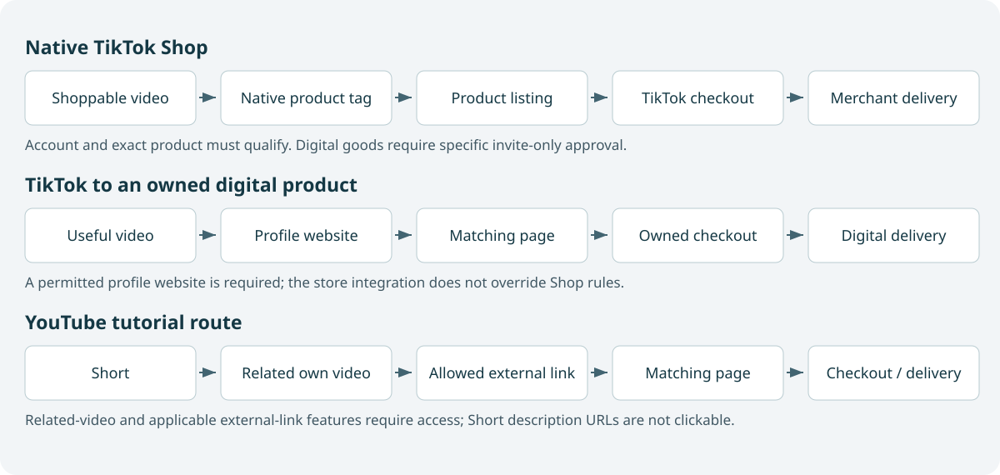

# 4. Affiliate marketing and the TikTok Shop funnel

A viewer watches your demonstration and decides the product might help. What happens next depends on the commercial model. They might tap a native product tag and buy inside TikTok. They might visit your profile, open a comparison page, and follow an affiliate link to a software vendor. They might buy your own ebook. These routes look similar from the creator's camera, but they have different eligibility rules, economics, customer relationships, and measurement limits.

Affiliate marketing means earning compensation for a defined referral or qualifying action under an agreement. The merchant supplies the product and normally controls checkout, fulfillment, support, and refunds. You supply useful discovery or evaluation. A commission is not the same as the customer's full purchase amount, and a tracked order is not always a payable commission.

This chapter teaches the affiliate model first, then works through native TikTok Shop, external affiliate links, product selection, demonstrations, and operations. It uses a United States baseline and sources inspected on November 13, 2026. Platform access can differ by region, account, product category, and pilot program. The examples are planning scenarios, not claims that you or another beginner will earn a specified amount.

## 4.1 Know which business you are operating

A creator affiliate recommends a merchant's product and receives a defined reward. A merchant affiliate program recruits creators to sell the merchant's product. A service creator may be paid a fixed fee to make a video regardless of referrals. A sponsored creator may receive payment for distribution or endorsement. One agreement can combine these arrangements, but each component should be explicit.

For example, a microphone seller might offer you a sample and commission on qualifying purchases. A separate agreement might pay for the video itself or for permission to use it in advertising. Receiving a sample does not necessarily mean the merchant owes a production fee. Earning commission does not automatically give the merchant unlimited rights to your face, footage, or advertising account.

Your own digital product is a different business. If you sell an extension-building ebook, you control the product promise and delivery. If other creators promote it, you become the merchant managing commissions and partner conduct. If you demonstrate another company's tool and link to its subscription, you are the affiliate. Keeping these roles separate prevents confusing revenue reports and customer expectations.

A good starting choice for your background is a small number of developer or creator tools you genuinely use, alongside a narrowly focused educational offer. That is a strategic hypothesis based on your strengths, not proof of existing demand. Broad physical-product promotion is an optional experiment when the product is relevant to the same audience, such as recording equipment used in your tutorials.

## 4.2 A funnel is a sequence of decisions

A marketing funnel describes how a group moves through stages: encountering content, understanding relevance, taking an action, evaluating an offer, purchasing, and receiving value. The term is a model, not a physical object or a requirement to build many pages. A native product tag followed by checkout can be a short funnel. An ebook sample followed by email lessons and a purchase can be a longer one.

Each step should reduce a specific uncertainty. The video establishes the problem and shows evidence. A product page clarifies compatibility, contents, price, and terms. Checkout enables payment. Delivery provides the promised product. Support resolves problems. If a step adds effort without improving understanding or enabling the transaction, question whether it belongs.

A native TikTok Shop route can be summarized as a shoppable demonstration, a product listing, in-app checkout, and merchant fulfillment. An external software affiliate route may require a profile visit, a useful resource page, an approved affiliate link, the merchant's offer, and a qualifying purchase. The second route has more handoffs, but it can support more complex evaluation.

Do not judge routes only by their number of steps. A technical subscription may require a longer demonstration to produce a well-informed customer who stays. Removing explanation can increase clicks while lowering fit. Your task is to reduce unnecessary friction while preserving the information needed for an appropriate decision.

## 4.3 Choose a product by fit and evidence

Begin with the viewer's task. If the audience is learning to make technical videos, a microphone or editing application may fit. A random household item with a high commission may attract a different audience and weaken the channel's coherence. Relevance affects both communication and long-term trust.

Evaluate the product itself. Can you use it or inspect reliable evidence? Can you demonstrate a meaningful benefit in a small frame? What are the limitations, compatibility requirements, ongoing costs, and alternatives? Does the merchant deliver and support it reliably? A high advertised commission cannot compensate for a product you cannot recommend truthfully.

Then evaluate the program. Determine the qualifying event, attribution method, window, excluded customers, return or cancellation treatment, payment schedule, minimum payout, and permitted promotional methods. Check whether the program allows email, paid advertising, trademark bidding, comparison pages, bonuses, and social links. Do not assume a practice is permitted because another creator appears to do it.

Create an offer card with one row for each of these facts and the date checked. If a fact is unknown, keep it unknown rather than filling it with an industry average. You can still draft a demonstration while investigating, but do not publish a compensation claim or build a paid campaign around terms you have not verified.

## 4.4 Calculate commission economics step by step

Suppose a hypothetical physical product costs forty dollars and pays a fifteen-percent commission on the eligible amount. For a qualifying forty-dollar base, the gross commission is six dollars. If ten percent of tracked orders are later reversed under the program's rules, the expected retained commission per initially tracked order is five dollars and forty cents. This is a simplified planning model, not a description of any current program.

Now suppose a video generates twenty thousand views. If one percent produce product-page visits, that is two hundred visits. If four percent of those visits become initially tracked orders, that is eight orders. Eight times six dollars gives forty-eight dollars in gross tracked commission. Applying the assumed reversal rate gives forty-three dollars and twenty cents in expected retained commission.

If producing the video costs thirty dollars in direct expenses and allocated tools, the expected contribution before your labor and other overhead is thirteen dollars and twenty cents. If you also value two hours of work at twenty dollars per hour for planning, the economic result becomes negative. The video may still be useful as a learning project or reusable asset, but the initial commission figure is not profit.

This arithmetic explains why views alone are insufficient. Product fit affects visit and purchase rates. Program terms affect eligible commission. Returns affect settlement. Production efficiency affects cost. The companion's funnel experiment lets you vary these assumptions and see where the result changes. Treat the output as sensitivity analysis, not a prediction engine.

## 4.5 Compare two offers using expected value per relevant visit

Imagine two hypothetical affiliate offers. Offer A pays six dollars per qualifying sale, converts four percent of relevant product-page visits, and retains ninety percent of initially tracked commissions. Its expected retained commission per visit is six times 0.04 times 0.90, or twenty-one point six cents. Offer B pays fifteen dollars, converts one percent, and retains ninety-five percent. Its expected retained commission per visit is fourteen point two five cents.

The larger commission does not automatically produce the stronger result. These calculations still omit production cost, audience fit, attribution loss, payment timing, and customer outcomes. They are useful because they make the relevant relationship visible. If you cannot estimate conversion with evidence, keep a range and test rather than selecting the offer solely from the payout.

Now consider a merchant changing its terms. If Offer A's commission drops to four dollars, expected retained commission per visit becomes fourteen point four cents under the same other assumptions. A previously attractive offer can become marginal without any change in your videos. This is why you should review program terms periodically and avoid building a fragile business around one payout figure.

Do not confuse this visit-based quantity with revenue per thousand video views. The latter also depends on how many viewers reach the product page. A useful demonstration can improve the quality of those visits while attracting fewer total viewers. Keep the stages separate so you can see whether a problem comes from the creative, the route, or the merchant's conversion experience.

## 4.6 Understand attribution and settlement

Attribution is the rule used to decide which referral receives credit. A program may use a tracked link, a product tag, a code, or another approved mechanism. Cookies, device changes, competing referrals, browser restrictions, and purchase timing can affect recognition. The merchant's system, not your expectation, determines the payable record under the agreement.

A pending commission represents a possible payment that may depend on approval, return periods, cancellation, fraud review, or other conditions. A settled commission is closer to money you can rely on, though ordinary payment issues can still exist. Keep pending, approved, reversed, and paid amounts separate in your records.

A coupon code can help some customers and measurement, but codes can be shared outside the intended audience. They can also interact with other attribution rules. Do not count every code use as a person who watched your video. Conversely, a viewer may see the video, search for the merchant later, and buy without creating a tracked referral. Your affiliate dashboard cannot observe every influence.

Maintain a simple ledger of video identifiers, product identifiers, approved links, tracked clicks if available, pending orders, reversals, settled commission, and payments received. Reconcile it periodically with the program dashboard. This gives you a better basis for deciding what to produce than screenshots of a single day's pending revenue.

## 4.7 Native TikTok Shop: verify the gates first

TikTok Shop is native commerce with its own seller, creator, product, and content requirements. The inspected United States creator policy distinguishes affiliate creators, marketing creators bound to a shop, and official shop creators. It lists self-application and a minimum of one thousand followers for affiliate creators, alongside age, location, identity, and account requirements. Bound-account roles have different rules and permissions. Verify your actual in-app eligibility; meeting a follower threshold alone does not guarantee approval. See [S13](../sources.md#s13).

A practical onboarding sequence is to confirm your country and age eligibility, inspect the creator-commerce application available to your account, complete required verification through the platform, and review product access. Do not buy followers or treat a bound account as a shortcut around requirements. Product-category access can also depend on creator performance and account health.

An affiliate creator promotes eligible merchant products. An official shop account is tied to its own seller relationship. These are not interchangeable. If your purpose is recommending other sellers' products, check the affiliate path. If your purpose is selling your own goods, check seller eligibility and the correct account relationship.

Record what your account actually exposes. Generic tutorials may show another region, an older interface, or an account with different permissions. If a product-tag option is absent, investigate eligibility and product approval rather than adding a misleading graphic that looks like a real tag. The route must function for the viewer, not merely resemble a tutorial screenshot.

## 4.8 Build the native product funnel

Choose one eligible product and inspect its listing. Confirm the exact variant you will demonstrate, price, shipping conditions, compatibility, merchant identity, and return information available to buyers. Order or obtain a legitimate sample when practical. Use the product enough to identify an honest demonstration and a meaningful limitation.

Create a video brief around a task: a desk recording with distracting echo, a phone stand that makes overhead filming possible, or a tool that organizes cables. Show the starting problem, demonstrate the product under a fair condition, reveal the result, and state the relevant boundary. Add the approved product tag through the actual platform workflow before publication.

The call to action should point to the native destination you configured: inspect the tagged product and its current terms. Do not promise that the price or promotion will remain unchanged. A clean demonstration helps the viewer recognize whether the listing matches the product shown. If the listing changes materially, reassess the content and link.

After publication, monitor both content response and commerce outcomes available to your account. Questions about compatibility may suggest missing information. High clicks with poor purchases may indicate listing or offer problems. Purchases followed by complaints may indicate product or expectation problems. The funnel continues through fulfillment; a sale that disappoints the customer is not a successful recommendation.

## 4.9 TikTok Shop and digital goods require a specific distinction

The current United States prohibited-products policy does not support a blanket statement that all digital goods are always banned. It prohibits virtual or digital products unless approved under the Virtual Goods category. The separate virtual-goods policy inspected for this guide makes that category invite-only and describes permitted types with additional conditions. This is a restricted route, not general permission to list any ebook or subscription. See [S14](../sources.md#s14)–[S15](../sources.md#s15).

For your initial ebook or SaaS, use an owned external funnel unless your seller account and exact product have the required approval. A software category appearing in a policy does not establish that a recurring SaaS plan, a course, or your particular ebook is eligible. Confirm the actual product type, approval, fulfillment method, and current seller rules before planning native commerce.

Do not disguise a digital download as a shipped object or create a fake tracking number. Do not assume that connecting Shopify makes a restricted product eligible. The store integration connects systems; it does not override TikTok Shop's catalog rules. Your product and account still need to qualify.

This distinction changes the strategy. A physical-product affiliate video can use a native tag when eligible. A digital teaching product can use a permitted profile website route to your own page. An approved virtual-goods seller may have another option, but that should be treated as an account-specific opportunity rather than the foundation of a beginner's plan.

## 4.10 External affiliate funnels from TikTok

For a software tool or an offer outside TikTok Shop, the viewer may need to visit your profile and follow a website link. The inspected account guidance states that personal accounts with at least one thousand followers can post a website link. Business and regional eligibility can differ; verify the actual field available to your account rather than assuming any account switch guarantees access. See [S16](../sources.md#s16).

The simplest useful external route is a focused page that continues the video. A video about caption correction can lead to a captioning workflow page with examples, limitations, and an appropriately disclosed affiliate link to the relevant tool. A generic page with twenty unrelated offers creates additional decisions and can weaken the relationship between the video and the product.

Your page should add value beyond a redirect when the program requires a substantive destination or the buyer needs comparison. Explain the task, show your own result, identify who the tool fits, and provide alternatives where helpful. Check the program's rules before using redirects, link shorteners, discounts, or paid traffic.

If your account lacks a clickable website route, keep building useful content and investigate legitimate eligibility. A memorable domain can be mentioned when appropriate, but it adds manual effort and is not equivalent to a clickable link. Do not use spam comments or repeated unsolicited messages as a substitute. You can also prioritize YouTube's configured profile route while the TikTok account develops.

## 4.11 Disclose the relationship where it matters

For United States viewers, FTC guidance calls for material relationships to be clear and hard to miss. Put an understandable disclosure with the endorsement, not only on a profile or hidden page. For video, a visible and spoken disclosure is a practical implementation. “I may earn a commission if you buy through this link” explains the relationship; gifted products and sponsorships also matter. See [S17](../sources.md#s17).

TikTok separately requires its content-disclosure setting for promotional content, including your own business. Use the applicable platform setting and clear language; a platform label is not a reason to omit needed context. See [S20](../sources.md#s20). YouTube also provides branded-content declarations where applicable; review the current upload setting for your arrangement.

Integrate disclosure naturally before or alongside the recommendation. For example: “This microphone was supplied for review, and the tagged purchase can earn me a commission. Here is the same recording at two distances.” The rest of the video should remain a fair demonstration. Disclosure does not make an unsupported performance claim acceptable.

For your own ebook, make ownership obvious: “This is my extension-building guide.” For an affiliate tool used inside that guide, identify that relationship at the point of recommendation. Readers should understand which product you sell and which referral may compensate you. Clear relationships help them evaluate the recommendation on its merits.

## 4.12 An affiliate demonstration that helps the right buyer

Suppose you make a video about a compact microphone for desk tutorials. Begin with the actual noisy or distant recording problem, then establish test conditions. Use the same sentence, a consistent room, and a stated distance. Show the microphone and connection setup so viewers can judge compatibility with their own devices.

Present the result without processing that changes the claimed comparison. If you apply enhancement, say so and distinguish raw from processed samples. A product review that quietly applies AI repair to only one microphone misrepresents the evidence. The production techniques from Chapters 2 and 3 should make the comparison clearer rather than artificially favoring the affiliate product.

Include one relevant limitation. It might require an adapter, pick up clothing noise, or be unnecessary for someone whose current microphone already sounds clear. This helps the appropriate buyer self-select. It also gives your content a useful distinction from a product listing that only enumerates benefits.

End with the actual route and a reminder to check current compatibility and terms. Measure questions, product-page visits, retained commissions, and customer feedback where available. A video can be commercially successful with modest views if it reaches people with the right task. Conversely, a spectacularly popular comparison can produce little commission if the audience has no buying intent.

## 4.13 A software affiliate funnel for your teaching channel

Choose a tool that appears naturally in a real workflow: recording, editing, documentation, or a developer utility. Teach a small result first. A video might show how to correct technical captions and preserve a code identifier. The continuation could be a longer walkthrough and an independent resource page comparing the manual and assisted workflows.

Apply to the program only through its official route and inspect approval conditions. Descript's public affiliate terms, [S21](../sources.md#s21), illustrate why this matters: they discuss approved channels, qualifying purchases, attribution, and promotional restrictions. The page carries an older stated update date while containing program-specific language, so use the live agreement and dashboard as the operational authority. This guide does not promise a commission rate or recurring payout.

On your resource page, show the actual workflow, explain who benefits, identify limitations, and disclose the affiliate relationship near the recommendation. Use only approved links. Do not invent a coupon or promise a bonus if the program disallows incentives. If you later add a paid campaign, recheck whether that traffic method is permitted.

Treat the content as durable evaluation material. A useful comparison can continue helping viewers even if the affiliate arrangement ends. Keep a process for replacing dead links and updating changed capabilities. Your audience relationship should be stronger than your dependence on one merchant's compensation terms.

## 4.14 Learn from documented funnels without copying outcomes

TikTok's Finn case study, [S22](../sources.md#s22), describes a merchant using affiliate creators, shoppable content, and paid amplification leading to product listings and native purchases. The transferable structure is creator demonstration followed by a direct commerce path, with paid distribution extending selected content. It is a publisher's selected success story, not an independent controlled experiment or a forecast for a new creator.

Shopify's historical SendAFriend interview, [S23](../sources.md#s23), describes product experience, unboxing-style creative, creator content, repeated variations, and paid acquisition. It predates the current TikTok Shop landscape. Use it to understand how a visible product experience can supply creative material for an owned-store business, not as evidence of today's account rules or a purely organic path to the reported scale.

These cases share a pattern: the content makes the product experience concrete, and the commercial destination continues that experience. Your ebook equivalent is showing a real sample lesson and a finished project. Your SaaS equivalent is showing an actual task completed. The emotional or practical benefit should be observable rather than replaced by a generic sales claim.

Do not copy a brand's reported return on ad spend into your own budget. The public case may omit costs, attribution details, existing audience, merchant operations, and failed creative. Learn the architecture and questions to ask. Build your own economics from your own settled results.

## 4.15 Shopify-connected TikTok Shop versus an external Shopify store

A Shopify merchant can connect eligible products and operations to TikTok Shop through the relevant sales channel. The inspected Shopify guidance describes product synchronization and managing orders while customers purchase on TikTok. That is different from a video sending someone to a Shopify website for checkout. See [S24](../sources.md#s24)–[S25](../sources.md#s25).

In the native route, TikTok Shop's catalog, checkout, and commerce rules govern the platform transaction, and the integration helps synchronize operations. In the external route, your website handles the product page and checkout experience, subject to applicable platform, payment, and legal requirements. Do not describe these as one interchangeable funnel just because Shopify appears in both.

For an eligible physical product you own, native commerce may reduce handoffs. For an ebook or SaaS that lacks native virtual-goods approval, an external owned page is the practical starting route. Connecting a catalog is not a workaround for product restrictions. Keep the channel eligibility of each product explicit in your store setup.

If you later operate both routes, compare their full customer economics. Native conversion may be easier while customer communication, fees, returns, or data access differ. External checkout may provide more control but require more explanation and clicks. Choose based on product fit, operational capacity, and measured contribution rather than the appeal of a shorter diagram.

## 4.16 Recruit affiliates for your own digital offer

Once your ebook has a reliable product page, fulfillment process, and evidence of customer fit, other creators may become a distribution channel. You now act as the merchant. Define the product, commission base, excluded transactions, refund treatment, attribution, payment timing, approved claims, and usage rights. Do not ask partners to make earnings or learning guarantees you cannot support.

Choose creators whose audience faces the specific problem. A small JavaScript teaching channel may be more appropriate for an extension guide than a broad technology entertainment account. Give the creator a real review copy, a sample lesson, the prerequisites, and a clear description of who should not buy. Let the demonstration reflect their actual experience while keeping factual boundaries explicit.

Shopify Collabs is one possible management tool. Its merchant documentation, [S34](../sources.md#s34), describes recruitment, links, and creator payments. The inspected creator Discover page, [S35](../sources.md#s35), says open new creator signups are currently closed while merchant invitations and applications can still operate. Therefore, do not build your recruitment plan around every partner simply joining a public marketplace today. Check merchant-plan eligibility and the current invitation workflow.

Begin with a small pilot relationship and manually review the customer experience before increasing volume. Track not only attributed orders but refunds, support issues, and whether the partner's promise matches the product. A partner who generates many poor-fit customers can create more cost than value. You are responsible for the offer and for appropriately managing the program you operate.

## 4.17 Samples, partnerships, and usage rights

When asking a merchant for a sample, describe your audience, the intended demonstration, and the scope you can actually deliver. Do not promise sales. Explain whether the arrangement is sample-only, commission-based, paid production, or a combination. Keep the agreement in writing so both parties understand expectations.

Separate content ownership from permission to use it. A merchant may want to repost the video, edit it, run it as an ad, or use your likeness in different placements. Define duration, platforms, geographic scope, approval, and payment when those rights matter. Affiliate commission alone should not be assumed to settle all of these questions.

Check who can change the product claim. A merchant's suggested script may contain language you cannot verify. Ask for evidence or revise it to match your demonstration. You remain responsible for what you say to your audience. A request to omit a material limitation or hide the relationship is a reason to decline or renegotiate the brief.

Track samples and paid costs as part of operations. A free product still requires time to evaluate and may create a disclosure obligation. If your channel begins accepting many samples, protect production time by choosing those that serve the same audience. A stack of unrelated free items can turn a focused teaching channel into an unfocused review obligation.

## 4.18 Common funnel failures and their likely causes

If people watch but do not visit the product, investigate relevance, demonstrated value, and the next-step instruction. A video can be entertaining without creating a reason to evaluate the product. Inspect whether the product appears as a useful solution or merely as a prop in the story.

If people visit but do not buy, inspect price, listing clarity, compatibility, shipping, trust, and whether the video created the right expectation. Do not immediately rewrite the opening. The failure occurs later in the route and may have little to do with the first three seconds. If the merchant controls the page, your options may be improved expectation-setting, feedback to the merchant, or choosing a different offer.

If purchases reverse, investigate the reason where available. Returns may indicate poor fit, fulfillment issues, misleading claims, or normal customer behavior. Compare settled results across comparable periods. A creator who optimizes pending commission can accidentally favor products with high cancellation rates.

If a link or tag disappears, check product availability, account status, eligibility, and policy changes. Keep a record of the approved route and review it periodically. The best creative cannot convert through a broken destination. Operational maintenance is part of affiliate marketing, not an administrative task to postpone indefinitely.

## 4.19 A complete review record before publication

For each affiliate video, preserve a short evidence record. Identify the product version, exact listing, test conditions, observed benefit, limitation, compensation arrangement, approved destination, and terms-check date. This is not a public legal document; it is a practical way to keep your own claims accurate as offers change.

Suppose a phone stand appears stable in your demo. Record the phone model or weight range you tested, the surface, and the relevant orientation. Do not silently extend that observation to every tablet or device. Suppose an editing tool generated captions correctly in your sample. Record the language and technical vocabulary used, and do not transform that result into a universal accuracy claim.

Before publishing, compare the script and captions with the record. If the script says the product works on every browser but you tested one, narrow the statement or gather the required evidence. If the merchant changed the listing, confirm that the product shown still matches it. A few minutes of focused review can prevent a video from sending many viewers toward an inaccurate expectation.

After publication, add meaningful changes to the record: a discontinued product, revised feature, repeated customer complaint, or changed compensation terms. You cannot revise every historical impression, but you can update available links, add an appropriate correction, or stop directing new traffic to an unsuitable offer. Maintenance protects both viewers and the value of your channel.

## 4.20 Check the merchant experience before committing a series

A creator cannot control every merchant operation, but can inspect the buyer experience before recommending it. Read the current listing carefully, verify the product identity, and test the support route with a legitimate question when needed. Look for a clear explanation of compatibility, delivery, and returns. Treat unresolved ambiguity as a reason for more investigation, not as a detail the video can ignore.

For a physical product, your own sample reveals only one delivery experience. It does not establish that every buyer receives the same quality or timing. Use appropriately qualified language and monitor patterns in credible feedback. For software, test the setup and cancellation information relevant to the offer. A polished homepage does not demonstrate that onboarding or billing is understandable.

Decide in advance what would make you stop recommending the product: a materially misleading listing, repeated unresolved customer problems, an unsupported claim request, or economics that no longer justify the work. This prevents the effort already spent on a series from becoming a reason to continue a poor recommendation. Your channel is an ongoing relationship with viewers, while an individual affiliate offer is replaceable. Protect the former when the two conflict.

## 4.21 Your first affiliate experiment

Choose one relevant product you can evaluate honestly. Complete its offer card, record a fair demonstration, and configure the approved route. Produce three different videos that answer different buyer questions: the task it improves, a practical comparison, and a limitation or fit decision. These are distinct useful pieces, not identical uploads with minor cosmetic changes.

Use a modest predefined production budget and a review period appropriate to the program's attribution and settlement timing. Record views, destination activity where observable, tracked orders, reversals, and settled commission. Keep observations and hypotheses separate. If there are few visits, you have limited evidence about purchase conversion.

At the review, decide whether to improve the explanation, change the offer, improve the destination, or stop. Do not scale paid traffic because one video generated pending orders. Confirm promotion permissions and contribution first. The purpose of the first experiment is to learn whether your audience, demonstration, product, and route fit together.

The next chapter applies the same reasoning to products you own. You will gain more control over the promise, price, delivery, and customer relationship, along with responsibility for making the entire experience work. Your craft advantage remains the same: show something real and explain it clearly.
