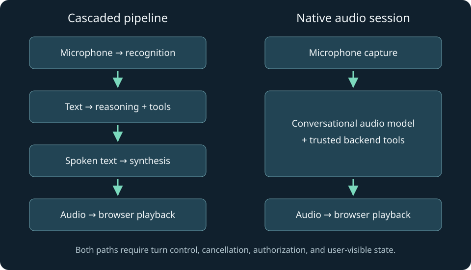

# Voice Agent Engineering

A first-principles journey from audio samples to useful conversations in Python and TypeScript

<a id="preface"></a>
## Preface

This is a practical, first-principles textbook for a developer who wants to understand voice agents well enough to build, debug, and evaluate one. It assumes basic programming, then teaches audio, asynchronous streams, browser media, model protocols, tools, and interaction design in dependency order. Python and TypeScript examples share the same underlying contracts.

Read chapters in order for the complete course. Each chapter is also a standalone Markdown lesson. The curriculum in `CURRICULUM.md` maps outcomes, prerequisites, examples, and experiments. Practice projects are optional; there are no quiz gates. All referenced application data is synthetic.

Parts I–II establish the signal and software boundaries, then build both cascaded and native audio paths. Part III examines speech platforms and self-hosted models. Part IV connects timing, trustworthy actions, accessible UX, and production evidence. These parts deliberately reuse Harbor, a fictional appointment assistant, so each new responsibility extends a familiar problem.

The local companion runs eight deterministic experiments without microphone access or provider accounts. Separate network examples require credentials and can incur charges. Provider interfaces were researched against primary documentation on November 12, 2026; live paid calls and model inference were not executed. Read `verification.md` for the evidence and limits.

Units are explicit: milliseconds for application timing, hertz for sample rates, mono signed little-endian PCM16 when stated, and opaque identifiers for sessions and operations. An integration fragment is labeled as such. A simulator is never presented as a model benchmark. A capstone project is guidance for extending the package, not a claim of a provisioned production service.


<a id="contents"></a>
## Contents

- [Chapter 1: What a voice agent actually does](#chapter-01)
- [Chapter 2: From air pressure to browser audio](#chapter-02)
- [Chapter 3: Streams, transports, and resource ownership](#chapter-03)
- [Chapter 4: Build a speech-to-text, reasoning, and text-to-speech pipeline](#chapter-04)
- [Chapter 5: A native OpenAI Realtime web application](#chapter-05)
- [Chapter 6: Gemini Live and explicit PCM streaming](#chapter-06)
- [Chapter 7: Cartesia, ElevenLabs, and managed agent platforms](#chapter-07)
- [Chapter 8: Open models, Fish Speech, and self-hosting](#chapter-08)
- [Chapter 9: Turn-taking, interruption, and what the user heard](#chapter-09)
- [Chapter 10: Tools, grounding, memory, and trustworthy actions](#chapter-10)
- [Chapter 11: Design a voice experience people can control](#chapter-11)
- [Chapter 12: Evaluate, operate, and extend the complete system](#chapter-12)
- [Complete source listings](#source-appendix)
- [Research and references](#references)

# I. The signal and the software

A voice application becomes easier to reason about when we separate the signal from the software moving it. We begin with architectures, then inspect samples and browser media, and finally give asynchronous work explicit ownership.


<a id="chapter-01"></a>
## Chapter 1: What a voice agent actually does

### In this chapter

- [Start with the observable task](#chapter-01-section-1)
- [Two architectures to understand before choosing a vendor](#chapter-01-section-2)
- [A researched map of the landscape](#chapter-01-section-3)
- [Trace one request through each architecture](#chapter-01-section-4)
- [Latency is a path, not a provider slogan](#chapter-01-section-5)
- [Build an adapter around behavior, not brand names](#chapter-01-section-6)
- [Choose with a task-specific evaluation](#chapter-01-section-7)
- [Follow the software through the book](#chapter-01-section-8)


A user says, “Find me an appointment tomorrow afternoon.” A convincing demonstration can play a fluent answer within a moment. A useful application has a harder job: identify what tomorrow means, inspect real availability, let the user change their mind, obtain any necessary confirmation, and tell the truth about whether the appointment exists. Speech makes this work feel conversational, but does not remove the software engineering underneath it.

This book builds that understanding in small steps. We will use a fictional appointment assistant called Harbor. Its data is synthetic. The name is a recurring example, not a delivered medical or scheduling product. Harbor can discuss available slots, propose one, and explain a receipt. The included provider voice demo deliberately has no booking integration. Later, a local transaction exercise demonstrates how such an integration should be controlled.

You need basic familiarity with functions, strings, lists or arrays, and running a program. The chapters teach the asynchronous programming, audio representation, browser lifecycle, and distributed-system ideas at the point they become necessary. Python and TypeScript are both first-class languages throughout the materials. We use Python for clear backend and signal-processing examples, TypeScript for typed event handling and Node servers, and browser JavaScript where a dependency-free browser implementation makes the mechanics easier to inspect.

<a id="chapter-01-section-1"></a>
### Start with the observable task

A voice application receives more than words. It receives microphone samples, silences, incomplete thoughts, interruptions, and device failures. Its output also has a duration. A sentence may already exist in a model response while the speaker is still playing the first few words. That gap between generated content and heard content explains many of the mistakes we will study.

Imagine Harbor says, “I found Tuesday at three, and I have booked it for you.” The user interrupts after “three.” There are at least three separate questions. Was there a real three o'clock slot? Had the booking transaction already committed? Did the user hear the claim that it was booked? A single chat history containing the full sentence cannot answer all three. A good voice-agent design keeps conversational state, audio playback state, and business state distinguishable.

We will use five terms consistently. **Capture** obtains audio from a microphone or file. **Recognition** converts speech into text, often called speech-to-text or STT. **Reasoning** selects the response or proposes a tool action. **Synthesis** converts intended speech into audio, often called text-to-speech or TTS. **Playback** schedules that audio on a user's device. A native audio model can combine recognition, reasoning, and synthesis internally, but capture and playback remain your application's responsibilities.

A tool is an ordinary program that performs a narrow task on behalf of an agent. A calendar lookup is a tool. A booking operation is another tool, with different authority and consequences. A model's request to call a tool is proposed input to software; it is not proof that the action should be authorized. This distinction applies equally to text agents and voice agents, but spoken fluency makes it particularly easy to overlook.

<a id="chapter-01-section-2"></a>
### Two architectures to understand before choosing a vendor

A **cascaded pipeline** connects STT, a language model, and TTS. Audio becomes text, text becomes an answer or a tool request, and the answer becomes speech. The stages may come from different providers. For example, an application might use a local recognizer, a hosted language model, and Cartesia or ElevenLabs synthesis. The important property is the explicit text boundary between the stages, not the company names.

A **native speech-to-speech system** accepts audio and generates audio within a conversational model session. OpenAI Realtime and Gemini Live are examples of this product category. Native audio can retain useful vocal information that a transcript omits. It can also simplify the number of services you operate. It does not automatically provide a complete web application, authorized business tools, reliable reconnects, or a user interface that communicates what is happening.

| Decision | Cascaded pipeline | Native audio session |
| --- | --- | --- |
| Inspect intended wording | Explicit text is usually available before synthesis | Output transcripts may be available; timing and semantics are provider-specific |
| Replace one speech component | Often straightforward through an adapter | Usually tied to the native model's session and audio behavior |
| Preserve vocal nuance | Text boundaries discard some information | The model can receive audio directly |
| Tune each stage | More independent controls | Fewer exposed internal boundaries |
| Operational burden | More services and cancellation boundaries | More dependence on one session protocol |
| Business authorization | Your backend must enforce it | Your backend must enforce it |

Neither column implies a universal latency winner. A well-tuned cascade with early recognition and carefully buffered synthesis can outperform a poorly connected native session. A native session can avoid multiple stage boundaries. The useful question is which system meets your task, device, language, and operational requirements under measurement.

A managed agent platform adds another layer. It may host conversation configuration, knowledge retrieval, tools, monitoring, and speech components. That is different from a TTS API. Buying excellent speech generation does not mean you have bought all the behavior of a conversational agent. Conversely, using a managed platform does not mean you must surrender every UI decision. Identify precisely which layer you want to own.



<a id="chapter-01-section-3"></a>
### A researched map of the landscape

The research snapshot for this edition is November 12, 2026. Read `research.md` and `sources.json` for the inspected pages, access limitations, and migration notes. Product names, model identifiers, and SDK interfaces change. Architectural reasoning is more stable than a “latest model” label.

**OpenAI Realtime** provides stateful conversational audio with WebRTC and WebSocket integration paths. This book's executable browser sample intentionally uses the documented Realtime GA `/v1/realtime/calls` protocol. Current documentation also contains newer Live examples. Their session and event schemas must not be mixed. The API reference, rather than a renamed guide heading, determines the sample's protocol. See [the Realtime call reference](https://developers.openai.com/api/reference/resources/realtime/subresources/calls/methods/create).

**Gemini Live** is another native audio path. Its official WebSocket reference documents bidirectional messages, session setup, and activity handling. The examples here show a server-side file turn in both languages and explain the additional capture, buffering, and playback work needed for a browser. Direct browser access calls for a supported ephemeral credential flow rather than embedding a permanent key. See [the Live reference](https://ai.google.dev/api/live) and [ephemeral tokens](https://ai.google.dev/gemini-api/docs/live-api/ephemeral-tokens).

**Cartesia** offers speech components and agent-related products. Sonic is a synthesis model family; a TTS request alone is not a reasoning agent. The inspected Bytes endpoint uses a dated API version and a voice identifier. We use that relatively small interface to teach an interchangeable synthesis adapter. Streaming text requires a separate streaming interface and cancellation policy. See [the Bytes reference](https://docs.cartesia.ai/api-reference/tts/bytes).

**ElevenLabs** likewise has both speech generation and a managed agents offering. Those paths have different integration responsibilities. The included code generates speech through its HTTP API. The managed-agent chapter explains hosted configuration, server-issued authorization, client controls, and the current React documentation rather than assuming that every historical hook example still applies. See [speech creation](https://elevenlabs.io/docs/api-reference/text-to-speech/convert) and [the React agent library](https://elevenlabs.io/docs/eleven-agents/libraries/react).

**Fish Audio and Fish Speech** need careful naming. A hosted Fish API model, a downloadable checkpoint, and an inference repository are distinct artifacts. The inspected S2-Pro model card identifies a research license, while the repository's current license describes a different community agreement. This edition therefore makes no blanket commercial-permission claim for all Fish artifacts. Inspect the exact checkpoint and its terms before choosing a deployment. See [the model card](https://huggingface.co/fishaudio/s2-pro/blob/main/README.md) and [repository license](https://github.com/fishaudio/fish-speech/blob/main/LICENSE).

**Open components and frameworks** fill other layers. Whisper is a recognition project; Kokoro is a TTS model; neither alone is a complete agent. LiveKit Agents and Pipecat address orchestration and transport concerns. Their value includes handling recurring lifecycle and media problems, not replacing the need to understand those problems. The later chapters show how to evaluate whether a framework's defaults match your product.

<a id="chapter-01-section-4"></a>
### Trace one request through each architecture

In a cascade, Harbor captures the user's utterance as audio frames. The recognizer emits “tomorrow afternoon,” perhaps first as an interim hypothesis and later as a committed transcript. The language model receives that text and a narrow set of tools. A tool resolves the user's timezone and returns actual availability. The language model proposes a short spoken response. TTS produces samples, and the browser plays them.

Each arrow has its own failure modes. Audio can be captured at the wrong rate. Recognition can revise a word. A lookup can time out. The language model can produce a response that is too long for speech. Synthesis can return MP3 when the player expects PCM. Playback can be blocked until the user interacts with the page. Thinking in stages gives you a debugging map instead of a vague complaint that “the model is slow.”

In a native audio session, captured audio travels to the conversational model. The model may send transcript events, speech output, and function-call events over different logical paths. A WebRTC connection typically carries audio on media tracks and application events on a data channel. Your backend still validates any tool action. The browser still owns microphone cleanup and visible controls. Integration is smaller in some places and more session-specific in others.

Consider a repair. The user first says “Tuesday,” then says “Sorry, Wednesday.” In a cascade, you must decide whether the first transcript triggered a lookup and whether to cancel or supersede it. In a native session, the model may hear the correction naturally, but your application must still prevent a late Tuesday lookup from overwriting the current Wednesday proposal. The solution is not a better greeting prompt; it is explicit identity and freshness for asynchronous work.

<a id="chapter-01-section-5"></a>
### Latency is a path, not a provider slogan

Define a time origin before discussing speed. Let the user's last meaningful speech sample occur at time zero. Suppose endpoint detection waits 400 milliseconds, recognition finalization takes 120 more, reasoning takes 250, synthesis needs 160 to produce usable audio, and playback buffering adds 70. In a strictly sequential toy pipeline, the first audible reply arrives at 1,000 milliseconds. The sum is 400 + 120 + 250 + 160 + 70.

Real pipelines overlap some work. Recognition may run while the user speaks. Reasoning may start speculatively, and synthesis may begin before the full answer exists. That changes the dependency path. You cannot subtract every advertised streaming latency from the total and assume the result is meaningful. Measure timestamps at the actual boundaries and identify which stages block the first audible response.

A second metric is interruption latency: how long between the user's attempt to interrupt and the old voice becoming silent. A system can have excellent first-response latency and terrible interruption behavior because it has queued several seconds of audio. Another metric is task completion time. A fast but ambiguous answer that causes three repair turns may be worse than a slightly slower answer that makes the next step clear.

The companion's latency experiment lets you vary a simple serial budget. It is explicitly a teaching model, not a provider benchmark. Use it to see why reducing synthesis startup by 30 milliseconds has little effect when endpointing adds 900 milliseconds. Later, replace its inputs with measurements from your own application.

<a id="chapter-01-section-6"></a>
### Build an adapter around behavior, not brand names

An adapter is a small interface that hides a provider's wire format from the rest of your application. A synthesis adapter might accept text and a cancellation signal and produce tagged audio chunks. The rest of the system should not need to know whether the vendor names its text field `text` or `transcript`.

Do not make the interface so generic that it lies. Some providers support streaming input, some only streaming output, and some return a complete file. Some return raw samples, others compressed containers. Record these capabilities explicitly. An adapter that silently accumulates an entire response and then calls itself realtime makes performance debugging much harder.

Here is an intentionally small TypeScript contract. It is an integration fragment, not a callable provider implementation:

```typescript
type AudioChunk = {
  responseId: string;
  epoch: number;
  bytes: Uint8Array;
  sampleRate: number;
  encoding: 'pcm16le';
};
type Synthesizer = {
  speak(text: string, signal: AbortSignal): AsyncIterable<AudioChunk>;
};
```

`responseId` says which response produced the data. `epoch` identifies the currently accepted playback generation. `bytes` contains audio, while `sampleRate` and `encoding` say how to interpret it. `AbortSignal` requests cancellation; it does not guarantee that all already-buffered data disappears. That is why the receiving player also checks the epoch. Chapter 3 introduces asynchronous iteration, and chapter 9 applies the cancellation model to interruptions.

Python can express the same responsibility with an asynchronous generator. The exact annotation matters less than the contract: the producer yields chunks, the consumer can stop accepting them, and both sides release owned resources. This shared behavioral model lets you move between the languages without treating each SDK as a completely new subject.

<a id="chapter-01-section-7"></a>
### Choose with a task-specific evaluation

A sensible provider comparison begins with representative utterances. Include your product names, accents, languages, background conditions, common corrections, and the longest acceptable response. Use the same task and device setup across candidates. If a system is configured with a slower but more expressive voice, record that choice rather than comparing it to another system's low-latency setting as though the settings were equivalent.

Measure at least intelligibility, task accuracy, first-audio latency, interruption latency, repair frequency, and operational cost. Voice preference matters, but a pleasant voice cannot compensate for repeated errors in dates or quantities. A native model's conversational style also needs evaluation: does it stay concise, follow the requested language, and acknowledge uncertainty without rambling?

Score constraints before preferences. If a product requires a particular deployment region, an unsupported candidate is eliminated regardless of voice quality. If the app needs an offline mode, a hosted-only service cannot satisfy that mode. If the team cannot operate GPU inference, a theoretically inexpensive checkpoint may have a high practical ownership cost. These are engineering choices, not judgments about which provider is universally best.

For a developer building an initial web product, a direct native-audio demo is a useful way to understand the interaction. A cascade is useful when you need explicit text controls or interchangeable speech components. A managed agent platform is useful when its hosted workflow fits the product. A self-hosted component is useful when measured control, economics, or deployment requirements justify the added operation. These are starting hypotheses to test, not recommendations backed by an invented leaderboard.

<a id="chapter-01-section-8"></a>
### Follow the software through the book

Run `python examples/python/core.py` from the extracted project root. It creates a quiet synthetic tone, prints a deterministic endpoint result, and streams four mock text chunks through a bounded queue. This program is deliberately not a speech recognizer. It isolates audio representation and scheduling so that later provider behavior has something concrete to attach to.

Then run `node companion/server.mjs` and open the printed localhost URL. The companion contains calculators and deterministic simulations. It makes no paid model calls and asks for no microphone permission. The separate Realtime browser example does use a microphone and a paid provider when configured. Keeping those execution modes visible prevents a local simulator from being mistaken for a functioning hosted model integration.

The sequence now moves from the system to the signal. Before connecting a microphone to any model, we need to know what an audio sample means, how a frame gets its duration, why a WAV header is not speech, and how the browser decides whether it may capture and play sound. Those foundations make the rest of the implementation much less mysterious.

[Back to contents](#contents)

---


<a id="chapter-02"></a>
## Chapter 2: From air pressure to browser audio

### In this chapter

- [A sample is a measurement at one time](#chapter-02-section-1)
- [Understand PCM16 before writing any networking code](#chapter-02-section-2)
- [Calculate frame duration and bandwidth](#chapter-02-section-3)
- [Containers, codecs, and raw samples are different](#chapter-02-section-4)
- [Why changing a number is not resampling](#chapter-02-section-5)
- [Make browser capture a user-controlled lifecycle](#chapter-02-section-6)
- [Playback is a scheduler](#chapter-02-section-7)
- [Worklets and real-time boundaries](#chapter-02-section-8)
- [A practical audio diagnosis sequence](#chapter-02-section-9)


The first audio bug many developers encounter sounds like a model failure: the voice is too fast, too slow, distorted, or silent. Frequently the model is fine. The application interpreted the bytes using the wrong sample rate, treated compressed audio as raw samples, or scheduled playback in a suspended audio context. To diagnose these problems, we need a precise but practical account of digital audio.

This chapter assumes only arithmetic and basic arrays. We will turn a short list of numbers into a sound, calculate how much data a voice stream needs, and connect those ideas to browser APIs. The runnable files `examples/python/core.py` and `examples/typescript/core.ts` create the same kind of tone. The companion's PCM experiment calculates frame sizes and displays a synthetic waveform. It does not record your voice or perform speech recognition.

<a id="chapter-02-section-1"></a>
### A sample is a measurement at one time

A microphone converts changing air pressure into an electrical signal. An audio device measures that signal repeatedly. Each measurement is a sample. A digital mono recording is an ordered sequence of samples plus information describing how quickly to play them. The samples alone do not tell a player how much time they represent.

The sample rate is measured in samples per second, usually written hertz or Hz. At 16,000 Hz, the device produces 16,000 samples every second for one channel. If you have 8,000 samples at that rate, you have half a second. The relationship is duration = sample count / sample rate. Substituting the values gives 8,000 / 16,000 = 0.5 seconds.

A channel is an independent stream of samples. Mono has one channel; stereo typically has left and right channels. Speech-model interfaces often request mono because a single conversational voice does not require stereo spatial information. A stereo capture cannot be made mono by declaring it to be mono. You must select a channel or combine channels according to a deliberate policy.

A sample's magnitude represents the measured signal amplitude, not a word or a phoneme. In floating-point browser audio, values commonly use a normalized range around minus one to plus one. Silence is near zero. Negative values are ordinary oscillations, not errors. A waveform alternates around zero as pressure changes. A constant positive value is not a constant musical tone; its transitions may produce clicks, and a sustained offset is not useful speech.

<a id="chapter-02-section-2"></a>
### Understand PCM16 before writing any networking code

PCM means pulse-code modulation. In the common signed 16-bit form, each sample occupies two bytes and represents an integer from minus 32,768 through plus 32,767. Little-endian means the less significant byte comes first. Endianness is a byte-order convention. It is unrelated to whether speech is spoken quickly or slowly.

Suppose a normalized sample is 0.25. Multiplying by 32,767 gives 8,191.75. Rounding produces 8,192. In hexadecimal that is `0x2000`, represented in little-endian bytes as `00 20`. A player reading the opposite order interprets a very different integer. Repeated across thousands of samples, that error can sound like harsh noise.

The example conversion clamps values into the allowed normalized interval before quantization. Clamping means replacing values above one with one and values below minus one with minus one. It prevents integer overflow during encoding. It does not repair a recording that was already clipped during capture; the lost waveform detail cannot be reconstructed by lowering the volume afterward.

Here is a complete Python experiment that can run without any dependencies:

```python
import struct

samples = [0.0, 0.25, -0.25, 1.0, -1.0]
encoded = b''.join(
    struct.pack('<h', round(max(-1, min(1, sample)) * 32767))
    for sample in samples
)
print(len(encoded))
print(struct.unpack('<5h', encoded))
```

The first output is `10`, because five samples use two bytes each. The second output contains the five quantized signed integers. The `<` selects little-endian byte order, `h` selects a signed short integer, and `5h` decodes five of them. The negative full-scale sample maps to minus 32,767 in this symmetric teaching conversion. Using minus 32,768 for that extreme is another valid conversion convention; be consistent when comparing exact bytes.

In TypeScript, a `DataView` gives explicit control over the byte order. A typed array alone uses the platform's native layout, which is less explicit when you are teaching a wire format. The following is a runnable Node fragment when saved as a `.ts` file under Node 24:

```typescript
const values = [0, 0.25, -0.25, 1, -1];
const bytes = new ArrayBuffer(values.length * 2);
const view = new DataView(bytes);
values.forEach((value, index) => {
  const clipped = Math.max(-1, Math.min(1, value));
  view.setInt16(index * 2, Math.round(clipped * 32767), true);
});
console.log(bytes.byteLength);
console.log(view.getInt16(2, true));
```

The `true` argument selects little-endian. The second output is 8,192. An offset counts bytes, so sample one begins at byte offset two. This is a small detail with a large practical effect: confusing sample indexes and byte indexes silently shifts or corrupts the stream.

<a id="chapter-02-section-3"></a>
### Calculate frame duration and bandwidth

A frame in this book is a short application chunk of audio samples. Other systems use the word frame differently, so always state the units. We will often use 20-millisecond chunks. Twenty milliseconds is 0.020 seconds. At 16,000 samples per second, the chunk contains 16,000 × 0.020 = 320 samples. With mono PCM16, it occupies 320 × 2 = 640 bytes.

The general equation is bytes = rate × duration_seconds × channels × bytes_per_sample. For one second of 24 kHz mono PCM16, that becomes 24,000 × 1 × 1 × 2 = 48,000 bytes. This is the raw payload, before transport framing, encryption, or protocol metadata. Stereo doubles the payload if the other values stay the same.

Base64 encodes arbitrary bytes as text. It is useful when a protocol places audio inside JSON strings. For a binary input of length `n`, the encoded length is `4 × ceil(n / 3)`. A 640-byte chunk therefore becomes 856 Base64 characters. This is roughly a one-third expansion, with rounding for the final group. JSON property names add further overhead. Base64 does not resample, compress, or improve the audio.

Smaller chunks can reduce the delay before data is sent, but create more messages and scheduling work. Larger chunks reduce message overhead but require more audio to accumulate before transmission. The right setting depends on the interface and playback behavior. A 20-millisecond teaching frame is not a promise that every provider accepts or prefers that exact chunk size.

Chunk duration also affects cancellation. If the producer has already generated two seconds of audio and the player schedules all of it, a tiny network chunk size will not make interruption feel immediate. You must inspect queued audio duration as well as message size. The companion distinguishes these quantities so they do not collapse into a single “buffer size” setting.

<a id="chapter-02-section-4"></a>
### Containers, codecs, and raw samples are different

A WAV file usually contains a header followed by audio data. The header describes properties such as channel count, rate, and encoding. A raw PCM stream has no such header. If an API requests raw PCM, sending an entire WAV file sends header bytes that the receiver may interpret as samples. That can create a click or corrupt the beginning of the turn.

A codec describes how audio is encoded, often with compression. MP3 and Opus are compressed formats. A container organizes encoded data and metadata. WebM is a container commonly encountered with browser recording. `MediaRecorder` may produce WebM/Opus or another supported format depending on the browser. Its chunks do not become raw PCM because you rename the file extension to `.pcm`.

This is why the included Gemini Python example reads a WAV file with the standard `wave` module and extracts its sample frames before sending. The TypeScript Gemini example instead requires a raw PCM input file and rejects a leading RIFF signature. The two inputs teach the same wire representation through different preparation paths. Their README explains the distinction explicitly.

When a provider returns complete MP3 bytes, an HTML audio element can often decode and play the file as a media resource. When a provider returns small raw PCM chunks, you need a PCM playback path, usually involving Web Audio and an appropriate buffering strategy. Feeding raw bytes to an audio element without a supported container is a common source of unexplained silence.

<a id="chapter-02-section-5"></a>
### Why changing a number is not resampling

Suppose a device captures 48,000 samples per second but a provider expects 16,000. Relabeling those samples as 16 kHz makes one second of captured audio last three seconds. It also lowers its apparent pitch. The waveform samples did not change; only the clock used to interpret them changed. This is a playback-speed change, not a conversion to equivalent 16 kHz audio.

Resampling creates a new sequence representing the same signal at another rate. In the idealized 48-to-16 kHz case, the output has one-third as many samples. Before discarding samples, a low-pass filter removes frequencies that the lower rate cannot represent safely. Otherwise high-frequency content can appear at incorrect lower frequencies, an effect called aliasing.

You do not need to derive a production resampler to build a voice app. You do need to use a tested resampling implementation and know its input and output rates. A browser can negotiate or process audio internally, but requested capture constraints are not a universal guarantee. Inspect `AudioContext.sampleRate` and track settings, then convert deliberately when the API requires a fixed format.

A simple linear interpolation experiment can illustrate rate conversion, but should be labeled as educational. It is not automatically a high-quality anti-aliasing resampler. This distinction is an example of a general rule in the book: an implementation that makes a concept visible is useful, but its production claims must remain proportional to what it actually does.

<a id="chapter-02-section-6"></a>
### Make browser capture a user-controlled lifecycle

A browser microphone request returns a promise for a `MediaStream`. That stream contains tracks. An audio track is the owned resource carrying microphone audio. When the user ends a conversation, stop every owned capture track. Closing a WebSocket or hiding a modal does not necessarily stop the microphone. The capture resource has its own lifecycle.

The official [`getUserMedia` documentation](https://developer.mozilla.org/en-US/docs/Web/API/MediaDevices/getUserMedia) describes secure-context requirements, permission prompts, and errors. A request can remain pending if the user does not answer. Design the interface so the user can cancel that waiting state, and so a late permission result cannot restart an already-ended conversation.

The included browser client solves that race with a generation number. Start captures the current generation in a local variable. End increments the shared generation. When microphone permission eventually resolves, the asynchronous start code compares the two values. If they differ, it stops the newly obtained tracks and exits. No model call is necessary to experience or test this bug.

Echo cancellation attempts to reduce the speaker's audio reaching the microphone. Noise suppression attempts to reduce non-speech noise, and automatic gain control adjusts levels. These are capture-processing requests, not guarantees of identical behavior on every device. Headphones often make full-duplex testing easier because less generated speech leaks acoustically back into the microphone.

Avoid requesting permission on page load merely because the SDK can do so. Explain what audio will be sent, then tie capture to an explicit action. A visible microphone indicator should reflect actual track state. A “Muted” label should not mean only that the waveform animation has stopped. Check whether your mute action disables capture tracks, stops transmission, or both, and communicate the implemented behavior.

<a id="chapter-02-section-7"></a>
### Playback is a scheduler

A browser has its own audio clock. Web Audio scheduling uses seconds on `AudioContext.currentTime`, not wall-clock dates. If chunks arrive every 20 milliseconds, calling a play operation immediately on every network event can produce gaps or overlaps because network arrivals are irregular. A player normally places chunks consecutively on a short playback timeline.

For a PCM chunk with `N` samples at rate `F`, its duration is `N / F` seconds. If a chunk contains 480 samples at 24 kHz, its duration is 0.020 seconds. The next chunk should start where that chunk ends, subject to a small initial buffer and a policy for underruns. An underrun occurs when the player reaches the end of available audio before the next chunk arrives.

A jitter buffer absorbs variation in arrival times. More buffering can reduce underruns but increase response and interruption latency. This is a tradeoff rather than a knob to maximize. If your target buffer is 80 milliseconds but your implementation quietly schedules two seconds ahead, the nominal setting is not the real behavior. Track actual queued duration and trim or fail according to an explicit bound.

Autoplay policy introduces another failure mode. Audio playback can be rejected until a permitted user interaction occurs. The Realtime demo includes a visible audio control and catches a rejected `play()` promise to explain what the user can do. A silent page that says “Connected” without any recovery control is a UX failure even if every network request succeeded.

<a id="chapter-02-section-8"></a>
### Worklets and real-time boundaries

An `AudioWorklet` is a browser mechanism for running audio processing separately from ordinary page UI work. It is useful when you need continuous sample processing, such as constructing PCM capture frames or maintaining a low-latency playback ring buffer. It is not needed just to forward a microphone track through WebRTC; the media stack already handles that transport path.

Keep worklet processing small and predictable. Avoid network requests, expensive allocations, and unbounded queues inside the sample-processing loop. Transfer batches of samples to the application layer using message passing. The application layer can encode messages and talk to a provider. Separating these responsibilities helps a slow UI update avoid becoming an audible glitch.

The older `ScriptProcessorNode` appears in historical tutorials. This book does not use it as a production capture recommendation. Before adopting any copied audio example, check the current API and browser support. The important concept is that sample processing has timing requirements unlike ordinary event-driven UI work; the exact implementation should follow supported platform facilities.

In the delivered WebRTC sample, the browser sends a media track directly to the peer connection. There is no need to encode PCM manually for that path. In the delivered Gemini file examples, the application owns PCM formatting because the WebSocket protocol expects it. These different responsibilities follow from the transport choice, not from a preference for one programming language.

<a id="chapter-02-section-9"></a>
### A practical audio diagnosis sequence

When a voice sounds wrong, first inspect the format contract at each boundary. Record channel count, rate, sample width, byte order, container, and codec. Next compare expected duration with actual sample count. If 16,000 samples play for one-third of a second, a rate interpretation is probably wrong. If the duration is right but the audio is harsh, inspect quantization, endianness, and clipping.

When there is silence, check capture separately from playback. A permitted microphone track may be disabled. A connected peer may have no attached track. An audio element may have no `srcObject`. A context may be suspended. A provider may return a textual error body that was incorrectly saved as an audio file. Validate content type and response status before treating bytes as sound.

When playback clicks between chunks, inspect scheduling continuity and sample boundaries. Independent audio buffers are not guaranteed to align smoothly if each is started at the moment its network message arrives. Check that all chunks use the same format and that your duration calculation uses sample count rather than byte count. A two-byte sample accidentally counted as two samples doubles the scheduled duration.

Finally, test representative devices. Laptop speakers, Bluetooth headsets, mobile browsers, and USB microphones can behave differently. The deterministic tone and numeric calculations establish a baseline; they cannot certify a physical microphone or speaker. The verification report identifies exactly which browser and simulated media conditions were exercised, leaving real-device acoustic testing as an explicit deployment task.

We now have a concrete audio contract. The next chapter explains how to move those frames through asynchronous code without growing an infinite queue, losing cancellation, or letting an old response return after the conversation has already changed.

[Back to contents](#contents)

---


<a id="chapter-03"></a>
## Chapter 3: Streams, transports, and resource ownership

### In this chapter

- [Waiting is different from computing](#chapter-03-section-1)
- [A bounded Python pipeline](#chapter-03-section-2)
- [The TypeScript equivalent is a behavioral contract](#chapter-03-section-3)
- [Queue length is a latency measurement](#chapter-03-section-4)
- [WebSocket: reliable ordered messages](#chapter-03-section-5)
- [WebRTC: media and control together](#chapter-03-section-6)
- [Cancellation has three different meanings](#chapter-03-section-7)
- [Resource ownership makes cleanup reliable](#chapter-03-section-8)
- [Events need identity and time](#chapter-03-section-9)
- [A debugging walk-through](#chapter-03-section-10)


A short request-response web application often lets you think one operation at a time: send a request, await a result, render it. A voice application must listen while receiving audio, update the interface while a tool runs, and react immediately when the user interrupts. The central programming problem is therefore concurrency with ownership. Several activities make progress together, and each needs a clear rule for when it stops.

We will establish the relevant asynchronous ideas in Python and TypeScript without assuming experience with either language's streaming libraries. The purpose is practical: after this chapter, you should be able to explain why an unbounded queue increases latency, why cancelling a task is different from retracting a database write, and why closing a connection does not necessarily dispose of a microphone.

<a id="chapter-03-section-1"></a>
### Waiting is different from computing

Consider receiving a network message. The program often spends most of its time waiting for bytes. An asynchronous runtime can let another activity run during that wait. In Python, `async def` defines a coroutine function, and `await` suspends the current coroutine until an awaitable operation completes. In TypeScript, an `async` function returns a promise, and `await` pauses that function's continuation until the promise settles.

Neither keyword makes CPU-heavy work inexpensive. A long synchronous loop can still block an event loop. If you decode large audio files or run a local model directly on a latency-sensitive event loop, network messages and stop controls may be delayed. Use a suitable worker, process, native library, or inference service for substantial computation. The asynchronous code should coordinate the work and remain responsive.

A task is a scheduled unit of asynchronous execution. A stream is a sequence of values that become available over time. A producer yields values; a consumer processes them. Audio frames, transcript updates, and generated text deltas are all streams, but they have different semantics. An interim transcript may replace previous text, whereas a PCM chunk usually appends samples to a sequence.

This difference matters when designing event types. An event named `transcript_delta` suggests append behavior. An event named `transcript_snapshot` suggests replacement behavior. If a provider sends snapshots but your adapter appends them, “book tomorrow” can become “book book tomorrow book tomorrow afternoon.” The bug lives in the contract, not the model.

<a id="chapter-03-section-2"></a>
### A bounded Python pipeline

Run `python examples/python/core.py`. Its `stream_demo` function creates an `asyncio.Queue(maxsize=2)`, starts a producer and consumer inside a task group, and prints four mock text chunks. The queue is an in-memory buffer. Its maximum size is a limit on buffered items, not a limit on all work that may exist elsewhere in the system.

The producer calls `await queue.put(word)`. If the queue is full, it waits until the consumer removes an item. This is backpressure: a downstream capacity limit slows upstream production. Backpressure prevents a consumer that is temporarily slow from causing an ever-growing memory buffer. It also makes queueing delay visible as a design concern rather than hiding it in an unrestricted list.

The consumer awaits `queue.get()`. When the producer sends `None`, the consumer exits. That sentinel is a teaching convention indicating completion. It is not audio, and it is not a provider event. A production pipeline may use a typed end-of-stream event or close a channel. Whichever convention you choose, every consumer must understand it and every error path must avoid leaving the other side waiting forever.

`asyncio.TaskGroup` provides structured concurrency. The enclosing block waits for its child tasks, and a child failure causes related work to be cancelled. This is useful because a voice session has activities that belong together. If playback or the upstream connection fails, continuing to accumulate microphone frames is rarely useful. The session should own and terminate the related work.

There is a subtle limit: a successful early return from one task does not automatically cancel all sibling tasks. Your lifecycle still needs explicit rules for completion and shutdown. In the Gemini file example, the sender finishes sending its file and the receiver finishes when the turn completes. In a continuously running microphone application, a session supervisor must end both activities when the user stops.

<a id="chapter-03-section-3"></a>
### The TypeScript equivalent is a behavioral contract

TypeScript's `AsyncIterable<T>` describes values produced over time. A `for await` loop consumes them. The language's type system can express whether a stream carries audio frames, text updates, or events. It cannot prove that a producer actually obeys a sample-rate contract or releases a network resource. Runtime checks and ownership remain necessary.

The following complete Node example demonstrates asynchronous iteration without a provider:

```typescript
async function* words(): AsyncGenerator<string> {
  for (const word of ['Your', 'options', 'are', 'ready.']) {
    await Promise.resolve();
    yield word;
  }
}
for await (const word of words()) {
  console.log('chunk:', word);
}
```

`async function*` creates an asynchronous generator. `yield` emits a value to its consumer. `Promise.resolve()` provides an asynchronous continuation point here; it does not simulate realistic network latency. This small program teaches the iteration mechanism before we attach it to a vendor SDK or a socket.

A cancellation signal is a separate input. `AbortController` owns an `AbortSignal`; calling `abort()` notifies listeners and compatible APIs. Fetch accepts a signal and can stop waiting for a request. A custom generator must inspect or subscribe to the signal itself. Passing a signal to a function that ignores it does not provide cancellation by magic.

Avoid a single global controller reused across sessions. Once aborted, an `AbortSignal` stays aborted. Create fresh owned state for each new session or response. The delivered browser sample stores its controller with the peer connection, data channel, and media stream so one cleanup operation can release the resources that belong together.

<a id="chapter-03-section-4"></a>
### Queue length is a latency measurement

Suppose a producer generates 40 milliseconds of audio every 20 milliseconds of wall time, while playback consumes 20 milliseconds. The queue gains 20 milliseconds each interval. After one second, it contains roughly one extra second of future speech. Memory may still look modest, but the user now hears increasingly stale content. This is a latency failure before it becomes a memory failure.

Measure buffered audio in milliseconds rather than only the number of chunks. Chunk sizes can vary. Ten chunks of 10 milliseconds and ten chunks of 200 milliseconds have very different conversational effects. A useful player tracks scheduled duration and sets a maximum. When that limit is exceeded, the application can apply backpressure, cancel the response, or report an error according to its design.

Dropping arbitrary middle chunks can make speech unintelligible. A bounded queue is not permission to discard random samples while claiming the answer is complete. If you cannot preserve the stream, a controlled interruption or restart may be better. For microphone input, dropping old data can preserve responsiveness in some architectures, but the recognition and turn-history consequences must be understood.

Backpressure also crosses provider boundaries imperfectly. Your local consumer can stop reading, but the remote provider may continue generating and billing until cancellation reaches it. A local bound protects your application. It does not necessarily cap remote work. This is why chapter 9 separates producer cancellation from local playback invalidation.

<a id="chapter-03-section-5"></a>
### WebSocket: reliable ordered messages

WebSocket provides a persistent bidirectional message connection over TCP. It is useful when a provider's protocol is expressed as JSON messages carrying audio, events, and tool results. You can send data while receiving data. That does not mean a single sequential loop that sends the whole recording and then begins reading is a robust full-duplex implementation. Send and receive need to make progress concurrently.

TCP preserves byte order and retransmits lost data. For a document download, that behavior is desirable. For live audio, a lost packet can delay later data behind it. This is often called head-of-line blocking. You can design around some effects with buffering and bounds, but a JSON WebSocket transport does not automatically supply the media behavior of WebRTC.

A browser's `WebSocket.bufferedAmount` reports outgoing queued bytes. It is a useful signal when the network is slower than production. Set a policy before it becomes unbounded. A typical response to sustained congestion might stop capture transmission, report a connection problem, and offer a retry. Silently buffering ten seconds of microphone audio can turn an interactive conversation into a delayed recording.

When a provider puts Base64 audio in JSON, validate both layers. First parse the message and recognize its type. Then decode the audio and check its declared format. A close event is not a successful turn completion. If the socket closes before a completion event, report the output as incomplete rather than writing a partial file and calling the interaction successful.

<a id="chapter-03-section-6"></a>
### WebRTC: media and control together

WebRTC is a browser platform for realtime communication. In the delivered Realtime sample, microphone and generated speech travel as media tracks. JSON conversation events travel on a data channel. The browser handles codec negotiation, packet timing, and media playout through its media stack. Your application does not manually Base64-encode each microphone frame for that path.

To establish a connection, the browser creates an SDP offer. SDP is text describing session capabilities and transport information. The application exchanges that offer for an answer through its backend. Applying the answer lets the peers complete negotiation. The HTTP request that carries the offer is signaling; it is not the continuous audio stream.

ICE is the connectivity process used to find a workable network path. Candidate gathering discovers connection options. A robust implementation handles gathering completion or a timeout rather than assuming the first offer already contains everything needed. The included browser code waits for gathering and rejects a stalled setup. Network environments still differ, so a successful local test does not establish compatibility with every corporate firewall.

A data channel has its own open and close state. The peer connection also has connection states. A session protocol may emit its own readiness event. Avoid treating any one of these as universal proof that every subsystem is ready. Gate commands on the state required by the specific protocol, and attach listeners before initiating operations that can emit events quickly.

<a id="chapter-03-section-7"></a>
### Cancellation has three different meanings

First, cancellation can stop local computation. A Python task can be cancelled, or a JavaScript continuation can observe an aborted signal. This prevents unnecessary local work. Second, cancellation can request that a remote service stop generating. That is a protocol action, subject to network delay and service behavior. Third, cancellation can invalidate data already produced, telling the player to ignore it.

These meanings are related but not interchangeable. Suppose a response is tagged with epoch seven. The user interrupts, so the player increments its accepted epoch to eight and clears its queue. A chunk from epoch seven arrives afterward. Even if remote cancellation was delayed, the player rejects it. The stale data does not regain permission to speak merely because it arrived on an open socket.

The `Playback` classes in both languages implement exactly that small rule. `interrupt()` increments the epoch and empties the queue. `accept()` appends a chunk only if its epoch matches the current one. This is not a complete audio player. It is a runnable model of freshness, and the tests verify that a late chunk cannot repopulate the queue after interruption.

Cancelling a booking tool has a different meaning again. If the database transaction already committed, cancellation cannot make it un-happen. You must query the receipt or run an authorized compensating operation. A spinner disappearing from the UI must never be treated as evidence that an external write did not occur. Chapter 10 develops this distinction in detail.

<a id="chapter-03-section-8"></a>
### Resource ownership makes cleanup reliable

For every resource, identify an owner and an end condition. The session owns its microphone stream and peer connection. A response owns its generation task and pending playback buffers. A tool operation owns a request identifier and possibly a durable transaction. Shared resources, such as a pooled HTTP client, may belong to the server rather than one conversation.

Cleanup should be idempotent: calling it twice should be harmless. This matters because a user may select End at the same moment a connection failure occurs. Both paths may attempt to close the same resources. A cleanup function that assumes it will be called exactly once turns ordinary races into exceptions that interrupt the rest of cleanup.

Do cleanup in failure paths as well as success paths. Microphone permission may succeed before provider setup fails. If you only stop tracks in the normal End handler, a failed setup can leave the microphone active. The included client wraps startup in a guarded lifecycle and calls the same resource disposal logic for errors and explicit ending.

A late asynchronous result must also respect ownership. Imagine session A is ended and session B starts immediately. A's failed request later rejects. If its error handler writes a global “Disconnected” status, it can overwrite B's healthy status. A generation comparison prevents old operations from modifying current state. This is a general UI race pattern, not something unique to speech.

<a id="chapter-03-section-9"></a>
### Events need identity and time

A useful internal event includes a session identifier, response or turn identifier, event kind, and monotonic timestamp. Monotonic time measures elapsed durations without jumping when a wall clock is corrected. Browser `performance.now()` and Python's monotonic clocks are useful for local intervals. Wall-clock time remains useful for human-readable logs, but it is a different purpose.

Do not subtract timestamps from unsynchronized devices and call the result network latency. A browser clock and a server clock may have different origins and drift. Either measure an interval on one clock, establish a synchronization method, or label the metric as an estimate. Precise-looking numbers are not automatically precise measurements.

Provider identifiers should remain opaque. Preserve them for correlation rather than parsing an assumed prefix to determine business meaning. Your application can add its own stable identifiers. When reconnecting, decide whether a new provider session maps to the same logical conversation and how much history should be restored. A new socket alone does not guarantee continuity.

Logs should be useful without retaining raw audio by default. Record event kinds, durations, buffer sizes, error categories, and opaque correlation IDs. Include transcripts or recordings only under an explicit product policy. A credential-bearing WebSocket URL is particularly easy to leak in exception logs, so the Gemini examples deliberately omit that URL from their error messages.

<a id="chapter-03-section-10"></a>
### A debugging walk-through

Suppose Harbor answers correctly once, then becomes slower on each turn. Begin by measuring queue duration at capture, synthesis, and playback boundaries. If the output queue grows, inspect whether generation is allowed to outrun playback. If the input queue grows, inspect network congestion or an upstream consumer that stopped reading. Do not start by changing the model temperature.

Suppose End stops the voice but the browser microphone indicator remains active. Inspect all capture tracks and their owners. Closing the peer connection is not a substitute for calling `stop()` on the local microphone tracks. If the indicator reappears after permission is granted late, inspect the generation guard around `getUserMedia` resolution.

Suppose an interrupted answer begins speaking again. Inspect whether remote cancellation succeeded, whether the local queue was cleared, whether scheduled sources were stopped, and whether new stale chunks were rejected. These are separate observations. The companion's interruption experiment makes the last problem reproducible without requiring a real model or microphone.

Finally, suppose reconnecting produces two simultaneous voices. Check that the previous session's player and event listeners were disposed before mounting the new session. A framework may manage some of these resources, but you still need to know its lifecycle contract. The next chapter uses these concurrency principles to assemble a complete cascaded speech turn and then shows how streaming changes the design.

[Back to contents](#contents)

---


# II. Build the conversation

With formats and lifecycles established, we can connect real interfaces. A whole-file cascade exposes intermediate text; Realtime moves native audio through browser media; Gemini Live makes PCM messaging explicit. Compare their responsibilities rather than memorizing unrelated SDK recipes.


<a id="chapter-04"></a>
## Chapter 4: Build a speech-to-text, reasoning, and text-to-speech pipeline

### In this chapter

- [Establish the input and the contract](#chapter-04-section-1)
- [Stage one: send a recording for transcription](#chapter-04-section-2)
- [A transcript is a hypothesis with a lifecycle](#chapter-04-section-3)
- [Stage two: request a spoken answer](#chapter-04-section-4)
- [Stage three: generate the voice](#chapter-04-section-5)
- [Trace a concrete utterance through the program](#chapter-04-section-6)
- [Move from whole turns to streaming in safe increments](#chapter-04-section-7)
- [Handle a correction before it becomes an action](#chapter-04-section-8)
- [Failure behavior is part of the pipeline](#chapter-04-section-9)
- [Inspect a failed turn without rerunning every service](#chapter-04-section-10)
- [When this architecture is a good fit](#chapter-04-section-11)


We now have enough foundations to make a complete speech turn. Start with a valid recording, transcribe it, ask a language model for a short reply, synthesize that reply, and save the result. This first implementation waits for each stage. It is intentionally easier to inspect than a continuously streaming application. Once its boundaries are clear, we can overlap work without losing the ability to diagnose it.

The complete implementations are `examples/python/providers.py` and `examples/typescript/providers.ts`. They use HTTP interfaces rather than depending on a rapidly changing speech SDK. Both provide a `tts` mode for testing synthesis in isolation and a `cascade` mode for a whole recorded utterance. These are paid network examples, not the offline companion. They were inspected and syntax-checked; live provider calls require your credentials and were not executed during this edition's verification.

<a id="chapter-04-section-1"></a>
### Establish the input and the contract

Use a short, non-sensitive WAV recording containing speech. The synthetic tone from chapter 2 is useful for checking audio formats, but it is not a meaningful transcription test. A recognizer may return no text or a spurious interpretation for a tone. That is not evidence about its ability to recognize ordinary speech.

The pipeline's input is one utterance file. Its intermediate data is a transcript string and then a response string. Its output is a playable file: WAV for the Cartesia adapter or MP3 for the ElevenLabs adapter. It has no persistent conversation memory, no realtime microphone, and no booking authority. Keeping those limits explicit lets you verify one behavior at a time.

Before running, set `OPENAI_API_KEY`, `OPENAI_STT_MODEL`, and `OPENAI_TEXT_MODEL` in the server process. Choose model identifiers that your account currently supports for transcription and Responses respectively. They are deliberately required configuration rather than hidden “latest” defaults. For Cartesia, also set `CARTESIA_API_KEY` and `CARTESIA_VOICE_ID`; for ElevenLabs, use the corresponding key and voice ID. Never paste keys into the example source or a browser bundle.

A typical shell invocation after configuring those variables is:

```bash
python examples/python/providers.py cascade utterance.wav cartesia
node examples/typescript/providers.ts cascade utterance.wav elevenlabs
```

Run only the command matching your intended language and provider. It writes `reply.wav` or `reply.mp3` in the current directory. The program prints the transcript and answer so you can inspect the text boundary. Use synthetic or permitted speech for that reason; console logs are also a data-retention surface.

<a id="chapter-04-section-2"></a>
### Stage one: send a recording for transcription

An HTTP transcription request commonly carries a model identifier and a file as multipart form data. Multipart means the request body contains separate named fields, each with its own boundary markers and metadata. It is not a JSON object containing an arbitrary filesystem path. The remote service cannot read a local path unless you upload the bytes or provide a supported accessible resource.

Python's example constructs a small multipart request using the standard library. It generates a unique boundary, adds a `model` field, adds the WAV file under the `file` field, and ends with a closing boundary. The boundary in the `Content-Type` header must match the boundary in the body. Missing carriage-return/newline separators can make a seemingly plausible request unparsable.

TypeScript uses native `FormData` and `Blob`. It reads the recording, wraps those bytes in a Blob with a WAV media type, and attaches a filename. Fetch generates the multipart boundary. Do not manually set a generic `multipart/form-data` header when using this mechanism; doing so can omit the boundary that the runtime needs to add.

The relevant interface is documented in [OpenAI's transcription reference](https://developers.openai.com/api/reference/resources/audio/subresources/transcriptions/methods/create). The teaching program expects a successful response with a `text` field. It checks HTTP success before decoding the result. This matters because an error response is not an empty transcript and should not silently become input to the next stage.

<a id="chapter-04-section-3"></a>
### A transcript is a hypothesis with a lifecycle

A whole-file transcription gives you a finished response for that request. Streaming recognition is different. It may produce interim text, finalized segments, timestamps, or replacement hypotheses. Your application needs a contract for when words are stable enough to trigger reasoning. “I want Thursday” can become “I want Thursday, no, Friday” within one turn.

Do not trigger an irreversible action from an interim recognition hypothesis. Even a final transcript is only recognition output, not authorization to act. A useful cascade treats recognition as evidence about what was said. It then resolves intent, missing context, and any confirmation policy through separate logic.

A recognizer can be highly accurate on average and still fail on the one noun that matters. An appointment assistant cares about dates, times, names, and quantities. Measure those entities explicitly. A transcript with one incorrect negation can be more harmful to task correctness than several harmless punctuation differences. Later evaluation therefore includes semantic task checks as well as word error rate.

Language hints and vocabulary hints can help when supported, but they should not force the user into a false transcript. If your app expects a product named “Harbor,” test the recognizer with that name in actual sentences and with similar words. Do not assume a hint guarantees correctness. Keep a repair path such as “I heard Thursday at three. Is that right?” when the detail matters.

<a id="chapter-04-section-4"></a>
### Stage two: request a spoken answer

The language model receives the transcript and instructions. The example asks for one or two short spoken sentences and explicitly forbids claiming that actions were executed. This is a behavior request, not a security boundary. The stronger reason the program cannot book anything is that it has no booking tool or database write path.

The Responses HTTP interface returns structured output items. The example walks through those items and extracts content parts whose type is `output_text`. It does not assume that the entire response object is a single string. A response can contain other items, including tool requests or reasoning-related structures, so extraction should match the documented output shape.

The program rejects an empty extracted answer before calling TTS. This prevents a failed or unsupported reasoning response from becoming a confusing synthesis request. In production, also limit the length of spoken output. A model that produces a thousand-word answer can create cost, delay, and an unpleasant interaction even if the HTTP request is formally successful.

For Harbor, the best next response often asks for one missing detail. If the transcript is “I need an appointment,” a short question about date or purpose is more useful than listing every possible scheduling feature. Speech disappears as it is heard, so the user benefits from a clear next action and a small amount of information at a time.

<a id="chapter-04-section-5"></a>
### Stage three: generate the voice

The synthesis adapter receives the intended spoken text. Cartesia's request calls the text field `transcript`; ElevenLabs calls it `text`. The adapters map these differences while keeping the outer pipeline stable. They also specify a model, voice, and output format. A voice ID is an account/provider resource, not a generic name that works everywhere.

The program saves bytes rather than attempting to parse the audio body as JSON. An API documentation generator may display a generic string response, but your implementation must follow the endpoint's audio response contract. Inspect status and media type when debugging. Saving a JSON error message with a `.wav` extension does not create a valid audio file.

The choice of WAV or MP3 is intentional. WAV PCM is easy to inspect and decode deterministically. MP3 is widely playable and smaller, but compressed chunks require a suitable decoder or media path. For this whole-file baseline, either can be played after download. For low-latency streaming, format and player design need to be reconsidered together.

Voice quality includes pronunciation, timing, intelligibility, and consistency across turns. A dramatic voice demo is not necessarily the best voice for a task assistant. Test numbers, abbreviations, addresses, and the vocabulary your app actually uses. A calm, concise answer that pronounces an appointment time correctly is often more valuable than broad expressive range.

<a id="chapter-04-section-6"></a>
### Trace a concrete utterance through the program

Suppose the recording contains “What information do you need to find an appointment?” The transcription stage returns that text. The reasoning stage might produce “Tell me the day you prefer and whether morning or afternoon works better.” The synthesis stage receives exactly that response string and returns audio bytes. The saved file is then the concrete output you can listen to and compare against the printed text.

If the spoken answer has the wrong day but the printed text is correct, investigate synthesis pronunciation or playback. If the printed answer has the wrong day and the transcript is correct, investigate reasoning context and instructions. If the transcript has the wrong day, investigate capture quality and recognition. This three-way split is the main educational value of the baseline.

Record timestamps around each stage using a monotonic clock. The elapsed transcription request includes upload and processing. The reasoning request includes network and model time. The TTS request includes generation and file transfer. Do not label these measurements as pure model inference latency; they are application-visible stage durations.

A simple trace can record utterance ID, stage name, start time, end time, byte count, and outcome. Avoid raw audio or sensitive text unless explicitly needed for your evaluation policy. This gives you enough information to distinguish a slow request from a large response without treating logging as unrestricted recording.

<a id="chapter-04-section-7"></a>
### Move from whole turns to streaming in safe increments

The first improvement is streaming recognition while the user speaks. This can overlap much of recognition with capture. It does not remove the need to decide when a turn ends. A final-looking segment can still belong to a larger thought. Keep acoustic activity, recognition finalization, and semantic turn completion conceptually separate.

The next improvement is streaming text from the language model. Tokens can arrive before the answer is complete. A TTS system may accept incremental text, or it may require complete text per request. If it accepts incremental input, you still need a buffering policy: sending each token independently can damage prosody, while waiting for an entire paragraph adds delay.

A useful teaching chunker accumulates text until a sentence boundary or a bounded phrase length. It then sends a coherent fragment to synthesis. However, punctuation is not a perfect semantic boundary. Decimal numbers, abbreviations, code, and URLs can contain periods. Production chunking should be evaluated with the actual response domain and the provider's streaming contract.

Finally, stream audio to playback as it becomes usable. The player needs format metadata, response identity, and cancellation freshness. These are the contracts from chapters 2 and 3. A pipeline is only genuinely streaming if intermediate work can progress before the previous complete artifact exists; reading a whole audio response and then yielding it in small slices does not reduce time to first audio.

<a id="chapter-04-section-8"></a>
### Handle a correction before it becomes an action

Imagine recognition emits “Tuesday afternoon,” and the model begins a lookup. The user adds “Actually Wednesday.” You can cancel the Tuesday request if the tool supports it. Whether or not cancellation reaches the tool in time, tag its result with the original turn version. The current conversation should reject stale Tuesday results once Wednesday becomes the active request.

For read-only work, speculation can improve responsiveness. You may begin an availability query before the utterance is final and discard it if the user changes direction. For writes, speculation is dangerous. Do not create an appointment merely because an interim transcript sounded complete. A write needs a deliberate authority and confirmation path, developed later in the book.

Do not present speculative lookup output as settled fact. A short acknowledgement can say that you are checking availability. It should not say that a slot is reserved unless the business system has actually reserved it. The more natural the voice sounds, the more important it becomes to keep these claims tied to real state.

A cascade's explicit text stages make inspection convenient, but they also create opportunities for duplicate work. If every transcript update triggers a new model request, five recognition revisions can create five overlapping answers. Debounce or version the trigger, cancel superseded work, and keep only the response associated with the current accepted turn.

<a id="chapter-04-section-9"></a>
### Failure behavior is part of the pipeline

Set timeouts at every network stage and for the whole turn. A stage can fail before any audio is emitted or after some audio has already played. Those cases need different recovery messages. If the user has heard the first half of an answer, silently restarting the whole answer can sound like a loop. Make the recovery clear and concise.

Retry policies must consider side effects and duplicate audio. Retrying a failed TTS request may be acceptable before playback begins, but can produce repeated speech if the first request actually succeeded and its result arrives late. Retrying a read-only lookup is different from retrying a booking. Track request identity and whether the user has already heard output.

Use provider-specific errors internally and user-oriented categories externally. A user can act on “The connection failed; try again or use text.” They usually cannot act on a stack trace containing a request URL and an SDK exception class. Keep enough sanitized detail in server logs to debug the issue without exposing secrets in the interface.

The delivered file examples intentionally do not retry automatically. This makes each run's behavior easy to reason about and avoids accidental repeated paid requests during learning. A production implementation can add bounded retries with jitter, but should do so only after deciding which stages and outcomes are safe to repeat.

<a id="chapter-04-section-10"></a>
### Inspect a failed turn without rerunning every service

Suppose a saved reply is silent. Preserve the stage outcomes from that run before repeating paid requests. Was there a nonempty transcript? Was there nonempty intended speech? Did the synthesis request return a successful status and an audio body? This sequence can localize the fault without transcribing the same recording again.

Next inspect whether the file is current. A previous successful run may have left `reply.wav` behind while the latest run failed. Use an isolated output directory or record the output path and timestamp for each utterance. Existence is not provenance. For a production trace, bind the output artifact to the same utterance ID as its transcript and reasoning result.

If the output is valid but semantically wrong, compare the three representations side by side. Keep the original user request, recognized text, and intended answer separate. Repair the earliest incorrect boundary rather than compensating later with a more elaborate prompt. A date misrecognized upstream should be corrected or confirmed before reasoning depends on it.

<a id="chapter-04-section-11"></a>
### When this architecture is a good fit

A cascade is attractive when you need explicit control over wording, independent speech providers, or clear intermediate text for evaluation. It also works well when the application already has a strong text assistant and you want to add voice as another input/output channel. You can reuse much of the tool and state logic while changing capture and presentation.

Its costs include additional interfaces, transformations, and cancellation boundaries. You may lose some vocal nuance at the transcript boundary. Operationally, a failure in any one of three providers can affect the turn. Track these dependencies honestly rather than presenting a component's latency as the entire agent's latency.

A native audio model is worth evaluating when conversational timing and vocal understanding are central, or when reducing the number of services helps. That choice does not invalidate the cascade baseline. The baseline remains a useful diagnostic reference and an alternate path for tasks where exact text control matters.

In the companion, vary the latency stages and inspect the serial total. Then read the source adapters side by side. Notice how much of the Python and TypeScript code is the same protocol expressed through different standard libraries. The next chapter replaces these explicit speech stages with a native Realtime session while retaining the lifecycle and trust boundaries we have already established.

[Back to contents](#contents)

---


<a id="chapter-05"></a>
## Chapter 5: A native OpenAI Realtime web application

### In this chapter

- [Choose one protocol and keep it consistent](#chapter-05-section-1)
- [Understand the trust boundary](#chapter-05-section-2)
- [Run the complete application](#chapter-05-section-3)
- [Walk through browser startup](#chapter-05-section-4)
- [Walk through the backend relay](#chapter-05-section-5)
- [Receive audio and events separately](#chapter-05-section-6)
- [Muting and ending have different meanings](#chapter-05-section-7)
- [Add typed event handling without inventing a universal schema](#chapter-05-section-8)
- [Tool calls require a second design](#chapter-05-section-9)
- [Read a connection timeline as a causal trace](#chapter-05-section-10)
- [Diagnose the application by layers](#chapter-05-section-11)


The cascaded baseline made every text boundary explicit. We will now connect the browser microphone to a native conversational audio session. The browser owns capture and playback, the backend owns the permanent credential and initial configuration, and the provider owns the model session. This division is small enough to inspect completely while still teaching a realistic web-app architecture.

The delivered application consists of `examples/web/index.html`, `examples/web/client.mjs`, and either `examples/python/openai_server.py` or `examples/typescript/openai-server.ts`. Both backend choices serve the same browser client and expose the same local `/session` route. Run one backend at a time. This is a localhost teaching application; publishing it requires the authentication, quotas, and deployment work in chapter 12.

<a id="chapter-05-section-1"></a>
### Choose one protocol and keep it consistent

A major practical hazard is combining examples from different API generations. This edition uses OpenAI Realtime GA: the backend posts multipart session configuration and SDP to `/v1/realtime/calls`, and receives an SDP answer. It uses `session.type = realtime`, audio configuration under `session.audio`, and GA event names. It does not send the older beta header.

The inspected [Realtime migration guide](https://developers.openai.com/api/docs/guides/realtime) identifies the GA changes. The inspected call reference lists `gpt-realtime-2.1`, which is the example's configurable default. This is an edition baseline, not a guarantee of account access or future availability. Set `OPENAI_REALTIME_MODEL` to a currently supported compatible model when your deployment requires it.

Some current guide pages also describe a newer Live protocol with different endpoints and session events. Treat those as a separate integration. Renaming a model while leaving an incompatible event schema is not a migration. When upgrading, verify the endpoint, authentication flow, session fields, media transport, events, tool semantics, and shutdown behavior together.

The server code deliberately uses HTTP and browser APIs directly. A higher-level agent SDK can reduce boilerplate, but first understanding the underlying responsibilities makes its lifecycle easier to evaluate. The raw implementation is also useful when diagnosing whether a failure originates in browser capture, signaling, media transport, or model configuration.

<a id="chapter-05-section-2"></a>
### Understand the trust boundary

A permanent API key is a server secret. It must not appear in HTML, client JavaScript, a public environment variable, or a URL sent to the browser. The browser sends an SDP offer to your backend. The backend attaches its key when calling the provider and returns only the SDP answer. The continuous media path is then negotiated between browser and provider.

This design keeps the key out of the browser, but does not by itself authorize every user to create sessions. A public `/session` endpoint without application authentication can still spend your account's budget. The delivered server binds to loopback and checks host and origin as local-demo protections. The chapter does not present those checks as a substitute for real user authentication.

The alternative is a provider-supported short-lived client credential. Your backend authenticates the user, requests a restricted ephemeral credential, and passes it to the browser. That credential is still a bearer capability: anyone who obtains it may be able to use it within its scope and lifetime. Keep it out of logs, caches, and persistent browser storage, and enforce server-side issuance limits.

Initial session instructions are also not an authorization mechanism. The browser can be modified by its user, and some client credential configurations may be overridden. Put business permissions in trusted backend tools. The teaching demo exposes no business write tools at all, so its spoken claims cannot create appointments.

<a id="chapter-05-section-3"></a>
### Run the complete application

From the package root, configure `OPENAI_API_KEY` in your shell or local secret manager. Optionally configure `OPENAI_REALTIME_MODEL`. Then choose one server:

```bash
python examples/python/openai_server.py
```

or:

```bash
node examples/typescript/openai-server.ts
```

Open `http://localhost:3000`. Select Start conversation, grant microphone permission, and speak after the connection is ready. Audio is sent to the provider. The page shows an audio control, mute and end controls, and the latest agent transcript. Actual provider use can incur charges. No live paid calls were made as part of the supplied verification.

The TypeScript server uses Node 24's built-in support for erasable TypeScript syntax. There is no npm install step for this sample. This execution support is not a full TypeScript type-checker. The verification report distinguishes Node execution and syntax parsing from `tsc` type-checking, which was not available in the authoring environment.

The Python variant uses the standard library. `ThreadingHTTPServer` accepts requests locally, and `urllib.request` makes the upstream request. It is intentionally not a production application server. For deployment, use an appropriate service runtime and preserve the same authentication, timeout, size-limit, and secret-handling responsibilities.

<a id="chapter-05-section-4"></a>
### Walk through browser startup

Startup first records a fresh generation number and creates a resource owner. It disables Start and enables End immediately. This prevents repeated clicks from creating overlapping starts and gives the user a way to cancel while permission is still pending. The status says that the application is waiting for microphone permission, rather than falsely claiming to be connected.

The client requests audio with echo cancellation, noise suppression, and automatic gain control. If permission resolves after the user has ended the session, the generation no longer matches. The client stops those late-arriving tracks and exits. This is an important case to understand because a permission dialog can remain open much longer than a typical network request.

Next, the client creates an `RTCPeerConnection`, registers handlers, and adds the microphone tracks. Adding a track makes it available for negotiation. It does not mean the provider has already received audio. The client also creates the `oai-events` data channel before creating its offer, so the negotiated session includes the event channel.

The client creates an SDP offer, sets it as its local description, and waits for ICE gathering. It then posts the resulting SDP to `/session` using the `application/sdp` media type. A six-second gathering timeout and a broader connection timeout prevent setup from remaining silently pending forever. These values are teaching defaults to measure and tune, not universal network guarantees.

<a id="chapter-05-section-5"></a>
### Walk through the backend relay

The backend checks the route, method, host, origin, content type, body size, and credential presence. Each check narrows the input contract. An offer larger than the allowed bound is rejected rather than accumulated indefinitely. The request must begin with the expected SDP version line. This is a basic input check, not a complete SDP security validator.

The backend constructs a multipart request with two fields: `sdp` and `session`. The session field contains JSON describing the Realtime model, short-answer instructions, and output voice. In TypeScript, native `FormData` handles the boundaries. In Python, a UUID-based boundary and explicit separators construct the same wire format.

The upstream call has a timeout. A successful response is relayed as an SDP answer. A rejected response becomes a sanitized local error that includes the upstream status but not a raw body or credential. This keeps the learning application understandable without returning internal details directly to the page. In production, correlate the error with a sanitized server trace identifier.

The browser then applies the answer as the remote description. That completes the signaling exchange, while connection establishment continues through WebRTC's state machine. The page updates when the peer connection becomes connected. A provider readiness event could support more detailed application status; the demo keeps its status claims limited to the connection state it actually observes.

<a id="chapter-05-section-6"></a>
### Receive audio and events separately

The remote `track` event supplies generated audio. The client attaches the received stream to the audio element. If the browser rejects `play()`, the page tells the user to press Play on the visible controls. This is better than hiding playback behind an animated indicator that offers no recovery when autoplay policy intervenes.

Transcript deltas arrive on the data channel using the Realtime GA event name `response.output_audio_transcript.delta`. The client appends each delta to the displayed latest response and clears the display when a new response is created. It uses `textContent`, so model output is treated as text rather than executable HTML. This is a small but important UI boundary.

A generated transcript is not proof that all those words have been heard. The media stream and data channel have distinct timing. Use the transcript as a helpful textual companion, not an exact playback receipt. If a product requires an accurate record of what the user heard, it needs a dedicated playout accounting design rather than equating transcript completion with speaker completion.

Likewise, `response.done` describes response generation completion, not necessarily the end of audible playback. Audio can remain buffered. Design speaking indicators and turn timing around the media behavior or provider events appropriate to the selected transport. A status label that says “Listening” while several seconds of agent speech remain queued can confuse the user about whether interruption is possible.

<a id="chapter-05-section-7"></a>
### Muting and ending have different meanings

Mute disables the owned microphone tracks through their `enabled` property. That produces a muted input state while leaving the conversation connection active. Agent replies may continue. The page explicitly says so. Muting is not ending, and the interface should not imply that all provider processing or billing stops merely because microphone input is disabled.

End increments the generation, aborts an in-flight signaling request, closes the data channel and peer connection, stops the microphone tracks, pauses playback, and clears the attached stream. Cleanup can be called from user action, timeout, connection failure, or page lifecycle. The common disposal path makes those cases consistent.

Closing local media is not a durable business rollback and is not represented as a verified provider billing receipt. Production systems should use the selected provider's session termination and usage mechanisms when authoritative closure matters. The demo reports only that local resources were ended. This distinction avoids overclaiming what a client cleanup function establishes.

`pagehide` triggers cleanup when leaving the page. It is a useful defense against obvious leaks, but browser shutdown behavior is not an absolute delivery guarantee. Do not rely on a last-millisecond network call during navigation to commit important application state. Persist required state earlier through a reliable backend workflow.

<a id="chapter-05-section-8"></a>
### Add typed event handling without inventing a universal schema

A production TypeScript app can define a discriminated union for the event types it supports. A discriminant is a field such as `type` whose literal value identifies the shape. The handler can then narrow to the expected fields. Still validate incoming JSON at runtime: TypeScript annotations do not inspect bytes from a socket.

The following is an intentionally limited integration fragment for a GA event adapter:

```typescript
type TranscriptDelta = {
  type: 'response.output_audio_transcript.delta';
  delta: string;
  response_id: string;
};
function isTranscriptDelta(value: unknown): value is TranscriptDelta {
  if (typeof value !== 'object' || value === null) return false;
  const event = value as Record<string, unknown>;
  return event.type === 'response.output_audio_transcript.delta'
    && typeof event.delta === 'string'
    && typeof event.response_id === 'string';
}
```

The guard checks only the fields this adapter needs. It does not claim to validate every provider event. Keep unknown event handling deliberate: log a sanitized event kind for diagnosis, but do not crash the whole session simply because a provider adds an unrelated event. Conversely, do not ignore an error that invalidates the active audio or tool workflow.

Python can apply the same policy using dictionary checks or a validation library. The conceptual order is identical: parse JSON, recognize a supported event, validate required fields, map it into internal application state, and reject stale session or response identities. The language changes the syntax, not the trust boundary.

<a id="chapter-05-section-9"></a>
### Tool calls require a second design

A native audio session may request tools while speech is ongoing. Do not attach privileged calendar credentials to browser-callable functions and assume a system prompt protects them. A trusted backend should bind tool execution to the authenticated application user, validate arguments, enforce allowed actions, and provide a result associated with the provider's call identifier.

There are provider-specific ways to maintain server-side control or a separate session connection. Use the current documentation for your selected protocol. This book deliberately does not fabricate a sideband endpoint from a similarly named guide. The included browser demo has no live function-call handler; chapter 10 supplies a local, tested transaction model and explains how to integrate it through a verified provider adapter.

A tool result should distinguish available, proposed, pending, confirmed, and failed states. The spoken response can then truthfully describe what happened. A function call returning “success” merely because a browser modal opened is not the same as a booking transaction committing. Trace the actual result from the backend system of record.

For tools that may take time, the conversation needs a waiting policy. A brief acknowledgement can help, but repeated filler becomes irritating. Decide whether the user can ask something else while a lookup is pending, and how that affects the original task. These policies are part of the product, even when the model protocol supports asynchronous tool calls.

<a id="chapter-05-section-10"></a>
### Read a connection timeline as a causal trace

Imagine the page records these relative times: Start at zero, microphone ready at 300 milliseconds, ICE gathered at 700, backend answer at 1,100, peer connected at 1,250, and first remote audio at 1,900. Startup to first audio is 1,900 milliseconds. It would be incorrect to call all of that model latency. Permission, connectivity, signaling, and response generation each occupy part of the path.

Now imagine a second run where permission takes seven seconds because the user is deciding. That longer startup is not necessarily a performance regression. Keep permission wait separate from machine-controlled setup. The user-visible state should say what is happening, while the engineering trace preserves enough boundaries to compare runs fairly.

The same approach clarifies an error. If End occurs at 500 milliseconds and the backend answer arrives at 1,100, the answer belongs to an obsolete generation. The client must ignore it and keep resources closed. If it instead applies that answer to a new peer connection, the old request has crossed its ownership boundary. This failure can be reproduced with delayed local responses and does not require a model conversation.

For production telemetry, use opaque IDs and numeric intervals rather than raw SDP. SDP can contain network-related information and is rarely necessary in ordinary user-facing diagnostics. If specialized transport debugging requires it, handle that evidence under an explicit restricted process. Normal startup monitoring can remain much smaller and less sensitive.

<a id="chapter-05-section-11"></a>
### Diagnose the application by layers

If Start fails immediately, check browser support, secure context, and permission. If microphone permission succeeds but setup fails, inspect the local route and server configuration. If the server returns an upstream error, check the model identifier, account access, and session schema. Keep the error category separate from the user's recording so debugging does not require retaining audio.

If signaling succeeds but audio never arrives, inspect peer connection state, remote tracks, and playback policy. Corporate networks and mobile conditions can affect connection establishment. If transcripts arrive but there is silence, the data path may work while playback does not. That observation is more informative than “the API connected.”

If the microphone remains active after an error, inspect resource cleanup. If a new session's status changes because an older request failed, inspect generation guards. If the page speaks twice, inspect whether two peer connections survived. These are application lifecycle problems that persist regardless of how capable the model is.

The companion's UX and cancellation simulations let you rehearse those states without provider access. The supplied browser checks exercise denied permission and ending before permission resolves through controlled test doubles. Real microphone acoustics, speaker echo, and live model conversation remain separate tests. The next chapter keeps the same lifecycle principles while switching to Gemini Live's explicit PCM-over-WebSocket model.

[Back to contents](#contents)

---


<a id="chapter-06"></a>
## Chapter 6: Gemini Live and explicit PCM streaming

### In this chapter

- [Establish the protocol baseline](#chapter-06-section-1)
- [Prepare exactly the audio the API expects](#chapter-06-section-2)
- [Run one turn in Python](#chapter-06-section-3)
- [Run one turn in TypeScript](#chapter-06-section-4)
- [Understand the setup message](#chapter-06-section-5)
- [Send and receive concurrently](#chapter-06-section-6)
- [Decode response messages carefully](#chapter-06-section-7)
- [Handle interruption at both ends](#chapter-06-section-8)
- [Extend the file program into a web application](#chapter-06-section-9)
- [Distinguish a decoder problem from a timing problem](#chapter-06-section-10)
- [Reconnect without inventing continuity](#chapter-06-section-11)


The previous chapter let WebRTC carry microphone media without exposing individual samples to application code. Gemini Live provides a useful contrasting lesson: a bidirectional WebSocket protocol in which your application explicitly sends audio data and receives structured messages. This makes audio formatting, simultaneous send/receive, and playback buffering visible responsibilities.

We will begin with one recorded turn, because a file lets us control format and timing. The complete programs are `examples/python/gemini_file.py` and `examples/typescript/gemini-file.ts`. They are server-side learning examples that save generated audio. They do not implement a browser microphone bridge, a production agent service, or tool execution. The chapter explains how those extensions would fit without pretending they are already present.

<a id="chapter-06-section-1"></a>
### Establish the protocol baseline

The inspected [Gemini Live WebSocket reference](https://ai.google.dev/api/live) describes a stateful bidirectional connection. The edition examples use the `v1beta` BidiGenerateContent endpoint and the documented `setup`, `realtimeInput`, and `serverContent` message families. The model is configurable through `GEMINI_LIVE_MODEL`; the inspected documentation names `gemini-3.8-live`, which is the example baseline.

This is a version-sensitive API. Confirm access and model availability before running. The source ledger records that the official documentation redirected some pages to Google's AI Studio documentation host. The code follows the inspected wire reference rather than translating an older SDK tutorial's names from memory. SDK names often use snake_case in Python and camelCase in JavaScript; raw JSON names must match the actual protocol.

The programs use a permanent key only in a server process. The raw WebSocket URL includes that credential as a query parameter, so exceptions and proxy logs require care. The examples avoid printing the URL. A direct browser integration should use the provider's supported ephemeral-token mechanism and its required endpoint/version, not reuse this server-key URL in client source.

A client-side credential is still extractable. Short lifetime, restricted use, issuance quotas, and authenticated backend provisioning reduce exposure. They do not turn a browser into a trusted place for permanent secrets or privileged tool execution. The trust model from chapter 5 therefore transfers intact even though the transport changes.

<a id="chapter-06-section-2"></a>
### Prepare exactly the audio the API expects

The file-turn examples send 16 kHz mono signed PCM16 little-endian input. At 20 milliseconds per chunk, the arithmetic is 16,000 × 0.020 = 320 samples, then 320 × 2 = 640 bytes. Each chunk is Base64-encoded inside a JSON audio object with the MIME description `audio/pcm;rate=16000`.

Python accepts a WAV file and checks its channels, sample width, and rate using `wave`. It then reads only the PCM frames. The WAV header stays local. TypeScript accepts a raw PCM file and checks that its length is even and that it does not begin with a RIFF header. Raw PCM cannot reveal its own sample rate, so the caller must honor the stated input contract.

These are deliberately different file interfaces. If you have a valid 16 kHz mono PCM16 WAV and want raw bytes for the TypeScript example, extract the frames rather than renaming the file. The following dependency-free Python command performs that preparation:

```python
import wave
from pathlib import Path
with wave.open('utterance.wav', 'rb') as source:
    assert (source.getnchannels(), source.getsampwidth(), source.getframerate()) == (1, 2, 16000)
    Path('utterance.pcm').write_bytes(source.readframes(source.getnframes()))
```

The assertion prevents a file with the wrong format from being mislabeled. It does not resample. If your recording is 48 kHz or stereo, use a suitable conversion step first. You can inspect the result by checking that one second of raw input occupies about 32,000 bytes, excluding any container metadata.

<a id="chapter-06-section-3"></a>
### Run one turn in Python

Create a Python environment and install the pinned optional dependency from `requirements-optional.txt`. The other Python examples do not require it. Configure `GEMINI_API_KEY` in the server environment, optionally set `GEMINI_LIVE_MODEL`, and run:

```bash
python -m pip install -r requirements-optional.txt
python examples/python/gemini_file.py utterance.wav
```

The program connects, sends setup, waits for acknowledgement, concurrently streams the recording and receives the reply, and writes `gemini-reply.wav`. The output is represented as 24 kHz mono PCM16 based on the documented native audio response contract. If a future model changes the format, update the decoder and file header together rather than blindly preserving this rate.

`asyncio.timeout(60)` bounds the whole interaction. A `TaskGroup` owns the sender and receiver. If either fails, related work is cancelled. The WebSocket context closes the connection when execution exits. This combination demonstrates structured ownership: a file-turn operation should not leave a sender task running after its output path has failed.

The code checks `setupComplete` before sending the audio stream. It does not assume that the WebSocket's open state means model setup has completed. For a production adapter, also explicitly recognize setup errors and unexpected closure while waiting. The example's global timeout gives the learning script a bounded failure even if no usable acknowledgement arrives.

<a id="chapter-06-section-4"></a>
### Run one turn in TypeScript

Node 24 includes a WebSocket client, so the TypeScript example has no SDK dependency. With the same server-side key configured, run:

```bash
node examples/typescript/gemini-file.ts utterance.pcm
```

It saves `gemini-reply.pcm`, which is raw output audio. The file has no WAV header and requires a player or conversion step that knows its 24 kHz mono PCM16 format. A simple way to wrap it uses Python's `wave` module:

```python
import wave
from pathlib import Path
with wave.open('gemini-reply.wav', 'wb') as output:
    output.setnchannels(1)
    output.setsampwidth(2)
    output.setframerate(24000)
    output.writeframes(Path('gemini-reply.pcm').read_bytes())
```

The TypeScript program handles socket closure separately from successful turn completion. It sets a completion flag only after observing the expected server event and writing output. A closed connection with no completion is an error, not an implicit successful answer. The output's existence alone should not be used as a success signal if an earlier run left a file in the directory.

Timers are owned resources too. The sender interval stops after the recording is exhausted, and the deadline and interval are cleared on closure. In a long-lived application, also ensure that asynchronous output writes cannot race a new session's state. A file example is small enough to finish and exit, but the same pattern must be stricter in a reusable browser component.

<a id="chapter-06-section-5"></a>
### Understand the setup message

The first application message contains a `setup` object. It identifies the model under `models/…` and requests audio output through generation configuration. This initial configuration establishes the session's behavior before normal realtime input. You should construct it from trusted application choices rather than directly accepting arbitrary browser configuration.

A model identifier and an API version are different dimensions. A correct model name can still fail on the wrong endpoint, and a valid endpoint can reject an unavailable model. Record both in configuration and telemetry. When investigating a failed upgrade, compare the whole session contract instead of changing random individual fields until the connection opens.

The official GenAI SDKs can hide some wire details. Python's asynchronous live connection and JavaScript's live callbacks are documented alternatives. They can be good production choices when you pin and test an SDK version. The raw examples here are not a claim that avoiding SDKs is universally better; they make the protocol visible and keep the delivered dependency surface small.

If you use an SDK, inspect its exact message types and cancellation lifecycle. Do not mix a raw-wire JSON field with a differently named SDK property and assume the library will translate it. Keep a thin adapter between provider messages and your application's internal events so the rest of the app does not depend on every SDK naming choice.

<a id="chapter-06-section-6"></a>
### Send and receive concurrently

The sender walks through input bytes in 640-byte slices. After each slice, Python awaits 20 milliseconds; TypeScript uses an interval. This approximately paces the file at its recorded rate. It is a teaching pacing mechanism, not a hard realtime scheduler. Event-loop delays, network buffering, and operating-system scheduling can change actual transmission timing.

The receiver runs at the same time. If you wait to read until after sending all audio, server responses can accumulate and your application may miss an opportunity to react to interruption, errors, or turn state. Full-duplex means both directions can make progress together, not that one socket automatically creates correct application concurrency.

After input is exhausted, the examples send `audioStreamEnd` for the configured automatic activity-detection path. Manual activity signaling is a different protocol mode. Do not send every possible end-of-turn marker out of caution; select one documented mode and follow its contract. Mixing automatic and manual control can produce duplicate or missing turn boundaries.

A continuously captured microphone would add a bounded queue between the audio processor and the socket. That queue needs overflow behavior. If the network cannot keep up, continuing to buffer indefinitely destroys conversational freshness. The same queue-duration reasoning from chapter 3 applies, regardless of whether the data originates in a file or a live worklet.

<a id="chapter-06-section-7"></a>
### Decode response messages carefully

The examples look for `serverContent`, then `modelTurn.parts`, then `inlineData` carrying audio. Not every server message contains generated audio. There may be setup acknowledgements, transcriptions, tool-related events, usage, or lifecycle information. A parser should distinguish these events rather than treating a missing audio field as an error on every message.

Python's JSON decoder returns a Base64 string at the raw protocol boundary, so the example explicitly decodes it. Some SDKs already expose binary bytes for inline audio. Decoding those bytes again would corrupt the data. Always know whether your layer sees wire JSON, SDK objects, or already-decoded audio.

The programs accumulate output chunks until `turnComplete`, then save the result. That choice is deliberately whole-turn playback. It makes the output easier to inspect and avoids pretending a file accumulator is a low-latency browser player. A realtime web application would instead feed chunks into a bounded PCM playback scheduler while tracking response identity and interruption.

The generated stream may finish producing before the user has heard all audio. Once again, generation completion and playback completion are separate facts. If a product's turn indicator depends on audible completion, use local playback accounting or suitable provider events. A server's `turnComplete` message cannot by itself describe the exact state of a remote speaker buffer.

<a id="chapter-06-section-8"></a>
### Handle interruption at both ends

The inspected protocol includes an interruption indication in server content. The example clears accumulated chunks when interrupted. For a file-output program, this discards output that no longer belongs in the current accepted response. For a browser player, clearing a JavaScript array is insufficient if samples have already been scheduled to the audio device.

A live implementation must stop scheduled sources or clear the worklet queue, invalidate the response epoch, and reject late chunks from the interrupted response. It should also preserve the correct conversational history according to the provider's semantics. Do not copy OpenAI's truncation event names into Gemini; shared architectural responsibilities do not imply shared protocol messages.

The user may produce a short backchannel such as “mm-hm” without intending to take the turn. An automatic interruption system may or may not distinguish that from a correction. Evaluate this behavior with representative speech. A good product can expose push-to-talk or a more deliberate turn mode for noisy environments rather than assuming fully open microphones are always best.

Interruption also affects tool work. If a lookup is still relevant, it may continue while the user adds a clarification. If the request has changed, the result must be tagged and rejected as stale. If a write already committed, the agent needs a truthful receipt or recovery path. The transport's interruption signal does not decide business semantics for you.

<a id="chapter-06-section-9"></a>
### Extend the file program into a web application

There are two broad browser topologies. In a backend bridge, the browser sends audio to your application server, which maintains the provider session. This centralizes credentials and tool control, but adds a media hop and operational load. In a direct connection, the browser uses a supported ephemeral credential and talks to the provider while trusted tools remain on your backend.

A browser PCM capture path commonly uses `getUserMedia`, an `AudioContext`, and an `AudioWorklet`. It observes the actual sample rate, converts to the required format with a tested resampler, frames the samples, and sends them through a bounded transport queue. This is additional implementation work; neither delivered file example claims to implement it.

Playback converts received PCM into the browser's audio representation and schedules it using the audio clock. Keep a small target buffer, a maximum queue duration, and explicit underrun handling. Provide output controls and autoplay recovery. On End, stop capture tracks, close owned contexts or nodes, stop output, and close the session connection according to the selected protocol.

For this extension, a mature voice framework can be valuable. It may provide media transport, device handling, and lifecycle management while retaining Gemini as the model. Evaluate the framework's current supported integration rather than assuming its WebRTC abstraction is a native Gemini WebRTC API. A framework can bridge transports without changing the underlying provider protocol.

<a id="chapter-06-section-10"></a>
### Distinguish a decoder problem from a timing problem

Suppose the raw reply contains 48,000 bytes and represents one second of mono PCM16 at 24 kHz. If it is wrapped in a WAV header declaring 16 kHz, it will play for one and a half seconds. The bytes may be valid and the protocol may have succeeded, while the apparent speaking speed is wrong. The correction is to fix the output interpretation, not ask the model to speak faster.

Now suppose the output format is correct but a live player starts and stops every few frames. Inspect arrival intervals and scheduled duration. If chunks arrive in bursts, a short jitter buffer may help. If the buffer repeatedly grows, production is outrunning consumption or the scheduling clock is wrong. These two problems can sound similarly awkward while requiring opposite responses.

Finally, suppose no audio is saved even though the socket remains open. Inspect event kinds and whether setup completed. A session can be connected yet waiting for the end of user activity. A parser can also be looking for an SDK field name in raw JSON. The file examples intentionally expose these layers so you can examine protocol state before adding microphone complexity.

When implementing a browser bridge, test it first with the same known PCM file. That isolates capture and resampling from the provider session. Then replace file input with a live worklet while preserving the exact framing contract. This incremental substitution makes a newly introduced bug easier to locate than connecting every layer at once.

<a id="chapter-06-section-11"></a>
### Reconnect without inventing continuity

A dropped WebSocket does not automatically preserve a conversation. Some APIs provide explicit resumption mechanisms with handles and constraints. When available, follow their documented lifetime and recovery semantics. Otherwise start a new session and restore an application-approved summary or task state. Do not replay old microphone audio indiscriminately.

A resumption handle can be sensitive because it relates to a live conversation. Keep it within the intended session scope and avoid persistent public logs. Track whether a resumed session actually restored provider state or whether the application started fresh. These are different user experiences and should lead to different status messages.

Tool transactions need durable identity across reconnects. If a booking result was lost during a connection failure, query it by operation identifier instead of issuing a second booking. The voice channel is a presentation and interaction mechanism; it should not be the only place where important business outcomes exist.

The next chapter returns to interchangeable speech components and managed platforms. The PCM and lifecycle reasoning here remains useful even when a higher-level SDK hides the wire messages, because the browser still has to capture, play, stop, and tell the user what is happening.

[Back to contents](#contents)

---


# III. Choose and operate speech components

The model is now a replaceable part of a system we understand. We examine speech adapters and managed agents, then consider the extra responsibilities of self-hosted inference. Provider choice becomes an evidence-based deployment decision.


<a id="chapter-07"></a>
## Chapter 7: Cartesia, ElevenLabs, and managed agent platforms

### In this chapter

- [Begin with an isolated synthesis request](#chapter-07-section-1)
- [Understand the Cartesia adapter](#chapter-07-section-2)
- [Understand the ElevenLabs adapter](#chapter-07-section-3)
- [Streaming input and streaming output are distinct](#chapter-07-section-4)
- [Keep spoken text separate from display text](#chapter-07-section-5)
- [Voice design is part of interaction design](#chapter-07-section-6)
- [What changes with a managed agent](#chapter-07-section-7)
- [Start hosted sessions with scoped authorization](#chapter-07-section-8)
- [Integrate a hosted client into React carefully](#chapter-07-section-9)
- [A listening comparison that produces useful decisions](#chapter-07-section-10)
- [Evaluate provider swaps without hiding behavior changes](#chapter-07-section-11)


A voice provider can sell several different products under one brand. A synthesis API turns text into audio. A recognition API turns audio into text. A managed agent platform may configure and host an entire conversational workflow. Before integrating Cartesia or ElevenLabs, identify which of those products you need. Otherwise it is easy to mistake a successful TTS demo for a complete agent implementation.

This chapter develops the synthesis adapters already included in both languages, then shows how the responsibilities change when you use a hosted agent. The runnable TTS examples save real provider responses when configured with your credentials. Hosted-agent configuration and React integration are explained as version-sensitive integration work, not represented as live services provisioned by this package.

<a id="chapter-07-section-1"></a>
### Begin with an isolated synthesis request

Run a TTS-only request before the full cascade. It removes recognition and reasoning from the diagnosis. With the appropriate provider key and voice ID configured, choose one command:

```bash
python examples/python/providers.py tts cartesia
node examples/typescript/providers.ts tts elevenlabs
```

The fixed input is a short synthetic sentence about reviewing appointment options. Cartesia writes WAV; ElevenLabs writes MP3. Listen to the file and compare it with the source text. If the file cannot play, check HTTP status, output format, and file bytes before investigating the language model, which did not participate in this test.

This small baseline also gives you a reproducible pronunciation fixture. You can replace the sentence with controlled examples containing times, amounts, abbreviations, or product names. Keep each change narrow enough that a quality difference has an interpretable cause. A paragraph containing every difficult feature at once can be impressive to hear but hard to diagnose.

An HTTP success says that the service accepted and returned a response. It does not say that the voice sounds appropriate for your users. Speech quality needs listening and task evaluation. Automated checks can establish format and duration, but they cannot fully judge conversational comfort, accent fit, or whether a particular pronunciation is acceptable in context.

<a id="chapter-07-section-2"></a>
### Understand the Cartesia adapter

The Cartesia adapter sends a model identifier, transcript, voice ID, and output format. This edition pins the `Cartesia-Version` header to `2026-08-14` and uses the inspected `sonic-3.6` model identifier. A dated version header and a model name are separate choices: one identifies the API contract, the other the selected synthesis behavior. Keep both in deployment records.

The output request asks for WAV containing 24 kHz signed 16-bit little-endian PCM. That makes the saved file easy to inspect with standard audio tools. The adapter does not implement incremental text streaming. Cartesia's documented Bytes and streaming interfaces serve different integration needs; replacing the URL without implementing the streaming protocol is not sufficient.

The relevant contract is [the Cartesia Bytes reference](https://docs.cartesia.ai/api-reference/tts/bytes). Older tutorials can use a structured voice object or different model and version values. This edition's adapter follows the inspected current voice-ID shape. When upgrading, compare the full request schema rather than assuming historical field shapes remain interchangeable.

A streaming synthesis connection can support multiple text fragments or contexts. Your application must associate generated audio with the correct response and cancel or invalidate a context on interruption. Reusing a socket does not mean reusing conversational audio state indiscriminately. Keep response identity explicit so one turn's late output cannot spill into the next.

<a id="chapter-07-section-3"></a>
### Understand the ElevenLabs adapter

The ElevenLabs adapter posts text and a model identifier to a voice-specific HTTP path. It authenticates with `xi-api-key`, selects an MP3 output format, and saves the returned bytes. The example defaults to the inspected `eleven_multilingual_v2` identifier for this file-based baseline, with an environment override. That is not a claim that it is the lowest-latency conversational choice.

The [speech creation reference](https://elevenlabs.io/docs/api-reference/text-to-speech/convert) exposes model and format choices. Evaluate an appropriate low-latency model separately if realtime responsiveness is central to your product. A model selected for long-form expressiveness and a model selected for short conversational turns may have different strengths. Do not infer a universal winner from a single sample.

Voice IDs are URL path values, so the TypeScript adapter uses `encodeURIComponent` and Python uses URL quoting. This prevents an unexpected identifier from changing the request path. It is ordinary input hygiene, and it remains necessary even when the value usually comes from your own configuration.

The adapter intentionally does not use a deprecated latency-optimization parameter as a generic speed fix. Start with a supported model and sensible chunking, then measure actual time to usable audio. Output format, region, request size, warmup, and network path can all contribute. A parameter that appears in an old blog post is not a substitute for checking the current contract.

<a id="chapter-07-section-4"></a>
### Streaming input and streaming output are distinct

A service may begin returning audio before the full audio response is generated. That is streaming output. It may also accept text fragments over time while the language model is still generating. That is streaming input. A provider can support one, both, or neither on a particular endpoint. Your adapter should state which capability it actually implements.

With output streaming only, the entire text must be known before synthesis starts, but playback can begin before all audio is generated. With input streaming, you can start with a coherent phrase before the entire answer exists. This can reduce perceived delay, but the TTS system has less future text available to choose prosody and sentence rhythm.

Suppose the language model emits “The available times are” and then pauses while a tool finishes. Speaking that phrase too early can leave an awkward gap. Waiting for “three or four tomorrow afternoon” gives the voice more context but adds startup delay. A useful policy buffers until the phrase has enough meaning to be spoken naturally, while bounding how long it waits.

Do not send one TTS request per token. Tokens are model units, not natural speech boundaries. Some tokens are partial words or punctuation. Excessively fine requests can create unnatural emphasis, more overhead, and complicated cancellation. Use the provider's supported streaming mechanism or a phrase-level request strategy, and evaluate the resulting voice under realistic token timing.

<a id="chapter-07-section-5"></a>
### Keep spoken text separate from display text

A web answer may contain a clickable date, an email address, code, or a table. Reading that representation literally is often unpleasant. A voice agent benefits from separate spoken and displayed forms derived from the same underlying facts. The screen can show a full address while the voice asks whether to use the saved location.

For example, display `2026-11-13 15:00 America/New_York` in a developer trace, but speak “Tomorrow at three in the afternoon, Eastern time” only after resolving the user's actual date and timezone. Do not let an informal spoken rendering become the canonical scheduling value. Store the precise timestamp and timezone in structured state.

Numbers need particular care. “One twenty” can mean a time, a price, or a quantity depending on context. A good response supplies the unit: “one hundred twenty dollars” or “one twenty in the afternoon.” Use task-aware normalization rather than blindly expanding every digit. A version number such as 3.6 should not be pronounced as a currency amount.

Pronunciation dictionaries or provider controls can help with product names when supported. Keep the canonical spelling in your business data, and apply the pronunciation mapping at the speech boundary. Test the mapping in complete sentences. A phonetic spelling that fixes one isolated word may sound unnatural in a different language or inflected context.

<a id="chapter-07-section-6"></a>
### Voice design is part of interaction design

Choose a voice for its role. Harbor should sound clear, steady, and easy to interrupt. It does not need to dramatize an availability lookup. An entertainment character may appropriately use a different style. Treat expressive controls as a product decision with evaluation, not as decoration added after the interaction is finished.

Consistency helps users understand that the same agent is continuing the task. Abrupt changes in speaking speed, volume, or pronunciation between turns can feel like errors. When switching providers as a fallback, voice identity may change. Decide whether to disclose the change, offer text, or preserve the task while restarting the audio experience deliberately.

Avoid inferring a user's emotional state as fact from vocal tone. An agent can respond gently to explicit frustration without claiming to know a hidden diagnosis or emotion. Similarly, a friendly voice should not imply human identity. State clearly that the user is interacting with an AI assistant, then focus on useful behavior rather than repeated artificial introductions.

Voice cloning requires an appropriate source and permission for the intended use. This book uses no cloned voice and redistributes no voice recordings or model weights. If your product uses a custom voice, document provenance, consent, access controls, and revocation handling as part of the asset lifecycle. Those are concrete product requirements, not something a TTS API automatically supplies.

<a id="chapter-07-section-7"></a>
### What changes with a managed agent

A managed agent platform may store the system instructions, speech configuration, tool definitions, knowledge sources, conversation records, and monitoring. Your web application then starts a conversation with a configured agent rather than orchestrating every recognition and synthesis call. This can reduce integration work when the platform's workflow fits your task.

The platform still needs a clear application boundary. Your backend determines which authenticated user may start which agent, what account or tenant context is attached, and which tools are allowed. Do not let the browser select arbitrary private agent identifiers or privileged dynamic variables without validation. Configuration flexibility is also an attack surface.

A hosted knowledge base is not automatically current or authoritative for every question. Decide how documents are refreshed, how access restrictions are applied, and how the agent handles missing evidence. For real availability, use a live lookup tool rather than embedding yesterday's calendar in a static document. Retrieval is useful for policies and explanations; transactions need their system of record.

Conversation dashboards can be useful operational tools, but they introduce retention and access questions. Know whether audio, transcripts, tool payloads, and user identifiers are stored. Minimize sensitive dynamic variables and prevent credentials from entering prompts or tool descriptions. A managed product can simplify operation without eliminating your responsibility for data flow.

<a id="chapter-07-section-8"></a>
### Start hosted sessions with scoped authorization

A private hosted agent typically requires a server-issued conversation authorization mechanism. ElevenLabs documents a signed URL for an authorized conversation and a separate token path for supported transports. These are transport-specific capabilities. Do not pass a signed WebSocket URL to an unrelated WebRTC initializer and assume the SDK will infer the intended mode.

A backend authorization route should authenticate the application user, select an allowed agent, request the appropriate short-lived capability, and return only what the client needs. Apply issuance limits and avoid caching the response. The [signed URL reference](https://elevenlabs.io/docs/api-reference/conversations/get-signed-url) defines that particular API; consult the current transport-specific SDK example before integrating it.

Cartesia's current materials also include managed-agent paths alongside its speech APIs. The source ledger distinguishes the accessible official example from the unavailable Line overview. We do not infer a stable Line SDK API from a failed page fetch. If you choose that route, start from the current official agent template and inspect its exact dependencies and configuration.

For either vendor, create separate development and production configurations. A test agent with permissive tools should not become a production agent by changing only its display name. Review tool endpoints, authentication, allowed overrides, retention, and quotas. Version the configuration so an observed behavior can be traced to the prompt and tool schema that produced it.

<a id="chapter-07-section-9"></a>
### Integrate a hosted client into React carefully

The inspected ElevenLabs React documentation currently shows a `ConversationProvider` with granular hooks for controls and status. Historical examples may use a different hook arrangement. Treat the current documented package and migration guidance as the baseline. This package does not install or pin that optional React SDK, so the following discussion is an integration plan rather than a verified React application.

At the component boundary, map start, end, mute, connection status, speaking status, transcript events, and errors into your UI. Keep the provider's lifetime aligned with the intended conversation lifetime. If navigating to another route should end capture, ensure the relevant provider or session is disposed. If conversation should persist, make that persistence explicit and keep its controls visible.

React development modes can mount and clean up effects more than once to expose lifecycle problems. Do not start a paid conversation automatically in an unguarded effect. Start from a user action, use the SDK's supported lifecycle, and make cleanup idempotent. The same principles apply to any frontend framework, even if its lifecycle terminology differs.

Client tools are useful for UI actions such as opening a panel or highlighting a result. They are not a safe home for privileged business authority. A client tool can request a backend operation, but the backend must independently authenticate and authorize it. Treat the model's tool arguments as untrusted input just as you would any other client request.

<a id="chapter-07-section-10"></a>
### A listening comparison that produces useful decisions

Prepare three response families: a short acknowledgement, a sentence containing critical details, and a longer explanation. For each family, keep the text constant across candidates. Normalize listening volume so loudness does not dominate preference. Label whether a sample is a complete-file request or a streaming request, since the timing conditions differ.

For Harbor's critical-detail sentence, include a date, time, and timezone. Ask whether each detail is intelligible on the target device, not merely whether the voice is attractive on studio headphones. Keep a separate note for pronunciation errors and for interaction timing. A voice can score well on one and poorly on the other.

Then repeat under the actual application chunking policy. A voice that sounds fluid with a full paragraph may sound fragmented when text arrives phrase by phrase. Measure first usable audio and listen at the boundaries between fragments. This reveals whether your adapter and chunker preserve the qualities that made the isolated sample appealing.

Document the decision as a configuration-specific result. Record the model, voice, output format, text policy, and device. That gives future upgrades a comparison baseline and avoids turning a narrow listening preference into an unsupported claim that one provider is best for every voice agent.

<a id="chapter-07-section-11"></a>
### Evaluate provider swaps without hiding behavior changes

An interchangeable synthesis adapter is valuable, but it does not make every voice equivalent. Compare sample rate, codec, streaming behavior, pronunciation controls, response IDs, cancellation semantics, and quota behavior. A fallback adapter that only returns complete files cannot preserve the timing of a streaming implementation without changing the user experience.

Define an internal capability record. It can state whether incremental text is supported, what audio formats are available, whether timestamps are returned, and how cancellation is requested. Use that record to select a compatible player and chunking policy. Prefer an explicit unsupported capability error over a silent fallback that claims to preserve realtime behavior.

Test provider failures as part of the comparison. Simulate rejected credentials, quota exhaustion, delayed first audio, and interrupted streams. Measure what the user sees and hears, not just whether an exception is caught. A graceful fallback to text can be a better product outcome than automatically starting a second voice session with uncertain history.

The next chapter examines what happens when you operate a speech model yourself. The same adapter boundaries remain useful, but you become responsible for model loading, hardware capacity, isolation, and checkpoint provenance as well as the conversation experience.

[Back to contents](#contents)

---


<a id="chapter-08"></a>
## Chapter 8: Open models, Fish Speech, and self-hosting

### In this chapter

- [A model is one component of an agent](#chapter-08-section-1)
- [Distinguish open source, open weights, and hosted access](#chapter-08-section-2)
- [Understand Fish Speech as a deployment candidate](#chapter-08-section-3)
- [Recognition candidates: Whisper and its implementations](#chapter-08-section-4)
- [Synthesis candidates: Kokoro and adjacent projects](#chapter-08-section-5)
- [Build a narrow inference service](#chapter-08-section-6)
- [Derive a useful capacity estimate](#chapter-08-section-7)
- [Batching trades throughput for waiting](#chapter-08-section-8)
- [Protect tenant data and clean up state](#chapter-08-section-9)
- [Separate model improvement from serving improvement](#chapter-08-section-10)
- [A realistic self-hosting pilot](#chapter-08-section-11)


Self-hosting changes who owns the difficult parts. Instead of sending a request to a managed speech service, you operate a process that loads model weights, accepts work, schedules inference, produces audio, and survives failures. This can provide useful control over deployment and data flow. It can also introduce cold starts, GPU memory limits, queueing delays, and maintenance work that a model-quality demonstration does not reveal.

We will separate three questions: what the model can do, what you are permitted to do with the exact artifact, and what your infrastructure can deliver under load. The chapter covers Fish Speech, Whisper-related recognition options, Kokoro, and adjacent open speech projects. It does not download or run model weights in the delivered package. The local simulations teach queue and capacity reasoning without implying that a GPU inference benchmark was performed.

<a id="chapter-08-section-1"></a>
### A model is one component of an agent

A TTS model accepts text or related conditioning and generates speech. A recognizer accepts audio and produces text. A native dialogue model may jointly handle conversational speech. These are different capabilities. Installing a TTS checkpoint does not provide turn detection, reasoning tools, a browser transport, or an application permission system.

For a self-hosted cascade, a practical architecture is browser media transport, recognition worker, reasoning service, synthesis worker, and playback. The workers can be independently deployed and scaled. The model-serving APIs should be narrower than the entire application: for example, a synthesis worker should receive approved spoken text and return tagged audio, without being allowed to book appointments.

A model's file size is not its total runtime memory requirement. Loading can involve parameters, intermediate activations, caches, decoder state, and framework overhead. Concurrent sessions add more state. A checkpoint that fits in GPU memory for one offline sample may fail or slow substantially when several live streams arrive together.

The application should preserve the adapter contract from chapter 1. A local synthesis adapter can implement the same response IDs, audio metadata, cancellation, and error categories as a hosted adapter. That makes it possible to compare deployments without rewriting the conversation state machine. It does not imply identical voice quality or timing.

<a id="chapter-08-section-2"></a>
### Distinguish open source, open weights, and hosted access

Open-source code and downloadable model weights are not automatically governed by the same license. A repository may license its inference implementation permissively while a checkpoint imposes use restrictions. A hosted API has service terms that can differ again. Record the exact artifact rather than assigning one legal label to an entire brand.

For an engineering inventory, keep repository URL and commit, checkpoint repository and revision, weight hash, tokenizer or codec artifacts, license files, and any separate voice-asset terms. This is not paperwork detached from implementation. It tells you which deployment you can reproduce and which terms apply when you upgrade or redistribute it.

The inspected Fish sources illustrate the distinction. The S2-Pro model card identifies the Fish Audio Research License. The current inference repository's license page contains a community agreement with its own conditions, including hosted-service considerations. Those documents must be evaluated for the exact intended deployment. This book does not infer that one document silently overrides the other for every checkpoint.

The relevant primary references are [the S2-Pro model card](https://huggingface.co/fishaudio/s2-pro/blob/main/README.md) and [the Fish Speech repository license](https://github.com/fishaudio/fish-speech/blob/main/LICENSE). Treat the observations here as artifact identification, not legal advice or a blanket permission grant. A production decision needs the actual terms attached to your chosen version and use.

<a id="chapter-08-section-3"></a>
### Understand Fish Speech as a deployment candidate

Fish Speech is a speech-generation project with downloadable model artifacts and documented inference paths. Its hosted platform also offers speech services. Those are separate choices: calling the hosted API does not mean your application is self-hosting, and running repository code does not mean you are using the same model version or operational stack as the hosted product.

The inspected installation and inference documentation includes a checkpoint layout and commands for the then-current S2-Pro path. Because model loading and serving interfaces evolve, this package links the official recipe rather than inventing a timeless `fish.generate()` call. See [installation](https://github.com/fishaudio/fish-speech/blob/main/docs/en/install.md) and [inference](https://github.com/fishaudio/fish-speech/blob/main/docs/en/inference.md).

When evaluating Fish for Harbor, prepare a fixed set of short utterances with dates, quantities, and corrections. Measure cold-load time, warm time to first audio, sustained generation speed, and output consistency. A long-form narration benchmark does not establish interruption responsiveness. Voice cloning or expressive controls should be assessed separately from the core requirement to speak accurately and promptly.

Check the relationship between reference audio, reference text, and generated speech if the selected model uses voice conditioning. Store only permitted assets, isolate them by tenant when necessary, and avoid accidentally caching one user's voice conditioning for another. Voice identity is data with a lifecycle, not merely an extra string in a synthesis request.

<a id="chapter-08-section-4"></a>
### Recognition candidates: Whisper and its implementations

Whisper is a recognition project with published code and weights. The inspected repository describes usage and its license. A common deployment uses a Python library around the model, while other projects provide optimized or native implementations. Recognition quality and inference cost depend on model size, language, hardware, decoding settings, and input conditions.

[Whisper's official repository](https://github.com/openai/whisper) is the source for its own interface. [faster-whisper](https://github.com/SYSTRAN/faster-whisper) provides a CTranslate2-based implementation, and [whisper.cpp](https://github.com/ggml-org/whisper.cpp) provides a C/C++ path. These projects have distinct installation, model-format, and runtime requirements. Do not assume a checkpoint file can be passed unchanged between every implementation.

Many recognition examples process a complete recording. To use an offline recognizer in a conversational system, you need a streaming strategy: short overlapping windows, incremental hypotheses, stable segment decisions, and a turn policy. Wrapping a batch transcription call in a loop is not automatically a high-quality streaming recognizer. You must manage boundary words, repeated text, and accumulated context.

A practical recognition evaluation includes quiet speech, background speech, accent variation, domain vocabulary, and silence. Some systems can hallucinate text on non-speech audio. Do not treat every decoded string as a true user command. Combine input-quality checks, activity evidence, and task-level confirmation where appropriate, while avoiding the claim that any one threshold eliminates all recognition errors.

<a id="chapter-08-section-5"></a>
### Synthesis candidates: Kokoro and adjacent projects

The inspected [Kokoro-82M model card](https://huggingface.co/hexgrad/Kokoro-82M) identifies Apache-2.0 licensing and a compact open-weight TTS model. That makes it a useful candidate for a small self-hosted synthesis evaluation. It still requires compatible software, voice assets, and realistic listening tests; the label does not establish that it meets your latency or language requirements.

Other projects serve different purposes. [Chatterbox](https://github.com/resemble-ai/chatterbox) is a TTS project worth inspecting for its documented capabilities and artifact terms. [Moshi](https://github.com/kyutai-labs/moshi) explores a speech-text dialogue approach with a streaming codec. A native dialogue research stack should not be compared to a small TTS model as though they perform the same job.

Use these references to broaden the candidate set, not to create an unsupported ranking. A project being popular or newly released is not evidence that it is the best fit for Harbor. Test the specific voice, language, hardware, and concurrency level you intend to use. Keep marketing claims and independent measurements separate in your evaluation notes.

For an initial local experiment, start with one recognizer and one synthesizer on a known machine. Capture exact package versions and model revisions after a successful installation, then create an environment lock or container digest. The optional `examples/python/local_models.py` provides documented faster-whisper and Kokoro file recipes. Its `requirements-models.txt` records direct baseline versions, not a tested transitive or GPU lock; no model installation was performed. Install in a separate environment, check upstream system requirements, and record a successful machine-specific lock before deployment.

<a id="chapter-08-section-6"></a>
### Build a narrow inference service

A useful synthesis service accepts text, an approved voice identifier, output preferences within supported bounds, and a response identity. It returns audio chunks with explicit format metadata. It should reject excessive text length and unsupported formats before allocating expensive inference work. Authentication and tenant limits belong at the service boundary.

Separate model loading from request handling. Load the model once per worker, perform a warmup appropriate to the implementation, and expose readiness only after the worker can produce valid output. A process being alive is a liveness signal. A process that has loaded its model and can accept work is a readiness signal. Confusing these causes traffic to hit workers that are still downloading or compiling.

A worker needs a bounded admission queue. When it is full, reject or defer work according to an explicit policy. A voice request that waits ten seconds in a hidden queue is not a successful low-latency response merely because inference itself took 200 milliseconds. Measure queue wait separately from generation time.

Do not expose arbitrary filesystem paths, model download URLs, or shell commands as request parameters. An inference service should select from installed, approved assets. Model files and deserialization formats can have security implications, so obtain them from intended sources and use supported safe loading practices for the framework. The application user should not choose executable model code at runtime.

<a id="chapter-08-section-7"></a>
### Derive a useful capacity estimate

Real-time factor, or RTF, compares generation time with generated audio duration. If a worker needs 0.4 seconds to produce one second of audio, its RTF is 0.4. Values below one mean faster-than-realtime generation for that workload. This says nothing by itself about time to first audio, which may still be long because of startup or buffering.

Suppose a worker has an RTF of 0.4 for one active stream. An idealized throughput estimate is 1 / 0.4 = 2.5 audio-seconds generated per wall-clock second. It would be unsafe to conclude that the worker can serve exactly two or three conversations. Concurrent state, scheduling, memory, burstiness, and first-chunk latency can change performance. Treat the arithmetic as a starting bound to test.

The user's speaking duty cycle matters. Ten connected sessions may not all require synthesis simultaneously. Capacity should account for active inference demand as well as connection count. However, average duty cycle can hide bursts after a common prompt or reconnect. Load-test overlapping turns rather than dividing a benchmark by an optimistic average.

The companion's capacity and cost inputs use explicit assumptions rather than measured model performance. Vary utilization and hourly infrastructure cost to see how idle time changes economics. Replace those inputs with measurements from your machine before making a deployment decision. A calculator is useful because it exposes assumptions; it does not certify them.

<a id="chapter-08-section-8"></a>
### Batching trades throughput for waiting

Batching combines work to use hardware efficiently. It can improve total throughput but add waiting time while a batch forms. For interactive speech, a large throughput gain may be a poor trade if it delays the first audible response. Continuous batching and streaming schedulers can help, but must be evaluated under the model implementation you actually use.

Measure at least median and tail time to first audio under concurrent load. A worker that serves most requests quickly but occasionally stalls for several seconds can feel unreliable. Also track cancellation: does an interrupted request release compute promptly, or does it continue generating an entire sentence that no one will hear?

Long requests can monopolize a worker if scheduling is naive. Bound spoken text length and consider fairness between sessions. A single narration request should not block every short conversational reply. Separate queues or worker pools may be appropriate when your product mixes long-form audio generation and realtime agents.

Warm workers consume resources even when idle. Autoscaling from zero saves idle cost but adds cold starts. A small warm pool can protect startup latency, while burst capacity handles additional demand. The correct balance depends on measured traffic and your acceptable wait, not on a universal claim that self-hosting is cheaper.

<a id="chapter-08-section-9"></a>
### Protect tenant data and clean up state

A worker may cache voice embeddings, text context, codec state, or generated audio. Identify which caches are global, per-model, per-voice, and per-session. A global model cache can be appropriate; a global conversational buffer containing another user's text is not. Clear session-owned state when the session ends or changes tenant.

Limit what is written to disk. Temporary audio files can persist after a crash. Use scoped temporary directories, defined retention, and cleanup on normal completion and startup recovery. If recording is not a product feature, do not quietly accumulate recordings as a debugging convenience. Store sanitized timing and outcome metrics instead where possible.

Network isolation helps reduce accidental exposure, but self-hosting does not automatically make every deployment private. Model downloads, telemetry, crash reporting, and external reasoning calls can still send data outward. Map the actual data flow. If recognition and synthesis are local but reasoning is hosted, the transcript still crosses that boundary.

Update models as versioned deployments. Keep a known-good checkpoint and configuration available for rollback. Compare the new version against the same fixtures and load conditions. A voice that improves on general samples can still regress on your appointment terminology or language mix. Treat model upgrades as software changes with evidence.

<a id="chapter-08-section-10"></a>
### Separate model improvement from serving improvement

Suppose a new checkpoint produces clearer speech but takes twice as long to load. If workers remain warm for hours, startup may matter little. If your deployment frequently scales from zero, the same change can make the first user wait much longer. Measure both cold and warm paths instead of allowing one average to conceal the difference.

A serving change can also alter quality indirectly. Aggressive batching may preserve the waveform quality of each response while delaying turn starts. Very small text fragments may improve first-audio timing while damaging phrasing. Treat model, scheduler, and chunking policy as a combined configuration during evaluation.

Keep a small known-good audio fixture and its expected format alongside the deployment. A health check can validate that the worker produces decodable audio with plausible duration, while deeper listening checks remain part of release validation. Do not make every health probe generate a long paid or expensive response; probes themselves consume capacity.

For a rollback, preserve the inference code, weight revision, voice conditioning assets, and format contract together. Restoring only a Python package while leaving incompatible new weights mounted can create a different failure. Reproducibility means recovering the complete executable configuration, not merely remembering the model's marketing name.

<a id="chapter-08-section-11"></a>
### A realistic self-hosting pilot

For Harbor, begin with ten synthetic utterances and ten intended spoken responses. Verify formats and output duration first. Next measure cold startup and warm single-turn behavior. Then test two and four concurrent requests, including a cancellation and an intentionally long response. Record queue wait, first audio, total generation, memory, and failures.

Inspect the resulting audio with human listening. Include a repeated date and a long identifier to expose pronunciation and chunking problems. Compare the exact same fixtures against a hosted synthesis adapter. Do not compare local warm inference with hosted cold connection setup without labeling the difference.

Only then build the browser transport and continuous session layer around the candidate. A working file-generation script is useful evidence, but it is not a deployed voice agent. Use the lifecycle, interruption, and UX chapters to complete the missing responsibilities. This sequence prevents expensive infrastructure work from obscuring a model that never met the basic task requirements.

The next chapter focuses on the timing behavior shared by every architecture: deciding when the user has finished, responding without rushing, and stopping promptly when the user changes direction. Those problems remain even if all speech inference runs on your own hardware.

[Back to contents](#contents)

---


# IV. Timing, trust, experience, and release

A working audio connection is only the beginning. Natural timing, grounded tools, accessible controls, and measured operation turn it into a useful application. The final chapters connect these responsibilities into a guided production capstone.


<a id="chapter-09"></a>
## Chapter 9: Turn-taking, interruption, and what the user heard

### In this chapter

- [Speech activity is not the same as a finished thought](#chapter-09-section-1)
- [Derive the deterministic endpoint experiment](#chapter-09-section-2)
- [Add semantic evidence carefully](#chapter-09-section-3)
- [Full duplex is an interaction policy](#chapter-09-section-4)
- [Separate backchannels from taking the turn](#chapter-09-section-5)
- [Interruption is a multi-step operation](#chapter-09-section-6)
- [Generated, transmitted, and heard are three timelines](#chapter-09-section-7)
- [Handle false interruption as a repairable event](#chapter-09-section-8)
- [Speculation can help only when it is reversible](#chapter-09-section-9)
- [Trace a correction across the audio and task states](#chapter-09-section-10)
- [Tune with scenarios rather than one average](#chapter-09-section-11)


A conversation is not a sequence of perfectly separated recordings. People pause mid-sentence, correct themselves, acknowledge an answer, and interrupt before the other speaker finishes. A useful voice agent needs rules for those situations. This chapter develops the rules as observable state changes rather than hiding them under a vague instruction to “be natural.”

We will distinguish acoustic activity, turn completion, response generation, and audible playback. The companion's endpoint and interruption experiments make these distinctions concrete. The matching `endpoint` and `Playback` implementations in Python and TypeScript provide small tested models. They are deliberately not a production VAD or a full audio engine; they isolate the decisions you must understand before tuning a framework.

<a id="chapter-09-section-1"></a>
### Speech activity is not the same as a finished thought

Voice activity detection, or VAD, estimates whether an audio region contains speech. It can use signal features or learned models. It does not by itself know that the user has completed an intention. A speaker can pause while saying “I need an appointment on… Wednesday.” The pause may contain no speech even though the turn is unfinished.

Endpointing decides when to treat the current user turn as complete. A basic endpoint rule waits for a period of silence after speech. A semantic rule also considers whether the words appear complete. A hybrid rule combines acoustic evidence and language context. Each has a tradeoff between responding quickly and avoiding premature interruption.

Suppose the user says “Could you move it to” and pauses for 600 milliseconds before saying “Friday?” A 400-millisecond silence threshold may commit too early. A 900-millisecond threshold may wait appropriately for that case but feel slow after a short complete question. There is no single silence duration that perfectly identifies all human turn boundaries.

The inspected [OpenAI VAD guide](https://developers.openai.com/api/docs/guides/realtime-vad) distinguishes server and semantic turn detection. LiveKit's [turn overview](https://docs.livekit.io/agents/logic/turns/) likewise separates related controls. Use provider-specific options only after understanding their units and scope. A framework endpoint delay and a provider endpoint delay can accidentally stack if both are active.

<a id="chapter-09-section-2"></a>
### Derive the deterministic endpoint experiment

The teaching function receives a list of boolean frames. `True` means an upstream detector has marked speech; `False` means it has not. The function does not analyze audio. It tracks whether a speech region is active and how long the subsequent quiet interval has lasted. Once quiet time reaches the configured threshold, it emits a commit time and resets.

At 20 milliseconds per frame, ten speech frames last 200 milliseconds. Twenty-five quiet frames last 500 milliseconds. With a 500-millisecond silence threshold, the commit occurs at 700 milliseconds from the beginning: 200 milliseconds of speech plus 500 milliseconds of quiet. This known result appears in both language tests.

If the threshold is not a multiple of the frame duration, the decision occurs at the first frame boundary that reaches or exceeds it. For a 510-millisecond threshold and 20-millisecond frames, the quiet duration must reach 520 milliseconds. This quantization is small but real. Precision in a numeric input does not mean the system can decide between arbitrary sample times.

Initial silence does not produce a user turn in this model. Once a commit occurs, additional silence does not repeatedly produce more commits. These are useful invariants. Without them, a silence-driven loop can generate repeated empty turns or repeated “Are you still there?” prompts even though the user has said nothing new.

<a id="chapter-09-section-3"></a>
### Add semantic evidence carefully

A semantic detector can estimate that “Yes, Friday at three” is likely complete while “Could you check whether” is not. It can reduce some premature commits without requiring every user to wait through a long fixed silence. However, it introduces another model and another source of uncertainty. Test it with the language and speaking styles your product supports.

A semantic completion score is not a business-confidence score. It may say the utterance sounds finished while the date remains ambiguous. Harbor still needs to resolve which Friday, what timezone, and whether three means morning or afternoon when context does not establish those facts. Turn completion permits reasoning to begin; it does not authorize a transaction.

Users with speech differences, second-language pauses, or slow deliberation can be disadvantaged by aggressive endpointing. Provide a more deliberate input mode such as push-to-talk, a “Done speaking” control, or a user-adjustable pause setting when appropriate. These options can improve both accessibility and recognition quality without pretending that one automatic detector fits everyone.

Do not punish a user for correcting the system. If endpointing cuts them off, stop the agent's response promptly, preserve useful task context, and let the correction finish. A brief repair can be more effective than repeatedly apologizing while continuing to speak over the user. The essential behavior is to yield and update the current request.

<a id="chapter-09-section-4"></a>
### Full duplex is an interaction policy

Full duplex means the system can receive user audio while output audio is playing. Half duplex permits one direction at a time. Push-to-talk makes the user's turn boundary explicit through an action. These modes are not a hierarchy in which one is always more advanced. They fit different environments and expectations.

An open microphone can feel fluid in a quiet room with headphones. In a noisy shared space, it can mistake other voices or speaker leakage for interruptions. A push-to-talk mode may be more predictable. A task that reads a short confirmation may also benefit from clear turn controls rather than continuous listening.

If the agent can be interrupted, explain it through behavior and a visible stop control. Do not require the user to guess whether speaking will work. If a portion of speech cannot be interrupted for a specific product reason, make that choice exceptional and deliberate. Long uninterruptible answers are particularly frustrating because the user cannot correct an early misunderstanding.

The audio path must support the policy. A UI that claims full duplex while muting capture throughout playback is not actually accepting spoken interruptions. Conversely, leaving capture active without echo handling can cause the agent to interrupt itself. Align the visible state, capture state, and turn controller.

<a id="chapter-09-section-5"></a>
### Separate backchannels from taking the turn

A backchannel is a short acknowledgement such as “right,” “okay,” or “mm-hm” that can occur while someone else speaks. It may indicate attention rather than a request to stop. A correction such as “No, Wednesday” usually deserves immediate attention. A noise burst should not automatically have the same meaning as either.

A basic barge-in policy may stop on any detected speech. A more selective policy can require minimum duration, recognized words, or a learned interruption decision. More selectivity can avoid false interruptions but risks ignoring legitimate short commands such as “Stop.” Evaluate the whole behavior, including how quickly the user can recover when the detector is wrong.

The inspected [LiveKit tuning guide](https://docs.livekit.io/agents/logic/turns/tuning/) discusses the relationship between turn controls and timing. Its values belong to a particular framework and version. This book does not prescribe a universal duration. Use a representative test set and compare false interruptions, missed interruptions, and stop latency.

A useful product fallback is an explicit Stop speaking button that bypasses semantic interpretation. It gives the user control even when acoustic detection fails. Keep it reachable by keyboard and visible while speech is active. A small visual control can complement conversational intelligence rather than competing with it.

<a id="chapter-09-section-6"></a>
### Interruption is a multi-step operation

When a user takes the turn, first stop the old audio locally. That includes currently scheduled sources or the worklet queue, not just the list of future chunks. Next invalidate the old response generation so late chunks cannot become audible. Then request cancellation upstream and reconcile history according to the selected provider's protocol.

The order matters for perceived responsiveness. Waiting for a round trip to confirm remote cancellation before stopping the speaker adds avoidable latency. The player can become silent immediately while the remote cancellation proceeds. At the same time, simply muting a global volume and later unmuting can accidentally reveal stale queued audio unless the queue is also cleared or invalidated.

The `Playback` class models the invalidation step. A response starts with epoch zero. After interruption, epoch becomes one and the queue empties. A late chunk labeled zero is rejected. A new chunk labeled one can be accepted. This does not require trusting that the remote service stopped instantly.

Use response identity as well as an epoch in a complete implementation. An epoch is a local freshness mechanism; a provider response ID helps correlate incoming events. Map the two in an adapter and do not assign new incoming chunks the current epoch blindly. If you do, stale provider output can be relabeled as fresh and bypass the protection.

<a id="chapter-09-section-7"></a>
### Generated, transmitted, and heard are three timelines

Suppose the model generates “Your appointment is Tuesday at three, and the confirmation number is…” The application has received the full transcript, the network has delivered one second of audio, and the speaker has played only the first half-second. These are three different frontiers. A user interruption occurs relative to what was heard, not what the model internally completed.

A history containing all generated words can mislead the next turn. The model may behave as if the user heard a confirmation number that never played. A history containing too little can make it repeat information the user already heard. Accurate reconciliation uses playout position or provider mechanisms designed for the chosen transport.

Some protocols provide conversation truncation or automatic media-history synchronization. Their event names and semantics differ. For an application-owned PCM player, you may need to track accepted sample duration and send a supported truncation operation. For provider-managed WebRTC playback, verify what synchronization the service provides before adding manual operations that could conflict.

Do not equate elapsed wall time with heard duration when playback was paused, underrun, or blocked. A one-second timer after receiving audio does not prove one second was audible. For precise history, use actual scheduling and device-facing playback state as far as the platform allows, and document remaining uncertainty.

<a id="chapter-09-section-8"></a>
### Handle false interruption as a repairable event

A cough may stop the agent even though the user did not intend to speak. The system can wait briefly for meaningful speech, then resume or ask a short question according to policy. Resuming requires knowing where playback stopped and whether the old response is still valid. It should not restart the whole answer automatically if that creates an irritating loop.

An adaptive system may distinguish a false interruption from a genuine turn. This is still fallible. Keep the behavior observable in traces: interruption candidate, accepted interruption, local stop, response cancellation, and resume decision are useful separate events. A single log line saying “interrupted” hides the information needed to tune the experience.

Avoid resuming an answer after the user has already asked a new question. Freshness rules apply to recovery too. A delayed false-interruption timer from response A must not resume A while response B is active. Bind timers and callbacks to the response generation that created them, and dispose them on supersession.

When in doubt, a concise clarification can be better than an elaborate automatic recovery. Harbor can say, “Would you like me to continue?” after a meaningful pause. It should not ask that after every background sound. Evaluate the repair frequency and user effort along with raw detection accuracy.

<a id="chapter-09-section-9"></a>
### Speculation can help only when it is reversible

Preemptive generation begins reasoning before the turn is certainly finished. It can reduce first-response latency when the prediction is right. When the user continues, the speculative response must be cancelled or discarded. The system needs a clear distinction between speculative computation and committed output.

Read-only availability lookup is often a reasonable speculative action if its cost is bounded. Speaking a speculative answer is more visible and can be disruptive. Committing a booking is a different category and should not occur merely because a partial utterance appears complete. Keep speculative tasks behind a version gate and prevent them from acquiring write authority.

Speculation also affects cost. Discarded responses may still consume tokens, synthesis compute, or inference capacity. Measure the fraction of speculative work used, cancelled, or superseded. A latency optimization that doubles cost and increases interruption errors may be a poor trade for the product.

The companion lets you observe late output after an interrupt and whether it is accepted. Extend that mental model to speculative results: every result belongs to the state that requested it. Before applying it, compare that identity with the current state. Cancellation improves efficiency; identity checks preserve correctness when cancellation arrives late.

<a id="chapter-09-section-10"></a>
### Trace a correction across the audio and task states

At time zero, Harbor begins speaking about Tuesday. At 300 milliseconds, the user says “No, Wednesday.” The local detector accepts an interruption at 420 milliseconds, and the speaker becomes silent at 450. The observed detector-to-stop interval is 30 milliseconds, while attempt-to-stop is 150. Both numbers are useful, but they answer different questions.

At 500 milliseconds, a final Tuesday audio chunk arrives from the network. Its response identity maps to the old epoch, so it is rejected. At 650, a Tuesday lookup result also arrives. Its task version is obsolete, so it cannot replace the Wednesday request. Audio freshness and task freshness use similar reasoning but are checked in different subsystems.

At 900 milliseconds, Wednesday becomes the accepted turn and a new lookup begins. The agent can acknowledge the correction briefly if useful. It should not continue the interrupted sentence merely because remote cancellation completed late. The current user intention, rather than network arrival order, determines which work remains relevant.

This trace explains why one global boolean such as `isInterrupted` is fragile. The application needs identities and ownership over time. A boolean can say that something was interrupted, but cannot reliably distinguish which response, which lookup, or which timer still has permission to affect the current conversation.

<a id="chapter-09-section-11"></a>
### Tune with scenarios rather than one average

Create a small scenario set: a short direct question, a long mid-sentence pause, a correction after a date, a backchannel during speech, an explicit stop, background conversation, and a user who speaks slowly. Run each through the same configuration and record the behavior. This reveals tradeoffs that a mean latency number cannot show.

Measure endpoint delay from the last meaningful speech to the turn commit, and interruption delay from the interruption attempt to local silence. Also measure premature commits, missed interruptions, and repair turns. A system that improves delay by 100 milliseconds but doubles repair frequency has not clearly improved the experience.

Inspect traces and listen to representative audio under an appropriate consent policy. Automated event timings cannot tell you whether a cutoff occurred at a confusing word boundary or whether a short acknowledgement sounded rude. Conversely, listening alone may not reveal an accumulating output queue until it becomes severe. Use both kinds of evidence.

Keep user-visible controls as the final authority over local output. End should stop capture and playback even when the model, network, or framework is busy. The next chapter applies the same separation of state and authority to tools, memory, retrieval, and business actions.

[Back to contents](#contents)

---


<a id="chapter-10"></a>
## Chapter 10: Tools, grounding, memory, and trustworthy actions

### In this chapter

- [Begin with a read-only tool](#chapter-10-section-1)
- [Function calling is a protocol, not a permission grant](#chapter-10-section-2)
- [Separate proposing from committing](#chapter-10-section-3)
- [Make idempotency durable in production](#chapter-10-section-4)
- [Tie confirmation to the actual proposal](#chapter-10-section-5)
- [Ground answers in the right source](#chapter-10-section-6)
- [Memory has several lifetimes](#chapter-10-section-7)
- [Design tools for concurrent conversation](#chapter-10-section-8)
- [Keep credentials and authority out of prompts](#chapter-10-section-9)
- [Walk through an uncertain confirmation outcome](#chapter-10-section-10)
- [Test the meaningful invariants](#chapter-10-section-11)


Harbor becomes useful when it can consult real information and act on the user's behalf. It also becomes easier to misunderstand. A fluent sentence saying “You're booked” is not a booking receipt. A model-generated tool request is not authorization. This chapter builds a narrow, inspectable path from conversation to an actual application operation.

The local `BookingLedger` implementations in Python and TypeScript demonstrate proposal identity, ownership checks, duplicate confirmation, and conflicting request IDs. They use in-memory synthetic data and are intentionally limited to a single process. The companion's transaction experiment exposes the same states with buttons. No real calendar is connected, and no appointment is created outside the exercise.

<a id="chapter-10-section-1"></a>
### Begin with a read-only tool

A lookup tool should answer a narrow question, such as which slots are available for a date and timezone. Its input has a schema, and its output contains structured facts. The model can explain those facts, but should not invent missing availability. Keep free-form explanatory text separate from fields that drive business logic.

For example, a lookup result might contain slot IDs, start timestamps, timezone names, and a freshness timestamp. The slot ID is the business system's stable identity. A spoken phrase such as “tomorrow afternoon” is an interpretation that must be resolved before lookup. If the user's timezone is unknown, ask or obtain it through an authorized application context.

Avoid deriving identity from the voice alone. A user saying “I'm Alice” does not authenticate them to Alice's calendar. The backend should obtain the application user and tenant from the authenticated request context. Tool arguments supplied by the model should not be allowed to override that trusted identity.

A read-only tool still needs limits. Restrict date ranges, result counts, execution time, and accessible accounts. A seemingly harmless lookup can reveal another user's private data or consume large resources if the model can request arbitrary ranges. Narrow interfaces are easier to validate and easier for the model to use accurately.

<a id="chapter-10-section-2"></a>
### Function calling is a protocol, not a permission grant

A model typically emits a tool name, structured arguments, and a call identifier. Your adapter parses and validates the arguments, dispatches an allowed function, and sends a result associated with the same identifier. The model then uses the result in its next response. The exact event names differ across providers and API generations.

Do not execute partial argument deltas before the tool call is complete. Streaming arguments can be syntactically incomplete or later extended. Wait for the protocol's completion signal, parse the complete structure, validate it, and only then consider execution. A string that resembles JSON is not a validated business command.

Use an allowlist of tool names. Never map a model-provided name to arbitrary dynamic imports, shell commands, or internal endpoints. A model requesting an unknown tool should receive a controlled error. For known tools, validate types, allowed values, ranges, and relationships between fields. A valid date string can still be outside the user's allowed booking window.

A tool result should have a clear status and structured payload. Distinguish “no slots,” “request rejected,” “service unavailable,” and “operation outcome unknown.” Collapsing all failures into an empty list makes the agent tell the user that nothing is available when the calendar service is merely down. Error taxonomy directly affects spoken truthfulness.

<a id="chapter-10-section-3"></a>
### Separate proposing from committing

For consequential writes, a useful pattern is proposal then confirmation. The proposal records the intended action in structured form: user, slot, relevant terms, and a stable proposal ID. The user sees or hears the important details. Confirmation applies to that exact proposal, not to any later action that happens to be in the model's context.

A proposal is not necessarily a reservation. If the business system supports holds, represent a hold explicitly with an expiration. If it does not, tell the user that availability can change before confirmation. Avoid inventing a hold merely because a conversation paused while the user considered the options.

The local ledger's `propose` method binds a proposal ID to a user and slot. Reusing the same ID with different values raises a conflict. This prevents a request identifier from silently changing meaning. The `confirm` method checks the owner and returns a receipt, creating it only once in this single-process model.

The following Python program can be saved and run from `examples/python`, or adapted by importing the included module from that directory:

```python
from core import BookingLedger
ledger = BookingLedger()
ledger.propose('demo-user', 'slot-wed-1500', 'proposal-1')
first = ledger.confirm('demo-user', 'proposal-1')
second = ledger.confirm('demo-user', 'proposal-1')
print(first)
print(first == second)
```

The equality result is `True`. Repeated confirmation returns the existing receipt rather than creating a second one. This demonstrates idempotent behavior for one stable operation identity. It does not establish durability across process restarts or correctness under concurrent database workers; those require a stronger implementation.

<a id="chapter-10-section-4"></a>
### Make idempotency durable in production

An idempotency key identifies a logical operation that may be retried. The backend stores the key, a hash or canonical representation of the request, and the result. A repeated request with the same key and same meaning returns the stored result. A repeated key with a different meaning is rejected as a conflict.

Store that relationship atomically with the business write. A database uniqueness constraint on the operation key prevents two concurrent workers from creating duplicate receipts. The transaction should also enforce availability and ownership rules. An in-memory dictionary cannot provide those guarantees across multiple processes or crashes.

Consider a timeout after the calendar accepted a booking but before the response reached Harbor. The correct state is unknown from the voice channel's perspective. Query by operation key or external receipt before retrying. Telling the user “It failed” can be false; telling them “It succeeded” without evidence can also be false. A truthful message explains that confirmation is being checked.

If the downstream calendar has no idempotency support, your adapter needs a documented strategy for deduplication and reconciliation. That strategy may involve a local operation record and a downstream correlation field. Do not assume that retrying a POST is safe merely because your HTTP client labels the error transient.

<a id="chapter-10-section-5"></a>
### Tie confirmation to the actual proposal

The user says “yes” after hearing “Wednesday at three.” Meanwhile, a delayed lookup returns Thursday at four. A poorly designed agent might overwrite its current proposal and interpret the same yes as approval of Thursday. Prevent this by binding confirmation to the proposal that was presented, including its version and key details.

A visible confirmation card is especially useful in a web app. It can show the date, time, timezone, location, and any relevant cost while the agent speaks a concise version. The user's confirmation control submits the proposal ID. The backend revalidates it and commits the exact operation. Spoken confirmation can be supported too, but must use the same binding and policy.

After commit, the agent should speak from the receipt, not from the original request. The system of record may assign a confirmation number or return a slightly changed state. Display the authoritative details and make them available even if audio is interrupted. The voice should say that booking succeeded only after the receipt exists.

If the user interrupts during a confirmation question, discard the pending interpretation of yes until the new turn is understood. A partial or noisy acknowledgement is not a good foundation for a write. The product can require an explicit click for actions where ambiguity would be costly, while preserving voice for lookup and explanation.

<a id="chapter-10-section-6"></a>
### Ground answers in the right source

Grounding means tying claims to evidence. For Harbor, live slot availability comes from the calendar tool. Cancellation policy might come from a maintained document. The user's preferred time might come from explicit conversation state. These sources have different freshness and authority, so do not treat them as one undifferentiated context blob.

Retrieval-augmented generation, often called RAG, supplies relevant document passages to the model. It can help answer questions about policies, setup, or product instructions. It does not guarantee that the retrieved passage is current, relevant, or accessible to the user. Filter by tenant and permission before retrieval results reach the model.

Retrieved text is reference data. It can contain instructions written by someone else, including malicious or irrelevant directions. The agent should not let a document redefine tool permissions or reveal secrets. Enforce permissions in software, and distinguish application instructions from retrieved content in the prompt and internal data model.

A useful retrieved result includes a source ID, title, date or version, and relevant text. The agent can say a short answer aloud and show a source link on screen. Reading a long URL is usually poor voice UX. If evidence is missing or conflicting, say so and offer a next step rather than filling the gap with a confident invention.

<a id="chapter-10-section-7"></a>
### Memory has several lifetimes

Working memory holds the current task: requested date, accepted proposal, pending lookup, and recent repair. Conversation history records what has been exchanged. Long-term preferences may store a user's explicit choice, such as preferring afternoon appointments. Business state records actual bookings. These lifetimes should not be collapsed into a single transcript.

A transcript is useful context, but it is a poor sole database. It can contain recognition errors, interrupted output, and abandoned proposals. Store important task facts in structured fields with provenance and version. For example, record that the preferred day was explicitly corrected from Tuesday to Wednesday in the latest accepted turn.

Long-term memory needs an intentional product policy. Do not infer permanent preferences from one temporary request. A user asking for an afternoon appointment today may not always prefer afternoons. If the app offers persistent preference storage, make that behavior clear and provide a way to inspect or change it.

Summarization can reduce context size, but summaries can lose negations, timezones, and operation identities. Preserve critical structured facts outside the summary. A summary saying “user discussed a booking” is not enough to determine whether the booking was proposed, confirmed, cancelled, or never executed. Receipts and transaction status belong in durable state.

<a id="chapter-10-section-8"></a>
### Design tools for concurrent conversation

A lookup may take longer than a spoken turn. Give it an operation ID and the task version that requested it. When it completes, compare those values with the current conversation. If the user has changed the date, an old result can be discarded or retained as historical information, but must not overwrite the current proposal.

For a still-relevant slow lookup, a short acknowledgement can reduce uncertainty. The agent can say “I'm checking Wednesday afternoon.” Avoid claiming progress that the system cannot observe, such as “I found a slot” before a result arrives. Also avoid repeating acknowledgements every few seconds; a visible waiting state can carry some of that information.

Tool concurrency should be deliberate. Independent read-only requests can run in parallel when it helps. Writes that depend on one another may need sequencing. A model's ability to request multiple tools does not mean every combination is safe to execute simultaneously. The backend orchestrator owns these dependencies.

Cancellation should preserve the difference between no longer relevant and not executed. A cancelled HTTP wait can leave a downstream operation running. Record the operation's durable status and reconcile uncertain outcomes. This is the same principle as stale audio rejection, but business actions require stronger persistence because their effects outlive a response.

<a id="chapter-10-section-9"></a>
### Keep credentials and authority out of prompts

A tool description should explain what a tool does and how to supply arguments. It should not contain API keys or database passwords. The backend attaches credentials after validating the request. A model cannot leak a secret it was never given, and your application can rotate or scope credentials independently of conversational context.

Use narrow service accounts where appropriate. A calendar lookup service does not need unrestricted organization administration. Bind tenant and user scope on the backend. Reject arbitrary URLs if the tool is intended to query one approved service; otherwise a model-generated URL can turn a lookup into an unintended network request.

Treat transcripts and tool outputs as potentially sensitive. A trace can often record operation ID, duration, status, and a redacted error category without storing full payloads. If detailed recordings are needed for evaluation, make their purpose, access, and retention explicit. The delivered examples use synthetic IDs and no real user data.

Voice identity is not authentication. An expressive or cloned voice must not bypass login or confirmation policy. Likewise, a confident model statement is not evidence of authorization. Keep user identity, user intent, model interpretation, and business permission as distinct inputs to an action decision.

<a id="chapter-10-section-10"></a>
### Walk through an uncertain confirmation outcome

A user confirms proposal P for Wednesday at three. The backend records operation K and sends it to the calendar. The calendar commits, but the network drops before the receipt returns. From the browser's perspective, the request timed out. From the business system's perspective, the appointment exists. Neither viewpoint alone is enough for a truthful spoken answer.

The recovery path queries operation K. If a receipt exists, return it and mark the proposal confirmed. If the downstream system reports that K was rejected, report that rejection. If its state remains uncertain, preserve the pending status and offer a clear next step. Do not create a new operation key merely to get a fresh request through; that can turn a communication failure into a duplicate booking.

Now suppose the user says “Never mind” during recovery. End the conversational output promptly, but keep the operation record. The user may be withdrawing intent after a transaction has already committed. A cancellation of the appointment, if supported, is a separate authorized business operation with its own receipt. Closing the voice channel cannot substitute for it.

The local ledger does not simulate this distributed uncertainty, and the package does not claim otherwise. It supplies the simpler identity and ownership invariants you can understand first. When integrating a real calendar, add a durable pending state and reconciliation workflow, then test the exact failure window between downstream commit and receipt delivery.

<a id="chapter-10-section-11"></a>
### Test the meaningful invariants

The supplied tests check that repeated confirmation returns one receipt, another user cannot confirm the proposal, and a reused proposal ID cannot change its slot. These tests establish the intended behavior of the local model. They do not mirror every line of implementation; they target the failures that would create duplicate or unauthorized actions.

A production integration needs additional tests for concurrent confirmation, expired proposals, slot contention, downstream timeout after commit, and reconnect recovery. Test the system of record and durable operation ledger together. A unit test that mocks away every database behavior cannot establish transactional correctness.

Evaluate the spoken layer separately. Verify that the agent does not announce success before commit, does not read internal exception messages aloud, and does not confuse a lookup with a reservation. Include interrupted confirmations and corrections. A correct transaction backend can still have a misleading voice experience if its result is described poorly.

The companion's transaction lab makes the basic states visible: propose, attempt confirmation as the wrong user, confirm, retry, and reset. It is a small model you can inspect completely. The next chapter turns these state boundaries into a web experience that users can understand, control, and recover from.

[Back to contents](#contents)

---


<a id="chapter-11"></a>
## Chapter 11: Design a voice experience people can control

### In this chapter

- [Explain the first action before asking for permission](#chapter-11-section-1)
- [Make the state visible and truthful](#chapter-11-section-2)
- [Keep controls available during the entire interaction](#chapter-11-section-3)
- [Use speech for the next useful step](#chapter-11-section-4)
- [Design repair as a normal part of conversation](#chapter-11-section-5)
- [Align transcripts with their actual purpose](#chapter-11-section-6)
- [Build a real text fallback](#chapter-11-section-7)
- [Handle waiting without filling every silence](#chapter-11-section-8)
- [Design for language and speech variation](#chapter-11-section-9)
- [Accessibility extends beyond captions](#chapter-11-section-10)
- [Review the same result through two channels](#chapter-11-section-11)
- [Evaluate the whole journey](#chapter-11-section-12)


A web voice agent has two interfaces at once: the spoken conversation and the visible page. They should help each other. Speech is useful for quick questions, hands-busy interaction, and natural repair. The screen is useful for exact details, persistent choices, links, receipts, and controls. A good design assigns each kind of information to the channel that makes it easiest to use.

The recurring Harbor task gives us a concrete product flow. The user starts a conversation, explains a preference, reviews available slots, confirms a precise proposal, and receives a durable result. This chapter explains how to make that flow understandable when permission is denied, audio is blocked, the user interrupts, or the network fails. The companion's UX simulator is a deterministic model of those states, not a live microphone application.

<a id="chapter-11-section-1"></a>
### Explain the first action before asking for permission

A microphone prompt appears in browser chrome, outside your normal design. If it arrives without explanation, users may not know why the page wants access or whether audio will be recorded. Put a short explanation next to the Start control: what the assistant helps with, that it is AI, and where the microphone audio goes in the selected mode.

The first action should be specific. “Start voice conversation” is clearer than an unlabeled glowing circle. Avoid starting capture when the user only opens a page or expands a panel. If you offer a text mode, make it available before permission is granted so declining the microphone does not block the entire task.

After Start, show a waiting-for-permission state and an End or Cancel control. Permission can remain pending indefinitely. Cancelling should return the UI to a stable state and stop any tracks that arrive later. The delivered Realtime client handles that resource race; a production design should also explain how to retry after a denied permission.

Do not repeatedly trigger the permission prompt after denial. Show a concise explanation and a route to browser settings or text mode. The user may have intentionally chosen not to speak. A useful fallback preserves their goal rather than treating microphone access as the goal itself.

<a id="chapter-11-section-2"></a>
### Make the state visible and truthful

Users need to know whether the system is waiting, listening, working, speaking, muted, disconnected, or finished. These states should come from actual resources and events. An animated waveform is not evidence that microphone input is reaching the provider. A connected socket is not evidence that the user can hear output.

A compact state model helps avoid contradictions. Capture can be on or off, transport can be connecting or connected, and playback can be idle or active. The UI may combine these into a readable label, but keep the underlying states distinct. “Microphone muted; assistant may still speak” is more accurate than a generic “Paused” when only input is muted.

Use text and icons together. Color alone should not carry a critical meaning. A red indicator can help, but the label should still say that recording or microphone capture is active. Screen-reader users need the same meaningful state transitions. Do not flood a live region with every audio frame or token; announce useful changes at a human pace.

The companion's UX lab lets you trigger permission grant, denial, provider readiness, playback failure, and ending. Its displayed state changes are derived from the selected events. Reset returns all state to the initial condition. It teaches the state model without pretending to test browser permission or real provider connectivity.

<a id="chapter-11-section-3"></a>
### Keep controls available during the entire interaction

Start, mute, stop speaking, and end are different controls. Start creates a session. Mute affects input. Stop speaking affects current output. End releases the conversation's local resources and closes the session according to your implementation. If a single button changes meaning, label that meaning clearly and keep its behavior predictable.

End should remain usable while connecting or waiting for permission. It should not wait for a model response or a slow tool. A disabled End button during a network hang removes the user's most important recovery action. Treat local control as independent of remote progress.

Keyboard behavior matters. Use native buttons, visible focus, and a logical tab order. Avoid press-and-hold interactions that require a pointer without an equivalent keyboard route. For push-to-talk, explain whether a key is held or toggled, avoid global shortcuts that interfere with typing, and handle focus loss so capture cannot remain accidentally active.

Touch targets need enough room for real devices. A tiny microphone icon beside a scrolling transcript can be difficult to hit while the user is speaking. Keep the essential controls in a stable location and test narrow screens. Decorative animation should not displace the controls or create layout shifts during conversation.

<a id="chapter-11-section-4"></a>
### Use speech for the next useful step

Spoken answers should usually be shorter than written answers. The user cannot scan backward through sound as easily as through text. Begin with the result or next question, then offer detail. Harbor might say, “I found Wednesday at three or four. Which works better?” while the screen shows both options with full dates and timezone.

Ask for one meaningful missing detail at a time. “What day works for you?” is easier to answer than a long list requesting date, time, location, purpose, contact details, and notification preference at once. When several details are already known, do not ask again just because a script reaches that step.

Avoid reading formatting aloud. Markdown headings, bullet characters, raw URLs, and JSON fields belong to the display or developer tools. A voice response can summarize and point to a visible detail. For code-heavy developer products, offer to show an example rather than reciting every symbol unless the user asks.

A concise prompt can guide this style. The following is a design prompt, not an action performed by the package:

```text
You are Harbor, an AI appointment assistant in a web app.
Use one or two short spoken sentences per turn unless asked for detail.
Ask one necessary question at a time. Use the screen for exact slot details.
Treat tool results as facts; do not claim a booking until a receipt confirms it.
When interrupted, yield and incorporate the correction.
If information is missing, say what is missing and offer a useful next step.
```

These instructions support behavior, while backend validation enforces authority. Evaluate the prompt with examples rather than assuming that a well-written instruction guarantees compliance. Keep the version of the prompt with the model and tool configuration so regressions can be traced.

<a id="chapter-11-section-5"></a>
### Design repair as a normal part of conversation

Misunderstandings are inevitable. A good repair identifies the uncertain detail and makes correction easy. If Harbor heard Tuesday but the user meant Thursday, it should update that field and continue. It should not restart the entire onboarding flow or ask the user to repeat information that remains valid.

Use proportional confirmation. For a low-stakes search preference, a lightweight acknowledgement may be enough. Before a consequential write, present the exact proposal and obtain the confirmation required by the product. Over-confirming every harmless word makes the agent tedious; under-confirming dates or amounts can make it unreliable.

Avoid blaming the user. “I didn't catch the time” is more useful than “You were unclear.” If background noise is persistent, offer a different input mode. If the recognizer repeatedly misses a name, allow typing the name while preserving voice for the rest of the task. Multimodal repair reduces repeated frustration.

After an interruption, stop promptly and listen to the correction. A long apology that continues speaking can recreate the very problem being repaired. The strongest acknowledgement is often behavioral: the old audio stops, the visible proposal updates, and the next response uses the corrected value.

<a id="chapter-11-section-6"></a>
### Align transcripts with their actual purpose

A transcript can help users review what was heard and see the agent's answer. Mark interim recognition as provisional if it may change. Do not let a rapidly changing draft appear to be a committed business instruction. A final transcript is still not necessarily a perfect record, so allow correction of important fields through structured controls.

Agent transcripts may get ahead of audible playback. If the user interrupts, decide whether to mark the unplayed portion as interrupted, hide it, or preserve it with a clear status. Do not silently present the entire generated answer as though it was heard. For a receipt or action result, display the authoritative structured state separately from conversational prose.

Avoid excessive screen-reader announcements. Reading every transcript delta can conflict with the agent's audio and overwhelm the user. Provide a readable history, announce meaningful status changes, and let users choose how to consume the conversation. Test with assistive technology rather than assuming that adding an `aria-live` attribute solves the problem.

The delivered Realtime demo shows only the latest agent transcript to keep its purpose small. A production chat history, editable transcript, and text input are extensions described here rather than hidden features of the sample. The offline companion demonstrates state and control concepts without claiming to implement those full communication modes.

<a id="chapter-11-section-7"></a>
### Build a real text fallback

A text fallback should support the user's task, not merely display “Voice unavailable.” Let the user enter the same request, review the same structured proposals, and obtain the same receipt. Shared business logic makes this easier: voice and text become two ways to interact with the same task state.

The fallback should preserve context when switching modes. If the user has already selected Wednesday, do not discard that choice when audio fails. Keep accepted task facts in application state, independent of the provider session. When a new voice session starts later, restore only the approved relevant context rather than replaying all old audio.

Make the current mode visible. If text mode sends no microphone audio, indicate that capture is off. If voice remains active while the user types, explain that and keep mute available. Avoid a design where users assume typing stopped listening when the microphone is still live.

The sample's mention of text fallback is an explicit production extension, not a promise that its minimal page includes a text assistant. The distinction matters because a button labeled “Use text” that leads nowhere would be worse than an honest statement of the demo's scope. When implementing the capstone, make that route complete.

<a id="chapter-11-section-8"></a>
### Handle waiting without filling every silence

Some waiting is useful. A user may be thinking, looking at the screen, or checking their calendar. Do not immediately interpret silence as failure. For a pending lookup, a short acknowledgement can explain the state, while a visible indicator carries continuing progress without repeated speech.

Use a no-input policy appropriate to the task. A gentle follow-up after a reasonable pause may help, but repeated prompts can become intrusive. After continued inactivity, offer to end or return to text. Set a session cap and resource timeout on the backend as well; a visible idle screen should not imply that resources and costs are necessarily zero.

Do not use fake progress claims. “I'm checking availability” is appropriate when a lookup is pending. “Almost done” requires evidence about progress that many APIs do not provide. A neutral status with a working cancel control is better than an invented estimate.

If a tool takes longer than expected, keep its result authoritative when it arrives, but check freshness. The user may have changed the task while waiting. A late response should not overwrite the current screen or speak an outdated proposal. The generation and operation identity rules from earlier chapters are therefore also UX requirements.

<a id="chapter-11-section-9"></a>
### Design for language and speech variation

Ask or respect the user's language preference when the product supports multiple languages. Do not infer a permanent language from one accented word or a product name. Code-switching can be normal. Test recognition, reasoning, and synthesis together, because each component may support a different set of languages and pronunciations.

Dates and numbers are cultural as well as technical. Numeric date formats can be ambiguous, and a spoken time needs a timezone when context spans regions. Show an unambiguous date and speak it naturally. Resolve “tomorrow” using the user's intended local date, not the server's UTC day by default.

Allow more deliberate timing for users who need it. Slow speech, pauses, assistive input, or second-language formulation can make aggressive endpointing unpleasant. Offer alternatives without labeling the user as a problem. A pause control or push-to-talk mode can be a normal option available to everyone.

Avoid treating emotion recognition as certainty. A voice can sound hurried, soft, or frustrated for many reasons. Respond to explicit content and observable interaction problems. Keep the assistant's tone respectful and useful without claiming hidden knowledge about the user's internal state.

<a id="chapter-11-section-10"></a>
### Accessibility extends beyond captions

Captions and transcripts help, but accessibility also includes control, timing, focus, motion, contrast, and error recovery. A user must be able to start and end without seeing an animation. A hearing-impaired user needs access to the task's results and choices. A speech-impaired user needs an input route that does not depend on a recognizer accepting their voice.

Respect reduced-motion preferences. A continuously pulsing orb should not be required to understand whether the system is active. Use stable text status and optional animation. Avoid rapid flashes and high-frequency layout updates. The companion uses native controls and text results so its lessons remain usable without decorative motion.

Test zoom and narrow viewports. Long transcripts and code snippets should scroll within their own regions rather than forcing the entire page wider than the screen. Keep controls reachable after errors and ensure focus does not disappear when a connected state replaces a Start button.

Automatic checks are useful for obvious missing labels or contrast issues, but they cannot establish that a conversation is understandable with a screen reader or switch device. Include manual task walkthroughs on representative assistive setups before shipping. The verification report limits its claims to the automated and visual checks actually performed.

<a id="chapter-11-section-11"></a>
### Review the same result through two channels

Suppose Harbor finds two slots. The voice says, “Wednesday at three or four is available.” The screen shows the full date, timezone, and selection controls. If the user misses the spoken time, the choices remain visible. If they cannot use the screen, the voice can repeat the options and accept a supported spoken choice.

After selection, both channels should refer to the same proposal ID. Do not render a new visual option from a late lookup while the voice is asking confirmation of an older one. The shared task model keeps the spoken and visible interfaces aligned. This is a state-consistency requirement with a direct usability consequence.

After booking, the receipt stays visible even if the user stops speech. A short spoken confirmation can summarize it, while the screen preserves exact details and any next action. This division reduces the pressure to make the voice read every field and gives the user a reliable place to verify completion later.

<a id="chapter-11-section-12"></a>
### Evaluate the whole journey

Use task-based observation. Ask whether a user can start, understand what is happening, correct an error, stop speech, switch input mode, review a proposal, and recognize completion. Count repair turns and abandonment, but also inspect where confusion occurs. A high completion rate can hide an exhausting experience if every task requires repeated corrections.

Evaluate the first minute separately from repeat use. New users need a brief explanation; returning users may prefer a faster start. Keep the explanation available without reading it aloud every time. Preserve useful preferences only under the product's intended memory policy.

The capstone in the next chapter combines these choices with production metrics and economics. A successful voice agent is judged by the task it helps the user complete, the control it gives them along the way, and the truthfulness of its result—not by how elaborate its waveform looks.

[Back to contents](#contents)

---


<a id="chapter-12"></a>
## Chapter 12: Evaluate, operate, and extend the complete system

### In this chapter

- [Define success before selecting a model](#chapter-12-section-1)
- [Build an evaluation set with real failure shapes](#chapter-12-section-2)
- [Measure time at observable boundaries](#chapter-12-section-3)
- [Work through nearest-rank percentiles](#chapter-12-section-4)
- [Evaluate accuracy at the right level](#chapter-12-section-5)
- [Calculate cost with explicit units](#chapter-12-section-6)
- [Compare self-hosted economics honestly](#chapter-12-section-7)
- [Prepare the backend for long-lived work](#chapter-12-section-8)
- [Add observability without recording everything](#chapter-12-section-9)
- [A guided capstone with acceptance conditions](#chapter-12-section-10)
- [Keep a release record a future developer can reproduce](#chapter-12-section-11)
- [Use coding assistants as reviewers of concrete work](#chapter-12-section-12)


A voice agent is ready for a controlled release when its behavior has evidence behind it. A natural-sounding sample proves little about noisy microphones, repeated interruptions, duplicate tools, long sessions, or costs under load. This final chapter turns the earlier lessons into an evaluation and deployment process you can apply to a real web product.

The delivered package includes a local companion, executable Python and TypeScript exercises, provider integration examples, and a verification report. It does not include provisioned provider accounts, a hosted website, downloaded model weights, or a production scheduling backend. The capstone below is a guided extension project with concrete acceptance conditions. It is not described as an already deployed service.

<a id="chapter-12-section-1"></a>
### Define success before selecting a model

Begin with a small task definition. For Harbor, success means the user can find an appropriate slot, review exact details, confirm the intended proposal, and obtain one authoritative receipt. The agent should also handle no availability, a correction, a cancelled session, and a failed lookup. These outcomes are more meaningful than whether the voice sounds impressive in an open-ended conversation.

Set target behaviors and failure budgets before comparison. A target might specify an acceptable first-audio delay, an interruption stop delay, a maximum duplicate-write count of zero in the test set, and a required text fallback path. Numeric latency targets should come from your product and user evaluation. This book's illustrative calculations are not universal service-level objectives.

Separate hard constraints from graded preferences. Required region, supported language, accessibility route, and permission model can eliminate a candidate. Voice preference and expressiveness can be scored afterward. A provider with a beautiful voice but no acceptable deployment path does not satisfy the product requirement.

Keep the model, voice, prompt, tool schema, transport, endpoint settings, and runtime version with every evaluation run. Otherwise a later improvement or regression is difficult to attribute. A result labeled only “provider A” is insufficient when several materially different configurations were possible.

<a id="chapter-12-section-2"></a>
### Build an evaluation set with real failure shapes

Use synthetic or appropriately permitted recordings and scripts. Include a quiet direct request, a long pause, a corrected date, a short stop command, background speech, an ambiguous time, a domain name, and a tool timeout. Add multilingual and device scenarios if your intended audience needs them. The set should represent the product's risks rather than only its easiest demonstrations.

Each case needs an expected task outcome, not necessarily one exact sentence. For “Actually Wednesday,” the accepted date should become Wednesday and the old Tuesday proposal should be superseded. For a timeout after a possible commit, the expected behavior is reconciliation, not an unconditional retry. The wording can vary while the invariant remains fixed.

Store fixtures with provenance and expected format. A recording's sample rate, channel count, duration, and consent or synthetic origin should be known. Avoid using private customer calls merely because they are convenient. A small carefully chosen set can reveal more than a large uncontrolled collection with unclear rights and inconsistent conditions.

Do not optimize only against the fixed set. Hold out cases and inspect new failures from controlled use. A prompt can overfit familiar wording. Evaluate semantic variants, different speaking rates, and repair sequences. Keep the evaluation process useful for detecting regressions rather than turning it into a performance theater.

<a id="chapter-12-section-3"></a>
### Measure time at observable boundaries

Record capture start, last meaningful input, turn commit, first reasoning output, first usable audio received, first audio played, interruption attempt, local silence, tool request, and tool result. Not every architecture exposes every boundary, so state what you can actually observe. An unavailable internal timestamp should remain unavailable rather than be guessed.

For first-audio latency, choose a consistent origin such as the user's last meaningful speech. For endpoint delay, measure from that origin to turn commit. For interruption latency, measure from the interruption attempt or accepted speech onset to local audio stopping, and clearly distinguish those two possible origins. Different definitions can produce very different numbers.

Use a monotonic clock for local intervals. Across browser and server, preserve separate spans unless clocks are synchronized or a round-trip method supports an estimate. A trace can correlate events without pretending all clocks share an exact origin. This is especially important when comparing deployments in different regions.

Report percentiles, not only a mean. If nine turns take 400 milliseconds and one takes 4,000, the mean is 760 milliseconds, but one user in ten experiences a much longer wait. A tail metric such as p95 exposes that behavior. State the percentile definition, since interpolation and nearest-rank methods differ for small samples.

<a id="chapter-12-section-4"></a>
### Work through nearest-rank percentiles

The included Python `percentile` function uses nearest rank. Sort the values, compute `ceil(p / 100 × N)`, and choose that one-based rank, bounded to the first element for p = 0. With five samples `[100, 200, 300, 400, 900]`, p50 has rank `ceil(0.50 × 5) = 3`, so the value is 300. P95 has rank `ceil(0.95 × 5) = 5`, so the value is 900.

A small sample does not estimate population tails reliably. The arithmetic is deterministic, but the statistical uncertainty remains large. Use enough representative turns before making a service promise. Also inspect failures separately: dropping failed turns from the latency dataset can make an unreliable system appear fast.

Compare paired scenarios where possible. Run the same utterances and task conditions across configurations. Keep network and device context with the measurements. If one candidate is tested on a warm local connection and another includes cold startup, label the difference rather than interpreting it as pure model performance.

The companion's evaluation experiment calculates a nearest-rank percentile from user-entered values. It rejects an empty or malformed list. This is an actual computation you can inspect, not a prerecorded chart. Replace the sample values with your trace measurements, while remembering that the calculator does not judge whether those measurements were collected correctly.

<a id="chapter-12-section-5"></a>
### Evaluate accuracy at the right level

Word error rate measures substitutions, deletions, and insertions relative to a reference transcript. It is useful for recognition comparison, but not enough for task correctness. A recognizer can have a low overall error rate while getting the appointment date wrong. Measure critical entity accuracy and successful intent repair as well.

For the reasoning layer, evaluate whether the agent asks for missing information, uses the correct tool, stays grounded in results, and avoids premature success claims. For synthesis, evaluate intelligibility, domain pronunciation, and consistency. For the full system, evaluate task completion, repair turns, abandonment, and the user's ability to stop or switch modes.

Automated judges can help triage text behavior, but they should not be the sole authority for spoken quality or business correctness. Use deterministic checks for receipts and ownership, human listening for representative speech, and task observation for the interaction. Each evidence type answers a different question.

Security and isolation scenarios belong in the test set too. Try a tool request with another user's identifier, a conflicting operation key, and a retrieved document containing instructions to ignore permissions. The backend should enforce scope regardless of what the model says. A prompt-only refusal is weaker evidence than a rejected unauthorized operation.

<a id="chapter-12-section-6"></a>
### Calculate cost with explicit units

Provider billing can involve audio input, audio output, text tokens, characters, connected duration, platform minutes, concurrency, and plan limits. Self-hosting adds instance hours, storage, network, and operational labor. Do not reduce every candidate to a single advertised price per minute without checking what that minute includes.

Use current official pricing pages for the selected deployment and account. This edition records links rather than freezing a fragile cross-provider price table. The companion accepts illustrative user-entered rates and clearly labels them as assumptions. It is a scenario calculator, not a live price feed or a quote.

For a simple minute-based example, suppose input costs 0.01 currency units per minute, output costs 0.04, and the average session contains three input minutes and two output minutes. Speech cost is `3 × 0.01 + 2 × 0.04 = 0.11`. If platform cost is 0.02 per connected minute and the session lasts six minutes, add 0.12. Total illustrative cost becomes 0.23 before other services.

The units matter. Input minutes, output minutes, and connected minutes are not interchangeable. A mostly silent session may still incur platform or connection-related costs depending on the service. A TTS character price requires an estimated character volume, not an assumed universal conversion to audio duration. Token-priced audio needs the provider's actual usage accounting rather than a guessed speech-rate formula.

<a id="chapter-12-section-7"></a>
### Compare self-hosted economics honestly

Suppose an inference instance costs 1.20 units per hour and provides 30 useful generated audio-minutes per hour under your measured load. Infrastructure cost is 1.20 / 30 = 0.04 per useful audio-minute. If utilization falls so that only six useful minutes are served per hour, the same instance costs 0.20 per useful minute. Idle capacity changes the result substantially.

This arithmetic excludes development, operations, redundancy, and failed or discarded generation. Include those when the decision requires a total ownership estimate. A local GPU you already own still has capacity and maintenance costs, even if it does not produce a new invoice per request. Conversely, a hosted API may save engineering time that matters more than marginal speech cost at small scale.

Count speculative and cancelled work. A system that generates two answers and plays one may pay for both. Measure cost per completed task as well as per audio minute. A slightly more expensive voice that reduces repair turns can lower task cost, while a cheap but confusing pipeline can increase total usage.

Set budget controls in software. Limit session duration, credential issuance, active sessions per user, response length, and expensive tool concurrency. Alert on unusual usage and provide a way to stop new sessions. A dashboard warning after costs have accumulated is less useful than bounded admission and sensible caps.

<a id="chapter-12-section-8"></a>
### Prepare the backend for long-lived work

Voice sessions are long-lived compared with ordinary HTTP requests. Check load-balancer timeouts, connection limits, process shutdown, and region placement. A platform that works well for short stateless requests may require a different service arrangement for persistent WebSockets or media workers. Verify the capabilities of your actual deployment target.

During a graceful shutdown, stop accepting new sessions, allow an appropriate drain period, and close remaining sessions with a clear client status. Do not terminate a worker in the middle of a possible business commit without preserving the operation ledger. Conversation recovery and transaction recovery have different requirements.

Keep session state where its lifetime belongs. A single worker's memory can hold ephemeral audio buffers. Durable proposals and receipts belong in a persistent store. If reconnecting may land on another worker, the application needs a way to restore relevant task state. Sticky routing alone is not a substitute for durable business state.

Place services to reduce unnecessary media hops, but measure the result. A browser-to-backend-to-provider bridge can simplify control while adding network distance. Direct provider media with backend tools can reduce the media path while requiring careful credential issuance and session correlation. Choose the topology that meets your trust and performance requirements together.

<a id="chapter-12-section-9"></a>
### Add observability without recording everything

A useful session trace contains opaque IDs, configuration version, event kinds, durations, queue sizes, usage, and outcome categories. That can diagnose many failures without storing raw audio or full transcripts. Detailed recordings may be valuable for consented evaluation, but their retention and access should be intentional.

Separate user-facing errors from diagnostic detail. The interface needs a clear recovery path. Operators need enough context to identify whether the failure was permission, signaling, provider quota, media transport, playback, or a tool. Avoid logging permanent keys, ephemeral tokens, signed URLs, raw SDP, or credential-bearing WebSocket URLs.

Track connection startup failures, mid-session disconnects, playback underruns, premature turn commits, interruption failures, and tool outcomes. A single aggregate error rate can hide a concentrated browser or device problem. Segment carefully by relevant non-sensitive environment information, and avoid collecting more user data than needed for diagnosis.

A rollback should restore configuration as well as code. Prompts, model IDs, endpoint settings, voice IDs, and tool schemas can change behavior independently. Keep a known-good version and rerun the representative evaluation set after updates. A model alias changing remotely is another reason to monitor behavior rather than assuming unchanged source means unchanged output.

<a id="chapter-12-section-10"></a>
### A guided capstone with acceptance conditions

Build Harbor as a small web app with shared task state for voice and text. Choose either a native session or a cascade after evaluating both against your needs. Start with read-only synthetic availability. Add the proposal and receipt model only after the interaction and cancellation paths behave predictably.

The first milestone is a complete local interaction: start, visible permission state, connected status, short answer, mute, stop output, and end with microphone cleanup. Its acceptance evidence includes ending before permission resolves, a denied permission, blocked playback, and a connection timeout. The delivered demo and tests provide a foundation, not the entire capstone.

The second milestone is grounded lookup and confirmation. The backend must bind user identity, validate tool arguments, supersede stale results, and return an idempotent receipt. Test duplicate confirmation and uncertain downstream outcome. The third milestone adds a real text route, accessible proposal review, and a receipt that remains visible after audio ends.

The final milestone is a controlled deployment with authentication, quotas, session caps, sanitized telemetry, and a documented evaluation result. Run representative device and network tests, compare cost per task, and record untested cases. Release gradually so observed failures can improve the system before broad use.

<a id="chapter-12-section-11"></a>
### Keep a release record a future developer can reproduce

For each controlled release, store the code revision, runtime, provider model and voice, prompt version, tool schema, timing settings, evaluation fixture version, and observed results. Include the known limitations rather than hiding them in conversation history. A future maintainer should be able to distinguish a tested configuration from an untested suggestion.

When an incident occurs, compare the affected release with the last known-good configuration. A prompt edit, remote model alias change, and transport deployment can all alter behavior without changing the same source file. Preserving the complete record makes rollback and diagnosis concrete. It also keeps claims such as “interruption improved” tied to a scenario set and measurement definition rather than a memorable demonstration.

<a id="chapter-12-section-12"></a>
### Use coding assistants as reviewers of concrete work

An AI coding assistant can help inspect lifecycle and transaction code, but give it a bounded task and verification requirement. For example: “Review this player for stale audio after interruption. Identify who owns each scheduled source, propose a minimal fix, and add a test where an old chunk arrives after stop.” That prompt asks for evidence rather than a broad claim that the app is production-ready.

For provider migration, ask it to compare the current pinned protocol with fetched official documentation and list every changed field or event before editing. Require it to preserve secrets and distinguish static checks from live calls. A plausible rewritten SDK example is not enough; inspect the diff and run the applicable tests.

For UX review, provide actual screenshots and state transitions, then ask whether the user can understand and recover from each failure. Do not ask an assistant to certify an experience it has not observed. Human task testing remains valuable, especially for speech timing, pronunciation, and accessibility combinations.

You now have the concepts, source examples, experiments, and verification framework to build and assess a voice agent deliberately. Start from the smallest working path, preserve truthful state and user control, and broaden the system only as each new responsibility has an observable contract and evidence behind it.

[Back to contents](#contents)

---


<a id="source-appendix"></a>
# Complete source listings

Run these files in the included companion using its documented setup. Integration modules retain their original imports and environment contracts.


<a id="source-core"></a>
## examples/python/core.py

Source: `examples/python/core.py`

```python
"""Dependency-free audio, cancellation, transaction, and measurement exercises."""
import asyncio
import math
import struct
import wave
from dataclasses import dataclass, field


def pcm16(samples):
    return b''.join(struct.pack('<h', round(max(-1, min(1, s)) * 32767)) for s in samples)


def tone(path='tone.wav', rate=16000, seconds=1.0):
    samples = [0.15 * math.sin(2 * math.pi * 440 * n / rate) for n in range(round(rate * seconds))]
    with wave.open(str(path), 'wb') as out:
        out.setnchannels(1)
        out.setsampwidth(2)
        out.setframerate(rate)
        out.writeframes(pcm16(samples))
    return len(samples)


def endpoint(frames, silence_ms=500, frame_ms=20):
    """frames: boolean speech decisions, not a real VAD. Returns commit times."""
    if silence_ms <= 0 or frame_ms <= 0:
        raise ValueError('positive timing required')
    active, quiet, commits = False, 0, []
    for i, speech in enumerate(frames):
        if speech:
            active, quiet = True, 0
        elif active:
            quiet += frame_ms
            if quiet >= silence_ms:
                commits.append((i + 1) * frame_ms)
                active, quiet = False, 0
    return commits


@dataclass
class Playback:
    epoch: int = 0
    queue: list = field(default_factory=list)

    def interrupt(self):
        self.epoch += 1
        self.queue.clear()

    def accept(self, epoch, chunk):
        if epoch == self.epoch:
            self.queue.append(chunk)
            return True
        return False


class BookingLedger:
    """Single-process teaching ledger; production requires a durable transaction."""
    def __init__(self):
        self.proposals = {}
        self.receipts = {}

    def propose(self, user, slot, proposal_id):
        value = (user, slot)
        if proposal_id in self.proposals and self.proposals[proposal_id] != value:
            raise ValueError('proposal ID conflict')
        self.proposals[proposal_id] = value
        return proposal_id

    def confirm(self, user, proposal_id):
        owner, slot = self.proposals[proposal_id]
        if owner != user:
            raise PermissionError('wrong owner')
        if proposal_id not in self.receipts:
            self.receipts[proposal_id] = {'receipt': f'booking-{len(self.receipts)+1}', 'slot': slot}
        return self.receipts[proposal_id]


def percentile(values, p):
    if not values or not 0 <= p <= 100:
        raise ValueError('nonempty values and percentile 0..100 required')
    values = sorted(values)
    return values[max(0, math.ceil(p / 100 * len(values)) - 1)]


async def stream_demo():
    """Mock text/PCM frames expose scheduling; no speech model is involved."""
    queue = asyncio.Queue(maxsize=2)
    async def produce():
        for word in ['Your', 'appointment', 'is', 'available.']:
            await queue.put(word)
        await queue.put(None)
    async def consume():
        while (word := await queue.get()) is not None:
            print('chunk:', word)
            await asyncio.sleep(0)
    async with asyncio.TaskGroup() as tasks:
        tasks.create_task(produce())
        tasks.create_task(consume())


if __name__ == '__main__':
    print('samples:', tone())
    print('commits:', endpoint([True]*10 + [False]*25))
    asyncio.run(stream_demo())

```


<a id="source-gemini-file"></a>
## examples/python/gemini_file.py

Source: `examples/python/gemini_file.py`

```python
"""One PCM-file Live turn. Not a live microphone client. websockets==16.0."""
import asyncio
import base64
import json
import os
import sys
import wave
from urllib.parse import quote
from websockets.asyncio.client import connect

async def main():
    with wave.open(sys.argv[1], 'rb') as source:
        if (source.getnchannels(), source.getsampwidth(), source.getframerate()) != (1, 2, 16000):
            raise ValueError('input must be 16 kHz mono PCM16 WAV')
        audio = source.readframes(source.getnframes())
    key = quote(os.environ['GEMINI_API_KEY'], safe='')
    url = 'wss://generativelanguage.googleapis.com/ws/google.ai.generativelanguage.v1beta.GenerativeService.BidiGenerateContent?key='+key
    async with asyncio.timeout(60):
        async with connect(url, max_size=8*1024*1024) as socket:
            await socket.send(json.dumps({'setup': {'model': 'models/'+os.getenv('GEMINI_LIVE_MODEL', 'gemini-3.8-live'),
                                                   'generationConfig': {'responseModalities': ['AUDIO']}}}))
            while 'setupComplete' not in json.loads(await socket.recv()):
                pass
            async def sender():
                for offset in range(0, len(audio), 640):  # 20 ms = 320 samples = 640 bytes.
                    await socket.send(json.dumps({'realtimeInput': {'audio': {
                        'data': base64.b64encode(audio[offset:offset+640]).decode(), 'mimeType': 'audio/pcm;rate=16000'}}}))
                    await asyncio.sleep(.02)
                await socket.send(json.dumps({'realtimeInput': {'audioStreamEnd': True}}))
            async def receiver():
                chunks=[]
                async for raw in socket:
                    event=json.loads(raw)
                    if 'error' in event: raise RuntimeError('provider error')
                    content=event.get('serverContent', {})
                    if content.get('interrupted'): chunks.clear()
                    for part in content.get('modelTurn', {}).get('parts', []):
                        inline=part.get('inlineData', {})
                        if inline.get('mimeType','').startswith('audio/pcm'):
                            chunks.append(base64.b64decode(inline['data']))
                    if content.get('turnComplete'): return b''.join(chunks)
                raise RuntimeError('socket closed before turn completion')
            async with asyncio.TaskGroup() as tasks:
                tasks.create_task(sender())
                receive=tasks.create_task(receiver())
            with wave.open('gemini-reply.wav','wb') as output:
                output.setnchannels(1);output.setsampwidth(2);output.setframerate(24000)
                output.writeframes(receive.result())
    print('Saved gemini-reply.wav')

if __name__ == '__main__':
    try: asyncio.run(main())
    except Exception as exc: raise SystemExit(f'Gemini example failed ({type(exc).__name__}); check WAV format, access, and protocol. Do not log the credential-bearing URL.')

```


<a id="source-local-models"></a>
## examples/python/local_models.py

Source: `examples/python/local_models.py`

```python
"""Optional model recipes, not executed in this edition. Downloads may be large.
Install the corresponding direct dependencies from requirements-models.txt in an
isolated environment and consult upstream hardware/system-library instructions.
"""
import argparse
from pathlib import Path
parser=argparse.ArgumentParser()
parser.add_argument('mode', choices=['recognize','speak'])
parser.add_argument('input', help='audio filename for recognize; spoken text for speak')
args=parser.parse_args()
if args.mode=='recognize':
    from faster_whisper import WhisperModel
    model=WhisperModel('small',device='cpu',compute_type='int8')
    segments,info=model.transcribe(args.input,beam_size=5)
    for segment in segments:
        print(f'{segment.start:.2f}–{segment.end:.2f}: {segment.text}')
else:
    from kokoro import KPipeline
    import soundfile as sf
    pipeline=KPipeline(lang_code='a')
    for index,(_,_,audio) in enumerate(pipeline(args.input,voice='af_heart')):
        path=Path(f'local-reply-{index:02d}.wav')
        sf.write(path,audio,24000)
        print(path)

```


<a id="source-openai-server"></a>
## examples/python/openai_server.py

Source: `examples/python/openai_server.py`

```python
"""Python 3.11+ standard-library equivalent of the local TypeScript relay."""
import json
import os
from pathlib import Path
from http.server import BaseHTTPRequestHandler, ThreadingHTTPServer
from urllib.request import Request, urlopen
from urllib.error import HTTPError
from uuid import uuid4

WEB = Path(__file__).resolve().parents[1] / 'web'

class Handler(BaseHTTPRequestHandler):
    def log_message(self, *args):
        pass  # SDP and secrets do not belong in teaching logs.

    def reply(self, code, data, content_type='text/plain'):
        if isinstance(data, str): data = data.encode()
        self.send_response(code)
        self.send_header('Content-Type', content_type)
        self.send_header('Cache-Control', 'no-store')
        self.send_header('Content-Length', str(len(data)))
        self.end_headers()
        self.wfile.write(data)

    def valid_host(self):
        return self.headers.get('Host') in {'localhost:3000', '127.0.0.1:3000'}

    def do_GET(self):
        if not self.valid_host(): return self.reply(403, 'Invalid host')
        names = {'/': ('index.html', 'text/html'), '/client.mjs': ('client.mjs', 'text/javascript')}
        if self.path not in names: return self.reply(404, 'Not found')
        name, mime = names[self.path]
        self.reply(200, (WEB / name).read_bytes(), mime)

    def do_POST(self):
        if not self.valid_host(): return self.reply(403, 'Invalid host')
        if self.path != '/session': return self.reply(404, 'Not found')
        if self.headers.get('Origin') not in {'http://localhost:3000', 'http://127.0.0.1:3000'}:
            return self.reply(403, 'Use the same-origin local page')
        if not self.headers.get('Content-Type', '').startswith('application/sdp'):
            return self.reply(415, 'Expected application/sdp')
        if not os.environ.get('OPENAI_API_KEY'): return self.reply(503, 'Set OPENAI_API_KEY on the server')
        try:
            size = int(self.headers.get('Content-Length', '0'))
            if not 0 < size <= 131072: return self.reply(413, 'Invalid offer size')
            sdp = self.rfile.read(size).decode()
            if not sdp.startswith('v=0'): return self.reply(400, 'Invalid SDP')
            session = {'type': 'realtime', 'model': os.getenv('OPENAI_REALTIME_MODEL', 'gpt-realtime-2.1'),
                       'instructions': 'You are a voice demo. Use short, clear answers. Do not claim to perform bookings.',
                       'audio': {'output': {'voice': 'marin'}}}
            boundary = 'voice-' + uuid4().hex
            parts=[]
            for name, value in [('sdp', sdp), ('session', json.dumps(session))]:
                parts.append(f'--{boundary}\r\nContent-Disposition: form-data; name="{name}"\r\n\r\n{value}\r\n')
            body=(''.join(parts)+f'--{boundary}--\r\n').encode()
            request=Request('https://api.openai.com/v1/realtime/calls', data=body,
                headers={'Authorization': 'Bearer '+os.environ['OPENAI_API_KEY'],
                         'Content-Type': 'multipart/form-data; boundary='+boundary})
            with urlopen(request, timeout=20) as response:
                self.reply(201, response.read(), 'application/sdp')
        except HTTPError as exc:
            self.reply(502, f'Provider rejected session ({exc.code}); check server configuration')
        except Exception:
            self.reply(502, 'Session setup failed or timed out')

if __name__ == '__main__':
    print('Open http://localhost:3000')
    ThreadingHTTPServer(('127.0.0.1', 3000), Handler).serve_forever()

```


<a id="source-providers"></a>
## examples/python/providers.py

Source: `examples/python/providers.py`

```python
"""Paid network examples. Run from project root; keys stay in this server process."""
import json
import os
import sys
from pathlib import Path
from urllib.request import Request, urlopen
from urllib.parse import quote
from uuid import uuid4


def post(url, body, headers):
    request = Request(url, data=body, headers=headers, method='POST')
    with urlopen(request, timeout=60) as response:
        return response.read()


def tts(text, provider):
    if provider == 'cartesia':
        payload = {'model_id': 'sonic-3.6', 'transcript': text, 'voice': os.environ['CARTESIA_VOICE_ID'],
                   'output_format': {'container': 'wav', 'encoding': 'pcm_s16le', 'sample_rate': 24000}}
        audio = post('https://api.cartesia.ai/tts/bytes', json.dumps(payload).encode(),
                     {'Authorization': 'Bearer '+os.environ['CARTESIA_API_KEY'],
                      'Cartesia-Version': '2026-08-14', 'Content-Type': 'application/json'})
        name = 'reply.wav'
    elif provider == 'elevenlabs':
        voice = quote(os.environ['ELEVENLABS_VOICE_ID'], safe='')
        payload = {'text': text, 'model_id': os.getenv('ELEVENLABS_TTS_MODEL', 'eleven_multilingual_v2')}
        audio = post(f'https://api.elevenlabs.io/v1/text-to-speech/{voice}?output_format=mp3_44100_128',
                     json.dumps(payload).encode(), {'xi-api-key': os.environ['ELEVENLABS_API_KEY'], 'Content-Type': 'application/json'})
        name = 'reply.mp3'
    else:
        raise ValueError('choose cartesia or elevenlabs')
    Path(name).write_bytes(audio)
    return name


def cascade(path, provider):
    boundary = 'voice-' + uuid4().hex
    header = {'Authorization': 'Bearer '+os.environ['OPENAI_API_KEY']}
    body = (f'--{boundary}\r\nContent-Disposition: form-data; name="model"\r\n\r\n'
            f'{os.environ["OPENAI_STT_MODEL"]}\r\n--{boundary}\r\n'
            'Content-Disposition: form-data; name="file"; filename="utterance.wav"\r\n'
            'Content-Type: audio/wav\r\n\r\n').encode() + Path(path).read_bytes() + f'\r\n--{boundary}--\r\n'.encode()
    transcript = json.loads(post('https://api.openai.com/v1/audio/transcriptions', body,
        header | {'Content-Type': 'multipart/form-data; boundary='+boundary}))['text']
    payload = {'model': os.environ['OPENAI_TEXT_MODEL'], 'input': transcript,
               'instructions': 'Reply in one or two short spoken sentences. Do not claim to execute actions.'}
    result = json.loads(post('https://api.openai.com/v1/responses', json.dumps(payload).encode(),
                             header | {'Content-Type': 'application/json'}))
    text = ''.join(part.get('text', '') for item in result.get('output', [])
                   for part in item.get('content', []) if part.get('type') == 'output_text')
    if not text.strip(): raise RuntimeError('No spoken answer returned')
    print('Transcript:', transcript)
    print('Answer:', text)
    print('Saved:', tts(text, provider))

if __name__ == '__main__':
    try:
        if len(sys.argv) == 3 and sys.argv[1] == 'tts':
            print(tts('Your appointment options are ready to review.', sys.argv[2]))
        elif len(sys.argv) == 4 and sys.argv[1] == 'cascade':
            cascade(sys.argv[2], sys.argv[3])
        else:
            print('Usage: python examples/python/providers.py tts cartesia|elevenlabs\n'
                  '       python examples/python/providers.py cascade utterance.wav cartesia|elevenlabs')
    except Exception as exc:
        raise SystemExit(f'Provider example failed ({type(exc).__name__}). Check model access, configuration, and network; no automatic retry.')

```


<a id="source-core-typescript"></a>
## examples/typescript/core.ts

Source: `examples/typescript/core.ts`

```typescript
/** Executable with Node 24's built-in type stripping. No SDK dependency. */
import { writeFileSync } from 'node:fs';
import { fileURLToPath } from 'node:url';

type Receipt = {receipt: string; slot: string};
export class Playback {
  epoch = 0;
  queue: string[] = [];
  interrupt(): void { this.epoch++; this.queue.length = 0; }
  accept(epoch: number, chunk: string): boolean {
    if (epoch !== this.epoch) return false;
    this.queue.push(chunk); return true;
  }
}
export class BookingLedger {
  proposals = new Map<string, {user: string; slot: string}>();
  receipts = new Map<string, Receipt>();
  propose(user: string, slot: string, id: string): string {
    const old = this.proposals.get(id);
    if (old && (old.user !== user || old.slot !== slot)) throw Error('proposal ID conflict');
    this.proposals.set(id, {user, slot}); return id;
  }
  confirm(user: string, id: string): Receipt {
    const proposal = this.proposals.get(id);
    if (!proposal || proposal.user !== user) throw Error('unknown or wrong owner');
    if (!this.receipts.has(id)) this.receipts.set(id, {receipt: `booking-${this.receipts.size+1}`, slot: proposal.slot});
    return this.receipts.get(id)!;
  }
}
export function endpoint(frames: boolean[], silenceMs=500, frameMs=20): number[] {
  if (silenceMs<=0 || frameMs<=0) throw Error('positive timing required');
  let active=false, quiet=0;
  const commits: number[]=[];
  frames.forEach((speech,i)=>{
    if(speech) {active=true; quiet=0;}
    else if(active) {quiet+=frameMs; if(quiet>=silenceMs) {commits.push((i+1)*frameMs);active=false;quiet=0;}}
  });
  return commits;
}
export function wavTone(rate=16000, seconds=1): Buffer {
  const count=Math.round(rate*seconds), data=Buffer.alloc(44+count*2);
  data.write('RIFF'); data.writeUInt32LE(data.length-8,4); data.write('WAVE',8);
  data.write('fmt ',12);data.writeUInt32LE(16,16);data.writeUInt16LE(1,20);
  data.writeUInt16LE(1,22);data.writeUInt32LE(rate,24);data.writeUInt32LE(rate*2,28);
  data.writeUInt16LE(2,32);data.writeUInt16LE(16,34);data.write('data',36);data.writeUInt32LE(count*2,40);
  for(let n=0;n<count;n++) data.writeInt16LE(Math.round(0.15*Math.sin(2*Math.PI*440*n/rate)*32767),44+2*n);
  return data;
}
if (process.argv[1] === fileURLToPath(import.meta.url)) {
  writeFileSync('tone-ts.wav', wavTone());
  console.log('commits:', endpoint([...Array(10).fill(true),...Array(25).fill(false)]));
}

```


<a id="source-gemini-file-typescript"></a>
## examples/typescript/gemini-file.ts

Source: `examples/typescript/gemini-file.ts`

```typescript
/** Server-side Node 24 WebSocket. Input is raw 16 kHz mono PCM16, WITHOUT WAV header. */
import {readFile,writeFile} from 'node:fs/promises';
const audio=await readFile(process.argv[2]);
if(audio.length%2 || audio.subarray(0,4).toString()==='RIFF')throw Error('Expected raw mono PCM16, no WAV header');
const key=process.env.GEMINI_API_KEY;if(!key)throw Error('Set GEMINI_API_KEY');
const socket=new WebSocket('wss://generativelanguage.googleapis.com/ws/google.ai.generativelanguage.v1beta.GenerativeService.BidiGenerateContent?key='+encodeURIComponent(key));
let chunks:Buffer[]=[], timer:ReturnType<typeof setInterval>|undefined, offset=0, completed=false;
const deadline=setTimeout(()=>{console.error('Live turn timed out');process.exitCode=1;socket.close();},60000);
socket.onopen=()=>socket.send(JSON.stringify({setup:{model:'models/'+(process.env.GEMINI_LIVE_MODEL??'gemini-3.8-live'),generationConfig:{responseModalities:['AUDIO']}}}));
socket.onmessage=async(event)=>{
  try {
    const raw=typeof event.data==='string'?event.data:await event.data.text();const message=JSON.parse(raw);
    if(message.error)throw Error('Provider returned an error');
    if(message.setupComplete && !timer)timer=setInterval(()=>{
      if(socket.readyState!==WebSocket.OPEN)return;
      if(offset<audio.length){socket.send(JSON.stringify({realtimeInput:{audio:{data:audio.subarray(offset,offset+640).toString('base64'),mimeType:'audio/pcm;rate=16000'}}}));offset+=640;}
      else{clearInterval(timer);socket.send(JSON.stringify({realtimeInput:{audioStreamEnd:true}}));}
    },20);
    const content=message.serverContent;
    if(content?.interrupted)chunks=[];
    for(const part of content?.modelTurn?.parts??[])if(part.inlineData?.mimeType?.startsWith('audio/pcm'))chunks.push(Buffer.from(part.inlineData.data,'base64'));
    if(content?.turnComplete){completed=true;clearTimeout(deadline);clearInterval(timer);await writeFile('gemini-reply.pcm',Buffer.concat(chunks));socket.close();console.log('Saved gemini-reply.pcm (24 kHz mono PCM16)');}
  }catch{console.error('Gemini protocol or output error; URL omitted');process.exitCode=1;socket.close();}
};
socket.onerror=()=>{console.error('Gemini connection error; URL omitted');process.exitCode=1;};
socket.onclose=()=>{clearTimeout(deadline);clearInterval(timer);if(!completed){console.error('Closed without a complete turn');process.exitCode=1;}};

```


<a id="source-openai-server-typescript"></a>
## examples/typescript/openai-server.ts

Source: `examples/typescript/openai-server.ts`

```typescript
/** Local learning server, not a public authenticated service. Node 24+. */
import { createServer } from 'node:http';
import { readFile } from 'node:fs/promises';
const port=3000;
const web=new URL('../web/',import.meta.url);
const allowed=new Set([`http://localhost:${port}`,`http://127.0.0.1:${port}`]);
createServer(async(req,res)=>{
  const reply=(status:number, body:string, type='text/plain')=>{
    res.writeHead(status,{'Content-Type':type,'Cache-Control':'no-store'});res.end(body);
  };
  try {
    if(!new Set([`localhost:${port}`,`127.0.0.1:${port}`]).has(req.headers.host??'')) return reply(403,'Invalid host');
    if(req.method==='GET' && (req.url==='/' || req.url==='/client.mjs')) {
      const name=req.url==='/'?'index.html':'client.mjs';
      return reply(200,await readFile(new URL(name,web),'utf8'),name.endsWith('html')?'text/html':'text/javascript');
    }
    if(req.method!=='POST' || req.url!=='/session') return reply(404,'Not found');
    if(!allowed.has(req.headers.origin??'')) return reply(403,'Use the same-origin local page');
    if(!(req.headers['content-type']??'').startsWith('application/sdp')) return reply(415,'Expected application/sdp');
    if(!process.env.OPENAI_API_KEY) return reply(503,'Set OPENAI_API_KEY on the server');
    const chunks: Buffer[]=[];let size=0;
    for await(const chunk of req) {size+=chunk.length;if(size>131072) return reply(413,'Offer too large');chunks.push(chunk);}
    const sdp=Buffer.concat(chunks).toString('utf8');
    if(!sdp.startsWith('v=0')) return reply(400,'Invalid SDP');
    const form=new FormData(); form.set('sdp',sdp);
    form.set('session',JSON.stringify({type:'realtime',model:process.env.OPENAI_REALTIME_MODEL??'gpt-realtime-2.1',
      instructions:'You are a voice demo. Use short, clear answers. Do not claim to perform bookings.',
      audio:{output:{voice:'marin'}}}));
    const upstream=await fetch('https://api.openai.com/v1/realtime/calls',{method:'POST',
      headers:{Authorization:`Bearer ${process.env.OPENAI_API_KEY}`},body:form,signal:AbortSignal.timeout(20000)});
    if(!upstream.ok) return reply(502,`Provider rejected session (${upstream.status}); check server configuration`);
    reply(201,await upstream.text(),'application/sdp');
  } catch { if(!res.headersSent) reply(502,'Session setup failed or timed out');else res.end(); }
}).listen(port,'127.0.0.1',()=>console.log(`Open http://localhost:${port}`));

```


<a id="source-providers-typescript"></a>
## examples/typescript/providers.ts

Source: `examples/typescript/providers.ts`

```typescript
import { readFile, writeFile } from 'node:fs/promises';
function env(name:string):string {const value=process.env[name];if(!value)throw Error(`Set ${name}`);return value;}
async function request(url:string,headers:Record<string,string>,body:BodyInit):Promise<Response> {
  const r=await fetch(url,{method:'POST',headers,body,signal:AbortSignal.timeout(60000)});
  if(!r.ok)throw Error(`Provider HTTP ${r.status}`);return r;
}
async function tts(text:string, provider:string):Promise<string> {
  let r:Response, name:string;
  if(provider==='cartesia') {
    r=await request('https://api.cartesia.ai/tts/bytes',{'Authorization':`Bearer ${env('CARTESIA_API_KEY')}`,
      'Cartesia-Version':'2026-08-14','Content-Type':'application/json'},JSON.stringify({model_id:'sonic-3.6',
      transcript:text,voice:env('CARTESIA_VOICE_ID'),output_format:{container:'wav',encoding:'pcm_s16le',sample_rate:24000}}));name='reply.wav';
  } else if(provider==='elevenlabs') {
    r=await request(`https://api.elevenlabs.io/v1/text-to-speech/${encodeURIComponent(env('ELEVENLABS_VOICE_ID'))}?output_format=mp3_44100_128`,
      {'xi-api-key':env('ELEVENLABS_API_KEY'),'Content-Type':'application/json'},
      JSON.stringify({text,model_id:process.env.ELEVENLABS_TTS_MODEL??'eleven_multilingual_v2'}));name='reply.mp3';
  } else throw Error('choose cartesia or elevenlabs');
  await writeFile(name,new Uint8Array(await r.arrayBuffer()));return name;
}
try {
  if(process.argv[2]==='tts') console.log(await tts('Your appointment options are ready to review.',process.argv[3]));
  else if(process.argv[2]==='cascade') {
    const form=new FormData();form.set('model',env('OPENAI_STT_MODEL'));
    form.set('file',new Blob([await readFile(process.argv[3])],{type:'audio/wav'}),'utterance.wav');
    const auth={'Authorization':`Bearer ${env('OPENAI_API_KEY')}`};
    const stt=await(await request('https://api.openai.com/v1/audio/transcriptions',auth,form)).json();
    const result=await(await request('https://api.openai.com/v1/responses',{...auth,'Content-Type':'application/json'},
      JSON.stringify({model:env('OPENAI_TEXT_MODEL'),input:stt.text,instructions:'Reply in one or two short spoken sentences. Do not claim to execute actions.'}))).json();
    const text=result.output.flatMap((item:any)=>item.content??[]).filter((part:any)=>part.type==='output_text').map((part:any)=>part.text).join('');
    if(!text.trim())throw Error('No spoken answer');console.log('Transcript:',stt.text,'Answer:',text,'Saved:',await tts(text,process.argv[4]));
  } else console.log('Usage: node examples/typescript/providers.ts tts cartesia|elevenlabs; or cascade utterance.wav provider');
} catch(error) {console.error('Provider example failed:',error instanceof Error?error.message:'unknown error');process.exitCode=1;}

```


<a id="source-client"></a>
## examples/web/client.mjs

Source: `examples/web/client.mjs`

```javascript
const byId=id=>document.getElementById(id);
const status=byId('status'), start=byId('start'), end=byId('end'), mute=byId('mute'), speaker=byId('speaker');
let generation=0, owned=null;
function dispose(resources) {
  if(!resources) return;
  resources.controller.abort(); clearTimeout(resources.timer);
  resources.dc?.close(); resources.pc?.close();
  resources.stream?.getTracks().forEach(track=>track.stop());
}
function stop(message='Ended. Microphone off.') {
  generation++;const previous=owned;owned=null;dispose(previous);
  speaker.pause();speaker.srcObject=null;start.disabled=false;end.disabled=true;mute.disabled=true;mute.textContent='Mute microphone';status.textContent=message;
}
async function gather(pc, signal) {
  if(pc.iceGatheringState==='complete')return;
  await new Promise((resolve,reject)=>{
    const timeout=setTimeout(()=>done(Error('ICE gathering timed out')),6000);
    const check=()=>{if(pc.iceGatheringState==='complete')done();};
    const abort=()=>done(Error('Setup cancelled'));
    function done(error){clearTimeout(timeout);pc.removeEventListener('icegatheringstatechange',check);signal.removeEventListener('abort',abort);error?reject(error):resolve();}
    pc.addEventListener('icegatheringstatechange',check);signal.addEventListener('abort',abort,{once:true});
    if(signal.aborted)abort();else check();
  });
}
start.onclick=async()=>{
  if(owned)return;
  const id=++generation, r={controller:new AbortController()};owned=r;
  start.disabled=true;end.disabled=false;status.textContent='Waiting for microphone permission…';byId('transcript').textContent='';
  try {
    if(!navigator.mediaDevices?.getUserMedia)throw Error('Microphone requires HTTPS or localhost and browser support');
    r.stream=await navigator.mediaDevices.getUserMedia({audio:{echoCancellation:true,noiseSuppression:true,autoGainControl:true}});
    if(id!==generation){dispose(r);return;}
    r.pc=new RTCPeerConnection();
    r.pc.ontrack=e=>{if(id===generation){speaker.srcObject=e.streams[0]??new MediaStream([e.track]);speaker.play().catch(()=>{if(id===generation)status.textContent='Connected. Press Play on the audio controls to hear replies.';});}};
    r.pc.onconnectionstatechange=()=>{
      if(id!==generation)return;
      if(r.pc.connectionState==='failed')stop('Connection failed. Start again or use text in your app.');
      else if(r.pc.connectionState==='connected'){clearTimeout(r.timer);status.textContent='Connected. Microphone on.';}
    };
    r.stream.getTracks().forEach(track=>r.pc.addTrack(track,r.stream));
    r.dc=r.pc.createDataChannel('oai-events');
    r.dc.onmessage=e=>{
      if(id!==generation)return;
      try { const event=JSON.parse(e.data);
        if(event.type==='response.output_audio_transcript.delta')byId('transcript').textContent+=event.delta;
        if(event.type==='response.created')byId('transcript').textContent='';
        if(event.type==='error')status.textContent='Provider reported a session error. End and retry.';
      }catch{status.textContent='Ignored an unrecognized event.';}
    };
    status.textContent='Connecting…';r.timer=setTimeout(()=>{if(id===generation)stop('Connection timed out. Start again.');},30000);
    await r.pc.setLocalDescription(await r.pc.createOffer());await gather(r.pc,r.controller.signal);
    const answer=await fetch('/session',{method:'POST',headers:{'Content-Type':'application/sdp'},body:r.pc.localDescription.sdp,signal:r.controller.signal});
    const body=await answer.text();if(!answer.ok)throw Error(body);
    if(id!==generation)return;
    await r.pc.setRemoteDescription({type:'answer',sdp:body});
    if(id===generation)mute.disabled=false;
  }catch(error){if(id===generation)stop(error.name==='NotAllowedError'?'Microphone permission denied. Change browser permissions or use text in your app.':error.message);}
};
end.onclick=()=>stop();
mute.onclick=()=>{
  const tracks=owned?.stream?.getAudioTracks()??[];const next=tracks.some(track=>track.enabled);
  tracks.forEach(track=>{track.enabled=!next;});mute.textContent=next?'Unmute microphone':'Mute microphone';status.textContent=next?'Microphone muted. Audio replies may continue.':'Microphone on.';
};
window.addEventListener('pagehide',()=>stop());

```


<a id="source-index"></a>
## examples/web/index.html

Source: `examples/web/index.html`

```html
<!doctype html><html lang="en"><meta charset="utf-8"><meta name="viewport" content="width=device-width,initial-scale=1">
<title>Realtime voice laboratory</title><style>body{font:18px system-ui;max-width:760px;margin:3rem auto;padding:1rem;background:#101c28;color:#f5f6f8}button{font:inherit;padding:.7rem;margin:.3rem}pre{white-space:pre-wrap;overflow-wrap:anywhere}button:focus-visible{outline:3px solid #7ef1cf}</style>
<h1>Realtime voice laboratory</h1><p>This demo sends your microphone audio to OpenAI after you select Start and grant permission. It does not record audio in this application.</p>
<button id="start">Start conversation</button><button id="mute" disabled>Mute microphone</button><button id="end" disabled>End conversation</button>
<p id="status" role="status">Ready. Microphone off.</p><audio id="speaker" controls autoplay></audio>
<h2>Latest agent transcript</h2><pre id="transcript"></pre><p>Text input fallback is a production extension taught in chapter 11.</p>
<script type="module" src="/client.mjs"></script></html>

```


<a id="references"></a>
# Research and references

# Voice-agent landscape: research and decision guide

Research snapshot: November 12, 2026. Primary documentation, model cards, official repositories, and package release records were used. `sources.json` records individual URLs, inspected sections, partial access, and unavailable pages. No provider benchmark, paid conversation, or model inference was run. The choices below are engineering inferences from documented capabilities and system responsibilities, not measured vendor rankings.

## Compare the layer you are buying

| Option | Role in an application | Useful reason to evaluate it | Responsibilities that remain yours |
| --- | --- | --- | --- |
| OpenAI Realtime | Native conversational audio | Direct browser media and tool-oriented conversation | App authentication, trusted tools, UX, lifecycle, evaluation |
| Gemini Live | Native bidirectional audio session | Explicit audio/video/text session integration | PCM bridge or supported client stack, playback, interruption, backend authority |
| Cartesia speech APIs | Recognition/synthesis components | Independent speech stages and voice evaluation | Reasoning, orchestration, media transport, cancellation |
| Cartesia managed agents / Line paths | Agent configuration and hosting options | A hosted workflow or framework may reduce integration work | Verify the exact current product, SDK, permissions, and lifecycle |
| ElevenLabs TTS | Synthesis component | Voice, pronunciation, and expressive speech evaluation | Recognition, reasoning, transport, task state |
| ElevenLabs Agents | Managed conversational platform | Hosted agent workflow and frontend integration | Scoped authorization, trusted backend actions, web controls, data policy |
| Fish hosted API | Hosted speech components | Evaluate documented hosted models without running inference workers | App orchestration, model selection, account terms, voice UX |
| Fish Speech checkpoints | Self-operated speech generation | Artifact-specific control and deployment evaluation | Exact checkpoint terms, hardware, serving, transport, cancellation, monitoring |
| Whisper / faster-whisper / whisper.cpp | Recognition | Local or self-operated recognition experiments | Streaming policy, turn detection, inference capacity, reasoning and synthesis |
| Kokoro | Open-weight TTS candidate | Compact synthesis pilot with a documented permissive model-card label | System dependencies, voice assets, quality testing, serving |
| LiveKit Agents / Pipecat | Orchestration and transport | Reduce repeated media/session engineering | Task design, correct configuration, provider/asset terms, release evidence |

Sources for the provider roles: [OpenAI Realtime](https://developers.openai.com/api/docs/guides/realtime), [Gemini Live](https://ai.google.dev/api/live), [Cartesia speech](https://docs.cartesia.ai/api-reference/tts/bytes), [ElevenLabs Agents](https://elevenlabs.io/docs/eleven-agents/libraries/react), [Fish capabilities](https://docs.fish.audio/overview/capabilities), [LiveKit](https://docs.livekit.io/agents/start/voice-ai/), and [Pipecat transport guidance](https://docs.pipecat.ai/client/concepts/choosing-a-transport).

## Implementation baselines and migration risks

The executable OpenAI browser demo uses the Realtime GA call reference and configurable `gpt-realtime-2.1` baseline. Some current guide pages also present the newer Live interface. Endpoint names, session shapes, readiness events, and shutdown semantics differ. This package keeps the Realtime example internally consistent rather than combining both protocols.

The Gemini examples use the documented v1beta BidiGenerateContent WebSocket wire schema with configurable `gemini-3.8-live`. Python and TypeScript both show a single file turn. They do not claim to implement live browser capture. Direct browser access needs the provider's supported ephemeral-credential flow and matching endpoint.

The Cartesia example pins `Cartesia-Version: 2026-08-14`, `sonic-3.6`, and the inspected voice-ID field shape. The ElevenLabs file example uses `eleven_multilingual_v2` as a documented compatibility baseline, not a claim that it is the newest or fastest model. Its pricing site lists newer model families; choose and verify the exact API model for your own realtime evaluation.

The current ElevenLabs React page includes a provider and granular hook pattern. Earlier tutorials may have a different shape. No React SDK was installed for this package, so its discussion is migration-aware guidance rather than a verified React build.

## Fish and the meaning of “open”

The inspected [S2-Pro model card](https://huggingface.co/fishaudio/s2-pro/blob/main/README.md) labels the weights with a research license. The [repository license](https://github.com/fishaudio/fish-speech/blob/main/LICENSE) currently contains a community agreement. The hosted platform lists additional model identifiers. These are separate artifacts and should not be collapsed into “Fish is free for any commercial agent.”

Before a deployment decision, record the exact code revision, checkpoint revision/hash, voice assets, applicable terms, and hosting use case. This report identifies the sources to examine; it does not grant permission or provide a legal determination. The package redistributes no weights, recordings, or upstream source-document extracts.

## A practical selection process

For a first application, compare one native-audio path and one cascade against the same task fixtures. This exposes whether your product benefits more from native vocal interaction or explicit text control and component interchange. Add a managed platform candidate if its workflow fits, and a local candidate if deployment control or measured economics justifies operating inference.

Use hard constraints first: permitted deployment region, language, accessibility route, latency tolerance, authority boundaries, and team operating capacity. Then score intelligibility, critical-entity accuracy, first-audio latency, interruption latency, repair turns, and cost per completed task. The book provides the definitions and local calculation tools; it does not pretend to supply measured scores for vendors.

Avoid comparing marketing latency numbers with different start and end points. “First audio” may exclude endpointing, network setup, or device buffering. Measure the user's experience with the actual transport and output policy. Include a noisy case, a correction, a mid-sentence pause, a tool delay, and repeated interruptions.

For self-hosting, measure cold load, warm first audio, queue wait, sustained generation, concurrent demand, and cancellation. Include idle capacity in cost. A faster-than-realtime offline model can still be a poor interactive service when the admission queue or startup dominates.

## Pricing research

Consult the current official account-specific terms and price pages: [OpenAI](https://developers.openai.com/api/docs/pricing), [Gemini](https://ai.google.dev/gemini-api/docs/pricing), [Cartesia](https://www.cartesia.ai/pricing), and [ElevenLabs API](https://elevenlabs.io/pricing/api). Hosted-agent and speech-component billing can differ. The attempted Fish pricing URL was unavailable, so no Fish price is asserted.

Normalize billing units only with explicit assumptions. Audio input, generated audio, text tokens, synthesis characters, connected minutes, platform fees, and self-hosted instance hours are different quantities. The companion uses editable illustrative rates and makes no live pricing request. Chapter 12 derives example cost equations and explains cost per task.

## Access and evidence limits

Cartesia's WebSocket page timed out; its Bytes reference and official SDK description were available. A Line overview, an ElevenLabs JavaScript page, and a Pipecat quickstart were unavailable at the attempted URLs. Accessible official alternatives support the bounded discussion, but no API was inferred from an unavailable page. The attempted OpenAI server-controls guide was unavailable, so no unverified sideband implementation is shipped.

Several large API pages were inspected only in relevant sections. `sources.json` marks that explicitly. Search retrieval and source inspection establish documented contracts; syntax checks, mocked tests, and browser tests establish different evidence. Read `verification.md` for the actual execution boundary.


## Primary source ledger

Accessed 2026-11-12. Partial inspection means selected sections, not an entire site.

- [O1: OpenAI Realtime GA overview and migration](https://developers.openai.com/api/docs/guides/realtime) — inspected; GA migration section; transport overview.
- [O2: OpenAI Realtime create-call reference](https://developers.openai.com/api/reference/resources/realtime/subresources/calls/methods/create) — inspected; multipart SDP and session schema; listed model IDs.
- [O3: OpenAI Realtime conversation guide](https://developers.openai.com/api/docs/guides/realtime-conversations) — partially-inspected; audio tracks, event lifecycle, PCM input shape.
- [O4: OpenAI create client secret](https://developers.openai.com/api/reference/typescript/resources/realtime/subresources/client_secrets/methods/create) — partially-inspected; credential lifetime and session association.
- [O5: OpenAI WebRTC guide](https://developers.openai.com/api/docs/guides/voice-webrtc) — partially-inspected; mixed Live and Realtime sections observed; newer Live flow kept separate.
- [O6: OpenAI VAD guide](https://developers.openai.com/api/docs/guides/realtime-vad) — partially-inspected; turn detection overview.
- [O7: OpenAI transcription reference](https://developers.openai.com/api/reference/resources/audio/subresources/transcriptions/methods/create) — partially-inspected; file transcription request shape.
- [O8: OpenAI Responses create reference](https://developers.openai.com/api/reference/resources/responses/methods/create) — partially-inspected; request/output object structure.
- [G1: Gemini Live SDK getting started](https://ai.google.dev/gemini-api/docs/live-api/get-started-sdk) — inspected; setup, PCM input, response part handling; redirected to AI Studio host.
- [G2: Gemini Live raw WebSocket reference](https://ai.google.dev/api/live) — inspected; Bidi endpoint, realtimeInput, audioStreamEnd, activity handling.
- [G3: Gemini Live ephemeral credentials](https://ai.google.dev/gemini-api/docs/live-api/ephemeral-tokens) — inspected; server provisioning, lifetime, client use; preview status.
- [G4: Gemini Live capabilities](https://ai.google.dev/gemini-api/docs/live-api/capabilities) — partially-inspected; PCM and version migration context.
- [C1: Cartesia Bytes TTS reference](https://docs.cartesia.ai/api-reference/tts/bytes) — inspected; voice ID, sonic-3.6, version 2026-08-14, output format.
- [C2: Cartesia Python SDK repository](https://github.com/cartesia-ai/cartesia-python) — partially-inspected; synchronous, async, streaming context overview and default headers.
- [C3: Cartesia official voice-chat cookbook](https://www.cartesia.ai/cookbooks/voice-chat) — partially-inspected; managed-agent token and browser-template architecture.
- [E1: ElevenLabs speech creation](https://elevenlabs.io/docs/api-reference/text-to-speech/convert) — inspected; HTTP endpoint, model, audio output formats.
- [E2: ElevenLabs React agents SDK](https://elevenlabs.io/docs/eleven-agents/libraries/react) — inspected; ConversationProvider, controls/status hooks, lifecycle and client tools.
- [E3: ElevenLabs Python agents SDK](https://elevenlabs.io/docs/eleven-agents/libraries/python) — partially-inspected; Conversation and audio-interface setup overview.
- [E4: ElevenLabs signed conversation URL](https://elevenlabs.io/docs/api-reference/conversations/get-signed-url) — inspected; private-agent authorization endpoint and response.
- [F1: Fish Speech repository README](https://github.com/fishaudio/fish-speech/blob/main/README.md) — partially-inspected; project scope and model-license distinction.
- [F2: Fish S2-Pro model card](https://huggingface.co/fishaudio/s2-pro/blob/main/README.md) — inspected; weight artifact and research license label.
- [F3: Fish Speech repository license](https://github.com/fishaudio/fish-speech/blob/main/LICENSE) — inspected; community agreement date, use categories, hosted-service provisions.
- [F4: Fish Speech installation](https://github.com/fishaudio/fish-speech/blob/main/docs/en/install.md) — partially-inspected; checkpoint layout and installation recipe.
- [F5: Fish Speech inference](https://github.com/fishaudio/fish-speech/blob/main/docs/en/inference.md) — partially-inspected; official inference recipe path.
- [F6: Fish hosted capabilities](https://docs.fish.audio/overview/capabilities) — inspected; hosted s2.1-pro versus previous S2-Pro; product categories.
- [M1: Whisper official project](https://github.com/openai/whisper) — partially-inspected; recognition project and license overview.
- [M2: Whisper MIT license](https://github.com/openai/whisper/blob/main/LICENSE) — inspected; license identity.
- [M3: faster-whisper official project](https://github.com/SYSTRAN/faster-whisper) — inspected; WhisperModel CPU/int8 usage, generator evaluation, runtime requirements.
- [M4: whisper.cpp official project](https://github.com/ggml-org/whisper.cpp) — partially-inspected; project scope and implementation category.
- [M5: Kokoro-82M model card](https://huggingface.co/hexgrad/Kokoro-82M) — inspected; license label, KPipeline usage, audio rate, voice example.
- [M6: Moshi official project](https://github.com/kyutai-labs/moshi) — partially-inspected; speech-text dialogue and streaming-codec scope.
- [M7: Chatterbox official project](https://github.com/resemble-ai/chatterbox) — partially-inspected; TTS project scope.
- [L1: LiveKit voice agent quickstart](https://docs.livekit.io/agents/start/voice-ai/) — inspected; Python and TypeScript AgentSession examples and pipeline/native split.
- [L2: LiveKit turn overview](https://docs.livekit.io/agents/logic/turns/) — partially-inspected; turn completion and interruption categories.
- [L3: LiveKit tuning](https://docs.livekit.io/agents/logic/turns/tuning/) — partially-inspected; timing and interruption relationship.
- [P1: Pipecat choosing a transport](https://docs.pipecat.ai/client/concepts/choosing-a-transport) — partially-inspected; WebRTC versus WebSocket responsibilities.
- [B1: MDN getUserMedia](https://developer.mozilla.org/en-US/docs/Web/API/MediaDevices/getUserMedia) — inspected; secure context, permissions, unresolved prompt, errors.
- [V1: OpenAI pricing](https://developers.openai.com/api/docs/pricing) — partially-inspected; billing reference; no numerical price table copied.
- [V2: Gemini pricing](https://ai.google.dev/gemini-api/docs/pricing) — partially-inspected; billing reference and account-tier distinctions.
- [V3: Cartesia pricing](https://www.cartesia.ai/pricing) — partially-inspected; speech credits and managed-agent product split.
- [V4: ElevenLabs API pricing](https://elevenlabs.io/pricing/api) — partially-inspected; model-specific character billing; newer products distinct from baseline code.
- [D1: Kokoro 0.9.2 release](https://pypi.org/project/kokoro/0.9.2/) — partially-inspected; published optional direct-dependency baseline.
- [D2: faster-whisper 1.2.1 release](https://pypi.org/project/faster-whisper/1.2.1/) — partially-inspected; published optional direct-dependency baseline.
- [D3: SoundFile release record](https://github.com/bastibe/python-soundfile/releases) — partially-inspected; 0.13.1 release existence.
