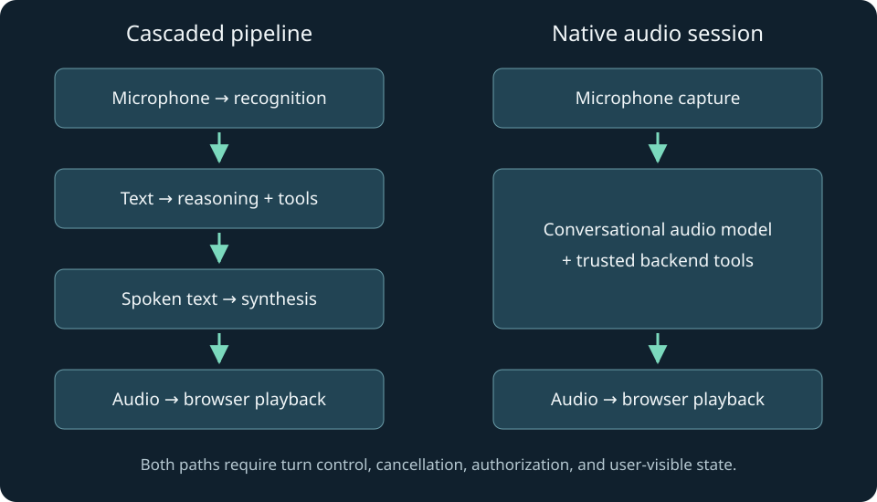

# 1. What a voice agent actually does

A user says, “Find me an appointment tomorrow afternoon.” A convincing demonstration can play a fluent answer within a moment. A useful application has a harder job: identify what tomorrow means, inspect real availability, let the user change their mind, obtain any necessary confirmation, and tell the truth about whether the appointment exists. Speech makes this work feel conversational, but does not remove the software engineering underneath it.

This book builds that understanding in small steps. We will use a fictional appointment assistant called Harbor. Its data is synthetic. The name is a recurring example, not a delivered medical or scheduling product. Harbor can discuss available slots, propose one, and explain a receipt. The included provider voice demo deliberately has no booking integration. Later, a local transaction exercise demonstrates how such an integration should be controlled.

You need basic familiarity with functions, strings, lists or arrays, and running a program. The chapters teach the asynchronous programming, audio representation, browser lifecycle, and distributed-system ideas at the point they become necessary. Python and TypeScript are both first-class languages throughout the materials. We use Python for clear backend and signal-processing examples, TypeScript for typed event handling and Node servers, and browser JavaScript where a dependency-free browser implementation makes the mechanics easier to inspect.

## Start with the observable task

A voice application receives more than words. It receives microphone samples, silences, incomplete thoughts, interruptions, and device failures. Its output also has a duration. A sentence may already exist in a model response while the speaker is still playing the first few words. That gap between generated content and heard content explains many of the mistakes we will study.

Imagine Harbor says, “I found Tuesday at three, and I have booked it for you.” The user interrupts after “three.” There are at least three separate questions. Was there a real three o'clock slot? Had the booking transaction already committed? Did the user hear the claim that it was booked? A single chat history containing the full sentence cannot answer all three. A good voice-agent design keeps conversational state, audio playback state, and business state distinguishable.

We will use five terms consistently. **Capture** obtains audio from a microphone or file. **Recognition** converts speech into text, often called speech-to-text or STT. **Reasoning** selects the response or proposes a tool action. **Synthesis** converts intended speech into audio, often called text-to-speech or TTS. **Playback** schedules that audio on a user's device. A native audio model can combine recognition, reasoning, and synthesis internally, but capture and playback remain your application's responsibilities.

A tool is an ordinary program that performs a narrow task on behalf of an agent. A calendar lookup is a tool. A booking operation is another tool, with different authority and consequences. A model's request to call a tool is proposed input to software; it is not proof that the action should be authorized. This distinction applies equally to text agents and voice agents, but spoken fluency makes it particularly easy to overlook.

## Two architectures to understand before choosing a vendor

A **cascaded pipeline** connects STT, a language model, and TTS. Audio becomes text, text becomes an answer or a tool request, and the answer becomes speech. The stages may come from different providers. For example, an application might use a local recognizer, a hosted language model, and Cartesia or ElevenLabs synthesis. The important property is the explicit text boundary between the stages, not the company names.

A **native speech-to-speech system** accepts audio and generates audio within a conversational model session. OpenAI Realtime and Gemini Live are examples of this product category. Native audio can retain useful vocal information that a transcript omits. It can also simplify the number of services you operate. It does not automatically provide a complete web application, authorized business tools, reliable reconnects, or a user interface that communicates what is happening.

| Decision | Cascaded pipeline | Native audio session |
| --- | --- | --- |
| Inspect intended wording | Explicit text is usually available before synthesis | Output transcripts may be available; timing and semantics are provider-specific |
| Replace one speech component | Often straightforward through an adapter | Usually tied to the native model's session and audio behavior |
| Preserve vocal nuance | Text boundaries discard some information | The model can receive audio directly |
| Tune each stage | More independent controls | Fewer exposed internal boundaries |
| Operational burden | More services and cancellation boundaries | More dependence on one session protocol |
| Business authorization | Your backend must enforce it | Your backend must enforce it |

Neither column implies a universal latency winner. A well-tuned cascade with early recognition and carefully buffered synthesis can outperform a poorly connected native session. A native session can avoid multiple stage boundaries. The useful question is which system meets your task, device, language, and operational requirements under measurement.

A managed agent platform adds another layer. It may host conversation configuration, knowledge retrieval, tools, monitoring, and speech components. That is different from a TTS API. Buying excellent speech generation does not mean you have bought all the behavior of a conversational agent. Conversely, using a managed platform does not mean you must surrender every UI decision. Identify precisely which layer you want to own.



## A researched map of the landscape

The research snapshot for this edition is November 12, 2026. Read `research.md` and `sources.json` for the inspected pages, access limitations, and migration notes. Product names, model identifiers, and SDK interfaces change. Architectural reasoning is more stable than a “latest model” label.

**OpenAI Realtime** provides stateful conversational audio with WebRTC and WebSocket integration paths. This book's executable browser sample intentionally uses the documented Realtime GA `/v1/realtime/calls` protocol. Current documentation also contains newer Live examples. Their session and event schemas must not be mixed. The API reference, rather than a renamed guide heading, determines the sample's protocol. See [the Realtime call reference](https://developers.openai.com/api/reference/resources/realtime/subresources/calls/methods/create).

**Gemini Live** is another native audio path. Its official WebSocket reference documents bidirectional messages, session setup, and activity handling. The examples here show a server-side file turn in both languages and explain the additional capture, buffering, and playback work needed for a browser. Direct browser access calls for a supported ephemeral credential flow rather than embedding a permanent key. See [the Live reference](https://ai.google.dev/api/live) and [ephemeral tokens](https://ai.google.dev/gemini-api/docs/live-api/ephemeral-tokens).

**Cartesia** offers speech components and agent-related products. Sonic is a synthesis model family; a TTS request alone is not a reasoning agent. The inspected Bytes endpoint uses a dated API version and a voice identifier. We use that relatively small interface to teach an interchangeable synthesis adapter. Streaming text requires a separate streaming interface and cancellation policy. See [the Bytes reference](https://docs.cartesia.ai/api-reference/tts/bytes).

**ElevenLabs** likewise has both speech generation and a managed agents offering. Those paths have different integration responsibilities. The included code generates speech through its HTTP API. The managed-agent chapter explains hosted configuration, server-issued authorization, client controls, and the current React documentation rather than assuming that every historical hook example still applies. See [speech creation](https://elevenlabs.io/docs/api-reference/text-to-speech/convert) and [the React agent library](https://elevenlabs.io/docs/eleven-agents/libraries/react).

**Fish Audio and Fish Speech** need careful naming. A hosted Fish API model, a downloadable checkpoint, and an inference repository are distinct artifacts. The inspected S2-Pro model card identifies a research license, while the repository's current license describes a different community agreement. This edition therefore makes no blanket commercial-permission claim for all Fish artifacts. Inspect the exact checkpoint and its terms before choosing a deployment. See [the model card](https://huggingface.co/fishaudio/s2-pro/blob/main/README.md) and [repository license](https://github.com/fishaudio/fish-speech/blob/main/LICENSE).

**Open components and frameworks** fill other layers. Whisper is a recognition project; Kokoro is a TTS model; neither alone is a complete agent. LiveKit Agents and Pipecat address orchestration and transport concerns. Their value includes handling recurring lifecycle and media problems, not replacing the need to understand those problems. The later chapters show how to evaluate whether a framework's defaults match your product.

## Trace one request through each architecture

In a cascade, Harbor captures the user's utterance as audio frames. The recognizer emits “tomorrow afternoon,” perhaps first as an interim hypothesis and later as a committed transcript. The language model receives that text and a narrow set of tools. A tool resolves the user's timezone and returns actual availability. The language model proposes a short spoken response. TTS produces samples, and the browser plays them.

Each arrow has its own failure modes. Audio can be captured at the wrong rate. Recognition can revise a word. A lookup can time out. The language model can produce a response that is too long for speech. Synthesis can return MP3 when the player expects PCM. Playback can be blocked until the user interacts with the page. Thinking in stages gives you a debugging map instead of a vague complaint that “the model is slow.”

In a native audio session, captured audio travels to the conversational model. The model may send transcript events, speech output, and function-call events over different logical paths. A WebRTC connection typically carries audio on media tracks and application events on a data channel. Your backend still validates any tool action. The browser still owns microphone cleanup and visible controls. Integration is smaller in some places and more session-specific in others.

Consider a repair. The user first says “Tuesday,” then says “Sorry, Wednesday.” In a cascade, you must decide whether the first transcript triggered a lookup and whether to cancel or supersede it. In a native session, the model may hear the correction naturally, but your application must still prevent a late Tuesday lookup from overwriting the current Wednesday proposal. The solution is not a better greeting prompt; it is explicit identity and freshness for asynchronous work.

## Latency is a path, not a provider slogan

Define a time origin before discussing speed. Let the user's last meaningful speech sample occur at time zero. Suppose endpoint detection waits 400 milliseconds, recognition finalization takes 120 more, reasoning takes 250, synthesis needs 160 to produce usable audio, and playback buffering adds 70. In a strictly sequential toy pipeline, the first audible reply arrives at 1,000 milliseconds. The sum is 400 + 120 + 250 + 160 + 70.

Real pipelines overlap some work. Recognition may run while the user speaks. Reasoning may start speculatively, and synthesis may begin before the full answer exists. That changes the dependency path. You cannot subtract every advertised streaming latency from the total and assume the result is meaningful. Measure timestamps at the actual boundaries and identify which stages block the first audible response.

A second metric is interruption latency: how long between the user's attempt to interrupt and the old voice becoming silent. A system can have excellent first-response latency and terrible interruption behavior because it has queued several seconds of audio. Another metric is task completion time. A fast but ambiguous answer that causes three repair turns may be worse than a slightly slower answer that makes the next step clear.

The companion's latency experiment lets you vary a simple serial budget. It is explicitly a teaching model, not a provider benchmark. Use it to see why reducing synthesis startup by 30 milliseconds has little effect when endpointing adds 900 milliseconds. Later, replace its inputs with measurements from your own application.

## Build an adapter around behavior, not brand names

An adapter is a small interface that hides a provider's wire format from the rest of your application. A synthesis adapter might accept text and a cancellation signal and produce tagged audio chunks. The rest of the system should not need to know whether the vendor names its text field `text` or `transcript`.

Do not make the interface so generic that it lies. Some providers support streaming input, some only streaming output, and some return a complete file. Some return raw samples, others compressed containers. Record these capabilities explicitly. An adapter that silently accumulates an entire response and then calls itself realtime makes performance debugging much harder.

Here is an intentionally small TypeScript contract. It is an integration fragment, not a callable provider implementation:

```typescript
type AudioChunk = {
  responseId: string;
  epoch: number;
  bytes: Uint8Array;
  sampleRate: number;
  encoding: 'pcm16le';
};
type Synthesizer = {
  speak(text: string, signal: AbortSignal): AsyncIterable<AudioChunk>;
};
```

`responseId` says which response produced the data. `epoch` identifies the currently accepted playback generation. `bytes` contains audio, while `sampleRate` and `encoding` say how to interpret it. `AbortSignal` requests cancellation; it does not guarantee that all already-buffered data disappears. That is why the receiving player also checks the epoch. Chapter 3 introduces asynchronous iteration, and chapter 9 applies the cancellation model to interruptions.

Python can express the same responsibility with an asynchronous generator. The exact annotation matters less than the contract: the producer yields chunks, the consumer can stop accepting them, and both sides release owned resources. This shared behavioral model lets you move between the languages without treating each SDK as a completely new subject.

## Choose with a task-specific evaluation

A sensible provider comparison begins with representative utterances. Include your product names, accents, languages, background conditions, common corrections, and the longest acceptable response. Use the same task and device setup across candidates. If a system is configured with a slower but more expressive voice, record that choice rather than comparing it to another system's low-latency setting as though the settings were equivalent.

Measure at least intelligibility, task accuracy, first-audio latency, interruption latency, repair frequency, and operational cost. Voice preference matters, but a pleasant voice cannot compensate for repeated errors in dates or quantities. A native model's conversational style also needs evaluation: does it stay concise, follow the requested language, and acknowledge uncertainty without rambling?

Score constraints before preferences. If a product requires a particular deployment region, an unsupported candidate is eliminated regardless of voice quality. If the app needs an offline mode, a hosted-only service cannot satisfy that mode. If the team cannot operate GPU inference, a theoretically inexpensive checkpoint may have a high practical ownership cost. These are engineering choices, not judgments about which provider is universally best.

For a developer building an initial web product, a direct native-audio demo is a useful way to understand the interaction. A cascade is useful when you need explicit text controls or interchangeable speech components. A managed agent platform is useful when its hosted workflow fits the product. A self-hosted component is useful when measured control, economics, or deployment requirements justify the added operation. These are starting hypotheses to test, not recommendations backed by an invented leaderboard.

## Follow the software through the book

Run `python examples/python/core.py` from the extracted project root. It creates a quiet synthetic tone, prints a deterministic endpoint result, and streams four mock text chunks through a bounded queue. This program is deliberately not a speech recognizer. It isolates audio representation and scheduling so that later provider behavior has something concrete to attach to.

Then run `node companion/server.mjs` and open the printed localhost URL. The companion contains calculators and deterministic simulations. It makes no paid model calls and asks for no microphone permission. The separate Realtime browser example does use a microphone and a paid provider when configured. Keeping those execution modes visible prevents a local simulator from being mistaken for a functioning hosted model integration.

The sequence now moves from the system to the signal. Before connecting a microphone to any model, we need to know what an audio sample means, how a frame gets its duration, why a WAV header is not speech, and how the browser decides whether it may capture and play sound. Those foundations make the rest of the implementation much less mysterious.
