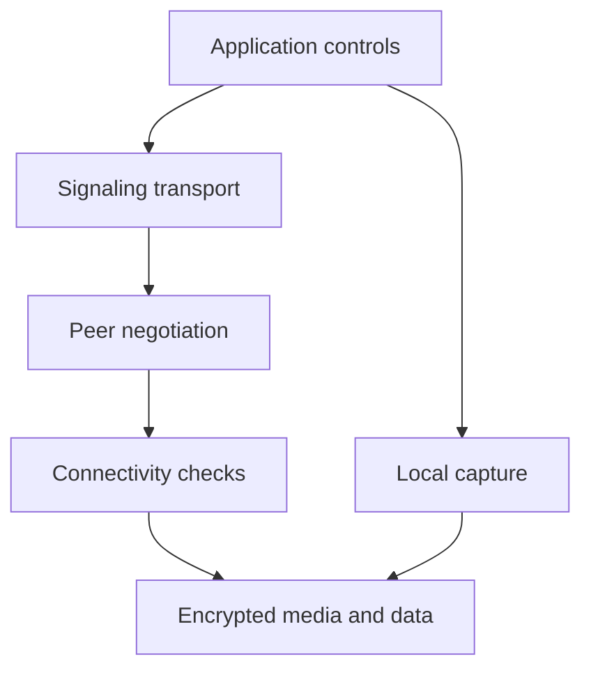
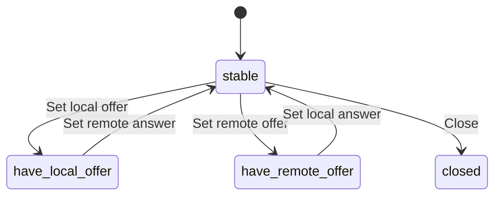
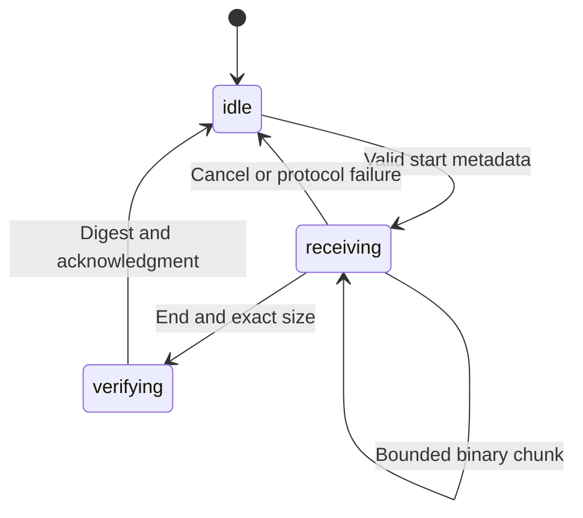
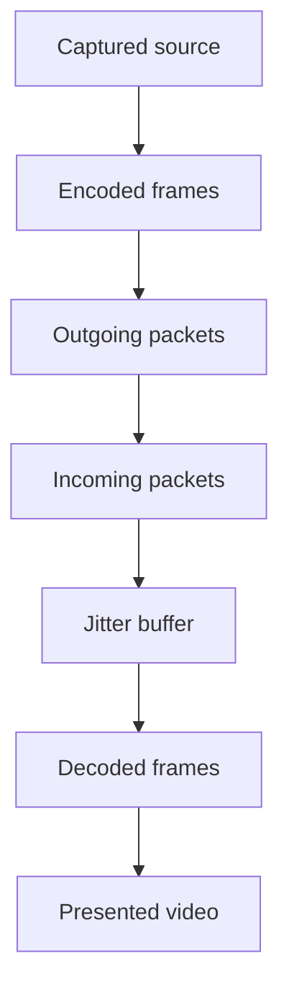
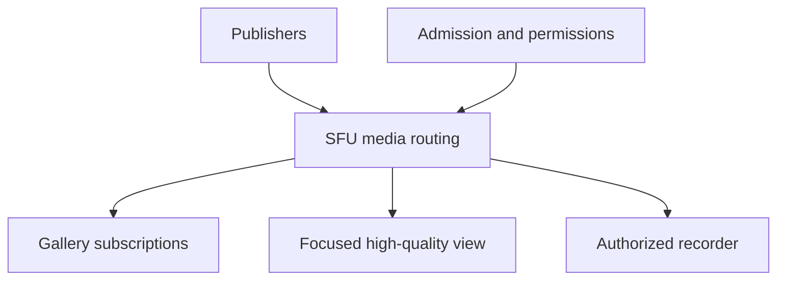

# WebRTC in TypeScript: From First Packets to Production

A guided textbook from browser fundamentals to expert real-time system engineering


<a id="preface"></a>
## Preface


This book is for a developer who wants to understand WebRTC well enough to build, debug, and design TypeScript applications. Familiarity with ordinary programming is useful; browser media, asynchronous ownership, networking terminology, and protocol relationships are introduced before they are required. You do not need calculus or a codec implementation to begin.

The learning order follows dependencies: understand the browser and resource lifetime, acquire a source, negotiate a pair, carry signaling, establish reachability, control media, design data protocols, interpret evidence, scale rooms, and operate the result. Each chapter develops a problem through concrete examples and realistic failures. Optional extensions are offered without quizzes or required recall gates.

The recurring project is a local learning lab. It contains actual peer-connection code, a generated media source, source replacement, a two-tab negotiation experiment, bounded binary transfer, live statistics, and a transparent bandwidth model. Complete canonical source accompanies the book. Some advanced sections are integration fragments or architecture treatments; they are labeled and do not claim to be deployed infrastructure.

Use the book in order for a full course. If you need immediate practical orientation, read guide.md first. Curriculum.md maps the chapters to abilities and experiments. Research-resources.md explains where the official references, samples, protocol book, standards, and server documentation fit. The book supplies original teaching; it does not redistribute those external works.

Conventions are consistent throughout: decimal kbps/Mbps describe rates; KiB/MiB describe binary buffer sizes; stats timestamps are milliseconds; many media delays are seconds until converted; A is impolite and B polite in the two-tab experiment. Documentation was inspected on November 12, 2026. Browser capability and implementation behavior must still be verified on target versions.

The practical expert destination is the ability to reason about browser and service behavior, read precise specifications, isolate failure by layer, and make justified architecture choices. It does not mean that reading alone substitutes for operating real calls. The verification report distinguishes generated content, executed tests, and untested deployment/platform behavior so your next steps are concrete.


<a id="contents"></a>
## Contents


- [Chapter 1: A real-time system you can reason about](#chapter-01)

- [Chapter 2: Capture, permissions, and the lifetime of media](#chapter-02)

- [Chapter 3: Two peers, one negotiated conversation](#chapter-03)

- [Chapter 4: Signaling that survives real users](#chapter-04)

- [Chapter 5: Reachability, relays, and recovery](#chapter-05)

- [Chapter 6: Control media without breaking the session](#chapter-06)

- [Chapter 7: Data channels and bounded application protocols](#chapter-07)

- [Chapter 8: Turn statistics into useful evidence](#chapter-08)

- [Chapter 9: From two people to a room](#chapter-09)

- [Chapter 10: Production engineering and the path to expertise](#chapter-10)

- [Source appendix](#source-appendix)

- [Resource research](#resource-research)

- [Glossary](#glossary)

- [Projects](#projects)


# I. Foundations


<a id="chapter-01"></a>
## Chapter 1: A real-time system you can reason about


### In this chapter

- [Begin with the problem](#chapter-01-section-1)
- [Three planes and their responsibilities](#chapter-01-section-2)
- [The practical web prerequisites](#chapter-01-section-3)
- [Running the delivered project](#chapter-01-section-4)
- [TypeScript types that earn their place](#chapter-01-section-5)
- [Promises, events, and ordering](#chapter-01-section-6)
- [Resource ownership and cancellation](#chapter-01-section-7)
- [Just enough networking](#chapter-01-section-8)
- [Frames, samples, and deadlines](#chapter-01-section-9)
- [A bounded learning environment](#chapter-01-section-10)
- [What this first experiment establishes](#chapter-01-section-11)


<a id="chapter-01-section-1"></a>
### Begin with the problem

Imagine building a browser tool that lets two developers discuss a screen. Each person needs to hear the other while speaking, see a moving image, and send small messages. Uploading a completed video file cannot solve this problem: by the time the file arrives, the conversation has moved on. We need a continuous pipeline whose usefulness depends on both arrival and timing.

WebRTC supplies browser APIs and interoperable protocols for exchanging audio, video, and application data. TypeScript helps us express the application around those APIs. It does not replace the browser's networking implementation. Your TypeScript code requests capture, attaches tracks, exchanges descriptions, reacts to state changes, and renders results. The browser performs encoding, packetization, connectivity checks, encryption, congestion control, and decoding.

This distinction makes the subject manageable. You do not need to implement a codec to build a call. You do need to understand enough about codecs to diagnose a negotiated format that one endpoint cannot decode. Likewise, you do not write ICE packets yourself, but you must supply reachable infrastructure and carry ICE information between endpoints.

Our recurring project is a small calling tool named the lab. Start with its camera-free local call. A moving canvas becomes a video source, one peer sends it, and another receives it. That is actual WebRTC traffic, even though both peers live in one tab. Later, two tabs exchange signaling through BroadcastChannel. Internet deployment is a separate step because a same-machine success proves much less than a call across independent networks.

<a id="chapter-01-section-2"></a>
### Three planes and their responsibilities

A useful first division is application control, signaling, and media/data transport. Application control answers questions such as who may join, who is speaking, and whether recording is allowed. Signaling carries the information endpoints need to establish or modify a connection. Media transport carries the time-sensitive audio and video; the data channel carries application messages over the negotiated connection.

These responsibilities can share infrastructure, but they should remain separate in your reasoning. A successful login does not mean media is flowing. A connected signaling socket does not mean ICE found a route. A connected peer does not guarantee a video element is playing. Each statement requires different evidence.



This diagram expresses dependencies rather than a strict one-time timeline. After a call connects, changing the media arrangement may require another negotiation. Moving from Wi-Fi to another network may require new connectivity work. The application therefore manages a session over time; it does not merely execute a connection recipe once.

A signaling server usually handles comparatively small control messages. A TURN server relays encrypted packets when required. An SFU, introduced in Chapter 9, is a media endpoint that forwards streams in group calls. Calling all three a “WebRTC server” obscures their different costs and trust boundaries.

<a id="chapter-01-section-3"></a>
### The practical web prerequisites

A browser runs JavaScript. TypeScript adds compile-time descriptions that are removed before execution. The DOM is the browser's object model for the document. A video element is a DOM object; assigning a MediaStream to its `srcObject` connects a media source to that presentation surface.

A secure context is a browser security classification, usually provided by HTTPS, with localhost receiving special development treatment. Camera and microphone capture require a suitable context and permission. Loading a page successfully over ordinary HTTP on a private LAN address does not establish the same privileges as localhost. This distinction will matter when moving the lab to another computer.

An origin consists of scheme, hostname, and port. `http://localhost:4173` and `http://localhost:4174` are different origins. BroadcastChannel communication is origin-scoped and may also be affected by browser storage partitioning. For the two-tab experiment, use the same address in the same browser profile. A private window, another profile, or another machine should not be expected to join that channel.

A module is a JavaScript file with explicit imports or exports. The browser resolves `./peer.js` relative to the importing module. Our canonical sources end in `.ts`, while their import paths end in `.js` because the build creates JavaScript files at those locations. This is a project convention, not a claim that browsers understand TypeScript source directly.

<a id="chapter-01-section-4"></a>
### Running the delivered project

From the extracted package root, use Node 24.22.1, the runtime used for the included execution checks:

```bash
npm run build
npm start
```

Open `http://localhost:4173`. The project has no package dependencies to download. The build uses Node's TypeScript stripping facility to remove erasable annotations and writes the browser modules into `companion/dist`. It does not run the TypeScript type checker. That limitation is recorded because successful stripping is weaker evidence than a strict type check.

The prebuilt directory is also included. If you only want to use the existing lab, `npm start` serves it. Run the build after editing source. The server binds to the local machine, which keeps the initial experiment focused and avoids implying that the development server is an internet signaling service.

Use Start local call. You should see the moving source on the left and its received version on the right. The event log should eventually show an open data channel. The exact sequence of intermediate events may differ between browsers. Inspect evidence by layer: a local image proves capture and rendering; the remote image proves the receive path; the data channel log proves a separate application transport became usable.

If a browser has no usable WebRTC implementation, the relevant call will fail and the log will show an error. If port 4173 is occupied, choose another with the `WEBRTC_LAB_PORT` environment variable. On PowerShell, for example, set `$env:WEBRTC_LAB_PORT = '4174'` before `npm start`, then use that port consistently in both tabs.

<a id="chapter-01-section-5"></a>
### TypeScript types that earn their place

Consider a function that displays an error:

```ts
export function errorMessage(error: unknown): string {
  if (error instanceof Error) {
    return `${error.name}: ${error.message}`;
  }
  return String(error);
}
```

`unknown` means the function has not established what the value is. That is appropriate for a caught exception: JavaScript permits throwing values other than Error objects. The `instanceof` check narrows the type and permits access to the error's name and message. This small boundary pattern prevents diagnostics from failing while reporting the original failure.

By contrast, `as RTCPeerConnection` does not validate a received value or construct a peer. A type assertion tells the compiler to accept your claim. It supplies no runtime proof. This becomes particularly important at signaling boundaries, where JSON received from another system must be checked before it reaches a browser API.

Use a discriminated union to express mutually exclusive messages:

```ts
type Signal =
  | { kind: 'description'; description: RTCSessionDescriptionInit }
  | { kind: 'candidate'; candidate: RTCIceCandidateInit };

function describe(signal: Signal): string {
  if (signal.kind === 'description') {
    return `Received ${signal.description.type}`;
  }
  return 'Received an ICE candidate';
}
```

The string `kind` is the discriminator. Checking it establishes which properties exist. The browser's DOM type definitions provide the RTC types in a conventional TypeScript project with DOM libraries enabled. They are compile-time declarations; the actual constructors and methods come from the browser.

Notice that this union describes already validated application data. Writing `JSON.parse(text) as Signal` skips validation. Chapter 4 shows how to distinguish a trusted internal type from an untrusted envelope, and why call identifiers matter in addition to object shape.

<a id="chapter-01-section-6"></a>
### Promises, events, and ordering

A Promise represents a result that may become available later. `await` pauses the current asynchronous function until that promise settles. It does not block the browser's event loop and it does not pause unrelated event handlers.

```ts
async function openCamera(): Promise<MediaStream> {
  const stream = await navigator.mediaDevices.getUserMedia({
    video: true,
    audio: false
  });
  return stream;
}
```

The function immediately returns a Promise. Permission may take time, fail, or remain unanswered. While it is waiting, the user can press Stop. If capture later succeeds, your application must decide whether the stream still belongs to an active session. Without that decision, a stopped call can unexpectedly reacquire a camera.

An event listener is different from an awaited result. `pc.addEventListener('track', handler)` registers code to run when the browser reports a track. The registration itself does not wait for a track and supplies no guarantee that one will arrive. A callback marked `async` returns a Promise, but most browser event dispatch does not wait for that Promise before dispatching the next event.

This explains a common signaling bug. Two messages arrive in order, but their handlers each start an asynchronous operation. If the second operation depends on the first completing, arrival order alone is insufficient. You need to serialize the relevant operations. We will use a Promise chain for incoming signaling; this makes the application order explicit without pretending the whole browser runs synchronously.

<a id="chapter-01-section-7"></a>
### Resource ownership and cancellation

A call owns more than a peer connection. It may own camera tracks, screen tracks, animation timers, data channels, polling tasks, event listeners, and object URLs. A useful design rule is that every acquisition should have a known release point.

| Resource | Typical acquisition | Typical release |
| --- | --- | --- |
| Local media track | Capture request | `track.stop()` |
| Peer connection | `new RTCPeerConnection()` | `pc.close()` |
| Timer | `setInterval()` | `clearInterval()` |
| Listener | `addEventListener()` | Remove listener or dispose owner |
| Blob URL | `URL.createObjectURL()` | `URL.revokeObjectURL()` |

Closing a peer connection does not stop a camera track you acquired separately. Removing a video element does not close the connection. Muting a preview does not mute a microphone's transmitted audio. These are independent objects with independent responsibilities.

A generation counter gives delayed work a clear ownership test:

```ts
let generation = 0;
let stream: MediaStream | undefined;

async function startPreview(video: HTMLVideoElement) {
  const startedIn = ++generation;
  const acquired = await navigator.mediaDevices.getUserMedia({ video: true });
  if (startedIn !== generation) {
    acquired.getTracks().forEach(track => track.stop());
    return;
  }
  stream?.getTracks().forEach(track => track.stop());
  stream = acquired;
  video.srcObject = acquired;
}

function stopPreview(video: HTMLVideoElement) {
  generation++;
  stream?.getTracks().forEach(track => track.stop());
  stream = undefined;
  video.srcObject = null;
}
```

The fragment expects an existing video element and two buttons that call these functions. Starting increments the generation. Stopping increments it again. A late result from the older generation is stopped instead of being installed. This is logical cancellation: it does not cancel the browser's permission prompt, but it prevents a stale result from becoming active.

For overlapping replacement operations within the same call, add a separate media-operation generation or serialize them. A call generation distinguishes old calls; it does not automatically decide which of two current camera selections should win. Distinguishing those two scopes is a practical concurrency skill you will reuse throughout the book.

<a id="chapter-01-section-8"></a>
### Just enough networking

An IP address identifies a network destination, a port distinguishes transport endpoints on a host, and a protocol defines how messages are exchanged. A private address is usually meaningful only within a local network. A NAT device maps internal traffic onto externally visible addresses and ports. A firewall decides which traffic may pass. NAT and firewall behavior can coexist, but they are different mechanisms.

TCP provides an ordered reliable byte stream. UDP provides datagrams without promising delivery or ordering. Real-time media commonly uses UDP because a late audio packet can be less useful than a missing one. That does not mean WebRTC ignores reliability: media protocols, retransmissions, loss recovery, and congestion control make deliberate tradeoffs. Data channels can provide reliable ordered messages even when their underlying path includes UDP.

Latency is delay. Bandwidth is a capacity or rate, depending on context. Throughput is the rate actually achieved. Jitter describes variation in arrival timing. Loss describes missing packets, but different measurement points can report different loss. Keep the units visible: bits per second for encoded rate, bytes for buffers, milliseconds or seconds for time.

Suppose a path can carry 2 megabits per second and your application continually offers 4 megabits per second. A queue may grow. If 1 megabit of traffic is waiting and the link serves 2 megabits per second, draining that queue requires roughly half a second, even before new arrivals. More capacity helps, but controlling offered load is often the immediate solution. A high-resolution source is not automatically a high-quality conversational experience if it creates excessive delay.

<a id="chapter-01-section-9"></a>
### Frames, samples, and deadlines

Audio and video represent continuous experience using discrete units. A video source produces frames, while an audio source produces samples grouped into processing and transport units. A 30 fps video has a nominal interval of one thirtieth of a second, about 33.3 ms, between frames. That does not require one network packet per frame; a compressed frame may occupy several packets, and transport can deliver them with uneven timing.

An audio sample rate describes samples per second for the signal representation. It is not the packet rate and it is not the encoded bitrate. If a representation uses 48,000 samples per second, grouping 20 ms of time corresponds to 960 samples per channel because 48,000 multiplied by 0.020 equals 960. A codec can represent those samples with far fewer bits than an uncompressed sample array would require. The browser manages these details, but distinguishing their units prevents misleading calculations.

Real-time usefulness depends on deadlines. A historical file download can wait for a missing byte and still deliver a correct file. A conversation cannot wait indefinitely for each missing audio interval. Some recovery is valuable, but delaying all subsequent sound for a very late packet can hurt more than concealing the gap. That is why reliable file transfer and conversational audio need different policies even when they share the same physical connection.

The browser integrates encoding, feedback, and timing to make those tradeoffs. Your application's role is to avoid defeating them. Do not send raw camera images through a reliable data channel merely because that channel was easy to open. Doing so creates a new media pipeline whose pacing, recovery, synchronization, and codec behavior you must now design. Use media tracks for ordinary audiovisual communication and data channels for application data with explicitly chosen semantics.

<a id="chapter-01-section-10"></a>
### A bounded learning environment

The book assumes comfort with variables, functions, objects, and basic browser interaction. It introduces TypeScript boundary types and asynchronous ownership locally because those are essential to WebRTC correctness. It does not require calculus, a codec implementation, or a native C++ build. The advanced destination is practical browser and service engineering in TypeScript, with enough protocol understanding to read precise specifications and diagnose real failures.

Keep the initial project small while learning. A UI framework can be added later, but a framework does not change offer/answer rules or release a camera automatically. Native browser APIs make the ownership boundaries visible. Once those relationships are understood, a framework component can subscribe to session state and render controls without becoming the owner of every transport object.

The remaining chapters repeatedly return to one question: what evidence would establish that this particular layer worked? That question prevents accidental assumptions from accumulating. It also gives you a useful way to study unfamiliar real-time systems: identify the representation, the owner, the transition, and the observable result before adding another abstraction.

<a id="chapter-01-section-11"></a>
### What this first experiment establishes

The local call is deliberately bounded. It establishes that the browser can negotiate two endpoints, transport a generated video, and open a data channel in a controlled environment. It does not establish camera hardware compatibility, permission behavior on every platform, traversal through a corporate firewall, TURN authentication, or mobile performance.

That boundary is useful rather than disappointing. It isolates variables. When an internet call fails later, you can compare it with a known local pipeline. If local media works but ICE never connects remotely, focus on signaling and reachability before changing camera constraints. If transport connects but video never plays, inspect receiving and presentation before buying a TURN service.

The core engineering habit is now in place: separate responsibilities, identify ownership, and seek evidence for each transition. The next chapter applies that habit to the first real resource users entrust to the application: their camera and microphone.

**References for this chapter:** [WebRTC peer connection guide](https://webrtc.org/getting-started/peer-connections), [W3C WebRTC API](https://www.w3.org/TR/webrtc/), and the source ledger in `research-resources.md`. The explanations and numerical examples here are original instructional material.

[Back to contents](#contents)

---


<a id="chapter-02"></a>
## Chapter 2: Capture, permissions, and the lifetime of media


### In this chapter

- [Start with a preview rather than a call](#chapter-02-section-1)
- [The smallest meaningful preview](#chapter-02-section-2)
- [Permission is a continuing interaction](#chapter-02-section-3)
- [Constraints, capabilities, and settings](#chapter-02-section-4)
- [Muted, disabled, and ended mean different things](#chapter-02-section-5)
- [Add audio deliberately](#chapter-02-section-6)
- [Screen sharing is a separate source](#chapter-02-section-7)
- [Device selection as a recoverable workflow](#chapter-02-section-8)
- [Track clones and shared consumers](#chapter-02-section-9)
- [Recording is another consumer](#chapter-02-section-10)
- [A worked lifecycle trace](#chapter-02-section-11)
- [Debugging capture with evidence](#chapter-02-section-12)


<a id="chapter-02-section-1"></a>
### Start with a preview rather than a call

A caller needs confidence about what will be shared before a network connection starts. A preview also separates device problems from connection problems. If a camera cannot be opened locally, changing signaling will not fix it. We therefore build the media acquisition layer before attaching it to a peer.

The browser presents media through two related abstractions. A MediaStreamTrack represents a single audio or video track. A MediaStream groups tracks for convenient handling and synchronization relationships. A stream is not a video file, and it is not necessarily a network connection. A camera stream can be displayed locally, recorded, processed, sent through several connections, or used by none of them.

Think of a track as a handle to a live source. The analogy has limits: several tracks may share the same underlying device, including cloned tracks. Stopping one handle does not imply every other consumer of that device has stopped. Your ownership inventory should record the actual tracks your application acquired or cloned.

The lab begins with a synthetic track from a canvas. This removes hardware and permission from the first transport experiment. The Use camera button replaces that source with a real camera track. The same sender can therefore carry different sources over time without the application treating each source as a different participant.

<a id="chapter-02-section-2"></a>
### The smallest meaningful preview

Create this HTML in a secure page or use localhost:

```html
<button id="start">Start camera</button>
<button id="stop">Stop camera</button>
<video id="preview" autoplay muted playsinline></video>
<script type="module" src="preview.js"></script>
```

The following is the complete TypeScript module for that page. Compile or strip it into `preview.js` with your TypeScript toolchain. It is intentionally separate from the full lab so the resource lifecycle remains visible.

```ts
const preview = document.querySelector<HTMLVideoElement>('#preview');
const start = document.querySelector<HTMLButtonElement>('#start');
const stop = document.querySelector<HTMLButtonElement>('#stop');
if (!preview || !start || !stop) throw new Error('Preview markup is missing');

let active: MediaStream | undefined;
let revision = 0;

start.addEventListener('click', async () => {
  const mine = ++revision;
  try {
    const acquired = await navigator.mediaDevices.getUserMedia({
      video: { width: { ideal: 640 }, height: { ideal: 360 } },
      audio: false
    });
    if (mine !== revision) {
      acquired.getTracks().forEach(track => track.stop());
      return;
    }
    active?.getTracks().forEach(track => track.stop());
    active = acquired;
    preview.srcObject = acquired;
    await preview.play();
  } catch (error) {
    if (mine === revision) console.error(error);
  }
});

stop.addEventListener('click', () => {
  revision++;
  active?.getTracks().forEach(track => track.stop());
  active = undefined;
  preview.srcObject = null;
});
```

The requested width and height are preferences. `ideal` gives the browser room to choose a supported mode. The generation check handles delayed permission and repeated Start clicks. The old track is stopped only after a usable replacement arrives. This preserves a working preview if the new capture fails.

`muted` controls local playback, which prevents hearing your own microphone if audio is added later. It does not modify any transmitted track. `playsinline` asks supporting mobile browsers to keep playback inline rather than automatically using a full-screen presentation. Calling `play()` can reject because browser playback policies are a separate layer from capture permission; handle that failure as presentation failure rather than capture failure.

<a id="chapter-02-section-3"></a>
### Permission is a continuing interaction

A capture request may be approved, rejected, blocked by policy, or left unanswered. Do not show an endless spinner with no way to leave. Give the user an explicit waiting state and a Cancel action that invalidates the request's ownership. A Promise race against a timeout can update the UI, but it cannot cancel `getUserMedia()` itself. If the late capture resolves, release its tracks.

Permission also depends on document context. A cross-origin iframe needs appropriate delegation from its embedder. A device can exist while an operating-system privacy setting prevents access. A browser can remember a denial, so retrying immediately may not display another prompt. Your error message should explain the next useful action without asserting a cause that the error alone cannot prove.

| Error name | Useful interpretation | First diagnostic action |
| --- | --- | --- |
| `NotAllowedError` | Permission or policy prevented access | Inspect browser permission, OS permission, and document context |
| `NotFoundError` | No matching device was found | Check connected devices and requested kinds |
| `NotReadableError` | The device could not be read | Check hardware, drivers, and competing applications |
| `OverconstrainedError` | A required constraint could not be met | Inspect the failed constraint and relax requirements |
| `TypeError` | Invalid request or unavailable API context | Check options, feature presence, and secure context |

These are diagnostic categories, not a guarantee that every browser maps every platform failure identically. Preserve the browser's error name in developer logs. Translate it into a helpful user-facing explanation rather than exposing a raw exception as the entire product experience.

The MDN capture documentation also notes that an ignored permission prompt may never settle. This is why asynchronous ownership is a correctness requirement, not merely defensive programming for rare failures.

<a id="chapter-02-section-4"></a>
### Constraints, capabilities, and settings

Three names describe different questions. Constraints are what the application requests. Capabilities describe the source's supported range where exposed. Settings describe the actual current configuration. Treating constraints as settings produces misleading UI: requesting 1280 by 720 does not establish that those are the chosen dimensions.

```ts
// Integration fragment: cameraTrack is a live video MediaStreamTrack.
await cameraTrack.applyConstraints({
  width: { ideal: 1280 },
  height: { ideal: 720 },
  frameRate: { ideal: 24, max: 30 }
});
const actual = cameraTrack.getSettings();
console.log(actual.width, actual.height, actual.frameRate);
```

The fragment applies preferences to the source. The browser may crop, scale, or choose another supported mode within the constraint rules. An `exact` requirement can reject the request if it cannot be met. Use exact selection when the product truly requires a particular device or property; prefer adaptable settings when a fallback is acceptable.

Capture constraints and sender encoding parameters affect different stages. Reducing source resolution lowers work before encoding and may affect all consumers sharing that track. Reducing a sender's maximum bitrate constrains one outgoing encoding. A local preview can remain sharp while an outgoing stream is compressed more aggressively. Chapter 6 uses this distinction to avoid changing the wrong part of a pipeline.

Device selection usually combines `enumerateDevices()` with a deviceId constraint. Labels and identifiers are subject to permission and privacy rules. A blank device label does not prove no device exists. Persisting a device identifier forever is fragile because the device may disappear, browser storage may change, or the browser may rotate identifiers. Offer a default-device fallback and refresh the list on device changes.

<a id="chapter-02-section-5"></a>
### Muted, disabled, and ended mean different things

A track's `enabled` flag is application control. For an audio track, disabling produces silence; for video, it produces black frames as defined by the media track model. This is a useful ordinary mute operation because the logical track can remain attached. It does not imply that every capture source has been released.

The `muted` property describes a source temporarily unable to provide media. It is read-only application evidence, often paired with `mute` and `unmute` events. It is not the property to assign when the user presses Mute. A source interruption and an intentional user mute should have different presentation in a polished application.

An ended track cannot be restarted by setting `enabled = true`. Acquire another track if needed. Calling `stop()` immediately changes that track's ready state to ended, but do not rely on receiving its `ended` event as a result of your own `stop()` call. Run your cleanup directly when you initiate it. The browser may fire `ended` when an external action ends capture, such as the user ending screen sharing.

A video element also has a `muted` property, but it controls that element's audio playback. Disabling the camera track, disabling the microphone track, and muting the element are three separate operations. Naming helpers `setMicrophoneEnabled`, `setCameraEnabled`, and `setPlaybackMuted` makes the intended target visible in code reviews.

<a id="chapter-02-section-6"></a>
### Add audio deliberately

For a voice call, request audio alongside video or acquire it independently. A single combined request is convenient, but a failure to satisfy one requested kind can fail the whole request. Independent acquisition supports products that permit audio-only fallback after camera failure. Choose based on the experience you intend to provide.

```ts
// Integration fragment: invoke from your join/preflight flow.
const microphone = await navigator.mediaDevices.getUserMedia({
  video: false,
  audio: {
    echoCancellation: true,
    noiseSuppression: true,
    autoGainControl: true
  }
});
const microphoneTrack = microphone.getAudioTracks()[0];
```

These processing preferences are not a universal guarantee of identical sound. Browser support, hardware processing, and device routing vary. Speech-oriented processing can help conversation but can harm music, where suppression may treat desired sound as noise. Expose a suitable mode and verify the actual outcome on the target devices instead of assuming one constraint object is ideal for every audio product.

Echo cancellation aims to remove audio played by the device from its microphone capture. Feedback occurs when a signal loops through playback and capture with enough gain. Muting a local preview avoids one obvious loop, but running two audible tabs near the same microphone can still cause feedback. The delivered lab uses silent synthetic video and does not request a microphone, making its default experiment predictable.

<a id="chapter-02-section-7"></a>
### Screen sharing is a separate source

A display capture is selected by the user. The browser's chooser is part of the permission model. Your application should not promise silent capture of a particular window. Call `getDisplayMedia()` directly from a user interaction path, then handle cancellation as an ordinary outcome.

```ts
// Integration fragment: sender is a negotiated video RTCRtpSender.
// Keep the previous track live if you intend to restore it.
const previous = sender.track;
const display = await navigator.mediaDevices.getDisplayMedia({
  video: true,
  audio: false
});
const screen = display.getVideoTracks()[0];
try {
  await sender.replaceTrack(screen);
} catch (error) {
  display.getTracks().forEach(track => track.stop());
  throw error;
}
screen.addEventListener('ended', () => {
  const restore = previous?.readyState === 'live' ? previous : null;
  void sender.replaceTrack(restore).catch(console.error);
}, { once: true });
```

This fragment isolates the replacement mechanic. A full session must additionally check that the call is still current after each await, stop display tracks on hangup, serialize replacements, and update the preview. The companion includes call-generation checks and source restoration. The companion disables conflicting camera/screen acquisition controls while a request is pending and resets that gate on hangup. A production capture service may additionally need a queue for device and shared-source operations.

Screen audio is not the same as microphone audio. Availability depends on the selected surface, browser, and operating system. Requesting display audio does not guarantee receiving an audio track. Always inspect the returned stream. If screen audio and microphone audio must both be sent as one mixed source, a Web Audio graph can combine them, but the graph introduces its own audio context, user activation, cleanup, and echo considerations.

<a id="chapter-02-section-8"></a>
### Device selection as a recoverable workflow

A device picker is more than a select element filled once at page load. Before permission, labels may be restricted. After permission, the list can contain more useful names. A device can then be unplugged, become unavailable, or change its operating-system routing while the call continues. Treat selection as an intention that may need to be satisfied again, rather than a permanent binding to one identifier.

A practical flow starts with the default device. After capture succeeds, enumerate devices and show available alternatives. When the user chooses another camera, acquire the requested device using an exact deviceId only for that deliberate choice. Keep the old source until the new source is usable. If acquisition fails, leave the old preview active and explain that the selected device could not be opened. If no old source remains, offer a default-device retry or an audio-only path according to product requirements.

Subscribe to devicechange where supported, refresh the list, and preserve the logical choice when possible. A removed device should not leave a menu showing a selected camera that no longer exists. At the same time, avoid automatically switching to an unexpected camera without making the behavior clear. A room may contain sensitive surroundings, and the difference between the intended camera and a newly attached camera matters to the user.

Output routing is a related but different feature. Choosing a microphone affects capture; choosing a speaker affects playback. Speaker selection APIs have their own support and permission requirements. Do not assume that because enumerateDevices lists an audio output, every browser permits arbitrary programmatic routing to it. Use feature detection and provide a system-default path.

<a id="chapter-02-section-9"></a>
### Track clones and shared consumers

A clone creates another track handle associated with the source. That can be useful when a processing or ownership arrangement needs an independent handle, but it also creates another cleanup obligation. Stopping the original handle does not establish that all clones have ended. An application that saves only the original stream can therefore leave capture active through a forgotten clone.

Consider a preview and a recorder sharing one stream. If the preview component unmounts, it can detach its video element without stopping the source still needed by the recorder. When the entire call ends, the session owner can stop all handles it owns. This division is easier to maintain when acquisition happens in a capture owner and presentation merely attaches the provided stream.

Document whether a function borrows or owns a stream. A helper that borrows a stream should not stop it as an incidental cleanup step. A helper that acquires a new stream must release it on failure. These small interface contracts eliminate a class of bugs that otherwise appears as intermittent camera shutdown or a privacy indicator remaining active after the UI disappears.

<a id="chapter-02-section-10"></a>
### Recording is another consumer

MediaRecorder can record a MediaStream when supported. Recording does not happen automatically because media is transmitted. Conversely, local recording does not imply the remote endpoint is receiving the same content. Decide which tracks the recording represents and make that behavior visible to participants.

Choose a MIME type by checking `MediaRecorder.isTypeSupported()`, rather than hard-coding one container for every browser. Collect `dataavailable` blobs or stream them to a bounded destination. Calling `start(timeslice)` requests periodic delivery; it does not make callback timing precise, so long recordings need storage and interruption handling.

A minimal recording lifecycle is: create the recorder from the chosen live stream, attach handlers, start, stop, wait for the final data and stop events, assemble or persist the result, and release any object URL used for download. Releasing the recorder is separate from stopping source tracks because the call may still need them. A recording service adds consent, retention, upload, and access control decisions beyond this local browser API.

The delivered companion does not implement recording. The separation is intentional: this chapter teaches how to add that consumer without misrepresenting it as part of the tested lab. Before integrating a recorder, first decide whether it records local capture, remote tracks, a composed layout, or all sources separately. Those outputs serve different purposes and have different synchronization requirements.

<a id="chapter-02-section-11"></a>
### A worked lifecycle trace

Follow a realistic sequence. At revision 1, a user requests the camera. The prompt remains open. At revision 2, they leave the preview. At revision 3, they re-enter and request another camera. Suppose the first request now resolves. Its stored revision is 1, which differs from 3, so the acquired tracks are stopped immediately. The application remains in the newer request's waiting state.

Next, the second request succeeds and becomes active. The user shares a screen. Keeping the camera track live allows immediate restoration when screen sharing ends, at the cost of continuing camera capture while it is not transmitted. Some products prefer to release the camera during screen sharing. That is a product and privacy choice, and restoration would then require reacquisition rather than reuse of the ended track.

Finally, the user hangs up. The owner invalidates the call generation, closes peer connections, stops all owned source tracks, clears previews, and removes timers. If a late `replaceTrack()` continuation runs, its generation check prevents it from installing a source into the ended call. Good cleanup is therefore both releasing existing resources and preventing delayed acquisition from reviving them.

<a id="chapter-02-section-12"></a>
### Debugging capture with evidence

If the preview is black, first inspect whether the stream has a live video track and whether that track is enabled. Then inspect settings and whether the element has a source. Check `videoWidth`, playback errors, and whether CSS is hiding the result. A black frame can be the intended result of disabling a track; it is not automatically a decoder failure.

If the camera light remains on after a call, inspect owned tracks and cloned tracks before changing connection code. An old preview, recorder, or shared capture manager may legitimately hold a live track. If one component shares media with another, it should release its ownership without stopping a resource still owned elsewhere. A reference-counted capture service is one possible design; explicit session ownership is often enough for a small application.

The chapter's main outcome is a capture layer whose behavior you can explain when permissions are slow, devices change, or the user leaves. We can now connect that layer to a peer without making device ownership disappear inside networking code.

**References:** [MDN getUserMedia](https://developer.mozilla.org/en-US/docs/Web/API/MediaDevices/getUserMedia), [MDN getDisplayMedia](https://developer.mozilla.org/en-US/docs/Web/API/MediaDevices/getDisplayMedia). Compatibility-sensitive features require testing on the target browser and OS.

[Back to contents](#contents)

---


# II. Negotiation and connectivity


<a id="chapter-03"></a>
## Chapter 3: Two peers, one negotiated conversation


### In this chapter

- [Why capture does not create a call](#chapter-03-section-1)
- [A minimal loopback sequence](#chapter-03-section-2)
- [Trace the intermediate states](#chapter-03-section-3)
- [Read SDP as a description](#chapter-03-section-4)
- [What an offer and an answer agree on](#chapter-03-section-5)
- [Add video to the data-only example](#chapter-03-section-6)
- [Multiplexing does not erase logical identity](#chapter-03-section-7)
- [Description state is pending work as well as agreement](#chapter-03-section-8)
- [A local call is still asynchronous](#chapter-03-section-9)
- [Several state machines coexist](#chapter-03-section-10)
- [Encryption and the identity boundary](#chapter-03-section-11)
- [Why we avoid SDP text surgery](#chapter-03-section-12)
- [A failure trace you can diagnose](#chapter-03-section-13)


<a id="chapter-03-section-1"></a>
### Why capture does not create a call

A camera stream tells one browser where its local media comes from. It tells the other browser nothing. The endpoints still need to agree on what they intend to exchange, which formats they can understand, and which transport information to use. RTCPeerConnection manages this negotiated relationship.

The word peer refers to a protocol endpoint, not necessarily another browser tab. A peer can be a browser, an SFU, a recording gateway, or another compatible implementation. In the first lab, each RTCPeerConnection is one endpoint, and both happen to be in the same JavaScript process. Do not reuse one connection object as if it represented both ends of a remote relationship.

A connection can carry multiple media tracks and data channels. The application attaches a track through an RTCRtpSender. Incoming media is associated with an RTCRtpReceiver. A transceiver pairs a sender and receiver for a negotiated media section. We will use `addTrack()` first because it expresses a clear intent: make this local track available for transmission.

Descriptions are exchanged through signaling, a mechanism you supply. For now, a function call carries a description directly to the other local peer. This removes the signaling service while retaining the actual offer/answer and transport behavior. Chapter 4 replaces the delivery mechanism without changing the fundamental relationship.

<a id="chapter-03-section-2"></a>
### A minimal loopback sequence

The following browser function is complete for a data-only local connection. Call it from a button and close the returned peers when finished. It deliberately gathers all candidates before exchanging descriptions, which makes the initial sequence easier to inspect. It is a teaching implementation, not the companion's more flexible negotiation controller.

```ts
async function gatherAll(pc: RTCPeerConnection): Promise<void> {
  if (pc.iceGatheringState === 'complete') return;
  await new Promise<void>((resolve, reject) => {
    const timeout = setTimeout(() => {
      cleanup();
      reject(new Error('ICE gathering timed out'));
    }, 10000);
    function cleanup() {
      clearTimeout(timeout);
      pc.removeEventListener('icegatheringstatechange', changed);
    }
    function changed() {
      if (pc.iceGatheringState === 'complete') {
        cleanup();
        resolve();
      }
    }
    pc.addEventListener('icegatheringstatechange', changed);
    changed();
  });
}

export async function localDataCall() {
  const left = new RTCPeerConnection({ iceServers: [] });
  const right = new RTCPeerConnection({ iceServers: [] });
  right.addEventListener('datachannel', event => {
    event.channel.addEventListener('message', message => {
      console.log('Right received:', message.data);
    });
  });
  const channel = left.createDataChannel('hello');
  channel.addEventListener('open', () => channel.send('First message'));
  try {
    await left.setLocalDescription(await left.createOffer());
    await gatherAll(left);
    if (!left.localDescription) throw new Error('Missing offer');
    await right.setRemoteDescription(left.localDescription);
    await right.setLocalDescription(await right.createAnswer());
    await gatherAll(right);
    if (!right.localDescription) throw new Error('Missing answer');
    await left.setRemoteDescription(right.localDescription);
    return { left, right, channel, close: () => {
      channel.close(); left.close(); right.close();
    } };
  } catch (error) {
    left.close(); right.close(); throw error;
  }
}
```

Creating the data channel before the offer gives the initial negotiation something to describe. An empty peer with no media or data may have no meaningful application section to establish. The right peer listens before negotiation begins, so it can react when its corresponding channel appears.

`createOffer()` produces a proposal. `setLocalDescription()` installs that proposal as the local peer's current negotiation intent and starts associated work, including gathering. `setRemoteDescription()` installs the received intent on the other endpoint. The answer must then travel back and become the original offerer's remote description.

The wait helper observes gathering completion and removes its listener afterward. The ten-second timeout is an application policy to avoid waiting indefinitely; it is not a standards-defined gathering duration. Reading `localDescription` after gathering matters because it can include candidates collected since the original offer object was created. A saved offer object from before gathering is not a substitute for the updated description in this non-trickle example.

<a id="chapter-03-section-3"></a>
### Trace the intermediate states

Before negotiation, both peers have signaling state `stable`. Once left installs its offer, left becomes `have-local-offer`. Once right installs that same offer as remote, right becomes `have-remote-offer`. Right installs its answer and returns to stable. Left installs that answer and returns to stable as well.



The diagram covers ordinary offer/answer transitions and omits provisional answers and rollback. It describes signaling state, not network state. A peer can be signaling-stable while connectivity is still checking. “Stable” means no offer/answer exchange is pending, not that video is smooth or that the internet route is reliable.

`createOffer()` alone does not advance the signaling state. This distinction becomes important in simultaneous negotiation: an application can be making an offer while the browser's signaling state still says stable. Chapter 4 adds an explicit flag for that interval.

The expected message output is `Right received: First message`, but it appears only after transport and channel establishment. The function can return before the channel opens. The returned connection objects represent a live ongoing system; returning them is not a synchronous proof that transmission has completed.

<a id="chapter-03-section-4"></a>
### Read SDP as a description

Session Description Protocol, or SDP, is a text representation of session information. You should be able to inspect it without treating it as a string template you manually invent. Browsers generate SDP based on their supported capabilities and the objects you configure.

A typical media section begins with an `m=` line. Attribute lines begin with `a=`. A `mid` identifies a media section within the negotiated session. Codec mappings connect numeric payload types to codec names and clock rates. Direction attributes express sending and receiving intent. ICE credentials and certificate fingerprints support transport establishment and security.

Here is a schematic excerpt. It is deliberately incomplete and must not be passed to `setRemoteDescription()`:

```sdp
m=video 9 UDP/TLS/RTP/SAVPF 96
a=mid:0
a=sendrecv
a=rtpmap:96 VP8/90000
a=ice-ufrag:illustration
a=fingerprint:sha-256 00:11:22:...
```

The payload type 96 is a negotiated identifier, not a global promise that 96 always means VP8. The clock rate 90000 describes RTP timestamp units for this codec context; it is not a 90,000-frame-per-second video. The number 9 in such generated transport descriptions is not a port you should open on your application server. Actual connectivity is determined through the ICE information and checks.

The companion's SDP inspector selects a small set of lines to make these relationships visible. It does not parse every SDP rule and it does not rewrite a description. That scope is useful: inspect what the browser generated, then explain why it generated it from your transceivers and capabilities.

<a id="chapter-03-section-5"></a>
### What an offer and an answer agree on

An offer describes possibilities and intent. An answer selects a compatible arrangement under the offer/answer rules. An answer cannot arbitrarily invent a different session unrelated to the offer. Both endpoints can have different local capabilities and still agree on a common subset.

This makes codec negotiation different from choosing an HTML video source. The sender and receiver must agree on a format, and the browser may need a usable encoder and decoder for that arrangement. The most advanced codec installed somewhere in the system is not automatically the right choice for every peer or hardware device.

Directions are relative to the endpoint whose description you are reading. `sendonly` in one side's description corresponds to receiving intent on the other side. A browser with a receive-only video transceiver can request incoming video without having a local camera track. Requesting to receive does not compel the remote application to attach a camera; application control still decides what is published.

A media section may be inactive or rejected. Inspect negotiated state rather than inferring that every section in an offer became an active stream. The eventual transceiver `currentDirection` describes the negotiated direction, while `direction` is the application's desired direction. During a negotiation they need not match yet.

<a id="chapter-03-section-6"></a>
### Add video to the data-only example

To extend the earlier sequence, acquire or generate a stream before creating the offer. Attach each desired track to left, then let right handle the incoming track event. The following integration fragment belongs before `left.createOffer()`:

```ts
// source is an owned MediaStream; remoteVideo is an HTMLVideoElement.
for (const track of source.getTracks()) {
  left.addTrack(track, source);
}
right.addEventListener('track', event => {
  const stream = remoteVideo.srcObject instanceof MediaStream
    ? remoteVideo.srcObject
    : new MediaStream();
  if (!stream.getTracks().includes(event.track)) stream.addTrack(event.track);
  remoteVideo.srcObject = stream;
  void remoteVideo.play().catch(console.error);
});
```

The stream argument in `addTrack()` carries grouping information; it is not the transport itself. An incoming track event can have an empty `streams` array when the sender used streamless tracks. Building an explicit receiving stream avoids assuming that `event.streams[0]` always exists.

Do not repeatedly add the same track whenever the component renders. Attachment is a session operation, not a presentation operation. If your UI framework renders ten times, the peer should not gain ten senders. Keep peer construction and track publication under an explicit owner with a well-defined start and end.

The companion uses a canvas stream. The sender's original track can be replaced by a camera track while the remote receiver continues representing the same media relationship. This is why the receiving UI should identify logical publication or participant roles separately from the local device identifier.

<a id="chapter-03-section-7"></a>
### Multiplexing does not erase logical identity

One peer connection can carry audio, camera video, screen video, and data while sharing transport resources. BUNDLE is a negotiated arrangement that lets multiple media sections use a common transport. RTP/RTCP multiplexing also affects how control and media use transport resources. These mechanisms reduce the number of separate network endpoints the application must establish, but they do not collapse all media into one logical track.

This distinction explains why a single connected transport can coexist with one failed video publication. The route may be healthy while one transceiver is inactive, one sender has no live source, or one decoder lacks usable frames. Transport evidence should be shared in your diagnostic model, while publication-specific evidence remains separate.

Several identifiers exist because they solve different correlation problems. A mid names a negotiated media section in this peer context. An SSRC names an RTP synchronization source in its media context. A track ID identifies a browser media track object or negotiated track identity under the API rules. A participant ID is your application's identity. A publication ID names a logical source such as a person's camera. None should be substituted for all the others.

For example, a person reloads their tab. The application may recognize the same participant account, but the new peer connection and track objects are different. If your UI keys the participant roster by the old track ID, the person can appear twice. If it keys all media by participant alone, their screen and camera can overwrite each other. Maintain explicit relationships rather than guessing identity from whichever transport field is convenient.

<a id="chapter-03-section-8"></a>
### Description state is pending work as well as agreement

The browser distinguishes local and remote descriptions and, at a more detailed level, pending and current descriptions. During negotiation, a proposed arrangement can be pending while the previous agreed arrangement remains relevant. This is why inspecting one convenient SDP string is not always enough to explain what the session is currently doing.

Suppose a call already sends camera video. A adds a screen transceiver and creates an offer. That offer describes the proposed expanded session. Until the exchange completes, the application should not assume the screen publication is negotiated simply because the pending offer contains a second video section. If the offer is rolled back, the intended change can remain an application intention without becoming the current agreement.

Use browser objects as the operational interface and SDP as evidence. After a completed exchange, inspect transceiver currentDirection and relevant sender/receiver state. During a collision, preserve the difference between what the application wants and what the peer has agreed to. This avoids presenting an unnegotiated publication as successfully shared.

The browser's operation ordering handles many details, but the application still owns routing and lifetime. A current description on an old closed peer is irrelevant to a new active peer. A saved answer for a previous offer is not made current by its text looking plausible. These are session identity problems, which the next chapter addresses through message envelopes and deterministic negotiation roles.

<a id="chapter-03-section-9"></a>
### A local call is still asynchronous

Even when both endpoints are in one tab, native media and transport work proceeds asynchronously. Do not use the absence of a network signaling service as a reason to expect immediate open events. The local experiment intentionally retains those asynchronous boundaries, making it useful for learning event registration, promise sequencing, and teardown before introducing internet variability.

Register receivers before creating the action that can emit them. Keep the peers reachable while the experiment runs. Close them explicitly when finished. These simple rules prevent a local demo from teaching accidental timing assumptions that later fail when signaling crosses a server.

<a id="chapter-03-section-10"></a>
### Several state machines coexist

RTCPeerConnection exposes multiple state properties because multiple subsystems progress independently. `signalingState` tracks description exchange. `iceGatheringState` tracks candidate collection. `iceConnectionState` tracks ICE connectivity. `connectionState` aggregates relevant transport states, including the security transport. A data channel additionally has its own readyState.

Suppose descriptions exchange successfully, candidate checks fail, and no data channel opens. The evidence can be: signaling stable, gathering complete, ICE failed, connection failed, channel connecting. Rewriting your chat message serializer will not repair that route. Conversely, a channel can be open while a newly added media track is still negotiating or failing to render.

Log state transitions with timestamps and a call identifier. Avoid polling all states at high frequency when events already tell you when they change. For debugging, state history is more useful than a single screenshot of the final state, because a brief disconnected interval followed by recovery differs from a call that never connected.

<a id="chapter-03-section-11"></a>
### Encryption and the identity boundary

WebRTC media uses secure transport; data channels also run over a secure transport stack. A browser does not offer a normal unencrypted RTP mode for ordinary WebRTC web applications. This protects packets on the selected route, including when a TURN relay forwards them.

The identity boundary still matters. Negotiated fingerprints are carried through signaling. If an attacker can replace the endpoint's signaling information and impersonate an authorized participant, packet encryption alone does not establish that the peer is the person your UI claims. Authenticate participants and protect signaling integrity. Chapter 10 develops this threat model without equating transport security with every possible application security guarantee.

A TURN relay generally forwards encrypted traffic without becoming the media decryption endpoint. An SFU ordinarily terminates a WebRTC security association and establishes others for subscribers. Those two server roles therefore have different access to content. Adding application-level end-to-end encryption changes the SFU trust boundary, but it also changes recording and processing options.

<a id="chapter-03-section-12"></a>
### Why we avoid SDP text surgery

You may find examples that alter SDP with string replacement. This can appear convenient for forcing codecs, bitrates, or directions. It also risks creating internally inconsistent descriptions, depending on browser-specific formatting, and bypassing supported object-level APIs.

Prefer transceiver direction, codec preferences where supported, sender parameters, and track replacement for their intended purposes. Read SDP to verify what was negotiated. Change it only when you have a narrowly understood interoperability requirement, matching tests, and a plan for browser changes. An expert knows where the representation matters; expertise does not require editing every text field manually.

The same principle applies to example code found online. Older tutorials may use callback-based APIs, `addStream`, or Plan B assumptions. Translate the underlying idea into current track/transceiver APIs rather than mechanically combining old and new code. The official sample collection is useful for inspecting individual behaviors, but even an official sample is an experiment with a scope, not a complete production architecture.

<a id="chapter-03-section-13"></a>
### A failure trace you can diagnose

Imagine left logs `have-local-offer`, right logs `have-remote-offer`, then left throws when receiving the answer. Start by checking that the answer belongs to this peer pair and this negotiation. Accidentally routing an old answer from a previous call can produce a state error even when the SDP is syntactically valid.

Next verify ordering: did left actually install its local offer before the answer was applied? Did an asynchronous callback replace the peer object? Is the same signaling message being processed twice? Preserve the error and signaling-state history. Blindly catching every exception and calling `createOffer()` again can hide the original problem and create additional collisions.

If both peers return to stable but no media arrives, continue down the layers: selected ICE path, transport state, sender attachment, outgoing counters, incoming counters, decoding counters, and playback. The whole reason to learn each object separately is to turn a vague “call broken” report into a narrow question with observable evidence.

You now understand the simplest offer/answer conversation and can inspect its intermediate states. A real application lets either participant change things at any time. The next chapter teaches how to preserve this clarity when signaling becomes asynchronous and both sides negotiate simultaneously.

**References:** [W3C WebRTC](https://www.w3.org/TR/webrtc/), [official samples](https://webrtc.github.io/samples/), and [peer connection introduction](https://webrtc.org/getting-started/peer-connections). Read the installed browser's behavior alongside these references rather than assuming universal feature parity.

[Back to contents](#contents)

---


<a id="chapter-04"></a>
## Chapter 4: Signaling that survives real users


### In this chapter

- [The missing delivery service](#chapter-04-section-1)
- [Validate before invoking the browser](#chapter-04-section-2)
- [Why hard-coded caller and callee fail](#chapter-04-section-3)
- [Follow the negotiation controller](#chapter-04-section-4)
- [Trace simultaneous offers](#chapter-04-section-5)
- [Ordering and the incoming queue](#chapter-04-section-6)
- [Trickle ICE and completion markers](#chapter-04-section-7)
- [What BroadcastChannel demonstrates](#chapter-04-section-8)
- [A concrete server contract](#chapter-04-section-9)
- [Select a signaling transport by its contract](#chapter-04-section-10)
- [Security and operational boundaries](#chapter-04-section-11)
- [Debug a negotiation failure systematically](#chapter-04-section-12)


<a id="chapter-04-section-1"></a>
### The missing delivery service

In Chapter 3 a function call delivered the offer directly to the other peer. Across computers, you need a service that delivers that same information. WebRTC deliberately leaves that delivery mechanism to the application. A WebSocket, an HTTP exchange, or another authenticated messaging channel can carry signaling. The transport choice does not remove the need to define who is speaking, which call the message belongs to, and how messages are ordered.

Start by separating the payload from its envelope. A description or candidate is a payload that the browser understands. The envelope identifies the application session and intended recipient. A valid candidate for yesterday's call is still wrong for today's call. Shape validation alone cannot establish session validity.

A useful production envelope contains a protocol version, call identifier, peer-connection incarnation, sender, recipient, message identifier, and payload. The server should derive the authenticated sender from the connection or token, rather than trusting a sender field supplied by the client. It should verify that both participants are authorized for the room before forwarding a description.

```ts
// Application schema sketch, not a browser API.
type Envelope = {
  version: 1;
  callId: string;
  connectionId: string;
  messageId: string;
  recipientId: string;
  payload:
    | { kind: 'description'; description: RTCSessionDescriptionInit }
    | { kind: 'candidate'; candidate: RTCIceCandidateInit };
};
```

`connectionId` identifies a particular peer connection lifecycle, not just a room. If you close a peer and construct another in the same room, delayed messages from the old instance should be rejected. An ICE restart is different: it can keep the same peer connection while changing the ICE generation. The SDP ICE credentials and candidate username fragments help distinguish those transport generations.

<a id="chapter-04-section-2"></a>
### Validate before invoking the browser

TypeScript cannot protect a JSON boundary at runtime. Receive text as untrusted data, enforce a size limit before parsing, parse into unknown, inspect the object, and then construct an internal message type. Reject unknown protocol versions and unexpected message kinds. Do not silently coerce an arbitrary value into a description.

```ts
// Integration fragment for the description portion of a signaling validator.
function descriptionFrom(value: unknown): RTCSessionDescriptionInit {
  if (typeof value !== 'object' || value === null) {
    throw new Error('Description must be an object');
  }
  const record = value as Record<string, unknown>;
  if (record.type !== 'offer' && record.type !== 'answer') {
    throw new Error('Unsupported description type');
  }
  if (typeof record.sdp !== 'string' || record.sdp.length > 256000) {
    throw new Error('Invalid SDP payload');
  }
  return { type: record.type, sdp: record.sdp };
}
```

The length bound is a chosen application policy, not a universal SDP limit. A real service must choose bounds that fit legitimate calls and reject abusive input before excessive resource use. This validator does not establish room membership, authenticity, or negotiation freshness. Those are envelope and server responsibilities.

Candidate validation additionally needs the candidate string and appropriate media-section association fields. You should not attempt to reimplement the full ICE candidate grammar with a casual regular expression. Validate the surrounding schema and size, then allow `addIceCandidate()` to perform its protocol validation. Preserve its failure when it concerns an accepted negotiation.

<a id="chapter-04-section-3"></a>
### Why hard-coded caller and callee fail

A one-shot demo assumes only the caller creates an offer. Real users add a camera, start sharing a screen, or change a transceiver after the call is established. Either endpoint may need to negotiate. If both create offers at once, each can reach `have-local-offer` before receiving the other's offer. That collision is called glare.

The solution is a deterministic conflict rule. Perfect negotiation assigns one peer the polite role and the other the impolite role. When an offer collides, the polite side accepts the incoming offer, allowing rollback of its conflicting local offer in modern implementations. The impolite side ignores the colliding offer. The roles must be complementary; two peers with the same behavior can deadlock or discard both proposals.

Polite does not mean permanently answering, and impolite does not mean permanently offering. After one exchange completes, either side can initiate another. The role resolves collisions independently of the current direction of media or who originally joined the room first.

The lab uses A as impolite and B as polite. This is convenient for two local tabs. A production service can assign complementary roles when establishing a peer pair. If client identities determine the ordering, use one consistent comparison rule and test it rather than relying on informal lexicographic behavior across mixed languages.

<a id="chapter-04-section-4"></a>
### Follow the negotiation controller

The canonical implementation is `companion/src/peer.ts`. It receives a peer, a role, a send function, and an error reporter. The important state variables are `makingOffer`, `ignoreOffer`, and `settingAnswer`. Their purpose is to describe application work that the browser's signaling state alone cannot fully express.

When `negotiationneeded` fires, the controller marks that it is making an offer and calls `setLocalDescription()` without an explicit argument. In a suitable stable state, the browser generates and installs an offer. The controller then sends the installed local description and clears the flag in a finally block. Clearing the flag after failure matters; otherwise one failed attempt could leave the application permanently believing an offer is in progress.

```ts
// Integration fragment from the negotiation algorithm.
const readyForOffer = !makingOffer &&
  (pc.signalingState === 'stable' || settingAnswer);
const collision = description.type === 'offer' && !readyForOffer;
ignoreOffer = !polite && collision;
if (ignoreOffer) return;

settingAnswer = description.type === 'answer';
try {
  await pc.setRemoteDescription(description);
} finally {
  settingAnswer = false;
}
if (description.type === 'offer') {
  await pc.setLocalDescription();
  // Send pc.localDescription through your ordered signaling transport.
}
```

The fragment assumes the surrounding flags and send operation provided by the canonical source. It is not a standalone signaling service. Its purpose is to make the decision visible before the full module adds event registration, serialization, and disposal.

The extra flag around a remote answer accounts for a brief asynchronous interval in the negotiation pattern. More generally, browser state changes occur through asynchronous operations, so application intent can become relevant before a state property changes. The controller should not replace that careful reasoning with a series of arbitrary timeouts.

<a id="chapter-04-section-5"></a>
### Trace simultaneous offers

Suppose A and B both add a receive transceiver. Both receive `negotiationneeded`, set makingOffer, install local offers, and send them. A receives B's offer while its own offer is pending. Because A is impolite, it ignores B's colliding offer. B receives A's offer and accepts it, rolling back its conflicting local offer through the supported remote-description behavior.

B now answers A's offer and sends that answer. A accepts B's answer and both return to stable. B's desired media change may still need another negotiation if it was not represented by A's accepted offer. The browser can raise `negotiationneeded` again once appropriate. The collision rule resolves the immediate conflict; it does not promise that every local intention fits into one offer.

Candidates related to an ignored offer can also arrive. A candidate failure associated with the intentionally ignored collision should not be reported as a new fatal connection failure. This is why the pattern keeps an ignore flag. Do not generalize that exception into ignoring all candidate failures: an error for an accepted description is useful evidence and may indicate misrouting or stale ICE information.

The lab's Simultaneous offers control requests new receive slots on both paired tabs. Browser event timing can differ, so a particular click may serialize naturally rather than producing a collision on every run. What matters is that both concurrent and nonconcurrent paths remain valid. A rigorous automated glare test uses controlled scheduling and asserts eventual stable state with working data afterward.

<a id="chapter-04-section-6"></a>
### Ordering and the incoming queue

A transport such as a WebSocket orders frames on one connection. It does not wait for your asynchronous handler to finish. If a description and candidate arrive one after another, two independent async callbacks can overlap. The candidate may be processed before the remote description operation has completed.

The canonical controller therefore chains incoming work:

```ts
// Complete queue pattern for an async apply function supplied by the owner.
let incoming = Promise.resolve();
function receive(message: WireSignal): Promise<void> {
  incoming = incoming
    .then(() => apply(message))
    .catch(error => report(error));
  return incoming;
}
```

Catching at the end keeps the queue usable after reporting a failure. This does not mean the application should continue indefinitely after every failure. The owner may decide that a protocol violation or unusable connection requires closing the session. Separate “the queue can accept another task” from “the call should remain active.”

The delivered negotiation module assumes one ordered stream per live peer pair, with a description preceding the candidates generated for it. If your transport can reorder across requests or reconnects, buffer candidates until their matching remote description has been accepted, bound that buffer, and associate entries with the correct connection and ICE generation. Do not blindly flush every old candidate into the newest peer.

<a id="chapter-04-section-7"></a>
### Trickle ICE and completion markers

Trickle ICE sends candidates as they are discovered rather than waiting for gathering to finish. This can reduce setup time because endpoints start checks earlier. Description exchange and candidate gathering therefore overlap. The signaling layer must preserve enough context to associate each candidate correctly.

An `icecandidate` event with a candidate object should be serialized with `toJSON()` and delivered. An object whose candidate string is empty can represent end-of-candidates for a generation. A null candidate has a different overall gathering-completion meaning in the event model. Applications should understand those distinctions before translating completion into their own protocol.

The companion forwards candidate objects and does not forward the final null event. Its route uses host candidates on one machine and does not depend on the null marker for connectivity. A production signaling protocol can explicitly carry the relevant completion information when needed. The omission is a bounded lab choice, not a recommendation to erase all completion semantics.

Non-trickle exchange, used in Chapter 3, is easier to transport manually but can delay setup. Trickle is usually preferable for interactive calls when both ends support it and the signaling system handles ordering correctly. Neither approach eliminates the need for TURN when direct routes are unavailable.

<a id="chapter-04-section-8"></a>
### What BroadcastChannel demonstrates

The two-tab lab uses a room name to choose a BroadcastChannel. Each tab has a random incarnation identifier. A hello/ready handshake pins the opposite tab before media negotiation begins. Messages are addressed to the accepted peer identifier, reducing accidental acceptance of a late message from a previous tab instance.

This is a same-origin teaching transport. Any suitably situated code in that origin may be able to participate. A room name is not authentication. BroadcastChannel is not an internet messaging service, and opening the same URL on another laptop does not bridge the two browsers. These boundaries let us teach negotiation without an account system or external infrastructure.

For a remote application, replace the send function with an authenticated transport and route received payloads to the same controller. The negotiator should not import UI elements or assume a particular WebSocket library. This small interface makes the core behavior testable and allows transport changes without rewriting the media state machine.

<a id="chapter-04-section-9"></a>
### A concrete server contract

A practical service starts with authenticated room admission. The server allocates or confirms a call identifier and a peer-pair incarnation. It gives both sides their complementary negotiation roles. Once both are ready, it forwards validated payloads in order. On departure, it announces that this incarnation ended and discards subsequent messages for it.

A reconnecting signaling client should not automatically replay every queued offer. If the peer connection survived, the application may resume that session after checking identity and state. If it was reconstructed, old descriptions belong to a different incarnation. Decide which recovery path is active before applying messages.

| Situation | Appropriate recovery question |
| --- | --- |
| Signaling connection reconnects, media still flows | Can the existing call resume control messaging? |
| Browser tab reloads | Which old peer instance must be retired? |
| ICE path fails | Can the same peer negotiate an ICE restart? |
| Authorization is revoked | Which media and signaling resources must close? |
| Server sees duplicate message ID | Has this message already been processed? |

At-least-once delivery, retries, and reconnect replay make message identifiers useful. SDP operations are not universally safe to repeat blindly. Deduplicate at the application protocol layer and define acknowledgment behavior, instead of assuming that “reliable transport” means each semantic action will occur exactly once.

<a id="chapter-04-section-10"></a>
### Select a signaling transport by its contract

WebSocket is a convenient default for bidirectional control, but WebRTC does not require it. HTTP polling can work with appropriate latency and ordering. Server-sent events plus authenticated POST requests can also work, but separate POST requests may complete out of order unless the client or server serializes them. A transport name is less useful than a written contract about ordering, reconnect behavior, authentication, and delivery acknowledgment.

Suppose offer message 10 and candidate message 11 are sent in separate concurrent HTTP requests. The server receives 11 first and forwards it immediately. Even if every request succeeds, the recipient may receive a candidate before its description. A sequential send queue solves this narrow ordering problem; sequence numbers and bounded reorder buffers can solve a more general one. Choose deliberately rather than assuming HTTP's reliability orders independent requests.

A browser data channel cannot normally bootstrap its own initial peer connection. It becomes available after the necessary negotiation and transport setup. Once established, it can carry some application control, but critical recovery signaling may need an independent route precisely when that data channel is unavailable. Keep a reliable way to renegotiate or rejoin when the media path fails.

For learning, manual copy/paste of complete descriptions is a valid transport with a very different latency and trust model. It demonstrates that signaling is information delivery, not a magical WebRTC-specific server. For production, use a service whose admission and lifecycle behavior matches the room. The negotiator's small send/receive interface lets you change the mechanism without changing the browser-level decision rules.

<a id="chapter-04-section-11"></a>
### Security and operational boundaries

Protect the signaling route with authenticated transport and room authorization. Rate-limit connection creation and message volume. Restrict message sizes. Avoid recording full SDP and candidate addresses in routine analytics, because they may contain sensitive network or session information. A support export can be more detailed when the user deliberately enables it and appropriate redaction is applied.

A call invitation also needs lifecycle rules. Who can invite whom? How long does an unanswered invitation remain valid? Can someone join after the original participant leaves? Those product questions affect signaling state, but they should not be smuggled into low-level perfect-negotiation flags. Keep room admission, invitation status, and peer negotiation as related but separate state machines.

The server does not need to understand every codec line to route signaling. It does need to enforce the application contract. Treating SDP as an opaque bounded payload can keep the service small, while accepting it from any unauthenticated sender would make that simplicity dangerous. The right boundary is a validated, authorized message whose browser-level contents are then checked by the browser.

<a id="chapter-04-section-12"></a>
### Debug a negotiation failure systematically

Capture the ordered message history with call and incarnation identifiers, message kinds, description types, and state transitions. You rarely need full SDP to establish that an answer arrived before a local offer or that the same message was applied twice. Start with metadata and reveal detailed session content only when required.

If both peers remain in `have-local-offer`, inspect their role assignment and collision flags. If candidates fail before any remote description exists, inspect transport ordering and asynchronous handler serialization. If a call works once but fails after hangup and rejoin, inspect instance identifiers and stale callbacks. If a new track never arrives while data remains active, inspect whether negotiationneeded was handled and whether the updated description was delivered.

Do not add sleeps as a substitute for the correct dependency. A delay that appears to fix one machine may fail on a slower network or after a browser update. Wait for promises, handle events, and serialize the operations whose order matters. This produces code you can explain rather than code that happens to work under one timing pattern.

We now have a reliable way to carry intent between peers and resolve simultaneous changes. The remaining obstacle is physical reachability: knowing what to say does not guarantee either endpoint can send packets to the other. That is the subject of ICE, STUN, and TURN.

**References:** [MDN perfect negotiation](https://developer.mozilla.org/en-US/docs/Web/API/WebRTC_API/Perfect_negotiation) and [official perfect-negotiation sample](https://webrtc.github.io/samples/). The lab controller is an original TypeScript implementation of the documented pattern, with an explicit ordered-transport contract.

[Back to contents](#contents)

---


<a id="chapter-05"></a>
## Chapter 5: Reachability, relays, and recovery


### In this chapter

- [The call that works only at home](#chapter-05-section-1)
- [A concrete NAT example](#chapter-05-section-2)
- [Candidate types as hypotheses](#chapter-05-section-3)
- [What STUN can and cannot do](#chapter-05-section-4)
- [TURN adds a reachable intermediary](#chapter-05-section-5)
- [Short-lived credentials step by step](#chapter-05-section-6)
- [Deploying coturn is a network task](#chapter-05-section-7)
- [Test the relay independently](#chapter-05-section-8)
- [Selection, nomination, and continued consent](#chapter-05-section-9)
- [Build a reachability decision record](#chapter-05-section-10)
- [Recovery is a state machine](#chapter-05-section-11)
- [Estimate relay bandwidth with units](#chapter-05-section-12)
- [Diagnose the office-only failure](#chapter-05-section-13)


<a id="chapter-05-section-1"></a>
### The call that works only at home

Your application works between two tabs and between two laptops on the same Wi-Fi. A customer joins from an office network and the call never connects. This is a classic boundary between application correctness and network reachability. The endpoints may agree perfectly about codecs and still have no usable route for packets.

Most browser applications initiate connections to stable public servers. Two browsers are different: either can be behind address translation, filtering, a VPN, or a network that blocks particular transport traffic. Their private addresses may not be meaningful to one another. WebRTC uses Interactive Connectivity Establishment, or ICE, to discover and test possible routes rather than assuming a single destination will work.

ICE is not a synonym for STUN or TURN. It is the process that uses gathered candidates and connectivity checks to choose a viable path. STUN supplies useful address and checking mechanisms. TURN supplies relayed transport addresses when direct connectivity is unavailable or when relay-only policy is desired. Signaling carries the information the endpoints need, but signaling itself is not the ICE route.

The local companion deliberately sets `iceServers: []`. It exercises same-machine host connectivity without relying on a public service. It will not demonstrate an internet TURN allocation merely because its log says connected. When you later test relay infrastructure, the selected candidate pair is the evidence to inspect.

<a id="chapter-05-section-2"></a>
### A concrete NAT example

Suppose a laptop sends a UDP packet from private endpoint `192.168.20.5:52000` to a public service. Its router may create a mapping so that the public service sees `203.0.113.40:62000`. These are documentation addresses used to illustrate the relationship, not real endpoints to contact.

The router maintains state connecting the internal socket to its external mapping. Another peer cannot safely assume that sending to the laptop's private address will work. Even learning the mapped address is not sufficient in every network: filtering rules or destination-dependent mappings may prevent incoming traffic from an unrelated endpoint.

NAT mapping behavior and filtering behavior are distinct. A simplistic label such as “symmetric NAT” often hides details. You rarely need to classify every home router before attempting a call. ICE gathers possibilities and performs checks; the application supplies the infrastructure and observes the result.

A VPN can change routing tables, DNS, source addresses, and filtering. Two applications on the same physical laptop can therefore observe different reachability, particularly when one runs inside a virtualized network environment. A working web signaling request only establishes that this one HTTP route works. It says little about UDP media routes or a TURN TLS connection.

<a id="chapter-05-section-3"></a>
### Candidate types as hypotheses

A host candidate represents an address associated with the endpoint's local networking environment. Browsers may conceal local addresses behind mDNS names for privacy. A server-reflexive candidate represents an externally observed mapped address learned using STUN. A relayed candidate represents an allocation on a TURN server. Peer-reflexive candidates can be learned during connectivity checks.

Treat each candidate as a hypothesis about reachability. Exchanging a candidate is not the same as selecting it. ICE forms local/remote candidate pairs and checks them. Some pairs fail, some succeed, and one suitable pair becomes selected for the transport. Gathering relay candidates does not establish that the call is using TURN.

| Candidate observation | What it establishes | What it does not establish |
| --- | --- | --- |
| Host candidate appears | Local candidate gathering succeeded | Remote reachability |
| Server-reflexive candidate appears | A STUN exchange produced an observed address | Direct media will pass |
| Relay candidate appears | TURN allocation succeeded | That relay is the selected path |
| Selected pair references relay | The transport selected a relayed candidate | End-to-end user quality |

The distinction saves money and debugging time. If you are testing TURN, force relay policy in a controlled test and inspect the selected path. Otherwise a direct route can succeed while the relay service is misconfigured, hiding the problem until a user needs it.

<a id="chapter-05-section-4"></a>
### What STUN can and cannot do

A STUN server can tell an endpoint the source address it sees. STUN messages are also used in ICE connectivity checks. This gives the system information and a checking mechanism; it does not create a universal permission through every firewall.

A public STUN server is not a free TURN service. Adding more STUN URLs does not solve every connection failure, and an unavailable or slow server can complicate setup. Use infrastructure with understood operating terms and performance for a deployed product. The book does not assume any third-party public server is a production entitlement.

If STUN works but direct traffic fails, the observed mapping might not be usable by that peer or the relevant traffic may be blocked. TURN provides a different hypothesis: both clients use addresses reachable through a relay service. The browser can establish a connection to a reachable relay even when it cannot receive direct traffic from the other endpoint.

<a id="chapter-05-section-5"></a>
### TURN adds a reachable intermediary

A TURN client authenticates and requests an allocation. That allocation supplies a relayed transport address. The browser manages permissions, channel binding, refresh, and packet forwarding under the protocol. Your application usually configures the server and credentials rather than implementing those exchanges.

A browser configuration can include different routes to the service:

```ts
// Configuration template: substitute your real service and short-lived credentials.
const configuration: RTCConfiguration = {
  iceServers: [{
    urls: [
      'turn:relay.example.com:3478?transport=udp',
      'turn:relay.example.com:3478?transport=tcp',
      'turns:relay.example.com:5349?transport=tcp'
    ],
    username: temporaryUsername,
    credential: temporaryCredential
  }],
  iceTransportPolicy: 'all'
};
const pc = new RTCPeerConnection(configuration);
```

The variables come from an authenticated application endpoint. They are not shared server secrets embedded in JavaScript. The domains are reserved examples and do not provide a service. Different URLs expose different client-to-relay transports; they do not imply the relayed media magically becomes an ordinary HTTPS request.

TURN over TCP or TLS can help on restricted networks, but enterprise proxies and firewalls may still reject it. Port 443 can improve reachability in some deployments when configured appropriately, yet “uses port 443” does not guarantee that an HTTP-only proxy will accept arbitrary TURN TLS. Measure your target environments.

A relay forwards transport-encrypted packets. It is not the same as an SFU that terminates the WebRTC media session. This makes TURN useful both for connectivity and for limiting peer-visible network addresses under relay-only policy. The relay operator still observes traffic metadata and volume; privacy statements should reflect the full system.

<a id="chapter-05-section-6"></a>
### Short-lived credentials step by step

Coturn supports a shared-secret credential mechanism commonly called its TURN REST API authentication. Despite that name, the credential generation itself can be performed by your own backend. The shared secret is known to the application backend and coturn. Clients receive derived temporary credentials.

A typical username contains an expiration timestamp and an identifier. The credential is a base64-encoded HMAC-SHA1 of that username using the shared secret. HMAC here is a keyed authentication computation used by this interoperability mechanism; it is not an example of inventing your own media encryption.

```js
// Node module; complete helper also included in examples/turn-credentials.mjs.
import { createHmac } from 'node:crypto';

export function turnCredentials(secret, subject, nowSeconds, ttlSeconds = 600) {
  if (!secret || !/^[a-zA-Z0-9_-]{1,64}$/.test(subject)) {
    throw new Error('Invalid credential input');
  }
  const expires = Math.floor(nowSeconds) + ttlSeconds;
  const username = `${expires}:${subject}`;
  const credential = createHmac('sha1', secret)
    .update(username)
    .digest('base64');
  return { username, credential, expires };
}
```

For a fixed time of 1,800,000,000 seconds and a ten-minute lifetime, expiration becomes 1,800,000,600. The browser uses the resulting username and credential for TURN authentication. The server and issuer need reasonably synchronized clocks; an otherwise correct credential can fail when their clocks disagree substantially.

A production credential endpoint authenticates the requester, checks call admission, chooses a bounded lifetime, rate-limits issuance, and avoids caching responses publicly. The identifier can be a pseudonymous accounting identifier instead of a person's name. Returning a derived credential limits its lifetime; it does not mean that credential is harmless to expose in logs while valid.

Credential expiration and existing allocation lifetime are related but not identical. Refresh and reauthentication behavior matters for long calls. Test calls that cross the credential lifetime and design renewal according to the chosen TURN server and client behavior. A ten-minute credential does not by itself prove that a two-hour call will continue correctly.

<a id="chapter-05-section-7"></a>
### Deploying coturn is a network task

Installing a package is only one part of operating a TURN service. The service needs a reachable public address, listeners for the intended transports, a relay port range allowed by host and cloud firewalls, correct address advertisement when behind NAT, authentication, and certificates for TLS endpoints. DNS must point to the intended service.

A narrow relay port range can simplify firewall configuration, but it constrains capacity. A publicly reachable listener with blocked relay ports can issue candidates that never carry useful traffic. Conversely, opening a large range without authentication creates an abuse and cost problem. Choose a capacity model, allocate ports, and validate both allocation and actual traffic.

Do not expose a relay as an unrestricted path to internal or sensitive destinations. Review the server's peer restrictions, address-family behavior, local management interfaces, and network placement. This is a concrete property of a public forwarding service, not a reason to avoid TURN. Use the coturn documentation matching your installed version for exact configuration directives.

The package includes the credential helper rather than an allegedly universal production configuration. Certificate paths, public/private address mappings, allowed peers, firewall rules, and distribution packaging are deployment-specific. A configuration that is correct for a directly addressed VM can be wrong behind a container NAT or cloud load balancer.

<a id="chapter-05-section-8"></a>
### Test the relay independently

Begin with candidate gathering using valid credentials. Confirm that a relay candidate appears. Repeat with intentionally invalid credentials and establish that allocation fails rather than granting anonymous relay access. Then place a call with `iceTransportPolicy: 'relay'` and inspect the selected local candidate through the transport's selected candidate pair.

Run the same checks across independent networks, including the environments your users actually use. Test UDP first, then a constrained scenario where only your intended TCP/TLS path is available. Record which client-to-relay transport was selected and how setup time and media quality changed. A same-LAN call is not a substitute for this experiment.

Monitor allocation failures, active allocations, relay traffic, authentication errors, and resource saturation. Separate credentials rejected from network unreachable; both can present to a caller as “connection failed,” but they require different operational fixes. Avoid exposing credentials in telemetry while adding enough identifiers to correlate application issuance with server-side outcomes.

<a id="chapter-05-section-9"></a>
### Selection, nomination, and continued consent

ICE checks candidate pairs rather than trusting a candidate's apparent attractiveness. A candidate priority helps order work, but a high-priority address that cannot exchange valid checks is not a usable route. The controlling and controlled roles coordinate selection under the protocol. Those roles are different from perfect negotiation's polite and impolite roles, so avoid assigning one application boolean responsibility for both concepts.

The selected route can involve a host candidate, a mapped address, or a relay, and it can change during a session. Do not hard-code a quality label such as direct equals fast or relay equals slow. A nearby relay on a good path can outperform a problematic direct route. The selected candidate type tells you topology, while measured delay, loss, and processing evidence tell you about performance.

Connectivity also includes continued consent. A browser must not send media indefinitely to an endpoint that no longer consents merely because it once answered checks. This is part of why a real-time transport maintains ongoing protocol state. The application does not gain a general-purpose packet-flooding primitive by obtaining a candidate string.

For operators, this means a route is more than a one-time open-port test. Stateful firewalls, NAT mappings, allocation refreshes, and path changes can affect long calls. A ten-second smoke test is useful but should be supplemented by sustained calls and transitions across the expected duration and network conditions.

<a id="chapter-05-section-10"></a>
### Build a reachability decision record

When validating a deployment, save a small record for each test: endpoint versions, network category, configured ICE policy, available candidate types, selected pair type and transport, setup duration, and whether media or data actually arrived. Use synthetic identities and redact addresses unless they are required for diagnosis. This record makes later regressions comparable.

A forced-relay success on one network establishes a specific fact under those conditions. Repeat across the target environments rather than turning it into a global reachability claim. Likewise, a failed direct path is not automatically a server outage if relay succeeds. Classify the result at the layer where evidence exists.

When a change affects coturn, certificates, firewall policy, or address advertisement, rerun the tests that exercise that component. When a UI text change has no transport effect, repeating the whole network matrix adds little value. Focus verification on the changed contract and unresolved risks, preserving a practical balance between rigor and useful engineering progress.

<a id="chapter-05-section-11"></a>
### Recovery is a state machine

A temporary `disconnected` state can occur during network disruption and may recover. `failed` is stronger evidence that ICE could not sustain connectivity. Do not immediately destroy a usable session after every transient state change. Apply a product policy with a grace interval, observed recovery, and bounded retries.

`restartIce()` asks the peer to use new ICE credentials in a subsequent negotiation. It does not itself deliver a new description to the other endpoint. Your negotiationneeded handler and signaling route must carry the restart exchange. Both peers then check routes for the new generation.

```ts
// Integration fragment: negotiationneeded is already handled by your controller.
let restartAttempts = 0;
pc.addEventListener('iceconnectionstatechange', () => {
  if (pc.iceConnectionState === 'connected' || pc.iceConnectionState === 'completed') {
    restartAttempts = 0;
  }
  if (pc.iceConnectionState === 'failed' && restartAttempts < 2) {
    restartAttempts++;
    pc.restartIce();
  }
});
```

This fragment illustrates the trigger, not a complete retry scheduler. A production owner should add backoff, prevent concurrent restarts, bound attempts over time, refresh credentials if needed, and stop retrying after hangup or authorization revocation. Resetting a counter on connection should not permit an infinite rapid flap cycle.

Reconstructing the peer connection is a separate recovery path. It requires reattaching tracks, creating new data channels, assigning a new incarnation, and rejecting old signaling. Prefer a clear escalation policy: try a bounded restart when appropriate, then rebuild or present a reconnect action. Randomly mixing both paths produces stale peers and confusing UI.

<a id="chapter-05-section-12"></a>
### Estimate relay bandwidth with units

Suppose one video stream averages 1.2 megabits per second and lasts 30 minutes. Thirty minutes is 1,800 seconds. Multiplying gives 2,160 megabits, or 270 megabytes using decimal units. That is media payload for one stream in one direction, before protocol overhead and retransmissions.

For a two-person call where both send at that rate, there are two such streams. A relay handling both directions sees ingress and egress. How a provider charges those bytes depends on its billing definition; do not assume “270 MB” is the invoice total. A model must name whether it counts media payload, one-direction egress, both directions, or all interface traffic.

Audio, screen sharing, bitrate adaptation, redundancy, and retransmission change the measured volume. Build estimates from expected usage, then compare them with real counters. TURN success rate is not a universal constant: geography, enterprise policies, and user networks affect how often relay is needed.

<a id="chapter-05-section-13"></a>
### Diagnose the office-only failure

Return to the opening failure. First establish whether offer and answer were received by the intended live peers. If signaling is complete, inspect candidate gathering: are relay candidates available when required? If not, check credentials, DNS, reachability, certificates, and server logs. If relay candidates exist but never become selected, examine relay ports, advertised addresses, and network filtering.

If the selected path is relayed and data flows but quality is poor, connectivity has been established. Move to rate, loss, delay, and processing evidence rather than declaring TURN broken simply because the video is blurry. A distant relay or a TCP path under loss can influence quality even while functioning correctly.

The expert outcome is a distinction between discovery, selection, transport, and user experience. You can now explain why a local success is valuable but incomplete, configure a real relay with the right credential boundary, and choose a recovery action based on state. Next we use the established path more deliberately by controlling media tracks and encodings.

**References:** [RFC 8445 ICE](https://www.rfc-editor.org/rfc/rfc8445.html), [RFC 8656 TURN](https://www.rfc-editor.org/rfc/rfc8656.html), [coturn project](https://github.com/coturn/coturn), [WebRTC TURN guide](https://webrtc.org/getting-started/turn-server), and [restartIce](https://developer.mozilla.org/en-US/docs/Web/API/RTCPeerConnection/restartIce).

[Back to contents](#contents)

---


# III. Media and application data


<a id="chapter-06"></a>
## Chapter 6: Control media without breaking the session


### In this chapter

- [One participant, several changing sources](#chapter-06-section-1)
- [Choose the operation that matches the intent](#chapter-06-section-2)
- [Replace a source as a transaction](#chapter-06-section-3)
- [Transceivers express a durable media arrangement](#chapter-06-section-4)
- [Encoding turns pictures into a manageable rate](#chapter-06-section-5)
- [RTP, RTCP, and recovery feedback](#chapter-06-section-6)
- [Set a bitrate ceiling carefully](#chapter-06-section-7)
- [Codec preferences are capabilities, not inventions](#chapter-06-section-8)
- [Simulcast: several representations of one source](#chapter-06-section-9)
- [Content hints and processing pipelines](#chapter-06-section-10)
- [Derive a useful resolution and frame-rate tradeoff](#chapter-06-section-11)
- [Make quality policy visible](#chapter-06-section-12)
- [A complete debugging path for source switching](#chapter-06-section-13)


<a id="chapter-06-section-1"></a>
### One participant, several changing sources

A participant starts with a camera, switches to a screen, mutes, resumes, and later uses another camera. The person has not changed identity. Their logical publication may remain “main video,” even though its physical source changes. A robust application models those distinctions instead of treating every device change as a new participant.

The browser gives us several layers of control. A MediaStreamTrack controls a source handle. An RTCRtpSender transmits a source through one peer connection. An RTCRtpReceiver represents incoming media. An RTCRtpTransceiver combines a sender and receiver with a negotiated direction and media-section identity. Source selection, publication, and presentation therefore need separate identifiers.

In the companion, a canvas track is attached to a sender. Use camera calls `replaceTrack()` on that sender. The received video continues in the same media relationship. This demonstrates a central design idea: replace the content source when the negotiated arrangement can remain valid; renegotiate when the arrangement itself must change.

<a id="chapter-06-section-2"></a>
### Choose the operation that matches the intent

| Intent | Typical operation | Important consequence |
| --- | --- | --- |
| Ordinary microphone/camera mute | Set track `enabled` | Track can remain attached and live |
| Stop acquiring a source | `track.stop()` | Track ends and cannot be restarted |
| Change source of same media kind | `sender.replaceTrack()` | Often avoids renegotiation; can reject |
| Add a new publication | `pc.addTrack()` or `addTransceiver()` | Usually requires negotiation |
| Change send/receive intent | Set transceiver `direction` | Negotiated state changes after negotiation |
| Permanently stop a transceiver | `transceiver.stop()` | Not an ordinary temporary mute |

A table is useful here because the operations solve different problems. Calling `removeTrack()` to implement every mute can create needless negotiation churn. Stopping the source to mute saves some capture resources but requires reacquisition later. Setting a remote video element's muted property affects playback audio, not remote publishing intent.

`removeTrack(sender)` does not remove the sender object from all knowledge of the connection. Track, sender, transceiver, and SDP section lifetimes do not have to end together. Design against documented state instead of assuming a list becomes empty whenever a visible tile disappears.

<a id="chapter-06-section-3"></a>
### Replace a source as a transaction

A safe replacement acquires the new source, checks ownership, attempts replacement, and only then releases the previous source if it is no longer needed. If acquisition or replacement fails, the old source can remain usable. This is a small transaction with a clear commit point.

```ts
// Integration fragment; the owner must serialize this operation and check call generation.
async function changeVideoSource(
  sender: RTCRtpSender,
  acquired: MediaStream
): Promise<MediaStreamTrack> {
  const next = acquired.getVideoTracks()[0];
  if (!next) throw new Error('No video track in replacement stream');
  const old = sender.track;
  try {
    await sender.replaceTrack(next);
  } catch (error) {
    acquired.getTracks().forEach(track => track.stop());
    throw error;
  }
  old?.stop();
  return next;
}
```

The replacement must have the same media kind. A different resolution may work, but a replacement outside the negotiated envelope can require negotiation and cause rejection. Hardware encoders and particular formats can also impose constraints. Handle rejection as a real outcome, rather than assuming every camera can replace every screen source without negotiation.

If the old source is retained for restoration, as during screen sharing, do not stop it at commit. Retention has a resource and privacy cost. If another sender or recorder shares that old track, this helper must not unilaterally stop it. In a larger application the owner decides when a source is truly unreferenced; the sender should not guess.

For repeated replacements, serialize operations or use a dedicated operation revision. A call-generation check prevents work from an ended call becoming active. It does not prevent an older camera choice from overwriting a newer camera choice within the same call. The companion disables overlapping acquisition controls; a larger application should also serialize all source changes from device events, screen restoration, and other programmatic callers.

<a id="chapter-06-section-4"></a>
### Transceivers express a durable media arrangement

`addTrack()` is convenient when you already have a source. `addTransceiver()` lets you reserve a media relationship before capture is available. For example, a receive-only transceiver can request incoming video without acquiring a camera.

```ts
// Integration fragment: install the negotiation controller first.
const video = pc.addTransceiver('video', { direction: 'recvonly' });
console.log(video.direction);        // desired direction
console.log(video.currentDirection); // null until a direction is negotiated
```

Later, an application might attach a track and change desired direction to `sendrecv`, then let its negotiation flow communicate that arrangement. Keep `direction` and `currentDirection` separate in the UI and diagnostics. One expresses what your application wants; the other expresses the current agreed result.

A transceiver mid becomes meaningful after negotiation associates it with a media section. It is useful for correlation within that connection. It is not necessarily a stable product identifier across reconnects or another peer connection. A logical camera publication should survive those transport-level changes in your application model.

<a id="chapter-06-section-5"></a>
### Encoding turns pictures into a manageable rate

An uncompressed 1280 by 720 RGB image with three bytes per pixel occupies 2,764,800 bytes. At 30 frames per second, that is 82,944,000 bytes per second, or about 664 megabits per second before overhead. Sending raw images would overwhelm many user connections. A video codec exploits spatial and temporal structure to reduce the rate.

A keyframe can be decoded without depending on earlier pictures in the same way as predicted frames. Predicted frames reuse information from reference pictures, which saves bandwidth but creates dependencies. Losing important reference information can affect more than one displayed frame. A receiver may request a fresh keyframe to recover a usable decoding point.

This makes screen sharing different from camera video. Text and fine lines need readable detail, while a mostly static screen may tolerate a lower frame rate. Camera motion often benefits from smoother temporal updates. A single resolution/frame-rate target is therefore not a universal quality setting.

Codec choice also involves CPU, battery, hardware acceleration, compatibility, licensing constraints, and server support. A newer codec can save bandwidth while costing more processing on a particular device. Measure the real target workload, including simultaneous receive streams, instead of ranking codecs by compression efficiency alone.

<a id="chapter-06-section-6"></a>
### RTP, RTCP, and recovery feedback

RTP transports encoded media in packets with identifiers, sequence numbers, and timestamps. Sequence numbers help detect gaps and ordering. Timestamps support timing; their units are codec-specific clock ticks, not wall-clock milliseconds. SSRC identifies a synchronization source within the RTP context and should not be treated as a permanent participant identity.

RTCP carries control and feedback information around the media session. A NACK requests missing packets in supported recovery arrangements. A PLI requests a picture refresh because the decoder needs a new usable picture. These are related to loss but are not interchangeable. A high PLI count can reflect decoder recovery or stream switching behavior; it is not itself a direct percentage of network loss.

Retransmission has a deadline. A missing packet that can return before playback may help; a packet that arrives after its useful time may not. Forward error correction and redundancy spend extra bandwidth to improve resilience in some conditions. More repair traffic is not free: when the path is already congested, increasing offered load can worsen delay and loss.

The browser manages much of this automatically. Your application chooses sensible source targets, publication layouts, and encoding limits, and it observes whether quality is constrained by bandwidth or processing. Trying to micromanage every packet from TypeScript is the wrong layer for the usual browser calling application.

<a id="chapter-06-section-7"></a>
### Set a bitrate ceiling carefully

Sender parameters allow bounded adjustments to existing encodings. Read a fresh parameter object, modify permitted fields, then submit it. Do not construct a guessed parameter object from scratch or retain an old transaction indefinitely.

```ts
export async function capVideo(sender: RTCRtpSender, kbps: number) {
  if (!Number.isFinite(kbps) || kbps <= 0) throw new RangeError('Positive kbps required');
  const parameters = sender.getParameters();
  if (!parameters.encodings?.length) {
    throw new Error('No negotiated encoding parameters');
  }
  parameters.encodings[0].maxBitrate = Math.round(kbps * 1000);
  await sender.setParameters(parameters);
}
```

The input is kilobits per second; multiplying by 1000 produces bits per second. The property is a ceiling, not a command to generate exactly that rate. A static canvas may use far less bandwidth. Congestion control may choose a lower rate. Protocol overhead and the precise measurement point also mean that one counter will not necessarily equal this ceiling numerically.

Do not change the number or order of encodings through a parameter update. Establish an intended simulcast structure when adding the transceiver. Some parameter capabilities differ across browsers, and DOM typings may lag or lead an installed implementation. Catch rejections and verify observed output rather than treating a successful property assignment as proof of support.

In the lab, apply a low cap and inspect outbound rate over several intervals. The synthetic source is low motion and low frame rate, so the rate may already be below the requested ceiling. That is a valid result. To study compression quality seriously, use a representative source and compare stable intervals after adaptation.

<a id="chapter-06-section-8"></a>
### Codec preferences are capabilities, not inventions

Where available, transceiver codec preferences let the application order supported codecs. Build preferences from browser capability objects, preserve the required supporting codecs and relationships, and let negotiation establish the common subset. A made-up codec object does not install an encoder.

A simplistic filter that retains only one media codec can accidentally discard retransmission or redundancy support. An application that genuinely needs restricted codec behavior should understand how its selected codec capabilities relate to auxiliary formats and test both endpoints. Codec preference changes also need a negotiation path; do not assume every browser automatically emits the event you expect solely because preferences changed.

Prefer capability detection and an interoperability test over a user-agent-name shortcut. A browser brand alone does not identify the OS codec stack, hardware acceleration, or negotiated profile. Inspect the chosen codec through stats and the negotiated description when investigating a mismatch.

<a id="chapter-06-section-9"></a>
### Simulcast: several representations of one source

In an SFU call, different subscribers may need different resolutions. A participant shown as a small tile does not need the same stream as a full-screen speaker. Simulcast lets a publisher send multiple encodings so the SFU can forward an appropriate one without transcoding each subscriber's video.

```ts
// Configuration sketch for a new connection; verify support in your target stack.
pc.addTransceiver(cameraTrack, {
  direction: 'sendonly',
  streams: [cameraStream],
  sendEncodings: [
    { rid: 'low', scaleResolutionDownBy: 4, maxBitrate: 120000 },
    { rid: 'mid', scaleResolutionDownBy: 2, maxBitrate: 400000 },
    { rid: 'high', scaleResolutionDownBy: 1, maxBitrate: 1200000 }
  ]
});
```

For a 1280 by 720 source, scale factors 4, 2, and 1 suggest dimensions around 320 by 180, 640 by 360, and 1280 by 720, subject to implementation details. Those ceilings total 1.72 megabits per second. Simulcast can therefore increase publisher upload compared with a single encoding, while reducing wasted subscriber bandwidth through selective forwarding.

The identifiers and layer policy must agree with the SFU stack. Adding this snippet to a peer-to-peer demo does not create a complete adaptive subscription system. The companion's topology calculator uses a single-encoding model, so its SFU upload figure deliberately excludes this simulcast overhead.

Scalable Video Coding, or SVC, instead structures dependencies into layers within an encoding. Spatial layers concern resolution; temporal layers concern update rate. Available scalability modes depend on codec, browser, and server support. SVC and simulcast solve related adaptation problems through different encoding arrangements; neither is a universal checkbox that guarantees scalability.

<a id="chapter-06-section-10"></a>
### Content hints and processing pipelines

A track's contentHint can inform the browser about intended content, such as motion-oriented or detail-oriented video, where supported. It is a hint rather than a guarantee. Apply it to a live track and compare observed results under representative conditions. A readable screen at a lower frame rate may be preferable to smooth movement that makes text unreadable.

Browser processing can create new tracks from canvas, Web Audio, or more specialized APIs. The synthetic lab is an example: a canvas draws frames and `captureStream()` supplies a track. That loop also consumes timer and rendering resources. Background tab throttling can affect it, which is one reason not to treat its frame cadence as a calibrated camera or network benchmark.

Raw media processing and encoded transforms operate at different stages. Raw processing can alter pixels or audio samples. Encoded transforms handle compressed frames around the sender or receiver pipeline. Chapter 10 discusses the latter as an extension point for application-level encryption. Keep the distinction clear because the objects, timing, and performance constraints differ.

<a id="chapter-06-section-11"></a>
### Derive a useful resolution and frame-rate tradeoff

Suppose a camera is captured at 1280 by 720 and 30 fps, while the interface displays it in a 320 by 180 tile. The capture has sixteen times as many pixels per frame because each dimension is four times larger. Keeping that full source may be useful for a focused view or recording, but sending every small tile at full resolution wastes work when no consumer needs it.

Reducing frame rate from thirty to fifteen halves the nominal number of source updates. That can reduce work, but encoded bitrate does not necessarily halve: temporal prediction, motion, keyframe frequency, and rate control affect the result. Similarly, reducing dimensions does not produce a universal fixed bitrate ratio. Use pixel and frame counts to understand processing demand, then measure actual encoding rate and quality.

Screen text often benefits from preserving spatial detail while reducing frame rate. A fast-moving camera may benefit more from temporal smoothness. An application can therefore define different source policies for camera and screen publications. The source label is a useful product concept because it connects user intent to media policy without inferring intent from device-specific track IDs.

Keep receiver demand in view. A phone receiving twelve streams may need fewer active subscriptions even when each individual stream is well encoded. Server layer selection, subscription suspension, source constraints, and sender ceilings operate at different levels. The best intervention is the one that addresses the constrained stage while preserving the information users need.

Finally, test changes over a stable interval. Encoders and congestion controllers take time to respond, and content changes independently. Compare representative motion or screen activity, record the selected codec and resolution, and avoid interpreting a single one-second sample as the final effect of a parameter change.

<a id="chapter-06-section-12"></a>
### Make quality policy visible

A useful quality policy defines priorities. In a conversation, intelligible audio may take precedence over sharp video. In remote code review, screen text may take precedence over camera motion. In a gallery, limiting the number of active high-resolution subscriptions may improve the whole device's performance more than lowering every publisher's camera settings.

Choose how to degrade: resolution, frame rate, number of subscriptions, or temporary video suspension. Avoid rapid oscillation by using stable intervals and hysteresis, meaning different thresholds for degrading and recovering. For example, reduce a subscription after several constrained samples and restore it only after a longer period of headroom.

The browser already runs congestion control. Your product policy should complement it at a slower semantic level, not repeatedly override parameters every few milliseconds. A tight application loop reacting to every noisy counter can fight the browser's adaptation and produce unstable quality.

<a id="chapter-06-section-13"></a>
### A complete debugging path for source switching

Suppose camera-to-screen switching succeeds locally but the remote image freezes. First check whether replaceTrack resolved. If it rejected, inspect the negotiated envelope and the replacement track's kind/settings. If it resolved, inspect whether the source remains live and whether framesEncoded increases. Then inspect remote bytes, framesDecoded, and presentation.

If outgoing bytes continue but decoded frames stall, decoder recovery or format issues deserve attention. If outgoing frames stop when the tab is backgrounded, source generation or capture behavior may be responsible. If remote decoding continues but the visible element is frozen, examine the rendering and attachment layer. Each diagnosis points to a different fix.

A second failure occurs after screen sharing ends: the application restores a camera track that was previously stopped. The restoration request can install a handle that no longer produces usable content. Check `readyState` and either restore a still-live source or explicitly reacquire one. Do not assume a saved reference implies a live resource.

The core outcome is purposeful control. You can choose between changing a source and changing negotiation, reason about encoding limits with units, and understand why codec and layer choices must match the whole system. The next chapter applies similar discipline to arbitrary application data, where the browser provides transport but you must design the message protocol.

**References:** [replaceTrack](https://developer.mozilla.org/en-US/docs/Web/API/RTCRtpSender/replaceTrack), [setParameters](https://developer.mozilla.org/en-US/docs/Web/API/RTCRtpSender/setParameters), [setCodecPreferences](https://developer.mozilla.org/en-US/docs/Web/API/RTCRtpTransceiver/setCodecPreferences), and the [W3C WebRTC specification](https://www.w3.org/TR/webrtc/).

[Back to contents](#contents)

---


<a id="chapter-07"></a>
## Chapter 7: Data channels and bounded application protocols


### In this chapter

- [A transport is not yet a file-transfer application](#chapter-07-section-1)
- [Establish a channel before sending](#chapter-07-section-2)
- [Match reliability to the information](#chapter-07-section-3)
- [Message boundaries and binary data](#chapter-07-section-4)
- [Backpressure: the producer can outrun the network](#chapter-07-section-5)
- [Pick chunk size from a known bound](#chapter-07-section-6)
- [Define the transfer protocol explicitly](#chapter-07-section-7)
- [Completion has several meanings](#chapter-07-section-8)
- [Keep asynchronous receiver work ordered](#chapter-07-section-9)
- [A file transfer needs a storage and trust policy](#chapter-07-section-10)
- [Cancellation and interruption](#chapter-07-section-11)
- [Multiple channels still share resources](#chapter-07-section-12)
- [Run and interpret the transfer experiment](#chapter-07-section-13)


<a id="chapter-07-section-1"></a>
### A transport is not yet a file-transfer application

A data channel lets connected peers exchange arbitrary messages. That is enough for a hello message, but not enough to define a useful file transfer, multiplayer update protocol, or shared editor. Your application must decide how messages are interpreted, how much memory they may consume, what completion means, and how interruption is handled.

Unlike WebSocket's byte-stream transport underneath framed messages, WebRTC data channels use SCTP over DTLS in the WebRTC stack. They can provide reliable ordered delivery or selected forms of partial reliability. The browser handles the protocol machinery. Your TypeScript code chooses channel properties and builds application semantics above them.

The companion implements a deliberately bounded synthetic transfer. The sender creates bytes with a deterministic pattern, announces a size and SHA-256 digest, sends chunks, and sends an end marker. The receiver enforces the announced size, reconstructs the buffer, computes its digest, and returns an acknowledgment. This is a genuine transfer and integrity comparison, not a progress animation. It is also not a general resumable file-sharing service.

<a id="chapter-07-section-2"></a>
### Establish a channel before sending

Normally one endpoint calls `createDataChannel()`, and the other receives a `datachannel` event. The initial creation can trigger negotiation when the connection has no existing data transport. Opening additional in-band channels on an already negotiated data transport generally does not require a new SDP exchange for each channel.

```ts
// Integration fragment: negotiation and signaling are already installed.
const outgoing = pc.createDataChannel('chat');
outgoing.addEventListener('open', () => {
  outgoing.send(JSON.stringify({ type: 'hello', text: 'Connected' }));
});
pc.addEventListener('datachannel', event => {
  const incoming = event.channel;
  incoming.addEventListener('message', message => {
    console.log('Message:', message.data);
  });
});
```

The label is application metadata, not a globally unique identifier. Both endpoints calling createDataChannel with the same label creates two channels rather than automatically pairing those calls into one. Decide which side creates each in-band channel and route received channels by an agreed purpose.

With `negotiated: true`, both sides explicitly create the corresponding channel with the same agreed ID instead of relying on in-band establishment. This is a specialized contract that your signaling must coordinate. The remote datachannel event should not be expected to establish that manually negotiated channel for you.

The readyState transitions through connecting, open, closing, and closed. `send()` is not a wait-until-open operation. Check state and react to the open event. A send call can fail if the channel is not usable or the buffer cannot accept the message; a momentary state check does not eliminate the need to handle errors.

<a id="chapter-07-section-3"></a>
### Match reliability to the information

Chat messages, file chunks, and document edits usually need reliable handling. A live cursor position can become obsolete as soon as a newer position exists. Retransmitting every lost cursor update can waste capacity and delay fresher information. The right transport policy follows the data's meaning.

```ts
const reliable = pc.createDataChannel('document');
const latestPosition = pc.createDataChannel('cursor', {
  ordered: false,
  maxRetransmits: 0
});
```

The first channel uses reliable ordered defaults. The second permits unordered delivery and does not retransmit lost messages. That does not guarantee low latency or guaranteed delivery; it expresses a tradeoff. The application still needs to handle dropped and reordered updates.

`maxPacketLifeTime` limits how long delivery may be attempted, while `maxRetransmits` limits retransmission attempts. Do not specify both as though they were independent additive controls. Check browser support and allowed values. Neither setting turns a channel into a durable message queue that survives the peer connection closing.

For latest-state updates, include a sequence number or monotonic revision and discard stale arrivals. A shared editor is different: a later operation may depend on an earlier one, so dropping intermediate operations can corrupt state. Reliable transport still does not solve concurrent editing; operational transformation, CRDTs, or a central authoritative model address different consistency questions.

<a id="chapter-07-section-4"></a>
### Message boundaries and binary data

Data channels preserve message boundaries at the API. Sending two strings results in two message events, rather than an arbitrary stream of partial strings. Binary messages can be ArrayBuffers, typed-array views, or Blobs under the supported API forms. Set binaryType according to the representation you intend to receive.

The lab uses `arraybuffer`, making each binary message easy to wrap in a Uint8Array. A Uint8Array represents bytes with values from 0 to 255. A view may cover only part of an underlying ArrayBuffer, so code that blindly sends `view.buffer` can accidentally include unrelated prefix or suffix bytes. Sending the view or an explicitly bounded slice makes the intended range clear.

Text length and encoded byte length are not interchangeable. A JavaScript string uses UTF-16 code units, while network text encoding has its own byte representation. If your protocol imposes a byte limit, use TextEncoder or the actual transmitted representation to measure it. A limit of 2,000 characters is not necessarily a limit of 2,000 bytes.

Do not use innerHTML to display received chat text. A peer is an untrusted input source even in an encrypted call. Assign textContent or use a framework's escaped text rendering. Transport encryption prevents some network tampering; it does not make a remote participant's message safe HTML.

<a id="chapter-07-section-5"></a>
### Backpressure: the producer can outrun the network

A JavaScript loop can enqueue data much faster than the path can transmit it. If you read a large file and call send repeatedly without a bound, browser buffering can grow and memory can spike. Media sharing the route may also suffer from excess offered load.

`bufferedAmount` reports bytes currently queued for the channel. `bufferedAmountLowThreshold` defines a threshold for a low-buffer event. These let the application pause production until there is room. They do not tell you that the remote application has received, validated, or persisted the data.

The companion uses a high watermark of 256 KiB and a low threshold of 64 KiB. Above the high watermark, it waits until buffering drops to the low threshold. The gap avoids waking the producer for every tiny decrease. These values are teaching choices, not a universal optimum.

```ts
// Integration fragment; sendBuffer and waitForDrain are complete in transfer.ts.
if (channel.bufferedAmount > 256 * 1024) {
  await waitForDrain(channel, abortSignal);
}
channel.send(chunk);
```

The wait helper handles more than the happy path. It rejects on close, error, cancellation, and timeout. It removes every listener it installed. It rechecks buffer and state after registration so a transition between the first check and listener attachment does not leave the wait hanging forever.

This lifecycle reasoning is the same as capture cancellation. Waiting for an event creates an owned resource. If the call ends while waiting, the helper must settle and release its listeners. A dangling Promise can retain state even after the visible UI has reset.

<a id="chapter-07-section-6"></a>
### Pick chunk size from a known bound

SCTP can fragment messages internally, but arbitrarily large application messages can cause interoperability and scheduling problems. The connection's SCTP transport exposes a negotiated maxMessageSize when available. A value of zero has a defined unlimited-size meaning in that context; it does not mean send zero bytes.

The lab chooses the smaller of 16 KiB and the negotiated finite maximum, using 16 KiB as a conservative local cap. It does not claim that 16 KiB is a standards-mandated WebRTC message size. Metadata messages must also fit the negotiated limit, and a generalized protocol should validate that before starting a transfer.

For a 1 MiB buffer, 16 KiB chunks produce 64 binary messages because 1,048,576 divided by 16,384 is 64. For an arbitrary length, the last chunk can be shorter. Advance offsets by the actual chunk length or by a fixed chunk size with a final bounded slice, ensuring no bytes are skipped or duplicated.

The payload pattern `bytes[i] = i % 251` creates deterministic data without external files. The prime-like choice 251 is not a cryptographic feature; it merely varies the byte values. SHA-256 then checks that the exact reconstructed byte sequence matches what the sender announced.

<a id="chapter-07-section-7"></a>
### Define the transfer protocol explicitly

The synthetic transfer uses one reliable ordered channel for both control messages and binary chunks. A start message declares size and digest. Binary messages follow. An end message indicates that the sender has enqueued all chunks. The receiver checks the observed count and digest, then sends an acknowledgment.



The diagram describes receiver application state. The browser's data channel has a separate state machine. A channel can remain open after one transfer ends, allowing another transfer. A production protocol would include a transfer identifier to distinguish multiple transfers, retries, acknowledgments, and cancellation.

The lab permits one incoming transfer per channel and caps it at 8 MiB. This keeps reconstruction easy to inspect without implying that holding a multi-gigabyte file in memory is safe. A production receiver should stream chunks to an appropriate storage sink when available, enforce user-approved limits, and support cleanup of partial data.

<a id="chapter-07-section-8"></a>
### Completion has several meanings

Calling send means the browser accepted a message for sending, subject to its API rules. A low bufferedAmount means local buffering has drained. Receipt of the end marker means the receiver got that marker on the reliable ordered channel after preceding messages. A valid digest means reconstructed bytes match the announced digest. Persistence means the receiver successfully committed the result to its chosen destination.

These are increasingly strong statements, and none should be substituted casually for another. The companion log says “enqueued” at the sender and “verified” at the receiver. It sends a receiver acknowledgment after digest calculation. It does not claim the data was saved as a file, because the lab does not perform file persistence.

A digest sent by the same peer as the data detects accidental corruption or assembly mistakes. It does not establish that the peer is trustworthy or that the content is benign. A malicious sender can supply a matching digest for malicious content. Authentication, authorization, safe rendering, and content handling remain application responsibilities.

For a resumable transfer, completion also requires a stable content identifier, chunk or range accounting, and a policy for reconnecting to an interrupted transfer. A new data channel is a new transport lifecycle; it does not automatically remember acknowledged application bytes. Define what can be replayed and how duplicate chunks are detected.

<a id="chapter-07-section-9"></a>
### Keep asynchronous receiver work ordered

Message events arrive in transport order on an ordered channel, but asynchronous work inside handlers can overlap. If every chunk is hashed or written using an await, the next handler can start before the previous write completes. Serialize storage operations or use a bounded producer-consumer queue so your application preserves its intended write order.

The synthetic lab avoids asynchronous chunk writes. It appends received ArrayBuffer chunks synchronously and computes a digest only after receiving the end marker. That is easy to understand for a bounded buffer. The end handler clears its incoming transfer state before awaiting the digest, which avoids treating subsequent control messages as additional chunks of a completed transfer.

A richer protocol should associate digest results and acknowledgments with transfer IDs. Otherwise a delayed digest from one transfer can be confused with another transfer's UI. The lab also checks the call generation after asynchronous hashing, preventing a completed calculation from updating a reset call's display.

<a id="chapter-07-section-10"></a>
### A file transfer needs a storage and trust policy

Extending the synthetic transfer to real files begins with a user-selected File object. Read bounded slices rather than converting a large file into one giant ArrayBuffer. A sender can announce a display name, MIME hint, size, and content identifier, but the receiver should treat those fields as claims. A filename is not a safe filesystem path, and a MIME hint does not prove content type.

Ask the receiver to approve meaningful transfers before allocating large resources or persisting content. Bound total size, concurrent transfers, per-message size, and partial-transfer lifetime. If the receiver supports a streaming file sink, serialize writes and handle failures. If it falls back to in-memory Blob assembly, state and enforce a much smaller practical bound.

Never automatically execute or render arbitrary received content with privileged behavior. Displaying a sanitized filename and offering an explicit download is different from opening received HTML inside the application origin. The fact that the bytes came from another person in the call does not change the browser security boundary.

For resume, define a stable transfer ID and content identity independently of channel identity. The receiver can report committed byte ranges or chunk identifiers, and the sender can retransmit missing ranges. An acknowledgment must state whether bytes were merely received in memory or committed to storage. That definition determines what can safely survive a browser crash or reconnect.

The delivered protocol keeps these concerns bounded by using synthetic data, a fixed memory limit, one incoming transfer per channel, and no persistence claim. Those constraints make the mechanics inspectable while giving you a clear list of contracts to add when moving from a transport experiment to a real file-sharing feature.

<a id="chapter-07-section-11"></a>
### Cancellation and interruption

Cancellation should have both local and protocol consequences. Locally, abort the producer, stop reading the file, settle drain waits, and clear owned buffers. Remotely, send a cancel control message when the channel is still usable, allowing the receiver to discard partial state. A closed channel can serve as an implicit cancellation, but that is less expressive if other work shares the channel.

The companion's Stop/reset aborts the current producer and closes the peers. It does not implement an in-channel cancel message because all work in that lab session ends together. If you add multiple transfers or shared collaboration features, cancellation must become per-transfer rather than per-call.

Timeouts also need scope. A drain timeout indicates local queued data is not clearing within policy. An acknowledgment timeout indicates the sender has not received application confirmation. Neither alone proves whether the receiver wrote data. Avoid retrying a non-idempotent action after a timeout without a message or operation identifier.

<a id="chapter-07-section-12"></a>
### Multiple channels still share resources

Creating separate channels for chat and bulk data can help organize semantics, but it does not create separate physical links. They share the peer connection's transport resources and compete with media on the path. Browser scheduling, SCTP capabilities, and message sizes affect how well they coexist.

A bulk file transfer should leave room for interactive media. Bound production and consider application pacing. On a constrained uplink, “send as fast as possible” can make the call unpleasant even if the transfer eventually succeeds. A control channel carrying important UI commands should not depend on a giant application message finishing first.

Unordered unreliable data is useful for state that can be replaced. It is not a universal performance mode. If your cursor packets all disappear during congestion, the UI should degrade gracefully. If the application cannot tolerate missing messages, reliability must be restored at some layer, and implementing it manually can be more complex than using the provided reliable channel.

<a id="chapter-07-section-13"></a>
### Run and interpret the transfer experiment

Start a local call and wait for the data channel open log. Send the default text and observe a receive entry. Choose 64 KiB, then 1 MiB. The receiver should report the exact byte count and a verified digest. Repeat after reset to establish that transfer state belongs to the current call.

Next, start a larger payload and press Stop. The expected product behavior is that the call ends, waiting work is cancelled, and no late verification updates the new idle session. Timing determines whether a small transfer completed before Stop, so a deterministic cancellation test needs a controlled slow or mocked drain path rather than relying on human button timing.

If the digest fails, inspect chunk boundaries, views, offsets, and expected size before blaming the network. Reliable transport plus transport integrity makes application assembly bugs a strong first hypothesis. If transfer never starts, inspect channel readyState. If it stalls under load, inspect bufferedAmount, receiver processing, and cancellation/timeout behavior.

The expertise gained here is broader than WebRTC. A network API gives you transport properties; a dependable application adds bounded memory, explicit states, correct completion claims, and meaningful recovery. The next chapter measures the media pipeline with the same care, turning counters into evidence instead of guessing from a blurry picture.

**References:** [RFC 8831 data channels](https://www.rfc-editor.org/rfc/rfc8831.html), [RTCDataChannel](https://developer.mozilla.org/en-US/docs/Web/API/RTCDataChannel), and [send](https://developer.mozilla.org/en-US/docs/Web/API/RTCDataChannel/send). Complete bounded transfer source is included in `companion/src/transfer.ts` and `companion/src/app.ts`.

[Back to contents](#contents)

---


# IV. Evidence and scale


<a id="chapter-08"></a>
## Chapter 8: Turn statistics into useful evidence


### In this chapter

- [A blurry image is a symptom](#chapter-08-section-1)
- [Establish the pipeline](#chapter-08-section-2)
- [Counters become rates through differences](#chapter-08-section-3)
- [Record identity and aggregation](#chapter-08-section-4)
- [Find the selected path through references](#chapter-08-section-5)
- [RTT is not total conversational delay](#chapter-08-section-6)
- [Jitter and the jitter buffer](#chapter-08-section-7)
- [Loss, repair, and visible impact](#chapter-08-section-8)
- [CPU and encoding constraints](#chapter-08-section-9)
- [Poll without creating a second problem](#chapter-08-section-10)
- [Smooth noisy rates without hiding failure](#chapter-08-section-11)
- [A worked incident: connected, no picture](#chapter-08-section-12)
- [A worked incident: poor quality after Wi-Fi changes](#chapter-08-section-13)
- [Use browser diagnostics as a second viewpoint](#chapter-08-section-14)


<a id="chapter-08-section-1"></a>
### A blurry image is a symptom

A user says the call is bad. That report matters, but it does not identify a cause. The camera may be low resolution, the encoder may be constrained, the uplink may be congested, the receiver may be overloaded, or the video element may be displayed larger than the received resolution. A single generic “quality score” can hide all of those distinctions.

WebRTC exposes `getStats()` so applications can inspect monitored objects and their relationships. A report is map-like: IDs refer to records, and some fields refer to other records by ID. Read it as a graph associated with a particular peer connection, not as one flat object whose every property is present in every browser.

The first diagnostic skill is asking the narrowest useful question. “Are encoded bytes increasing?” differs from “Are decoded frames increasing?” Those questions locate a problem on different sides of the transport. Once you know which stage stopped advancing, you can investigate that stage instead of changing unrelated configuration.

The companion displays outbound and inbound rates, frame counters, packet-loss counters where available, and selected-path information. It deliberately preserves missing fields as unavailable. Filling a missing value with zero would invent evidence: zero loss measured is different from loss not reported.

<a id="chapter-08-section-2"></a>
### Establish the pipeline

A simplified video pipeline is source capture, encoding, packet transmission, packet reception, jitter buffering, decoding, and presentation. The sender can observe some stages; the receiver can observe others. Remote reports may convey additional evidence, but they do not make every stage visible from one endpoint with identical timing.



Each arrow is an opportunity for delay or failure. A working local preview establishes the capture-to-local-presentation path, which is different from encoding and sending. Incoming bytes establish transport arrival but not successful decoding. Decoded frames establish decoder progress but not that the intended video element is visible and playing.

A good incident record includes the call identifier, endpoint/browser information, timestamps, relevant state transitions, and a short window of counter deltas. Raw packet captures are not the first requirement for most application bugs. Start with structured evidence that your own application can collect consistently.

<a id="chapter-08-section-3"></a>
### Counters become rates through differences

Many statistics are cumulative counters. A bytesSent value of 500,000 is a lifetime total for that monitored object, not a bitrate. To compute a rate, compare two samples of the same object over a measured interval.

Suppose at 1,000 milliseconds a stream has sent 200,000 bytes. At 3,000 milliseconds it has sent 500,000 bytes. The difference is 300,000 bytes over 2,000 milliseconds, which is two seconds. There are eight bits in a byte, so the rate is 300,000 times eight divided by two: 1,200,000 bits per second, or 1.2 megabits per second in decimal units.

Let B be the cumulative byte count and t the stats timestamp in milliseconds. Then:

$$
r = \frac{8(B_2-B_1)}{(t_2-t_1)/1000}
  = \frac{8000(B_2-B_1)}{t_2-t_1}.
$$

The result is bits per second. The factor 1000 converts milliseconds to seconds. Omitting it produces a value a thousand times too small. Reporting bytes per second as bits per second produces a value eight times too small. Units are therefore part of correctness, not a cosmetic label.

```ts
type Sample = { timestamp: number; bytes: number };
export function bitrate(previous: Sample | undefined, current: Sample): number | null {
  if (!previous || current.timestamp <= previous.timestamp || current.bytes < previous.bytes) {
    return null;
  }
  return 8000 * (current.bytes - previous.bytes) /
    (current.timestamp - previous.timestamp);
}
```

The complete function is also in the companion. The first sample establishes a baseline and returns null. Nonincreasing time and a decreasing byte counter produce no rate instead of an invented negative bitrate. A new peer, new stream record, or changed stats ID requires a new baseline. Never subtract counters from unrelated records merely because both are labeled video.

<a id="chapter-08-section-4"></a>
### Record identity and aggregation

An outbound-rtp record usually describes one RTP stream, not necessarily the entire participant's video. Simulcast can create multiple encodings and related records. Summing appropriate stream rates can estimate a publication's aggregate media rate, but first identify which records belong together and avoid double counting.

Keep keys scoped to a peer connection and stats record ID. IDs are useful for linking repeated queries of that monitored object; they are not a persistent user identity across rebuilt connections. When a call resets, clear baselines. If an old polling request resolves after reset, ignore its result using the call generation.

Retransmission and header fields have defined counting semantics that differ by record. Decide whether your metric represents RTP payload, total network traffic, or application data. Comparing a media byte counter directly with a cloud network bill can be misleading because the latter may include headers, relay legs, and unrelated traffic.

When aggregating participants, name the population. An average across connected calls can hide users who never established media. Setup failure rate, time to first media, and in-call quality need separate denominators. A product that excludes failures from its quality dashboard can appear excellent while frustrating many users.

<a id="chapter-08-section-5"></a>
### Find the selected path through references

The transport record can expose a selectedCandidatePairId. Use that ID to find the candidate-pair record, then follow its localCandidateId and remoteCandidateId. This establishes which candidate types and protocols participate in the selected route.

```ts
// Integration fragment: report is the result of await pc.getStats().
report.forEach(record => {
  if (record.type !== 'transport' || !record.selectedCandidatePairId) return;
  const pair = report.get(record.selectedCandidatePairId);
  if (!pair) return;
  const local = report.get(pair.localCandidateId);
  const remote = report.get(pair.remoteCandidateId);
  console.log({ localType: local?.candidateType, remoteType: remote?.candidateType });
});
```

Follow the references rather than selecting the first candidate pair whose state looks successful. More than one pair may have succeeded or remain in a report. Selection is the fact you care about when determining the current path. Feature availability still varies, so handle missing records and fields gracefully.

A selected local relay candidate is useful evidence for TURN testing. Protocol and relay protocol details may help distinguish client-to-relay transport behavior. Do not print raw addresses into routine analytics unnecessarily. Candidate type, coarse transport information, and a pseudonymous call identifier often answer the operational question without retaining detailed network addresses.

<a id="chapter-08-section-6"></a>
### RTT is not total conversational delay

Candidate-pair currentRoundTripTime is a round-trip measure associated with the connectivity-check context. Remote-inbound-rtp statistics can provide other RTT evidence from media feedback. These are related network observations, but they are not interchangeable with full capture-to-playout delay.

Total one-way experience includes capture buffering, encoding, packetization, network travel, jitter buffering, decoding, and presentation. RTT divided by two is only an approximation of network one-way delay under assumptions about symmetry. It does not include all processing stages, and asymmetric routes break that approximation.

Imagine a candidate-pair RTT of 40 ms, an encoder adding 20 ms, a receiver jitter buffer averaging 80 ms, and decode/presentation adding another 20 ms. Even a rough sum shows why “40 ms latency” would be an incomplete product claim. Some components overlap, and actual measurement requires careful synchronization and instrumentation, so do not blindly add every reported metric as if they were independent serial stages.

<a id="chapter-08-section-7"></a>
### Jitter and the jitter buffer

Network packets do not arrive at perfectly regular intervals. The jitter buffer absorbs some variation so playback can be smoother. More buffering can prevent underflow but adds delay. A low-delay setting that constantly underruns may sound worse than a slightly larger stable buffer.

The jitter statistic is not the jitter buffer delay. The former describes timing variation under its defined calculation; the latter describes time spent in buffering. A chart labeled latency that combines them without explanation is misleading.

For records exposing cumulative jitterBufferDelay and jitterBufferEmittedCount, an average delay is cumulative delay divided by emitted count. For a recent interval, use the difference in delay divided by the difference in emitted count. The delay is measured in seconds, while emitted units are audio samples or video frames depending on the record.

For example, suppose video jitterBufferDelay increases by 9 seconds across 180 emitted frames. Nine divided by 180 is 0.05 seconds per frame, or 50 ms. This is an average waiting time for those emitted frames, not nine seconds of user-visible delay. If no frames were emitted during the interval, the denominator is zero and no interval average exists.

Do not divide jitter-buffer delay by packetsReceived. The accumulation unit is not simply one increment per packet, especially for video frames assembled from several packets. Match the numerator and denominator defined by the metric rather than choosing a nearby counter whose name sounds plausible.

<a id="chapter-08-section-8"></a>
### Loss, repair, and visible impact

A cumulative packetsLost counter is not a percentage. A rough interval loss fraction uses the interval change in lost packets divided by interval received plus interval lost, when those counters and their semantics support the calculation. Guard zero denominators and anomalous or corrected deltas rather than silently treating them as healthy zero loss.

Late arrivals and reporting corrections can complicate loss counters. Retransmission can recover useful content after an initial loss, while some received packets may still arrive too late for playback. Audio concealment can synthesize missing sound. Therefore raw packet loss, unrecovered media damage, and user-perceived quality are different observations.

For audio, concealedSamples and related counters can help establish how much output needed concealment where exposed. For video, freeze counts, decoded frame progress, and keyframe requests can add context. A two-percent loss rate spread evenly may affect experience differently from a long burst with the same average.

A useful dashboard combines transport evidence and media evidence. If retransmission rises but decoded frames remain smooth, recovery may be working. If freezes rise while packet loss stays low, inspect decoder load, source generation, and presentation before concluding that the network counter must be wrong.

<a id="chapter-08-section-9"></a>
### CPU and encoding constraints

Outbound quality limitation fields can indicate whether bandwidth, CPU, or another reason constrained video, where implemented. Total encoding time and encoded-frame deltas can estimate average encoding work per frame. Similarly, total decode time divided by decoded-frame count gives an average for that measured work.

Suppose totalDecodeTime increases by 1.8 seconds across 90 decoded frames. The average is 0.02 seconds, or 20 ms per frame. At 30 fps, a nominal frame interval is about 33.3 ms. This suggests meaningful decoder work, but it does not alone prove the decoder is the only bottleneck. Parallel processing, scheduling, and other streams matter.

A gallery with many videos can exhaust processing even when network throughput is comfortable. Limit subscriptions and select appropriate layers before trying to force every publisher into a lower global quality. The receiver's actual display layout is valuable input to a group-call quality policy.

<a id="chapter-08-section-10"></a>
### Poll without creating a second problem

Polling once per second is a reasonable teaching interval for rates. Production products may choose another interval based on cost and diagnostic needs. Polling hundreds of times per second is unlikely to improve user-level insight and can add overhead.

Use a single in-flight poll or a sequential async loop. `setInterval(async () => ...)` can overlap invocations if one takes longer than the interval. The companion uses a polling flag and a generation check. It also clears the timer when its owner is disposed. Those details keep measurement from outliving the thing being measured.

Store a bounded window or summarize data before sending it to analytics. Redact addresses and session descriptions according to the diagnostic purpose. Track missing-field coverage as well as metric values, so a browser that omits a metric does not appear healthier than one that reports an adverse value.

<a id="chapter-08-section-11"></a>
### Smooth noisy rates without hiding failure

A one-second rate can vary because of content, scheduling, keyframes, and measurement timing. A moving average can make a chart easier to read, but the raw samples remain important for diagnosis. Do not smooth a period of missing data into an apparently healthy continuing connection.

For example, three valid interval rates of 0.9, 1.5, and 1.2 Mbps have an arithmetic average of 1.2 Mbps if the intervals have equal duration. If durations differ, compute total bits divided by total elapsed time or use a duration-weighted average. Averaging rates without their interval lengths can bias a result when background throttling or delayed polls changes sample spacing.

A sudden counter reset requires a new baseline. It is not a zero-rate interval followed by a huge compensating spike. A missing record may mean a source ended, a stream was replaced, or the browser omitted information. Preserve that state explicitly and correlate it with application events. Charts should distinguish unavailable, inactive, and measured zero when those meanings differ.

Thresholds also require duration and context. One high RTT sample during a network switch may not justify rebuilding a call. Several samples with no received bytes and a failed transport state justify a different response. Combine the browser's discrete state evidence with continuous metrics instead of asking one noisy number to decide the entire session lifecycle.

A useful support view can show both a readable trend and the exact recent samples with units and timestamps. That lets an engineer reconstruct a calculation without requiring every user to interpret raw stats. The product UI can remain simple while the diagnostic model stays precise.

<a id="chapter-08-section-12"></a>
### A worked incident: connected, no picture

A customer sees an empty remote tile. The connection state is connected, and the selected pair has a viable route. Outbound sender bytes and frames increase. The receiver's inbound bytes also increase, but framesDecoded stays unchanged. This narrows the investigation toward decoding or media format, including whether a usable keyframe arrived.

If framesDecoded increases instead, inspect the video element. Does it hold the intended stream? Is play blocked? Is it hidden behind another element? Is its rendered size zero? A decoder progress counter is strong evidence that changing TURN credentials is not the first useful action.

Now consider the opposite case: the receiver gets no bytes, and the sender has no framesEncoded despite a healthy preview. Inspect sender attachment, negotiated direction, source enabled state, and encoding configuration. The preview bypasses the network encoder, so its success does not exonerate publication logic.

<a id="chapter-08-section-13"></a>
### A worked incident: poor quality after Wi-Fi changes

The call initially uses a direct UDP route. After a network transition, the peer enters disconnected, attempts a bounded restart, and selects a relay route over a more constrained transport. Video rate falls and jitter-buffer delay rises. This is evidence of a changed path and adaptation, not necessarily a broken codec.

Check restart signaling and selected-path history. Compare outbound offered rate, loss, RTT, and quality limitations around the transition. Preserve audio if possible while reducing video demand. A clear reconnecting indicator helps users understand the interruption, but it should reflect actual session state rather than an arbitrary spinner timer.

If the peer never selects a new path, return to Chapter 5's reachability workflow. If the new path carries media but the device overheats, inspect processing and capture settings. Diagnosing the transition requires correlating multiple time series, which is why stable call IDs and timestamps matter.

<a id="chapter-08-section-14"></a>
### Use browser diagnostics as a second viewpoint

Browser-specific WebRTC diagnostic pages and logs can expose additional state. Their interfaces and field names evolve, so consult the current browser's documentation. Use them to compare what your application believes with what the browser observed, and preserve a minimal reproduction when filing an issue.

A reproduction should state browser and OS versions, source type, signaling arrangement, network conditions, expected behavior, actual behavior, and relevant errors. Remove private SDP, addresses, tokens, and user content before sharing. An isolated official sample that fails under the same conditions can be useful evidence, but executing it is a separate test from reading its source.

The main skill is now analytical: turn counters into rates with correct units, follow relationships to the selected path, separate network from processing and presentation, and state the limits of each measurement. The next chapter uses those measurements to make architecture decisions when two peers become a room full of participants.

**References:** [W3C statistics definitions](https://www.w3.org/TR/webrtc-stats/), [WebRTC API](https://www.w3.org/TR/webrtc/), and the official sample collection. Equations and worked values are implemented or checked in `examples/core.test.ts` and the verification report.

[Back to contents](#contents)

---


<a id="chapter-09"></a>
## Chapter 9: From two people to a room


### In this chapter

- [Why another peer is an architecture decision](#chapter-09-section-1)
- [Count mesh relationships rather than guessing](#chapter-09-section-2)
- [An SFU moves replication to a server](#chapter-09-section-3)
- [An MCU trades flexibility for composition](#chapter-09-section-4)
- [Model participants and publications](#chapter-09-section-5)
- [Compare a room platform with an SFU toolkit](#chapter-09-section-6)
- [A concrete TypeScript room integration](#chapter-09-section-7)
- [Understand adaptive subscription](#chapter-09-section-8)
- [Deploy control and media separately in your model](#chapter-09-section-9)
- [Recording, streaming, and external endpoints](#chapter-09-section-10)
- [Failure domains and useful resilience](#chapter-09-section-11)
- [Trace one late joiner through the room](#chapter-09-section-12)
- [Apply the model to a product decision](#chapter-09-section-13)


<a id="chapter-09-section-1"></a>
### Why another peer is an architecture decision

A two-person call needs one peer relationship. Adding a third person can be done by creating more relationships, but the cost grows with the room. Every publisher may need to send several copies of its media, and every receiver may need to decode several streams. More signaling messages are only a small part of the change.

A room also introduces application questions. Who publishes a camera versus a screen? Which tracks should a late joiner receive? Which participant is allowed to record? What happens when the room's media node fails? A peer connection remains a transport object; it does not become a complete room model merely because you create several of them.

We will compare mesh, SFU, and MCU arrangements, derive a bandwidth model, and examine a TypeScript SFU integration. The runnable companion implements the bandwidth model, not a hidden group media server. Operating an SFU requires infrastructure beyond the local package, and that boundary should remain visible while you learn.

<a id="chapter-09-section-2"></a>
### Count mesh relationships rather than guessing

In a full mesh, each pair of participants has a peer relationship. For N participants, each participant has N minus one neighbors. Counting each relationship from both ends gives N times N minus one, so divide by two to count unique links:

$$
L = \frac{N(N-1)}{2}.
$$

For six people, each has five neighbors. Six times five is thirty endpoint-neighbor relationships, and dividing by two gives fifteen peer links. If each person sends one 1.2 Mbps video to every neighbor, each uploader sends five copies totaling 6 Mbps. Across all publishers that is 36 Mbps of uploaded video payload.

This model assumes one equal-rate video per person, no simulcast, no audio, no protocol overhead, and everyone viewing everyone. Those assumptions are intentionally simple enough to inspect. A device might reuse some encoding work, but it still must transmit the separate copies required by its peer relationships. Do not assume “same camera” means “one network upload.”

The companion's calculator computes those quantities directly. Change participants from six to ten while holding video rate constant. Peer links grow from fifteen to forty-five; per-person upload grows from six to 10.8 Mbps. There is no universal participant threshold where mesh suddenly fails, because device power, uplink capacity, chosen resolution, and layout differ. The growth law explains why scaling eventually demands another architecture.

<a id="chapter-09-section-3"></a>
### An SFU moves replication to a server

A Selective Forwarding Unit receives encoded streams and forwards selected media to subscribers. It typically does not decode and composite every participant's video. Publishers send toward the SFU, and the SFU replicates or selects streams for receivers.

Under the same six-person single-encoding model, each publisher uploads one 1.2 Mbps video rather than five copies. If everyone still receives all five other videos, each receiver still downloads 6 Mbps. The SFU sends six times five stream copies, so aggregate video egress remains 36 Mbps. The architecture moves bandwidth responsibility; it does not eliminate the need to deliver requested media.



This diagram emphasizes subscriptions rather than depicting every participant as a node. The SFU can forward a lower layer for a small tile, a higher layer for the focused participant, and nothing for a hidden publication. The application and SDK translate layout and policy into subscription intent; the server manages actual forwarding according to its capabilities.

Simulcast changes the upload model. A publisher may upload low, medium, and high representations whose rates add together. SVC changes dependencies differently. A realistic capacity model therefore separates publisher ingress, subscriber egress, number of encodings, packet rate, retransmission, and CPU. Raw Mbps alone can hide a packet-processing bottleneck.

<a id="chapter-09-section-4"></a>
### An MCU trades flexibility for composition

A Multipoint Control Unit decodes, mixes or composites, and re-encodes media into output streams. A receiver may get a composed video and mixed audio instead of many independent sources. This can reduce receiver decoding and simplify some endpoint requirements, but it consumes server processing and limits client-side layout flexibility.

| Architecture | Publisher upload pattern | Receiver experience | Main engineering pressure |
| --- | --- | --- | --- |
| Mesh | Separate copies to peers | Independent sources | Client upload, peer count, device work |
| SFU | One or several encodings to server | Selected independent sources | Server egress, subscriptions, client decode |
| MCU | Media to mixer | Composed/mixed outputs | Server decode/encode, composition latency |

An SFU can coexist with a recorder that composites output. A system may use different paths for live interaction, recording, and large-audience distribution. Choose the arrangement per requirement rather than insisting that one acronym describes every service in the product.

Server composition also affects encryption goals. If a server must decode content to mix it, that server needs access to the relevant plaintext media. Application-level encryption that hides content from the SFU can prevent an ordinary server compositor from operating. The recording policy and the encryption trust model must be designed together.

<a id="chapter-09-section-5"></a>
### Model participants and publications

A participant is an application identity. A publication is a logical media source, such as camera video, microphone audio, or screen video. A subscription is a receiver's intent to receive a publication. A transport is a concrete networking relationship used to carry those sources. These entities have related but distinct lifetimes.

```ts
// Application types, not an SDK's built-in API.
type Publication = {
  id: string;
  participantId: string;
  source: 'camera' | 'microphone' | 'screen';
  kind: 'audio' | 'video';
};
type SubscriptionIntent = {
  publicationId: string;
  visible: boolean;
  desiredWidth?: number;
  priority: 'background' | 'normal' | 'focused';
};
```

A reconnect may replace a track object or transport without changing the user's participant identity. A camera replacement may change the physical source while retaining one logical publication. A participant can publish both camera and screen, so a map keyed only by participant ID can accidentally overwrite one tile with another.

Use stable application IDs for product state and transport IDs for correlation. Track which layer introduced an event. “Participant left” is stronger than “one media track ended.” A temporary source interruption should not necessarily remove the participant from the room roster.

<a id="chapter-09-section-6"></a>
### Compare a room platform with an SFU toolkit

LiveKit provides a room-oriented server and client SDK model. Its documentation exposes participant and track events, connection behavior, and adaptive stream features. Mediasoup provides lower-level media building blocks; its documentation explicitly leaves application signaling to you. Both can be valuable, but they place different amounts of room and control logic in your application.

For a first production group-calling product, a room-oriented platform can reduce integration work. For specialized media routing and protocol control, a toolkit can provide more flexibility at the cost of building admission, signaling, lifecycle, and operational tooling. These are engineering tradeoffs, not a claim that one choice is always superior.

Use the current primary documentation and inspect the server deployment requirements before choosing. Compare feature requirements, operating effort, observability, data handling, supported clients, and costs under a stated usage model. The resource research for this book did not conduct a benchmark or current pricing survey, so it does not assign invented performance rankings or prices.

<a id="chapter-09-section-7"></a>
### A concrete TypeScript room integration

The inspected LiveKit browser SDK reference identifies version 2.24.0. The following optional example targets that API surface. It is separate from the dependency-free companion and requires a configured LiveKit service plus a backend-issued participant token. It was documentation-checked, not executed against a live SFU here.

In a separate TypeScript web project, install an exact SDK version and retain the resulting lockfile:

```bash
npm install --save-exact livekit-client@2.24.0
```

The example connects, attaches subscribed tracks, enables local camera/microphone, and returns a cleanup function. Register listeners before connecting so early subscriptions are not missed.

```ts
import { Room, RoomEvent } from 'livekit-client';
import type { RemoteTrack } from 'livekit-client';

export async function joinRoom(url: string, token: string, target: HTMLElement) {
  const room = new Room({ adaptiveStream: true, dynacast: true });
  const attached = new Map<RemoteTrack, HTMLElement>();
  const subscribed = (track: RemoteTrack) => {
    const element = track.attach();
    attached.set(track, element);
    target.append(element);
  };
  const unsubscribed = (track: RemoteTrack) => {
    track.detach().forEach(element => element.remove());
    attached.delete(track);
  };
  const cleanup = async () => {
    room.off(RoomEvent.TrackSubscribed, subscribed);
    room.off(RoomEvent.TrackUnsubscribed, unsubscribed);
    for (const track of attached.keys()) {
      track.detach().forEach(element => element.remove());
    }
    attached.clear();
    await room.disconnect();
  };
  room.on(RoomEvent.TrackSubscribed, subscribed);
  room.on(RoomEvent.TrackUnsubscribed, unsubscribed);
  try {
    await room.connect(url, token);
    await room.localParticipant.enableCameraAndMicrophone();
    return { room, cleanup };
  } catch (error) {
    await cleanup();
    throw error;
  }
}
```

The URL and token are inputs because the browser must not contain a server API secret. The backend authenticates a person, authorizes a room and allowed actions, then issues a suitably scoped short-lived token. The SDK token is not a substitute for your application's decision about who may join or publish.

This example isolates room integration. A full product adds a call-generation check if join can be cancelled, a user action to unlock blocked audio playback when necessary, UI for reconnect/disconnect events, local preview, and source-specific publication mapping. It must also clean up when the remote participant leaves, not just when the local user clicks Hang up.

<a id="chapter-09-section-8"></a>
### Understand adaptive subscription

A gallery may show twenty participants but only six visible tiles at one moment. Sending every hidden video at full quality wastes downstream bandwidth and decoding. Adaptive subscription connects UI requirements to transport demand: pause hidden video, choose a suitable layer for tile dimensions, and promote the active focus.

Do not equate screen pixels with a guaranteed codec layer. Device pixel ratio, cropping, aspect ratio, and server capabilities matter. A reasonable policy can choose from available representations and verify quality outcomes rather than requesting arbitrary dimensions that no encoding provides.

Audio policy differs. Often several participants need audible audio even when their video tiles are hidden. Active-speaker detection can help prioritize video but can be noisy. Avoid switching so aggressively that the UI constantly churns, subscriptions oscillate, or decoders repeatedly wait for keyframes. Use stable windows and clear product priorities.

Dynacast-like publishing optimization can avoid transmitting layers no subscriber currently needs, depending on the stack. That saves publisher bandwidth and processing, but a new subscriber may then need time for a representation to resume. This is another latency/resource tradeoff to measure rather than a universally free optimization.

<a id="chapter-09-section-9"></a>
### Deploy control and media separately in your model

A web reverse proxy can serve HTTPS and WebSocket signaling while media still needs its own reachable transport configuration. Successfully loading the app through a load balancer does not establish that UDP media reaches the intended SFU node. Public address advertisement, firewall rules, TURN fallback, and certificate configuration remain relevant.

Room placement also matters. A control service needs to know which media node owns a room. If a client reconnects to a different control process, the system must still route it to the right room or perform a supported migration. Generic stateless HTTP load balancing is not a complete stateful media-cluster design.

Capacity testing should include many packets, subscriptions, and joins rather than just a high aggregate byte stream. A room with many low-rate sources can stress scheduling differently from a few high-rate sources. Record startup time, steady-state egress, CPU, memory, packet drops, and recovery when a node becomes unhealthy.

Geography adds another tradeoff. Placing a room near one publisher may place it far from several subscribers. Cascaded or distributed SFU designs can reduce some long-haul replication patterns but introduce inter-node routing and operational complexity. Do not infer globally distributed room behavior from the phrase horizontally scalable; verify the chosen product's actual room-placement and distribution model.

<a id="chapter-09-section-10"></a>
### Recording, streaming, and external endpoints

A recorder can subscribe to tracks and store them separately or compose a layout. Separate recordings retain flexibility for later editing but require synchronization and storage management. Composite recordings are easier to watch immediately but commit to a layout and consume rendering/encoding resources.

A broadcast audience may not need bidirectional low-latency interaction. A hybrid system can keep speakers on WebRTC and distribute a produced stream through an appropriate broadcast path. The right audience transport depends on latency, scale, device support, and interaction requirements. WebRTC is powerful, but its peer and server state has costs.

External RTP, SIP, or standardized ingest/egress interfaces introduce protocol translation and authentication requirements. The browser TypeScript API does not directly become a SIP phone or raw RTP socket. Treat gateways as separate endpoints with their own codec, clock, media, and authorization contracts. Study the exact interface used by your selected server rather than copying a generic acronym into a design diagram.

<a id="chapter-09-section-11"></a>
### Failure domains and useful resilience

An SFU is a shared dependency. When a media node fails, many users can be affected together. Graceful control reconnection is different from uninterrupted media continuity. Decide what users will observe and what the system can actually preserve. A transparent migration promise requires explicit support, not just a reconnect loop.

A bounded recovery flow can detect media failure, preserve application room identity, stop obsolete transports, acquire replacement credentials if needed, reconnect to the assigned media endpoint, and republish owned live sources. Avoid reacquiring cameras unnecessarily if the application still owns valid tracks. Avoid keeping old subscriptions and render elements after the new connection becomes active.

Test a participant who disappears without a clean leave message. Heartbeats, transport state, and server membership rules need a consistent timeout policy. The UI should not indefinitely show a departed participant as live because only a graceful disconnect event was handled.

<a id="chapter-09-section-12"></a>
### Trace one late joiner through the room

A late joiner first authenticates with the application and requests admission to a room. The control service checks permission and issues the information required by the selected media stack. The client connects, receives the current publication roster, and establishes subscriptions according to its layout and authorization. Receiving a roster entry is not itself evidence that media has arrived.

Next, a subscribed track becomes available. The client attaches it to a rendering element associated with the publication ID. If the participant already has a camera tile, a new screen publication should create the intended screen surface rather than overwrite the camera because both share one participant ID. Track-unsubscribed and publication-ended events should remove only the appropriate presentation resources.

Suppose the late joiner has a weak downstream path. The system can choose lower camera layers, prioritize the shared screen, or reduce the number of visible videos. This policy should not force every existing participant to lower their capture resolution if only one receiver is constrained. Per-subscriber adaptation is one of the main reasons to move replication and selection into an SFU architecture.

Now the presenter leaves abruptly. Server membership and publication state eventually retire the presenter's sources, and clients release the corresponding elements and subscriptions. The room itself may continue. If the room owner also disappears, product policy decides whether another owner can continue or the room ends. Those are application decisions, separate from the browser's decision about one transport.

Tracing this sequence exposes the contracts a group-call SDK can help manage and the contracts your product still owns. It also supplies meaningful tests: late roster handling, two publications for one person, constrained receiver adaptation, abrupt departure, and correct cleanup. A six-person happy-path demo does not exercise those lifetimes by itself.

<a id="chapter-09-section-13"></a>
### Apply the model to a product decision

Suppose you are building a developer pairing tool. Most sessions have two people, but some include six observers and one shared screen. A mesh can be a useful learning baseline. An SFU can reduce the presenter's repeated uploads and let observers select appropriate screen and camera layers. You still need to budget the server's egress and each observer's decode work.

If the product needs server-side searchable recordings, ordinary transport encryption to the SFU may fit that processing model with appropriate controls. If the requirement is that the service operator cannot access media, application-level encryption changes recording and search architecture. These decisions should be made before promising both features as if they were independent toggles.

The outcome of this chapter is a reasoned architecture rather than a favorite acronym. You can derive mesh costs, explain where an SFU moves work, distinguish logical publications from transports, and integrate a documented TypeScript room SDK with clear credentials and cleanup boundaries. The final chapter turns that architecture into a disciplined production and expert-study workflow.

**References:** [LiveKit SFU architecture](https://docs.livekit.io/reference/internals/livekit-sfu/), [LiveKit TypeScript SDK reference](https://docs.livekit.io/reference/client-sdk-js/), [mediasoup design](https://mediasoup.org/documentation/v3/mediasoup/design/), and [mediasoup client/server communication](https://mediasoup.org/documentation/v3/communication-between-client-and-server/).

[Back to contents](#contents)

---


# V. Expert engineering


<a id="chapter-10"></a>
## Chapter 10: Production engineering and the path to expertise


### In this chapter

- [A working call is the beginning of a service](#chapter-10-section-1)
- [Give the session one owner](#chapter-10-section-2)
- [Design failure by layer](#chapter-10-section-3)
- [Threat-model the complete path](#chapter-10-section-4)
- [Explain the encryption boundary accurately](#chapter-10-section-5)
- [Encoded transforms are an extension point](#chapter-10-section-6)
- [Test observable contracts at several levels](#chapter-10-section-7)
- [Make timing tests deliberate](#chapter-10-section-8)
- [A useful interoperability matrix](#chapter-10-section-9)
- [Observability that helps a person act](#chapter-10-section-10)
- [Deployment as a sequence of concrete gates](#chapter-10-section-11)
- [Read specifications with a practical question](#chapter-10-section-12)
- [Extend the project in coherent increments](#chapter-10-section-13)
- [What expert practice looks like](#chapter-10-section-14)


<a id="chapter-10-section-1"></a>
### A working call is the beginning of a service

By now you can acquire media, negotiate a peer, carry signaling, establish connectivity, control encodings, transfer bounded data, interpret statistics, and reason about group-call architecture. Production work combines those abilities under real timing, permissions, failures, and operating constraints. The goal is not to memorize more method names. It is to preserve clear invariants when several subsystems change at once.

An invariant is a condition your design promises to maintain. For example, a closed session must never install a newly acquired camera. A signaling message must belong to the intended live peer incarnation. A transfer must never allocate more than its approved bound. A participant who loses authorization must not remain subscribed merely because a media route is still healthy.

Write those promises before adding recovery code. They become review criteria and meaningful tests. Without them, retry logic can make a demo appear more persistent while quietly creating duplicate peers, orphaned cameras, stale subscriptions, or unauthorized session continuation.

The delivered lab is an instructional baseline with explicit boundaries. It is local, has no account system, and does not operate a TURN or SFU service. Its source provides concrete material to extend. The production design in this chapter explains what changes and how to verify those changes without pretending that infrastructure was deployed during book creation.

<a id="chapter-10-section-2"></a>
### Give the session one owner

A session owner coordinates capture, signaling, peers, channels, timers, and presentation references. This can be a class or a closure; the important property is ownership, not syntax. UI components send intents and observe state. They should not independently create peer connections during arbitrary render callbacks.

A compact public interface might expose start, setCameraEnabled, replaceCamera, startScreen, stopScreen, sendText, and close. Internally, maintain an application state such as idle, acquiring, connecting, connected, reconnecting, closing, or closed. Browser states remain evidence feeding that state; do not overwrite them with a misleading one-to-one mapping.

```ts
// Application interface sketch; these are your abstractions, not WebRTC APIs.
interface CallSession {
  start(): Promise<void>;
  setCameraEnabled(enabled: boolean): void;
  sendText(text: string): void;
  close(): Promise<void>;
}
```

Make close idempotent: calling it twice should have the same final resource outcome as calling it once. Invalidate generations first, then release resources. This prevents pending asynchronous work from acquiring new ownership during cleanup. Catch individual cleanup failures where appropriate so one failing release does not prevent the rest.

Separate the call lifetime from a media-operation lifetime. A current call can still have an obsolete source-selection request. Serialize source replacement or use a latest-operation revision, and stop any source that loses ownership. Disable controls whose overlap has no useful product meaning. These rules are easier to explain than scattered boolean flags with unclear scopes.

<a id="chapter-10-section-3"></a>
### Design failure by layer

A useful error model distinguishes authorization, capture, signaling, negotiation, connectivity, transport, media processing, presentation, and application-protocol failure. Users do not need these internal labels in every message, but engineers need them to choose the next action.

A denied camera request may permit audio-only continuation. A revoked room token should end participation rather than trigger endless reconnects. An ICE failure may justify a bounded restart. A renderer play rejection may require a user action to enable playback. A malformed signaling message may warrant rejecting that sender rather than rebuilding all peers.

Retry only when the action can plausibly succeed under changed conditions. Include a maximum attempt policy, backoff, jitter in retry scheduling where useful, and a stop condition. Count attempts over a meaningful interval. A loop that resets its budget after every brief connection can still create uncontrolled churn.

Preserve the original error and causal context when a later cleanup also fails. A generic reconnect failure that discards the initial authorization error sends an operator toward the wrong investigation. Structured errors with cause and session identifiers help keep the first meaningful failure visible.

<a id="chapter-10-section-4"></a>
### Threat-model the complete path

A practical security model begins with assets and adversaries. Assets include media content, room membership, device access, temporary credentials, user identity, and operational availability. Adversaries can include an unauthenticated outsider, an authorized but abusive participant, a compromised client origin, or an infrastructure operator outside your intended trust boundary.

Transport encryption protects traffic on its negotiated association. It does not prevent a participant from recording what they receive. It does not make received chat safe to render as HTML. It does not stop compromised application JavaScript from using device access granted to that origin. It does not decide whether a server may admit someone to the room.

Room authorization belongs on the server. Scope tokens to room and permitted actions, bound lifetime, handle revocation, and keep server secrets out of browser bundles. Validate signaling sizes and schemas, rate-limit allocation and joining, and make the server establish sender identity. Browser-supplied participant IDs are claims until authenticated.

TURN and SFU infrastructure need operational controls because both consume resources on behalf of clients. TURN credentials should not become anonymous indefinite relay access. SFU admission should not let a client subscribe to unrelated rooms or publish unlimited sources. Limits should match a concrete product policy and legitimate capacity.

<a id="chapter-10-section-5"></a>
### Explain the encryption boundary accurately

In a direct browser-to-browser call, transport encryption protects media between those endpoints. A TURN relay forwards encrypted packets without ordinarily decrypting the media. In a typical SFU architecture, each client establishes a secure association with the SFU, which can access the encoded media it routes.

Application-level end-to-end encryption aims to keep content inaccessible to that intermediary while still allowing forwarding. This adds a separate cryptographic layer inside the transport. It changes key distribution, membership, recording, moderation, search, transcoding, and recovery. A product should state which endpoints hold keys and which services can access content.

Encryption alone does not authenticate the human behind a device. If the same untrusted service supplies both keys and participant identities without an independent verification mechanism, the exact trust claim needs careful analysis. A polished padlock icon is not a substitute for a precise model.

Group membership changes are especially important. When a participant leaves, should they retain access to future media? If not, keys must evolve according to a sound group protocol. A participant joining late may or may not be allowed to decrypt earlier content. Those policies should be explicit before selecting or designing the key-management system.

<a id="chapter-10-section-6"></a>
### Encoded transforms are an extension point

WebRTC encoded transforms expose encoded frames around sender or receiver processing. They are distinct from raw pixel manipulation. As inspected on November 12, 2026, the W3C Encoded Transform publication is a Working Draft dated June 25, 2026. Browser support and details must be checked for the exact target environment.

A pass-through worker demonstrates the placement without claiming to provide encryption:

```js
// passthrough-worker.js — optional advanced experiment, not encryption.
self.addEventListener('rtctransform', event => {
  const transformer = event.transformer;
  const pass = new TransformStream({
    transform(frame, controller) {
      controller.enqueue(frame);
    }
  });
  transformer.readable
    .pipeThrough(pass)
    .pipeTo(transformer.writable)
    .catch(error => self.postMessage({ type: 'error', message: String(error) }));
});
```

The main-thread integration checks the feature and assigns a transform to a sender before exercising that pipeline:

```ts
// Integration fragment; use a browser and type definitions supporting this API.
if (!('RTCRtpScriptTransform' in window)) {
  throw new Error('Encoded transform is unavailable');
}
const worker = new Worker('./passthrough-worker.js', { type: 'module' });
sender.transform = new RTCRtpScriptTransform(worker, { purpose: 'passthrough' });
// The session owner terminates worker after ending the associated media pipeline.
```

The worker forwards actual frame objects unchanged. Replacing the pass operation with ad hoc XOR does not create secure encryption. A production design needs established authenticated encryption, unique nonce handling, replay policy, key identifiers, key rotation, codec-compatible framing, worker failure handling, and interoperability testing. Use an established supported scheme and review its trust model rather than presenting a toy cipher as a deployable security feature.

Transform processing also has a time budget. Blocking or accumulating frames can increase delay or stall media. Bound queues, propagate failures, and monitor the pipeline. A worker makes work independent of the main thread but does not make CPU or memory consumption free.

<a id="chapter-10-section-7"></a>
### Test observable contracts at several levels

Pure tests are useful for rate calculations, topology models, validators, bounded queues, and protocol state transitions. They are fast and deterministic. They cannot establish whether a browser opened a real camera, selected a relay, or rendered decoded frames.

Mocked peer tests can check that your controller sends accepted descriptions, serializes operations, and handles a collision according to roles. A mock must not merely restate the implementation's own assumptions. Assert the externally meaningful sequence and state outcome, and retain browser integration tests because the native API has behavior your mock may omit.

Browser tests should create a real peer pair, wait for actual connection evidence, send text and bytes, verify the receiver result, and close everything. Use a synthetic source for deterministic transport tests. Use fake devices when testing permission-independent capture automation, while keeping real-device tests for hardware and platform behavior.

Network tests need independent networks and actual relay infrastructure. A headless local test cannot establish enterprise reachability. Explicitly force relay during a relay test, inspect the selected candidate pair, and include invalid-credential scenarios. Capture setup duration and first-media timing, not only eventual success.

<a id="chapter-10-section-8"></a>
### Make timing tests deliberate

A late-permission test should control when acquisition resolves, close the session before resolution, then assert that acquired tracks are stopped and not installed. A stale-signaling test should deliver an old incarnation's answer after a new connection starts and assert rejection at the envelope boundary. These tests directly protect the ownership and freshness invariants.

A glare test should schedule both peers' local changes close enough to exercise collision handling, then assert that both return to stable and can still exchange data. Merely checking that an error was not logged is weaker than proving a working post-collision exchange.

A backpressure test should put bufferedAmount above the high watermark, verify that the producer waits, lower it past the threshold, dispatch the event, and verify continuation. Separate tests should abort or close during that wait and verify rejection plus listener cleanup. Those cases explain why the helper has several exit paths.

A reset test should repeat start, transfer, and stop several times while monitoring active tracks, timers, and peer objects. One successful run can conceal a leak that becomes visible only after repeated calls. Avoid testing arbitrary internal variable names when the observable resource contract gives a clearer assertion.

<a id="chapter-10-section-9"></a>
### A useful interoperability matrix

Select browsers and devices according to the intended audience. Desktop Chromium alone is not a cross-browser guarantee. Mobile backgrounding, Bluetooth routing, camera switching, screen capture, autoplay, and hardware encoding introduce platform-specific behavior. Record the exact versions and conditions tested.

| Dimension | Representative conditions |
| --- | --- |
| Endpoint | Supported desktop browsers and actual target phones |
| Source | Camera, screen, microphone, absent device, interrupted source |
| Network | Same LAN, separate networks, relay-only, constrained path |
| Lifecycle | Cancel during acquisition, rejoin, reload, network change |
| Media | Source replacement, mute/unmute, low bitrate, many subscriptions |
| Protocol | Invalid payload, stale incarnation, duplicate message, interrupted transfer |

This matrix is a planning tool, not a claim that every cell was executed for the delivered package. The verification report records the actual checks performed. Keeping that distinction explicit makes the report useful to the next engineer rather than a ceremonial “all tests pass.”

<a id="chapter-10-section-10"></a>
### Observability that helps a person act

Define a few outcome metrics: admitted-to-connected success, time to first received media, unexpected disconnect rate, recovery success, and quality indicators with known availability. Give each metric a denominator and measurement point. A time-to-first-frame measured from button click differs from one measured after permissions finish.

Correlate client and server events with pseudonymous session identifiers. Log state transitions, selected candidate type changes, credential issuance outcomes, and server capacity signals. Avoid sending raw media, unredacted SDP, temporary credentials, or detailed addresses into routine telemetry simply because they are convenient to inspect locally.

Build an incident workflow: establish scope, identify the failed layer, compare affected browser/network groups, inspect recent changes, reproduce with a minimal source, and roll back or mitigate the relevant component. A source capture regression, TURN certificate expiration, and SFU capacity issue may all look like call failure to users, but their evidence differs.

<a id="chapter-10-section-11"></a>
### Deployment as a sequence of concrete gates

Start with a secured web origin and an authenticated admission flow. Establish the signaling contract and verify role assignment and instance freshness. Provision reachable TURN and verify forced relay across independent networks. Add an SFU only if the room model requires it, with explicit routing and capacity configuration.

Next, exercise source replacement and recovery under real browser conditions. Verify cleanup on navigation and canceled joins. Validate authorization revocation on both signaling and media services. Add monitoring for setup failures and active-call degradation. Only then increase load while keeping a rollback path for each independently deployable component.

Pin application dependencies and retain lockfiles in a real deployment project. Treat browser versions as a tested matrix rather than a package lock you can impose on every user. Advanced features should have capability checks and a clear product fallback. A silent fallback to weaker security is not an acceptable way to preserve a call when the user was promised end-to-end encryption.

<a id="chapter-10-section-12"></a>
### Read specifications with a practical question

An expert does not read every specification from front to back before shipping a button. Start with a specific uncertainty: when does this operation reject, which state permits it, what does this counter count, or what must happen after an ICE restart? Read the relevant algorithm or definition and compare it with a minimal experiment.

Use the W3C API specification for browser object behavior, IETF RFCs for protocol rules, implementation documentation for a chosen server, and small official samples for controlled experiments. WebRTC for the Curious provides a useful conceptual bridge into protocol detail. Those resources complement this textbook rather than replacing actual tests.

When sources differ, check dates, document status, and the browser version. A draft can describe behavior not yet universally shipped. An old tutorial can be pedagogically clear while using deprecated APIs. Preserve the useful explanation, then validate the exact modern operation you intend to use.

<a id="chapter-10-section-13"></a>
### Extend the project in coherent increments

A good first extension is a remote authenticated signaling transport that preserves the negotiator's ordered message contract. Next, add deployed TURN with backend-issued credentials and a forced-relay diagnostic. Then add a real microphone lifecycle, audio-only fallback, and target-device tests. Each extension has a visible outcome and a narrow verification scope.

For group calling, integrate a selected SFU stack and model publications separately from participants. Build adaptive subscriptions from actual layout needs. Add recording only after deciding its content, consent, access, and encryption boundaries. Add resumable file transfer only after defining identifiers, storage limits, acknowledgments, and replay behavior.

These are optional applications, not prerequisites you must pass before reading further and not features claimed to exist in the local companion. Their purpose is to show how to use the book's reasoning in a project that becomes more capable without losing its invariants.

<a id="chapter-10-section-14"></a>
### What expert practice looks like

An expert can explain why a call that is signaling-stable may still fail ICE, why a live preview does not prove encoding, why a TURN allocation does not prove relay selection, and why a successful send does not prove receiver persistence. Those distinctions lead directly to better code and faster diagnosis.

Expertise also includes restraint. Use the browser's media pipeline rather than inventing a raw-video transport for an ordinary call. Use supported negotiation APIs before editing SDP. Choose a room platform when its abstractions match the product, and choose lower-level control when you can justify the extra responsibility. State what your measurements establish and what they leave unknown.

You now have a dependency-ordered foundation for building and evaluating TypeScript WebRTC systems. The remaining growth comes from controlled experiments, reading precise definitions when needed, and operating real calls under real constraints. The included curriculum, resource guide, source, and verification report are designed to support that work without hiding the boundaries of the delivered lab.

**References:** [RFC 8827 security architecture](https://www.rfc-editor.org/rfc/rfc8827.html), [W3C encoded transforms](https://www.w3.org/TR/webrtc-encoded-transform/), [RTCRtpScriptTransform](https://developer.mozilla.org/en-US/docs/Web/API/RTCRtpScriptTransform), and the resource ledger. The pass-through transform is an optional, unexecuted advanced example and provides no added encryption.

[Back to contents](#contents)

---


<a id="source-appendix"></a>
# Complete source appendix

These are canonical source listings. Use the included directory tree for runnable files and imports. Optional helpers have their environment contracts described in the chapters.


<a id="source-core"></a>
## Unit-aware calculations

Source: `companion/src/core.ts`

```ts
export type Sample = { timestamp: number; bytes: number };
export function bitrate(previous: Sample | undefined, current: Sample): number | null {
  if (!previous || current.timestamp <= previous.timestamp || current.bytes < previous.bytes) return null;
  return 8 * (current.bytes - previous.bytes) * 1000 / (current.timestamp - previous.timestamp);
}
export function topology(participants: number, megabits: number) {
  if (!Number.isInteger(participants) || participants < 2 || !Number.isFinite(megabits) || megabits <= 0) {
    throw new RangeError('Use at least two participants and a positive stream rate.');
  }
  return { links: participants * (participants - 1) / 2,
    meshUpload: (participants - 1) * megabits,
    sfuUpload: megabits,
    allVideoDownload: (participants - 1) * megabits,
    sfuEgress: participants * (participants - 1) * megabits };
}
export function summarizeSdp(sdp: string) {
  return sdp.split(/\r?\n/).filter(line => /^(m=|a=(mid:|sendrecv|sendonly|recvonly|inactive|rtpmap:|fingerprint:|ice-ufrag:|sctp-port:|max-message-size:))/.test(line));
}
export function textError(error: unknown): string {
  return error instanceof Error ? `${error.name}: ${error.message}` : String(error);
}

```


<a id="source-negotiation"></a>
## Negotiation controller

Source: `companion/src/peer.ts`

```ts
export type WireSignal = { description: RTCSessionDescriptionInit } | { candidate: RTCIceCandidateInit };
export type SendSignal = (signal: WireSignal) => void;
// Contract: one ordered signaling stream per live peer pair. The caller validates envelopes.
export function negotiate(pc: RTCPeerConnection, polite: boolean, send: SendSignal, report: (error: unknown) => void) {
  let makingOffer = false;
  let ignoreOffer = false;
  let settingAnswer = false;
  let disposed = false;
  let queue = Promise.resolve();
  const onNegotiation = async () => {
    try {
      makingOffer = true;
      await pc.setLocalDescription();
      if (!disposed && pc.localDescription) send({ description: pc.localDescription.toJSON() });
    } catch (error) { if (!disposed) report(error); }
    finally { makingOffer = false; }
  };
  const onCandidate = (event: RTCPeerConnectionIceEvent) => {
    if (event.candidate && !disposed) send({ candidate: event.candidate.toJSON() });
  };
  pc.addEventListener('negotiationneeded', onNegotiation);
  pc.addEventListener('icecandidate', onCandidate);
  async function apply(signal: WireSignal) {
    if (disposed) return;
    if ('description' in signal) {
      const description = signal.description;
      const ready = !makingOffer && (pc.signalingState === 'stable' || settingAnswer);
      ignoreOffer = !polite && description.type === 'offer' && !ready;
      if (ignoreOffer) return;
      settingAnswer = description.type === 'answer';
      try { await pc.setRemoteDescription(description); }
      finally { settingAnswer = false; }
      if (description.type === 'offer') {
        await pc.setLocalDescription();
        if (!disposed && pc.localDescription) send({ description: pc.localDescription.toJSON() });
      }
    } else {
      try { await pc.addIceCandidate(signal.candidate); }
      catch (error) { if (!ignoreOffer) throw error; }
    }
  }
  return {
    receive(signal: WireSignal) {
      queue = queue.then(() => apply(signal)).catch(error => { if (!disposed) report(error); });
      return queue;
    },
    dispose() {
      disposed = true;
      pc.removeEventListener('negotiationneeded', onNegotiation);
      pc.removeEventListener('icecandidate', onCandidate);
    }
  };
}

```


<a id="source-transfer"></a>
## Bounded transfer helpers

Source: `companion/src/transfer.ts`

```ts
// This lab transfers a bounded synthetic buffer, one transfer per channel at a time.
export async function waitForDrain(channel: RTCDataChannel, signal: AbortSignal): Promise<void> {
  if (signal.aborted) throw new DOMException('Transfer cancelled', 'AbortError');
  if (channel.readyState !== 'open') throw new Error('Channel is not open');
  channel.bufferedAmountLowThreshold = 64 * 1024;
  if (channel.bufferedAmount <= channel.bufferedAmountLowThreshold) return;
  await new Promise<void>((resolve, reject) => {
    const clean = () => {
      channel.removeEventListener('bufferedamountlow', low);
      channel.removeEventListener('close', closed);
      channel.removeEventListener('error', closed);
      signal.removeEventListener('abort', aborted);
      clearTimeout(timeout);
    };
    const low = () => { clean(); resolve(); };
    const closed = () => { clean(); reject(new Error('Channel closed during transfer')); };
    const aborted = () => { clean(); reject(new DOMException('Transfer cancelled', 'AbortError')); };
    const timeout = setTimeout(() => { clean(); reject(new Error('Drain timed out')); }, 15000);
    channel.addEventListener('bufferedamountlow', low);
    channel.addEventListener('close', closed);
    channel.addEventListener('error', closed);
    signal.addEventListener('abort', aborted, { once: true });
    // Close the gap between the initial check and listener registration.
    if (signal.aborted) aborted();
    else if (channel.readyState !== 'open') closed();
    else if (channel.bufferedAmount <= channel.bufferedAmountLowThreshold) low();
  });
}
export async function sendBuffer(channel: RTCDataChannel, bytes: Uint8Array, maxMessageSize: number, signal: AbortSignal) {
  const chunkSize = Math.min(16 * 1024, maxMessageSize === 0 ? 16 * 1024 : maxMessageSize);
  if (!Number.isInteger(chunkSize) || chunkSize < 1) throw new Error('Invalid message size');
  for (let offset = 0; offset < bytes.length; offset += chunkSize) {
    if (signal.aborted) throw new DOMException('Transfer cancelled', 'AbortError');
    if (channel.bufferedAmount > 256 * 1024) await waitForDrain(channel, signal);
    if (channel.readyState !== 'open') throw new Error('Channel closed');
    channel.send(bytes.slice(offset, offset + chunkSize));
  }
}
export async function hash(bytes: Uint8Array): Promise<string> {
  const result = await crypto.subtle.digest('SHA-256', new Uint8Array(bytes).buffer);
  return [...new Uint8Array(result)].map(n => n.toString(16).padStart(2, '0')).join('');
}

```


<a id="source-app"></a>
## Complete browser experiment controller

Source: `companion/src/app.ts`

```ts
import { bitrate, topology, summarizeSdp, textError } from './core.js';
import type { Sample } from './core.js';
import { negotiate } from './peer.js';
import { hash, sendBuffer } from './transfer.js';
function el<T extends HTMLElement>(id: string): T {
  const node = document.getElementById(id); if (!node) throw new Error(`Missing ${id}`); return node as T;
}
export function mount() {
  const local = el<HTMLVideoElement>('local'), remote = el<HTMLVideoElement>('remote');
  let peers: RTCPeerConnection[] = [], streams = new Set<MediaStream>(), disposers: (() => void)[] = [];
  let epoch = 0, dc: RTCDataChannel | undefined, sender: RTCRtpSender | undefined, current: MediaStreamTrack | undefined;
  let abort = new AbortController(), sending = false, bus: BroadcastChannel | undefined;
  let triggerGlare: (() => void) | undefined;
  let mediaOperation = 0;
  function mediaButtons(disabled: boolean) {
    for (const id of ['camera', 'screen']) el<HTMLButtonElement>(id).disabled = disabled;
  }
  async function acquireMedia(action: () => Promise<void>) {
    const operation = ++mediaOperation; mediaButtons(true);
    try { await action(); } finally { if (operation === mediaOperation) mediaButtons(false); }
  }
  let lines: string[] = [], samples = new Map<string, Sample>();
  const log = (message: string) => { lines.push(`${new Date().toLocaleTimeString()} ${message}`); lines = lines.slice(-100); el('log').textContent = lines.join('\n'); };
  const fail = (error: unknown) => log(textError(error));
  const listeners: (() => void)[] = [];
  function click(id: string, action: () => unknown) {
    const node = el(id), handler = () => { Promise.resolve().then(action).catch(fail); };
    node.addEventListener('click', handler); listeners.push(() => node.removeEventListener('click', handler));
  }
  function reset() {
    epoch++; mediaOperation++; mediaButtons(false); abort.abort(); abort = new AbortController(); sending = false;
    disposers.splice(0).forEach(fn => fn()); bus?.close(); bus = undefined; triggerGlare = undefined;
    peers.forEach(pc => pc.close()); peers = [];
    streams.forEach(stream => stream.getTracks().forEach(track => track.stop())); streams.clear();
    dc = undefined; sender = undefined; current = undefined; samples.clear();
    local.srcObject = remote.srcObject = null;
    el('state').textContent = 'Idle'; el('stats').textContent = 'No connection'; el('sdp').textContent = '';
    el('transfer-state').textContent = 'No transfer';
  }
  function synthetic() {
    const canvas = document.createElement('canvas'); canvas.width = 640; canvas.height = 360;
    const context = canvas.getContext('2d'); if (!context) throw new Error('Canvas unavailable');
    let frame = 0;
    const draw = () => {
      context.fillStyle = '#102a43'; context.fillRect(0,0,640,360); context.fillStyle = '#80f0db';
      context.fillRect((frame * 4) % 560,190,80,80); context.font = '26px sans-serif';
      context.fillText('Real WebRTC canvas video',25,65); context.fillText(`Frame ${frame++}`,25,110);
    };
    draw(); const timer = setInterval(draw,100); disposers.push(() => clearInterval(timer));
    const stream = canvas.captureStream(10); streams.add(stream); return stream;
  }
  function attach(channel: RTCDataChannel) {
    channel.binaryType = 'arraybuffer'; const version = epoch;
    let incoming: { size: number; sha: string; chunks: Uint8Array[]; count: number } | undefined;
    channel.addEventListener('open', () => { dc ??= channel; log(`Data channel open: ${channel.label}`); });
    channel.addEventListener('close', () => { if (dc === channel) dc = undefined; });
    channel.addEventListener('message', async event => {
      try {
        if (version !== epoch) return;
        if (event.data instanceof ArrayBuffer) {
          if (!incoming) throw new Error('No transfer metadata'); incoming.count += event.data.byteLength;
          if (incoming.count > incoming.size) { incoming = undefined; throw new Error('Transfer exceeded size'); }
          incoming.chunks.push(new Uint8Array(event.data)); return;
        }
        if (typeof event.data !== 'string' || event.data.length > 8192) throw new Error('Invalid control message');
        const msg = JSON.parse(event.data);
        if (msg.type === 'text' && typeof msg.text === 'string') log(`Received text: ${msg.text.slice(0,2048)}`);
        else if (msg.type === 'start') {
          if (incoming || !Number.isInteger(msg.size) || msg.size < 1 || msg.size > 8388608 || !/^[a-f0-9]{64}$/.test(msg.sha)) throw new Error('Invalid metadata');
          incoming = {size:msg.size,sha:msg.sha,chunks:[],count:0};
        } else if (msg.type === 'end') {
          const completed = incoming; incoming = undefined;
          if (!completed || completed.count !== completed.size) throw new Error('Incomplete transfer');
          const bytes = new Uint8Array(completed.size); let offset = 0;
          for (const chunk of completed.chunks) { bytes.set(chunk,offset); offset += chunk.length; }
          const valid = await hash(bytes) === completed.sha; if (version !== epoch) return;
          const result = `Received ${offset} bytes; SHA-256 ${valid ? 'verified' : 'MISMATCH'}`;
          el('transfer-state').textContent = result; log(result);
          if (channel.readyState === 'open') channel.send(JSON.stringify({type:'ack',size:offset,valid}));
        } else if (msg.type === 'ack') log(`Receiver acknowledgment: ${msg.size} bytes, valid=${msg.valid}`);
        else throw new Error('Unknown message type');
      } catch (error) { fail(error); }
    });
  }
  function peer(name: string) {
    const pc = new RTCPeerConnection({iceServers:[]}); peers.push(pc);
    const update = () => {
      el('state').textContent = peers.map((p,i) => `Peer ${i+1}: ${p.connectionState} / ICE ${p.iceConnectionState} / signaling ${p.signalingState}`).join(' | ');
      log(`${name}: ${pc.connectionState}, ICE ${pc.iceConnectionState}, signaling ${pc.signalingState}`);
    };
    for (const event of ['connectionstatechange','iceconnectionstatechange','signalingstatechange']) pc.addEventListener(event,update);
    pc.addEventListener('track', event => {
      const stream = remote.srcObject instanceof MediaStream ? remote.srcObject : new MediaStream();
      if (!stream.getTracks().includes(event.track)) stream.addTrack(event.track);
      remote.srcObject = stream; remote.play().catch(fail);
    });
    pc.addEventListener('datachannel', event => attach(event.channel)); return pc;
  }
  function addVideo(pc: RTCPeerConnection) {
    const stream = synthetic(); current = stream.getVideoTracks()[0]; local.srcObject = stream; sender = pc.addTrack(current,stream);
  }
  click('loop', () => {
    reset(); const a = peer('A'), b = peer('B');
    let na: ReturnType<typeof negotiate>, nb: ReturnType<typeof negotiate>;
    na = negotiate(a,false,s => { void nb.receive(structuredClone(s)); },fail);
    nb = negotiate(b,true,s => { void na.receive(structuredClone(s)); },fail);
    disposers.push(na.dispose,nb.dispose); attach(a.createDataChannel('lab')); addVideo(a); log('Local peer pair started');
  });
  click('stop', () => { reset(); log('Reset released owned resources'); });
  click('join', () => {
    reset(); const version = epoch, room = el<HTMLInputElement>('room').value, role = el<HTMLSelectElement>('role').value;
    if (!/^[\w-]{1,64}$/.test(room)) throw new Error('Use 1–64 letters, digits, _ or - for room');
    const id = crypto.randomUUID(); let other: string | undefined;
    const signaling = new BroadcastChannel(`webrtc-book-${room}`); bus = signaling; const pc = peer(role);
    const send = (payload: object) => signaling.postMessage({...payload,from:id,to:other});
    const n = negotiate(pc,role === 'B',signal => send({type:'signal',signal}),fail); disposers.push(n.dispose);
    function activate(remoteId: string) {
      if (other) return; other = remoteId; addVideo(pc); if (role === 'A') attach(pc.createDataChannel('tab-lab')); log(`Paired role ${role}`);
    }
    signaling.onmessage = event => {
      const m = event.data; if (version !== epoch || !m || typeof m.from !== 'string') return;
      if (m.type === 'hello' && m.role !== role && (!other || other === m.from)) {
        signaling.postMessage({type:'ready',from:id,to:m.from,role}); activate(m.from);
      } else if (m.type === 'ready' && m.to === id && m.role !== role) activate(m.from);
      else if (m.from === other && m.to === id) {
        if (m.type === 'signal' && m.signal && (m.signal.description?.type === 'offer' || m.signal.description?.type === 'answer' || typeof m.signal.candidate?.candidate === 'string')) void n.receive(m.signal);
        if (m.type === 'glare') pc.addTransceiver('audio',{direction:'recvonly'});
      }
    };
    triggerGlare = () => { if (!other) throw new Error('Wait for the other tab'); send({type:'glare'}); pc.addTransceiver('audio',{direction:'recvonly'}); log('Both peers requested a new receive slot'); };
    signaling.postMessage({type:'hello',from:id,role}); el('state').textContent = `Waiting for opposite role in ${room}`;
  });
  click('glare', () => { if (!triggerGlare) throw new Error('Use two-tab mode'); triggerGlare(); });
  click('restart', () => { if (!peers[0]) throw new Error('Start a call'); peers[0].restartIce(); log('ICE restart requested'); });
  async function replace(stream: MediaStream, restore: boolean, version: number, activeSender: RTCRtpSender) {
    if (version !== epoch) { stream.getTracks().forEach(t => t.stop()); return; }
    streams.add(stream); const track = stream.getVideoTracks()[0], previous = current;
    try { await activeSender.replaceTrack(track); } catch(error) { track.stop(); streams.delete(stream); throw error; }
    if (version !== epoch) { track.stop(); return; }
    current = track; local.srcObject = stream;
    if (!restore) previous?.stop();
    else track.addEventListener('ended', () => {
      if (version !== epoch || current !== track) return;
      const target = previous?.readyState === 'live' ? previous : null;
      void activeSender.replaceTrack(target).then(() => {
        if (version === epoch && current === track) { current = target ?? undefined; local.srcObject = target ? new MediaStream([target]) : null; }
      }).catch(fail);
    },{once:true});
  }
  click('camera', () => acquireMedia(async () => {
    const activeSender = sender, version = epoch; if (!activeSender) throw new Error('Start a call');
    const stream = await navigator.mediaDevices.getUserMedia({video:{width:{ideal:640}},audio:false});
    await replace(stream,false,version,activeSender); if (version === epoch) log('Camera replaced the video source');
  }));
  click('screen', () => acquireMedia(async () => {
    const activeSender = sender, version = epoch; if (!activeSender) throw new Error('Start a call');
    if (!navigator.mediaDevices?.getDisplayMedia) throw new Error('Screen capture unavailable');
    const stream = await navigator.mediaDevices.getDisplayMedia({video:true,audio:false});
    await replace(stream,true,version,activeSender); if (version === epoch) log('Screen active; browser Stop sharing restores the source');
  }));
  click('mute', () => { if (!current) throw new Error('No video'); current.enabled = !current.enabled; log(`Video enabled=${current.enabled}`); });
  click('apply', async () => {
    if (!sender) throw new Error('No sender'); const p = sender.getParameters(), cap = Number(el<HTMLInputElement>('cap').value);
    if (!Number.isFinite(cap) || cap < 100 || cap > 5000) throw new Error('Use 100–5000 kbps');
    if (!p.encodings?.length) throw new Error('Wait for negotiated encodings'); p.encodings[0].maxBitrate = cap*1000;
    await sender.setParameters(p); log(`Requested ceiling ${cap} kbps`);
  });
  click('send', () => { if (dc?.readyState !== 'open') throw new Error('Wait for channel open'); dc.send(JSON.stringify({type:'text',text:el<HTMLInputElement>('message').value})); log('Text enqueued'); });
  click('transfer', async () => {
    const channel = dc; if (channel?.readyState !== 'open') throw new Error('Wait for channel open'); if (sending) throw new Error('One transfer at a time');
    sending = true; const version = epoch, signal = abort.signal;
    try {
      const size = Number(el<HTMLSelectElement>('size').value), bytes = new Uint8Array(size);
      for (let i=0;i<size;i++) bytes[i]=i%251;
      const sha = await hash(bytes); if (signal.aborted) return;
      channel.send(JSON.stringify({type:'start',size,sha})); el('transfer-state').textContent = `Sending ${size} bytes`;
      await sendBuffer(channel,bytes,peers[0]?.sctp?.maxMessageSize ?? 16384,signal);
      channel.send(JSON.stringify({type:'end'})); log(`Enqueued ${size} bytes; awaiting receiver`);
    } finally { if (version === epoch) sending=false; }
  });
  click('inspect', () => { el('sdp').textContent = summarizeSdp(peers[0]?.localDescription?.sdp ?? '').join('\n') || 'No description'; });
  function calculate() {
    const r = topology(Number(el<HTMLInputElement>('participants').value),Number(el<HTMLInputElement>('rate').value));
    el('topology').textContent = `Mesh links: ${r.links}\nMesh upload per person: ${r.meshUpload.toFixed(2)} Mbps\nSFU upload per person: ${r.sfuUpload.toFixed(2)} Mbps\nAll-video download per person: ${r.allVideoDownload.toFixed(2)} Mbps\nSFU total video egress: ${r.sfuEgress.toFixed(2)} Mbps`;
  }
  click('calculate',calculate); calculate();
  let polling = false;
  const timer = setInterval(async () => {
    if (polling || !peers.length) return; polling=true; const version=epoch;
    try {
      const output: string[] = [];
      for (const [i,pc] of peers.entries()) {
        const stats = await pc.getStats(); if (version!==epoch) return;
        stats.forEach(s => {
          if (s.type==='inbound-rtp' || s.type==='outbound-rtp') {
            const bytes=s.bytesSent??s.bytesReceived; if (typeof bytes!=='number') return;
            const key=`${i}:${s.id}`, now={bytes,timestamp:s.timestamp}, rate=bitrate(samples.get(key),now); samples.set(key,now);
            output.push(`peer ${i+1} ${s.type} ${s.kind}: ${rate===null?'baseline':(rate/1000).toFixed(1)+' kbps'}, frames=${s.framesEncoded??s.framesDecoded??'n/a'}, lost=${s.packetsLost??'n/a'}`);
          }
          if (s.type==='transport' && s.selectedCandidatePairId) {
            const p=stats.get(s.selectedCandidatePairId), c=p&&stats.get(p.localCandidateId);
            output.push(`peer ${i+1} path=${c?.candidateType??'n/a'}, protocol=${c?.protocol??'n/a'}, RTT=${typeof p?.currentRoundTripTime==='number'?(p.currentRoundTripTime*1000).toFixed(1)+' ms':'n/a'}`);
          }
        });
      }
      if (version===epoch) el('stats').textContent=output.join('\n')||'Waiting for reports';
    } catch(error) { if(version===epoch) fail(error); } finally { polling=false; }
  },1000);
  const leave=()=>reset(); window.addEventListener('pagehide',leave);
  return ()=>{clearInterval(timer);reset();listeners.forEach(f=>f());window.removeEventListener('pagehide',leave);};
}
mount();

```


<a id="source-html"></a>
## Browser interface

Source: `companion/public/index.html`

```html
<!doctype html><html lang="en"><head><meta charset="utf-8"><meta name="viewport" content="width=device-width,initial-scale=1"><title>WebRTC TypeScript Lab</title><link rel="stylesheet" href="style.css"></head><body><main><header><p class="eyebrow">FROM FIRST PACKETS TO PRODUCTION</p><h1>WebRTC TypeScript Lab</h1><p>Real peer connections, visible state, and experiments for the textbook.</p></header>
<section><h2>Connect · Chapters 1–5</h2><p>Local call creates two peers in this tab. Two-tab mode uses BroadcastChannel signaling within the same browser profile and origin. No external servers are contacted.</p><div class="controls"><button id="loop">Start local call</button><button id="stop">Stop / reset call</button><label>Room <input id="room" value="learning-room" maxlength="64"></label><label>Role <select id="role"><option>A</option><option>B</option></select></label><button id="join">Join two-tab room</button><button id="glare">Simultaneous offers</button><button id="restart">Restart ICE</button></div><p id="state" role="status">Idle</p><div class="videos"><figure><video id="local" autoplay muted playsinline></video><figcaption>Local source (muted preview)</figcaption></figure><figure><video id="remote" autoplay muted playsinline></video><figcaption>Received across WebRTC (muted by default)</figcaption></figure></div></section>
<section><h2>Media lifecycle · Chapters 2, 6</h2><div class="controls"><button id="camera">Use camera</button><button id="screen">Share screen</button><button id="mute">Toggle local video</button><label>Video cap (kbps)<input id="cap" type="number" min="100" max="5000" value="1200"></label><button id="apply">Apply cap</button></div><p>Camera and screen access require permission. Screen sharing depends on browser support and a user gesture. This lab intentionally captures no microphone.</p></section>
<section><h2>Data channels · Chapter 7</h2><div class="controls"><label>Text <input id="message" value="Hello from TypeScript" maxlength="2048"></label><button id="send">Send text</button><label>Payload <select id="size"><option value="65536">64 KiB</option><option value="1048576">1 MiB</option><option value="4194304">4 MiB</option></select></label><button id="transfer">Transfer & verify SHA-256</button></div><p id="transfer-state" role="status">No transfer</p></section>
<section><h2>Evidence · Chapters 3, 8</h2><p>Rates come from counter deltas. Missing fields stay unavailable. Loopback does not measure internet quality.</p><pre id="stats">No connection</pre><details><summary>Local session description</summary><button id="inspect">Inspect SDP</button><pre id="sdp"></pre></details><details open><summary>Event log</summary><pre id="log"></pre></details></section>
<section><h2>Scaling model · Chapter 9</h2><div class="controls"><label>Participants <input id="participants" type="number" min="2" max="100" value="6"></label><label>One video rate (Mbps)<input id="rate" type="number" min="0.1" max="20" step="0.1" value="1.2"></label><button id="calculate">Calculate</button></div><pre id="topology"></pre><p>Assumes one equal-rate video per publisher, everyone subscribes to everyone. Excludes audio, overhead, simulcast, adaptation.</p></section><footer>Source: companion/src/*.ts · Reset releases owned resources. Two-tab roles must differ. This local lab has no room authentication and is not a production conferencing service.</footer></main><script type="module" src="app.js"></script></body></html>

```


<a id="source-css"></a>
## Responsive presentation

Source: `companion/public/style.css`

```css
:root{color-scheme:dark;font-family:system-ui,sans-serif;background:#0b1525;color:#e5eef8;line-height:1.6}*{box-sizing:border-box}body{margin:0}main{max-width:1120px;margin:auto;padding:28px 20px 60px}header{padding:26px 0}h1{font-size:clamp(2rem,5vw,3.5rem);line-height:1.15;margin:.2em 0}h2{font-size:1.3rem}.eyebrow{letter-spacing:.13em;color:#77dfcd;font-size:.8rem}section{background:#142338;border:1px solid #31445d;border-radius:14px;padding:22px;margin-bottom:20px}.controls{display:flex;flex-wrap:wrap;gap:12px;align-items:end}label{display:flex;flex-direction:column;gap:4px;font-size:.9rem}input,select,button{font:inherit;border:1px solid #6c829e;border-radius:6px;padding:9px;background:#0b192a;color:#edf6ff;max-width:100%}button{background:#225a74;cursor:pointer}button:hover{background:#2d718f}:focus-visible{outline:3px solid #80f0db;outline-offset:3px}.videos{display:grid;grid-template-columns:1fr 1fr;gap:16px;margin-top:18px}figure{margin:0;min-width:0}video{width:100%;aspect-ratio:16/9;object-fit:contain;background:#020a13;border-radius:8px}figcaption,footer{font-size:.85rem;color:#b2c4d8}pre{white-space:pre-wrap;overflow-wrap:anywhere;max-height:310px;overflow:auto;background:#081421;padding:16px;border-radius:8px;font-size:.85rem}details{margin-top:15px}summary{cursor:pointer}#state{color:#8ff1d6}@media(max-width:640px){.videos{grid-template-columns:1fr}main{padding:16px 12px}section{padding:16px}.controls>label{max-width:100%}}

```


<a id="source-server"></a>
## Local static server

Source: `companion/server.mjs`

```js
import { createServer } from 'node:http';
import { readFile } from 'node:fs/promises';
const root = new URL('./dist/', import.meta.url);
const types = { '.html': 'text/html; charset=utf-8', '.js': 'text/javascript; charset=utf-8', '.css': 'text/css; charset=utf-8' };
const port = Number(process.env.WEBRTC_LAB_PORT ?? 4173);
const server = createServer(async (req, res) => {
  const url = new URL(req.url ?? '/', 'http://localhost');
  const name = url.pathname === '/' ? 'index.html' : url.pathname.slice(1);
  if (!/^[a-zA-Z0-9_-]+\.(html|js|css)$/.test(name) || req.method !== 'GET') {
    res.writeHead(404).end('Not found'); return;
  }
  try {
    const bytes = await readFile(new URL(name, root));
    const extension = name.slice(name.lastIndexOf('.'));
    res.writeHead(200, { 'Content-Type': types[extension], 'Cache-Control': 'no-store',
      'X-Content-Type-Options': 'nosniff', 'Referrer-Policy': 'no-referrer' }).end(bytes);
  } catch { res.writeHead(404).end('Build first: npm run build'); }
});
server.listen(port, '127.0.0.1', () => console.log(`WebRTC lab: http://localhost:${port}`));

```


<a id="source-build"></a>
## Dependency-free TypeScript build

Source: `scripts/build.mjs`

```js
import { readFile, writeFile, mkdir, readdir, copyFile } from 'node:fs/promises';
import { stripTypeScriptTypes } from 'node:module';
import { fileURLToPath } from 'node:url';
import path from 'node:path';
const root = fileURLToPath(new URL('../', import.meta.url));
const out = path.join(root, 'companion/dist');
await mkdir(out, { recursive: true });
for (const name of await readdir(path.join(root, 'companion/src'))) {
  if (!name.endsWith('.ts')) continue;
  const source = await readFile(path.join(root, 'companion/src', name), 'utf8');
  const js = stripTypeScriptTypes(source, { mode: 'strip', sourceUrl: name });
  await writeFile(path.join(out, name.replace(/\.ts$/, '.js')), js);
}
for (const name of await readdir(path.join(root, 'companion/public'))) {
  await copyFile(path.join(root, 'companion/public', name), path.join(out, name));
}
console.log('Built browser JavaScript from canonical TypeScript. No type checking performed.');

```


<a id="source-turn"></a>
## Backend credential helper

Source: `examples/turn-credentials.mjs`

```js
import { createHmac } from 'node:crypto';
export function turnCredentials(secret, subject, nowSeconds, ttlSeconds = 600) {
  if (typeof secret !== 'string' || !secret || !/^[a-zA-Z0-9_-]{1,64}$/.test(subject) ||
      !Number.isFinite(nowSeconds) || !Number.isInteger(ttlSeconds) || ttlSeconds < 1 || ttlSeconds > 3600) {
    throw new Error('Invalid credential input');
  }
  const expires = Math.floor(nowSeconds) + ttlSeconds;
  const username = `${expires}:${subject}`;
  const credential = createHmac('sha1', secret).update(username).digest('base64');
  return { username, credential, expires };
}

```


<a id="source-transform"></a>
## Optional pass-through worker

Source: `examples/passthrough-worker.js`

```js
// Optional encoded-transform experiment. This forwards frames; it does not encrypt.
self.addEventListener('rtctransform', event => {
  const transformer = event.transformer;
  transformer.readable.pipeThrough(new TransformStream({
    transform(frame, controller) { controller.enqueue(frame); }
  })).pipeTo(transformer.writable).catch(error => {
    self.postMessage({ type: 'error', message: String(error) });
  });
});

```


<a id="source-tests"></a>
## Executed pure and mocked contracts

Source: `examples/core.test.ts`

```ts
import test from 'node:test';
import assert from 'node:assert/strict';
import { bitrate, topology, summarizeSdp } from '../companion/src/core.ts';
test('rate derives bits per second from byte and millisecond deltas', () => {
  assert.equal(bitrate({ timestamp: 1000, bytes: 200000 }, { timestamp: 3000, bytes: 500000 }), 1200000);
  assert.equal(bitrate(undefined, { timestamp: 1000, bytes: 200 }), null);
  assert.equal(bitrate({ timestamp: 1000, bytes: 200 }, { timestamp: 1000, bytes: 300 }), null);
  assert.equal(bitrate({ timestamp: 1000, bytes: 200 }, { timestamp: 2000, bytes: 0 }), null);
});
test('mesh and SFU bandwidth model', () => {
  assert.deepEqual(topology(6, 1.2), { links: 15, meshUpload: 6, sfuUpload: 1.2, allVideoDownload: 6, sfuEgress: 36 });
  assert.throws(() => topology(1, 2), RangeError);
});
test('SDP summary is read-only selection, not a negotiation parser', () => {
  assert.deepEqual(summarizeSdp('v=0\r\nm=video 9 UDP/TLS/RTP/SAVPF 96\r\na=mid:0\r\na=sendrecv\r\n'), ['m=video 9 UDP/TLS/RTP/SAVPF 96', 'a=mid:0', 'a=sendrecv']);
});

import { waitForDrain, sendBuffer, hash } from '../companion/src/transfer.ts';
import { negotiate } from '../companion/src/peer.ts';
import { turnCredentials } from './turn-credentials.mjs';
class FakeChannel extends EventTarget {
  readyState = 'open'; bufferedAmount = 0; bufferedAmountLowThreshold = 0;
  chunks: Uint8Array[] = [];
  send(bytes: Uint8Array) { this.chunks.push(bytes); }
}
test('bounded chunks preserve every byte, including a short final chunk', async () => {
  const channel = new FakeChannel(); const bytes = new Uint8Array(40001).map((_,i) => i%251);
  await sendBuffer(channel as unknown as RTCDataChannel, bytes, 8000, new AbortController().signal);
  assert.deepEqual(channel.chunks.map(chunk => chunk.length), [8000,8000,8000,8000,8000,1]);
  assert.deepEqual(Buffer.concat(channel.chunks), Buffer.from(bytes));
  assert.equal(await hash(new Uint8Array([97,98,99])), 'ba7816bf8f01cfea414140de5dae2223b00361a396177a9cb410ff61f20015ad');
});
test('backpressure waits for low threshold, and abort/close settle waits', async () => {
  const channel = new FakeChannel(); channel.bufferedAmount = 300000;
  let resolved = false;
  const pending = waitForDrain(channel as unknown as RTCDataChannel, new AbortController().signal).then(() => {resolved=true;});
  await Promise.resolve(); assert.equal(resolved,false);
  channel.bufferedAmount=1000;channel.dispatchEvent(new Event('bufferedamountlow'));await pending;
  channel.bufferedAmount=300000; const controller=new AbortController();
  const cancelled=waitForDrain(channel as unknown as RTCDataChannel,controller.signal);controller.abort();
  await assert.rejects(cancelled,{name:'AbortError'});
  const closed=waitForDrain(channel as unknown as RTCDataChannel,new AbortController().signal);
  channel.readyState='closed';channel.dispatchEvent(new Event('close'));await assert.rejects(closed,/closed/);
});
test('short-lived coturn credentials use fixed expiry and reject invalid lifetime', () => {
  const c=turnCredentials('synthetic-test-secret','test_user',1800000000,600);
  assert.equal(c.username,'1800000600:test_user');assert.equal(c.expires,1800000600);
  assert.equal(c.credential,'dXE8UU+L+xecUILSvybl/AXqYac=');
  assert.throws(()=>turnCredentials('test','user',0,0));
});
class FakePeer extends EventTarget {
  signalingState='stable'; localDescription: {toJSON():object}|null=null;
  applied: string[]=[]; active=0; maximum=0;
  async setLocalDescription() {this.localDescription={toJSON:()=>({type:'answer',sdp:'synthetic'})};}
  async setRemoteDescription(description: {type:string}) {
    this.active++;this.maximum=Math.max(this.maximum,this.active);
    await Promise.resolve();this.applied.push(description.type);this.active--;
  }
  async addIceCandidate() {this.applied.push('candidate');}
}
test('negotiator serializes remote work and does not apply ignored glare', async () => {
  const pc=new FakePeer();const sent: object[]=[];const errors: unknown[]=[];
  const n=negotiate(pc as unknown as RTCPeerConnection,true,s=>sent.push(s),e=>errors.push(e));
  await Promise.all([n.receive({description:{type:'offer',sdp:'one'}}),n.receive({candidate:{candidate:'synthetic'}})]);
  assert.deepEqual(pc.applied,['offer','candidate']);assert.equal(pc.maximum,1);assert.equal(sent.length,1);assert.deepEqual(errors,[]);n.dispose();
  const impolite=new FakePeer();impolite.signalingState='have-local-offer';
  const ni=negotiate(impolite as unknown as RTCPeerConnection,false,()=>{},e=>errors.push(e));
  await ni.receive({description:{type:'offer',sdp:'collision'}});assert.deepEqual(impolite.applied,[]);ni.dispose();
});

```


<a id="resource-research"></a>
# Resource research


Research date: **November 12, 2026**. This selection prioritizes primary documentation, project-maintained examples, standards, and explanations written by implementers. Pages were inspected selectively for relevant content and API contracts; this is not a claim that every linked document or sample was read or executed in full. The machine-readable ledger is [sources.json](sources.json).

## The most useful resource stack

| Resource | Best use | Where to use it in this course | Limitation to keep in mind |
| --- | --- | --- | --- |
| [MDN WebRTC reference](https://developer.mozilla.org/en-US/docs/Web/API/RTCPeerConnection) | Method behavior, errors, event semantics, compatibility | Alongside every browser API chapter | Reference pages need a teaching sequence around them; some advanced options vary by platform |
| [Official WebRTC samples](https://webrtc.github.io/samples/) | Small inspectable experiments for one behavior | After the corresponding chapter's explanation | Sample index inspected; linked demos were not executed here; examples are not full production services |
| [WebRTC for the Curious](https://webrtcforthecurious.com/) | Protocol intuition and the relationship among signaling, connection, security, media, and data | After the first working call, then during Chapters 5–10 | Its authors explicitly position it as protocol-focused, with minimal code, so pair it with TypeScript experiments |
| [W3C WebRTC API specification](https://www.w3.org/TR/webrtc/) | Exact object behavior and state/operation rules | Resolve precise questions after learning the model | Normative algorithms are dense and are not a gentle first tutorial |
| [W3C stats definitions](https://www.w3.org/TR/webrtc-stats/) | Units, accumulation semantics, and relationships behind metrics | Chapter 8 and diagnostic implementation | A defined field is not proof that every target browser reports it |
| [WebRTC getting-started guides](https://webrtc.org/getting-started/peer-connections) | Short architectural orientation and basic connection flow | Chapters 1, 3, 5 | Their simple signaling abstraction does not implement your authenticated room service |
| [coturn](https://github.com/coturn/coturn) | Real TURN implementation, credential/configuration documentation | Chapter 5 and traversal capstone | Network placement, relay ports, credentials, and certificates must match the deployment |
| [LiveKit SDK and architecture docs](https://docs.livekit.io/reference/client-sdk-js/) | A room-oriented TypeScript SFU path | Chapter 9 and group-call capstone | Requires a real service and backend-issued tokens; SDK example was not installed or run here |
| [mediasoup documentation](https://mediasoup.org/documentation/v3/mediasoup/design/) | A lower-level media toolkit and explicit client/server responsibilities | Compare architecture choices in Chapter 9 | Your application supplies signaling and considerable room/control logic |
| [IETF RFCs](https://www.rfc-editor.org/) | Protocol definitions for ICE, TURN, data channels, and security | Advanced questions in Chapters 5, 7, 10 | Read the relevant RFC and errata with a concrete question, not as your first coding lesson |

For this learner, the strongest sequence is the included guided textbook → a relevant official sample → MDN details → deeper protocol reading → exact standards when a behavior remains uncertain. This ordering is an instructional recommendation based on each resource's inspected scope, not a benchmark of learning outcomes.

## High-value API reading

Read [perfect negotiation](https://developer.mozilla.org/en-US/docs/Web/API/WebRTC_API/Perfect_negotiation) after the first one-shot call. Concentrate on offer collision, complementary roles, and why application flags are needed alongside signalingState. Our controller additionally states an ordered transport contract and serializes incoming asynchronous operations.

For capture, compare [getUserMedia](https://developer.mozilla.org/en-US/docs/Web/API/MediaDevices/getUserMedia), [getDisplayMedia](https://developer.mozilla.org/en-US/docs/Web/API/MediaDevices/getDisplayMedia), and [track.stop](https://developer.mozilla.org/en-US/docs/Web/API/MediaStreamTrack/stop). The important relationships are permission versus playback, source lifetime versus transport lifetime, and application stop versus externally ended capture.

For media changes, compare [replaceTrack](https://developer.mozilla.org/en-US/docs/Web/API/RTCRtpSender/replaceTrack), [setParameters](https://developer.mozilla.org/en-US/docs/Web/API/RTCRtpSender/setParameters), and [setCodecPreferences](https://developer.mozilla.org/en-US/docs/Web/API/RTCRtpTransceiver/setCodecPreferences). They operate on different aspects of the session. Check rejection conditions and negotiation requirements before treating a property update as an observed result.

For data, read [RTCDataChannel](https://developer.mozilla.org/en-US/docs/Web/API/RTCDataChannel) and [send](https://developer.mozilla.org/en-US/docs/Web/API/RTCDataChannel/send) while tracing the bounded transfer. For recovery, read [restartIce](https://developer.mozilla.org/en-US/docs/Web/API/RTCPeerConnection/restartIce) together with the negotiation handler that must carry its new description.

## Standards and protocol reading

- [RFC 8445: ICE](https://www.rfc-editor.org/rfc/rfc8445.html) — candidate checks, roles, and selection.
- [RFC 8656: TURN](https://www.rfc-editor.org/rfc/rfc8656.html) — relay allocations, permissions, and refresh.
- [RFC 8831: data channels](https://www.rfc-editor.org/rfc/rfc8831.html) — SCTP's role in WebRTC application data.
- [RFC 8827: security architecture](https://www.rfc-editor.org/rfc/rfc8827.html) — origin, consent, communications security, and trust relationships.
- [WebRTC Encoded Transform](https://www.w3.org/TR/webrtc-encoded-transform/) — advanced compressed-frame extension surface. The inspected publication is a Working Draft, so support and semantics must be checked for the deployment.

The book explains these relationships in original prose and examples. It does not mirror the standards or redistribute external books. Full protocol implementation and native codec internals are outside the practical browser TypeScript implementation scope; the references provide a path when a concrete problem requires that depth.

## Version and inspection record

| Component | Recorded baseline | Meaning |
| --- | --- | --- |
| Core runtime/build | Node 24.22.1 actually used | Build strips TypeScript; no separate compiler was available |
| Browser APIs | Current inspected MDN/W3C contracts | No claim of universal browser support or executed browser tests |
| WebRTC W3C publication | Recommendation dated March 13, 2025 in inspected page | API reference baseline, including its noted amendments |
| Stats W3C publication | Candidate Recommendation Draft dated September 25, 2025 | Field definitions remain capability-sensitive |
| Encoded Transform publication | Working Draft dated June 25, 2026 | Optional advanced example, unexecuted |
| Optional LiveKit example | JS SDK reference v2.24.0 | Exact SDK version suggested for a separate integration project; not bundled |
| mediasoup material | v3 documentation | Architecture and integration responsibilities, no installed deployment |
| coturn material | Current repository README and authentication comments | Configuration concepts inspected; no server installed |

Node's unversioned documentation resolved to a newer documentation branch during research. The actual included build was verified against the installed 24.22.1 runtime, which is stronger evidence for this package than assuming the unversioned documentation matches it exactly.

## How to evaluate another tutorial

Prefer material that states its environment, shows complete setup, uses current track/transceiver APIs, explains signaling and TURN separately, handles cleanup, and names what was actually tested. Treat callback-era APIs, addStream/Plan B assumptions, hard-coded TURN secrets, unbounded send loops, and blanket claims about browser support as reasons to inspect carefully.

A tutorial can still contain useful intuition while its exact implementation is old. Translate the idea through current primary documentation, then test a minimal example. Avoid mixing snippets from incompatible eras until the result compiles: a successful build does not establish correct asynchronous protocol behavior.

No paid course recommendation or pricing comparison is included because this research did not verify one. The selected free official/project-maintained materials already cover the reference, experiment, protocol, and implementation roles needed by the curriculum.


<a id="glossary"></a>
# Glossary


| Term | Practical meaning |
| --- | --- |
| Signaling | Application-chosen delivery of negotiation and session-control information |
| SDP | Text session description interpreted under offer/answer rules |
| Offer/answer | Exchange establishing a compatible media/data arrangement |
| Glare | Competing offers created at approximately the same time |
| Polite/impolite | Complementary collision-handling roles in perfect negotiation |
| MediaStreamTrack | One audio or video track handle |
| MediaStream | Track grouping object, not inherently a connection or recording |
| Sender/receiver | Browser objects for outgoing/incoming RTP media |
| Transceiver | Sender/receiver pair with a negotiated media-section relationship |
| ICE | Candidate gathering/checking/selection process for connectivity |
| STUN | Protocol used for mapped-address discovery and connectivity-check mechanisms |
| TURN | Relay service/protocol supplying relayed transport addresses |
| Candidate pair | A local/remote candidate combination checked for reachability |
| NAT | Address/port translation with state and mapping behavior |
| DTLS/SRTP | Security components of WebRTC transport/media protection |
| SCTP | Message-oriented transport used by WebRTC data channels over DTLS |
| RTP/RTCP | Encoded media packet transport and associated control/feedback |
| SSRC | RTP synchronization-source identifier, not permanent participant identity |
| mid | Identifier of a media section within the negotiated session |
| RID | Identifier associated with an RTP encoding in relevant negotiated arrangements |
| NACK/PLI | Missing-packet feedback / picture-refresh request |
| Codec | Encoding/decoding scheme for media representation |
| Simulcast | Multiple encodings of a source for selective forwarding |
| SVC | Layered scalable encoding with dependency relationships |
| Jitter | Variation in packet timing under the metric's definition |
| Jitter buffer | Receiver buffer trading some delay for smoother playout |
| RTT | Round-trip time at a named measurement point |
| Backpressure | Producer pacing in response to bounded downstream capacity |
| SFU | Server forwarding selected encoded media to subscribers |
| MCU | Server mixing/compositing and re-encoding media outputs |
| Publication | Logical source made available by a participant |
| Subscription | Receiver's intent to receive a publication |
| Incarnation/generation | Application marker distinguishing a particular resource/session lifetime |
| End-to-end encryption | Content protection between intended endpoints under an explicit key/trust model |

Units: kbps/Mbps are decimal bit rates; KiB/MiB are binary byte quantities. A JavaScript string length is not its network byte length. A statistic's missing field is not measured zero.


<a id="projects"></a>
# Projects

| Capstone | Concrete deliverable | Evidence to collect |
| --- | --- | --- |
| Reliable one-to-one tool | Authenticated remote signaling, camera/mic/screen, deployed TURN | Independent-network calls, forced relay, stale-session rejection, cleanup |
| Data collaboration tool | Bounded messages, file approval, acknowledgments, cancellation/resume policy | Exact receiver bytes, storage completion, interrupted/replayed transfers |
| Group room | SFU integration, publication model, adaptive subscriptions, authorized recording policy | Late join, multiple sources/person, weak receiver, node failure, permissions |

These capstones are extension specifications, not deployed features of the included lab. The companion, chapter content, and actual verification evidence are documented separately so the learning path remains concrete and honest.

