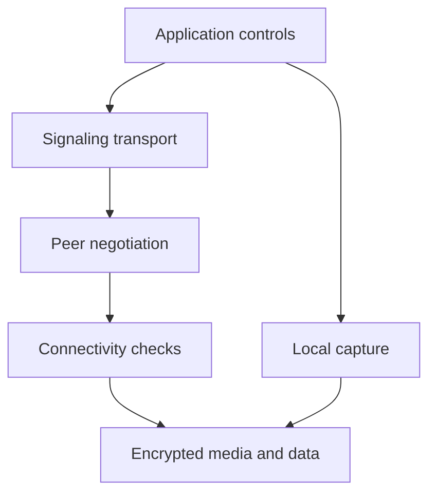

# 1. A real-time system you can reason about

## Begin with the problem

Imagine building a browser tool that lets two developers discuss a screen. Each person needs to hear the other while speaking, see a moving image, and send small messages. Uploading a completed video file cannot solve this problem: by the time the file arrives, the conversation has moved on. We need a continuous pipeline whose usefulness depends on both arrival and timing.

WebRTC supplies browser APIs and interoperable protocols for exchanging audio, video, and application data. TypeScript helps us express the application around those APIs. It does not replace the browser's networking implementation. Your TypeScript code requests capture, attaches tracks, exchanges descriptions, reacts to state changes, and renders results. The browser performs encoding, packetization, connectivity checks, encryption, congestion control, and decoding.

This distinction makes the subject manageable. You do not need to implement a codec to build a call. You do need to understand enough about codecs to diagnose a negotiated format that one endpoint cannot decode. Likewise, you do not write ICE packets yourself, but you must supply reachable infrastructure and carry ICE information between endpoints.

Our recurring project is a small calling tool named the lab. Start with its camera-free local call. A moving canvas becomes a video source, one peer sends it, and another receives it. That is actual WebRTC traffic, even though both peers live in one tab. Later, two tabs exchange signaling through BroadcastChannel. Internet deployment is a separate step because a same-machine success proves much less than a call across independent networks.

## Three planes and their responsibilities

A useful first division is application control, signaling, and media/data transport. Application control answers questions such as who may join, who is speaking, and whether recording is allowed. Signaling carries the information endpoints need to establish or modify a connection. Media transport carries the time-sensitive audio and video; the data channel carries application messages over the negotiated connection.

These responsibilities can share infrastructure, but they should remain separate in your reasoning. A successful login does not mean media is flowing. A connected signaling socket does not mean ICE found a route. A connected peer does not guarantee a video element is playing. Each statement requires different evidence.



This diagram expresses dependencies rather than a strict one-time timeline. After a call connects, changing the media arrangement may require another negotiation. Moving from Wi-Fi to another network may require new connectivity work. The application therefore manages a session over time; it does not merely execute a connection recipe once.

A signaling server usually handles comparatively small control messages. A TURN server relays encrypted packets when required. An SFU, introduced in Chapter 9, is a media endpoint that forwards streams in group calls. Calling all three a “WebRTC server” obscures their different costs and trust boundaries.

## The practical web prerequisites

A browser runs JavaScript. TypeScript adds compile-time descriptions that are removed before execution. The DOM is the browser's object model for the document. A video element is a DOM object; assigning a MediaStream to its `srcObject` connects a media source to that presentation surface.

A secure context is a browser security classification, usually provided by HTTPS, with localhost receiving special development treatment. Camera and microphone capture require a suitable context and permission. Loading a page successfully over ordinary HTTP on a private LAN address does not establish the same privileges as localhost. This distinction will matter when moving the lab to another computer.

An origin consists of scheme, hostname, and port. `http://localhost:4173` and `http://localhost:4174` are different origins. BroadcastChannel communication is origin-scoped and may also be affected by browser storage partitioning. For the two-tab experiment, use the same address in the same browser profile. A private window, another profile, or another machine should not be expected to join that channel.

A module is a JavaScript file with explicit imports or exports. The browser resolves `./peer.js` relative to the importing module. Our canonical sources end in `.ts`, while their import paths end in `.js` because the build creates JavaScript files at those locations. This is a project convention, not a claim that browsers understand TypeScript source directly.

## Running the delivered project

From the extracted package root, use Node 24.22.1, the runtime used for the included execution checks:

```bash
npm run build
npm start
```

Open `http://localhost:4173`. The project has no package dependencies to download. The build uses Node's TypeScript stripping facility to remove erasable annotations and writes the browser modules into `companion/dist`. It does not run the TypeScript type checker. That limitation is recorded because successful stripping is weaker evidence than a strict type check.

The prebuilt directory is also included. If you only want to use the existing lab, `npm start` serves it. Run the build after editing source. The server binds to the local machine, which keeps the initial experiment focused and avoids implying that the development server is an internet signaling service.

Use Start local call. You should see the moving source on the left and its received version on the right. The event log should eventually show an open data channel. The exact sequence of intermediate events may differ between browsers. Inspect evidence by layer: a local image proves capture and rendering; the remote image proves the receive path; the data channel log proves a separate application transport became usable.

If a browser has no usable WebRTC implementation, the relevant call will fail and the log will show an error. If port 4173 is occupied, choose another with the `WEBRTC_LAB_PORT` environment variable. On PowerShell, for example, set `$env:WEBRTC_LAB_PORT = '4174'` before `npm start`, then use that port consistently in both tabs.

## TypeScript types that earn their place

Consider a function that displays an error:

```ts
export function errorMessage(error: unknown): string {
  if (error instanceof Error) {
    return `${error.name}: ${error.message}`;
  }
  return String(error);
}
```

`unknown` means the function has not established what the value is. That is appropriate for a caught exception: JavaScript permits throwing values other than Error objects. The `instanceof` check narrows the type and permits access to the error's name and message. This small boundary pattern prevents diagnostics from failing while reporting the original failure.

By contrast, `as RTCPeerConnection` does not validate a received value or construct a peer. A type assertion tells the compiler to accept your claim. It supplies no runtime proof. This becomes particularly important at signaling boundaries, where JSON received from another system must be checked before it reaches a browser API.

Use a discriminated union to express mutually exclusive messages:

```ts
type Signal =
  | { kind: 'description'; description: RTCSessionDescriptionInit }
  | { kind: 'candidate'; candidate: RTCIceCandidateInit };

function describe(signal: Signal): string {
  if (signal.kind === 'description') {
    return `Received ${signal.description.type}`;
  }
  return 'Received an ICE candidate';
}
```

The string `kind` is the discriminator. Checking it establishes which properties exist. The browser's DOM type definitions provide the RTC types in a conventional TypeScript project with DOM libraries enabled. They are compile-time declarations; the actual constructors and methods come from the browser.

Notice that this union describes already validated application data. Writing `JSON.parse(text) as Signal` skips validation. Chapter 4 shows how to distinguish a trusted internal type from an untrusted envelope, and why call identifiers matter in addition to object shape.

## Promises, events, and ordering

A Promise represents a result that may become available later. `await` pauses the current asynchronous function until that promise settles. It does not block the browser's event loop and it does not pause unrelated event handlers.

```ts
async function openCamera(): Promise<MediaStream> {
  const stream = await navigator.mediaDevices.getUserMedia({
    video: true,
    audio: false
  });
  return stream;
}
```

The function immediately returns a Promise. Permission may take time, fail, or remain unanswered. While it is waiting, the user can press Stop. If capture later succeeds, your application must decide whether the stream still belongs to an active session. Without that decision, a stopped call can unexpectedly reacquire a camera.

An event listener is different from an awaited result. `pc.addEventListener('track', handler)` registers code to run when the browser reports a track. The registration itself does not wait for a track and supplies no guarantee that one will arrive. A callback marked `async` returns a Promise, but most browser event dispatch does not wait for that Promise before dispatching the next event.

This explains a common signaling bug. Two messages arrive in order, but their handlers each start an asynchronous operation. If the second operation depends on the first completing, arrival order alone is insufficient. You need to serialize the relevant operations. We will use a Promise chain for incoming signaling; this makes the application order explicit without pretending the whole browser runs synchronously.

## Resource ownership and cancellation

A call owns more than a peer connection. It may own camera tracks, screen tracks, animation timers, data channels, polling tasks, event listeners, and object URLs. A useful design rule is that every acquisition should have a known release point.

| Resource | Typical acquisition | Typical release |
| --- | --- | --- |
| Local media track | Capture request | `track.stop()` |
| Peer connection | `new RTCPeerConnection()` | `pc.close()` |
| Timer | `setInterval()` | `clearInterval()` |
| Listener | `addEventListener()` | Remove listener or dispose owner |
| Blob URL | `URL.createObjectURL()` | `URL.revokeObjectURL()` |

Closing a peer connection does not stop a camera track you acquired separately. Removing a video element does not close the connection. Muting a preview does not mute a microphone's transmitted audio. These are independent objects with independent responsibilities.

A generation counter gives delayed work a clear ownership test:

```ts
let generation = 0;
let stream: MediaStream | undefined;

async function startPreview(video: HTMLVideoElement) {
  const startedIn = ++generation;
  const acquired = await navigator.mediaDevices.getUserMedia({ video: true });
  if (startedIn !== generation) {
    acquired.getTracks().forEach(track => track.stop());
    return;
  }
  stream?.getTracks().forEach(track => track.stop());
  stream = acquired;
  video.srcObject = acquired;
}

function stopPreview(video: HTMLVideoElement) {
  generation++;
  stream?.getTracks().forEach(track => track.stop());
  stream = undefined;
  video.srcObject = null;
}
```

The fragment expects an existing video element and two buttons that call these functions. Starting increments the generation. Stopping increments it again. A late result from the older generation is stopped instead of being installed. This is logical cancellation: it does not cancel the browser's permission prompt, but it prevents a stale result from becoming active.

For overlapping replacement operations within the same call, add a separate media-operation generation or serialize them. A call generation distinguishes old calls; it does not automatically decide which of two current camera selections should win. Distinguishing those two scopes is a practical concurrency skill you will reuse throughout the book.

## Just enough networking

An IP address identifies a network destination, a port distinguishes transport endpoints on a host, and a protocol defines how messages are exchanged. A private address is usually meaningful only within a local network. A NAT device maps internal traffic onto externally visible addresses and ports. A firewall decides which traffic may pass. NAT and firewall behavior can coexist, but they are different mechanisms.

TCP provides an ordered reliable byte stream. UDP provides datagrams without promising delivery or ordering. Real-time media commonly uses UDP because a late audio packet can be less useful than a missing one. That does not mean WebRTC ignores reliability: media protocols, retransmissions, loss recovery, and congestion control make deliberate tradeoffs. Data channels can provide reliable ordered messages even when their underlying path includes UDP.

Latency is delay. Bandwidth is a capacity or rate, depending on context. Throughput is the rate actually achieved. Jitter describes variation in arrival timing. Loss describes missing packets, but different measurement points can report different loss. Keep the units visible: bits per second for encoded rate, bytes for buffers, milliseconds or seconds for time.

Suppose a path can carry 2 megabits per second and your application continually offers 4 megabits per second. A queue may grow. If 1 megabit of traffic is waiting and the link serves 2 megabits per second, draining that queue requires roughly half a second, even before new arrivals. More capacity helps, but controlling offered load is often the immediate solution. A high-resolution source is not automatically a high-quality conversational experience if it creates excessive delay.

## Frames, samples, and deadlines

Audio and video represent continuous experience using discrete units. A video source produces frames, while an audio source produces samples grouped into processing and transport units. A 30 fps video has a nominal interval of one thirtieth of a second, about 33.3 ms, between frames. That does not require one network packet per frame; a compressed frame may occupy several packets, and transport can deliver them with uneven timing.

An audio sample rate describes samples per second for the signal representation. It is not the packet rate and it is not the encoded bitrate. If a representation uses 48,000 samples per second, grouping 20 ms of time corresponds to 960 samples per channel because 48,000 multiplied by 0.020 equals 960. A codec can represent those samples with far fewer bits than an uncompressed sample array would require. The browser manages these details, but distinguishing their units prevents misleading calculations.

Real-time usefulness depends on deadlines. A historical file download can wait for a missing byte and still deliver a correct file. A conversation cannot wait indefinitely for each missing audio interval. Some recovery is valuable, but delaying all subsequent sound for a very late packet can hurt more than concealing the gap. That is why reliable file transfer and conversational audio need different policies even when they share the same physical connection.

The browser integrates encoding, feedback, and timing to make those tradeoffs. Your application's role is to avoid defeating them. Do not send raw camera images through a reliable data channel merely because that channel was easy to open. Doing so creates a new media pipeline whose pacing, recovery, synchronization, and codec behavior you must now design. Use media tracks for ordinary audiovisual communication and data channels for application data with explicitly chosen semantics.

## A bounded learning environment

The book assumes comfort with variables, functions, objects, and basic browser interaction. It introduces TypeScript boundary types and asynchronous ownership locally because those are essential to WebRTC correctness. It does not require calculus, a codec implementation, or a native C++ build. The advanced destination is practical browser and service engineering in TypeScript, with enough protocol understanding to read precise specifications and diagnose real failures.

Keep the initial project small while learning. A UI framework can be added later, but a framework does not change offer/answer rules or release a camera automatically. Native browser APIs make the ownership boundaries visible. Once those relationships are understood, a framework component can subscribe to session state and render controls without becoming the owner of every transport object.

The remaining chapters repeatedly return to one question: what evidence would establish that this particular layer worked? That question prevents accidental assumptions from accumulating. It also gives you a useful way to study unfamiliar real-time systems: identify the representation, the owner, the transition, and the observable result before adding another abstraction.

## What this first experiment establishes

The local call is deliberately bounded. It establishes that the browser can negotiate two endpoints, transport a generated video, and open a data channel in a controlled environment. It does not establish camera hardware compatibility, permission behavior on every platform, traversal through a corporate firewall, TURN authentication, or mobile performance.

That boundary is useful rather than disappointing. It isolates variables. When an internet call fails later, you can compare it with a known local pipeline. If local media works but ICE never connects remotely, focus on signaling and reachability before changing camera constraints. If transport connects but video never plays, inspect receiving and presentation before buying a TURN service.

The core engineering habit is now in place: separate responsibilities, identify ownership, and seek evidence for each transition. The next chapter applies that habit to the first real resource users entrust to the application: their camera and microphone.

**References for this chapter:** [WebRTC peer connection guide](https://webrtc.org/getting-started/peer-connections), [W3C WebRTC API](https://www.w3.org/TR/webrtc/), and the source ledger in `research-resources.md`. The explanations and numerical examples here are original instructional material.
