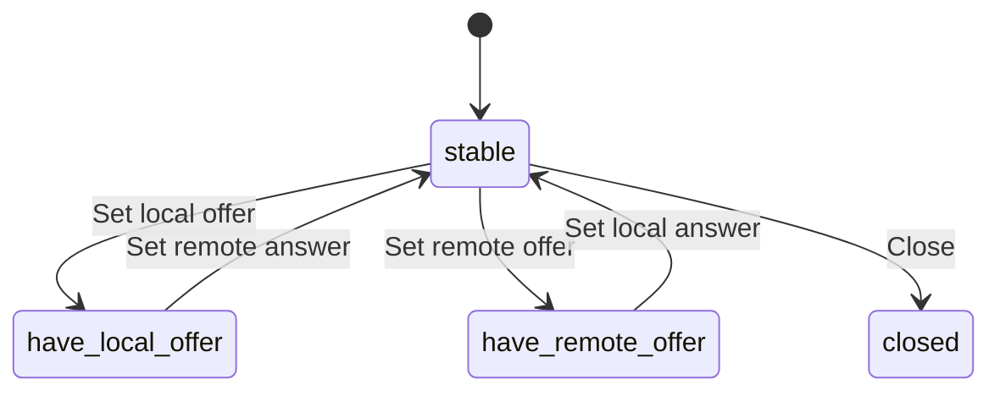

# 3. Two peers, one negotiated conversation

## Why capture does not create a call

A camera stream tells one browser where its local media comes from. It tells the other browser nothing. The endpoints still need to agree on what they intend to exchange, which formats they can understand, and which transport information to use. RTCPeerConnection manages this negotiated relationship.

The word peer refers to a protocol endpoint, not necessarily another browser tab. A peer can be a browser, an SFU, a recording gateway, or another compatible implementation. In the first lab, each RTCPeerConnection is one endpoint, and both happen to be in the same JavaScript process. Do not reuse one connection object as if it represented both ends of a remote relationship.

A connection can carry multiple media tracks and data channels. The application attaches a track through an RTCRtpSender. Incoming media is associated with an RTCRtpReceiver. A transceiver pairs a sender and receiver for a negotiated media section. We will use `addTrack()` first because it expresses a clear intent: make this local track available for transmission.

Descriptions are exchanged through signaling, a mechanism you supply. For now, a function call carries a description directly to the other local peer. This removes the signaling service while retaining the actual offer/answer and transport behavior. Chapter 4 replaces the delivery mechanism without changing the fundamental relationship.

## A minimal loopback sequence

The following browser function is complete for a data-only local connection. Call it from a button and close the returned peers when finished. It deliberately gathers all candidates before exchanging descriptions, which makes the initial sequence easier to inspect. It is a teaching implementation, not the companion's more flexible negotiation controller.

```ts
async function gatherAll(pc: RTCPeerConnection): Promise<void> {
  if (pc.iceGatheringState === 'complete') return;
  await new Promise<void>((resolve, reject) => {
    const timeout = setTimeout(() => {
      cleanup();
      reject(new Error('ICE gathering timed out'));
    }, 10000);
    function cleanup() {
      clearTimeout(timeout);
      pc.removeEventListener('icegatheringstatechange', changed);
    }
    function changed() {
      if (pc.iceGatheringState === 'complete') {
        cleanup();
        resolve();
      }
    }
    pc.addEventListener('icegatheringstatechange', changed);
    changed();
  });
}

export async function localDataCall() {
  const left = new RTCPeerConnection({ iceServers: [] });
  const right = new RTCPeerConnection({ iceServers: [] });
  right.addEventListener('datachannel', event => {
    event.channel.addEventListener('message', message => {
      console.log('Right received:', message.data);
    });
  });
  const channel = left.createDataChannel('hello');
  channel.addEventListener('open', () => channel.send('First message'));
  try {
    await left.setLocalDescription(await left.createOffer());
    await gatherAll(left);
    if (!left.localDescription) throw new Error('Missing offer');
    await right.setRemoteDescription(left.localDescription);
    await right.setLocalDescription(await right.createAnswer());
    await gatherAll(right);
    if (!right.localDescription) throw new Error('Missing answer');
    await left.setRemoteDescription(right.localDescription);
    return { left, right, channel, close: () => {
      channel.close(); left.close(); right.close();
    } };
  } catch (error) {
    left.close(); right.close(); throw error;
  }
}
```

Creating the data channel before the offer gives the initial negotiation something to describe. An empty peer with no media or data may have no meaningful application section to establish. The right peer listens before negotiation begins, so it can react when its corresponding channel appears.

`createOffer()` produces a proposal. `setLocalDescription()` installs that proposal as the local peer's current negotiation intent and starts associated work, including gathering. `setRemoteDescription()` installs the received intent on the other endpoint. The answer must then travel back and become the original offerer's remote description.

The wait helper observes gathering completion and removes its listener afterward. The ten-second timeout is an application policy to avoid waiting indefinitely; it is not a standards-defined gathering duration. Reading `localDescription` after gathering matters because it can include candidates collected since the original offer object was created. A saved offer object from before gathering is not a substitute for the updated description in this non-trickle example.

## Trace the intermediate states

Before negotiation, both peers have signaling state `stable`. Once left installs its offer, left becomes `have-local-offer`. Once right installs that same offer as remote, right becomes `have-remote-offer`. Right installs its answer and returns to stable. Left installs that answer and returns to stable as well.



The diagram covers ordinary offer/answer transitions and omits provisional answers and rollback. It describes signaling state, not network state. A peer can be signaling-stable while connectivity is still checking. “Stable” means no offer/answer exchange is pending, not that video is smooth or that the internet route is reliable.

`createOffer()` alone does not advance the signaling state. This distinction becomes important in simultaneous negotiation: an application can be making an offer while the browser's signaling state still says stable. Chapter 4 adds an explicit flag for that interval.

The expected message output is `Right received: First message`, but it appears only after transport and channel establishment. The function can return before the channel opens. The returned connection objects represent a live ongoing system; returning them is not a synchronous proof that transmission has completed.

## Read SDP as a description

Session Description Protocol, or SDP, is a text representation of session information. You should be able to inspect it without treating it as a string template you manually invent. Browsers generate SDP based on their supported capabilities and the objects you configure.

A typical media section begins with an `m=` line. Attribute lines begin with `a=`. A `mid` identifies a media section within the negotiated session. Codec mappings connect numeric payload types to codec names and clock rates. Direction attributes express sending and receiving intent. ICE credentials and certificate fingerprints support transport establishment and security.

Here is a schematic excerpt. It is deliberately incomplete and must not be passed to `setRemoteDescription()`:

```sdp
m=video 9 UDP/TLS/RTP/SAVPF 96
a=mid:0
a=sendrecv
a=rtpmap:96 VP8/90000
a=ice-ufrag:illustration
a=fingerprint:sha-256 00:11:22:...
```

The payload type 96 is a negotiated identifier, not a global promise that 96 always means VP8. The clock rate 90000 describes RTP timestamp units for this codec context; it is not a 90,000-frame-per-second video. The number 9 in such generated transport descriptions is not a port you should open on your application server. Actual connectivity is determined through the ICE information and checks.

The companion's SDP inspector selects a small set of lines to make these relationships visible. It does not parse every SDP rule and it does not rewrite a description. That scope is useful: inspect what the browser generated, then explain why it generated it from your transceivers and capabilities.

## What an offer and an answer agree on

An offer describes possibilities and intent. An answer selects a compatible arrangement under the offer/answer rules. An answer cannot arbitrarily invent a different session unrelated to the offer. Both endpoints can have different local capabilities and still agree on a common subset.

This makes codec negotiation different from choosing an HTML video source. The sender and receiver must agree on a format, and the browser may need a usable encoder and decoder for that arrangement. The most advanced codec installed somewhere in the system is not automatically the right choice for every peer or hardware device.

Directions are relative to the endpoint whose description you are reading. `sendonly` in one side's description corresponds to receiving intent on the other side. A browser with a receive-only video transceiver can request incoming video without having a local camera track. Requesting to receive does not compel the remote application to attach a camera; application control still decides what is published.

A media section may be inactive or rejected. Inspect negotiated state rather than inferring that every section in an offer became an active stream. The eventual transceiver `currentDirection` describes the negotiated direction, while `direction` is the application's desired direction. During a negotiation they need not match yet.

## Add video to the data-only example

To extend the earlier sequence, acquire or generate a stream before creating the offer. Attach each desired track to left, then let right handle the incoming track event. The following integration fragment belongs before `left.createOffer()`:

```ts
// source is an owned MediaStream; remoteVideo is an HTMLVideoElement.
for (const track of source.getTracks()) {
  left.addTrack(track, source);
}
right.addEventListener('track', event => {
  const stream = remoteVideo.srcObject instanceof MediaStream
    ? remoteVideo.srcObject
    : new MediaStream();
  if (!stream.getTracks().includes(event.track)) stream.addTrack(event.track);
  remoteVideo.srcObject = stream;
  void remoteVideo.play().catch(console.error);
});
```

The stream argument in `addTrack()` carries grouping information; it is not the transport itself. An incoming track event can have an empty `streams` array when the sender used streamless tracks. Building an explicit receiving stream avoids assuming that `event.streams[0]` always exists.

Do not repeatedly add the same track whenever the component renders. Attachment is a session operation, not a presentation operation. If your UI framework renders ten times, the peer should not gain ten senders. Keep peer construction and track publication under an explicit owner with a well-defined start and end.

The companion uses a canvas stream. The sender's original track can be replaced by a camera track while the remote receiver continues representing the same media relationship. This is why the receiving UI should identify logical publication or participant roles separately from the local device identifier.

## Multiplexing does not erase logical identity

One peer connection can carry audio, camera video, screen video, and data while sharing transport resources. BUNDLE is a negotiated arrangement that lets multiple media sections use a common transport. RTP/RTCP multiplexing also affects how control and media use transport resources. These mechanisms reduce the number of separate network endpoints the application must establish, but they do not collapse all media into one logical track.

This distinction explains why a single connected transport can coexist with one failed video publication. The route may be healthy while one transceiver is inactive, one sender has no live source, or one decoder lacks usable frames. Transport evidence should be shared in your diagnostic model, while publication-specific evidence remains separate.

Several identifiers exist because they solve different correlation problems. A mid names a negotiated media section in this peer context. An SSRC names an RTP synchronization source in its media context. A track ID identifies a browser media track object or negotiated track identity under the API rules. A participant ID is your application's identity. A publication ID names a logical source such as a person's camera. None should be substituted for all the others.

For example, a person reloads their tab. The application may recognize the same participant account, but the new peer connection and track objects are different. If your UI keys the participant roster by the old track ID, the person can appear twice. If it keys all media by participant alone, their screen and camera can overwrite each other. Maintain explicit relationships rather than guessing identity from whichever transport field is convenient.

## Description state is pending work as well as agreement

The browser distinguishes local and remote descriptions and, at a more detailed level, pending and current descriptions. During negotiation, a proposed arrangement can be pending while the previous agreed arrangement remains relevant. This is why inspecting one convenient SDP string is not always enough to explain what the session is currently doing.

Suppose a call already sends camera video. A adds a screen transceiver and creates an offer. That offer describes the proposed expanded session. Until the exchange completes, the application should not assume the screen publication is negotiated simply because the pending offer contains a second video section. If the offer is rolled back, the intended change can remain an application intention without becoming the current agreement.

Use browser objects as the operational interface and SDP as evidence. After a completed exchange, inspect transceiver currentDirection and relevant sender/receiver state. During a collision, preserve the difference between what the application wants and what the peer has agreed to. This avoids presenting an unnegotiated publication as successfully shared.

The browser's operation ordering handles many details, but the application still owns routing and lifetime. A current description on an old closed peer is irrelevant to a new active peer. A saved answer for a previous offer is not made current by its text looking plausible. These are session identity problems, which the next chapter addresses through message envelopes and deterministic negotiation roles.

## A local call is still asynchronous

Even when both endpoints are in one tab, native media and transport work proceeds asynchronously. Do not use the absence of a network signaling service as a reason to expect immediate open events. The local experiment intentionally retains those asynchronous boundaries, making it useful for learning event registration, promise sequencing, and teardown before introducing internet variability.

Register receivers before creating the action that can emit them. Keep the peers reachable while the experiment runs. Close them explicitly when finished. These simple rules prevent a local demo from teaching accidental timing assumptions that later fail when signaling crosses a server.

## Several state machines coexist

RTCPeerConnection exposes multiple state properties because multiple subsystems progress independently. `signalingState` tracks description exchange. `iceGatheringState` tracks candidate collection. `iceConnectionState` tracks ICE connectivity. `connectionState` aggregates relevant transport states, including the security transport. A data channel additionally has its own readyState.

Suppose descriptions exchange successfully, candidate checks fail, and no data channel opens. The evidence can be: signaling stable, gathering complete, ICE failed, connection failed, channel connecting. Rewriting your chat message serializer will not repair that route. Conversely, a channel can be open while a newly added media track is still negotiating or failing to render.

Log state transitions with timestamps and a call identifier. Avoid polling all states at high frequency when events already tell you when they change. For debugging, state history is more useful than a single screenshot of the final state, because a brief disconnected interval followed by recovery differs from a call that never connected.

## Encryption and the identity boundary

WebRTC media uses secure transport; data channels also run over a secure transport stack. A browser does not offer a normal unencrypted RTP mode for ordinary WebRTC web applications. This protects packets on the selected route, including when a TURN relay forwards them.

The identity boundary still matters. Negotiated fingerprints are carried through signaling. If an attacker can replace the endpoint's signaling information and impersonate an authorized participant, packet encryption alone does not establish that the peer is the person your UI claims. Authenticate participants and protect signaling integrity. Chapter 10 develops this threat model without equating transport security with every possible application security guarantee.

A TURN relay generally forwards encrypted traffic without becoming the media decryption endpoint. An SFU ordinarily terminates a WebRTC security association and establishes others for subscribers. Those two server roles therefore have different access to content. Adding application-level end-to-end encryption changes the SFU trust boundary, but it also changes recording and processing options.

## Why we avoid SDP text surgery

You may find examples that alter SDP with string replacement. This can appear convenient for forcing codecs, bitrates, or directions. It also risks creating internally inconsistent descriptions, depending on browser-specific formatting, and bypassing supported object-level APIs.

Prefer transceiver direction, codec preferences where supported, sender parameters, and track replacement for their intended purposes. Read SDP to verify what was negotiated. Change it only when you have a narrowly understood interoperability requirement, matching tests, and a plan for browser changes. An expert knows where the representation matters; expertise does not require editing every text field manually.

The same principle applies to example code found online. Older tutorials may use callback-based APIs, `addStream`, or Plan B assumptions. Translate the underlying idea into current track/transceiver APIs rather than mechanically combining old and new code. The official sample collection is useful for inspecting individual behaviors, but even an official sample is an experiment with a scope, not a complete production architecture.

## A failure trace you can diagnose

Imagine left logs `have-local-offer`, right logs `have-remote-offer`, then left throws when receiving the answer. Start by checking that the answer belongs to this peer pair and this negotiation. Accidentally routing an old answer from a previous call can produce a state error even when the SDP is syntactically valid.

Next verify ordering: did left actually install its local offer before the answer was applied? Did an asynchronous callback replace the peer object? Is the same signaling message being processed twice? Preserve the error and signaling-state history. Blindly catching every exception and calling `createOffer()` again can hide the original problem and create additional collisions.

If both peers return to stable but no media arrives, continue down the layers: selected ICE path, transport state, sender attachment, outgoing counters, incoming counters, decoding counters, and playback. The whole reason to learn each object separately is to turn a vague “call broken” report into a narrow question with observable evidence.

You now understand the simplest offer/answer conversation and can inspect its intermediate states. A real application lets either participant change things at any time. The next chapter teaches how to preserve this clarity when signaling becomes asynchronous and both sides negotiate simultaneously.

**References:** [W3C WebRTC](https://www.w3.org/TR/webrtc/), [official samples](https://webrtc.github.io/samples/), and [peer connection introduction](https://webrtc.org/getting-started/peer-connections). Read the installed browser's behavior alongside these references rather than assuming universal feature parity.
