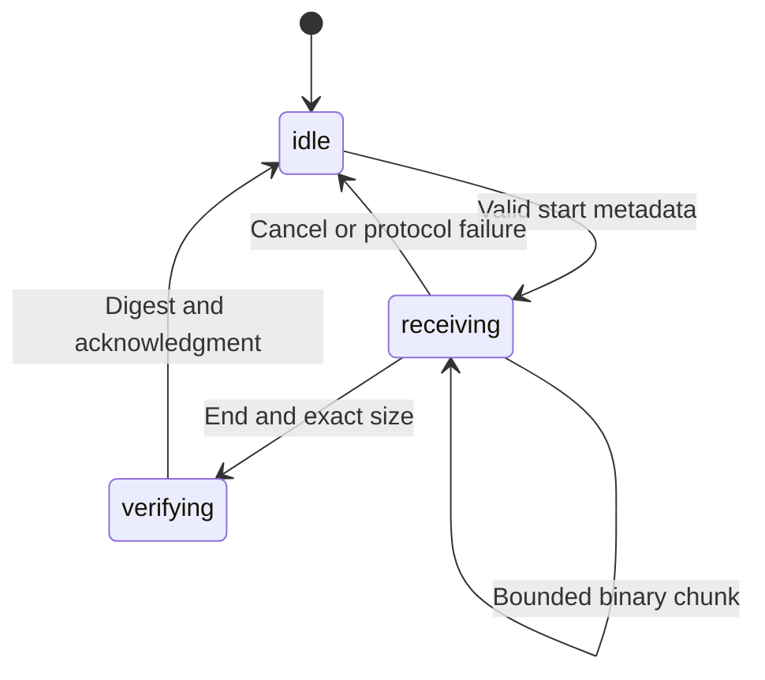

# 7. Data channels and bounded application protocols

## A transport is not yet a file-transfer application

A data channel lets connected peers exchange arbitrary messages. That is enough for a hello message, but not enough to define a useful file transfer, multiplayer update protocol, or shared editor. Your application must decide how messages are interpreted, how much memory they may consume, what completion means, and how interruption is handled.

Unlike WebSocket's byte-stream transport underneath framed messages, WebRTC data channels use SCTP over DTLS in the WebRTC stack. They can provide reliable ordered delivery or selected forms of partial reliability. The browser handles the protocol machinery. Your TypeScript code chooses channel properties and builds application semantics above them.

The companion implements a deliberately bounded synthetic transfer. The sender creates bytes with a deterministic pattern, announces a size and SHA-256 digest, sends chunks, and sends an end marker. The receiver enforces the announced size, reconstructs the buffer, computes its digest, and returns an acknowledgment. This is a genuine transfer and integrity comparison, not a progress animation. It is also not a general resumable file-sharing service.

## Establish a channel before sending

Normally one endpoint calls `createDataChannel()`, and the other receives a `datachannel` event. The initial creation can trigger negotiation when the connection has no existing data transport. Opening additional in-band channels on an already negotiated data transport generally does not require a new SDP exchange for each channel.

```ts
// Integration fragment: negotiation and signaling are already installed.
const outgoing = pc.createDataChannel('chat');
outgoing.addEventListener('open', () => {
  outgoing.send(JSON.stringify({ type: 'hello', text: 'Connected' }));
});
pc.addEventListener('datachannel', event => {
  const incoming = event.channel;
  incoming.addEventListener('message', message => {
    console.log('Message:', message.data);
  });
});
```

The label is application metadata, not a globally unique identifier. Both endpoints calling createDataChannel with the same label creates two channels rather than automatically pairing those calls into one. Decide which side creates each in-band channel and route received channels by an agreed purpose.

With `negotiated: true`, both sides explicitly create the corresponding channel with the same agreed ID instead of relying on in-band establishment. This is a specialized contract that your signaling must coordinate. The remote datachannel event should not be expected to establish that manually negotiated channel for you.

The readyState transitions through connecting, open, closing, and closed. `send()` is not a wait-until-open operation. Check state and react to the open event. A send call can fail if the channel is not usable or the buffer cannot accept the message; a momentary state check does not eliminate the need to handle errors.

## Match reliability to the information

Chat messages, file chunks, and document edits usually need reliable handling. A live cursor position can become obsolete as soon as a newer position exists. Retransmitting every lost cursor update can waste capacity and delay fresher information. The right transport policy follows the data's meaning.

```ts
const reliable = pc.createDataChannel('document');
const latestPosition = pc.createDataChannel('cursor', {
  ordered: false,
  maxRetransmits: 0
});
```

The first channel uses reliable ordered defaults. The second permits unordered delivery and does not retransmit lost messages. That does not guarantee low latency or guaranteed delivery; it expresses a tradeoff. The application still needs to handle dropped and reordered updates.

`maxPacketLifeTime` limits how long delivery may be attempted, while `maxRetransmits` limits retransmission attempts. Do not specify both as though they were independent additive controls. Check browser support and allowed values. Neither setting turns a channel into a durable message queue that survives the peer connection closing.

For latest-state updates, include a sequence number or monotonic revision and discard stale arrivals. A shared editor is different: a later operation may depend on an earlier one, so dropping intermediate operations can corrupt state. Reliable transport still does not solve concurrent editing; operational transformation, CRDTs, or a central authoritative model address different consistency questions.

## Message boundaries and binary data

Data channels preserve message boundaries at the API. Sending two strings results in two message events, rather than an arbitrary stream of partial strings. Binary messages can be ArrayBuffers, typed-array views, or Blobs under the supported API forms. Set binaryType according to the representation you intend to receive.

The lab uses `arraybuffer`, making each binary message easy to wrap in a Uint8Array. A Uint8Array represents bytes with values from 0 to 255. A view may cover only part of an underlying ArrayBuffer, so code that blindly sends `view.buffer` can accidentally include unrelated prefix or suffix bytes. Sending the view or an explicitly bounded slice makes the intended range clear.

Text length and encoded byte length are not interchangeable. A JavaScript string uses UTF-16 code units, while network text encoding has its own byte representation. If your protocol imposes a byte limit, use TextEncoder or the actual transmitted representation to measure it. A limit of 2,000 characters is not necessarily a limit of 2,000 bytes.

Do not use innerHTML to display received chat text. A peer is an untrusted input source even in an encrypted call. Assign textContent or use a framework's escaped text rendering. Transport encryption prevents some network tampering; it does not make a remote participant's message safe HTML.

## Backpressure: the producer can outrun the network

A JavaScript loop can enqueue data much faster than the path can transmit it. If you read a large file and call send repeatedly without a bound, browser buffering can grow and memory can spike. Media sharing the route may also suffer from excess offered load.

`bufferedAmount` reports bytes currently queued for the channel. `bufferedAmountLowThreshold` defines a threshold for a low-buffer event. These let the application pause production until there is room. They do not tell you that the remote application has received, validated, or persisted the data.

The companion uses a high watermark of 256 KiB and a low threshold of 64 KiB. Above the high watermark, it waits until buffering drops to the low threshold. The gap avoids waking the producer for every tiny decrease. These values are teaching choices, not a universal optimum.

```ts
// Integration fragment; sendBuffer and waitForDrain are complete in transfer.ts.
if (channel.bufferedAmount > 256 * 1024) {
  await waitForDrain(channel, abortSignal);
}
channel.send(chunk);
```

The wait helper handles more than the happy path. It rejects on close, error, cancellation, and timeout. It removes every listener it installed. It rechecks buffer and state after registration so a transition between the first check and listener attachment does not leave the wait hanging forever.

This lifecycle reasoning is the same as capture cancellation. Waiting for an event creates an owned resource. If the call ends while waiting, the helper must settle and release its listeners. A dangling Promise can retain state even after the visible UI has reset.

## Pick chunk size from a known bound

SCTP can fragment messages internally, but arbitrarily large application messages can cause interoperability and scheduling problems. The connection's SCTP transport exposes a negotiated maxMessageSize when available. A value of zero has a defined unlimited-size meaning in that context; it does not mean send zero bytes.

The lab chooses the smaller of 16 KiB and the negotiated finite maximum, using 16 KiB as a conservative local cap. It does not claim that 16 KiB is a standards-mandated WebRTC message size. Metadata messages must also fit the negotiated limit, and a generalized protocol should validate that before starting a transfer.

For a 1 MiB buffer, 16 KiB chunks produce 64 binary messages because 1,048,576 divided by 16,384 is 64. For an arbitrary length, the last chunk can be shorter. Advance offsets by the actual chunk length or by a fixed chunk size with a final bounded slice, ensuring no bytes are skipped or duplicated.

The payload pattern `bytes[i] = i % 251` creates deterministic data without external files. The prime-like choice 251 is not a cryptographic feature; it merely varies the byte values. SHA-256 then checks that the exact reconstructed byte sequence matches what the sender announced.

## Define the transfer protocol explicitly

The synthetic transfer uses one reliable ordered channel for both control messages and binary chunks. A start message declares size and digest. Binary messages follow. An end message indicates that the sender has enqueued all chunks. The receiver checks the observed count and digest, then sends an acknowledgment.



The diagram describes receiver application state. The browser's data channel has a separate state machine. A channel can remain open after one transfer ends, allowing another transfer. A production protocol would include a transfer identifier to distinguish multiple transfers, retries, acknowledgments, and cancellation.

The lab permits one incoming transfer per channel and caps it at 8 MiB. This keeps reconstruction easy to inspect without implying that holding a multi-gigabyte file in memory is safe. A production receiver should stream chunks to an appropriate storage sink when available, enforce user-approved limits, and support cleanup of partial data.

## Completion has several meanings

Calling send means the browser accepted a message for sending, subject to its API rules. A low bufferedAmount means local buffering has drained. Receipt of the end marker means the receiver got that marker on the reliable ordered channel after preceding messages. A valid digest means reconstructed bytes match the announced digest. Persistence means the receiver successfully committed the result to its chosen destination.

These are increasingly strong statements, and none should be substituted casually for another. The companion log says “enqueued” at the sender and “verified” at the receiver. It sends a receiver acknowledgment after digest calculation. It does not claim the data was saved as a file, because the lab does not perform file persistence.

A digest sent by the same peer as the data detects accidental corruption or assembly mistakes. It does not establish that the peer is trustworthy or that the content is benign. A malicious sender can supply a matching digest for malicious content. Authentication, authorization, safe rendering, and content handling remain application responsibilities.

For a resumable transfer, completion also requires a stable content identifier, chunk or range accounting, and a policy for reconnecting to an interrupted transfer. A new data channel is a new transport lifecycle; it does not automatically remember acknowledged application bytes. Define what can be replayed and how duplicate chunks are detected.

## Keep asynchronous receiver work ordered

Message events arrive in transport order on an ordered channel, but asynchronous work inside handlers can overlap. If every chunk is hashed or written using an await, the next handler can start before the previous write completes. Serialize storage operations or use a bounded producer-consumer queue so your application preserves its intended write order.

The synthetic lab avoids asynchronous chunk writes. It appends received ArrayBuffer chunks synchronously and computes a digest only after receiving the end marker. That is easy to understand for a bounded buffer. The end handler clears its incoming transfer state before awaiting the digest, which avoids treating subsequent control messages as additional chunks of a completed transfer.

A richer protocol should associate digest results and acknowledgments with transfer IDs. Otherwise a delayed digest from one transfer can be confused with another transfer's UI. The lab also checks the call generation after asynchronous hashing, preventing a completed calculation from updating a reset call's display.

## A file transfer needs a storage and trust policy

Extending the synthetic transfer to real files begins with a user-selected File object. Read bounded slices rather than converting a large file into one giant ArrayBuffer. A sender can announce a display name, MIME hint, size, and content identifier, but the receiver should treat those fields as claims. A filename is not a safe filesystem path, and a MIME hint does not prove content type.

Ask the receiver to approve meaningful transfers before allocating large resources or persisting content. Bound total size, concurrent transfers, per-message size, and partial-transfer lifetime. If the receiver supports a streaming file sink, serialize writes and handle failures. If it falls back to in-memory Blob assembly, state and enforce a much smaller practical bound.

Never automatically execute or render arbitrary received content with privileged behavior. Displaying a sanitized filename and offering an explicit download is different from opening received HTML inside the application origin. The fact that the bytes came from another person in the call does not change the browser security boundary.

For resume, define a stable transfer ID and content identity independently of channel identity. The receiver can report committed byte ranges or chunk identifiers, and the sender can retransmit missing ranges. An acknowledgment must state whether bytes were merely received in memory or committed to storage. That definition determines what can safely survive a browser crash or reconnect.

The delivered protocol keeps these concerns bounded by using synthetic data, a fixed memory limit, one incoming transfer per channel, and no persistence claim. Those constraints make the mechanics inspectable while giving you a clear list of contracts to add when moving from a transport experiment to a real file-sharing feature.

## Cancellation and interruption

Cancellation should have both local and protocol consequences. Locally, abort the producer, stop reading the file, settle drain waits, and clear owned buffers. Remotely, send a cancel control message when the channel is still usable, allowing the receiver to discard partial state. A closed channel can serve as an implicit cancellation, but that is less expressive if other work shares the channel.

The companion's Stop/reset aborts the current producer and closes the peers. It does not implement an in-channel cancel message because all work in that lab session ends together. If you add multiple transfers or shared collaboration features, cancellation must become per-transfer rather than per-call.

Timeouts also need scope. A drain timeout indicates local queued data is not clearing within policy. An acknowledgment timeout indicates the sender has not received application confirmation. Neither alone proves whether the receiver wrote data. Avoid retrying a non-idempotent action after a timeout without a message or operation identifier.

## Multiple channels still share resources

Creating separate channels for chat and bulk data can help organize semantics, but it does not create separate physical links. They share the peer connection's transport resources and compete with media on the path. Browser scheduling, SCTP capabilities, and message sizes affect how well they coexist.

A bulk file transfer should leave room for interactive media. Bound production and consider application pacing. On a constrained uplink, “send as fast as possible” can make the call unpleasant even if the transfer eventually succeeds. A control channel carrying important UI commands should not depend on a giant application message finishing first.

Unordered unreliable data is useful for state that can be replaced. It is not a universal performance mode. If your cursor packets all disappear during congestion, the UI should degrade gracefully. If the application cannot tolerate missing messages, reliability must be restored at some layer, and implementing it manually can be more complex than using the provided reliable channel.

## Run and interpret the transfer experiment

Start a local call and wait for the data channel open log. Send the default text and observe a receive entry. Choose 64 KiB, then 1 MiB. The receiver should report the exact byte count and a verified digest. Repeat after reset to establish that transfer state belongs to the current call.

Next, start a larger payload and press Stop. The expected product behavior is that the call ends, waiting work is cancelled, and no late verification updates the new idle session. Timing determines whether a small transfer completed before Stop, so a deterministic cancellation test needs a controlled slow or mocked drain path rather than relying on human button timing.

If the digest fails, inspect chunk boundaries, views, offsets, and expected size before blaming the network. Reliable transport plus transport integrity makes application assembly bugs a strong first hypothesis. If transfer never starts, inspect channel readyState. If it stalls under load, inspect bufferedAmount, receiver processing, and cancellation/timeout behavior.

The expertise gained here is broader than WebRTC. A network API gives you transport properties; a dependable application adds bounded memory, explicit states, correct completion claims, and meaningful recovery. The next chapter measures the media pipeline with the same care, turning counters into evidence instead of guessing from a blurry picture.

**References:** [RFC 8831 data channels](https://www.rfc-editor.org/rfc/rfc8831.html), [RTCDataChannel](https://developer.mozilla.org/en-US/docs/Web/API/RTCDataChannel), and [send](https://developer.mozilla.org/en-US/docs/Web/API/RTCDataChannel/send). Complete bounded transfer source is included in `companion/src/transfer.ts` and `companion/src/app.ts`.
