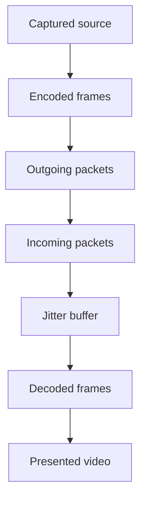

# 8. Turn statistics into useful evidence

## A blurry image is a symptom

A user says the call is bad. That report matters, but it does not identify a cause. The camera may be low resolution, the encoder may be constrained, the uplink may be congested, the receiver may be overloaded, or the video element may be displayed larger than the received resolution. A single generic “quality score” can hide all of those distinctions.

WebRTC exposes `getStats()` so applications can inspect monitored objects and their relationships. A report is map-like: IDs refer to records, and some fields refer to other records by ID. Read it as a graph associated with a particular peer connection, not as one flat object whose every property is present in every browser.

The first diagnostic skill is asking the narrowest useful question. “Are encoded bytes increasing?” differs from “Are decoded frames increasing?” Those questions locate a problem on different sides of the transport. Once you know which stage stopped advancing, you can investigate that stage instead of changing unrelated configuration.

The companion displays outbound and inbound rates, frame counters, packet-loss counters where available, and selected-path information. It deliberately preserves missing fields as unavailable. Filling a missing value with zero would invent evidence: zero loss measured is different from loss not reported.

## Establish the pipeline

A simplified video pipeline is source capture, encoding, packet transmission, packet reception, jitter buffering, decoding, and presentation. The sender can observe some stages; the receiver can observe others. Remote reports may convey additional evidence, but they do not make every stage visible from one endpoint with identical timing.



Each arrow is an opportunity for delay or failure. A working local preview establishes the capture-to-local-presentation path, which is different from encoding and sending. Incoming bytes establish transport arrival but not successful decoding. Decoded frames establish decoder progress but not that the intended video element is visible and playing.

A good incident record includes the call identifier, endpoint/browser information, timestamps, relevant state transitions, and a short window of counter deltas. Raw packet captures are not the first requirement for most application bugs. Start with structured evidence that your own application can collect consistently.

## Counters become rates through differences

Many statistics are cumulative counters. A bytesSent value of 500,000 is a lifetime total for that monitored object, not a bitrate. To compute a rate, compare two samples of the same object over a measured interval.

Suppose at 1,000 milliseconds a stream has sent 200,000 bytes. At 3,000 milliseconds it has sent 500,000 bytes. The difference is 300,000 bytes over 2,000 milliseconds, which is two seconds. There are eight bits in a byte, so the rate is 300,000 times eight divided by two: 1,200,000 bits per second, or 1.2 megabits per second in decimal units.

Let B be the cumulative byte count and t the stats timestamp in milliseconds. Then:

$$
r = \frac{8(B_2-B_1)}{(t_2-t_1)/1000}
  = \frac{8000(B_2-B_1)}{t_2-t_1}.
$$

The result is bits per second. The factor 1000 converts milliseconds to seconds. Omitting it produces a value a thousand times too small. Reporting bytes per second as bits per second produces a value eight times too small. Units are therefore part of correctness, not a cosmetic label.

```ts
type Sample = { timestamp: number; bytes: number };
export function bitrate(previous: Sample | undefined, current: Sample): number | null {
  if (!previous || current.timestamp <= previous.timestamp || current.bytes < previous.bytes) {
    return null;
  }
  return 8000 * (current.bytes - previous.bytes) /
    (current.timestamp - previous.timestamp);
}
```

The complete function is also in the companion. The first sample establishes a baseline and returns null. Nonincreasing time and a decreasing byte counter produce no rate instead of an invented negative bitrate. A new peer, new stream record, or changed stats ID requires a new baseline. Never subtract counters from unrelated records merely because both are labeled video.

## Record identity and aggregation

An outbound-rtp record usually describes one RTP stream, not necessarily the entire participant's video. Simulcast can create multiple encodings and related records. Summing appropriate stream rates can estimate a publication's aggregate media rate, but first identify which records belong together and avoid double counting.

Keep keys scoped to a peer connection and stats record ID. IDs are useful for linking repeated queries of that monitored object; they are not a persistent user identity across rebuilt connections. When a call resets, clear baselines. If an old polling request resolves after reset, ignore its result using the call generation.

Retransmission and header fields have defined counting semantics that differ by record. Decide whether your metric represents RTP payload, total network traffic, or application data. Comparing a media byte counter directly with a cloud network bill can be misleading because the latter may include headers, relay legs, and unrelated traffic.

When aggregating participants, name the population. An average across connected calls can hide users who never established media. Setup failure rate, time to first media, and in-call quality need separate denominators. A product that excludes failures from its quality dashboard can appear excellent while frustrating many users.

## Find the selected path through references

The transport record can expose a selectedCandidatePairId. Use that ID to find the candidate-pair record, then follow its localCandidateId and remoteCandidateId. This establishes which candidate types and protocols participate in the selected route.

```ts
// Integration fragment: report is the result of await pc.getStats().
report.forEach(record => {
  if (record.type !== 'transport' || !record.selectedCandidatePairId) return;
  const pair = report.get(record.selectedCandidatePairId);
  if (!pair) return;
  const local = report.get(pair.localCandidateId);
  const remote = report.get(pair.remoteCandidateId);
  console.log({ localType: local?.candidateType, remoteType: remote?.candidateType });
});
```

Follow the references rather than selecting the first candidate pair whose state looks successful. More than one pair may have succeeded or remain in a report. Selection is the fact you care about when determining the current path. Feature availability still varies, so handle missing records and fields gracefully.

A selected local relay candidate is useful evidence for TURN testing. Protocol and relay protocol details may help distinguish client-to-relay transport behavior. Do not print raw addresses into routine analytics unnecessarily. Candidate type, coarse transport information, and a pseudonymous call identifier often answer the operational question without retaining detailed network addresses.

## RTT is not total conversational delay

Candidate-pair currentRoundTripTime is a round-trip measure associated with the connectivity-check context. Remote-inbound-rtp statistics can provide other RTT evidence from media feedback. These are related network observations, but they are not interchangeable with full capture-to-playout delay.

Total one-way experience includes capture buffering, encoding, packetization, network travel, jitter buffering, decoding, and presentation. RTT divided by two is only an approximation of network one-way delay under assumptions about symmetry. It does not include all processing stages, and asymmetric routes break that approximation.

Imagine a candidate-pair RTT of 40 ms, an encoder adding 20 ms, a receiver jitter buffer averaging 80 ms, and decode/presentation adding another 20 ms. Even a rough sum shows why “40 ms latency” would be an incomplete product claim. Some components overlap, and actual measurement requires careful synchronization and instrumentation, so do not blindly add every reported metric as if they were independent serial stages.

## Jitter and the jitter buffer

Network packets do not arrive at perfectly regular intervals. The jitter buffer absorbs some variation so playback can be smoother. More buffering can prevent underflow but adds delay. A low-delay setting that constantly underruns may sound worse than a slightly larger stable buffer.

The jitter statistic is not the jitter buffer delay. The former describes timing variation under its defined calculation; the latter describes time spent in buffering. A chart labeled latency that combines them without explanation is misleading.

For records exposing cumulative jitterBufferDelay and jitterBufferEmittedCount, an average delay is cumulative delay divided by emitted count. For a recent interval, use the difference in delay divided by the difference in emitted count. The delay is measured in seconds, while emitted units are audio samples or video frames depending on the record.

For example, suppose video jitterBufferDelay increases by 9 seconds across 180 emitted frames. Nine divided by 180 is 0.05 seconds per frame, or 50 ms. This is an average waiting time for those emitted frames, not nine seconds of user-visible delay. If no frames were emitted during the interval, the denominator is zero and no interval average exists.

Do not divide jitter-buffer delay by packetsReceived. The accumulation unit is not simply one increment per packet, especially for video frames assembled from several packets. Match the numerator and denominator defined by the metric rather than choosing a nearby counter whose name sounds plausible.

## Loss, repair, and visible impact

A cumulative packetsLost counter is not a percentage. A rough interval loss fraction uses the interval change in lost packets divided by interval received plus interval lost, when those counters and their semantics support the calculation. Guard zero denominators and anomalous or corrected deltas rather than silently treating them as healthy zero loss.

Late arrivals and reporting corrections can complicate loss counters. Retransmission can recover useful content after an initial loss, while some received packets may still arrive too late for playback. Audio concealment can synthesize missing sound. Therefore raw packet loss, unrecovered media damage, and user-perceived quality are different observations.

For audio, concealedSamples and related counters can help establish how much output needed concealment where exposed. For video, freeze counts, decoded frame progress, and keyframe requests can add context. A two-percent loss rate spread evenly may affect experience differently from a long burst with the same average.

A useful dashboard combines transport evidence and media evidence. If retransmission rises but decoded frames remain smooth, recovery may be working. If freezes rise while packet loss stays low, inspect decoder load, source generation, and presentation before concluding that the network counter must be wrong.

## CPU and encoding constraints

Outbound quality limitation fields can indicate whether bandwidth, CPU, or another reason constrained video, where implemented. Total encoding time and encoded-frame deltas can estimate average encoding work per frame. Similarly, total decode time divided by decoded-frame count gives an average for that measured work.

Suppose totalDecodeTime increases by 1.8 seconds across 90 decoded frames. The average is 0.02 seconds, or 20 ms per frame. At 30 fps, a nominal frame interval is about 33.3 ms. This suggests meaningful decoder work, but it does not alone prove the decoder is the only bottleneck. Parallel processing, scheduling, and other streams matter.

A gallery with many videos can exhaust processing even when network throughput is comfortable. Limit subscriptions and select appropriate layers before trying to force every publisher into a lower global quality. The receiver's actual display layout is valuable input to a group-call quality policy.

## Poll without creating a second problem

Polling once per second is a reasonable teaching interval for rates. Production products may choose another interval based on cost and diagnostic needs. Polling hundreds of times per second is unlikely to improve user-level insight and can add overhead.

Use a single in-flight poll or a sequential async loop. `setInterval(async () => ...)` can overlap invocations if one takes longer than the interval. The companion uses a polling flag and a generation check. It also clears the timer when its owner is disposed. Those details keep measurement from outliving the thing being measured.

Store a bounded window or summarize data before sending it to analytics. Redact addresses and session descriptions according to the diagnostic purpose. Track missing-field coverage as well as metric values, so a browser that omits a metric does not appear healthier than one that reports an adverse value.

## Smooth noisy rates without hiding failure

A one-second rate can vary because of content, scheduling, keyframes, and measurement timing. A moving average can make a chart easier to read, but the raw samples remain important for diagnosis. Do not smooth a period of missing data into an apparently healthy continuing connection.

For example, three valid interval rates of 0.9, 1.5, and 1.2 Mbps have an arithmetic average of 1.2 Mbps if the intervals have equal duration. If durations differ, compute total bits divided by total elapsed time or use a duration-weighted average. Averaging rates without their interval lengths can bias a result when background throttling or delayed polls changes sample spacing.

A sudden counter reset requires a new baseline. It is not a zero-rate interval followed by a huge compensating spike. A missing record may mean a source ended, a stream was replaced, or the browser omitted information. Preserve that state explicitly and correlate it with application events. Charts should distinguish unavailable, inactive, and measured zero when those meanings differ.

Thresholds also require duration and context. One high RTT sample during a network switch may not justify rebuilding a call. Several samples with no received bytes and a failed transport state justify a different response. Combine the browser's discrete state evidence with continuous metrics instead of asking one noisy number to decide the entire session lifecycle.

A useful support view can show both a readable trend and the exact recent samples with units and timestamps. That lets an engineer reconstruct a calculation without requiring every user to interpret raw stats. The product UI can remain simple while the diagnostic model stays precise.

## A worked incident: connected, no picture

A customer sees an empty remote tile. The connection state is connected, and the selected pair has a viable route. Outbound sender bytes and frames increase. The receiver's inbound bytes also increase, but framesDecoded stays unchanged. This narrows the investigation toward decoding or media format, including whether a usable keyframe arrived.

If framesDecoded increases instead, inspect the video element. Does it hold the intended stream? Is play blocked? Is it hidden behind another element? Is its rendered size zero? A decoder progress counter is strong evidence that changing TURN credentials is not the first useful action.

Now consider the opposite case: the receiver gets no bytes, and the sender has no framesEncoded despite a healthy preview. Inspect sender attachment, negotiated direction, source enabled state, and encoding configuration. The preview bypasses the network encoder, so its success does not exonerate publication logic.

## A worked incident: poor quality after Wi-Fi changes

The call initially uses a direct UDP route. After a network transition, the peer enters disconnected, attempts a bounded restart, and selects a relay route over a more constrained transport. Video rate falls and jitter-buffer delay rises. This is evidence of a changed path and adaptation, not necessarily a broken codec.

Check restart signaling and selected-path history. Compare outbound offered rate, loss, RTT, and quality limitations around the transition. Preserve audio if possible while reducing video demand. A clear reconnecting indicator helps users understand the interruption, but it should reflect actual session state rather than an arbitrary spinner timer.

If the peer never selects a new path, return to Chapter 5's reachability workflow. If the new path carries media but the device overheats, inspect processing and capture settings. Diagnosing the transition requires correlating multiple time series, which is why stable call IDs and timestamps matter.

## Use browser diagnostics as a second viewpoint

Browser-specific WebRTC diagnostic pages and logs can expose additional state. Their interfaces and field names evolve, so consult the current browser's documentation. Use them to compare what your application believes with what the browser observed, and preserve a minimal reproduction when filing an issue.

A reproduction should state browser and OS versions, source type, signaling arrangement, network conditions, expected behavior, actual behavior, and relevant errors. Remove private SDP, addresses, tokens, and user content before sharing. An isolated official sample that fails under the same conditions can be useful evidence, but executing it is a separate test from reading its source.

The main skill is now analytical: turn counters into rates with correct units, follow relationships to the selected path, separate network from processing and presentation, and state the limits of each measurement. The next chapter uses those measurements to make architecture decisions when two peers become a room full of participants.

**References:** [W3C statistics definitions](https://www.w3.org/TR/webrtc-stats/), [WebRTC API](https://www.w3.org/TR/webrtc/), and the official sample collection. Equations and worked values are implemented or checked in `examples/core.test.ts` and the verification report.
