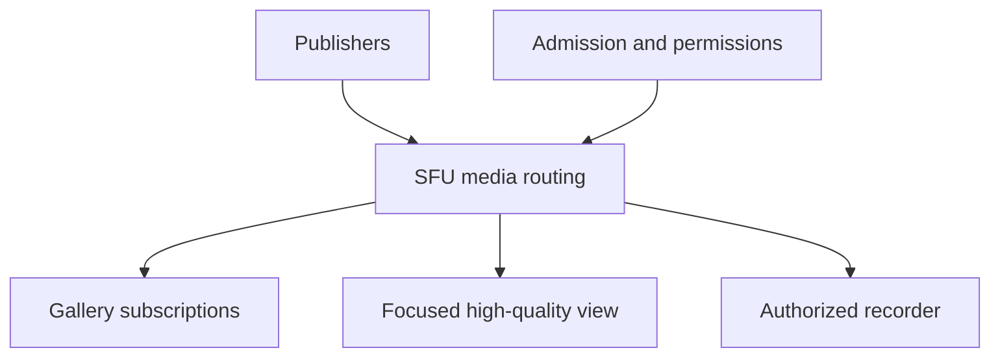

# 9. From two people to a room

## Why another peer is an architecture decision

A two-person call needs one peer relationship. Adding a third person can be done by creating more relationships, but the cost grows with the room. Every publisher may need to send several copies of its media, and every receiver may need to decode several streams. More signaling messages are only a small part of the change.

A room also introduces application questions. Who publishes a camera versus a screen? Which tracks should a late joiner receive? Which participant is allowed to record? What happens when the room's media node fails? A peer connection remains a transport object; it does not become a complete room model merely because you create several of them.

We will compare mesh, SFU, and MCU arrangements, derive a bandwidth model, and examine a TypeScript SFU integration. The runnable companion implements the bandwidth model, not a hidden group media server. Operating an SFU requires infrastructure beyond the local package, and that boundary should remain visible while you learn.

## Count mesh relationships rather than guessing

In a full mesh, each pair of participants has a peer relationship. For N participants, each participant has N minus one neighbors. Counting each relationship from both ends gives N times N minus one, so divide by two to count unique links:

$$
L = \frac{N(N-1)}{2}.
$$

For six people, each has five neighbors. Six times five is thirty endpoint-neighbor relationships, and dividing by two gives fifteen peer links. If each person sends one 1.2 Mbps video to every neighbor, each uploader sends five copies totaling 6 Mbps. Across all publishers that is 36 Mbps of uploaded video payload.

This model assumes one equal-rate video per person, no simulcast, no audio, no protocol overhead, and everyone viewing everyone. Those assumptions are intentionally simple enough to inspect. A device might reuse some encoding work, but it still must transmit the separate copies required by its peer relationships. Do not assume “same camera” means “one network upload.”

The companion's calculator computes those quantities directly. Change participants from six to ten while holding video rate constant. Peer links grow from fifteen to forty-five; per-person upload grows from six to 10.8 Mbps. There is no universal participant threshold where mesh suddenly fails, because device power, uplink capacity, chosen resolution, and layout differ. The growth law explains why scaling eventually demands another architecture.

## An SFU moves replication to a server

A Selective Forwarding Unit receives encoded streams and forwards selected media to subscribers. It typically does not decode and composite every participant's video. Publishers send toward the SFU, and the SFU replicates or selects streams for receivers.

Under the same six-person single-encoding model, each publisher uploads one 1.2 Mbps video rather than five copies. If everyone still receives all five other videos, each receiver still downloads 6 Mbps. The SFU sends six times five stream copies, so aggregate video egress remains 36 Mbps. The architecture moves bandwidth responsibility; it does not eliminate the need to deliver requested media.



This diagram emphasizes subscriptions rather than depicting every participant as a node. The SFU can forward a lower layer for a small tile, a higher layer for the focused participant, and nothing for a hidden publication. The application and SDK translate layout and policy into subscription intent; the server manages actual forwarding according to its capabilities.

Simulcast changes the upload model. A publisher may upload low, medium, and high representations whose rates add together. SVC changes dependencies differently. A realistic capacity model therefore separates publisher ingress, subscriber egress, number of encodings, packet rate, retransmission, and CPU. Raw Mbps alone can hide a packet-processing bottleneck.

## An MCU trades flexibility for composition

A Multipoint Control Unit decodes, mixes or composites, and re-encodes media into output streams. A receiver may get a composed video and mixed audio instead of many independent sources. This can reduce receiver decoding and simplify some endpoint requirements, but it consumes server processing and limits client-side layout flexibility.

| Architecture | Publisher upload pattern | Receiver experience | Main engineering pressure |
| --- | --- | --- | --- |
| Mesh | Separate copies to peers | Independent sources | Client upload, peer count, device work |
| SFU | One or several encodings to server | Selected independent sources | Server egress, subscriptions, client decode |
| MCU | Media to mixer | Composed/mixed outputs | Server decode/encode, composition latency |

An SFU can coexist with a recorder that composites output. A system may use different paths for live interaction, recording, and large-audience distribution. Choose the arrangement per requirement rather than insisting that one acronym describes every service in the product.

Server composition also affects encryption goals. If a server must decode content to mix it, that server needs access to the relevant plaintext media. Application-level encryption that hides content from the SFU can prevent an ordinary server compositor from operating. The recording policy and the encryption trust model must be designed together.

## Model participants and publications

A participant is an application identity. A publication is a logical media source, such as camera video, microphone audio, or screen video. A subscription is a receiver's intent to receive a publication. A transport is a concrete networking relationship used to carry those sources. These entities have related but distinct lifetimes.

```ts
// Application types, not an SDK's built-in API.
type Publication = {
  id: string;
  participantId: string;
  source: 'camera' | 'microphone' | 'screen';
  kind: 'audio' | 'video';
};
type SubscriptionIntent = {
  publicationId: string;
  visible: boolean;
  desiredWidth?: number;
  priority: 'background' | 'normal' | 'focused';
};
```

A reconnect may replace a track object or transport without changing the user's participant identity. A camera replacement may change the physical source while retaining one logical publication. A participant can publish both camera and screen, so a map keyed only by participant ID can accidentally overwrite one tile with another.

Use stable application IDs for product state and transport IDs for correlation. Track which layer introduced an event. “Participant left” is stronger than “one media track ended.” A temporary source interruption should not necessarily remove the participant from the room roster.

## Compare a room platform with an SFU toolkit

LiveKit provides a room-oriented server and client SDK model. Its documentation exposes participant and track events, connection behavior, and adaptive stream features. Mediasoup provides lower-level media building blocks; its documentation explicitly leaves application signaling to you. Both can be valuable, but they place different amounts of room and control logic in your application.

For a first production group-calling product, a room-oriented platform can reduce integration work. For specialized media routing and protocol control, a toolkit can provide more flexibility at the cost of building admission, signaling, lifecycle, and operational tooling. These are engineering tradeoffs, not a claim that one choice is always superior.

Use the current primary documentation and inspect the server deployment requirements before choosing. Compare feature requirements, operating effort, observability, data handling, supported clients, and costs under a stated usage model. The resource research for this book did not conduct a benchmark or current pricing survey, so it does not assign invented performance rankings or prices.

## A concrete TypeScript room integration

The inspected LiveKit browser SDK reference identifies version 2.24.0. The following optional example targets that API surface. It is separate from the dependency-free companion and requires a configured LiveKit service plus a backend-issued participant token. It was documentation-checked, not executed against a live SFU here.

In a separate TypeScript web project, install an exact SDK version and retain the resulting lockfile:

```bash
npm install --save-exact livekit-client@2.24.0
```

The example connects, attaches subscribed tracks, enables local camera/microphone, and returns a cleanup function. Register listeners before connecting so early subscriptions are not missed.

```ts
import { Room, RoomEvent } from 'livekit-client';
import type { RemoteTrack } from 'livekit-client';

export async function joinRoom(url: string, token: string, target: HTMLElement) {
  const room = new Room({ adaptiveStream: true, dynacast: true });
  const attached = new Map<RemoteTrack, HTMLElement>();
  const subscribed = (track: RemoteTrack) => {
    const element = track.attach();
    attached.set(track, element);
    target.append(element);
  };
  const unsubscribed = (track: RemoteTrack) => {
    track.detach().forEach(element => element.remove());
    attached.delete(track);
  };
  const cleanup = async () => {
    room.off(RoomEvent.TrackSubscribed, subscribed);
    room.off(RoomEvent.TrackUnsubscribed, unsubscribed);
    for (const track of attached.keys()) {
      track.detach().forEach(element => element.remove());
    }
    attached.clear();
    await room.disconnect();
  };
  room.on(RoomEvent.TrackSubscribed, subscribed);
  room.on(RoomEvent.TrackUnsubscribed, unsubscribed);
  try {
    await room.connect(url, token);
    await room.localParticipant.enableCameraAndMicrophone();
    return { room, cleanup };
  } catch (error) {
    await cleanup();
    throw error;
  }
}
```

The URL and token are inputs because the browser must not contain a server API secret. The backend authenticates a person, authorizes a room and allowed actions, then issues a suitably scoped short-lived token. The SDK token is not a substitute for your application's decision about who may join or publish.

This example isolates room integration. A full product adds a call-generation check if join can be cancelled, a user action to unlock blocked audio playback when necessary, UI for reconnect/disconnect events, local preview, and source-specific publication mapping. It must also clean up when the remote participant leaves, not just when the local user clicks Hang up.

## Understand adaptive subscription

A gallery may show twenty participants but only six visible tiles at one moment. Sending every hidden video at full quality wastes downstream bandwidth and decoding. Adaptive subscription connects UI requirements to transport demand: pause hidden video, choose a suitable layer for tile dimensions, and promote the active focus.

Do not equate screen pixels with a guaranteed codec layer. Device pixel ratio, cropping, aspect ratio, and server capabilities matter. A reasonable policy can choose from available representations and verify quality outcomes rather than requesting arbitrary dimensions that no encoding provides.

Audio policy differs. Often several participants need audible audio even when their video tiles are hidden. Active-speaker detection can help prioritize video but can be noisy. Avoid switching so aggressively that the UI constantly churns, subscriptions oscillate, or decoders repeatedly wait for keyframes. Use stable windows and clear product priorities.

Dynacast-like publishing optimization can avoid transmitting layers no subscriber currently needs, depending on the stack. That saves publisher bandwidth and processing, but a new subscriber may then need time for a representation to resume. This is another latency/resource tradeoff to measure rather than a universally free optimization.

## Deploy control and media separately in your model

A web reverse proxy can serve HTTPS and WebSocket signaling while media still needs its own reachable transport configuration. Successfully loading the app through a load balancer does not establish that UDP media reaches the intended SFU node. Public address advertisement, firewall rules, TURN fallback, and certificate configuration remain relevant.

Room placement also matters. A control service needs to know which media node owns a room. If a client reconnects to a different control process, the system must still route it to the right room or perform a supported migration. Generic stateless HTTP load balancing is not a complete stateful media-cluster design.

Capacity testing should include many packets, subscriptions, and joins rather than just a high aggregate byte stream. A room with many low-rate sources can stress scheduling differently from a few high-rate sources. Record startup time, steady-state egress, CPU, memory, packet drops, and recovery when a node becomes unhealthy.

Geography adds another tradeoff. Placing a room near one publisher may place it far from several subscribers. Cascaded or distributed SFU designs can reduce some long-haul replication patterns but introduce inter-node routing and operational complexity. Do not infer globally distributed room behavior from the phrase horizontally scalable; verify the chosen product's actual room-placement and distribution model.

## Recording, streaming, and external endpoints

A recorder can subscribe to tracks and store them separately or compose a layout. Separate recordings retain flexibility for later editing but require synchronization and storage management. Composite recordings are easier to watch immediately but commit to a layout and consume rendering/encoding resources.

A broadcast audience may not need bidirectional low-latency interaction. A hybrid system can keep speakers on WebRTC and distribute a produced stream through an appropriate broadcast path. The right audience transport depends on latency, scale, device support, and interaction requirements. WebRTC is powerful, but its peer and server state has costs.

External RTP, SIP, or standardized ingest/egress interfaces introduce protocol translation and authentication requirements. The browser TypeScript API does not directly become a SIP phone or raw RTP socket. Treat gateways as separate endpoints with their own codec, clock, media, and authorization contracts. Study the exact interface used by your selected server rather than copying a generic acronym into a design diagram.

## Failure domains and useful resilience

An SFU is a shared dependency. When a media node fails, many users can be affected together. Graceful control reconnection is different from uninterrupted media continuity. Decide what users will observe and what the system can actually preserve. A transparent migration promise requires explicit support, not just a reconnect loop.

A bounded recovery flow can detect media failure, preserve application room identity, stop obsolete transports, acquire replacement credentials if needed, reconnect to the assigned media endpoint, and republish owned live sources. Avoid reacquiring cameras unnecessarily if the application still owns valid tracks. Avoid keeping old subscriptions and render elements after the new connection becomes active.

Test a participant who disappears without a clean leave message. Heartbeats, transport state, and server membership rules need a consistent timeout policy. The UI should not indefinitely show a departed participant as live because only a graceful disconnect event was handled.

## Trace one late joiner through the room

A late joiner first authenticates with the application and requests admission to a room. The control service checks permission and issues the information required by the selected media stack. The client connects, receives the current publication roster, and establishes subscriptions according to its layout and authorization. Receiving a roster entry is not itself evidence that media has arrived.

Next, a subscribed track becomes available. The client attaches it to a rendering element associated with the publication ID. If the participant already has a camera tile, a new screen publication should create the intended screen surface rather than overwrite the camera because both share one participant ID. Track-unsubscribed and publication-ended events should remove only the appropriate presentation resources.

Suppose the late joiner has a weak downstream path. The system can choose lower camera layers, prioritize the shared screen, or reduce the number of visible videos. This policy should not force every existing participant to lower their capture resolution if only one receiver is constrained. Per-subscriber adaptation is one of the main reasons to move replication and selection into an SFU architecture.

Now the presenter leaves abruptly. Server membership and publication state eventually retire the presenter's sources, and clients release the corresponding elements and subscriptions. The room itself may continue. If the room owner also disappears, product policy decides whether another owner can continue or the room ends. Those are application decisions, separate from the browser's decision about one transport.

Tracing this sequence exposes the contracts a group-call SDK can help manage and the contracts your product still owns. It also supplies meaningful tests: late roster handling, two publications for one person, constrained receiver adaptation, abrupt departure, and correct cleanup. A six-person happy-path demo does not exercise those lifetimes by itself.

## Apply the model to a product decision

Suppose you are building a developer pairing tool. Most sessions have two people, but some include six observers and one shared screen. A mesh can be a useful learning baseline. An SFU can reduce the presenter's repeated uploads and let observers select appropriate screen and camera layers. You still need to budget the server's egress and each observer's decode work.

If the product needs server-side searchable recordings, ordinary transport encryption to the SFU may fit that processing model with appropriate controls. If the requirement is that the service operator cannot access media, application-level encryption changes recording and search architecture. These decisions should be made before promising both features as if they were independent toggles.

The outcome of this chapter is a reasoned architecture rather than a favorite acronym. You can derive mesh costs, explain where an SFU moves work, distinguish logical publications from transports, and integrate a documented TypeScript room SDK with clear credentials and cleanup boundaries. The final chapter turns that architecture into a disciplined production and expert-study workflow.

**References:** [LiveKit SFU architecture](https://docs.livekit.io/reference/internals/livekit-sfu/), [LiveKit TypeScript SDK reference](https://docs.livekit.io/reference/client-sdk-js/), [mediasoup design](https://mediasoup.org/documentation/v3/mediasoup/design/), and [mediasoup client/server communication](https://mediasoup.org/documentation/v3/communication-between-client-and-server/).
