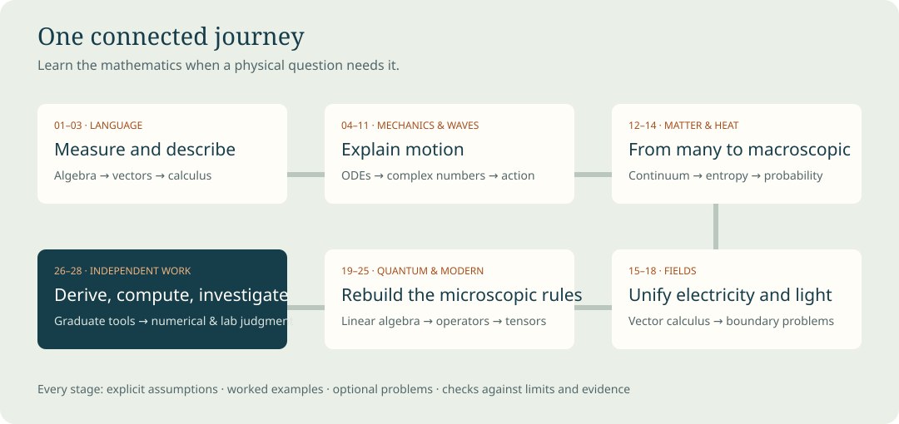

# Physics from First Principles

A beginner-first course through undergraduate core physics, with mathematics on demand and selected graduate bridges

# Welcome to Physics from First Principles

This is a course for someone beginning physics without assuming algebra, trigonometry or calculus. The aim is to understand the relationships well enough to derive them, use them in unfamiliar situations, and recognize their limits. New mathematics appears at the point where a physical question needs it. Early chapters are intentionally concrete; later chapters become more demanding because they build on work already taught.

Start with [Chapter 01](chapters/01-measurement-and-the-language-of-physics.md), then follow the numbered sequence. Each chapter has original explanations, worked examples, optional problems, and separate hints and solutions. Read a small section, redo its calculation, and explain the result in your own words. When a later step is unclear, return to the specific prerequisite rather than concluding that the whole subject is beyond you.

The course uses Feynman's lectures as its conceptual spine and adds explicit beginner mathematics, a conventional undergraduate problem-solving sequence, numerical methods, laboratory analysis and selected graduate bridges. It is an original companion, not a reproduction, official revision, or endorsement of the Feynman lectures. Optional Feynman readings enrich each subject after its prerequisites have been established here.

The [study sequence](curriculum.md) gives a suggested multiyear pace, mathematical milestones, and projects. The [coverage map](coverage.md) distinguishes worked subjects, contextual readings, and graduate extensions. The [source ledger](sources.md) records what was actually inspected, including the limitations of the supplied scanned PDF.

Open **companion/index.html** for the offline chapter reader and experiments. Open **book.html** for a continuous, typeset HTML edition; its equations and fonts are bundled locally. The canonical editable text is **book.md**, with individual chapters in **chapters/**. The offline reader needs no account, network, package installation or running server. Keep the folders together when moving or extracting the course. Optional developer rebuild instructions are in the README.

Use the experiments to ask a question before changing a parameter. Identify what the model assumes, predict a direction of change, then compare the calculation with your reasoning. A plotted ideal trajectory is evidence about a mathematical model; it is not a measurement of an actual object. Several late projects ask you to collect data or write extensions yourself. Those are learner assignments, not claims that the experiment has already been performed.

The main route covers the undergraduate core: mechanics, oscillations and waves, optics, special relativity, continuum physics, thermal and statistical physics, electromagnetism, quantum mechanics, and introductory modern topics. Graduate bridges introduce tools and representative derivations. They do not replace specialist graduate courses, supervised laboratories or research. The practical goal is demonstrated ability, not a promised credential or a claim about how “smart” a reader becomes.

Conventions are SI units, right-handed axes, radians for calculus, wave phase $kx-\omega t$, and quantum inner products conjugating the first entry. Thermodynamics uses positive heat into the system and positive work done by the system, so $dU=\delta Q-\delta W$. A chapter states local alternatives when needed. Constants are exact SI definitions where applicable and explicitly approximate measured values elsewhere. A dimensionless ideal model is labeled as such.

Accuracy rests on visible derivations, unit checks, independent example calculations, numerical tests, rendering checks and review. These reduce error; they cannot certify that a newly authored book contains no mistakes. The [verification report](verification.md) states the checks performed and their limits. If a result seems inconsistent, check conventions and assumptions, redo the derivation, and compare an independent source. That habit is itself part of learning physics.

## Contents

- [01. Measurement and the language of physics](#chapter-01)
- [02. Geometry, trigonometry and vectors](#chapter-02)
- [03. Motion, change and accumulation](#chapter-03)
- [04. Newton’s laws and differential equations](#chapter-04)
- [05. Energy, momentum and gravitation](#chapter-05)
- [06. Rotation and angular momentum](#chapter-06)
- [07. Oscillations, complex numbers and resonance](#chapter-07)
- [08. Waves, Fourier analysis and partial differential equations](#chapter-08)
- [09. Optics, interference and polarization](#chapter-09)
- [10. Special relativity and relativistic dynamics](#chapter-10)
- [11. Analytical mechanics and chaos](#chapter-11)
- [12. Fluids, elasticity and diffusion](#chapter-12)
- [13. Thermodynamics and entropy](#chapter-13)
- [14. Probability and statistical mechanics](#chapter-14)
- [15. Vector calculus and electrostatics](#chapter-15)
- [16. Potentials, boundaries, multipoles and matter](#chapter-16)
- [17. Currents, circuits, magnetism and induction](#chapter-17)
- [18. Maxwell equations, waves, radiation and energy](#chapter-18)
- [19. Quantum amplitudes, linear algebra and two-state systems](#chapter-19)
- [20. Schrödinger mechanics, bound states and tunneling](#chapter-20)
- [21. Angular momentum, spin and hydrogen](#chapter-21)
- [22. Approximation, scattering and quantum correlations](#chapter-22)
- [23. Condensed matter and collective behavior](#chapter-23)
- [24. Atoms, nuclei and elementary particles](#chapter-24)
- [25. Gravity, tensors and cosmology](#chapter-25)
- [26. Bridges to graduate physics](#chapter-26)
- [27. Computational physics and numerical reliability](#chapter-27)
- [28. Experimental physics, uncertainty and research](#chapter-28)
- [Reference material and projects](#references)

# I · The mathematical language

## 01. Measurement and the language of physics

You watch a toy car cross a table. One person says it is fast; another says it is slow. Neither statement tells us whether it will reach the edge in time to be caught. Physics begins when we replace an impression with a question that can be checked: how far is the edge, how long does the journey take, and how reliably can we predict the next journey?

This chapter assumes no algebra. We will build the arithmetic and language needed to ask those questions. You need paper, a pencil, and optionally a calculator. A calculator performs arithmetic; it does not decide what a number means. Our recurring task will be to make that decision explicitly.

### 1. A quantity has a number and a unit

A measurement compares something with an agreed reference. If a table is 1.20 metres long, the number 1.20 tells us how many metre units fit along it. We write

$$L=1.20\,\mathrm{m}.$$

The symbol $L$ is a name for the length, not another object to multiply. The letter $\mathrm{m}$ identifies the unit metre. A quantity is the whole combination. The same length is $120\,\mathrm{cm}$ because one metre contains one hundred centimetres. Changing a unit changes the numerical value; it does not stretch the table.

The International System of Units, abbreviated SI, supplies a common language. We will use metre for length, second for time, kilogram for mass, kelvin for absolute temperature, ampere for electric current, and mole for amount of substance. These are definitions of measurement conventions. A law such as the relationship between force and motion is an additional empirical statement, to be tested rather than established by choosing units.

An instrument does not give unlimited precision. A ruler with millimetre markings cannot, without extra evidence, establish a length to one millionth of a millimetre. Write a measurement in a way that preserves what was actually observed. If repeated measurements of a table give 1.199, 1.201 and 1.200 m, a reasonable first report is about 1.200 m with uncertainty of order 0.001 m. A formal uncertainty analysis comes in Chapter 28. For now the essential habit is to distinguish the measured value from an exact definition.

### 2. Arithmetic as combining and comparing quantities

Addition combines quantities of the same kind. A 2 m length followed by a 3 m length gives 5 m. Subtraction compares them or removes part of a total. If the car has travelled 0.35 m along a 1.20 m table, the remaining distance is

$$1.20\,\mathrm{m}-0.35\,\mathrm{m}=0.85\,\mathrm{m}.$$

The unit is common to both terms. Adding 2 metres to 3 seconds has no physical meaning as a length or time. Such an expression can be written on paper, but it does not answer a well-defined measurement question.

Multiplication describes repeated equal groups and, more generally, scaling. Three equal 0.20 m pieces have total length $3\times0.20\,\mathrm{m}=0.60\,\mathrm{m}$. Multiplying two lengths gives an area: a rectangle 2 m wide and 3 m long contains six squares of side 1 m, so its area is $6\,\mathrm{m^2}$. Division reverses a multiplication. Dividing 6 m into three equal pieces gives 2 m per piece. Dividing a distance by a time defines an average speed. If the car travels 0.60 m in 2.0 s,

$$\text{average speed}=\frac{0.60\,\mathrm{m}}{2.0\,\mathrm{s}}=0.30\,\mathrm{m/s}.$$

The slash means “divided by.” The unit metre per second means distance travelled for each second, when motion is uniform. This calculation alone says nothing about whether the car sped up and slowed down within those two seconds.

Division by zero is undefined. If we ask how many groups of zero make six, no number works. If both numerator and denominator are zero, every multiplier gives zero, so no unique quotient exists. Later, calculus will examine limits of ratios whose numerator and denominator approach zero. A limit is a new question; it does not make division by zero permissible.

The ordinary order of operations makes an expression unambiguous. Parentheses are evaluated first, powers next, then multiplication and division, then addition and subtraction. Thus $2+3\times4=14$, whereas $(2+3)\times4=20$. When in doubt, add parentheses. Many physics mistakes are arithmetic questions that were never made unambiguous.

### 3. Fractions, decimals and ratios

The fraction $a/b$ means $a$ divided by $b$, where $b\ne0$. A quarter of a metre is $1/4\,\mathrm{m}=0.25\,\mathrm{m}$. Two equivalent fractions represent the same ratio: multiplying numerator and denominator by the same nonzero number changes neither the number nor the physical comparison. For example,

$$\frac{1}{4}=\frac{2}{8}=\frac{25}{100}=0.25.$$

To add fractions, describe both in equal-size pieces. One half plus one third is three sixths plus two sixths, so

$$\frac12+\frac13=\frac36+\frac26=\frac56.$$

It is not $2/5$: that would change the piece size while combining the counts. Multiplication of fractions combines their scaling effects: $(2/3)(3/4)=6/12=1/2$. Dividing by a fraction is multiplication by its reciprocal, provided the fraction is nonzero. In particular, $2/(1/2)=4$: four half-units fit into two units.

A ratio can cancel units. If a model car is 0.12 m long and a real car is 4.8 m long, their length ratio is $0.12/4.8=0.025=1/40$. The model has one fortieth the length. A percentage expresses a ratio per hundred: 0.025 is 2.5%. Saying that a measurement increased by 10% means multiplying the original value by 1.10. An increase of 10% followed by a decrease of 10% gives $1.10\times0.90=0.99$ times the original value. The percentage bases differ, so the changes do not cancel.

Ratios need careful reference values. An error of 0.02 m is small compared with a 100 m field and large compared with a 0.03 m component. The relative error is the error divided by a relevant nonzero reference size. If a 2.00 m distance is reported as 2.02 m, the absolute discrepancy is 0.02 m and the relative discrepancy is 0.01, or 1%. An absolute uncertainty can still be useful when the reference value is zero; a relative percentage then cannot be formed.

### 4. Signed numbers describe direction and reference levels

Place an origin at the left edge of the table and declare rightward positions positive. A point 0.20 m left of that origin has coordinate $-0.20\,\mathrm{m}$. Negative position is not negative physical existence; it records our coordinate choice. The change from position $x_1$ to position $x_2$ is $x_2-x_1$. Moving from $-0.20$ m to $+0.30$ m changes position by

$$\Delta x=0.30\,\mathrm{m}-(-0.20\,\mathrm{m})=0.50\,\mathrm{m}.$$

Here $\Delta$, the Greek capital delta, means “change in.” Subtracting a negative is adding its opposite. A journey from $+0.30$ m back to $-0.20$ m has change $-0.50$ m. The distance travelled is 0.50 m in either case; the displacement keeps direction. Chapter 3 develops this distinction.

The absolute value $|x|$ is a number's distance from zero: $|-3|=3$ and $|3|=3$. It is useful for magnitudes. The rules for multiplication of signs preserve distributivity: since $0=(-1)[1+(-1)]=-1+(-1)(-1)$, the product $(-1)(-1)$ must be $+1$. This is a small example of deriving a rule from a coherent structure rather than memorizing an isolated trick.

Do not attach physical interpretations to signs without identifying the convention. A negative velocity means motion toward decreasing coordinate, not necessarily slowing down. A negative energy may mean an energy measured below an agreed zero. A negative absolute temperature has a specialized meaning in statistical physics; it does not mean a temperature below absolute zero on an ordinary thermometer. We will introduce such meanings only with their necessary assumptions.

### 5. Powers, roots and scientific notation

A positive integer power is repeated multiplication: $a^3=a\times a\times a$. The multiplication rule $a^m a^n=a^{m+n}$ follows by counting factors. For nonzero $a$, consistency then gives $a^0=1$ and $a^{-n}=1/a^n$. Thus $10^{-3}=0.001$ and $\mathrm{s^{-1}}$ means reciprocal seconds.

A square root reverses squaring for nonnegative real numbers. The principal square root $\sqrt9$ is $+3$, although the equation $x^2=9$ has two solutions, $x=+3$ and $x=-3$. We choose physically admissible solutions only after solving the mathematics. A length cannot be negative, but a coordinate can. For real $x$, $\sqrt{x^2}=|x|$, which is not always $x$.

Scientific notation writes a number as a value between 1 and 10 multiplied by a power of ten. We write $360000=3.6\times10^5$ and $0.000042=4.2\times10^{-5}$. This keeps both scale and meaningful digits visible. To multiply, multiply the leading numbers and add the powers:

$$ (3.0\times10^4)(2.0\times10^{-6})=6.0\times10^{-2}=0.060.$$

To add, first express numbers at the same power: $3.0\times10^4+2.0\times10^3=(3.0+0.20)\times10^4=3.2\times10^4$. Adding exponents would be the rule for multiplication applied to the wrong operation.

Common metric prefixes are kilo, $10^3$; centi, $10^{-2}$; milli, $10^{-3}$; micro, $10^{-6}$; and nano, $10^{-9}$. A kilometre is 1,000 m. A millisecond is 0.001 s. The kilogram is the SI base unit of mass even though its name contains a prefix. One gram is $10^{-3}$ kg.

Squaring a prefixed unit squares its conversion factor. Since 1 cm is $10^{-2}$ m,

$$1\,\mathrm{cm^2}=(10^{-2}\,\mathrm{m})^2=10^{-4}\,\mathrm{m^2}.$$

A square metre therefore contains 10,000 square centimetres. A cube of side 1 cm has volume $10^{-6}\,\mathrm{m^3}$. The shape has changed dimension, so a length conversion factor cannot be reused without the appropriate power.

### 6. Algebra is arithmetic with named unknowns

Suppose the car travels at constant speed $v$ for a time $t$. The distance $d$ is the number of seconds multiplied by the distance per second:

$$d=vt.$$

Letters permit one statement to cover many experiments. Adjacent letters usually mean multiplication. They do not become a single new variable unless we define one. The equal sign asserts that the two sides represent the same quantity. It does not mean “now calculate the next thing.” A chain such as $2+3=5\times2=10$ is false because its first and second expressions are unequal; write separate steps.

An equation can be manipulated by doing the same reversible operation to both sides. If $d=vt$ and $v\ne0$, dividing both sides by $v$ gives $t=d/v$. For $d=0.85$ m and $v=0.25$ m/s,

$$t=\frac{0.85\,\mathrm{m}}{0.25\,\mathrm{m/s}}=3.4\,\mathrm{s}.$$

The metres cancel and dividing by reciprocal seconds leaves seconds. This makes the answer more trustworthy. Substituting it back gives $(0.25\,\mathrm{m/s})(3.4\,\mathrm{s})=0.85\,\mathrm{m}$. We have checked both the unit and the numerical relationship.

If $v=0$ and $d\ne0$, the constant-speed model predicts no finite arrival time. If both are zero, any elapsed time is compatible with zero displacement. Dividing first and thinking later would hide these distinct cases.

The distributive law, $a(b+c)=ab+ac$, expresses multiplication of a sum. Its reverse, factoring, exposes structure: $ab+ac=a(b+c)$. In $(x+2)(x+3)$, distribute each term to obtain $x^2+5x+6$. In physics, factoring often shows which parameter makes an effect disappear. For example $vt+v\tau=v(t+\tau)$ says that two equal-speed journeys can be combined by adding their durations.

An inequality describes ordering: $x<3$ means $x$ is less than three. Adding the same value preserves the ordering. Multiplying by a positive value preserves it; multiplying by a negative value reverses it, because reflecting a number line exchanges left and right. From $-2x<6$, dividing by $-2$ gives $x>-3$. This matters when finding permitted energies, distances or times.

### 7. Functions and graphs are models of dependence

A function assigns a unique output to each allowed input. If $d(t)=vt$ with a fixed speed $v$, then choosing a time determines a distance. The parentheses identify the input; they do not mean that $d$ is multiplied by $t$. A function's domain specifies allowed inputs. A model for a car before it reaches the table edge might use $0\le t\le3.4$ s. Extending the same formula indefinitely would predict motion through empty space after the car falls, outside the model's domain.

A graph places the input along a horizontal axis and the output along a vertical axis. A straight line $y=a+bx$ has intercept $a$, its output at $x=0$, and slope $b$, the output change divided by input change. If $x$ is time in seconds and $y$ is position in metres, $b$ has units m/s. Slope is not just visual steepness: changing the axis scales changes the picture without changing the physical ratio.

Consider the observations $(t,x)=(0,0.10),(1,0.35),(2,0.60)$ in seconds and metres. Each one-second interval adds 0.25 m. The model is $x(t)=0.10\,\mathrm{m}+(0.25\,\mathrm{m/s})t$. At $t=1.5$ s it predicts 0.475 m. This is interpolation, prediction between observed inputs. At $t=100$ s it predicts 25.10 m; that is extrapolation far outside the table experiment and requires new evidence.

Functions need not be straight lines. For a square of side $L$, area is $A(L)=L^2$. Doubling side length multiplies area by four. The inverse relationship, $L=\sqrt A$, is restricted to $L\ge0$ for an ordinary side length. A later chapter will use slopes of curved graphs, which change from point to point, to define instantaneous rates.

### 8. Proportionality, dimensions and scale

The statement $y\propto x$ means $y=kx$ for a constant $k$ over the range under consideration. The proportionality sign does not identify $k$. If mass is proportional to volume for a uniform material, $m=\rho V$, where $\rho$ is density. A piece of material with mass 0.54 kg and volume $2.0\times10^{-4}\,\mathrm{m^3}$ has

$$\rho=\frac{0.54}{2.0\times10^{-4}}\,\mathrm{kg/m^3}=2.7\times10^3\,\mathrm{kg/m^3}.$$

A second piece with twice the volume has twice the mass only if its density is the same. Hollow objects and mixtures require more care. A relationship can be true within a model without being universally true for every object bearing the same everyday name.

Dimensions classify kinds of quantity independently of units. We denote length dimension by $\mathsf L$, time by $\mathsf T$, and mass by $\mathsf M$. Speed has dimension $\mathsf L/\mathsf T$. Area has dimension $\mathsf L^2$. Every term added in a physical equation must have the same dimension. The expression $d=vt$ passes because $(\mathsf L/\mathsf T)\mathsf T=\mathsf L$. The proposed $d=v+t$ fails.

Dimensional consistency is necessary, not sufficient. Both $d=vt$ and $d=2vt$ have correct dimensions, but they make different predictions. Dimensions cannot identify a missing factor of two, a sign, or an arbitrary dimensionless function. They can catch many mistakes quickly, so use them alongside derivation and experiment.

Suppose a hypothetical falling time depends only on a height $H$ and a constant acceleration $g$, with dimensions $\mathsf L$ and $\mathsf L/\mathsf T^2$. An expression $H/g$ has dimension $\mathsf T^2$, so its square root has dimension time. Dimensional reasoning suggests $t=C\sqrt{H/g}$ for a dimensionless constant $C$. It does not determine $C$, and it assumes that no other relevant quantity such as an initial speed or air resistance is needed. Chapter 3 derives $C=\sqrt2$ for release from rest with constant downward acceleration.

### 9. Approximation and honest numerical answers

A model deliberately retains some features and ignores others. Treating the toy car as a point is reasonable when we care about its centre's travel across the table. It fails when we ask whether its front bumper has already crossed the edge. Treating its speed as constant may work over a short interval and fail while it accelerates. State the question before deciding which details matter.

An estimate is a calculation whose inputs or assumptions are intentionally approximate. It is valuable when its uncertainty is suitable for the decision. If a room is about 4 m by 5 m by 2.5 m, its volume is about $50\,\mathrm{m^3}$. Reporting $50.000000\,\mathrm{m^3}$ would imply information that those measurements did not contain. Keep a few extra digits during intermediate calculations and round the final answer to match the evidence.

Significant figures are a convenient reporting convention, not a substitute for an uncertainty model. For products and quotients of rough measurements, retaining roughly the number of meaningful digits in the least precise input often works as a first pass. For sums, absolute place precision matters: $12.3+0.04$ is known approximately to tenths if 12.3 was rounded to tenths. Chapter 28 replaces these shortcuts with propagation and data analysis.

Errors also arise from models. Suppose a constant-speed prediction says 3.4 s but measured arrivals cluster around 4.0 s with small trial-to-trial variation. Repeating the same timing more accurately will not necessarily fix the discrepancy. The car may slow down, the measured endpoint may refer to its front rather than its centre, or the clock may have a bias. Separate variation between trials, instrument calibration, and inadequate physics.

### 10. A complete first investigation

Set an origin on a tabletop. Record the car's centre at time zero as 0.10 m, and at 2.0 s as 0.60 m. The coordinate difference is $0.60-0.10=0.50$ m. Dividing by the elapsed time gives average velocity $0.25$ m/s to the right. If the table edge has coordinate 1.20 m and the velocity remains constant, the remaining distance from the second observation is 0.60 m. The predicted additional time is $0.60/0.25=2.4$ s, so the predicted arrival is at time 4.4 s after the original zero.

Notice the distinction between additional time and clock time. The value 2.4 s answers “how much longer?” The value 4.4 s answers “at what time on this clock?” A formula can be arithmetically correct and still answer the wrong question.

Now test the constant-velocity assumption with a third observation. If the car is at 0.84 m at 3.0 s, the model predicts 0.85 m and the discrepancy is $-0.01$ m. Whether that matters depends on measurement uncertainty. If position uncertainty is about 0.02 m, the discrepancy is unsurprising. If it is 0.001 m, the discrepancy suggests model failure or unaccounted error. The conclusion requires a scale, not just a nonzero difference.

The logical pattern will recur throughout the course: define quantities; choose a model with explicit assumptions; derive a prediction; carry units through the arithmetic; compare with evidence; revise the model or its domain when needed. Later equations will become more sophisticated, but they will serve this same purpose.

### Optional practice

Try the questions without consulting the solutions first. Hints and full reasoning are in [the chapter hints](solutions/01-hints.md) and [solutions](solutions/01-solutions.md).

1. Convert 72 km/h to m/s. Show conversion factors that cancel units.
2. A rectangular sheet measures 30 cm by 20 cm. Find its area in square metres and square centimetres, explaining the conversion.
3. A cart moves from coordinate $-1.2$ m to $+0.8$ m in 0.50 s. Find its displacement and average velocity. Can the total distance be inferred?
4. Solve $D=D_0+vt$ for $t$. State when your result is valid and what happens when $v=0$.
5. A uniform sample of volume $15\,\mathrm{cm^3}$ has mass 0.120 kg. Find its density in kg/m³.
6. A proposed oscillation period is $T=2\pi\sqrt{m/k}$, with mass $m$ and a stiffness $k$ measured in kg/s². Check its dimensions. Does this prove the formula?
7. A measured length rises by 20% and then falls by 20%. Find the final fraction of the original length and explain why it is not one.
8. A model $x(t)=a+bt$ is fitted to positions 0.20 m at 1 s and 0.80 m at 4 s. Determine $a,b$ and predict $x(2.5\,\mathrm{s})$. Name an assumption needed to apply it at 100 s.

### Connection to Feynman and the next chapter

Read Feynman Volume I, Chapters 1, 2, 4 and 5 as a conceptual companion when ready. These are optional source readings; this lesson supplies its own reasoning and examples. The measured-quantity viewpoint will support every later derivation. Next we turn directions and shapes into mathematics, so that motion across a plane can be described as clearly as motion along a table.

[Return to contents](#contents)

## 02. Geometry, trigonometry and vectors

A rescue boat receives the message “three kilometres away.” That does not locate the person in trouble. Three kilometres east and three kilometres west require different journeys. A length supplies size; a direction supplies another essential part of the information. This chapter develops a language for both, starting with shapes and ending with vectors. We use only Chapter 1 arithmetic and algebra.

### 1. Coordinates turn location into numbers

On a flat map choose an origin, an eastward $x$ axis, and a northward $y$ axis. Give both axes the same physical unit. The ordered pair $(3,4)$ km means travel 3 km east and 4 km north from the origin. The order matters: $(4,3)$ is a different point. Negative coordinates indicate west or south under this convention.

Coordinates depend on the reference system. If we move the origin 1 km east without rotating the axes, the same physical point has coordinates $(2,4)$ km. The place did not move; its description changed. To describe a displacement from point A to point B, subtract corresponding coordinates:

$$\Delta x=x_B-x_A,\qquad \Delta y=y_B-y_A.$$

If A is $(1,2)$ km and B is $(4,6)$ km, the displacement is $(3,4)$ km. Moving both coordinate descriptions by the same origin shift leaves their difference unchanged. Physics often gains clarity by separating a reference-dependent label from a relationship that survives a reference change.

Three-dimensional coordinates add a $z$ axis. We choose a right-handed system: when the right hand's fingers curl from positive $x$ toward positive $y$, its thumb points toward positive $z$. For a familiar map, east, north and up give this orientation. Handedness will matter for rotations, torque and magnetism; declaring it now avoids later sign ambiguity.

### 2. Triangles measure straight-line separation

A right triangle has one angle of 90 degrees. Its side opposite the right angle is the hypotenuse, the longest side. If the perpendicular sides have lengths $a,b$ and the hypotenuse has length $c$, the Pythagorean theorem states

$$c^2=a^2+b^2.$$

Here is a geometric reason. Arrange four copies of the triangle inside a square of side $a+b$, with their hypotenuses surrounding an inner square of side $c$. The large square's area is $(a+b)^2$. The four triangles together have area $4(ab/2)=2ab$. Subtracting them leaves $c^2=(a+b)^2-2ab=a^2+b^2$. The construction assumes flat Euclidean geometry, the geometry of ordinary laboratory rulers at this scale. Chapter 25 examines curved geometry.

The map displacement $(3,4)$ km is therefore 5 km long because $\sqrt{3^2+4^2}=5$. Going east and then north along roads would cover 7 km. The straight-line separation is 5 km. A coordinate displacement and the actual path travelled answer different questions.

In three dimensions, apply the theorem twice. The horizontal projection has squared length $x^2+y^2$. Adding the perpendicular vertical part gives

$$r=\sqrt{x^2+y^2+z^2}.$$

For $(2,-3,6)$ m, $r=\sqrt{4+9+36}=7$ m. Negative coordinate components are squared because length is nonnegative and does not depend on which side of the origin the point lies.

### 3. Angles, circles and radians

A complete turn is 360 degrees. A degree is a convenient convention, but an angle can also be defined by lengths. On a circle of radius $r$, an arc of length $s$ subtends the angle

$$\theta=\frac{s}{r}$$

in radians. Because both quantities are lengths, the ratio is dimensionless. We still write rad to make the angular meaning clear. A complete circumference is $2\pi r$, so one turn is $2\pi$ radians. The number $\pi$ is the circumference-to-diameter ratio for a Euclidean circle, approximately 3.14159. Thus $180^\circ=\pi$ rad and $90^\circ=\pi/2$ rad.

Convert 30 degrees by multiplying by $\pi/180$ radians per degree: $30^\circ=\pi/6$ rad. Convert $2$ rad by multiplying by $180/\pi$ degrees per radian to obtain approximately $114.59^\circ$. Check your calculator's degree or radian setting before using trigonometric buttons. A wrong mode can produce a plausible number that describes a different angle.

The radian definition makes arc length $s=r\theta$ with no extra conversion factor. A wheel of radius 0.20 m rotating through 0.50 rad moves its rim through an arc 0.10 m long. That arc is a curved path, not the straight chord between the endpoints. Radians will also make the derivative of sine especially simple in Chapter 3.

### 4. Sine, cosine and tangent

For a right triangle with an acute angle $\theta$, define

$$\sin\theta=\frac{\text{opposite side}}{\text{hypotenuse}},\quad
\cos\theta=\frac{\text{adjacent side}}{\text{hypotenuse}},\quad
\tan\theta=\frac{\text{opposite side}}{\text{adjacent side}}.$$

Similar triangles with the same angle have proportional sides, so these ratios depend on angle rather than triangle size. In the 3–4–5 triangle, if the opposite side is 3 and the adjacent side is 4, sine is $3/5$, cosine is $4/5$, and tangent is $3/4$.

To extend the definitions beyond acute angles, use a unit circle. Begin at $(1,0)$ and turn counterclockwise through $\theta$. The resulting point has coordinates $(\cos\theta,\sin\theta)$. This definition handles negative angles and multiple turns. At zero the point is $(1,0)$; at $\pi/2$ it is $(0,1)$; at $\pi$ it is $(-1,0)$. Sine and cosine repeat after $2\pi$ because a full turn returns to the same point.

Since the point remains at distance one,

$$\cos^2\theta+\sin^2\theta=1.$$

The notation $\sin^2\theta$ means $(\sin\theta)^2$, not sine of a squared angle. Reflection across the horizontal axis shows $\cos(-\theta)=\cos\theta$ and $\sin(-\theta)=-\sin\theta$. Cosine is an even function and sine is odd; these labels mean that precise reflection behavior.

Where $\cos\theta\ne0$, tangent is $\sin\theta/\cos\theta$. It is undefined at a right angle because the adjacent coordinate vanishes. Do not turn this undefined quotient into a very large finite physical slope without considering the geometry.

We often need inverse functions. If $\sin\theta=1/2$, one solution is $\theta=\pi/6$, but another between zero and $2\pi$ is $5\pi/6$. A calculator's inverse sine returns a principal value within a chosen range. The physical diagram decides whether another branch is appropriate. For a direction from components, use both component signs; an inverse tangent of $y/x$ alone cannot distinguish opposite quadrants.

### 5. Resolving one directed quantity into components

Suppose the rescue boat must travel 5 km at an angle with cosine $4/5$ and sine $3/5$ north of east. Its eastward component is $5(4/5)=4$ km and its northward component is $5(3/5)=3$ km. More generally, a displacement of magnitude $r$ making angle $\theta$ counterclockwise from positive $x$ has components

$$x=r\cos\theta,\qquad y=r\sin\theta.$$

Conversely $r=\sqrt{x^2+y^2}$. A vector of magnitude 10 m at 30 degrees has components approximately $(8.660,5.000)$ m. Squaring and adding gives 100 m² to rounding precision, as required.

Components are projections, not additional physical displacements that must literally occur in sequence. The boat can travel diagonally. Its mathematical description still separates the eastward and northward parts. The same method will resolve a force on an inclined plane or a velocity in wind.

A scalar is a quantity specified by a value and unit without an associated spatial direction, such as mass or temperature. A vector includes directed magnitude and follows the transformation and addition rules we are developing. We write a displacement vector as $\mathbf r=(x,y,z)$. Its magnitude is $|\mathbf r|$. In expressions like $3\mathbf r$, the scalar 3 stretches its magnitude by three; multiplying by $-1$ reverses direction.

An arrow is a useful picture of a vector: its length represents magnitude and its orientation represents direction. The arrow picture is an analogy with a precise correspondence, not the definition of every vector space encountered later. Quantum states, for example, obey vector algebra but are not ordinary arrows in the room.

### 6. Vector addition and unit vectors

Place the tail of one displacement arrow at the head of another. The arrow from the original start to the final endpoint is their sum. Component addition gives the same result:

$$ (a_x,a_y,a_z)+(b_x,b_y,b_z)=(a_x+b_x,a_y+b_y,a_z+b_z).$$

Walking 3 m east and 4 m north gives $(3,0)+(0,4)=(3,4)$ m. Swapping the walks gives the same endpoint, so vector addition is commutative. That does not say every physical operation commutes. Finite rotations about different axes, for example, generally do not; Chapter 6 will demonstrate this distinction.

Subtraction is addition of the reverse: $\mathbf a-\mathbf b=\mathbf a+(-\mathbf b)$. For two map points, the vector from A to B is $\mathbf r_B-\mathbf r_A$. Reversing the subtraction reverses the arrow. A zero vector has all components zero and magnitude zero; it has no unique direction.

Unit vectors have magnitude one. Let $\hat{\mathbf x},\hat{\mathbf y},\hat{\mathbf z}$ point along the positive coordinate axes. Then

$$\mathbf a=a_x\hat{\mathbf x}+a_y\hat{\mathbf y}+a_z\hat{\mathbf z}.$$

The little hat marks a unit direction. These basis vectors are dimensionless; the components carry physical units. For a nonzero vector $\mathbf a$, its own direction unit vector is $\hat{\mathbf a}=\mathbf a/|\mathbf a|$. For $(3,4,0)$ m it is $(3/5,4/5,0)$. Dividing the zero vector by its magnitude would divide by zero, so normalization requires a nonzero vector.

### 7. A worked navigation problem

A boat's velocity relative to still water is $(3,4)$ m/s and the river's velocity relative to land is $(-1,0)$ m/s. Under ordinary nonrelativistic velocity addition, the boat's land velocity is

$$\mathbf v=(3,4)+(-1,0)=(2,4)\,\mathrm{m/s}.$$

Its speed is $\sqrt{2^2+4^2}=\sqrt{20}\approx4.472$ m/s. Its direction is northeast, with tangent $4/2=2$, so the angle north of east is approximately $63.435^\circ$. In 10 s of these constant velocities, its displacement is $(20,40)$ m. Its path length is about 44.72 m if the land velocity remains constant.

We have made assumptions: a uniform current, steady steering, negligible acceleration during the interval, and speeds far below that of light. Vectors organize the prediction; they do not validate those assumptions. A current that changes with position requires a changing velocity and a more general calculation.

Notice that the boat's speed relative to water is 5 m/s, the river speed is 1 m/s, and the resulting land speed is not their arithmetic sum or difference. Speeds have lost directional information. Add velocity vectors before taking their magnitude.

### 8. The dot product measures alignment

For vectors in an orthonormal Cartesian basis, define the dot product by

$$\mathbf a\cdot\mathbf b=a_xb_x+a_yb_y+a_zb_z.$$

“Orthonormal” means the basis directions are perpendicular and each has unit magnitude. The output is a scalar. Its physical units are the product of the two input units. For $(3,4)$ m and $(2,-1)$ N, the dot product is $(3)(2)+(4)(-1)=2$ N m. Chapter 5 gives this combination the meaning of work when the second vector is a constant force acting through the first displacement.

The geometric relationship is

$$\mathbf a\cdot\mathbf b=|\mathbf a||\mathbf b|\cos\theta,$$

where $\theta$ is the angle between nonzero vectors. To see why, consider the triangle joining their endpoints. Expanding the component magnitude gives $|\mathbf a-\mathbf b|^2=|\mathbf a|^2+|\mathbf b|^2-2\mathbf a\cdot\mathbf b$. The cosine rule for that triangle gives the same expression with $2|\mathbf a||\mathbf b|\cos\theta$. Here is the needed geometric reason for that rule: choose one side of length $a$ along a horizontal line, and resolve the other side of length $b$ into $b\cos\theta$ horizontally and $b\sin\theta$ vertically. The third side has squared length $(a-b\cos\theta)^2+(b\sin\theta)^2=a^2+b^2-2ab\cos\theta$, using Pythagoras and the sine-cosine identity. Equating the two expressions establishes the dot-product relationship.

Parallel vectors pointing the same way have a positive product equal to the product of magnitudes. Perpendicular vectors have zero dot product. Opposite vectors have a negative dot product. A zero dot product therefore diagnoses perpendicularity only when both vectors are nonzero; the zero vector has zero dot product with everything.

The scalar projection of $\mathbf a$ onto a unit direction $\hat{\mathbf n}$ is $\mathbf a\cdot\hat{\mathbf n}$. The vector projection is $(\mathbf a\cdot\hat{\mathbf n})\hat{\mathbf n}$. If $\mathbf a=(3,4)$ m and $\hat{\mathbf n}=(1,0)$, these give 3 m and $(3,0)$ m respectively. Confusing a scalar projection with a full vector omits its direction.

### 9. The cross product measures oriented area

In three dimensions a second useful product is

$$\mathbf a\times\mathbf b=(a_yb_z-a_zb_y,\ a_zb_x-a_xb_z,\ a_xb_y-a_yb_x).$$

Its magnitude is $|\mathbf a||\mathbf b|\sin\theta$, the area of the parallelogram spanned by the vectors. Its direction is perpendicular to their plane, chosen by the right-hand rule from $\mathbf a$ toward $\mathbf b$. Unlike the dot product, it is a vector and changes sign when the order is reversed.

Take $\mathbf a=(2,0,0)$ m and $\mathbf b=(0,3,0)$ m. The formula gives $(0,0,6)$ m². The area is 6 m² and the positive $z$ direction records the orientation. Reversing the vectors gives $(0,0,-6)$ m²: the area magnitude is unchanged, while orientation reverses. Parallel vectors give zero because their parallelogram has zero area.

The component formula can be remembered by cyclic order: the $x$ component uses $y,z$; the $y$ component uses $z,x$; the $z$ component uses $x,y$, each with one positive and one negative product. Work it out explicitly until the pattern is familiar. A determinant is another compact notation for the same expression, but it is not a prerequisite here.

This product will describe torque and angular momentum. Its arrow is an axial vector, whose behavior under mirror reflection differs from an ordinary displacement. We do not need that distinction for present calculations, but it warns against taking every arrow picture literally. The familiar cross product is special to oriented three-dimensional Euclidean space; not every kind of mathematical vector has one.

### 10. Rotating axes and preserving geometry

Rotate the coordinate axes counterclockwise by angle $\phi$ while keeping the physical vector fixed. The new positive $x'$ direction is $(\cos\phi,\sin\phi)$ in the old coordinates. The new positive $y'$ direction is $(-\sin\phi,\cos\phi)$. Projecting onto these directions gives

$$a_{x'}=a_x\cos\phi+a_y\sin\phi,\qquad
a_{y'}=-a_x\sin\phi+a_y\cos\phi.$$

For a vector $(1,0)$ m and axes rotated by 90 degrees, the new components are $(0,-1)$ m. The physical arrow still points east, which is now opposite the new positive $y'$ direction. Rotating the physical vector by 90 degrees while retaining the axes would instead produce $(0,1)$ m. An active rotation of the object and a passive change of description have opposite signs.

Squaring the new components and adding cancels the mixed terms and leaves $(a_x^2+a_y^2)(\cos^2\phi+\sin^2\phi)=a_x^2+a_y^2$. The magnitude is unchanged. A similar expansion shows that dot products are unchanged when both vectors undergo the same coordinate rotation. These are invariants: relationships that survive the change of description.

This idea guides more advanced physics. We want equations to express physical relationships without depending on arbitrary axis choices. An equation can have different-looking components in different coordinates and still describe the same event. Chapter 10 extends this concern from spatial rotations to changing inertial reference frames.

### 11. Curved coordinates without new physics

Sometimes radial distance and angle describe a situation better than Cartesian components. In a plane, polar coordinates are $(r,\theta)$ with

$$x=r\cos\theta,\qquad y=r\sin\theta,\qquad r\ge0.$$

At the origin $r=0$, the angle is undefined because every direction labels the same point. This is a coordinate singularity, not a physical defect at the origin. Away from it, a radial unit vector is $(\cos\theta,\sin\theta)$ and a tangential unit vector for increasing angle is $(-\sin\theta,\cos\theta)$. Their dot product is zero and each has unit magnitude.

Their directions change with position. At the east side of a circle the outward radial direction is east; at the north side it is north. This matters when differentiating motion later. A constant radial component does not guarantee a constant physical vector because the basis direction can rotate.

For area, a narrow sector with angle $\Delta\theta$ has approximate area $r\,\Delta r\,\Delta\theta$ when both widths are small. The radial thickness is $\Delta r$ and the arc width is approximately $r\Delta\theta$. This explains the extra factor of $r$ in a polar area integral later. We are previewing the geometry, not requiring integration before Chapter 3.

The ordinary formulas for circle area $\pi r^2$, sphere area $4\pi r^2$ and sphere volume $4\pi r^3/3$ will be derived or motivated where they are used. For now check their dimensions and scaling: doubling a radius multiplies area by four and volume by eight. This is why surface-related effects become relatively more important as objects get smaller.

### 12. Diagnosing common errors

When a magnitude seems too large, first check whether you added magnitudes instead of components. The magnitude of a sum cannot exceed the sum of magnitudes, but it can be smaller, including zero. Two equally strong opposite pushes cancel as vectors even though both force magnitudes are positive.

When a direction is wrong, draw the coordinate signs before using inverse trigonometry. A displacement $(-3,4)$ points northwest. Taking $\tan^{-1}(4/-3)$ gives a negative principal angle that points southeast unless you choose the correct quadrant. Software often provides a two-argument angle function, but the signs still carry the reasoning.

When a cross product has the wrong sign, specify the operand order and check it against $\hat{\mathbf x}\times\hat{\mathbf y}=\hat{\mathbf z}$. When a dot product has the wrong units, remember that components are quantities; numbers alone do not cancel their physical dimensions. When a rotated vector seems to move, identify whether you rotated the object or changed the coordinate frame.

Try an independent check instead of repeating the same arithmetic. Reconstruct a vector from magnitude and angle; verify a proposed unit vector has squared components summing to one; verify the cross product is perpendicular to each input by taking dot products. These are small examples of invariants serving as calculation checks.

### A useful bound on projections

The dot product cannot have magnitude larger than the product of vector magnitudes, because $|\cos\theta|\le1$. Thus $|\mathbf a\cdot\mathbf b|\le|\mathbf a||\mathbf b|$. This is the Cauchy–Schwarz inequality in ordinary Euclidean space. For a unit direction, it says a projected component cannot exceed the original vector's length. If a calculation gives a 7 m projection from a 5 m displacement, something is inconsistent: the direction vector may not be normalized, the units may differ, or the component arithmetic may be wrong. Equality for nonzero vectors occurs when they are parallel or antiparallel. Later, an analogous inequality for more general inner products will support the quantum uncertainty relation. The geometry learned here is therefore also preparation for mathematics that will no longer look like a map.

### Optional practice

Hints are in [02-hints](solutions/02-hints.md), with full reasoning in [02-solutions](solutions/02-solutions.md).

1. Convert 135 degrees to radians. Give its sine and cosine using the unit circle.
2. Find the displacement and separation from A $=(-2,1,0)$ m to B $=(1,5,12)$ m.
3. Resolve a 20 N vector at 60 degrees counterclockwise from positive $x$ into Cartesian components.
4. Add $(3,-2,1)$ m and $(-1,5,2)$ m. Find the sum's magnitude and unit direction.
5. For $\mathbf a=(1,2,0)$ and $\mathbf b=(2,-1,0)$, compute dot and cross products and interpret their geometry.
6. A river flows east at 2 m/s. A boat moves north relative to the water at 3 m/s. Find its land velocity, speed and displacement after 20 s.
7. Rotate axes by 45 degrees for a fixed vector $(2,0)$ m. Check that its magnitude is unchanged.
8. Derive the triangle inequality $|\mathbf a+\mathbf b|\le|\mathbf a|+|\mathbf b|$ from the dot-product formula and $\cos\theta\le1$. State when equality occurs for nonzero vectors.

### Reading connection

Feynman Volume I, Chapter 11 is the closest companion. Chapters 18–20 later connect vector geometry with rotation. Our next step is to let position vary with time and to define what it means to change at an instant; the geometry developed here ensures those changes retain direction.

[Return to contents](#contents)

## 03. Motion, change and accumulation

A car covers 100 metres in ten seconds. Its average speed is ten metres per second, but that number cannot tell us whether it briefly stopped or exceeded a speed limit. We need a way to describe motion at an instant. The difficulty is that an instant has no duration, so the ordinary distance-over-time calculation cannot be applied by dividing by zero. Calculus resolves the difficulty by studying what finite-interval calculations approach as the interval shrinks.

We will build this idea from algebra and graphs, then reverse it: if the rate of motion is known, how can we reconstruct the journey? Derivatives describe local change; integrals describe accumulation. They are connected, and together they will let us turn physical laws into predictions.

### 1. Position, displacement and average velocity

Choose a fixed coordinate system and a clock. The function $x(t)$ gives a particle's position at clock time $t$. A particle here is an idealization: an object whose internal size and rotation are irrelevant to the question. For a car journey it might describe the centre of the car; it cannot describe the wheel's rotation without additional variables.

Between times $t_1$ and $t_2$, the displacement is $x(t_2)-x(t_1)$. The elapsed time is $t_2-t_1$, assumed positive. Define average velocity by

$$\bar v=\frac{x(t_2)-x(t_1)}{t_2-t_1}.$$

The bar distinguishes an interval average from an instantaneous value. If a runner moves from coordinate 5 m to 17 m in 3 s, average velocity is 4 m/s in the positive direction. If the runner first goes to 20 m and then returns to 17 m, displacement remains 12 m, but distance travelled is 18 m. Average speed is then $18/3=6$ m/s. Average speed and the magnitude of average velocity coincide only for suitable motion without directional reversals.

On a position-versus-time graph, average velocity is the slope of the straight line connecting the two observation points. Such a line is a secant. If the graph curves, different intervals generally have different slopes. A single average cannot retain all that information.

### 2. Limits describe an approach, not division by zero

Consider a model

$$x(t)=\alpha t^2,$$

where $\alpha=2\,\mathrm{m/s^2}$. At $t=3$ s the position is 18 m. To measure the rate near that time, use a small nonzero interval $h$:

$$\frac{x(t+h)-x(t)}{h}
=\frac{\alpha(t+h)^2-\alpha t^2}{h}
=\frac{2\alpha th+\alpha h^2}{h}
=2\alpha t+\alpha h.$$

We expanded the square, cancelled equal terms, then divided by $h$ while it was nonzero. At $t=3$ s, taking $h=1$ s gives 14 m/s, $h=0.1$ s gives 12.2 m/s, and $h=0.01$ s gives 12.02 m/s. As $h$ approaches zero, these slopes approach 12 m/s. Intervals ending just before 3 s approach the same value from the other side.

The notation

$$\lim_{h\to0}\frac{x(t+h)-x(t)}h=2\alpha t$$

states this approach. It does not insert $h=0$ into the original quotient. More precisely, for every desired positive output tolerance, sufficiently small nonzero input intervals make the quotient fall within that tolerance of the limit. For this example the error is $|\alpha h|$, so choosing $|h|$ smaller than the desired velocity tolerance divided by $|\alpha|$ guarantees it. This is the central logic of a limit, expressed with physically meaningful units.

A limit need not exist. The function $|t|$ has right-hand slope $+1$ and left-hand slope $-1$ at zero. The two approaches disagree, so there is no single tangent slope there. A particle model with an instantaneous reversal of velocity has a corner in its position graph; real collisions usually smooth that corner over a short time, requiring a model of the interaction.

### 3. The derivative is the instantaneous rate

Define velocity as the derivative of position:

$$v(t)=\frac{dx}{dt}=\lim_{h\to0}\frac{x(t+h)-x(t)}h.$$

The notation $dx/dt$ names a limit, though it will sometimes be manipulated like a ratio when a justified chain rule permits it. Its units are position units divided by time units. Other derivative notations are $x'(t)$ and $\dot x(t)$. A dot means a time derivative in this course.

The derivative also defines a tangent-line approximation. For a sufficiently small time increment $h$,

$$x(t+h)\approx x(t)+v(t)h.$$

For the quadratic example the omitted term is exactly $\alpha h^2$. This makes “sufficiently small” quantitative: the approximation is good when $|\alpha h^2|$ is small compared with the position accuracy required. A tangent line is local. Extending it across a long accelerating journey would discard the very curvature it approximates.

In three dimensions differentiate each component: $\mathbf v=d\mathbf r/dt$. The instantaneous speed is $|\mathbf v|$. A curved path can have constant speed with changing velocity because the direction changes. The vector language of Chapter 2 prevents us from overlooking that change.

### 4. Derivative rules with their reasons

The derivative of a constant is zero because its change over every interval is zero. The derivative of $ct$ is $c$, because its difference quotient is $ch/h=c$. Limits preserve sums and constant multiples when the relevant limits exist, so differentiate a sum term by term.

For a positive integer $n$, expand $(t+h)^n$. The term linear in $h$ is $nt^{n-1}h$ and all remaining changed terms contain at least $h^2$. After division by $h$ and passage to the limit,

$$\frac{d}{dt}t^n=nt^{n-1}.$$

This power rule extends to many real exponents on suitable domains. It must be used with those domains in mind: $\sqrt t$ requires $t\ge0$ as a real function and has an unbounded right-hand slope at zero.

Products require more than multiplying derivatives. Add and subtract $f(t+h)g(t)$ in the product difference:

$$\frac{f(t+h)g(t+h)-f(t)g(t)}h
=f(t+h)\frac{g(t+h)-g(t)}h+g(t)\frac{f(t+h)-f(t)}h.$$

For differentiable functions, $f(t+h)$ approaches $f(t)$. The product rule follows:

$$\frac{d}{dt}(fg)=fg'+gf'.$$

For $f=t^2,g=t^3$, this gives $t^2(3t^2)+t^3(2t)=5t^4$, agreeing with differentiating $t^5$. Multiplying the derivatives would give $6t^3$, which disagrees even in dimensions if these factors carry physical units.

Differentiating $g(1/g)=1$ yields $(1/g)'=-g'/g^2$ where $g\ne0$. Combining this with the product rule gives the quotient rule $(f/g)'=(f'g-fg')/g^2$. The zero-denominator exclusion survives differentiation.

For nested dependence, if $y=f(u)$ and $u=u(t)$, a small change $dt$ produces $du\approx u'(t)dt$, then $dy\approx f'(u)du$. The chain rule makes the relationship exact at the derivative level:

$$\frac{dy}{dt}=\frac{df}{du}\frac{du}{dt}.$$

Thus the derivative of $(3t+1)^2$ is $2(3t+1)\times3$. The inside function contributes the factor three. Missing this factor is a frequent error in oscillations and exponential decay.

### 5. Sine and cosine change by turning

Use radians. On a unit circle, a small angle $h$ sweeps arc length $h$. The corresponding vertical change near angle zero is $\sin h$. Geometrically, for positive small $h$, the sine is bounded by the arc and tangent lengths; these bounds imply $\sin h/h\to1$ and $(\cos h-1)/h\to0$. Negative $h$ follows by sine's odd symmetry and cosine's even symmetry.

The angle addition identity

$$\sin(\theta+h)=\sin\theta\cos h+\cos\theta\sin h$$

can be obtained by rotating a unit-circle point and projecting onto the vertical axis. Substitute it into the difference quotient and use the two limits. The result is

$$\frac{d}{d\theta}\sin\theta=\cos\theta,\qquad
\frac{d}{d\theta}\cos\theta=-\sin\theta.$$

With degrees, an extra factor $\pi/180$ would appear. The clean radian rule is one reason physics uses radians. If $x(t)=A\cos(\omega t+\phi)$, define $A$ as amplitude, $\omega$ as angular frequency in rad/s and $\phi$ as phase. The chain rule gives $v=-A\omega\sin(\omega t+\phi)$. We have not yet explained why an object should follow this motion; Chapter 7 derives it from a force law.

### 6. Acceleration and the meaning of a second derivative

Define acceleration as the rate of change of velocity:

$$a(t)=\frac{dv}{dt}=\frac{d^2x}{dt^2}.$$

The squared symbols in the final notation indicate differentiating twice; they do not mean squaring $dx/dt$. Acceleration has units m/s², meaning a velocity change in m/s per second. For $x=\alpha t^2$, velocity is $2\alpha t$ and acceleration is $2\alpha$. Our earlier choice $\alpha=2$ m/s² corresponds to acceleration 4 m/s².

Positive acceleration means velocity is becoming more positive. It does not always mean speed is increasing. A particle with velocity $-5$ m/s and acceleration $+2$ m/s² is initially slowing down. It reaches zero velocity after 2.5 s if acceleration remains constant, then moves in the positive direction with increasing speed.

The vector acceleration $d\mathbf v/dt$ includes direction change. For uniform circular motion of radius $R$, take $\mathbf r=(R\cos\omega t,R\sin\omega t)$. Differentiation gives $\mathbf v=(-R\omega\sin\omega t,R\omega\cos\omega t)$ and then $\mathbf a=-\omega^2\mathbf r$. The acceleration points inward, with magnitude $R\omega^2=v^2/R$. The speed is constant, but the velocity is not. This is a kinematic derivation; Chapter 4 asks what force produces it.

### 7. Accumulation from many small pieces

Now reverse the question. A velocity sensor records a changing velocity. How far does the object move? Divide the time interval into small pieces. Over piece $j$ of duration $\Delta t_j$, approximate displacement by $v(t_j^*)\Delta t_j$, where $t_j^*$ is a chosen sample time inside that piece. Add all the pieces:

$$\Delta x\approx\sum_{j=1}^{N}v(t_j^*)\Delta t_j.$$

The symbol $\sum$ means add the indicated terms for $j=1,2,\ldots,N$. For a well-behaved continuous velocity, the sums approach one value as the largest interval width approaches zero, independently of reasonable sample choices. Define that limit as the definite integral:

$$x(t_2)-x(t_1)=\int_{t_1}^{t_2}v(t)\,dt.$$

The integral sign is an elongated S for sum. The lower and upper labels specify the interval. The $dt$ indicates the variable whose small widths are being accumulated. A velocity-time graph offers a picture: the integral is signed area under the curve. Its units are (m/s) times s, hence m. Regions below zero contribute negative displacement.

Total distance instead accumulates speed:

$$D=\int_{t_1}^{t_2}|v(t)|\,dt.$$

If velocity changes sign, split the integral at the zero crossings or integrate the absolute value directly. Integrating velocity and taking the absolute value afterward can lose the distance travelled during a reversal.

### 8. Why differentiation reverses accumulation

Let $F(t)=\int_{t_0}^{t}f(s)\,ds$, where $f$ is continuous. The letter $s$ is a temporary integration variable; using a different letter avoids confusing the moving endpoint with the summed variable. A small endpoint change $h$ adds the thin strip $\int_t^{t+h}f(s)ds$. Divide by $h$. Since continuity makes all values in this shrinking strip approach $f(t)$, the average strip height approaches $f(t)$. Therefore $F'(t)=f(t)$.

This is one part of the fundamental theorem of calculus. Its companion says that if $G'=f$ on the interval, then

$$\int_a^b f(t)\,dt=G(b)-G(a).$$

One proof is to note that $F$ and $G$ have the same derivative, so their difference is constant; evaluate at the endpoints. The statement requires appropriate continuity or a suitable more general integration theory. We will use continuous or piecewise continuous physical models and identify jumps explicitly.

A function $G$ with derivative $f$ is an antiderivative. If one exists, adding a constant gives another because constants differentiate to zero. This is why indefinite integrals include an arbitrary constant. The definite integral between specified endpoints has a particular value and no arbitrary constant.

Reverse the power rule: for $n\ne-1$, an antiderivative of $t^n$ is $t^{n+1}/(n+1)$ on a suitable domain. Check it by differentiation. For example,

$$\int_0^3 4t\,dt=[2t^2]_0^3=18,$$

with the physical coefficients carrying the units appropriate to the original velocity. The square brackets mean evaluate the antiderivative at the upper limit and subtract its value at the lower limit.

### Changing the integration variable

The chain rule also supplies substitution for integrals. If $u=g(t)$, a small width transforms as $du=g'(t)dt$. Thus $\int_a^b f(g(t))g'(t)dt=\int_{g(a)}^{g(b)}f(u)du$, under differentiability and continuity assumptions that justify the chain rule and integral. Both the integrand and endpoints must change. For example $\int_0^1 2t(1+t^2)dt$ becomes $\int_1^2 u\,du=3/2$ after $u=1+t^2$. The old endpoints 0 and 1 would refer to the old variable and would give the wrong result. Differentiate the resulting antiderivative to check the substitution. This method will let later physical integrals use energy, radius or another convenient variable while preserving the same accumulated quantity.

### 9. Deriving constant-acceleration motion

Assume acceleration $a$ is constant over the interval starting at $t=0$. Integrating $dv/dt=a$ gives $v(t)=v_0+at$, where $v_0$ is velocity at zero. Integrating again gives

$$x(t)=x_0+v_0t+\frac12at^2.$$

The initial position $x_0$ is necessary: a rate law cannot determine an absolute position without a starting value. The factor one half appears because acceleration's contribution to velocity grows linearly from zero; its velocity-time area is a triangle, not a rectangle of height $at$ throughout the interval.

As a numerical example choose $x_0=2$ m, $v_0=3$ m/s and $a=-2$ m/s². At $t=4$ s, $v=3-8=-5$ m/s and $x=2+12-16=-2$ m. Displacement is $-4$ m. The object reverses at $t=1.5$ s, where its position is $2+4.5-2.25=4.25$ m. It travels 2.25 m forward and 6.25 m backward, for distance 8.50 m. This example makes the speed-velocity distinction measurable.

Eliminating time between $v=v_0+at$ and the position equation yields $v^2=v_0^2+2a(x-x_0)$. This relation is useful when time is not requested, but it loses the sign of velocity. Recover direction from the motion and initial conditions. It is not valid for arbitrary position-dependent acceleration merely by substituting a single value of $a$.

### 10. Falling and projectiles

Near Earth's surface, a useful approximate model has constant downward acceleration $g=9.81$ m/s² and negligible air resistance. This value is a stated local approximation, not a universal gravitational constant. Choose upward $y$ positive. Then $a_y=-g$, so

$$y(t)=y_0+v_{0y}t-\frac12gt^2.$$

For release from rest at height $H$ above the ground, set $y_0=H,v_{0y}=0$ and solve $0=H-gt^2/2$. The nonnegative arrival time is $t=\sqrt{2H/g}$. At $H=4.905$ m this is 1.000 s in the model. The negative algebraic root describes a backward extension of the same parabola, not a second future impact.

For a projectile in a vertical plane, horizontal and vertical motions share the same clock. With launch speed $u$ at angle $\theta$ above horizontal,

$$x(t)=x_0+u\cos\theta\,t,\qquad
y(t)=y_0+u\sin\theta\,t-\tfrac12gt^2.$$

If launch and landing heights are equal and $\sin\theta>0$, the nonzero flight time is $2u\sin\theta/g$. Multiplying by horizontal speed gives range $u^2\sin(2\theta)/g$. For $u=10$ m/s and $\theta=45^\circ$, the predicted time is about 1.4416 s, the range about 10.1937 m and maximum height above launch about 2.5484 m. The 45-degree maximum-range result assumes equal heights, no drag, flat local geometry and constant $g$; changing those assumptions can change the optimal angle.

### 11. Exponentials, logarithms and differential equations

A differential equation relates a function to its derivatives. We have already solved $x''=a$ with constant $a$. Another recurring equation is $y'=ky$, meaning a quantity changes at a rate proportional to its present value. Define the exponential $e^z$ as the function with derivative equal to itself and value one at zero. Its series is

$$e^z=1+z+\frac{z^2}{2!}+\frac{z^3}{3!}+\cdots,$$

where $n!=1\cdot2\cdots n$ and $0!=1$. This convergent series can be differentiated term by term on finite intervals, giving the same series again. The chain rule establishes $y=y_0e^{kt}$ as a solution. If $k<0$, it decays; if $k>0$, it grows. Because an exponential's input is dimensionless, $k$ has units reciprocal time.

The natural logarithm $\ln y$ reverses $e^z$ for positive dimensionless $y$. Thus $\ln(e^z)=z$ and $e^{\ln y}=y$. Differentiating the inverse relation gives $d(\ln y)/dy=1/y$. One can therefore define $\ln y=\int_1^y ds/s$, which also explains why it is real only for positive input in this form.

If a quantity falls to half its initial value according to $y=y_0e^{-\lambda t}$, divide by $y_0$ and take logarithms: $1/2=e^{-\lambda t}$ gives $t=\ln2/\lambda$. Only the ratio $y/y_0$ enters the logarithm. A bare expression such as $\ln(3\,\mathrm{kg})$ depends on arbitrary unit choice and requires reformulation as a dimensionless ratio. Thermodynamics will return to this point carefully.

### 12. Reliable local approximations

If derivatives exist to the needed order, a function near a point can be expanded in powers of a small increment:

$$f(t+h)=f(t)+f'(t)h+\frac12f''(t)h^2+\cdots.$$

This is a Taylor expansion. It is not always legitimate to use an infinite series globally; a finite-order expansion needs a remainder estimate in the interval of interest. For $e^h$ near zero, $1+h+h^2/2$ omits terms beginning at order $h^3$. At $h=0.1$, the approximation is 1.105, compared with $e^{0.1}\approx1.105170$, an error about 0.000170.

For a small angle in radians, $\sin\theta\approx\theta$ and $\cos\theta\approx1-\theta^2/2$. The leading sine correction is $-\theta^3/6$. At 0.1 rad, the relative error of replacing sine by its argument is about $\theta^2/6\approx0.00167$, or 0.167%. Calling an angle “small” should therefore mean small enough for a specified accuracy, not merely small-looking on a sketch.

Approximation is central to physics, but it must preserve the question's required precision. In Chapter 7, the small-angle pendulum becomes an oscillator because $\sin\theta$ can be replaced by $\theta$ within a controlled regime. At large angles the same replacement changes the predicted period appreciably.

### Optional practice

Use [03-hints](solutions/03-hints.md) and [03-solutions](solutions/03-solutions.md) after an independent attempt.

1. For $x(t)=(1\,\mathrm{m})+(2\,\mathrm{m/s})t+(3\,\mathrm{m/s^2})t^2$, find velocity and acceleration at 2 s.
2. Use the difference quotient, rather than a memorized rule, to differentiate $t^3$.
3. A velocity is $v(t)=4-2t$ in m/s when $t$ is in seconds, for $0\le t\le4$. Find displacement and distance travelled.
4. Derive the time and height of the apex of a projectile using $v_y=0$. Explain why this does not make its acceleration zero.
5. A decay constant is 0.20 s⁻¹. Find the half-life and the remaining fraction after 10 s.
6. Differentiate $A\cos(\omega t+\phi)$ twice. State the units of every parameter and relate the second derivative to the original function.
7. Explain why $|t|$ has no derivative at zero even though it is continuous there.
8. Derive integration by parts by integrating the product rule: $\int f g'=[fg]-\int f'g$. Use it to evaluate $\int_0^1 t e^t\,dt$.

### Reading connection

Feynman Volume I, Chapters 8 and 9 connect motion with differential equations. Chapter 22 explores algebra useful for oscillations. You now have the mathematical language required to state Newton's laws as quantitative evolution laws; the next chapter introduces the physical assumptions that select one motion from all mathematically possible functions.

[Return to contents](#contents)

# II · Mechanics and waves

## 04. Newton’s laws and differential equations

A cart sits on a straight track. You can measure its mass, give it a push, and watch it move. Describing the resulting positions is one task. Predicting the positions before the experiment is another. The bridge is a model that connects interactions to changes of motion. Newtonian mechanics is our first systematic version of that model.

The central question is: **given the state now and the interactions, what happens next?** A state must contain enough information to distinguish possible futures. Position alone cannot distinguish a cart rolling to the left from one rolling to the right through the same point. For a particle in ordinary Newtonian mechanics, position and velocity provide the required state. A force law then determines acceleration.

Read Chapters 02–03 first. We use vectors, sine and cosine, velocity as a derivative, and acceleration as the derivative of velocity. The new mathematics is an ordinary differential equation: an equation that relates an unknown function to its derivatives. We will build its meaning through examples rather than assume that the name explains anything.

### Choosing the object and the observer

Begin every mechanics problem by choosing a **system**. It may be a cart, a person, two connected masses, or the Earth and a satellite together. Everything outside that choice is the environment. Interactions across the boundary appear as external forces. Interactions between parts of the system are internal forces. This distinction depends on our choice; it is not a permanent label attached to a force.

A particle model replaces an extended object by a point when its size and orientation do not materially affect the question. A car traveling along a road can often be modeled this way for its travel time. The same model cannot predict whether the car tips over: that requires its geometry and distribution of mass. A useful model discards details for a stated purpose.

Position is always position relative to a coordinate frame. An **inertial frame** is one in which an isolated particle moves with constant velocity. In a classroom, a frame fixed to the floor is often a sufficiently good approximation. Earth's rotation produces small corrections that matter in long-range trajectories, weather, and precision experiments. Calling the laboratory inertial is therefore a modeling decision, not an exact statement about the planet.

Newton's first law identifies the privileged frames: without a net external force, velocity remains constant. Constant velocity includes rest. The law does not say that motion requires a continuing push. A rolling cart slows because of interactions such as bearing friction and air resistance, not because motion naturally runs out. Nor can a single experiment distinguish rest from uniform straight-line motion relative to another inertial frame.

Choose axes before assigning signs. For a cart moving along a horizontal track, let positive $x$ point right. A leftward velocity is then negative. A leftward acceleration is also negative, but these statements mean different things: negative velocity describes the present direction of motion; negative acceleration describes how velocity changes. A right-moving cart can have a leftward acceleration and slow down. After reversing, the same leftward acceleration makes its leftward speed increase.

### What the second and third laws actually say

For a particle of constant mass $m$, Newton's second law is

$$\sum \mathbf F_{\mathrm{ext}}=m\mathbf a=m\frac{d\mathbf v}{dt}.$$

The summation sign means add all external force vectors. Mass measures inertia: for the same net force, a larger mass changes its velocity more slowly. In SI, mass is measured in kilograms and acceleration in meters per second squared. The derived unit of force is the newton:

$$1\,\mathrm N=1\,\mathrm{kg\,m\,s^{-2}}.$$

The equation is a relation between quantities, not a recipe for drawing arrows. It becomes predictive only after the forces have been identified and their dependence on position, velocity, or time specified. For example, a spring model supplies $F_x=-kx$, with $k>0$ and $x$ measured from equilibrium. Newton's law then gives $m\ddot x=-kx$. A dot over a variable denotes a derivative with respect to time; two dots denote the second derivative.

The force laws and Newton's dynamical law play different roles. Newton's law does not tell us that springs are linear or that friction has a constant coefficient. Those are additional models whose accuracy must be investigated. Combining an accurate dynamical framework with an inaccurate force model can still produce a poor prediction.

The more general momentum statement is $\mathbf F_{\rm ext}=d\mathbf p/dt$ for a suitable closed system. In this chapter $\mathbf p=m\mathbf v$ and mass is constant, so it reduces to the displayed equation. Do not apply $d(m\mathbf v)/dt$ to a rocket while ignoring the momentum carried across the chosen boundary by the exhaust. Chapter 05 explains that bookkeeping.

Newton's third law concerns a pair of interacting objects. If object A exerts a force on B, B exerts an equal and opposite force on A:

$$\mathbf F_{A\to B}=-\mathbf F_{B\to A}.$$

These two forces act on **different objects**. They do not cancel in the equation for B alone. A book on a table experiences an upward table force and a downward gravitational force; those may balance, but they are not a third-law pair. The partner of the table's force on the book is the book's force on the table. The partner of Earth's gravitational force on the book is the book's gravitational force on Earth.

This simple pairwise statement applies to the ordinary mechanical interactions considered here. In electrodynamics, fields can carry momentum, and a particle-only instantaneous action–reaction picture need not hold. The larger conservation principle survives when the field is included. We will earn that extension in Chapter 18.

### A free-body diagram is a bookkeeping device

Draw only the forces acting **on the chosen system**. Use a dot or an outline for the object and arrows for external interactions. Label each arrow by its source. Weight is the gravitational force, usually $m\mathbf g$ near Earth's surface. A normal force is the component of a contact force perpendicular to a surface. Tension is a pulling contact force along an ideal string. Friction is a component parallel to the contact surface.

The arrows are not motion arrows. Do not add a force labeled “velocity,” “acceleration,” or “inertia” to an inertial-frame diagram. A force that keeps an object on a circular path is not automatically an extra interaction called centrifugal or centripetal force. Identify the actual source—perhaps tension or gravity—and use its radial component in the acceleration equation.

As a first numerical example, a $2.0\,\mathrm{kg}$ cart receives a $7.0\,\mathrm N$ rightward pull and a $1.0\,\mathrm N$ leftward resistance. The horizontal net force is $7.0-1.0=6.0\,\mathrm N$. Dividing by mass gives

$$a_x=\frac{6.0\,\mathrm N}{2.0\,\mathrm{kg}}=3.0\,\mathrm{m\,s^{-2}}.$$

Suppose $x(0)=1.0\,\mathrm m$ and $v_x(0)=-2.0\,\mathrm{m\,s^{-1}}$. Constant acceleration gives $v_x(t)=-2.0+3.0t$ in SI and $x(t)=1.0-2.0t+1.5t^2$. At $t=1.0\,\mathrm s$, the cart is at $0.50\,\mathrm m$ and moving right at $1.0\,\mathrm{m\,s^{-1}}$. It initially moved left, stopped at $2/3\,\mathrm s$, then reversed. The net force never reversed. This is a concrete reason to keep signs attached to components rather than replace velocity by speed.

Check the vertical equation too. If there is no vertical acceleration and the pull is horizontal, $N-mg=0$, so $N=mg$. This equality follows from these conditions. It is not the definition of a normal force.

### Contact, friction, and constraints

A contact surface can push but ordinarily cannot pull an unattached object toward itself. Thus its normal reaction satisfies $N\geq0$. If equations demand a negative $N$, the assumed contact has failed; the object loses contact and a new model must be used. A taut ideal string likewise pulls, so a negative calculated tension signals a mistaken assumption or a slack string.

The simple dry-friction model distinguishes two regimes. During sliding, the magnitude of kinetic friction is approximately $\mu_kN$ and its direction opposes the relative sliding velocity. For static contact, friction adjusts as needed within

$$|f_s|\leq\mu_sN.$$

Static friction is not always $\mu_sN$. The equality describes the threshold of impending slip. A $10\,\mathrm N$ horizontal push on a stationary box may be balanced by $10\,\mathrm N$ static friction even if the maximum available friction is $30\,\mathrm N$. A friction coefficient is dimensionless. The model is empirical and approximate; real contact depends on surface history, speed, temperature, deformation, and other details.

Consider a block on a plane inclined at angle $\theta$ above horizontal. Choose positive $s$ downhill and positive $n$ perpendicular outward. Resolving weight gives a downhill component $mg\sin\theta$ and an inward normal component $mg\cos\theta$. The block has no normal acceleration while it remains on a straight plane, so

$$N=mg\cos\theta.$$

If the block slides downhill, friction is uphill. The tangential equation becomes

$$ma_s=mg\sin\theta-\mu_kmg\cos\theta,$$

and therefore $a_s=g(\sin\theta-\mu_k\cos\theta)$. The mass cancels because both the gravitational and modeled friction forces scale with mass. This cancellation would not survive an additional drag force that scaled differently.

For $\theta=30^\circ$, $\mu_k=0.20$, and $g=9.81\,\mathrm{m\,s^{-2}}$, use $\sin30^\circ=0.5$ and $\cos30^\circ\approx0.8660$. Then

$$a_s=9.81(0.5000-0.1732)\approx3.21\,\mathrm{m\,s^{-2}}.$$

For a block initially at rest, however, first ask whether static friction can hold it. The required magnitude is $mg\sin\theta$, while the maximum is $\mu_smg\cos\theta$. Static equilibrium is possible when $\tan\theta\leq\mu_s$. This result follows by dividing by the positive quantity $mg\cos\theta$ for $0\leq\theta<90^\circ$. If $\mu_s=0.60$, a $30^\circ$ incline can hold because $\tan30^\circ\approx0.577<0.60$. In that case using the kinetic formula from rest would describe the wrong regime.

### Connected systems: the acceleration constraint comes first

Two masses hang from a light inextensible string passing over an ideal pulley. Let $m_2>m_1$. Choose positive upward for mass 1 and positive downward for mass 2, so the same positive number $a$ describes both accelerations. The equality of acceleration magnitudes follows from constant string length. It is a geometric constraint, not a consequence of equal forces.

An ideal massless string and frictionless, massless pulley give a common tension $T$. Writing separate equations yields

$$T-m_1g=m_1a,\qquad m_2g-T=m_2a.$$

Add them to eliminate the internal string force:

$$a=g\frac{m_2-m_1}{m_1+m_2}.$$

Substitute into the first equation to recover $T=m_1(g+a)$. For $m_1=2.0\,\mathrm{kg}$ and $m_2=3.0\,\mathrm{kg}$, $a=9.81/5=1.962\,\mathrm{m\,s^{-2}}$ and $T=2.0(9.81+1.962)=23.544\,\mathrm N$. Tension lies between the two weights, as expected: it must accelerate the lighter object upward while allowing the heavier object to accelerate downward.

Several limits test the result. Equal masses give $a=0$ and $T=mg$. If $m_1$ approaches zero while $m_2$ stays fixed, $a$ approaches $g$ and $T$ approaches zero. If the pulley has rotational inertia, the two tensions are generally unequal, and Chapter 06 supplies the missing rotation equation. Calling every pulley “ideal” without checking the physical apparatus hides the assumption that makes this calculation possible.

The same bookkeeping helps a person on a scale in an elevator. Choose upward positive. If the person accelerates upward at $a$, then $N-mg=ma$, so $N=m(g+a)$. The scale measures the contact force $N$, not gravitational mass directly. For downward acceleration of magnitude $a_d$, $N=m(g-a_d)$. In free fall $a_d=g$ and $N=0$ even though the gravitational force remains $mg$.

### What an ordinary differential equation asks us to find

The expression $\dot v=a$ can describe a constant $a$, but a real force may depend on the changing state. For a falling particle with drag proportional to velocity, choose downward positive and use

$$m\dot v=mg-bv,\qquad b>0.$$

The unknown is the entire function $v(t)$. The coefficient $b$ has units $\mathrm{kg\,s^{-1}}$ because $bv$ must be a force. A useful scale appears by dividing mass by $b$:

$$\tau=\frac{m}{b}.$$

Its units are seconds. It will measure the time over which the velocity approaches its long-time value. Setting $\dot v=0$ gives the equilibrium or terminal velocity $v_\infty=mg/b=g\tau$. That is a prediction about a steady state, not yet a solution for the approach to it.

Let $u=v-v_\infty$. Because $v_\infty$ is constant, $\dot u=\dot v$. Substituting and using $bv_\infty=mg$ gives

$$\dot u=-\frac{u}{\tau}.$$

To solve it, we need the exponential function. Define $e^z$ as the function equal to one at $z=0$ whose derivative equals itself. Its power series is $e^z=1+z+z^2/2!+\cdots$, where $n!$ means $1\cdot2\cdots n$ and $0!=1$. The chain rule shows that $d(e^{-t/\tau})/dt=-e^{-t/\tau}/\tau$. Thus

$$u(t)=u(0)e^{-t/\tau},\qquad
v(t)=v_\infty+(v_0-v_\infty)e^{-t/\tau}.$$

You can verify the solution by differentiating it and substituting, without trusting a memorized formula. An initial condition such as $v(0)=v_0$ chooses one member of the solution family. Without it, the force law does not distinguish all possible motions.

For a particle released from rest at $y(0)=0$, integration gives

$$y(t)=v_\infty\left[t-\tau(1-e^{-t/\tau})\right].$$

Differentiate the position to check that it returns the velocity. At short times, $e^{-t/\tau}=1-t/\tau+t^2/(2\tau^2)-\cdots$. Inserting this expansion yields $y\approx\tfrac12gt^2$ because the first-order terms cancel. At long times, $e^{-t/\tau}$ approaches zero and the motion becomes almost uniform at terminal speed. Both limits connect the new model to simpler physical pictures.

### A complete drag example and the limits of separation

Take $m=0.20\,\mathrm{kg}$ and $b=0.10\,\mathrm{kg\,s^{-1}}$. Then $\tau=2.0\,\mathrm s$ and $v_\infty=19.62\,\mathrm{m\,s^{-1}}$. After one time constant, a release from rest gives

$$v(2)=19.62(1-e^{-1})\approx12.40\,\mathrm{m\,s^{-1}},$$

$$y(2)=19.62[2-2(1-e^{-1})]\approx14.44\,\mathrm m.$$

Without drag, the predictions would be $19.62\,\mathrm{m\,s^{-1}}$ and $19.62\,\mathrm m$. Drag reduces both, as the force direction requires. After $3\tau$, the remaining difference from terminal velocity is $e^{-3}\approx0.0498$, about five percent of its initial difference. The approach is asymptotic: the mathematical solution never reaches exactly $v_\infty$ in finite time.

Another solution method starts from $du/u=-dt/\tau$ and integrates to $\ln|u|=-t/\tau+C$. Here $\ln$ is the inverse of the positive exponential: $\ln(e^z)=z$. Differentiating that inverse gives $d\ln|u|/du=1/u$ for $u\ne0$. Exponentiation recovers $u=Ae^{-t/\tau}$, with either sign allowed for $A$.

Dividing by $u$ temporarily excludes the equilibrium solution $u=0$. Always check any value by which you divide. The equilibrium is valid and must be restored. This small mathematical issue has a physical interpretation: a particle initially at terminal velocity remains there. The exponential solution with $A=0$ includes it, whereas an intermediate logarithm does not.

Linear drag is a useful low-speed, appropriate-flow model, not a universal law for falling objects. A common higher-speed model has drag magnitude $c_dv^2$ opposing velocity. In one dimension its signed form is $-c_d|v|v$, not $-c_dv^2$ for both directions. The absolute value ensures resistance reverses direction when the particle does. Its terminal speed for downward falling is $\sqrt{mg/c_d}$. We need not solve that model to recognize that the physics and the speed scale have changed.

### Circular motion: changing direction is acceleration

A particle can have constant speed and changing velocity. In uniform circular motion of radius $R$, write

$$\mathbf r(t)=R\cos(\omega t)\,\hat{\mathbf x}
+R\sin(\omega t)\,\hat{\mathbf y}.$$

Differentiating twice gives $\mathbf a=-\omega^2\mathbf r$. The acceleration points toward the center. Since the speed is $v=\omega R$, its magnitude is $v^2/R$. This is a kinematic result. The dynamical question is which interaction provides the required inward force $mv^2/R$.

For a mass whirled on a horizontal frictionless table by a string, tension supplies that force, so $T=mv^2/R$. If $m=0.50\,\mathrm{kg}$, $v=4.0\,\mathrm{m\,s^{-1}}$, and $R=0.80\,\mathrm m$, then $T=10\,\mathrm N$. Cutting the string removes the inward force. The particle initially travels tangent to the circle, not radially outward: its velocity at the cut is tangent, and no force instantly changes that velocity.

For motion around a vertical circle, the radial component of weight varies around the path, and the speed may vary too. At the top, inward is downward. The radial equation is $T+mg=mv^2/R$. Requiring a taut string, $T\geq0$, gives $v^2\geq gR$ at that point. This is only a local contact condition; determining whether a release elsewhere reaches the top also requires an energy calculation. Chapter 05 supplies it.

### When an accelerating frame is convenient

Suppose the laboratory coordinates and a translating frame satisfy $\mathbf r=\mathbf r'+\mathbf R(t)$. Differentiating twice gives $\mathbf a=\mathbf a'+\ddot{\mathbf R}$. Substitution into Newton's law yields

$$m\mathbf a'=\sum\mathbf F_{\rm real}-m\ddot{\mathbf R}.$$

The extra term is the inertial or fictitious force associated with that accelerating frame. It is not an additional interaction with a physical source. It appears because we elected to use coordinates that accelerate. A passenger in a forward-accelerating bus can describe the backward apparent force in the bus frame, or describe insufficient forward contact force to accelerate their upper body in a ground frame. Both descriptions agree when the coordinate transformation is handled consistently.

Do not mix half of one description with half of the other. If using an inertial ground frame, include only real interactions. If using the accelerating bus frame, include the coordinate correction for each modeled mass. Rotating frames require additional terms depending on angular velocity and position; the translational formula above does not cover them.

### Stepping forward when no closed formula is available

A differential equation can be solved approximately by advancing the state in small time steps. Given $x_n,v_n$ at time $t_n$, the forward Euler method uses

$$a_n=F(x_n,v_n,t_n)/m,\quad
x_{n+1}=x_n+v_n\Delta t,\quad
v_{n+1}=v_n+a_n\Delta t.$$

The subscript is a step number, not a derivative. This is an approximation because acceleration and velocity may change during the step. Reducing $\Delta t$ usually improves accuracy for a well-behaved problem, but numerical stability also matters. Chapter 27 makes these issues quantitative.

For the linear-drag example, $v_0=0$ and $\Delta t=0.10\,\mathrm s$ give $a_0=9.81\,\mathrm{m\,s^{-2}}$, then $v_1=0.981\,\mathrm{m\,s^{-1}}$. On the second step, $a_1=9.81-(0.10/0.20)(0.981)=9.3195\,\mathrm{m\,s^{-2}}$, so $v_2=1.91295\,\mathrm{m\,s^{-1}}$. The exact value at $0.20\,\mathrm s$ is $19.62(1-e^{-0.1})\approx1.867\,\mathrm{m\,s^{-1}}$. A plausible-looking result is not proof of accuracy; comparison with a known solution exposes the finite-step error.

The most useful workflow is now visible: define the system; select a frame and axes; identify interactions; write vector equations; add constraints and initial conditions; solve; check units, signs, limiting cases, and the force model's applicability. Conservation principles will soon make many problems shorter, but this force-based construction remains the place to return when a shortcut becomes confusing.

### Optional practice

1. A $3.0\,\mathrm{kg}$ cart moving right at $5.0\,\mathrm{m\,s^{-1}}$ experiences a constant $6.0\,\mathrm N$ leftward force. Find its acceleration, stopping time, and displacement before stopping. Explain why acceleration is not zero at the stop.
2. A $4.0\,\mathrm{kg}$ block rests on a horizontal floor with $\mu_s=0.50$ and $\mu_k=0.30$. A horizontal force increases slowly to $15\,\mathrm N$ and then to $25\,\mathrm N$. Find the friction at $15\,\mathrm N$, the threshold for slipping, and the acceleration while sliding under $25\,\mathrm N$.
3. Derive the acceleration and tension for an ideal pulley with masses $1.5\,\mathrm{kg}$ and $2.5\,\mathrm{kg}$. Check whether the tension lies between the weights.
4. In the linear-drag model, a particle starts at $v_0=2v_\infty$. Find $v(t)$ and the time when its excess above $v_\infty$ has fallen to ten percent of its initial excess. Does its velocity ever fall below $v_\infty$?
5. A $0.25\,\mathrm{kg}$ object moves at $3.0\,\mathrm{m\,s^{-1}}$ around a horizontal circle of radius $0.60\,\mathrm m$. Find the tension. Describe its initial motion after the string breaks.
6. A $70\,\mathrm{kg}$ person stands on a scale in an elevator accelerating downward at $2.0\,\mathrm{m\,s^{-2}}$. Find the scale force. Repeat for upward acceleration of the same magnitude.
7. Derive the Euler recurrence for linear drag and show that the velocity error relative to terminal speed is multiplied by $1-\Delta t/\tau$ at every step. Identify the step-size interval for decay of that error, and the smaller interval for a monotone approach from rest.
8. Explain why a block moving uphill on an incline has a different friction term from one sliding downhill. Write a signed acceleration formula while it moves uphill, with positive downhill. State what must be reconsidered at the instant its velocity becomes zero.

Hints and complete solutions: [hints](solutions/04-hints.md), [solutions](solutions/04-solutions.md). Use the [companion](companion/index.html) to compare trajectories and numerical steps where available.

Further conceptual reading: Feynman Lectures, Volume I, Chapters 9 and 12; [Newton's laws](https://www.feynmanlectures.caltech.edu/I_09.html). The examples and teaching sequence here are original. Next we replace some detailed force calculations by conserved quantities, beginning with the work done along a path.

[Return to contents](#contents)

## 05. Energy, momentum and gravitation

You drop a ball, catch a cart, compress a spring, and launch a satellite. Newton's law can describe each event, but a detailed time history may be unnecessary. If the question asks how fast the ball is just before impact, the acceleration at every intermediate instant may be more information than we need. Conservation laws organize a different kind of prediction: compare an initial state with a final state by tracking quantities that transfer between systems or forms.

This chapter develops work, kinetic and potential energy, impulse, momentum, center of mass, collisions, and Newtonian gravitation. The mathematics uses the derivatives and integrals of Chapter 03 and the force models of Chapter 04. Each conservation statement has a boundary condition attached to it. “Energy is conserved” does not imply that the mechanical energy of every chosen object remains constant. “Momentum is conserved” does not imply that a wall exerts no impulse during a collision with it.

### Work measures a force along a displacement

For a constant force acting through a straight displacement, define work as

$$W=\mathbf F\cdot\Delta\mathbf r=F\Delta r\cos\theta,$$

where $\theta$ is the angle between the force and displacement. The dot product selects the force component along the displacement. A perpendicular force does no work in this particle model. Its direction can still change the motion: tension in uniform circular motion is an example.

For a varying force or curved path, divide the path into small pieces and add the contributions. In the limiting notation,

$$W=\int_{\mathcal C}\mathbf F\cdot d\mathbf r.$$

The symbol $\mathcal C$ denotes the actual path, and $d\mathbf r$ is its tiny displacement vector. In one dimension this becomes $\int_{x_i}^{x_f}F_x(x)\,dx$. The integral is signed. A negative force acting through a negative displacement can do positive work. Work has SI unit newton meter, called the joule: $1\,\mathrm J=1\,\mathrm{kg\,m^2\,s^{-2}}$.

Derive its relation to motion rather than memorize it. For a constant-mass particle, $\mathbf F=m\dot{\mathbf v}$. Since $d\mathbf r=\mathbf v\,dt$,

$$W=\int m\dot{\mathbf v}\cdot\mathbf v\,dt
=\int\frac{d}{dt}\left(\frac12m\mathbf v\cdot\mathbf v\right)dt.$$

The final equality follows by the product rule: $d(\mathbf v\cdot\mathbf v)/dt=2\mathbf v\cdot\dot{\mathbf v}$. Therefore

$$W_{\rm net}=K_f-K_i,\qquad K=\frac12mv^2.$$

This **work–kinetic-energy theorem** follows from Newton's law in this regime. It applies even when friction acts, as long as all relevant work on the modeled particle is counted. It does not state that kinetic energy is conserved; it states exactly how net work changes it.

For a $2.0\,\mathrm{kg}$ cart initially at rest, a constant $8.0\,\mathrm N$ force acts along $3.0\,\mathrm m$ while a $2.0\,\mathrm N$ resistance acts against the motion. Net work is $(8.0-2.0)(3.0)=18\,\mathrm J$. Thus $\tfrac12(2.0)v_f^2=18$, so $v_f=\sqrt{18}\approx4.24\,\mathrm{m\,s^{-1}}$. We did not calculate the travel time. The energy method answered the question using the variables the question actually supplied.

### Potential energy stores the effect of conservative forces

Some forces do work that depends only on the endpoints. In one dimension, if $F_x$ depends only on $x$ over an interval, define a potential energy function by

$$U(x)-U(x_0)=-\int_{x_0}^{x}F_x(s)\,ds.$$

The dummy variable $s$ prevents confusion between the endpoint $x$ and the variable being summed over. Differentiation gives $F_x=-dU/dx$. The minus sign means the force points toward decreasing potential energy. A potential is not the force itself: it has different units and describes a different aspect of the model.

Adding a constant to $U$ changes neither the force nor any potential difference. Thus a choice such as $U=0$ at a tabletop or at infinity is a reference convention. A negative potential energy is not a negative amount of all possible energy; it means the chosen state lies below the reference.

For a linear spring, $F_x=-kx$ with $x$ measured from its unstretched equilibrium. Then $U(x)-U(0)=\int_0^xks\,ds=\tfrac12kx^2$. For nearly uniform gravity with upward coordinate $y$, $F_y=-mg$, so $U(y)=mgy+C$. These expressions hold under stated force models. A highly stretched nonideal spring need not have a quadratic potential, and $mgy$ is only a local approximation to Earth's full gravitational potential.

When all work is due to conservative forces, $\Delta K=-\Delta U$, hence

$$E=K+U=\text{constant}.$$

If other forces do work $W_{\rm nc}$, the particle mechanical-energy equation is $\Delta(K+U)=W_{\rm nc}$. The subscript means nonconservative within the chosen mechanical description. Energy transferred into heat or deformation has not vanished; it has left the variables represented by $K+U$.

For a $0.50\,\mathrm{kg}$ cart released from rest against a spring of stiffness $200\,\mathrm{N\,m^{-1}}$ compressed by $0.10\,\mathrm m$, the spring initially stores $\tfrac12(200)(0.10)^2=1.0\,\mathrm J$. On a frictionless track, the cart's speed when the spring reaches equilibrium satisfies $\tfrac12(0.50)v^2=1.0$, giving $v=2.0\,\mathrm{m\,s^{-1}}$. If $0.20\,\mathrm J$ is transferred to internal energy before that point, kinetic energy is $0.80\,\mathrm J$, and $v=\sqrt{3.2}\approx1.79\,\mathrm{m\,s^{-1}}$.

### Reading motion from an energy curve

In one dimension, energy conservation gives $\tfrac12m\dot x^2+U(x)=E$. Since kinetic energy cannot be negative, accessible positions satisfy $U(x)\leq E$. At a turning point, $U(x)=E$ and velocity is zero. Acceleration need not be zero there: $a=-U'(x)/m$ can immediately reverse the motion.

An equilibrium position $x_*$ satisfies $U'(x_*)=0$. If $U$ has a strict local minimum there, small displacements raise potential energy and the force tends to restore the particle. If it has a local maximum, a small displacement tends to move the particle farther away. Expanding a smooth potential near equilibrium gives

$$U(x_*+q)=U(x_*)+\frac12U''(x_*)q^2+\cdots,$$

because the linear term vanishes. Positive $U''(x_*)$ therefore makes the leading force $-U''(x_*)q$, a spring-like restoring force. This explains why harmonic oscillation occurs in so many apparently unrelated systems.

The second-derivative test can be inconclusive. For $U=\alpha x^4$ with $\alpha>0$, $U''(0)=0$ even though zero is a stable minimum. For $U=-\alpha x^4$, zero is unstable. When the lowest nonzero term is higher order, inspect that term or the graph rather than declare stability from a zero second derivative.

One can also reconstruct time from energy where the motion is monotone:

$$dt=\frac{dx}{\sqrt{2[E-U(x)]/m}}$$

for the positive-velocity branch. The negative branch carries the opposite sign. This expression shows that an energy method need not lose the time information; it often postpones the harder integral until time is actually requested. It also warns that dividing by velocity requires care at a turning point. The physical trajectory is continued by the force equation there.

### Power and system boundaries

Power is the rate of work transfer:

$$P=\frac{dW}{dt}=\mathbf F\cdot\mathbf v.$$

Its SI unit is the watt, $1\,\mathrm W=1\,\mathrm{J\,s^{-1}}$. A motor can exert a large force at low speed with modest power, or require large power to maintain speed against resistance. If a car experiences a $400\,\mathrm N$ resistance while moving at $25\,\mathrm{m\,s^{-1}}$, the power delivered to its translational mechanical motion to maintain that speed is $10{,}000\,\mathrm W=10\,\mathrm{kW}$. Actual fuel power is larger because the conversion is not perfectly efficient.

There is a subtlety with friction in extended systems. Static friction at an ideal rolling contact can provide force and torque while the contact point is instantaneously at rest, so its local power at that contact is zero. A naive calculation that multiplies friction by the displacement of the center of mass does not necessarily equal actual work at the point of application. The particle work theorem uses a particle's displacement; an extended body needs translational and rotational bookkeeping. Chapter 06 makes that distinction explicit.

The choice of system resolves many energy puzzles. For the falling ball alone, gravity performs external work. For the ball-plus-Earth system, gravitational potential energy is part of the internal interaction bookkeeping. For a sliding block alone, friction transfers energy out of its mechanical motion. For block plus floor, much of the same energy appears as internal thermal energy. Neither description changes the measured final speed when used consistently.

### Momentum and impulse: what a brief force accomplishes

Define a particle's linear momentum as $\mathbf p=m\mathbf v$. For constant mass, Newton's law gives $\dot{\mathbf p}=\mathbf F_{\rm net}$. Integrating over an event yields

$$\mathbf J=\int_{t_i}^{t_f}\mathbf F_{\rm net}\,dt
=\mathbf p_f-\mathbf p_i.$$

The vector $\mathbf J$ is impulse. Its unit is newton second, equal to kilogram meter per second. A short strong force and a longer weak force can cause the same momentum change. Their injury risk or deformation can differ because peak force and time history matter, but momentum alone records the integral.

A $0.15\,\mathrm{kg}$ ball moving right at $20\,\mathrm{m\,s^{-1}}$ rebounds left at $15\,\mathrm{m\,s^{-1}}$. Its momentum change is $0.15(-15-20)=-5.25\,\mathrm{kg\,m\,s^{-1}}$. If contact lasts $0.010\,\mathrm s$, the average horizontal net force is $-525\,\mathrm N$. The average need not equal the maximum. Drawing a smooth pulse or a rectangular pulse with the same area produces the same impulse but different peak forces.

For several particles, add their momenta. Internal forces cancel in pairs under the mechanical third-law assumptions of Chapter 04:

$$\frac{d\mathbf P}{dt}=\mathbf F_{\rm ext},\qquad
\mathbf P=\sum_i m_i\mathbf v_i.$$

If net external impulse is negligible during an event, total momentum remains approximately constant. During a brief collision on a level low-friction track, horizontal external impulse may be small even though the colliding objects exert large forces on each other. Vertical forces need not be small; their effects must be analyzed component by component.

### Center of mass separates whole-system motion from internal motion

For fixed constituent masses, define total mass $M=\sum_i m_i$ and center of mass

$$\mathbf R=\frac{1}{M}\sum_i m_i\mathbf r_i.$$

Differentiate to obtain $M\dot{\mathbf R}=\mathbf P$, then differentiate again to obtain $M\ddot{\mathbf R}=\mathbf F_{\rm ext}$. This result does not require the object to be rigid. Its pieces may vibrate or fly apart; their mass-weighted average still follows the external-force equation.

For two masses $m_1=2\,\mathrm{kg}$ at $x_1=0$ and $m_2=3\,\mathrm{kg}$ at $x_2=5\,\mathrm m$, the center is $R=(2\cdot0+3\cdot5)/5=3\,\mathrm m$. It is nearer the heavier mass. If they move with velocities $+4$ and $-1\,\mathrm{m\,s^{-1}}$, their total momentum is $8-3=5\,\mathrm{kg\,m\,s^{-1}}$, so center-of-mass velocity is $1\,\mathrm{m\,s^{-1}}$.

Define each velocity relative to the center as $\mathbf u_i=\mathbf v_i-\mathbf V$, where $\mathbf V=\dot{\mathbf R}$. Because $\sum_i m_i\mathbf u_i=0$, expanding the squares gives

$$\sum_i\frac12m_i v_i^2
=\frac12MV^2+\sum_i\frac12m_i u_i^2.$$

The cross term vanishes. The first term is kinetic energy of the overall motion; the second is kinetic energy of motion within the system. Conservation of momentum fixes the first contribution for an isolated system but says nothing by itself about how the second becomes deformation, sound, heat, or other internal energy.

For two particles, let $\mathbf v_{\rm rel}=\mathbf v_1-\mathbf v_2$ and define the reduced mass $\mu=m_1m_2/(m_1+m_2)$. Algebra then reduces the internal kinetic energy to $\tfrac12\mu v_{\rm rel}^2$. The reduced mass is useful whenever a two-body interaction depends on their separation. If one mass is enormously larger, $\mu$ approaches the smaller mass, explaining why the fixed-heavy-object approximation often works.

### Collisions: conserved momentum does not imply conserved kinetic energy

An **elastic collision** preserves total kinetic energy as well as momentum in the isolated system. An **inelastic collision** does not preserve kinetic energy, though total energy still balances when internal forms are included. Objects that stick undergo a perfectly inelastic collision in the usual one-dimensional model.

Let $m_1=2.0\,\mathrm{kg}$ move at $u_1=3.0\,\mathrm{m\,s^{-1}}$ toward a stationary $m_2=1.0\,\mathrm{kg}$ cart. If they stick, momentum conservation gives

$$V=\frac{m_1u_1+m_2u_2}{m_1+m_2}=2.0\,\mathrm{m\,s^{-1}}.$$

Initial kinetic energy is $\tfrac12(2)(3^2)=9.0\,\mathrm J$. Final kinetic energy is $\tfrac12(3)(2^2)=6.0\,\mathrm J$. The $3.0\,\mathrm J$ difference is converted to internal energy and other accounted forms. It is not evidence against total energy conservation.

For a one-dimensional elastic collision, the momentum and kinetic-energy equations imply reversal of relative velocity:

$$v_1-v_2=-(u_1-u_2).$$

To see why, rearrange momentum as $m_1(u_1-v_1)=m_2(v_2-u_2)$ and energy as $m_1(u_1-v_1)(u_1+v_1)=m_2(v_2-u_2)(v_2+u_2)$. For a nontrivial collision, divide the common momentum-transfer factor to get $u_1+v_1=v_2+u_2$. The trivial zero-transfer case also satisfies the original conservation equations and should not be lost by division.

Solving for the final velocities gives

$$v_1=\frac{m_1-m_2}{m_1+m_2}u_1+\frac{2m_2}{m_1+m_2}u_2,$$

$$v_2=\frac{2m_1}{m_1+m_2}u_1+\frac{m_2-m_1}{m_1+m_2}u_2.$$

For the same $2\,\mathrm{kg}$ and $1\,\mathrm{kg}$ carts with initial velocities $3$ and $0$, the elastic answers are $v_1=1$ and $v_2=4\,\mathrm{m\,s^{-1}}$. Momentum is $2+4=6$ in the original units, and kinetic energy is $1+8=9\,\mathrm J$. Equal masses exchange velocities; a light projectile reflecting from a much heavier stationary target approximately reverses its velocity. These limits are stronger checks than matching one numerical example.

### Variable mass and the rocket equation

A rocket demonstrates why the system boundary matters. At time $t$ let the rocket have mass $m$ and inertial velocity $v$. During a short interval it expels positive mass $\delta m$, leaving rocket mass $m-\delta m$ and velocity $v+\delta v$. Let the exhaust leave backward at relative speed $u>0$, so its inertial velocity is approximately $v-u$. Neglect external impulse during that short interval.

Conservation of the total momentum of rocket plus expelled parcel gives, to first order,

$$mv=(m-\delta m)(v+\delta v)+\delta m(v-u).$$

Cancel $mv$ and neglect the product $\delta m\delta v$, which is second order in the short interval. The result is $m\delta v=u\delta m$. Since the rocket's own differential mass change is $dm=-\delta m$, this becomes $dv=-u\,dm/m$.

Integrating from initial mass $m_i$ to final mass $m_f$ for constant relative exhaust speed gives

$$\Delta v=u\ln\frac{m_i}{m_f}.$$

The logarithm appears because each later parcel accelerates a lighter remaining rocket. For $u=2.0\,\mathrm{km\,s^{-1}}$ and mass ratio $m_i/m_f=3$, $\Delta v=2\ln3\approx2.20\,\mathrm{km\,s^{-1}}$. This ideal result omits gravitational and aerodynamic losses. It is not a complete launch-performance model. Crucially, inserting a changing rocket mass into $d(mv)/dt$ and setting that derivative to zero for the rocket alone would miss the exhaust momentum flux.

### Gravitation: a force law that unifies falling and orbiting

Newton's gravitational model for two point masses, or for nonoverlapping spherically symmetric bodies, is an attractive inverse-square force. For a small mass $m$ at displacement $\mathbf r$ from a much larger approximately fixed mass $M$,

$$\mathbf F=-\frac{GMm}{r^2}\hat{\mathbf r},\qquad r=|\mathbf r|.$$

Here $G$ is the gravitational constant and $\hat{\mathbf r}$ is the outward radial unit vector. The minus sign makes the force inward. The model is highly successful in its domain; it is not derived from $F=ma$. That dynamical law and this interaction law are distinct empirical ingredients.

Choose the potential to vanish at infinite separation. Because $F_r=-dU/dr$,

$$U(r)=-\frac{GMm}{r}.$$

Differentiate: $dU/dr=GMm/r^2$, so the force is indeed negative. Near a body's surface, put $r=R+y$ with $|y|\ll R$. Using $1/(R+y)\approx R^{-1}-yR^{-2}$ gives $U\approx-GMm/R+(GMm/R^2)y$. The varying part is $mgy$ with $g=GM/R^2$. Uniform gravity is therefore a local limit of the inverse-square model.

For a circular orbit, the gravitational force supplies the inward acceleration:

$$\frac{mv^2}{r}=\frac{GMm}{r^2},\qquad
v_{\rm circ}=\sqrt{\frac{GM}{r}}.$$

The period is circumference divided by speed, so

$$T=2\pi\sqrt{\frac{r^3}{GM}},\qquad
T^2=\frac{4\pi^2}{GM}r^3.$$

This is the circular-orbit version of Kepler's period relation. In a genuine two-body calculation the relative orbit uses $G(M+m)$; the fixed-center approximation replaces that by $GM$ when $m\ll M$. General elliptical motion requires angular-momentum bookkeeping, developed next, rather than treating this circular derivation as proof for every orbit.

As a rounded numerical example take Earth's gravitational parameter $GM=3.986\times10^{14}\,\mathrm{m^3\,s^{-2}}$ and orbital radius $r=7.00\times10^6\,\mathrm m$. Then $GM/r\approx5.694\times10^7\,\mathrm{m^2\,s^{-2}}$, so $v\approx7.55\times10^3\,\mathrm{m\,s^{-1}}$. The period is $2\pi r/v\approx5.83\times10^3\,\mathrm s$, about $97.1$ minutes. Radius means distance from Earth's center, not altitude above the surface.

### Escape, binding, and why an orbit is still a fall

To escape to infinite separation with zero remaining speed in this ideal model, initial total energy must be zero:

$$\frac12mv_{\rm esc}^2-\frac{GMm}{r}=0,
\qquad v_{\rm esc}=\sqrt{\frac{2GM}{r}}.$$

Thus escape speed is $\sqrt2$ times circular speed at the same radius. At the previous orbital radius it is about $10.7\,\mathrm{km\,s^{-1}}$. This neglects atmosphere, rotation, other gravitating bodies, and propulsion during flight. “Escape speed” describes the initial free-flight energy threshold, not a requirement that an engine-powered craft always move at least that fast.

A circular orbit has total energy

$$E_{\rm circ}=\frac12\frac{GMm}{r}-\frac{GMm}{r}
=-\frac{GMm}{2r}.$$

Its negative value indicates binding relative to the zero chosen at infinite separation. Increasing the orbital radius raises the total energy toward zero even though the circular speed decreases. Energy added to reach a higher circular orbit increases potential energy by more than it decreases kinetic energy. Trying to infer the energy change from speed alone gives the wrong conclusion.

An orbiting astronaut is not weightless because gravity has vanished. The astronaut and spacecraft are falling together, with nearly the same gravitational acceleration. Their mutual support force can be small, just as the elevator scale in free fall reads zero. The sideways velocity makes the path curve around Earth rather than intersect its surface. The same inward acceleration that makes an apple fall also bends the satellite's velocity.

### Choosing the right conserved quantity

Use momentum when external impulse is small and interactions are brief or difficult to resolve. Use mechanical energy when conservative forces dominate or nonconservative work is known. Use Newton's law to determine forces, accelerations, and contact conditions. Some problems require all three in sequence. For a projectile that embeds in a hanging block, use momentum during the short inelastic impact, then mechanical energy during the subsequent swing. Conserving kinetic energy during embedding would falsely erase the internal-energy change.

The checks are complementary. Momentum is a vector, so directions and signs are essential. Energy is a scalar, so it cannot alone determine an outgoing direction. Dimensional analysis can reject an expression like $v=GM/r$ because the right side has units of speed squared. A conservation equation can be mathematically correct and physically irrelevant if its assumed isolated system is actually receiving a substantial external transfer. State the boundary, the time interval, and the neglected transfer before trusting the cancellation.

### Optional practice

1. A force $F_x=(4.0\,\mathrm{N\,m^{-1}})x$ acts on a $2.0\,\mathrm{kg}$ particle from $x=0$ to $x=3.0\,\mathrm m$. Starting at rest, find work and final speed.
2. A $0.20\,\mathrm{kg}$ cart is launched by a $100\,\mathrm{N\,m^{-1}}$ spring compressed $0.080\,\mathrm m$. A constant $0.50\,\mathrm N$ resistance acts over $0.40\,\mathrm m$. Find the final speed, assuming the spring has fully released before the endpoint.
3. Two carts of masses $1.0$ and $3.0\,\mathrm{kg}$ have velocities $+4.0$ and $0\,\mathrm{m\,s^{-1}}$. Find final velocity and kinetic-energy change if they stick. Find both final velocities if the collision is elastic instead.
4. Prove that the kinetic-energy loss in a perfectly inelastic two-body collision is $\tfrac12\mu|\mathbf u_1-\mathbf u_2|^2$. State the assumed external impulse.
5. An ideal rocket has exhaust speed $3.0\,\mathrm{km\,s^{-1}}$ and mass ratio 4. Find its ideal velocity increment. Explain why doubling the initial-to-final mass ratio does not double that increment.
6. For $GM=3.986\times10^{14}\,\mathrm{m^3\,s^{-2}}$ and $r=8.00\times10^6\,\mathrm m$, find circular speed, escape speed, and period. Keep radius distinct from altitude.
7. For $U(x)=\alpha(x^2-a^2)^2$ with $\alpha>0$ and $a>0$, find the equilibria and classify them. Find the energy barrier between the two minima.
8. A small mass starts from rest at the top of a frictionless circular track on its inside. Explain why energy alone cannot determine whether contact is maintained everywhere. Write the radial equation at the top and identify the contact constraint.

Hints and complete solutions: [hints](solutions/05-hints.md), [solutions](solutions/05-solutions.md). Explore the numerical versions in the [companion](companion/index.html).

Further conceptual reading: Feynman Lectures, Volume I, Chapters 4, 7, 10, 13–14; [work and potential energy](https://www.feynmanlectures.caltech.edu/I_13.html). Next, torque and angular momentum extend the same reasoning to rotation and central-force orbits.

[Return to contents](#contents)

## 06. Rotation and angular momentum

A force applied near a door's hinge has a different effect from the same force applied at its handle. Newton's force law still holds for every tiny piece of the door, but tracking each piece separately would bury the simple question: how quickly does the door turn? Rotation introduces variables that summarize coordinated motion around an axis.

We begin with a fixed axis and then ask what survives when the axis itself changes. The new mathematical operation is the cross product, which encodes an oriented area and a perpendicular direction. We will also meet the moment of inertia, angular momentum, rolling constraints, and the first elements of three-dimensional rigid-body dynamics. The prerequisites are vectors, trigonometry, derivatives, work, and linear momentum from Chapters 02–05.

### Angle is a way to measure arc length

For a circle of radius $r$, define an angle in radians by $\theta=s/r$, where $s$ is the arc length. A full turn corresponds to $2\pi$ radians. The radian is dimensionless in dimensional analysis because it is a ratio of two lengths, but retaining “rad” in a reported angular speed helps readers recognize its meaning.

Angular velocity about a fixed axis is $\omega=d\theta/dt$, and angular acceleration is $\alpha=d\omega/dt$. Every point on a rigid body shares the same $\omega$ about that axis, but points at different distances have different linear speeds:

$$v_{\rm tan}=r_\perp\omega,\qquad a_{\rm tan}=r_\perp\alpha.$$

Here $r_\perp$ is perpendicular distance to the axis, not necessarily distance to a chosen origin. A point can also have radial acceleration $r_\perp\omega^2$ toward the axis. Tangential acceleration changes speed; radial acceleration changes direction. They should not be added as ordinary signed scalars because their directions differ.

A wheel turns through $12$ radians in $3$ seconds at constant angular velocity. Then $\omega=4\,\mathrm{rad\,s^{-1}}$. A mark $0.20\,\mathrm m$ from the axle has speed $0.80\,\mathrm{m\,s^{-1}}$ and inward acceleration $0.20(4^2)=3.2\,\mathrm{m\,s^{-2}}$. Its tangential acceleration is zero. Saying “constant angular speed” therefore does not mean that every part has zero acceleration.

For constant angular acceleration, integration gives $\omega=\omega_0+\alpha t$ and $\theta=\theta_0+\omega_0t+\tfrac12\alpha t^2$. These equations resemble their straight-line counterparts because they express the same derivative relationships for a different coordinate. The analogy is useful, but three-dimensional rotations cannot in general be treated as ordinary angle vectors: finite rotations about different axes do not commute.

### The cross product and the meaning of torque

For vectors $\mathbf a$ and $\mathbf b$, the cross product $\mathbf a\times\mathbf b$ has magnitude $ab\sin\phi$, where $\phi$ is their angle, and points perpendicular to their plane according to the right-hand rule. Curl the fingers of your right hand from the first vector toward the second through the smaller angle; your thumb gives the positive direction. Reversing the order changes the sign.

In a right-handed Cartesian basis, its components are

$$\mathbf a\times\mathbf b=
(a_yb_z-a_zb_y,\ a_zb_x-a_xb_z,\ a_xb_y-a_yb_x).$$

This component formula defines the operation even if a drawing is difficult. Parallel vectors have zero cross product. The magnitude represents the area of the parallelogram spanned by the two vectors. This geometry explains why an interaction's rotational effect depends on its perpendicular lever arm.

Define torque about an origin O as

$$\boldsymbol\tau_O=\mathbf r\times\mathbf F,$$

with $\mathbf r$ pointing from O to the force's point of application. Its magnitude is force times the perpendicular distance from O to the force's line of action. A force through the origin has zero torque about it. Torque has units newton meter, but it is not energy: torque is an axial vector, whereas work is a scalar and requires an angular displacement or path.

For a door with a handle $0.80\,\mathrm m$ from its hinge, a perpendicular $15\,\mathrm N$ push gives torque magnitude $12\,\mathrm{N\,m}$. If the push makes $30^\circ$ with the radius from hinge to handle, the torque is $0.80(15)\sin30^\circ=6.0\,\mathrm{N\,m}$. The angle here is with the radius, not automatically with the door's surface normal. Drawing the vectors prevents the common sine-versus-cosine error.

### Angular momentum follows from Newton's law

For a particle, define angular momentum about O as

$$\mathbf L_O=\mathbf r\times\mathbf p.$$

Take O fixed in an inertial frame. Differentiating with the product rule gives

$$\frac{d\mathbf L_O}{dt}
=\mathbf v\times m\mathbf v+\mathbf r\times\dot{\mathbf p}
=\boldsymbol\tau_O.$$

The first term vanishes because a vector crossed with itself is zero. Thus torque changes angular momentum just as force changes linear momentum. Integrating gives angular impulse $\int\boldsymbol\tau\,dt=\Delta\mathbf L$.

For a collection of particles, sum the angular momenta. Internal central pair forces give zero net internal torque because each pair acts along the separation between its particles. Then $d\mathbf L_O/dt=\boldsymbol\tau_{O,\rm ext}$. This usual mechanical result requires the relevant interaction and field bookkeeping; it should not be promoted into a claim that all particle-only internal torques always vanish in every theory.

The fixed-origin hypothesis matters. A moving origin can introduce additional terms. A particularly useful alternative is angular momentum about the center of mass, formed with positions and velocities relative to that center; its derivative equals external torque about the center for a fixed-mass system. Do not silently mix an angular momentum measured about one point with torques measured about another.

If external torque about the selected origin vanishes, angular momentum about that origin is conserved. A gravitational central force points along $\mathbf r$, so $\mathbf r\times\mathbf F=0$. A satellite therefore has conserved orbital angular momentum even though its linear momentum changes continuously. Its orbit lies in the plane perpendicular to its nonzero angular momentum vector, because $\mathbf L$ is perpendicular to both position and velocity.

### Moment of inertia: where the mass is matters

For a rigid body rotating about a fixed $z$ axis, particle $i$ has tangential speed $r_{\perp i}\omega$. Adding kinetic energies yields

$$K_{\rm rot}=\frac12\sum_i m_i r_{\perp i}^2\omega^2
=\frac12I_z\omega^2,$$

where

$$I_z=\sum_i m_i r_{\perp i}^2$$

is the moment of inertia about that axis. For continuous matter, replace the sum by $I_z=\int r_\perp^2\,dm$. The squared distance weights remote mass strongly. Equal total masses need not have equal rotational inertia, and a body's inertia changes when the axis changes.

For a thin hoop of radius $R$, every mass element is distance $R$ from its central perpendicular axis, so $I=MR^2$. For a uniform disk, imagine thin concentric rings. A ring of radius $r$ and width $dr$ has area $2\pi r\,dr$. Uniform surface density is $\sigma=M/(\pi R^2)$, hence $dm=2\pi\sigma r\,dr$. Therefore

$$I=\int_0^Rr^2(2\pi\sigma r\,dr)
=2\pi\sigma\frac{R^4}{4}=\frac12MR^2.$$

For a uniform slender rod of length $L$ about its midpoint and perpendicular to its length, use linear density $M/L$ and coordinate $x\in[-L/2,L/2]$:

$$I_{\rm mid}=\frac{M}{L}\int_{-L/2}^{L/2}x^2dx=\frac{ML^2}{12}.$$

These are derivations from mass distribution, not independent laws. A hollow rod, nonuniform disk, or thick hoop requires a different integral.

The parallel-axis theorem relates parallel axes separated by distance $d$:

$$I_O=I_{\rm CM}+Md^2.$$

To derive it, write a particle's perpendicular position relative to O as its position relative to the center of mass plus the constant offset. Expanding the squared distance produces an $I_{\rm CM}$ term, an $Md^2$ term, and a cross term proportional to the mass-weighted sum of positions relative to the center. That sum is zero by the definition of center of mass. For the rod about one end, $d=L/2$ gives $I_{\rm end}=ML^2/12+ML^2/4=ML^2/3$.

### The rotational equation and work about a fixed axis

For fixed-axis rotation, the angular momentum component along the axis is $L_z=I_z\omega$. If the body is rigid and the axis is fixed, $I_z$ is constant. Therefore

$$\tau_{z,\rm ext}=I_z\alpha.$$

This is an equation for the component along that axis. It does not imply the vector relation $\boldsymbol\tau=I\boldsymbol\alpha$ for arbitrary three-dimensional motion with one scalar $I$. Supports can exert additional torques needed to keep a nonprincipal axis fixed.

An infinitesimal rotation $d\theta$ moves a force's application point by a tangential amount. Its work is $dW=\tau_zd\theta$, so $P=\tau_z\omega$ and net rotational work changes $\tfrac12I_z\omega^2$. The sign convention must be consistent: a torque opposite angular velocity removes rotational kinetic energy.

Suppose a uniform disk has $M=2.0\,\mathrm{kg}$ and $R=0.30\,\mathrm m$. Its central inertia is $I=0.090\,\mathrm{kg\,m^2}$. A tangential $3.0\,\mathrm N$ force at the rim supplies torque $0.90\,\mathrm{N\,m}$. Neglect axle resistance; then $\alpha=0.90/0.090=10\,\mathrm{rad\,s^{-2}}$. Starting at rest, after $2.0\,\mathrm s$ it has $\omega=20\,\mathrm{rad\,s^{-1}}$ and has turned through $20$ radians. Torque work is $0.90(20)=18\,\mathrm J$, matching $\tfrac12(0.090)(20)^2=18\,\mathrm J$.

### Static equilibrium requires both kinds of balance

An extended body at rest requires net external force zero and net external torque zero. Force balance alone can leave an unbalanced couple: two equal opposite forces at different points can have zero net force and nonzero net torque. Torque balance alone can leave a net translational force.

A uniform horizontal beam of length $L=2.0\,\mathrm m$ and mass $M=10\,\mathrm{kg}$ is hinged at the left end. A vertical cable supports its right end. A $5.0\,\mathrm{kg}$ load hangs $1.5\,\mathrm m$ from the hinge. Taking torques about the hinge removes the hinge force from that equation:

$$T(2.0)-Mg(1.0)-(5.0g)(1.5)=0.$$

Thus $T=[98.1+73.575]/2=85.8375\,\mathrm N$. Vertical force balance then gives hinge reaction $H_y=(10+5)g-T=61.3125\,\mathrm N$. The cable does not carry the whole weight because the hinge also supports the beam. Taking torque about a different origin gives the same result once all forces and lever arms are included.

The beam's gravitational force acts at its center of mass in a uniform gravitational field. In a significantly nonuniform field, a single center-of-gravity force may not reproduce the torque for all orientations. The simplification works here because $g$ is effectively constant across the beam.

### Rolling is translation plus rotation

A wheel rolling without slipping on a stationary flat surface satisfies $v_{\rm CM}=R\omega$ in magnitude. The contact point is instantaneously at rest relative to the surface: its velocity from translation and its velocity from rotation cancel. The top point moves at $2v_{\rm CM}$. These are instantaneous velocities; the contact point is not a permanently fixed pivot in an inertial frame.

For a rigid body whose center moves with speed $V$,

$$K=\frac12MV^2+\frac12I_{\rm CM}\omega^2.$$

This follows from the center-of-mass kinetic-energy decomposition in Chapter 05. It is not double-counting: one term describes motion of the center and the other motion relative to the center. Under no-slip rolling, substitute $\omega=V/R$.

For a body rolling down an incline through vertical drop $h$, assume static contact, negligible rolling resistance, and no other energy transfer. Then

$$Mgh=\frac12MV^2+\frac12I_{\rm CM}\frac{V^2}{R^2},$$

so

$$V^2=\frac{2gh}{1+I_{\rm CM}/(MR^2)}.$$

A disk has denominator $1+1/2=3/2$, giving $V^2=4gh/3$. A hoop has denominator 2, giving $V^2=gh$. The hoop is slower at the same drop because more energy resides in rotation for the same center speed, not because it necessarily experiences a larger dissipative friction force.

To find acceleration and the required static friction, choose downhill positive and let $f$ denote an uphill friction magnitude. Translation gives $Mg\sin\theta-f=Ma$. Rotation about the center gives $fR=I_{\rm CM}\alpha$, and no slip gives $a=R\alpha$. Combining,

$$a=\frac{g\sin\theta}{1+I_{\rm CM}/(MR^2)},\qquad
f=\frac{I_{\rm CM}}{R^2}a.$$

For a disk on a $30^\circ$ incline, $a=(2/3)g\sin30^\circ=3.27\,\mathrm{m\,s^{-2}}$ and $f=Mg\sin30^\circ/3=Mg/6$. Because $N=Mg\cos30^\circ$, rolling requires $\mu_s\geq f/N=\tan30^\circ/3\approx0.1925$. If friction is insufficient, the no-slip constraint fails and a sliding model must replace it.

In ideal rolling on a stationary rigid surface, static friction does no work at the contact point. It still redistributes the mechanical effect between translation and rotation. Real tires deform, surfaces yield, and rolling resistance dissipates energy; the ideal conclusion must not be applied to every wheel without its assumptions.

### A pulley with inertia makes the tensions unequal

Return to two hanging masses, but let the pulley have radius $R$ and moment of inertia $I$. The string does not slip. Use upward positive for $m_1$ and downward positive for $m_2>m_1$. The equations are

$$T_1-m_1g=m_1a,\qquad m_2g-T_2=m_2a,$$

$$ (T_2-T_1)R=I\alpha=I\frac{a}{R}.$$

Adding the first two and substituting the torque relation gives

$$a=\frac{(m_2-m_1)g}{m_1+m_2+I/R^2}.$$

The term $I/R^2$ has units of mass and expresses the extra inertia associated with spinning the pulley. With $m_1=2.0\,\mathrm{kg}$, $m_2=3.0\,\mathrm{kg}$, and a uniform $1.0\,\mathrm{kg}$ pulley, $I/R^2=0.50\,\mathrm{kg}$. Hence $a=9.81/5.5\approx1.784\,\mathrm{m\,s^{-2}}$, smaller than the ideal massless-pulley value. Then $T_1\approx23.19\,\mathrm N$ and $T_2\approx24.08\,\mathrm N$. Their difference supplies the pulley torque.

### Central forces, swept area, and effective radial energy

Angular momentum connects rotation to orbital motion. In a plane, polar coordinates describe position by distance $r$ and angle $\theta$. The radial and tangential unit vectors rotate with the particle. A small displacement has radial part $dr$ and tangential part $r\,d\theta$, so

$$v^2=\dot r^2+r^2\dot\theta^2,\qquad L=mr^2\dot\theta$$

for the signed perpendicular angular momentum component. For a central force, $L$ is constant. In a short time, the radius sweeps a thin triangle of area approximately $\tfrac12r^2d\theta$. Thus

$$\frac{dA}{dt}=\frac12r^2\dot\theta=\frac{L}{2m}.$$

Equal swept areas in equal times follow from zero torque, not specifically from an inverse-square force. The special orbit shape requires the additional gravitational force law. Near a planet the radius is smaller, so angular speed must be larger to maintain the same $r^2\dot\theta$.

Substitute $\dot\theta=L/(mr^2)$ into energy:

$$E=\frac12m\dot r^2+U_{\rm eff}(r),\qquad
U_{\rm eff}(r)=U(r)+\frac{L^2}{2mr^2}.$$

The second term is a convenient way to account for tangential kinetic energy in a radial equation. It is not an additional physical potential interaction. For gravity, $U=-GMm/r$. A circular orbit has $\dot r=0$ at a stationary point of the effective potential:

$$\frac{dU_{\rm eff}}{dr}=\frac{GMm}{r^2}-\frac{L^2}{mr^3}=0,$$

so $L^2=GMm^2r$. Substituting $L=mrv$ recovers $v^2=GM/r$. At that radius $U_{\rm eff}''=GMm/r^3>0$, so small radial disturbances around the circular orbit are stable in this ideal model. This is a local stability statement, not a claim that every disturbance leaves the same circle intact.

### Three-dimensional rotation needs more than one scalar inertia

For a body rotating with angular velocity vector $\boldsymbol\omega$, a mass element at position $\mathbf r$ relative to the center has velocity $\boldsymbol\omega\times\mathbf r$. Its angular momentum is $\mathbf r\times dm(\boldsymbol\omega\times\mathbf r)$. Adding elements produces a linear relation between the three components of $\mathbf L$ and those of $\boldsymbol\omega$.

Write it as $L_i=\sum_jI_{ij}\omega_j$, where

$$I_{ij}=\int(r^2\delta_{ij}-r_ir_j)\,dm.$$

Here indices $i,j$ run over $x,y,z$, and $\delta_{ij}$ is 1 when the indices match and 0 otherwise. For example, $I_{xx}=\int(y^2+z^2)dm$ and $I_{xy}=-\int xy\,dm$. The array $I_{ij}$ is the inertia tensor. It describes how direction matters in the mass distribution. This is our first concrete tensor: a rule converting one vector into another while representing the same physical relationship under a change of coordinates.

For suitable mutually perpendicular **principal axes**, the off-diagonal entries vanish. Then $L_1=I_1\omega_1$, $L_2=I_2\omega_2$, and $L_3=I_3\omega_3$. Symmetry often identifies these axes directly. A sphere has the same inertia in every direction, so $\mathbf L$ is parallel to $\boldsymbol\omega$. An asymmetric body generally does not. The matrix and eigenvector machinery that finds the axes systematically is taught in Chapter 19; here the diagonal relationships are sufficient to understand the dynamics.

Because body-fixed axes rotate, the time derivative of a vector in the inertial frame equals its body-component derivative plus $\boldsymbol\omega\times$ that vector. For angular momentum this gives the body-axis equations

$$\tau_1=I_1\dot\omega_1+(I_3-I_2)\omega_2\omega_3,$$

$$\tau_2=I_2\dot\omega_2+(I_1-I_3)\omega_3\omega_1,$$

$$\tau_3=I_3\dot\omega_3+(I_2-I_1)\omega_1\omega_2.$$

To justify the extra cross term, imagine a vector whose body components remain constant while the body turns: it still changes direction in the laboratory at rate $\boldsymbol\omega\times\mathbf L$. The displayed equations are Euler's rigid-body equations in principal axes. They are not obtained by applying $\tau=I\alpha$ independently while ignoring the rotating basis.

For torque-free motion, both $L^2$ and rotational kinetic energy remain constant, but the body's orientation and body components of angular velocity can change. Rotation about the largest or smallest principal inertia is stable to small disturbances; rotation about an intermediate inertia is unstable. The final practice problem derives the intermediate-axis result from a small perturbation rather than asking you to trust an object-tossing demonstration.

### Gyroscopic precession is angular momentum changing direction

A rapidly spinning top can respond to gravity by turning its axis sideways. Let its large spin angular momentum be approximately $\mathbf L$ along the symmetry axis. If that axis precesses steadily around a vertical direction with angular velocity $\boldsymbol\Omega$, then

$$\frac{d\mathbf L}{dt}=\boldsymbol\Omega\times\mathbf L.$$

Gravity exerts torque $\boldsymbol\tau=\mathbf r_{\rm CM}\times M\mathbf g$ about the support. If the axis makes angle $\theta$ with vertical and the center lies distance $\ell$ along it, the torque magnitude is $Mg\ell\sin\theta$. The precession derivative has magnitude $\Omega L\sin\theta$. For nonzero tilt, equating them gives

$$\Omega\approx\frac{Mg\ell}{L}\approx\frac{Mg\ell}{I_{\rm spin}\omega_{\rm spin}}.$$

This approximation assumes rapid spin and a regime of slow, nearly steady precession in which the spin dominates the angular momentum. A general top can nutate, meaning its tilt oscillates, and the approximation does not describe all releases. Increasing spin angular momentum reduces the slow precession rate in the stated regime. A torque can change direction rather than mainly change magnitude, just as a perpendicular force can turn linear velocity without changing speed.

The point of the chapter is not to memorize a second set of mechanics formulas. It is to see how geometry supplies the appropriate conserved quantity. Position crossed with momentum gives angular momentum; position crossed with force gives torque; mass weighted by squared distance gives inertia. Keeping the origin, axis, frame, and constraint explicit lets these compact quantities replace an impossible list of individual particle motions.

### Optional practice

1. A $0.50\,\mathrm m$ wrench receives a $40\,\mathrm N$ force at $60^\circ$ to its length. Find the torque magnitude. What changes if the force is parallel to the wrench?
2. Derive the inertia of a uniform rod about one end by direct integration and by the parallel-axis theorem.
3. A uniform disk of mass $3.0\,\mathrm{kg}$ and radius $0.20\,\mathrm m$ accelerates from rest to $30\,\mathrm{rad\,s^{-1}}$ in $5.0\,\mathrm s$. Find the required constant net torque and the work done.
4. A hoop and a disk of the same mass and radius roll from rest through a $1.0\,\mathrm m$ vertical drop without slipping. Find their center speeds and compare their kinetic-energy partitions.
5. Derive the minimum coefficient of static friction for a uniform solid sphere rolling down an incline, using $I=2MR^2/5$ about its center.
6. A skater changes their axial inertia from $4.0$ to $2.5\,\mathrm{kg\,m^2}$ while rotating initially at $3.0\,\mathrm{rad\,s^{-1}}$, with negligible external axial torque. Find the final angular speed and kinetic-energy change. Identify the energy source.
7. A central-force orbit has radius $r$ and angular speed $\dot\theta$. At a later instant its radius is half as large. Find the new angular speed and tangential speed relative to their original values, assuming nonzero conserved angular momentum.
8. Suppose $I_1<I_2<I_3$ and a torque-free body nearly spins about axis 2 with $\omega_2=\Omega$. Linearize Euler's equations in small $\omega_1,\omega_3$. Show that $\ddot\omega_1=c\omega_1$ with $c>0$, and interpret the growing solution. Explain why conserving both energy and angular momentum does not forbid this instability.

Hints and complete solutions: [hints](solutions/06-hints.md), [solutions](solutions/06-solutions.md). The [companion](companion/index.html) provides numerical exploration of the mechanics models where listed.

Further conceptual reading: Feynman Lectures, Volume I, Chapters 18–20; [rotation in space](https://www.feynmanlectures.caltech.edu/I_20.html). Next, the local spring-like behavior near a stable equilibrium becomes a general theory of oscillation and resonance.

[Return to contents](#contents)

## 07. Oscillations, complex numbers and resonance

A guitar string, a hanging pendulum, a building in wind, and an electrical resonator are different physical objects. Near a stable equilibrium, many of them obey nearly the same equation. The shared structure is a restoring tendency: a displacement creates a response that points back toward equilibrium. Inertia carries the system past that equilibrium, and the process repeats.

The main question is how a system responds when it is displaced, loses energy, or receives a repeated push. We will derive natural frequency, damping, phase, resonance, and normal modes. The new mathematical tool is the complex number. It is introduced because it turns the geometry of an oscillation into algebra that is easier to check, not because the physical displacement becomes imaginary.

We use Newton's law, spring potential energy, elementary derivatives, and the real exponential developed earlier. Oscillation also provides a concrete place to distinguish a model's exact solution from an approximation used to obtain the model.

### A spring makes a solvable return force

Let $x$ measure displacement from equilibrium of a mass attached to an ideal linear spring. The spring force is $-kx$ with $k>0$. Newton's law gives

$$m\ddot x=-kx,\qquad \ddot x+\omega_0^2x=0,
\qquad\omega_0=\sqrt{k/m}.$$

The ratio $k/m$ has units $\mathrm{s^{-2}}$, so $\omega_0$ is an angular frequency in radians per second. Direct differentiation verifies that both $\cos(\omega_0t)$ and $\sin(\omega_0t)$ solve the equation. Because the equation is linear, a sum of solutions is also a solution:

$$x(t)=A\cos(\omega_0t)+B\sin(\omega_0t).$$

Here linear means that the unknown function and its derivatives appear to the first power and are not multiplied by one another. It does not mean that the graph of the solution is a straight line. Substituting $t=0$ gives $A=x_0$. Differentiating and setting $t=0$ gives $B=v_0/\omega_0$. Position and velocity initial conditions determine the two constants.

An equivalent representation is $x=C\cos(\omega_0t+\phi)$. Expanding the angle sum shows $A=C\cos\phi$ and $B=-C\sin\phi$. Thus $C=\sqrt{A^2+B^2}$, while the signs of $A$ and $B$ determine the correct quadrant for $\phi$. An inverse tangent without quadrant information can give the wrong phase.

For $m=0.50\,\mathrm{kg}$ and $k=50\,\mathrm{N\,m^{-1}}$, $\omega_0=10\,\mathrm{rad\,s^{-1}}$. The ordinary frequency is $f_0=\omega_0/(2\pi)\approx1.59\,\mathrm{Hz}$ and the period is $T=2\pi/\omega_0\approx0.628\,\mathrm s$. A hertz means one cycle per second. Confusing $f$ with $\omega$ introduces a factor of $2\pi$, often twice when a frequency is squared.

If the mass begins at $x_0=0.10\,\mathrm m$ with zero velocity, $x=0.10\cos(10t)$ and $v=-1.0\sin(10t)$ in SI. At equilibrium the speed is largest, not zero. At the extreme displacements velocity is zero and restoring acceleration is largest in magnitude. Position, velocity, and acceleration therefore do not reach their extrema simultaneously.

### Energy explains the motion's geometry

The undamped oscillator has conserved energy

$$E=\frac12m\dot x^2+\frac12kx^2.$$

For amplitude $C$, this is $E=\tfrac12kC^2$. At the turning points all the modeled mechanical energy is spring potential; at equilibrium it is kinetic. Substitution of $x=C\cos(\omega_0t+\phi)$ and $v=-\omega_0C\sin(\omega_0t+\phi)$ makes the total constant because $m\omega_0^2=k$ and $\sin^2+\cos^2=1$.

A plot of velocity against position is a **phase-space** plot. Dividing the energy equation by $E$ gives

$$\frac{x^2}{C^2}+\frac{v^2}{\omega_0^2C^2}=1.$$

The trajectory is an ellipse, or a circle if velocity is rescaled by $\omega_0$. This plot records the state, unlike a position-only picture. Two points with the same $x$ but opposite $v$ lie on different sides of the ellipse and have different immediate futures.

The spring oscillator's period is independent of amplitude within the linear model. This is not true of every periodic system. A force containing a significant $-\lambda x^3$ term generally produces an amplitude-dependent period. “Simple harmonic” names a special sinusoidal motion, not every back-and-forth motion.

### Why a pendulum is only approximately harmonic

For a point mass on a light rigid-length pendulum of length $\ell$, torque about the pivot is $-mg\ell\sin\theta$ and inertia is $m\ell^2$. Hence

$$\ddot\theta+\frac{g}{\ell}\sin\theta=0.$$

This equation is nonlinear. For small angles measured in radians, the sine expansion is $\sin\theta=\theta-\theta^3/6+\cdots$. Keeping only the first term gives $\ddot\theta+(g/\ell)\theta=0$, so $\omega_0=\sqrt{g/\ell}$. The relative correction to replacing sine by angle begins at roughly $\theta^2/6$. At $0.10$ rad, about $5.7^\circ$, it is around $0.17\%$; at one radian it is no longer a small correction.

For $\ell=1.0\,\mathrm m$, the small-angle period is $2\pi\sqrt{1/9.81}\approx2.01\,\mathrm s$. The mass cancels because both gravitational torque and rotational inertia contain the same mass factor. This is a result of the ideal point-mass model, not permission to ignore a massive rod or friction at the pivot.

More generally, for an extended rigid body pivoted a distance $d$ from its center of mass, $I\ddot\theta=-Mgd\sin\theta$. In the small-angle regime the physical-pendulum period is $2\pi\sqrt{I/(Mgd)}$. The relevant inertia is about the pivot, not automatically about the center.

The energy method reveals why the large-angle period grows. Near the top of a long swing, the torque is smaller than the linear approximation predicts because $\sin\theta<\theta$ for positive $\theta$. The turning region takes longer to traverse. The exact period can be expressed by an integral, but calling the small-angle formula exact would hide the important physics before any advanced integration begins.

### Damping turns closed trajectories into inward spirals

Use a linear resistive force $-b\dot x$ with $b>0$. Then

$$m\ddot x+b\dot x+kx=0.$$

Define $\gamma=b/(2m)$ and retain $\omega_0=\sqrt{k/m}$, giving $\ddot x+2\gamma\dot x+\omega_0^2x=0$. The parameter $\gamma$ has units inverse seconds. Seek an exponential solution $x=e^{st}$ because each derivative preserves its form. Substitution gives

$$s^2+2\gamma s+\omega_0^2=0,
\qquad s=-\gamma\pm\sqrt{\gamma^2-\omega_0^2}.$$

The roots organize three regimes. When $0<\gamma<\omega_0$, define $\omega_d=\sqrt{\omega_0^2-\gamma^2}$. The real solution is

$$x(t)=e^{-\gamma t}[A\cos(\omega_dt)+B\sin(\omega_dt)].$$

It oscillates under a decaying amplitude envelope. At critical damping, $\gamma=\omega_0$, the repeated root gives $x=(A+Bt)e^{-\gamma t}$. The second independent solution needs the factor $t$; writing the same exponential twice would not supply two independently adjustable initial conditions. For overdamping, $\gamma>\omega_0$, there are two distinct negative real roots and the solution is a sum of decaying exponentials without a sustained sinusoidal oscillation.

The initial conditions for the underdamped case give $A=x_0$ and $B=(v_0+\gamma x_0)/\omega_d$. The additional $\gamma x_0$ matters because differentiating the envelope contributes to the initial velocity. Setting $B=0$ just because $v_0=0$ would be wrong when $x_0\ne0$ and damping is present.

For the earlier mass and spring with $b=2.0\,\mathrm{kg\,s^{-1}}$, $\gamma=2.0\,\mathrm{s^{-1}}$ and $\omega_d=\sqrt{96}\approx9.798\,\mathrm{rad\,s^{-1}}$. With $x_0=0.10\,\mathrm m$ and $v_0=0$, the sine coefficient is $B=0.20/9.798\approx0.0204\,\mathrm m$. The oscillation period is slightly longer than the undamped period, while the amplitude envelope falls by a factor $e^{-1}$ over $1/\gamma=0.50\,\mathrm s$.

Differentiate mechanical energy and use the equation of motion:

$$\frac{dE}{dt}=\dot x(m\ddot x+kx)=-b\dot x^2\leq0.$$

This is an exact instantaneous statement for the linear-damping model. Energy decreases even though it temporarily stops decreasing at a turning point where $v=0$. For weak damping, cycle-averaged energy decays approximately as $e^{-2\gamma t}$. The instantaneous energy is not exactly a pure exponential for arbitrary damping and phase, so distinguish an envelope or averaged law from the exact derivative above.

### Complex numbers are two real components with a useful multiplication

Define $i$ by $i^2=-1$. A complex number $z=a+ib$ packages two real numbers. Its real part is $a$, its imaginary part is $b$, and its conjugate is $z^*=a-ib$. The squared magnitude is $zz^*=a^2+b^2$, so $|z|=\sqrt{a^2+b^2}$.

Addition is componentwise. Multiplication follows ordinary distribution with $i^2=-1$:

$$ (a+ib)(c+id)=(ac-bd)+i(ad+bc).$$

To divide, multiply numerator and denominator by the denominator's conjugate. For example,

$$\frac{1}{3+4i}=\frac{3-4i}{(3+4i)(3-4i)}
=\frac{3-4i}{25}.$$

This is algebra on pairs, with a geometry: multiplication by $i$ rotates the plane by $90^\circ$ because $(a,b)$ becomes $(-b,a)$. A complex number can be written in polar form $z=\rho(\cos\phi+i\sin\phi)$ with $\rho\geq0$. Multiplication adds the angles and multiplies the magnitudes.

Euler's identity

$$e^{i\phi}=\cos\phi+i\sin\phi$$

connects this geometry to exponentials. One justification expands the convergent exponential series into even and odd powers of $i\phi$: even powers give the cosine series and odd powers give $i$ times the sine series. Another differentiates the right side and checks the same initial-value equation as the left. The exponent $\phi$ is dimensionless.

The identity makes differentiation easy: $d(e^{-i\Omega t})/dt=-i\Omega e^{-i\Omega t}$. A real sinusoid can therefore be written as the real part of a complex exponential. We will use the convention $e^{-i\Omega t}$ in the forced-oscillator calculation. The imaginary part is bookkeeping for a quadrature component, shifted by a quarter cycle. Measured displacement remains the real part of the final expression.

Complex notation works here because the equation is linear with real coefficients. Taking a real part commutes with addition, real scalar multiplication, and differentiation. For a nonlinear term such as $x^2$, replacing $x$ by a complex expression and taking the real part only at the end generally changes the problem. The tool has a reason and a limit.

### A periodic drive selects its own steady frequency

Let a force $F_0\cos(\Omega t)$ drive the damped oscillator:

$$m\ddot x+b\dot x+kx=F_0\cos(\Omega t).$$

After transients decay, seek $x_{\rm ss}=\operatorname{Re}[Xe^{-i\Omega t}]$, where $X$ is a constant complex amplitude. Replacing each derivative by multiplication by $-i\Omega$ gives

$$[k-m\Omega^2-ib\Omega]X=F_0,$$

so

$$X=\frac{F_0}{k-m\Omega^2-ib\Omega}.$$

Taking its magnitude gives the steady amplitude

$$A(\Omega)=\frac{F_0}{\sqrt{(k-m\Omega^2)^2+b^2\Omega^2}}.$$

Writing $X=Ae^{i\delta}$ yields $x_{\rm ss}=A\cos(\Omega t-\delta)$. Thus the displacement lags the force by phase $\delta$, with

$$\delta=\operatorname{atan2}(b\Omega,k-m\Omega^2).$$

The two-argument inverse tangent returns the proper quadrant. At low frequency, $\delta\approx0$ and $A\approx F_0/k$: the spring nearly follows static force balance. At $\Omega=\omega_0$, the restoring and inertial terms cancel in the complex denominator, the phase is $\pi/2$, and $A=F_0/(b\omega_0)$. At high frequency, $A\approx F_0/(m\Omega^2)$ and the displacement is almost opposite the force.

The complete motion is the steady solution plus a solution of the homogeneous damped equation. The steady solution alone generally fails the specified initial conditions. Damping erases the transient over time; it does not make the transient absent at the moment the drive begins.

### Resonance is a competition, not a mysterious extra force

The drive supplies energy with a phase relationship. Near the oscillator's natural frequency, the repeated pushes can accumulate an unusually large response before damping removes an equal average amount. For displacement amplitude, minimizing the squared denominator gives

$$\Omega_{\rm peak}=\sqrt{\omega_0^2-2\gamma^2}$$

when $\gamma<\omega_0/\sqrt2$. To verify it, write the denominator divided by $m^2$ as $(\omega_0^2-\Omega^2)^2+4\gamma^2\Omega^2$ and differentiate with respect to $\Omega$. The nonzero stationary point solves $\Omega^2=\omega_0^2-2\gamma^2$. For stronger damping the amplitude need not show a nonzero-frequency peak.

The peak of absorbed average power is a different question. For the steady motion, velocity is $-A\Omega\sin(\Omega t-\delta)$. Averaging $b\dot x^2$ over a cycle uses the average of sine squared, $1/2$, giving

$$\langle P\rangle=\frac12b\Omega^2A^2
=\frac{F_0^2b\Omega^2}{2[(k-m\Omega^2)^2+b^2\Omega^2]}.$$

For this ideal velocity-damping model with constant $F_0$, power peaks at $\Omega=\omega_0$. Do not report a single “resonance frequency” without stating what response is being measured. Frequency-dependent forcing or damping can alter these results.

For $m=0.50\,\mathrm{kg}$, $k=50\,\mathrm{N\,m^{-1}}$, $b=2.0\,\mathrm{kg\,s^{-1}}$, and $F_0=1.0\,\mathrm N$, driving at $\Omega=10\,\mathrm{rad\,s^{-1}}$ gives $A=1/(2\cdot10)=0.050\,\mathrm m$. The displacement is $0.050\sin(10t)$, since its phase lag is $\pi/2$. Velocity is $0.50\cos(10t)\,\mathrm{m\,s^{-1}}$, in phase with the force. Average input power is $\tfrac12(1.0)(0.50)=0.25\,\mathrm W$, equal to $\tfrac12b(0.50)^2=0.25\,\mathrm W$. The displacement peak occurs at $\sqrt{100-8}\approx9.59\,\mathrm{rad\,s^{-1}}$, slightly below the undamped frequency.

The quality factor for weak damping is $Q=\omega_0/(2\gamma)=m\omega_0/b$. It compares stored energy to energy lost per radian; equivalently $Q\approx2\pi E/(\text{energy lost per cycle})$ when the fractional cycle loss is small. Large $Q$ means slow decay and a narrow resonance. In our moderately damped example $Q=2.5$, so weak-damping approximations should not be treated as high-precision identities.

### Zero damping is a singular resonant limit

If $b=0$ and the drive frequency differs from $\omega_0$, a sinusoidal particular solution has amplitude $F_0/[m|\omega_0^2-\Omega^2|]$. At exact resonance the denominator vanishes, so this assumed form fails. It does not prove that a finite-time displacement becomes infinite.

For $\ddot x+\omega_0^2x=(F_0/m)\cos\omega_0t$, try a growing sinusoid. Direct differentiation verifies

$$x_p(t)=\frac{F_0}{2m\omega_0}t\sin\omega_0t.$$

Starting from rest at zero displacement, this particular solution already satisfies both initial conditions. Its envelope grows linearly with time in the ideal linear undamped model. Real systems eventually encounter damping, nonlinear behavior, finite drive capacity, or structural change. “Infinite resonance” is shorthand for the failure of a bounded steady-state ansatz, not a literal finite-time prediction.

This example illustrates the difference between limits. Taking a long-time steady state with $b>0$ and then sending $b$ to zero is not the same operation as setting $b=0$ in a finite-time initial-value problem. The distinction returns throughout physics whenever a small dissipative term controls the long-time behavior.

### Impulses and arbitrary forces build responses by addition

A short force pulse of impulse $J$ changes velocity by $J/m$ if displacement changes negligibly during the pulse. An underdamped oscillator initially at rest then responds, for $t>0$, with

$$x(t)=\frac{J}{m\omega_d}e^{-\gamma t}\sin(\omega_dt).$$

This follows from the free damped solution with $x(0)=0$ and $v(0)=J/m$. It defines a response per unit impulse,

$$h(t)=\frac{e^{-\gamma t}\sin(\omega_dt)}{m\omega_d},\qquad t\geq0.$$

Divide a general force history into small time intervals. The interval near $t'$ supplies impulse approximately $F(t')dt'$, and its later response is shifted by $t'$. Adding those responses produces

$$x(t)=x_{\rm free}(t)+\int_0^t h(t-t')F(t')\,dt'.$$

This integral is a causal convolution: only earlier forces contribute. The dimensions check: $h$ has units seconds per kilogram, so $hFdt$ has units meters. We have introduced the construction without requiring a generalized delta function. The method relies on linear superposition; a nonlinear oscillator cannot generally be assembled by adding independent pulse responses.

The formula is also practical. A measured force record can be inserted into a numerical integral to predict a model's displacement. Comparing that prediction with data tests the assumed parameters and linearity. Fitting an oscillator response does not prove that a building, instrument, or biological system remains linear outside the measured range.

### Coupled oscillators reveal normal modes

Two equal masses $m$ each attach to an outer spring of stiffness $k$ and share a middle spring of stiffness $\kappa$. Let $x_1,x_2$ be displacements from equilibrium in the same positive direction. The middle spring's extension is $x_2-x_1$. Newton's equations are

$$m\ddot x_1=-kx_1+\kappa(x_2-x_1),$$

$$m\ddot x_2=-kx_2-\kappa(x_2-x_1).$$

Add them and define $q_+=(x_1+x_2)/2$. Then $m\ddot q_+=-kq_+$, so $\omega_+=\sqrt{k/m}$. In this motion the masses move together and the coupling spring does not stretch. Subtract them and define $q_-=(x_1-x_2)/2$. Then $m\ddot q_-=-(k+2\kappa)q_-$, so $\omega_-=\sqrt{(k+2\kappa)/m}$. In this motion they move oppositely and the coupling spring contributes a stronger restoring force.

These are **normal modes**: coordinated patterns that oscillate independently at one frequency in the linear model. General motion is a superposition because $x_1=q_++q_-$ and $x_2=q_+-q_-$. This is a first example of choosing coordinates that uncouple equations, a strategy later generalized by linear algebra.

For weak coupling, the two frequencies are close. If initially only one mass is displaced, each mass's motion contains both frequencies. The identity

$$\cos\omega_+t+\cos\omega_-t
=2\cos\left(\frac{\omega_--\omega_+}{2}t\right)
\cos\left(\frac{\omega_-+\omega_+}{2}t\right)$$

shows a fast oscillation with a slowly changing amplitude: beats. Energy moves between masses while the total remains constant in the ideal undamped system. A mass being briefly at rest does not imply that the entire system has lost its energy. The extension to many coupled masses becomes the wave equation in the next chapter.

### Optional practice

1. A $0.20\,\mathrm{kg}$ mass on a $20\,\mathrm{N\,m^{-1}}$ spring begins at $x_0=0.030\,\mathrm m$, $v_0=0.40\,\mathrm{m\,s^{-1}}$. Find its motion, amplitude, and energy.
2. Derive the small-angle period of a uniform rod of length $L$ pivoted at one end. State which two approximations enter the pendulum model.
3. For $m=1.0\,\mathrm{kg}$, $k=25\,\mathrm{N\,m^{-1}}$, find the critical damping coefficient. Classify $b=2$, $10$, and $14\,\mathrm{kg\,s^{-1}}$.
4. Compute $(2+3i)(1-2i)$, $|3-4i|$, and $1/(1-i)$. Explain geometrically what multiplying by $i$ does.
5. A driven oscillator has $m=1.0\,\mathrm{kg}$, $k=100\,\mathrm{N\,m^{-1}}$, $b=1.0\,\mathrm{kg\,s^{-1}}$, $F_0=2.0\,\mathrm N$. Find its steady amplitude, lag, and average absorbed power at $\Omega=10\,\mathrm{rad\,s^{-1}}$.
6. Verify by differentiation the exact undamped resonant solution $x=(F_0/2m\omega_0)t\sin\omega_0t$. Explain why a time-independent amplitude fails.
7. Derive the normal frequencies for the two-mass system and show that the in-phase frequency does not depend on the middle spring stiffness.
8. For an undamped oscillator with $x(0)=v(0)=0$, use the impulse-response integral to derive the displacement caused by a constant force switched on at $t=0$. Interpret the oscillation around the new equilibrium.

Hints and complete solutions: [hints](solutions/07-hints.md), [solutions](solutions/07-solutions.md). Compare parameter changes in the [companion](companion/index.html) where the corresponding experiment is listed.

Further conceptual reading: Feynman Lectures, Volume I, Chapters 21–25; [resonance](https://www.feynmanlectures.caltech.edu/I_23.html). Next, normal modes become waves and Fourier analysis explains how complicated signals are assembled from simple oscillations.

[Return to contents](#contents)

## 08. Waves, Fourier analysis and partial differential equations

Displace one point of a stretched string. Nearby points pull on it, and its motion pulls on theirs. A disturbance travels even though each material element remains near its original location. A wave is an organized change propagating through a system; it need not mean that matter travels along with the disturbance.

This chapter connects the coupled oscillators of Chapter 07 to continuous fields. It teaches partial derivatives, the wave equation, boundary conditions, normal modes, Fourier series and transforms, reflection, sound, and dispersion. These are central tools for optics, electrodynamics, quantum mechanics, and heat transport. The common question is how a local dynamical law produces a pattern over an extended region.

### A field needs more than one independent variable

For a transverse string, let $y(x,t)$ be vertical displacement of the material near horizontal position $x$ at time $t$. Its value depends on both location and time. A **partial derivative** changes one independent variable while holding the others fixed. Thus $\partial y/\partial t$ is the vertical velocity of the string element at fixed $x$, whereas $\partial y/\partial x$ is the string's local slope at fixed time.

The distinction can be checked with $y(x,t)=Ax^2t$. At fixed $x$, $\partial_ty=Ax^2$. At fixed $t$, $\partial_xy=2Axt$. The other variable behaves as a constant during the particular derivative. A second time derivative describes acceleration, and a second space derivative describes curvature in the small-slope approximation.

Consider a string with uniform tension $\mathcal T$ and linear mass density $\mu$, in kilograms per meter. Take a short horizontal segment of length $\Delta x$. The tension forces nearly cancel horizontally. For small slopes, their vertical difference is approximately $\mathcal T[y_x(x+\Delta x)-y_x(x)]$, where $y_x$ abbreviates $\partial y/\partial x$. Its mass is $\mu\Delta x$. Newton's law gives

$$\mu\Delta x\,y_{tt}\approx\mathcal T\Delta x\,y_{xx}.$$

Taking the continuum limit yields

$$y_{tt}=c^2y_{xx},\qquad c=\sqrt{\mathcal T/\mu}.$$

The curvature determines the net restoring force. A straight tilted segment has no curvature and no net transverse force from a uniform tension. The speed has the correct units because $\mathcal T/\mu$ has units $\mathrm{m^2\,s^{-2}}$. A $100\,\mathrm N$ tension and $0.010\,\mathrm{kg\,m^{-1}}$ density give $c=100\,\mathrm{m\,s^{-1}}$.

The derivation assumes small transverse slopes, nearly constant tension, negligible bending stiffness, and a continuum description. A real string at sufficiently short wavelengths or large amplitude violates these approximations. The mathematical solution can be exact for the model without being exact for every physical string.

### A traveling shape solves the wave equation

Let $f$ be any twice-differentiable function and set $y(x,t)=f(x-ct)$. Introduce $u=x-ct$. The chain rule gives $y_x=f'(u)$, $y_{xx}=f''(u)$, $y_t=-cf'(u)$, and $y_{tt}=c^2f''(u)$. Therefore the wave equation is satisfied. A feature with fixed argument $u$ has $x=ct+u$ and moves right at speed $c$. Similarly $g(x+ct)$ moves left.

On an infinite line, the sufficiently smooth general solution is

$$y(x,t)=f(x-ct)+g(x+ct).$$

The two independent traveling functions supply the two kinds of initial data: displacement and velocity. If $y(x,0)=Y(x)$ and $y_t(x,0)=V(x)$, then $f+g=Y$ and $-cf'+cg'=V$. Integrating these relationships gives d'Alembert's formula

$$y(x,t)=\frac{Y(x-ct)+Y(x+ct)}2
+\frac{1}{2c}\int_{x-ct}^{x+ct}V(s)\,ds.$$

At $t=0$ the integral vanishes and the first term becomes $Y(x)$. Differentiating with respect to time confirms the initial velocity. The value at $(x,t)$ depends only on initial data in $[x-ct,x+ct]$, a finite region called its domain of dependence. This is a precise form of finite propagation speed within the model.

If an initially displaced string is released from rest, $V=0$ and its initial profile splits into two equal-amplitude copies moving oppositely. If instead we want a single right-moving profile $Y(x-ct)$, its initial velocity cannot be zero: it must be $V(x)=-cY'(x)$. A shape alone does not determine a wave's direction; the initial velocity field matters.

### Sinusoidal waves define wavelength and frequency

A harmonic right-moving wave can be written

$$y(x,t)=A\cos(kx-\omega t+\phi).$$

Amplitude $A$ is the maximum displacement, phase $\phi$ sets its initial alignment, wave number $k=2\pi/\lambda$ measures spatial phase change, and angular frequency $\omega=2\pi f$ measures temporal phase change. A wavelength $\lambda$ advances the phase by $2\pi$ at fixed time. A period $T=1/f$ advances it by $2\pi$ at fixed location.

Substitution into the wave equation gives $\omega^2=c^2k^2$. For a chosen right-moving positive-frequency convention, $\omega=ck$. Thus $c=\omega/k=f\lambda$. This is the speed of a fixed phase, not the vertical velocity of a string element. The element's maximum transverse speed is $A\omega$ and may be entirely different from $c$.

For $c=100\,\mathrm{m\,s^{-1}}$ and $f=50\,\mathrm{Hz}$, the wavelength is $2.0\,\mathrm m$, $k=\pi\,\mathrm{m^{-1}}$, and $\omega=100\pi\,\mathrm{s^{-1}}$. If $A=0.0050\,\mathrm m$, the maximum transverse element speed is $0.0050(100\pi)\approx1.57\,\mathrm{m\,s^{-1}}$. Confusing that speed with the propagation speed would conflate motion of matter with motion of the pattern.

Two waves can occupy the same linear medium and pass through one another. Their instantaneous displacements add. Interference is the resulting enhancement or cancellation of the sum, not necessarily a collision that destroys the constituent waves. Nonlinear systems can behave differently, including permanent waveform changes after interactions.

### Boundaries select standing waves

For a string of length $L$ fixed at both ends, $y(0,t)=y(L,t)=0$. Seek a separated solution $y(x,t)=X(x)Q(t)$. Substitution gives $XQ''=c^2X''Q$. Where the factors are nonzero, divide to obtain $Q''/(c^2Q)=X''/X$. The left side depends only on time and the right only on position, so both must equal a constant.

Choose that constant as $-k^2$ for oscillatory solutions. Then $X''+k^2X=0$ and $Q''+c^2k^2Q=0$. The first boundary requires $X$ proportional to $\sin kx$. The second requires $\sin kL=0$, so

$$k_n=\frac{n\pi}{L},\qquad
\omega_n=\frac{n\pi c}{L},\qquad n=1,2,3,\ldots.$$

The corresponding wavelengths are $2L/n$. There is no nonzero $n=0$ mode for a fixed-fixed string because the only linear spatial solution satisfying both zero endpoints is zero. Negative $n$ would duplicate the same spatial patterns up to sign.

The fundamental is $f_1=c/(2L)$ and the higher frequencies are integer harmonics $nf_1$ in this nondispersive ideal string. For $L=1.0\,\mathrm m$ and $c=100\,\mathrm{m\,s^{-1}}$, $f_1=50\,\mathrm{Hz}$, $f_2=100\,\mathrm{Hz}$, and $f_3=150\,\mathrm{Hz}$. Nodes are positions of permanently zero displacement; antinodes are positions of largest oscillation amplitude. A standing wave has no net average energy transport along the string when made from equal counterpropagating waves, even though energy moves locally between neighboring regions.

Different boundary conditions give different spectra. A free end requires approximately zero transverse force, hence zero slope $y_x=0$. A fixed-free string therefore has $kL=(n+\tfrac12)\pi$ for $n=0,1,2,\ldots$, giving odd multiples of its fundamental. Boundary physics, rather than a preference for particular numbers, chooses the allowed modes.

### Fourier coefficients come from orthogonality

An arbitrary suitable initial displacement on a fixed string can be expanded in its sine modes:

$$Y(x)=\sum_{n=1}^{\infty}a_n\sin\frac{n\pi x}{L}.$$

This statement needs regularity qualifications: for piecewise smooth functions the series has standard pointwise convergence behavior, and square-integrable functions can be represented in a mean-square sense. At a jump, the series converges to the average of the one-sided limits. Do not assume a Fourier series equals every possible function at every point without specifying the sense of convergence.

The coefficients follow from the integral identity

$$\int_0^L\sin\frac{n\pi x}{L}\sin\frac{m\pi x}{L}dx
=\begin{cases}0,&n\ne m,\\L/2,&n=m.\end{cases}$$

To see the cancellation, use $2\sin a\sin b=\cos(a-b)-\cos(a+b)$ and integrate. For different positive integers the endpoint sines vanish. For matching integers the zero-frequency cosine contributes $L$, while the oscillatory part integrates to zero. This is **orthogonality**, the continuous analogue of perpendicular coordinate directions.

Multiply the series by the $m$th sine and integrate. Every other term vanishes, leaving

$$a_m=\frac{2}{L}\int_0^LY(x)\sin\frac{m\pi x}{L}dx.$$

Initial velocity has its own coefficients $b_n=(2/L)\int_0^LV(x)\sin(n\pi x/L)dx$. The full motion is then

$$y(x,t)=\sum_{n=1}^{\infty}\left[a_n\cos\omega_nt+
\frac{b_n}{\omega_n}\sin\omega_nt\right]\sin\frac{n\pi x}{L}.$$

The factor $1/\omega_n$ is fixed by differentiating with respect to time. Dropping it would give the wrong units and initial velocities. The expansion uncouples the wave equation into independent oscillators, one for each allowed mode.

### A plucked string and a discontinuous example

Suppose a string is plucked into a triangle of height $h$ at its midpoint, then released from rest. Its initial displacement is $Y=2hx/L$ on $0\leq x\leq L/2$ and $Y=2h(L-x)/L$ on $L/2\leq x\leq L$. Splitting the coefficient integral at the midpoint and integrating by parts gives

$$a_n=\frac{8h}{n^2\pi^2}\sin\frac{n\pi}{2}.$$

Even modes vanish. The first coefficients are $a_1=8h/\pi^2$, $a_3=-8h/(9\pi^2)$, and $a_5=8h/(25\pi^2)$. Their decreasing $1/n^2$ size means the large-scale shape is captured rapidly, while many higher modes refine the sharp corner. An off-center pluck changes the harmonic mixture and therefore changes the sound even if the fundamental frequency stays the same.

For a periodic square wave of height $+1$ on $0<\theta<\pi$ and $-1$ on $-\pi<\theta<0$, odd symmetry removes cosine terms. Its sine coefficient is

$$b_n=\frac{2}{\pi}\int_0^\pi\sin(n\theta)d\theta
=\frac{2[1-(-1)^n]}{n\pi}.$$

Thus $b_n=4/(n\pi)$ for odd $n$ and zero for even $n$. At a jump, the series value is zero, the average of $+1$ and $-1$. Finite partial sums overshoot near the jump: the Gibbs phenomenon. Adding terms narrows the overshoot region but does not remove its limiting fractional height. This is not a failure of arithmetic; a discontinuous target cannot be uniformly approximated by these continuous partial sums.

The examples connect smoothness to spectral decay. The triangular function's corner produces $1/n^2$ coefficients; the square wave's jump produces slower $1/n$ decay. Resolving abrupt features generally requires more high-frequency content. That observation becomes important in numerical grids, diffraction, and quantum wave packets.

### Wave energy and the direction of its flow

For the small-slope string, kinetic energy per unit length is $u_K=\tfrac12\mu y_t^2$. Stretching the string by a small transverse slope increases arc length by approximately $\tfrac12y_x^2dx$, so potential energy per unit length is $u_U=\tfrac12\mathcal T y_x^2$. Therefore

$$u=\frac12\mu y_t^2+\frac12\mathcal T y_x^2.$$

The power crossing a point toward positive $x$ is

$$P=-\mathcal T y_x y_t.$$

For a right-moving sinusoid, $y_x=-Ak\sin(kx-\omega t)$ and $y_t=A\omega\sin(kx-\omega t)$, so $P=\mathcal T A^2k\omega\sin^2(kx-\omega t)\geq0$. Its average is

$$\langle P\rangle=\frac12\mu c\omega^2A^2.$$

The square of amplitude matters: doubling amplitude quadruples average power within this linear model. Averaged energy density is $\langle u\rangle=\tfrac12\mu\omega^2A^2$, so $\langle P\rangle=c\langle u\rangle$. The relationship is consistent with energy traveling at $c$ for this nondispersive wave.

One can verify local conservation directly: differentiate $u$ in time, use $\mu y_{tt}=\mathcal T y_{xx}$, and apply the product rule to obtain $\partial_tu+\partial_xP=0$. This is a continuity equation: energy stored in a tiny region changes because energy flows across its boundaries. The same structure later governs electric charge and probability.

### Reflection follows from matching displacement and force

Let a wave travel from string 1 to string 2 across a junction, with common tension $\mathcal T$ and speeds $c_1,c_2$. Use a sinusoidal incident displacement amplitude $A_i$, reflected amplitude $A_r$, and transmitted amplitude $A_t$. Continuity of displacement gives $A_i+A_r=A_t$. Continuity of transverse force gives $k_1(A_i-A_r)=k_2A_t$ because reflected propagation reverses the spatial phase derivative.

Define the string impedance $Z=\mathcal T/c=\mu c$. Since $k=\omega/c$, solving gives

$$r=\frac{A_r}{A_i}=\frac{Z_1-Z_2}{Z_1+Z_2},\qquad
t=\frac{A_t}{A_i}=\frac{2Z_1}{Z_1+Z_2}.$$

These are displacement-amplitude coefficients for this specific string convention. Pressure-wave coefficients in acoustics have a different sign convention and should not be copied blindly. The reflected power fraction is $r^2$; the transmitted fraction is $(Z_2/Z_1)t^2$. Their sum is one for an ideal lossless junction.

As $Z_2\to\infty$, $r\to-1$: a fixed-like end reflects with inverted displacement. As $Z_2\to0$, $r\to+1$: a free-like end reflects without inversion. For matching impedances, $r=0$. These limits explain why a change in the medium can reflect a wave even when no energy is dissipated.

### Sound is a compressional wave

In a fluid, let $\xi(x,t)$ be the small longitudinal displacement of a parcel. Compression corresponds approximately to fractional density change $\delta\rho/\rho_0=-\xi_x$. Define a bulk modulus $B$ by the linear relation between pressure change and compression: $\delta p=-B\xi_x$. Pressure gradients accelerate the fluid, so $\rho_0\xi_{tt}=-\partial_x\delta p$. Combining gives

$$\xi_{tt}=\frac{B}{\rho_0}\xi_{xx},\qquad
c_s=\sqrt{B/\rho_0}.$$

The appropriate bulk modulus depends on how quickly heat can flow. For ordinary rapid small-amplitude sound in an ideal gas, compression is approximately adiabatic, giving $B=\Gamma p_0$ where $\Gamma=C_p/C_v$. Thermodynamics will derive that distinction in Chapter 13; until then $B$ is a measured constitutive parameter, so the wave calculation does not require an unexplained thermal derivation.

Acoustic intensity is average power per area. For a plane traveling sound wave with pressure amplitude $p_a$, $I=p_a^2/(2\rho_0c_s)$. The quantity $\rho_0c_s$ is acoustic impedance for pressure divided by particle velocity. In an ideal isotropic three-dimensional medium, a point source's fixed average power spreads over spheres of area $4\pi r^2$, so intensity falls as $1/r^2$ and wave amplitude falls as $1/r$ in the far field without absorption. An inverse-square intensity law is geometric dilution, not necessarily energy loss to the medium.

### Dispersion separates phase speed from packet speed

Not every wave satisfies $\omega=ck$ with constant $c$. A **dispersion relation** $\omega(k)$ tells how frequency depends on wave number. The phase speed is $v_p=\omega/k$. To understand a narrow packet, add two nearby waves with $k\pm\Delta k/2$ and $\omega\pm\Delta\omega/2$. The cosine addition identity produces a fast carrier multiplied by a slow envelope. A fixed envelope phase moves at approximately $\Delta\omega/\Delta k$.

In the narrow-band limit this becomes the group velocity

$$v_g=\frac{d\omega}{dk}.$$

For a nondispersive string, $v_g=v_p=c$. For $\omega=ak^2$ with positive $a$, $v_p=ak$ and $v_g=2ak$. Different components then move with different phase speeds and a localized packet can spread. Group velocity often tracks an energy or packet speed in a transparent weakly dispersive regime, but it is not an unrestricted definition of information speed in every absorbing or strongly dispersive system.

The Fourier transform represents a localized initial shape by a continuous range of wave numbers. One convention is

$$\widetilde Y(k)=\int_{-\infty}^{\infty}Y(x)e^{-ikx}dx,
\qquad
Y(x)=\frac{1}{2\pi}\int_{-\infty}^{\infty}\widetilde Y(k)e^{ikx}dk.$$

The factors of $2\pi$ belong to a convention and must be kept consistent. Evolving each component by $e^{-i\omega(k)t}$ constructs a wave packet. A narrow spatial feature needs a broad range of wave numbers. This Fourier relationship is the mathematical precursor of the position–momentum uncertainty relation; quantum physics will add the physical identification $p=\hbar k$ rather than derive it from classical waves alone.

### Moving sources and the boundary of the linear model

For sound in a stationary medium, a source moving toward a stationary observer at speed $u_s<c_s$ emits successive crests from progressively closer positions. If its emitted period is $T_s$, the forward wavelength is $(c_s-u_s)T_s$. The observed frequency is therefore $f_{\rm obs}=f_s c_s/(c_s-u_s)$. A moving observer changes the rate at which crests are encountered instead: for motion toward the source at speed $u_o$, the numerator becomes $c_s+u_o$.

The source and observer velocities are relative to the medium in this acoustic model. Light in vacuum does not have the same preferred-medium rule; special relativity changes the Doppler relationship. Also, the formula assumes the source's forward crest pattern is subsonic. If a source outruns its waves, the geometry produces a Mach cone rather than arbitrarily high observed frequency from the subsonic formula.

Large-amplitude waves can steepen because different parts of the disturbance propagate at different speeds. Shocks require nonlinear dynamics and dissipative or other microscopic regularization. The linear wave equation cannot predict all of that behavior simply by increasing its amplitude parameter. Learning a solvable model includes recognizing the mechanism it leaves out.

### Optional practice

1. Verify directly that $y=Ae^{-(x-ct)^2/a^2}$ solves the one-dimensional wave equation. What initial velocity is needed for this right-moving Gaussian?
2. A string has tension $64\,\mathrm N$, density $0.010\,\mathrm{kg\,m^{-1}}$, and fixed length $0.80\,\mathrm m$. Find speed, fundamental frequency, and third-mode wavelength.
3. Show the sine-mode orthogonality relation by integrating the product-to-sum identity. Treat equal and unequal mode numbers separately.
4. For initial displacement $Y(x)=h\sin(\pi x/L)+\tfrac12h\sin(3\pi x/L)$ and zero initial velocity, write the full motion and find the displacement at $x=L/2$, $t=L/(2c)$.
5. For a lossless string junction with $Z_2=3Z_1$, find displacement reflection and transmission coefficients and both power fractions.
6. A string wave's amplitude doubles while its frequency triples, with the medium unchanged. By what factor does its average power change? State the linear-model limitation.
7. For $\omega=ak^2$, derive phase and group velocities. Explain why a packet assembled from a finite wave-number range generally changes shape.
8. A sound source emits at $500\,\mathrm{Hz}$ while approaching a stationary listener at $20\,\mathrm{m\,s^{-1}}$ in a medium with $c_s=340\,\mathrm{m\,s^{-1}}$. Find the observed frequency. Explain why swapping “source” and “listener” is not the same acoustic calculation.

Hints and complete solutions: [hints](solutions/08-hints.md), [solutions](solutions/08-solutions.md). Explore Fourier and wave behavior in the [companion](companion/index.html) where listed.

Further conceptual reading: Feynman Lectures, Volume I, Chapters 47–51; [harmonics](https://www.feynmanlectures.caltech.edu/I_50.html). Next, light provides a particularly rich set of examples in which rays, waves, interference, and measurement must fit together.

[Return to contents](#contents)

## 09. Optics, interference and polarization

A camera can form a recognizable image, yet a sufficiently small aperture makes that image blurrier. A thin soap film shows colors even when its material is almost transparent. Two light beams can produce dark fringes where their fields cancel. No single picture of little straight arrows explains all three observations equally well.

Optics uses several models at different scales. Rays describe the direction of propagation when wavelength is small compared with the relevant lengths. Wave amplitudes explain phase, interference, diffraction, and polarization. Later, quantum theory explains the statistics of individual detection events. We will not pretend that one model was derived merely by naming another. This chapter develops the ray and classical-wave descriptions and makes their domains explicit.

We use trigonometry, derivatives, complex amplitudes, superposition, and Fourier ideas from Chapters 02–08. The new physical parameter is refractive index. The new reasoning habit is to decide whether an experiment asks about a path, an amplitude, an intensity, or a detector count.

### Refractive index and the approximations behind a ray

For a monochromatic plane wave in a transparent isotropic medium, define phase refractive index $n=c_0/v_p$, where $c_0$ is the speed of light in vacuum and $v_p$ is phase speed in the medium. If frequency is $f$, the vacuum wavelength is $\lambda_0=c_0/f$, while the medium wavelength is $\lambda=\lambda_0/n$.

At a stationary interface the frequency remains the same in ordinary linear optics. Otherwise the phases on the two sides could not match for all times. Wavelength changes because propagation speed changes. A light wave entering glass does not ordinarily keep its wavelength while slowing its frequency.

A ray traces the local direction of wave propagation in geometrical optics. The approximation works when refractive properties vary slowly over a wavelength and when diffraction at edges or small openings is not the dominant effect. A sharp edge, focus, or wavelength-scale aperture can require wave treatment even when rays are useful elsewhere in the same apparatus.

The optical path length along a curve is $\int n\,ds$. Dividing by $c_0$ gives travel time in a nondispersive ray description. Fermat's principle states that an actual ray makes this travel time stationary against nearby allowed paths, with endpoints fixed. Stationary means the first-order change vanishes; it does not always mean a global minimum. Rays can correspond to other stationary paths in more complicated systems. The principle is a compact law of geometrical optics, connected to short-wavelength wave interference rather than an assertion that light consciously chooses a route.

### Reflection and refraction from a stationary path

For reflection from a flat mirror, reflect the final point geometrically to the opposite side of the mirror. The shortest broken path from source to mirror to observer becomes a straight line to that reflected point. The geometry gives equal incidence and reflection angles, measured from the normal to the surface. This ray construction also explains the virtual image behind a plane mirror: the backward extensions of reflected rays meet there, although light does not physically pass through that image point.

For refraction, let a source be height $a$ above a flat interface and a destination be depth $b$ below it, horizontally separated by $D$. Let the ray cross at horizontal coordinate $x$. Travel time is

$$t(x)=\frac{n_1}{c_0}\sqrt{a^2+x^2}
+\frac{n_2}{c_0}\sqrt{b^2+(D-x)^2}.$$

Differentiate and set the first derivative to zero:

$$n_1\frac{x}{\sqrt{a^2+x^2}}
=n_2\frac{D-x}{\sqrt{b^2+(D-x)^2}}.$$

The fractions are sines of the incidence and refraction angles relative to the normal. Thus Snell's law is

$$n_1\sin\theta_1=n_2\sin\theta_2.$$

The same law follows by requiring matching phase along the interface: the tangential components of wave vector must agree, so $k_1\sin\theta_1=k_2\sin\theta_2$. Since $k=n\omega/c_0$ and the frequency is shared, the refractive indices appear. This gives a useful connection between a ray derivation and a wave boundary condition.

For air with $n_1\approx1.00$ and glass with $n_2=1.50$, incidence at $30^\circ$ gives $\sin\theta_2=(1/1.5)(0.5)=1/3$, so $\theta_2\approx19.47^\circ$. The ray bends toward the normal in the higher-index medium. If you accidentally measure angles from the surface, the sine formula will be applied to the wrong angles.

### Lenses form images within a paraxial approximation

A thin converging lens in air can bring nearly parallel rays to a focal point a distance $f>0$ beyond the lens. A diverging lens has $f<0$ under the convention used here. We use the real-is-positive convention: object distance $s>0$ for an object on the incident side, and image distance $s'>0$ for a real image on the outgoing side. A virtual image has $s'<0$.

For a thin paraxial lens,

$$\frac1f=\frac1s+\frac1{s'},\qquad
M=\frac{h'}{h}=-\frac{s'}s.$$

The magnification sign tells orientation: a negative value is inverted. To see the geometry, trace a ray through the lens center, approximately undeviated, and a ray initially parallel to the axis, which leaves through the far focal point. Similar triangles give $h'/h=-s'/s$ and the focal relationship. The lens changes direction over a thickness neglected compared with $s,s',f$; the paraxial approximation uses small angles, so $\sin\theta\approx\tan\theta\approx\theta$.

The focal length is related to surface curvature. For a thin lens of index $n$ in air,

$$\frac1f=(n-1)\left(\frac1{R_1}-\frac1{R_2}\right).$$

Here a positive radius means that the center of curvature lies downstream of the surface in the incident-light direction. A biconvex lens has $R_1>0$ and $R_2<0$. The formula follows by applying paraxial Snell refraction to each spherical surface and neglecting the separation between them. More explicitly, a surface separating indices $n_a,n_b$ obeys $n_a/s+n_b/s'=(n_b-n_a)/R$ in the corresponding real-object/real-image surface convention. Adding the two surface powers for zero thickness gives the displayed thin-lens result. Thick lenses require principal planes and cannot be handled by silently treating their physical center as the thin-lens plane.

Take $f=0.10\,\mathrm m$ and an object at $s=0.30\,\mathrm m$. Then $1/s'=10-3.333=6.667\,\mathrm{m^{-1}}$, so $s'=0.15\,\mathrm m$ and $M=-0.50$. The image is real, inverted, and half as tall. For the same lens with $s=0.050\,\mathrm m$, $1/s'=10-20=-10\,\mathrm{m^{-1}}$, so $s'=-0.10\,\mathrm m$ and $M=+2$. The image is virtual, upright, and enlarged. At $s=f$, the outgoing rays are parallel and no finite image plane exists in this model.

Real lenses also have aberrations. Spherical aberration makes large-angle rays focus differently, and dispersion makes different wavelengths have different focal lengths. These are separate effects from diffraction. Stopping a lens down can reduce some geometric aberrations while increasing diffraction blur. Optical design is therefore a tradeoff between effects, not a competition to make the opening arbitrarily small.

### Interference adds fields before it averages intensity

For coherent waves with the same frequency and polarization, let their complex field amplitudes at a point be $E_1$ and $E_2e^{i\delta}$. The detected time-averaged intensity in a fixed common medium is proportional to the squared magnitude of the total amplitude. If $I_1$ and $I_2$ are the separate intensities, then

$$I=I_1+I_2+2\sqrt{I_1I_2}\cos\delta.$$

The last term is the interference term. If the phase relation varies rapidly during the detector's averaging time, its average can vanish. In that case intensities add. Which addition rule applies depends on coherence and the measurement, not on a preference for a simpler formula.

For equal separate intensities $I_0$, $I=4I_0\cos^2(\delta/2)$. The maximum is $4I_0$ and the minimum zero. The maximum does not create energy from nowhere: bright regions are accompanied by dark regions, and a complete energy-flow calculation accounts for the redistribution. Looking only at a bright point ignores the rest of the pattern.

An optical path difference $\Delta$ gives phase difference $\delta=2\pi\Delta/\lambda_0$ plus any source or reflection phase shifts. Optical path means $n$ times physical length in a uniform medium. A $1\,\mathrm{mm}$ glass insertion does not necessarily contribute the same phase as a $1\,\mathrm{mm}$ vacuum path; compare the material path with the path it replaces.

Coherence has temporal and spatial aspects. A broad range of frequencies causes relative phase to wash out over large path differences. A source extended over many unrelated emitting points can blur fringes because each point produces a shifted pattern. A laser often helps, but “laser” is not a substitute for specifying whether a particular arrangement maintains a stable phase and polarization relation.

### Young's two slits connect geometry to phase

Two narrow slits separated by $d$ illuminate a distant screen. At angle $\theta$ relative to the central axis, the far-field path difference is approximately $d\sin\theta$. For equal in-phase illumination, bright fringes satisfy

$$d\sin\theta=m\lambda,\qquad m\in\mathbb Z.$$

Here $\lambda$ is the wavelength in the propagation medium. Dark fringes lie at half-integer path differences for equal amplitudes. At small screen angle, $y\approx D\theta$ and $\sin\theta\approx\theta$, so adjacent bright fringes have spacing $\Delta y\approx\lambda D/d$.

For $\lambda=580\,\mathrm{nm}=5.80\times10^{-7}\,\mathrm m$, $D=2.0\,\mathrm m$, and $d=0.25\,\mathrm{mm}=2.5\times10^{-4}\,\mathrm m$, spacing is $4.64\times10^{-3}\,\mathrm m=4.64\,\mathrm{mm}$. The expression requires the far-field and small-angle approximations used to derive it. At large angles, solve the sine relation and use the actual screen geometry rather than extending the linear spacing indefinitely.

If the slit intensities differ, complete darkness is generally impossible. At destructive phase, $I_{\min}=(\sqrt{I_1}-\sqrt{I_2})^2$. Fringe visibility is $(I_{\max}-I_{\min})/(I_{\max}+I_{\min})=2\sqrt{I_1I_2}/(I_1+I_2)$ for this fully coherent ideal case. A washed-out minimum can therefore result from unequal amplitudes, imperfect coherence, different polarizations, or background light; diagnosing it requires more than assuming a wrong wavelength.

### Diffraction is the wave nature of an aperture

A finite slit cannot radiate into only one geometrical direction. In the Fraunhofer, or far-field, regime, each point across an aperture contributes an amplitude with a position-dependent phase. For a uniformly illuminated slit of width $a$, let its transverse coordinate be $u$. At observation angle $\theta$, a contribution has relative phase $ku\sin\theta$. The total amplitude is proportional to

$$\int_{-a/2}^{a/2}e^{iku\sin\theta}du
=a\frac{\sin\beta}{\beta},\qquad
\beta=\frac{\pi a\sin\theta}{\lambda}.$$

At $\beta=0$, interpret the ratio by its limit, one. Define $\operatorname{sinc}\beta=\sin\beta/\beta$ with that continuous extension. Squaring the magnitude gives the single-slit intensity envelope

$$I(\theta)=I(0)\operatorname{sinc}^2\beta.$$

Its first zeros occur at $a\sin\theta=\pm\lambda$. Higher zeros occur at nonzero integer multiples of $\lambda$. The secondary maxima are not exactly halfway between adjacent zeros because the denominator also varies. The far-field approximation is appropriate when propagation distance is large compared with a scale of order $a^2/\lambda$, or when a lens forms the angular pattern near its focal plane. Near-field Fresnel diffraction retains additional quadratic phases.

For two identical finite slits, the ideal pattern is the two-slit interference modulation times the single-slit envelope:

$$I(\theta)=4I_0\operatorname{sinc}^2\left(\frac{\pi a\sin\theta}{\lambda}\right)
\cos^2\left(\frac{\pi d\sin\theta}{\lambda}\right),$$

where $I_0$ is the on-axis intensity from either slit alone. With the earlier $d=0.25\,\mathrm{mm}$ and $a=0.050\,\mathrm{mm}$, the first envelope zero occurs near $y=D\lambda/a=23.2\,\mathrm{mm}$. Since this is five fringe spacings, the nominal fifth interference order is missing. “Interference” and “diffraction” are not unrelated mechanisms; both follow from adding wave amplitudes over the relevant sources or aperture.

### Resolution is limited by the aperture's wave pattern

A circular aperture produces an Airy diffraction pattern rather than a point image. For an ideal uniformly illuminated circular opening of diameter $D_a$, the first dark ring occurs at a small angle approximately

$$\theta_{\rm dark}=1.22\frac{\lambda}{D_a}.$$

The number 1.22 comes from the first zero of the circular-aperture diffraction integral; it is not the same as the single-slit zero. One can write the circular amplitude as an integral over the aperture, $\int e^{ik\mathbf u\cdot\boldsymbol\theta}d^2u$. Rotational symmetry reduces it to a radial special function whose first zero supplies that number. We use the evaluated result here and identify its assumptions rather than manufacture an elementary derivation of the numerical constant.

The Rayleigh criterion calls two equal incoherent point sources approximately resolved when one's central maximum lies at the other's first minimum. It is a conventional practical criterion, not an absolute theorem that no information can exist below that separation. Noise, source assumptions, detector sampling, and estimation methods also matter.

At $\lambda=550\,\mathrm{nm}$ and aperture $D_a=0.10\,\mathrm m$, the angle is about $6.71\times10^{-6}\,\mathrm{rad}$, or $1.38$ arcseconds using $206{,}265$ arcseconds per radian. A telescope's angular magnification does not remove that diffraction scale. Enlarging an already blurred image does not recover spatial frequencies the aperture failed to transmit. For microscopy, numerical aperture $\mathrm{NA}=n\sin\alpha$ describes accepted angular range; a common lateral Rayleigh estimate is $0.61\lambda_0/\mathrm{NA}$ under its ideal incoherent-imaging assumptions.

### Polarization adds a direction to the amplitude

Light is an electromagnetic transverse wave. In vacuum its electric field is perpendicular to its propagation direction. If propagation is along $z$, write the field in two transverse components. Linear polarization means the electric vector oscillates along a fixed transverse line. Circular or elliptical polarization means its tip rotates as time advances at a fixed location.

An ideal linear polarizer transmits the electric-field projection onto its axis. If a linearly polarized input has amplitude $E_0$ at angle $\alpha$ to the axis, the transmitted amplitude is $E_0\cos\alpha$, giving Malus's law

$$I=I_0\cos^2\alpha.$$

The square is essential: intensity is not proportional to field amplitude itself. For unpolarized light, averaging equally over transverse orientations gives $\langle\cos^2\alpha\rangle=1/2$, so an ideal first polarizer transmits half the intensity. A second polarizer then applies Malus's law to the now linearly polarized output.

With input intensity $100\,\mathrm{W\,m^{-2}}$ unpolarized, the first ideal polarizer transmits $50$. A second at $60^\circ$ transmits $50\cos^260^\circ=12.5\,\mathrm{W\,m^{-2}}$. Two crossed polarizers transmit zero in the ideal model, but placing a third at $45^\circ$ between them yields $100(1/2)(1/2)(1/2)=12.5$. The middle polarizer changes the polarization state; it is not merely an extra neutral absorber.

Using complex amplitudes, a transverse polarization state can be represented by $(E_x,E_y)$. Equal amplitudes in phase give a line at $45^\circ$. Equal amplitudes differing by a quarter cycle, such as $E_y=iE_x$ under a stated time convention, give circular polarization; the sign of the phase difference determines handedness. A quarter-wave plate creates a relative $\pi/2$ phase between its principal axes. It produces circular polarization from a linearly polarized input only when that input has equal components on those axes. Arbitrary input angles generally give an ellipse.

Orthogonally polarized beams do not produce the usual intensity interference cross term in a polarization-insensitive detector because their field vectors have zero dot product. Projecting both through a common polarizer can restore interference if their phase relation is otherwise coherent. The vector nature of the wave therefore matters even when a scalar intensity picture looks tempting.

### Reflection phases, total internal reflection, and coatings

At normal incidence between transparent nonmagnetic media, the electric-field amplitude reflection coefficient is

$$r=\frac{n_1-n_2}{n_1+n_2},\qquad
t=\frac{2n_1}{n_1+n_2}.$$

The reflected intensity fraction is $R=|r|^2$, while the transmitted fraction is $T=(n_2/n_1)|t|^2$. The extra index ratio accounts for the different relation between field amplitude and energy flux. For air to glass with $n_1=1$ and $n_2=1.5$, $r=-0.20$, $R=0.040$, and $T=0.960$. Negative $r$ signifies a $\pi$ field phase shift, not negative intensity. These coefficients follow from electromagnetic boundary conditions, developed in Chapter 18; here they are a stated interface result used consistently with energy conservation.

For incidence from a higher index $n_1$ to a lower $n_2$, Snell's law demands $\sin\theta_2>1$ when $\sin\theta_1>n_2/n_1$. A propagating transmitted ray is then impossible. The critical angle satisfies $\sin\theta_c=n_2/n_1$. For glass to air with index 1.5, $\theta_c\approx41.81^\circ$. Total internal reflection still has an evanescent field penetrating the lower-index region; the field is not literally zero beyond the interface. For an ideal isolated lossless interface, it carries no net average energy away normal to the surface. A nearby second medium can change that through frustrated total internal reflection.

At oblique incidence the reflection coefficients depend on polarization. For nonmagnetic lossless dielectrics, the parallel-to-incidence-plane coefficient vanishes at Brewster's angle, $\tan\theta_B=n_2/n_1$. At this angle the reflected and refracted rays are perpendicular; combining that geometry with Snell's law gives the tangent formula. Real absorption and multilayer structures require a more general treatment.

Thin-film colors come from phase differences between reflections at two surfaces. Include both the extra optical round trip $2n_ft\cos\theta_f$ and any reflection phase changes. At normal incidence for an antireflection film with $n_1<n_f<n_3$, both reflected fields acquire the same $\pi$ reflection shift. A quarter-wave optical thickness $n_ft=\lambda_0/4$ adds a relative propagation phase $\pi$, making the two leading reflected contributions destructive. Exact cancellation at the design wavelength also requires matched amplitudes; the ideal single-layer condition is $n_f=\sqrt{n_1n_3}$. A quarter-wave thickness alone is not enough for perfect antireflection at arbitrary indices, wavelengths, or angles.

### Interferometers turn phase into a length measurement

In a Michelson interferometer, two beams make round trips along different arms and recombine. Moving one mirror by $\Delta L$ changes that arm's round-trip optical path by $2\Delta L$ in air. Its phase change is $4\pi\Delta L/\lambda_0$. One full bright-to-bright fringe cycle therefore corresponds to mirror motion $\lambda_0/2$.

For $\lambda_0=633\,\mathrm{nm}$, 100 fringe cycles correspond to $100(633/2)\,\mathrm{nm}=31.65\,\mu\mathrm m$. Counting fringes measures a change in optical path. It does not directly determine an absolute length without resolving whole-fringe ambiguity and other instrument effects. Index changes from temperature or pressure can mimic physical length changes, and unequal arm coherence can reduce contrast.

The optical models now connect. A lens's ray diagram predicts approximate image location. Its aperture's Fourier transform predicts diffraction blur. Polarization determines which field components interfere. An interferometer converts a phase difference into a measurable intensity change. A reliable calculation chooses the model appropriate to the requested observable, checks its assumptions, and keeps amplitudes distinct from intensities throughout.

### Optional practice

1. Light enters a medium of index 1.40 from air at $45^\circ$. Find the refracted angle and the wavelength inside if $\lambda_0=560\,\mathrm{nm}$.
2. A converging thin lens has $f=0.20\,\mathrm m$. Find image distance and magnification for object distances $0.60\,\mathrm m$ and $0.10\,\mathrm m$. Classify each image.
3. In a double-slit experiment, $\lambda=500\,\mathrm{nm}$, $D=1.5\,\mathrm m$, and $d=0.30\,\mathrm{mm}$. Find small-angle fringe spacing. If slit width is $0.060\,\mathrm{mm}$, which interference order coincides with the first envelope zero?
4. Derive $I_{\min}=(\sqrt{I_1}-\sqrt{I_2})^2$. For $I_1=9$ and $I_2=4$ in the same intensity units, find maximum, minimum, and visibility.
5. Unpolarized light passes through ideal polarizers at $0^\circ$, $30^\circ$, and $90^\circ$. Find the transmitted fraction of incident intensity.
6. Find the normal-incidence reflected fraction and critical angle for an index-1.60 medium next to air. Keep straight which direction of propagation permits total internal reflection.
7. A Michelson mirror moves while 240 fringe cycles are counted at $\lambda_0=600\,\mathrm{nm}$. Find its displacement. Explain why the factor of two appears.
8. For air, a film, and a substrate of index 2.25, find the ideal antireflection film index and physical quarter-wave thickness for $\lambda_0=600\,\mathrm{nm}$. State at least two limitations of the cancellation.

Hints and complete solutions: [hints](solutions/09-hints.md), [solutions](solutions/09-solutions.md). Use the [companion](companion/index.html) for listed optical wave experiments.

Further conceptual reading: Feynman Lectures, Volume I, Chapters 26–33; [diffraction](https://www.feynmanlectures.caltech.edu/I_30.html). Next, the invariant vacuum light speed forces a revision of our earlier assumptions about space, time, and simultaneity.

[Return to contents](#contents)

## 10. Special relativity and relativistic dynamics

Imagine two inertial observers moving relative to one another. Each carries clocks and rulers, and each measures a vacuum light pulse. If both obtain the same light speed, the Galilean rule of adding velocities cannot describe their measurements: that rule would predict different speeds for the pulse. Something in our familiar description of space and time must change.

Special relativity preserves the equivalence of inertial observers and replaces the assumption of universal simultaneity. It does not make measurement arbitrary. It supplies precise transformation laws and quantities on which observers agree. We will derive those laws, distinguish coordinate time from proper time, and build momentum and energy that remain consistent with the new geometry.

The prerequisites are algebra, functions, square roots, derivatives, vectors, conservation laws, and waves. The word **event** means a specified occurrence with a place and time, such as a detector clicking. A trajectory through spacetime is a sequence of events called a worldline. We use $c$ for vacuum light speed; numerical examples may use $c\approx3.00\times10^8\,\mathrm{m\,s^{-1}}$ when stated.

### The postulates and what they do not assume

The first postulate says the laws of physics take the same form in every inertial frame. No local nongravitational experiment in a closed laboratory identifies one inertial frame as absolutely at rest. The second says light in vacuum propagates at invariant speed $c$, independent of the inertial motion of its source. These are empirical foundations of the theory, not conclusions obtained from Newton's mechanics.

An inertial coordinate system uses synchronized clocks at different positions. One operational convention sends a light pulse from clock A to clock B and back; if emission and return occur at A-times $t_1,t_3$, B's reflection event is assigned time $(t_1+t_3)/2$. The convention treats opposite vacuum light-travel times symmetrically. Once adopted consistently in each inertial frame, it leads to the transformation laws below.

The theory concerns local physics without gravitational spacetime curvature. Accelerating observers and accelerated particles can still be described within flat spacetime, but a single global inertial coordinate system does not move with an accelerating traveler. General relativity in Chapter 25 adds gravity and curved geometry. We do not need it merely because a clock turns around.

### Deriving the Lorentz transformation

Let frame S' move at speed $v$ in the positive $x$ direction of S. Origins coincide at $t=t'=0$, and the axes are parallel. Homogeneity of space and time suggests a linear coordinate transformation: equal intervals should not acquire different rules merely because we moved the origin. The moving origin satisfies $x=vt$, so write $x'=A(x-vt)$.

Require that light moving along $x=ct$ maps to $x'=ct'$ and light along $x=-ct$ maps to $x'=-ct'$. These two conditions force the accompanying time relation to be $t'=A(t-vx/c^2)$. Relativity between the frames requires the inverse to have the same form with $v$ reversed. Substitute the forward relation into the inverse $x=A(x'+vt')$:

$$x=A^2\left[(x-vt)+v(t-vx/c^2)\right]
=A^2(1-v^2/c^2)x.$$

Thus $A=1/\sqrt{1-v^2/c^2}$, choosing the positive branch that approaches one as $v$ approaches zero. Define $\beta=v/c$ and $\gamma=(1-\beta^2)^{-1/2}$. Then

$$x'=\gamma(x-vt),\qquad
t'=\gamma\left(t-\frac{vx}{c^2}\right),\qquad
y'=y,\quad z'=z.$$

The transverse coordinates are unchanged for this standard boost. The inverse is obtained by changing $v$ to $-v$ and swapping primes. These formulas apply to differences between events as well as to coordinates relative to the common origin.

At $v=0.60c$, $\gamma=1.25$. Consider an event at $x=300\,\mathrm m$, $t=2.00\,\mu\mathrm s$, using rounded $c=3.00\times10^8\,\mathrm{m\,s^{-1}}$. Here $vt=360\,\mathrm m$, so $x'=-75.0\,\mathrm m$. Also $vx/c^2=0.600\,\mu\mathrm s$, so $t'=1.25(1.40)=1.75\,\mu\mathrm s$. Space and time mix, but the units in each subtraction match. An expression such as $t-vx/c$ would fail that check.

For $|v|\ll c$, $\gamma\approx1+\tfrac12v^2/c^2$. To lowest order, $x'\approx x-vt$ and $t'\approx t$ when the synchronization correction is negligible on the problem's scales. Galilean mechanics emerges as an approximation, not as a competing description that must remain exact at every speed.

### Simultaneity depends on the frame

Two spatially separated events simultaneous in S satisfy $\Delta t=0$. Their time difference in S' is

$$\Delta t'=-\gamma\frac{v\Delta x}{c^2}.$$

Unless $v\Delta x=0$, they are not simultaneous in S'. This is the crucial change behind time dilation and length contraction. It is not merely a delay caused by seeing a distant flash: the formula describes coordinates after light-travel-time corrections have been made using synchronized clocks.

For two events separated by $\Delta x=600\,\mathrm m$ and simultaneous in S, a frame moving at $0.60c$ assigns $\Delta t'=-1.50\,\mu\mathrm s$ with the rounded $c$ above. The negative sign says the event at larger $x$ occurs earlier in S'. We will shortly identify which event order can change without allowing a cause to precede itself.

When comparing measurements, specify the two events. “The moving clock is slower” without a pair of events and a synchronization convention can sound contradictory because either inertial observer can describe the other's clocks as moving. The resolution lies in which separated clocks are being compared and which simultaneity slice is used.

### Proper time is what a clock carries along its path

Direct substitution into the Lorentz transformation shows that

$$c^2\Delta t'^2-\Delta x'^2-\Delta y'^2-\Delta z'^2
=c^2\Delta t^2-\Delta x^2-\Delta y^2-\Delta z^2.$$

We use the metric-sign convention $+---$ in this chapter. An alternative overall sign convention is physically equivalent if used consistently. For nearby events along a massive clock's worldline, define proper time by

$$d\tau^2=dt^2-\frac{d\mathbf r^2}{c^2}
=dt^2\left(1-\frac{u^2}{c^2}\right).$$

Thus $d\tau=dt/\gamma_u$, where $u$ is that clock's speed in the chosen inertial frame. Proper time is invariant and is measured by an ideal clock traveling between the events. Coordinate time is measured using the chosen frame's synchronized clock network.

For a clock moving at constant $u$ between two events on its own worldline, $\Delta t=\gamma_u\Delta\tau$. This is time dilation. A particle with rest-frame mean lifetime $2.0\,\mu\mathrm s$ moving at $0.80c$ has $\gamma=5/3$ and mean coordinate lifetime $3.33\,\mu\mathrm s$ in the laboratory. Its mean travel distance is then $u\Delta t\approx800\,\mathrm m$ using rounded $c$. A mean lifetime is a statistical decay scale, not a promise that every particle lasts exactly that long.

For variable speed, integrate along the actual path:

$$\tau=\int_{t_i}^{t_f}\sqrt{1-u(t)^2/c^2}\,dt.$$

This formula already handles acceleration in flat spacetime. Ideal-clock behavior means the clock's reading follows proper time; physical clocks can also have engineering sensitivities to forces or environmental conditions, which are separate from the spacetime prediction.

### Length contraction is a statement about simultaneous endpoints

A rod at rest in S' has proper length $L_0$. Measure its length in S by recording both endpoints at the same S-time, so $\Delta t=0$. The Lorentz transformation gives $\Delta x'=\gamma\Delta x$. Since the two endpoints maintain fixed separation $L_0$ in S',

$$L=\Delta x=\frac{L_0}{\gamma}.$$

A rod of proper length $10\,\mathrm m$ moving at $0.60c$ has length $8.0\,\mathrm m$ under this simultaneous-endpoint procedure. Its own observer still measures $10\,\mathrm m$. There is no contradiction because the two procedures select different pairs of endpoint events.

A photograph is another observable. Light from different points takes different times to arrive, so a camera image can combine events that were not simultaneous in the camera frame. The contraction formula is not automatically a rule for the apparent shape in every photograph. Nor does a moving object physically need to be compressed by a force to satisfy the coordinate comparison.

No perfectly rigid object transmits a push instantaneously in relativity. A change at one end must propagate through the material at a finite signal speed. Prescribing an accelerated rod as if every point received simultaneous instructions in every frame is incompatible with the theory's geometry.

### Intervals classify possible causal relationships

For a separation, define $\Delta s^2=c^2\Delta t^2-|\Delta\mathbf r|^2$. A positive value is timelike: an inertial frame exists in which the events occur at the same place, and a massive object can in principle travel between them at sublight speed. A zero value is null or lightlike: a vacuum light signal can connect them. A negative value is spacelike: no signal traveling at or below $c$ can connect them directly.

The time ordering of timelike-separated events is the same in all proper orthochronous inertial frames. For a spacelike separation, some frames reverse the coordinate order. That reversal does not reverse an allowed cause-and-effect chain because no ordinary causal signal can link those two events. A Lorentz transformation does not let an observer turn a timelike future into its own past.

For example, a separation of $300\,\mathrm m$ in $2.0\,\mu\mathrm s$ has $c\Delta t=600\,\mathrm m$, so it is timelike. A separation of $600\,\mathrm m$ in zero coordinate time is spacelike. The invariant interval, rather than the coordinate values separately, identifies the physical distinction.

A spacetime diagram often puts $ct$ vertically and $x$ horizontally, so light rays make $45^\circ$ lines when the axes use equal length scales. Massive worldlines remain within the light cone. A Lorentz boost changes the coordinate grid while preserving that cone, unlike an ordinary Euclidean rotation that preserves circles.

### Velocities transform by dividing transformed intervals

Let a particle have components $u_x=dx/dt$ and $u_y=dy/dt$ in S. Differentiate the coordinate transformation and divide:

$$u_x'=\frac{u_x-v}{1-vu_x/c^2},\qquad
u_y'=\frac{u_y}{\gamma(1-vu_x/c^2)}.$$

The $z$ expression is analogous. If $u_x=c$ and $u_y=0$, then $u_x'=c$. If both collinear speeds have magnitude below $c$, their relativistic composition also remains below $c$. The denominator is the effect of transforming time as well as space.

A spacecraft moves at $0.80c$ relative to Earth and launches a probe forward at $0.70c$ relative to itself. Earth's probe speed is

$$u=\frac{0.80c+0.70c}{1+0.80(0.70)}
=\frac{1.50}{1.56}c\approx0.9615c.$$

It is not $1.50c$. A probe launched backward at $0.70c$ relative to the craft has Earth speed $(0.80-0.70)c/[1-0.80(0.70)]\approx0.2273c$ forward. A negative relative velocity in one frame does not guarantee a negative velocity in another.

### The traveling-clock comparison has different paths

Suppose a traveler moves from Earth to a destination $4.0$ light-years away in Earth's inertial frame at $0.80c$, then reverses and returns at the same speed. Idealize the turnaround as brief. One light-year is the distance light travels in one year, so Earth's time for each leg is $4.0/0.80=5.0$ years. Total Earth time is 10 years.

The traveler's proper time on each leg is $5.0/(5/3)=3.0$ years, so total is 6.0 years. Both clocks meet at departure and reunion; their readings can be directly compared without a distant synchronization argument. The worldlines between the same endpoints differ, and so do their proper-time integrals.

During each constant-velocity leg the traveler can use an inertial frame, but the outbound and inbound frames are different. Joining them changes which distant Earth event is called simultaneous with the turnaround. Treating both legs as one unchanging inertial frame creates the apparent paradox. Acceleration is needed to change the path in this trip, but it is not correct to say that acceleration by itself is a universal instantaneous clock-slowing term in $d\tau$. The proper-time formula depends locally on speed in a chosen inertial frame; the full path determines the final difference.

### Relativistic Doppler shift combines travel geometry and clocks

Let a source recede directly from an observer at speed $v$. It emits successive crests separated by proper time $\Delta\tau_s$. In the observer's frame the emission interval is $\gamma\Delta\tau_s$. During that interval the source moves farther away by $v\gamma\Delta\tau_s$, adding another light-travel delay. Thus the arrival interval is

$$\Delta t_{\rm arr}=\gamma(1+\beta)\Delta\tau_s.$$

Taking reciprocal periods gives

$$f_{\rm obs}=f_s\sqrt{\frac{1-\beta}{1+\beta}}$$

for recession, with the inverse factor for approach. At $\beta=0.60$, the recession factor is $\sqrt{0.40/1.60}=1/2$. The received frequency is half the source's rest-frame frequency. Unlike the acoustic formula in Chapter 08, there is no material medium's preferred rest frame in this vacuum result.

At other viewing angles, one must transform the emission direction as well as account for time dilation. Do not use the longitudinal formula for a transverse arrangement by merely setting an intuitive radial speed to zero. The transverse Doppler effect is a direct consequence of the clock relationship and requires a clearly specified observation geometry.

### Four-momentum turns spacetime geometry into dynamics

Write a spacetime displacement as $dx^\mu=(c\,dt,dx,dy,dz)$. The superscript $\mu$ is a component label running from 0 to 3, not an exponent. Divide by invariant proper time to define four-velocity:

$$U^\mu=\frac{dx^\mu}{d\tau}=\gamma(c,\mathbf u).$$

For a massive particle of invariant mass $m$, define four-momentum $P^\mu=mU^\mu$. Its spatial part is $\mathbf p=\gamma m\mathbf u$. Define energy through the time component, $P^0=E/c$, giving

$$E=\gamma mc^2,\qquad \mathbf p=\gamma m\mathbf u.$$

This construction makes momentum and energy transform together as a four-vector. It is supported physically by their conservation in interactions and by the work relation below; geometry alone does not determine every interaction law. Invariant mass is a property of the particle, not a speed-dependent “amount of matter.” We use the same $m$ in every inertial frame.

The invariant norm is

$$\frac{E^2}{c^2}-p^2=m^2c^2,
\qquad E^2=p^2c^2+m^2c^4.$$

At rest $E_0=mc^2$. Kinetic energy is $K=E-E_0=(\gamma-1)mc^2$. Expanding at low speed gives $K\approx\tfrac12mu^2+\tfrac38mu^4/c^2+\cdots$, recovering Newtonian kinetic energy as the leading term. The total energy includes rest energy; adding $mc^2$ to kinetic energy again would double-count it.

For a massless free particle, proper-time four-velocity is not defined because its worldline is null. Instead use a null four-momentum with $E=pc$ and propagation speed $c$. One cannot obtain a photon's momentum by setting $m=0$ in $\gamma m u$ while leaving $\gamma$ finite. Quantum theory later supplies the photon relation $E=hf$ as an additional physical fact, not as a consequence of the Lorentz transformation alone.

At $u=0.60c$, $\gamma=1.25$, so a massive particle's kinetic energy is $0.25mc^2$ and momentum is $0.75mc$. The Newtonian estimate would give $0.18mc^2$, already significantly smaller. As $u\to c$ for fixed positive $m$, $\gamma$ and the required energy diverge. Finite supplied energy cannot accelerate such a particle to $c$ in this framework.

### Forces change momentum, not a universal scalar times acceleration

Define the laboratory three-force by $\mathbf F=d\mathbf p/dt$. Differentiate the energy–momentum relation, or the expressions in $\gamma$, to find

$$\frac{dE}{dt}=\mathbf F\cdot\mathbf u.$$

Thus work remains the transfer of energy, but the kinetic-energy expression has changed. For force parallel to velocity, differentiation of $p=\gamma mu$ gives $F=\gamma^3ma$. For force perpendicular to velocity, $\mathbf u\cdot\mathbf a=0$ at that instant, so $\gamma$ does not change then and $F_\perp=\gamma ma_\perp$. One scalar “relativistic mass” multiplying every acceleration would obscure this directional distinction.

A constant one-dimensional laboratory force acting on a particle initially at rest gives $p=Ft$. Using $u=pc^2/E$ and $E=\sqrt{p^2c^2+m^2c^4}$,

$$u(t)=\frac{Ft/m}{\sqrt{1+(Ft/mc)^2}}.$$

For small $t$ this is approximately $Ft/m$; for large $t$ it approaches $c$ while momentum continues to grow. Integration yields

$$x(t)=\frac{mc^2}{F}\left[\sqrt{1+(Ft/mc)^2}-1\right].$$

Differentiate to check the velocity, and note that the bracket is dimensionless while $mc^2/F$ is a length. The Newtonian limit follows by expanding the square root, giving $x\approx Ft^2/(2m)$. Consistent limiting behavior is a powerful check on a relativistic formula.

### A system's invariant mass includes internal energy

Total four-momentum is the sum of constituent four-momenta. Define a system's invariant mass by

$$M^2c^4=E_{\rm tot}^2-c^2|\mathbf P_{\rm tot}|^2.$$

It is not generally the sum of constituent rest masses. In the center-of-momentum frame, $\mathbf P_{\rm tot}=0$, so $Mc^2=E_{\rm CM}$. Relative kinetic energy, stored field energy, and other internal energy contribute to the system's rest energy.

Consider two identical masses $m$ approaching one another at equal speed $u$ in their center-of-momentum frame and sticking. Initial total momentum is zero and total energy is $2\gamma mc^2$. If no energy escapes, the final composite remains at rest and has invariant mass $M=2\gamma m$. At $u=0.60c$, $M=2.5m$, exceeding $2m$ by the converted internal energy divided by $c^2$. Rest mass of the closed system is consistent with total four-momentum conservation even though the sum of the separate particle masses changes after binding or heating.

Two photons of equal energy $\varepsilon$ traveling oppositely have total momentum zero and system mass $2\varepsilon/c^2$, despite each having zero invariant mass. If the photons travel in the same direction, their total energy and total momentum satisfy $E=cP$, and the pair has zero invariant mass. Direction matters; adding energies alone is insufficient to determine invariant mass.

This also explains collider design. A beam particle with total energy $E_b$ hits an identical target of mass $m$ at rest. The squared center-of-momentum energy is

$$E_{\rm CM}^2=(E_b+mc^2)^2-p_b^2c^2
=2m^2c^4+2mc^2E_b.$$

At very high beam energy, the available center-of-momentum energy grows only as $\sqrt{E_b}$. Two equal opposing beams instead have zero total momentum and $E_{\rm CM}=2E_b$. Much more of their energy is available for creating new particles rather than carrying the whole reaction forward.

### Rapidity makes repeated boosts add

Ordinary velocities do not add linearly, but a new parameter can. Define hyperbolic functions through exponentials:

$$\cosh\eta=\frac{e^\eta+e^{-\eta}}2,\qquad
\sinh\eta=\frac{e^\eta-e^{-\eta}}2,\qquad
\tanh\eta=\frac{\sinh\eta}{\cosh\eta}.$$

Their identity $\cosh^2\eta-\sinh^2\eta=1$ resembles the invariant spacetime interval. Set $\beta=\tanh\eta$. Then $\gamma=\cosh\eta$ and $\gamma\beta=\sinh\eta$. The Lorentz boost becomes a hyperbolic rotation mixing $ct$ and $x$. The parameter is

$$\eta=\frac12\ln\frac{1+\beta}{1-\beta}.$$

For collinear boosts, multiplying the transformations and using the exponential definitions shows their rapidities add: $\eta_{\rm total}=\eta_1+\eta_2$. Taking the hyperbolic tangent reproduces the velocity-addition rule. This provides an efficient language for repeated accelerations and a bridge to the geometry of Chapter 25. Noncollinear boosts require more care; they can include a rotation and are not summarized by adding ordinary rapidity vectors.

The conceptual chain is now complete: invariant light propagation requires transformed simultaneity; transformed space and time produce invariant proper time; the same geometry organizes four-momentum; and energy–momentum conservation replaces the Newtonian expressions while preserving their successful low-speed limit. No single observer's coordinates are absolute, but the transformation rules and invariants make their predictions agree.

### Optional practice

1. Compute $\gamma$ at $0.80c$. A moving ideal clock records $3.0\,\mu\mathrm s$ between two events on its worldline. Find laboratory elapsed time and distance traveled.
2. A rod has proper length $12\,\mathrm m$ and moves along its length at $0.60c$. Find its laboratory length and identify the simultaneity condition used.
3. Two events have $\Delta x=900\,\mathrm m$ and $\Delta t=2.0\,\mu\mathrm s$, with no transverse separation. Using rounded $c=3.00\times10^8\,\mathrm{m\,s^{-1}}$, classify the interval. Find the speed of a frame in which they are simultaneous.
4. Compose collinear speeds $0.60c$ and $0.60c$. Check that the result is less than $c$.
5. A source recedes at $0.80c$. Find its longitudinal observed-to-emitted frequency ratio.
6. A particle has momentum $p=3mc/4$. Find total energy, kinetic energy, speed, and $\gamma$ in units built from $m$ and $c$.
7. Two equal rest masses move oppositely at $0.80c$ and stick without radiation escaping. Find the composite invariant mass. Explain why conserving the sum of constituent rest masses would be incorrect.
8. Derive the constant-force position formula by integrating the displayed velocity. Verify its low-speed limit and large-time speed limit.

Hints and complete solutions: [hints](solutions/10-hints.md), [solutions](solutions/10-solutions.md). Use the [companion](companion/index.html) for listed relativistic calculations.

Further conceptual reading: Feynman Lectures, Volume I, Chapters 15–17; [spacetime](https://www.feynmanlectures.caltech.edu/I_17.html). Next, analytical mechanics reorganizes classical motion around action, symmetry, and phase space, preparing a language used throughout advanced physics.

[Return to contents](#contents)

## 11. Analytical mechanics and chaos

A pendulum is constrained to a circle. A satellite moves under a central attraction. A pair of coupled masses has useful collective coordinates. In each case Cartesian force components work, but the geometry suggests a more economical description. Analytical mechanics organizes that economy and reveals why certain quantities are conserved.

The central problem is to formulate dynamics in coordinates adapted to the system while preserving a clear route back to measurable motion. We introduce generalized coordinates, the action, variational calculus, Lagrange's equations, Hamilton's equations, symmetry, and Poisson brackets. We then derive the full Kepler orbit and examine the limits of predictability in nonlinear systems.

The prerequisites are derivatives, integrals, partial derivatives, kinetic and potential energy, angular momentum, and oscillation. The advanced vocabulary will be built from those ideas. Action principles are a new formulation of the mechanics already studied, not a claim that a particle forecasts its future and chooses a path.

### Coordinates should describe the allowed configurations

A generalized coordinate is any independent number needed to specify a system's configuration, subject to its constraints. A point mass in three unconstrained dimensions needs three coordinates. A pendulum of fixed length in a plane needs one angle. Choosing the angle builds the length constraint into the description, so we need not solve for a tension merely to predict the angle.

Let the independent coordinates be $q_1,\ldots,q_n$. Cartesian particle positions can be expressed as $\mathbf r_i(q_1,\ldots,q_n,t)$. The chain rule gives velocities

$$\dot{\mathbf r}_i=\sum_j\frac{\partial\mathbf r_i}{\partial q_j}\dot q_j
+\frac{\partial\mathbf r_i}{\partial t}.$$

Substitute these into $T=\sum_i\tfrac12m_i\dot{\mathbf r}_i^2$ to obtain kinetic energy in the new coordinates. A coordinate may be an angle, so its conjugate quantities need not have the units of ordinary linear momentum or force.

For a simple pendulum, choose pivot-centered coordinates $x=\ell\sin\theta$, $y=-\ell\cos\theta$. Differentiation gives $\dot x=\ell\cos\theta\dot\theta$ and $\dot y=\ell\sin\theta\dot\theta$, so $T=\tfrac12m\ell^2\dot\theta^2$. Set the gravitational potential zero at the bottom: $U=mg\ell(1-\cos\theta)$. The single coordinate describes the allowed circle, while the geometry places the factor $\ell^2$ in the inertia term.

Such configuration constraints are called holonomic when expressible as equations among coordinates and perhaps time. An ideal rolling condition can constrain velocities in ways not globally reducible to position-only equations. Do not assume every velocity constraint can be inserted into an unconstrained action and varied as if it were a simple coordinate restriction. Our derivations use independent coordinates with appropriate ideal constraints, or explicit multipliers.

### A functional takes a whole path as its input

A function might take one number and return one number: $U(q)$ assigns potential to a position. A **functional** takes a function, such as an entire trial path $q(t)$, and returns a number. Define the Lagrangian for ordinary conservative particle mechanics as $L=T-U$, and the action as

$$S[q]=\int_{t_i}^{t_f}L(q,\dot q,t)dt.$$

Action has units energy times time. It is not the same quantity as energy or accumulated distance. The stationary-action principle says that the physical path makes the first-order change in $S$ vanish for small variations holding the endpoint configurations fixed.

To understand “variation,” start with a candidate path $q(t)$ and an arbitrary smooth displacement function $\eta(t)$ with $\eta(t_i)=\eta(t_f)=0$. Compare it with $q_\epsilon(t)=q(t)+\epsilon\eta(t)$ for a small scalar $\epsilon$. Stationarity means $dS[q_\epsilon]/d\epsilon$ at zero is zero for every such $\eta$. This is an ordinary derivative with respect to the family parameter; the path itself is the object being varied.

The first-order change is

$$\delta S=\int_{t_i}^{t_f}\left(
\frac{\partial L}{\partial q}\eta+
\frac{\partial L}{\partial\dot q}\dot\eta\right)dt.$$

The notation $\partial L/\partial\dot q$ treats $q$ and $\dot q$ as separate input slots of $L$ during differentiation. It does not assert that a path's position and velocity are unrelated. They become related when the varied path is substituted into the integral.

Integrate the second term by parts. This uses $\int a\dot\eta\,dt=[a\eta]-\int\dot a\eta\,dt$. The endpoint term vanishes because the endpoints are fixed. Hence

$$\delta S=\int_{t_i}^{t_f}\left[
\frac{\partial L}{\partial q}-\frac{d}{dt}\frac{\partial L}{\partial\dot q}
\right]\eta(t)dt.$$

If the bracketed continuous function were positive or negative in some small interval, an $\eta$ supported there could make the integral nonzero. Therefore stationarity for every allowed variation requires

$$\frac{d}{dt}\frac{\partial L}{\partial\dot q_j}
-\frac{\partial L}{\partial q_j}=0$$

for every independent coordinate. These are the Euler–Lagrange equations. The proof depends on differentiability, fixed endpoint variations, and independent coordinates; dropping those hypotheses can change the boundary terms or allowable equations.

### Recovering forces and handling constraints

For one Cartesian coordinate with $L=\tfrac12m\dot x^2-U(x)$, the equation gives $m\ddot x+U'(x)=0$, exactly Newton's law for $F=-U'$. The action formulation has reorganized the same dynamics. Its usefulness becomes clearer in curved coordinates.

For the pendulum Lagrangian,

$$\frac{\partial L}{\partial\dot\theta}=m\ell^2\dot\theta,
\qquad
\frac{\partial L}{\partial\theta}=-mg\ell\sin\theta.$$

Thus $m\ell^2\ddot\theta+mg\ell\sin\theta=0$. Tension is absent because it acts perpendicular to allowed instantaneous displacements and does no work in that coordinate variation. The equation remains nonlinear until we make the separate small-angle approximation $\sin\theta\approx\theta$.

Sometimes we need the constraint force itself. Keep Cartesian coordinates and add a multiplier:

$$L'=\frac12m(\dot x^2+\dot y^2)-mgy
+\lambda(t)(x^2+y^2-\ell^2).$$

Variation with respect to $\lambda$ enforces the circle. Variation in $x,y$ gives $m\ddot x=2\lambda x$ and $m\ddot y=-mg+2\lambda y$. The vector $2\lambda(x,y)$ is the constraint force. For a taut string it points inward, so $\lambda<0$ and tension magnitude is $-2\lambda\ell$. Multipliers are not magic extra physical constants; they are unknown functions determined along with the motion to enforce the constraint.

For nonconservative generalized forces $Q_j$, the equation becomes $d(\partial L/\partial\dot q_j)/dt-\partial L/\partial q_j=Q_j$. For a Cartesian viscous force $-b\dot x$, use $Q_x=-b\dot x$. A convenient quadratic dissipation function $\mathcal R=\tfrac12b\dot x^2$ generates it as $Q_x=-\partial\mathcal R/\partial\dot x$, but $\mathcal R$ is not a potential energy to be subtracted from $L$. It has units of power, and it represents an additional modeling device.

### Stationary is broader than minimum

“Least action” is a traditional phrase, but the mathematical condition is stationarity. A stationary path can be a local minimum, a maximum in some constrained examples, or a saddle. The first variation tests only the linear change. A second variation is needed to characterize the local shape of the functional.

For a free particle with fixed endpoints over a fixed duration, $S=\int\tfrac12m\dot x^2dt$. The straight constant-velocity path minimizes that positive kinetic action: writing a trial path as the straight path plus $\eta$ makes the cross term vanish and adds $\tfrac12m\int\dot\eta^2dt\geq0$. This particular example supports “minimum.” It does not prove the same property for every Lagrangian, duration, or boundary choice.

Adding a total time derivative to a Lagrangian leaves the fixed-endpoint equations unchanged. If $L'=L+dF(q,t)/dt$, then $S'=S+F(q_f,t_f)-F(q_i,t_i)$. That endpoint contribution has zero variation when the endpoints and endpoint times are held fixed. Consequently different-looking Lagrangians can encode the same motion. The physical equations are not determined by the numerical value of action alone.

### Symmetry identifies conserved conjugate momentum

Define the conjugate momentum by

$$p_j=\frac{\partial L}{\partial\dot q_j}.$$

If $L$ does not explicitly depend on a coordinate $q_j$, the Euler–Lagrange equation says $\dot p_j=0$. Such a coordinate is called cyclic or ignorable. For a free particle, independence from $x$ gives conservation of $m\dot x$. In plane polar coordinates, a central-potential Lagrangian is

$$L=\frac12m(\dot r^2+r^2\dot\theta^2)-U(r).$$

It is independent of $\theta$, so $p_\theta=mr^2\dot\theta$ is conserved angular momentum. Rotational symmetry has become a conservation equation through one derivative.

A small general continuous coordinate change can be written $\delta q_j=\epsilon\xi_j(q,t)$. Along a physical solution,

$$\delta L=\sum_j\left(L_{q_j}\delta q_j+L_{\dot q_j}\delta\dot q_j\right)
=\frac{d}{dt}\sum_jp_j\delta q_j.$$

If the transformation leaves $L$ unchanged to first order for constant $\epsilon$, the quantity $\sum_jp_j\xi_j$ is conserved. If $\delta L=\epsilon\,dB/dt$ instead, the conserved quantity is $\sum_jp_j\xi_j-B$. This is the coordinate-transformation version of Noether's reasoning. It explains why a symmetry can conserve something even when a chosen Lagrangian changes by a harmless total derivative.

Time translation gives energy. Define

$$H=\sum_jp_j\dot q_j-L.$$

Differentiate along a solution and cancel the Euler–Lagrange terms to find $dH/dt=-\partial L/\partial t$. If $L$ has no explicit time dependence, $H$ is conserved. For the usual kinetic energy quadratic in velocities and a velocity-independent potential, $H=T+U$. In more general coordinates or velocity-dependent interactions, work through the definition rather than assume every symbol named $H$ equals a familiar-looking expression.

### Hamilton's equations choose position and momentum as the state

Lagrange's equations use $q,\dot q$. Hamiltonian mechanics uses $q,p$. To change variables, solve $p_j=L_{\dot q_j}$ for velocities in terms of coordinates and momenta, then substitute into $H=\sum p_j\dot q_j-L$. This is a Legendre transformation. It requires an invertible velocity-to-momentum relation in the ordinary unconstrained formulation; singular Lagrangians need an extended constraint theory.

For $L=\tfrac12m\dot q^2-U(q)$, $p=m\dot q$ and

$$H(q,p)=\frac{p^2}{2m}+U(q).$$

To derive the dynamical equations, take a differential of $H$. The terms multiplying $d\dot q$ cancel because $p=L_{\dot q}$. The remainder is $dH=\sum_j\dot q_jdp_j-\sum_jL_{q_j}dq_j-L_tdt$. With $L_{q_j}=\dot p_j$ along the motion, identify coefficients:

$$\dot q_j=\frac{\partial H}{\partial p_j},\qquad
\dot p_j=-\frac{\partial H}{\partial q_j}.$$

For the particle Hamiltonian, these become $\dot q=p/m$ and $\dot p=-U'(q)$. Two first-order equations replace one second-order equation. They contain the same initial data and the same physics; they expose a geometric structure useful in statistical mechanics, numerical integration, and quantum theory.

For the oscillator, $H=p^2/(2m)+kq^2/2$. Constant-energy curves in $(q,p)$ space are ellipses. Momentum points are not extra spatial positions; phase space is the space of possible states. An orbit in phase space tells us both where the particle is and how it is moving.

### Phase-space area is preserved in Hamiltonian flow

Consider a small cloud of neighboring initial states. A Hamiltonian flow moves and distorts it. Its phase-space divergence is

$$\sum_j\left(\frac{\partial\dot q_j}{\partial q_j}
+\frac{\partial\dot p_j}{\partial p_j}\right)
=\sum_j\left(H_{p_jq_j}-H_{q_jp_j}\right)=0$$

when the mixed derivatives are continuous and equal. Zero divergence means that phase-space volume is locally preserved. This is Liouville's theorem in canonical coordinates. The cloud may stretch in one direction and shrink in another without changing its total volume. Conservation of volume does not prevent nearby trajectories from separating.

Damped motion is different: the $(x,v)$ oscillator flow has divergence $-b/m$, so areas contract. If a mechanical subsystem loses energy to an unmodeled environment, its reduced phase-space flow need not preserve volume. Including enough environmental degrees of freedom can restore a larger conservative description; the reduced model and the closed system are different objects.

A canonical coordinate transformation preserves the Hamiltonian structure, not merely any attractive plot shape. Later, symplectic geometry gives a formal language for that requirement. Here it is enough to know why $(q,p)$ are special and why arbitrary rescaling or mixing of coordinates requires attention to the corresponding momentum rule.

### Poisson brackets package evolution and compatibility

For functions $A(q,p,t)$ and $B(q,p,t)$, define their Poisson bracket as

$$\{A,B\}=\sum_j\left(
\frac{\partial A}{\partial q_j}\frac{\partial B}{\partial p_j}
-\frac{\partial A}{\partial p_j}\frac{\partial B}{\partial q_j}
\right).$$

Using the chain rule and Hamilton's equations gives

$$\frac{dA}{dt}=\{A,H\}+\frac{\partial A}{\partial t}.$$

For one pair, $\{q,p\}=1$, $\{q,H\}=H_p$, and $\{p,H\}=-H_q$. A time-independent quantity commutes with $H$ under this bracket precisely when it is conserved along the Hamiltonian flow. The word “commutes” here means the bracket is zero; it does not mean ordinary scalar multiplication has become noncommutative.

For the oscillator, $\{H,H\}=0$ because the two terms cancel, confirming energy conservation when $H$ has no explicit time dependence. For a free particle, $\{p,H\}=0$, confirming constant momentum. Angular-momentum components satisfy related brackets in three dimensions, preparing the symmetry structure of quantum angular momentum. The quantum commutator is a different operation, with a physical correspondence developed later rather than assumed identical to this classical definition.

### The full Kepler orbit from a cyclic angle

For two gravitational masses $M,m$, separate the center-of-mass motion from their relative separation. The reduced mass is $\mu=Mm/(M+m)$ and the interaction strength is $\kappa=GMm$. Relative motion has

$$L=\frac12\mu(\dot r^2+r^2\dot\theta^2)+\frac{\kappa}{r}.$$

The plus sign in $L$ comes from subtracting negative potential $U=-\kappa/r$. Since the angle is cyclic, $\ell=\mu r^2\dot\theta$ is constant. We use $\ell$ here for angular momentum magnitude, not pendulum length. Assume $\ell\ne0$ to describe a nonradial orbit.

The radial equation is $\mu(\ddot r-r\dot\theta^2)=-\kappa/r^2$. Set $u(\theta)=1/r$ and let a prime now mean derivative with respect to $\theta$. Since $\dot\theta=\ell u^2/\mu$,

$$\dot r=-\frac{\ell}{\mu}u',\qquad
\ddot r=-\frac{\ell^2}{\mu^2}u^2u''.$$

Substitute these into the radial equation and divide by the nonzero common factors to obtain Binet's equation for this force:

$$u''+u=\frac{\mu\kappa}{\ell^2}.$$

It is an oscillator equation with a constant offset. Its solution is

$$r(\theta)=\frac{p}{1+e\cos(\theta-\theta_0)},
\qquad p=\frac{\ell^2}{\mu\kappa}.$$

The integration constants are eccentricity $e\geq0$ and orientation $\theta_0$. For $0\leq e<1$ the orbit is an ellipse, for $e=1$ a parabola, and for $e>1$ a hyperbola, on the physically allowed branches where $r>0$. The zero-angular-momentum radial case was excluded by dividing and must be treated directly rather than forced into this polar orbit formula.

To connect shape to energy, substitute $u$ and $u'$ into

$$E=\frac{\ell^2}{2\mu}(u'^2+u^2)-\kappa u.$$

The angular terms cancel and leave $E=\mu\kappa^2(e^2-1)/(2\ell^2)$. For an ellipse, the semimajor axis is $a=p/(1-e^2)$, hence

$$E=-\frac{\kappa}{2a}.$$

The periapsis and apoapsis distances are $a(1-e)$ and $a(1+e)$. A circle is the special case $e=0$, matching the earlier circular energy result.

Swept area per time is $\ell/(2\mu)$, while ellipse area is $\pi ab$ with $b=a\sqrt{1-e^2}$. Divide total area by areal speed and substitute the relation for $\ell$ to find

$$T^2=\frac{4\pi^2\mu a^3}{\kappa}
=\frac{4\pi^2a^3}{G(M+m)}.$$

This derives Kepler's period law for the full two-body ellipse. The circular argument in Chapter 05 was a useful special case; the symmetry and radial dynamics now explain why the same semimajor-axis law survives eccentricity.

### Small oscillations are a local quadratic geometry

Near an equilibrium of several coordinates, write small displacements $\eta_i$. To leading nontrivial order the potential is $U\approx U_0+\tfrac12\sum_{ij}K_{ij}\eta_i\eta_j$, where $K_{ij}$ is the array of second partial derivatives at equilibrium. The linear term vanishes because equilibrium requires zero first derivatives. Kinetic energy often takes the form $T\approx\tfrac12\sum_{ij}M_{ij}\dot\eta_i\dot\eta_j$, with a positive mass array.

The equations are $\sum_jM_{ij}\ddot\eta_j+\sum_jK_{ij}\eta_j=0$. Try a coordinated pattern $\eta_j=a_j\cos\omega t$. Then

$$\sum_j(K_{ij}-\omega^2M_{ij})a_j=0.$$

This is a generalized eigenvalue problem. The word means we seek nonzero amplitude patterns $a_j$ that reproduce themselves up to a scalar factor under the two linear rules. For two coordinates, a nonzero solution requires the determinant $A_{11}A_{22}-A_{12}A_{21}$ of $A=K-\omega^2M$ to vanish. This elementary formula eliminates the amplitudes and yields the allowed $\omega^2$ values. Chapter 19 develops the general linear algebra; the two-coordinate method is already enough to reproduce Chapter 07's normal modes.

Positive $\omega^2$ gives oscillatory linear motion; negative $\omega^2$ gives exponential growth and decay, indicating an unstable equilibrium direction. A zero value can signal a symmetry direction or the need to retain higher-order terms. The quadratic approximation describes a neighborhood, not all amplitudes or every global trajectory.

### Nonlinear deterministic systems can lose practical predictability

Deterministic means a specified state and a well-posed evolution law determine a future trajectory. It does not mean finite-precision measurements allow arbitrarily long predictions. In a chaotic regime, nearby states can separate approximately as

$$|\delta z(t)|\sim|\delta z(0)|e^{\lambda t}$$

over a suitable intermediate range, with positive Lyapunov exponent $\lambda$. The exponential describes separation while the disturbance is small and the local stretching estimate applies; it cannot grow indefinitely in a bounded state space without saturation and folding.

A driven damped pendulum is a concrete model:

$$\ddot\theta+2\gamma\dot\theta+\omega_0^2\sin\theta
=A\cos\Omega t.$$

For some parameter and initial-condition regimes the motion is periodic; for others it can be quasiperiodic or chaotic. Nonlinearity alone does not guarantee chaos. The undriven one-coordinate pendulum with conserved energy is integrable: its motion is confined by an energy curve and can be reconstructed by quadrature, even though the equation is nonlinear.

To inspect a periodically driven system, sample its state once per drive period $2\pi/\Omega$. This Poincare section removes the rapid repeating drive phase. A period-one attractor produces one repeated point, a period-two motion two, while more complicated sets can indicate other behavior. A cloud of points alone is not proof of chaos; numerical error, transients, or quasiperiodicity can also create complex plots. A stronger check estimates perturbation growth, convergence with time step, and long-time statistics.

For a numerical separation measure, first nondimensionalize state components, for example $z=(\theta,\dot\theta/\omega_0)$. Adding an angle difference directly to a velocity difference with incompatible units would make an arbitrary distance. Evolve two nearby states, periodically record the logarithm of their stretching factor, and renormalize their separation to remain small. The time average estimates a largest Lyapunov exponent under appropriate conditions. Its result must be checked against integration accuracy and parameter regimes rather than declared positive because a plot looks irregular.

If an initial uncertainty is $10^{-6}$ in a dimensionless coordinate, acceptable error is $10^{-2}$, and a verified local growth rate is $\lambda=0.5\,\mathrm{s^{-1}}$, the approximate prediction horizon is $\ln(10^4)/0.5\approx18.4\,\mathrm s$. Better measurements extend the horizon logarithmically. This is uncertainty amplification under a deterministic law, a concept distinct from the intrinsic probabilistic rules introduced in quantum physics.

### Numerical algorithms can respect or damage the geometry

For $H=p^2/(2m)+U(q)$, ordinary forward Euler updates both variables from their old values. For a harmonic oscillator its phase-space area multiplier is $1+(\omega_0\Delta t)^2>1$, so it systematically distorts conservative geometry and pumps energy into the numerical orbit.

One simple symplectic Euler scheme instead updates momentum first and then uses the new momentum:

$$p_{n+1}=p_n-\Delta t\,U'(q_n),\qquad
q_{n+1}=q_n+\frac{\Delta t}{m}p_{n+1}.$$

The derivative array of this map has determinant

$$\left(1-\frac{\Delta t^2}{m}U''\right)(1)
-\left(\frac{\Delta t}{m}\right)(-\Delta t U'')=1.$$

Thus it preserves phase-space area in this one-pair setting. It does not exactly conserve the original energy at every step. For an oscillator with a suitable stable step, its energy error oscillates rather than showing the unbounded forward-Euler growth. At excessively large steps it can still fail. A conservation property is a valuable check, not an excuse to skip accuracy tests. Chapter 27 develops numerical reliability in detail.

Analytical mechanics now ties several threads together: adapted coordinates remove unnecessary constraint forces; stationary action yields equations; continuous symmetries yield conserved momenta; a Legendre transformation exposes phase-space flow; and nonlinear geometry explains why conservation does not always imply simple or predictable motion. These are working tools for undergraduate mechanics and a language that carries into fields, statistical physics, and quantum theory.

### Optional practice

1. Starting with $L=\tfrac12m\dot x^2-\tfrac12kx^2$, derive the oscillator equation and its conserved energy using the Euler–Lagrange formula and $H=\dot xp-L$.
2. For a pendulum whose pivot is fixed, derive its exact angular equation from the stated Cartesian parametrization. Where does the small-angle approximation enter, and where does it not?
3. Prove that adding $dF(q,t)/dt$ changes action only by endpoint values and does not alter fixed-endpoint Euler–Lagrange motion.
4. For $H=p^2/(2m)+\alpha q^4$ with $\alpha>0$, write Hamilton's equations and show $dH/dt=0$. Compute $\{q^2,p^2\}$.
5. In an inverse-square bound orbit with semimajor axis $a$ and eccentricity $e=0.50$, find periapsis, apoapsis, and the ratio of tangential speeds at those two points. Explain why speed is purely tangential there.
6. Show that the two-body Kepler period depends on $M+m$, not solely on the larger mass. Recover the fixed-heavy-center limit.
7. For the Hamiltonian oscillator, compute the forward-Euler update determinant and compare it with the symplectic-Euler determinant. Explain why determinant one does not establish exact trajectory accuracy.
8. A verified chaotic regime has $\lambda=0.20\,\mathrm{s^{-1}}$. Estimate how much longer prediction remains within the same tolerance if initial uncertainty improves by a factor of 100. State the exponential-growth assumption and its limitation.

Hints and complete solutions: [hints](solutions/11-hints.md), [solutions](solutions/11-solutions.md). Explore the numerical models listed in the [companion](companion/index.html).

Further conceptual reading: Feynman Lectures, Volume II, Chapter 19; [the principle of least action](https://www.feynmanlectures.caltech.edu/II_19.html). The next part changes scale: instead of following a few coordinates, we describe continuous materials and enormous collections of particles.

[Return to contents](#contents)

# III · Matter, heat and probability

## 12. Fluids, elasticity and diffusion

A glass of water looks continuous even though it consists of molecules. A steel bridge also looks continuous even though its atoms occupy a lattice. Both descriptions can be useful because a small laboratory volume contains an enormous number of particles. Instead of tracking those particles, we ask how mass, velocity, pressure, temperature, and deformation vary from place to place. This chapter builds that description carefully, including the mathematics needed to say what changes when several variables are involved.

The central problem is transport: how can matter, momentum, energy, or a dissolved substance move through a region while respecting conservation? A second problem is response: how does matter deform when forces act on it? Fluid flow, heat conduction, and elastic waves will emerge as different combinations of conservation laws and material response laws. Those response laws are empirical models; conservation alone cannot tell us a material's viscosity or stiffness.

### From particles to fields

A field assigns a quantity to every position and time in a chosen region. Temperature is a scalar field: one number, such as 293 kelvin, at a point. Fluid velocity is a vector field: both speed and direction at a point. Write it as

$$\mathbf v(x,y,z,t)=v_x\hat{\mathbf x}+v_y\hat{\mathbf y}+v_z\hat{\mathbf z}.$$

A field value means an average over a small region. That region must contain enough molecules for the average to be stable, yet remain much smaller than the length over which the macroscopic field changes. In a very dilute gas, a tiny channel, or a shock front, this separation can fail. A continuum model then needs correction or replacement. Continuity of matter is an approximation, not an assertion that molecules disappear.

Density is mass divided by volume, $\rho=m/V$, measured in kilograms per cubic metre. If density varies, the mass in a sufficiently small volume $\Delta V$ is approximately $\rho\Delta V$. Dividing space into small pieces and adding their masses gives, in the limit,

$$M=\int_V\rho\,dV.$$

Here $dV$ is a small volume element and the integral accumulates contributions throughout a three-dimensional region. For uniform density this reduces to $M=\rho V$. Water near ordinary room conditions has density approximately $1000\,\mathrm{kg\,m^{-3}}$; we use that rounded value for examples, not as an exact universal constant.

The same logic defines a concentration $c$: amount of a substance per volume. We will use number concentration in particles per cubic metre, although moles per cubic metre works too if used consistently. A concentration is not a probability. It can exceed one in its stated units.

### The mathematical bridge: changing one variable at a time

An ordinary derivative measures how a quantity changes with one input. A field has several inputs. A partial derivative specifies which input changes while the others are held fixed:

$$\frac{\partial T}{\partial x}=\lim_{h\to0}\frac{T(x+h,y,z,t)-T(x,y,z,t)}{h}.$$

For $T(x,t)=300+2x-0.5t$, with $x$ in metres and $t$ in seconds, $\partial T/\partial x=2\,\mathrm{K\,m^{-1}}$ and $\partial T/\partial t=-0.5\,\mathrm{K\,s^{-1}}$. The coefficients carry units. These derivatives answer different questions: walking through the room at one instant versus waiting at one location.

A moving observer can experience both changes. Suppose the observer follows $x=x(t)$. Over a short interval, temperature changes because time passes and because position changes. Adding these contributions and dividing by the interval produces the chain rule

$$\frac{dT(x(t),t)}{dt}=\frac{\partial T}{\partial t}+\frac{dx}{dt}\frac{\partial T}{\partial x}.$$

For an observer moving at $1\,\mathrm{m\,s^{-1}}$ through our example, the experienced rate is $-0.5+1(2)=1.5\,\mathrm{K\,s^{-1}}$. Every fixed location cools, while the observer gets warmer by moving into hotter locations. There is no contradiction.

In three dimensions this becomes the material derivative,

$$\frac{D}{Dt}=\frac{\partial}{\partial t}+v_x\frac{\partial}{\partial x}+v_y\frac{\partial}{\partial y}+v_z\frac{\partial}{\partial z}.$$

It measures change following a material parcel. Applied component by component to velocity it gives the parcel's acceleration. A steady flow has $\partial\mathbf v/\partial t=0$ at fixed positions, yet a parcel can accelerate as it enters a narrower channel. Steady does not mean every particle moves with constant velocity.

### Pressure: force distributed over area

A fluid at rest cannot maintain a sustained shear stress: neighbouring layers slide until such stress relaxes. It can maintain a normal compressive stress, called pressure. On a small surface of area $A$, uniform pressure $p$ produces a force of magnitude $pA$ normal to the surface. The pascal is $1\,\mathrm{N\,m^{-2}}$.

Take a stationary horizontal slab of fluid with area $A$, thickness $dz$, and upward coordinate $z$. Pressure below pushes upward by $p(z)A$; pressure above pushes downward by $p(z+dz)A$; gravity contributes $\rho A dz\,g$ downward. Zero net force gives

$$p(z)A-p(z+dz)A-\rho A dz\,g=0.$$

Rearrange, divide by $A dz$, and take the thin-slab limit:

$$\frac{dp}{dz}=-\rho g.$$

For constant density, pressure increases with depth $h$ below a surface:

$$p=p_{\rm surface}+\rho gh.$$

At depth $2.0\,\mathrm m$ in water, the increase is $1000(9.81)(2.0)=19620\,\mathrm{Pa}$, about $19.6\,\mathrm{kPa}$. This is gauge pressure, the excess over surface pressure. Absolute pressure includes atmospheric pressure as well. Confusing the two matters when discussing gas laws or cavitation, which depend on absolute pressure.

Pressure itself is not a vector. Its force points differently on differently oriented surfaces. Fluid pressure acts in every direction, not only downward. A small object with equal pressure on all sides feels no net pressure force, although each side is compressed.

Integrating pressure over a submerged body gives buoyancy. One way to see the result without difficult geometry is to imagine replacing the body with the fluid that would occupy its volume. That fluid would be at rest, so the surrounding pressure force would balance its weight. Therefore the same pressure distribution exerts an upward force $\rho_{\rm fluid}gV_{\rm displaced}$ on the body. A floating object adjusts its submerged volume until this equals its weight. This argument assumes hydrostatic conditions and the relevant fluid density; it does not apply unchanged to rapidly accelerating flow.

### Conservation of mass creates the continuity equation

Consider a pipe with cross-sectional area $A$ and approximately uniform speed $v$ across a section. In time $\Delta t$, a length $v\Delta t$ passes the section, transporting volume $Av\Delta t$ and mass $\rho Av\Delta t$. The mass flow rate is

$$\dot m=\rho Av.$$

For steady flow with no leaks or accumulation, $\rho_1A_1v_1=\rho_2A_2v_2$. If the fluid is incompressible, density stays constant following a parcel, and $A_1v_1=A_2v_2$. Water entering a pipe of area $4.0\,\mathrm{cm^2}$ at $0.50\,\mathrm{m\,s^{-1}}$ reaches speed $2.0\,\mathrm{m\,s^{-1}}$ in a section of area $1.0\,\mathrm{cm^2}$. Both areas may be used in the ratio without conversion, but a volume flow rate requires SI conversion: $Q=4.0\times10^{-4}(0.50)=2.0\times10^{-4}\,\mathrm{m^3\,s^{-1}}$.

For a narrow one-dimensional tube of constant area, accumulation within $[x,x+dx]$ equals inflow minus outflow. Dividing by volume and taking a limit gives

$$\frac{\partial\rho}{\partial t}+\frac{\partial(\rho v)}{\partial x}=0.$$

The three-dimensional version is

$$\frac{\partial\rho}{\partial t}+\nabla\cdot(\rho\mathbf v)=0,$$

where the divergence $\nabla\cdot\mathbf F$ means $\partial F_x/\partial x+\partial F_y/\partial y+\partial F_z/\partial z$. It measures local outward transport per unit volume. Chapter 15 develops its geometry and integral theorem. Here its component definition is enough to interpret mass balance.

If density is constant, $\nabla\cdot\mathbf v=0$. This does not force velocity to be spatially uniform. The field $\mathbf v=(ax,-ay,0)$ has divergence $a-a=0$: a little parcel stretches along one direction while contracting along another, preserving volume.

### Bernoulli's relation and its limits

For an ideal fluid, neglect viscosity. Following a streamline in steady flow, pressure forces can change kinetic and gravitational potential energy. Along a small displacement $ds$, Newton's law gives

$$\rho v\,\frac{dv}{ds}=-\frac{dp}{ds}-\rho g\frac{dz}{ds}.$$

Multiply by $ds/\rho$ and integrate:

$$\frac{p}{\rho}+\frac{v^2}{2}+gz=\text{constant along a streamline}.$$

Each term has units of energy per mass. Equivalent forms divide by $g$ to obtain a height, or multiply by $\rho$ to obtain energy per volume. The derivation assumes steady, incompressible, inviscid flow and no pump, turbine, or other unaccounted energy transfer along the segment. In a general rotational flow the constant can differ between streamlines.

For the pipe example at equal height, the faster section has lower pressure:

$$p_1-p_2=\frac{\rho}{2}(v_2^2-v_1^2)=500(4.00-0.25)=1875\,\mathrm{Pa}.$$

The pressure drop transfers energy into directed motion. A pressure drop does not always imply an increase in speed: in a long uniform pipe, viscosity dissipates mechanical energy while average speed remains constant. Applying Bernoulli there without a loss term would give a wrong prediction.

For water draining from a large open tank through a small outlet at depth $h$, the surface speed is approximately zero and pressures at surface and outlet are atmospheric. Bernoulli gives $v=\sqrt{2gh}$. The result resembles free fall because the same energy conversion occurs. Real openings have contraction and dissipation, so actual flow rate needs an experimentally determined discharge coefficient.

### Viscosity and the Reynolds number

Imagine a fluid film between parallel plates. Hold the lower plate still and move the upper plate at speed $U$, separated by distance $H$. For a Newtonian fluid in steady simple shear, the shear force per area is

$$\tau=\eta\frac{dv_x}{dy}.$$

The dynamic viscosity $\eta$ has units $\mathrm{Pa\,s}$. In this geometry the velocity profile is linear, $v_x=Uy/H$, so $\tau=\eta U/H$. The force needed on plate area $A$ is $F=\eta AU/H$. The fluid's reaction on the moving plate opposes its motion. The sign depends on which surface force is being described; the magnitude law alone should not be mistaken for a complete vector equation.

For $\eta=0.10\,\mathrm{Pa\,s}$, $A=0.020\,\mathrm{m^2}$, $U=0.30\,\mathrm{m\,s^{-1}}$, and $H=0.0010\,\mathrm m$, the required force is $0.60\,\mathrm N$. Reducing the gap tenfold raises the force tenfold in this ideal model. A non-Newtonian fluid can violate proportionality between stress and shear rate; viscosity may then depend on rate or history.

Compare inertial force density, of order $\rho U^2/L$, with viscous force density, of order $\eta U/L^2$. Their ratio is the Reynolds number,

$$\mathrm{Re}=\frac{\rho UL}{\eta}.$$

For water with $\eta\approx10^{-3}\,\mathrm{Pa\,s}$, speed $0.10\,\mathrm{m\,s^{-1}}$, and length $0.010\,\mathrm m$, $\mathrm{Re}\approx1000$. This number identifies the relative importance of inertia and viscosity; it does not by itself determine a universal transition to turbulence. Geometry, disturbances, surface roughness, and the definition of characteristic length matter. Small swimming organisms live at low Reynolds number; their motion is dominated by instantaneous viscous resistance rather than coasting.

For incompressible Newtonian flow with constant viscosity, combining momentum balance with this stress law gives

$$\rho\frac{D\mathbf v}{Dt}=-\nabla p+\eta\nabla^2\mathbf v+\rho\mathbf g.$$

The gradient $\nabla p$ is the vector of pressure slopes. The Laplacian $\nabla^2$ adds second spatial derivatives, applied separately to each velocity component. This is the incompressible Navier–Stokes equation. Its assumptions are part of its meaning; it is not the equation of every substance under every condition.

### A solved boundary problem: flow through a tube

Consider steady laminar flow in a long circular tube of radius $R$ and length $L$. Let the pressure fall by $\Delta p>0$ along the tube. Symmetry suggests velocity along the tube axis, depending only on radial distance $r$. Newtonian momentum balance reduces to

$$0=\frac{\Delta p}{L}+\eta\frac1r\frac{d}{dr}\left(r\frac{dv}{dr}\right).$$

The radial derivative expression reflects the changing area of cylindrical shells; using a Cartesian second derivative alone would miss that geometry. Multiply by $r$ and integrate:

$$r\frac{dv}{dr}=-\frac{\Delta p}{2\eta L}r^2+C.$$

Finite slope at the centre requires $C=0$. Divide by $r$ away from the centre, integrate again, and impose no slip $v(R)=0$:

$$v(r)=\frac{\Delta p}{4\eta L}(R^2-r^2).$$

Integrate the speed over rings of area $dA=2\pi r\,dr$ to find volume flow rate:

$$Q=\int_0^R v(r)2\pi r\,dr=\frac{\pi\Delta pR^4}{8\eta L}.$$

The fourth power is striking. Doubling the radius raises flow rate sixteenfold if the other assumptions remain valid. It also raises Reynolds number, so sufficiently large changes can invalidate laminar-flow assumptions. An algebraic prediction must be checked against the conditions used to derive it.

Take $R=0.0010\,\mathrm m$, $L=1.0\,\mathrm m$, $\Delta p=100\,\mathrm{Pa}$, and $\eta=0.0010\,\mathrm{Pa\,s}$. Then $Q=3.93\times10^{-8}\,\mathrm{m^3\,s^{-1}}$ and mean speed $Q/(\pi R^2)=0.0125\,\mathrm{m\,s^{-1}}$. With diameter $2R$, $\mathrm{Re}=25$, consistent with a quiet laminar example. Entrance effects and microscopic boundary slip are neglected.

### Elasticity: when matter remembers its shape

A solid supports shear as well as compression. Start with a thin rod of original length $L$, cross-sectional area $A$, and small extension $\Delta L$. Tensile stress is $\sigma=F/A$. Strain is $\epsilon=\Delta L/L$, a dimensionless fractional deformation. For small reversible deformation many materials approximately obey Hooke's law,

$$\sigma=Y\epsilon.$$

Young's modulus $Y$ is measured in pascals. Rearranging gives $\Delta L=FL/(YA)$. A rod with $Y=2.0\times10^{11}\,\mathrm{Pa}$, $L=2.0\,\mathrm m$, $A=1.0\times10^{-4}\,\mathrm{m^2}$, and $F=1000\,\mathrm N$ stretches by $1.0\times10^{-4}\,\mathrm m$, or $0.10\,\mathrm{mm}$. Its strain is $5.0\times10^{-5}$.

Stress is not generally captured by one number. On a surface normal to one axis, force can have components along any axis. The collection $\sigma_{ij}$ records the $i$-directed force per area on a surface normal to direction $j$. This is a second-rank tensor. At this stage think of its nine components as a bookkeeping table whose entries change together when coordinates rotate. Chapter 25 develops coordinate transformations more formally. Symmetry and angular-momentum balance often reduce independent stress components to six.

For a displacement field $\mathbf u$, small strain components are

$$\epsilon_{ij}=\frac12\left(\frac{\partial u_i}{\partial x_j}+\frac{\partial u_j}{\partial x_i}\right).$$

Why symmetrize? A small rigid rotation changes the displacement gradients but does not stretch the material. The antisymmetric part describes that rotation; the symmetric part describes shape change. For $u_x=ay$ and $u_y=-ax$, the shear strain is $(a-a)/2=0$, consistent with an infinitesimal rotation.

Linear elasticity fails beyond yield, during fracture, or for large deformation. A stiff material has large modulus; a strong material resists failure. These are distinct properties. Glass can be stiff and brittle. An elastic material can store energy without permanently changing shape, even if the instantaneous displacement is substantial within its permitted range.

### Elastic waves and local restoring forces

For a thin rod with longitudinal displacement $u(x,t)$, strain is $\partial u/\partial x$ and stress is $Y\partial u/\partial x$. The force difference across a short slice is $YA\,\partial^2u/\partial x^2\,dx$. Its mass is $\rho A dx$. Newton's law therefore gives

$$\frac{\partial^2u}{\partial t^2}=\frac{Y}{\rho}\frac{\partial^2u}{\partial x^2}.$$

This is a wave equation with speed $c=\sqrt{Y/\rho}$ in the thin-rod approximation, where lateral stresses can relax. With $Y=2.0\times10^{11}\,\mathrm{Pa}$ and $\rho=8000\,\mathrm{kg\,m^{-3}}$, $c=5000\,\mathrm{m\,s^{-1}}$. Bulk three-dimensional longitudinal waves involve other elastic moduli, so the same formula must not be applied to every sound-speed problem.

The mathematical distinction between this equation and diffusion is physically important. Waves retain a second time derivative because inertia stores kinetic energy and restoring forces store potential energy. Diffusion will have a first time derivative and smooth differences without oscillating under ordinary conditions.

### Diffusion: conservation plus a downhill flux

A drop of dye spreads through still water because molecular motion transports particles from a highly populated region toward a less populated one on average. The particles themselves move both ways. A concentration gradient biases the net transport because more particles are available on the more concentrated side.

Define one-dimensional number flux $J$ as particles crossing unit area per unit time, positive along $+x$. Fick's empirical law for ordinary diffusion is

$$J=-D\frac{\partial c}{\partial x},$$

where diffusivity $D$ has units $\mathrm{m^2\,s^{-1}}$ and is positive. The minus sign makes the flux point downhill in concentration. Conservation in a small interval gives $\partial c/\partial t=-\partial J/\partial x$. For constant $D$,

$$\frac{\partial c}{\partial t}=D\frac{\partial^2c}{\partial x^2}.$$

At a smooth concentration peak, the second derivative is negative, so the peak decreases. At a valley it is positive, so the valley fills. This local curvature argument explains why diffusion smooths profiles. A negative diffusivity would amplify small fluctuations and represents a different, unstable mathematical model rather than ordinary molecular diffusion.

A localized packet in an infinite one-dimensional medium has Gaussian solution

$$c(x,t)=\frac{N}{\sqrt{4\pi Dt}}\exp\left(-\frac{x^2}{4Dt}\right),\qquad t>0.$$

Here $N=\int c\,dx$ is the total amount per transverse area in this reduced one-dimensional description. The prefactor preserves that integral as the packet widens. The mean-square displacement is $2Dt$, so a typical width grows like $\sqrt t$. Doubling spreading distance requires four times as long. For $D=10^{-9}\,\mathrm{m^2\,s^{-1}}$, an rms distance of $10^{-3}\,\mathrm m$ requires $t=x_{\rm rms}^2/(2D)=500\,\mathrm s$. Molecular diffusion alone mixes a centimetre-scale sample much more slowly than stirring.

The ideal diffusion equation predicts an immediately nonzero Gaussian tail arbitrarily far away. That is a limitation of the continuum approximation, not a statement that molecules or signals travel infinitely fast. At sufficiently short times and distances, finite collision times and microscopic dynamics matter.

### Heat conduction uses the same mathematical structure

Temperature differences drive heat flux approximately according to Fourier's law, $j_Q=-\kappa\partial T/\partial x$, where thermal conductivity $\kappa$ has units $\mathrm{W\,m^{-1}\,K^{-1}}$. If density and specific heat $c_p$ are approximately constant in the relevant process, conservation of thermal energy gives

$$\frac{\partial T}{\partial t}=\alpha\frac{\partial^2T}{\partial x^2},\qquad \alpha=\frac{\kappa}{\rho c_p}.$$

More precise settings require the correct heat capacity and a thermodynamic account of expansion or work. The simplified equation is appropriate for a solid with negligible motion and suitably constant properties. Heat sources add an explicit source term; an insulated boundary imposes zero normal heat flux; a thermostat boundary imposes temperature. Initial conditions describe the starting profile, while boundary conditions describe interaction at the edges. Neither can be omitted when asking for a unique evolution.

For a bar of length $L$ held at zero temperature excess at both ends, a sinusoidal excess $T(x,0)=A\sin(\pi x/L)$ evolves as

$$T(x,t)=A\sin(\pi x/L)e^{-\alpha\pi^2t/L^2}.$$

Substituting it into the equation verifies both the time derivative and spatial curvature. Its decay time is $L^2/(\alpha\pi^2)$. Shorter wavelength modes decay faster because their larger curvature creates larger flux differences. This connects diffusion to Fourier modes from Chapter 8.

### What this chapter lets you recognize

A continuum problem normally needs a conserved quantity, a flux, a material law, and initial/boundary conditions. For fluid momentum the response involves pressure and viscosity. For a stretched solid it involves elasticity. For concentration and temperature it involves transport down a gradient. The equations look related because the same local accounting recurs, while their solutions differ because the physical storage and response laws differ.

The companion's transport experiments can be used to compare smoothing with propagation and to check characteristic length and time scales. Numerical approximations require care: a diffusion update can become unstable when the time step is too large even though the physical diffusion process is stable. Chapter 27 derives that restriction rather than treating a computer picture as automatic evidence.

### Optional practice

1. Find the gauge pressure at depth $3.0\,\mathrm m$ in a liquid of density $800\,\mathrm{kg\,m^{-3}}$. State why absolute pressure cannot be found without another datum.
2. An incompressible flow passes from area $6.0\,\mathrm{cm^2}$ to $2.0\,\mathrm{cm^2}$, entering at $0.40\,\mathrm{m\,s^{-1}}$. Find exit speed and volume flow rate.
3. For $T(x,t)=290+3x+2t$, find the temperature rate experienced by a parcel moving with $dx/dt=-0.50\,\mathrm{m\,s^{-1}}$. Include units.
4. A rod with $Y=70\,\mathrm{GPa}$, length $1.0\,\mathrm m$, and area $2.0\,\mathrm{mm^2}$ carries a $14\,\mathrm N$ tensile load. Find stress, strain, and extension.
5. A diffusing packet has $D=2.0\times10^{-9}\,\mathrm{m^2\,s^{-1}}$. How long until its one-dimensional rms displacement is $2.0\,\mathrm{mm}$? Explain why this does not give a sharp leading edge.
6. Derive the mean speed for the parabolic tube profile, and compare it with the centreline speed. Explain the role of the no-slip boundary condition.
7. Show that a sinusoidal temperature mode satisfies the diffusion equation and obtain its decay time. What changes when its spatial frequency doubles?
8. Explain why applying ideal Bernoulli to a uniform long viscous pipe would incorrectly predict zero pressure loss. Identify the missing physical process.

Hints and full solutions are in the separate files `../solutions/12-hints.md` and `../solutions/12-solutions.md`.

### Source connections

This original treatment connects to Feynman Volume II Chapters 38–41 on elasticity and fluids, Volume I Chapters 41–43 on Brownian motion and diffusion, and Volume II Chapters 2–3 on field derivatives and transport. The course reorganizes those ideas to introduce partial derivatives locally. The supplied PDF is a reference source; this chapter is not a transcription. The next chapter develops the thermodynamic meaning of temperature, heat, and entropy.

[Return to contents](#contents)

## 13. Thermodynamics and entropy

A hot cup cools in a room. A room-temperature cup does not ordinarily cool the room while heating itself. Energy conservation permits both processes if the energy transfers balance. Why does only one direction happen spontaneously? Thermodynamics answers this without following every molecule. It describes reproducible relations between macroscopic states and identifies restrictions that conservation alone does not provide.

This chapter starts with temperature and energy accounting, builds logarithms when expansion work requires them, and then develops entropy. The central achievement will be an ability to decide what is possible, what work a process can produce, and which assumptions make a familiar formula legitimate. Thermodynamics describes equilibrium states and constraints on processes. It does not, by itself, predict every rate of approach to equilibrium.

### States, systems, and temperature

Choose a system boundary before writing an equation. Gas inside a piston can be a closed system: energy crosses the boundary but matter does not. A turbine with flowing steam is an open system and needs mass-flow energy terms. An isolated system exchanges neither energy nor matter with its surroundings. These words concern the selected boundary; they are not intrinsic labels attached permanently to an object.

An equilibrium state has no macroscopic changes or unbalanced internal gradients that drive further evolution under the specified constraints. A simple compressible gas can often be characterized by particle number $N$, volume $V$, and temperature $T$. Pressure $p$ is then related through an equation of state. For a dilute ideal gas,

$$pV=Nk_BT=nRT.$$

Here $k_B$ is Boltzmann's constant, $n$ is amount in moles, and $R$ is the gas constant. The ideal-gas equation neglects intermolecular interactions and the particles' finite occupied volume; it fails near condensation and at sufficiently high density. Temperature in this equation is absolute kelvin temperature. A Celsius temperature must be shifted by 273.15 before use.

Temperature is operationally defined by thermal equilibrium: systems that are each in thermal equilibrium with the same third system are in equilibrium with each other. This zeroth-law relation makes thermometers possible. Temperature is not total energy. A large cool lake can contain more internal energy than a hot cup, while heat still tends to flow from the hotter cup toward the cooler surroundings when they interact.

Some quantities scale when the system is doubled. Internal energy $U$, volume, entropy, and particle number are extensive. Temperature, pressure, and density are intensive for homogeneous equilibrium phases. This distinction helps detect errors: doubling an ideal gas sample at unchanged temperature should double its internal energy, not its pressure if volume also doubles.

### Heat and work describe transfers

Internal energy includes microscopic kinetic and interaction energies after macroscopic centre-of-mass motion and external potential energy have been accounted for separately. Heat $Q$ is energy transferred because of a temperature difference. Work $W$ is energy transferred through organized generalized forces and displacements. Neither is a stored substance called heat or work inside the system.

For a closed system whose macroscopic kinetic and potential energies are unchanged, our convention is

$$\Delta U=Q-W,$$

with $Q>0$ for heat entering the system and $W>0$ for work done by the system on its surroundings. Other sign conventions exist; translating them consistently matters more than preferring one. In differential notation we write $dU=\delta Q-\delta W$. The different symbols warn that $U$ is a state function, whereas heat and work depend on the path between states.

For a slowly moving piston of area $A$, a displacement $dx$ changes volume by $dV=A\,dx$. Work done against external pressure $p_{\rm ext}$ is $\delta W=p_{\rm ext}A\,dx=p_{\rm ext}\,dV$. In a mechanically reversible limit, the gas pressure differs infinitesimally from the external pressure, so

$$W_{\rm rev}=\int_{V_i}^{V_f}p\,dV.$$

For a rapid irreversible expansion, using an equilibrium gas pressure inside this integral may be meaningless. The external pressure, when well defined, determines boundary work. Free expansion into a vacuum has $p_{\rm ext}=0$ and does zero boundary work even though volume increases.

Suppose a gas absorbs $500\,\mathrm J$ while performing $200\,\mathrm J$ of work. Its internal energy increases by $300\,\mathrm J$. If it is compressed so the surroundings do $200\,\mathrm J$ on it while it loses $50\,\mathrm J$ of heat, then $W=-200\,\mathrm J$, $Q=-50\,\mathrm J$, and $\Delta U=150\,\mathrm J$. Writing the signs before calculating avoids a frequent confusion.

### Heat capacity and the first molecular connection

Heat capacity specifies how much energy transfer changes temperature under stated constraints. At fixed volume with no other work, $C_V=(\partial U/\partial T)_V$. At fixed pressure, heat capacity is related to enthalpy $H=U+pV$, giving $C_p=(\partial H/\partial T)_p$. Capacities refer to the whole chosen sample; lowercase or molar versions divide by mass or amount.

For a classical monatomic ideal gas, molecular translational kinetic energy gives

$$U=\frac32Nk_BT,\qquad C_V=\frac32Nk_B,\qquad C_p=\frac52Nk_B.$$

Chapter 14 derives the mean kinetic energy using probability. For now this is a microscopic result supplied as a model input, not a consequence of the first law alone. The difference $C_p-C_V=Nk_B$ arises because constant-pressure heating also expands the gas and does work. Molecules with rotational or vibrational degrees of freedom have different heat capacities, and quantum effects can freeze out some modes.

Heating one mole of a monatomic ideal gas by $20\,\mathrm K$ at fixed volume requires $Q=(3R/2)(20)\approx249\,\mathrm J$, using $R\approx8.314\,\mathrm{J\,mol^{-1}\,K^{-1}}$. At constant pressure the required heat is $(5R/2)(20)\approx416\,\mathrm J$. The additional $166\,\mathrm J$ is expansion work. Both paths connect temperatures differing by the same amount, but heat differs because it is a path quantity.

### The logarithm appears because scale ratios matter

During reversible isothermal expansion of an ideal gas at temperature $T$, pressure is $Nk_BT/V$. The work is therefore

$$W=Nk_BT\int_{V_i}^{V_f}\frac{dV}{V}.$$

The antiderivative needed here defines the natural logarithm. For $x>0$,

$$\ln x=\int_1^x\frac{du}{u}.$$

Its derivative is $1/x$. It measures multiplicative change using an additive number. To see why, split an integral at $a>0$ and substitute $u=av$ in the remaining part. This gives $\ln(ab)=\ln a+\ln b$. Consequently $\ln(a/b)=\ln a-\ln b$, and $\ln(x^r)=r\ln x$ for positive $x$ with an appropriate real exponent. These identities follow from the definition rather than being unrelated calculation tricks.

The inverse function is the exponential: $y=\ln x$ means $x=e^y$. Its derivative equals itself, and $e^{a+b}=e^ae^b$. Natural logarithms require positive dimensionless arguments. Writing $\ln V$ without a reference volume is shorthand at best; the physical result must contain a ratio such as $V_f/V_i$.

Thus

$$W=Nk_BT\ln\left(\frac{V_f}{V_i}\right).$$

Doubling and then doubling again produces two equal work increments in an isothermal ideal-gas expansion because the ratio is the same each time. The pressure is lower during the second interval, but the extra volume is proportionally larger. The logarithm encodes precisely that compensation.

For one mole at $300\,\mathrm K$ expanding reversibly from $10\,\mathrm L$ to $20\,\mathrm L$, $W=8.314(300)\ln2\approx1729\,\mathrm J$. For an ideal gas $U$ depends only on temperature, so $\Delta U=0$ and $Q=W$. The gas does work by continuously absorbing heat. Isothermal does not mean adiabatic.

### Adiabatic expansion and a useful differential equation

An adiabatic process has $Q=0$. A reversible adiabatic ideal-gas expansion therefore satisfies $dU=-p\,dV$. If $C_V$ is constant,

$$C_VdT=-\frac{Nk_BT}{V}\,dV.$$

Divide by $T$ and integrate:

$$C_V\ln\frac{T_f}{T_i}=-Nk_B\ln\frac{V_f}{V_i}.$$

Let $\gamma=C_p/C_V$. Since $C_p-C_V=Nk_B$, $Nk_B/C_V=\gamma-1$. Exponentiating gives

$$TV^{\gamma-1}=\text{constant},\qquad pV^\gamma=\text{constant}.$$

These relations need reversible adiabatic evolution and an ideal gas with approximately constant heat capacities. They do not describe every insulated expansion. An insulated free expansion of an ideal gas has no heat and no work, so its temperature remains unchanged instead of following this reversible curve.

For a monatomic gas, $\gamma=5/3$. If volume doubles in a reversible adiabatic expansion, $T_f/T_i=2^{-2/3}\approx0.630$. Starting at $300\,\mathrm K$ gives approximately $189\,\mathrm K$. Cooling occurs because the gas supplies work from its internal energy. If a calculation instead predicts heating for this expansion, its work sign is likely wrong.

### The second law and why a heat engine needs a sink

A cyclic engine returns its working substance to the same state, so $\Delta U=0$ over a cycle. Suppose it absorbs heat $Q_h>0$ from a hot reservoir and rejects magnitude $Q_c>0$ to a cold reservoir. The net work output is $W=Q_h-Q_c$ and efficiency is

$$\eta=\frac{W}{Q_h}=1-\frac{Q_c}{Q_h}.$$

Energy conservation alone would allow $Q_c=0$. The second law excludes a cyclic device whose sole effect is to convert heat drawn from one reservoir entirely into work. It also excludes spontaneous transfer of heat from cold to hot as the sole effect. Refrigerators can move heat from cold to hot because they consume work; their complete effect includes that energy input.

A reversible engine is an ideal limiting device whose operation can be reversed without leaving net changes elsewhere. Reversible does not merely mean slow. Friction, finite temperature differences, electrical resistance, and mixing can produce irreversibility even when a process is performed gradually.

For two reservoirs at absolute temperatures $T_h>T_c$, a reversible engine has

$$\frac{Q_c}{Q_h}=\frac{T_c}{T_h},\qquad \eta_{\rm rev}=1-\frac{T_c}{T_h}.$$

One derivation uses a Carnot cycle with two isotherms joined by two reversible adiabats. The isothermal heats are $Nk_BT_h\ln(V_2/V_1)$ and magnitude $Nk_BT_c\ln(V_3/V_4)$. The adiabatic relations imply $V_2/V_1=V_3/V_4$, so the logarithmic factors cancel in their ratio. A hypothetical more efficient engine could drive the reversible one backward and violate the second law. That comparison establishes the bound for every engine operating only between those reservoirs.

At $T_h=600\,\mathrm K$ and $T_c=300\,\mathrm K$, the maximum efficiency is $0.50$. If $Q_h=1000\,\mathrm J$, reversible work is $500\,\mathrm J$ and rejected heat is $500\,\mathrm J$. This is a ceiling, not a design guarantee. Raising temperatures introduces material and engineering constraints absent from the abstract cycle.

### Entropy is a state function built from reversible heat

The reversible cycle suggests that heat transfer divided by temperature has a special balance. For an infinitesimal reversible transfer, define entropy change by

$$dS=\frac{\delta Q_{\rm rev}}{T}.$$

Entropy has units $\mathrm{J\,K^{-1}}$. The subscript matters. For an irreversible process, computing $\int\delta Q/T$ along the actual path does not generally give the system's entropy change. Instead find any reversible path joining the same equilibrium endpoints. Because entropy is a state function, that calculation gives the correct endpoint difference.

For a closed system,

$$\Delta S=\int\frac{\delta Q}{T_{\rm boundary}}+S_{\rm generated},\qquad S_{\rm generated}\ge0.$$

This balance separates entropy transferred through a boundary from entropy generated by irreversibility. Several boundary regions at different temperatures need separate transfer terms. For an isolated system, no entropy crosses the boundary and its entropy cannot decrease. A subsystem's entropy can decrease if it exports sufficient entropy to its surroundings.

For a reversible ideal-gas path, the first law gives $\delta Q_{\rm rev}=C_VdT+p\,dV$. Dividing by $T$ and integrating gives

$$\Delta S=C_V\ln\frac{T_f}{T_i}+Nk_B\ln\frac{V_f}{V_i}.$$

This assumes constant $C_V$; otherwise integrate $C_V(T)/T$. The formula depends only on endpoints, so it also applies to irreversible transitions between those equilibrium states. In an insulated ideal-gas free expansion doubling volume, $\Delta S=Nk_B\ln2>0$ even though $Q=0$. Entropy increases through generation rather than heat transfer.

For one mole, the increase is $R\ln2\approx5.76\,\mathrm{J\,K^{-1}}$. Reversible isothermal expansion between the same states gives the same system entropy increase, but now it is supplied by heat transfer and the reservoir loses the same entropy. In the reversible case total entropy change is zero; in the isolated free expansion it is positive. Same endpoints for the gas, different consequences for the surroundings.

### A direct irreversibility calculation

Transfer $100\,\mathrm J$ from a reservoir at $400\,\mathrm K$ to one at $300\,\mathrm K$. The reservoirs' entropy changes are $-100/400=-0.250\,\mathrm{J\,K^{-1}}$ and $+100/300=0.333\,\mathrm{J\,K^{-1}}$. The total increase is approximately $0.0833\,\mathrm{J\,K^{-1}}$. Energy is conserved exactly in this ideal accounting, while entropy increases.

Reverse the transfer without any other change and the total entropy change would be negative. That is the thermodynamic reason it does not occur spontaneously. Entropy is therefore more precise than an everyday description such as disorder. A neat refrigerator interior can become colder and lower in entropy while the compressor and room create a larger entropy increase elsewhere.

For two finite bodies, temperatures change during transfer. If each has constant heat capacity $C$, integrating $dS=C\,dT/T$ gives $C\ln(T_f/T_i)$. Suppose equal bodies initially at $400\,\mathrm K$ and $300\,\mathrm K$ are thermally isolated together, with no work and equal constant $C=100\,\mathrm{J\,K^{-1}}$. Energy balance gives $T_f=350\,\mathrm K$. Their total entropy change is

$$100\ln(350/400)+100\ln(350/300)=100\ln(49/48)\approx2.06\,\mathrm{J\,K^{-1}}>0.$$

Replacing the logarithms by $Q/T$ with one arbitrarily chosen temperature would be incorrect because neither body stays at a fixed temperature.

### Refrigeration and the meaning of a performance ratio

A refrigerator removes heat $Q_c$ from a cold space, consumes work $W$, and rejects $Q_h=Q_c+W$ to a hotter room. Its useful output is the heat removed, so its coefficient of performance is $\mathrm{COP}_R=Q_c/W$. This is not a heat-engine efficiency. A value above one does not violate energy conservation: work enables the movement of heat already present in the cold space rather than supplying all the rejected energy itself.

For a reversible refrigerator, zero total reservoir entropy change requires $Q_h/T_h=Q_c/T_c$. Insert $Q_h=Q_c+W$ and multiply by $T_hT_c$ to obtain $T_cQ_c+T_cW=T_hQ_c$. Rearranging gives $W=Q_c(T_h-T_c)/T_c$ and therefore

$$\mathrm{COP}_{R,\max}=\frac{T_c}{T_h-T_c}.$$

Removing $600\,\mathrm J$ from a space at $270\,\mathrm K$ and rejecting heat to a room at $300\,\mathrm K$ requires at least $600(30)/270=66.7\,\mathrm J$ of work in this reversible model. Rejected heat is then $666.7\,\mathrm J$. The refrigerator reservoir loses $600/270\approx2.222\,\mathrm{J\,K^{-1}}$ and the room gains $666.7/300\approx2.222\,\mathrm{J\,K^{-1}}$. A real refrigerator requires more work and produces positive total entropy. A useful diagnostic is that the room must gain more heat than the cold space loses whenever the device consumes positive work.

As $T_h-T_c$ approaches zero, the ideal performance ratio diverges. This limiting mathematical result does not promise finite-rate heat transfer at zero temperature difference or zero machinery loss. Reversibility is an ideal limit; practical cooling power and performance depend on transport rates as well as thermodynamic bounds.

### Fundamental relations and thermodynamic potentials

For a simple compressible system of fixed composition in equilibrium, combine reversible heat and work to obtain

$$dU=T\,dS-p\,dV.$$

This is a relation between neighbouring equilibrium states; it is not a claim that every actual path is reversible. If particles can be exchanged, add $\mu\,dN$, where chemical potential $\mu$ is the energy change per added particle at fixed entropy and volume. Additional kinds of work need additional conjugate pairs, such as magnetic variables under a stated convention.

The natural variables of $U$ are $S,V,N$: $T=(\partial U/\partial S)_{V,N}$ and $p=-(\partial U/\partial V)_{S,N}$. These derivatives extract measurable quantities from one state function. The notation on each derivative states what is held fixed; omitting that information can make a thermodynamic expression ambiguous.

Often temperature or pressure is controlled more conveniently than entropy or volume. Define Helmholtz free energy $F=U-TS$. Differentiate using the product rule:

$$dF=dU-T\,dS-S\,dT=-S\,dT-p\,dV+\mu\,dN.$$

At fixed $T,V,N$, equilibrium minimizes $F$ among allowed states under the usual stable-equilibrium conditions. To see the physical basis, place a closed system in contact with a large reservoir at fixed $T$. For fixed volume and no other work, energy leaving the reservoir enters the system, so total entropy change is $\Delta S_{\rm total}=\Delta S-\Delta U/T=-\Delta F/T$. The second law requires $\Delta F\le0$ for spontaneous change under these constraints. The conclusion comes with constraints; $F$ need not decrease in an externally driven process.

For fixed temperature and pressure, define Gibbs free energy $G=U+pV-TS$. Its differential is

$$dG=-S\,dT+V\,dp+\mu\,dN.$$

At fixed $T,p,N$, it is the appropriate minimized potential. At fixed entropy and volume, internal energy is the relevant potential. These are different descriptions of the same energy-entropy competition adapted to different experimental controls.

### Maxwell relations turn hidden derivatives into measurable ones

If $F(T,V)$ has continuous second derivatives in a single smooth phase, mixed derivatives commute. Since $\partial F/\partial T=-S$ and $\partial F/\partial V=-p$,

$$\left(\frac{\partial S}{\partial V}\right)_T=\left(\frac{\partial p}{\partial T}\right)_V.$$

The minus signs cancel. For an ideal gas the right side is $Nk_B/V$, matching the volume derivative of the entropy formula already derived. This is a Maxwell relation: a mathematical identity from a thermodynamic potential, not an additional empirical law. The smoothness assumption can fail at a phase boundary, where derivatives may jump or diverge.

For coexisting phases, equality of temperature, pressure, and chemical potential expresses equilibrium. Along a coexistence curve the slope satisfies the Clapeyron equation $dp/dT=\Delta s/\Delta v=L/(T\Delta v)$, with consistent per-particle, per-mole, or per-mass quantities. It follows by equating $d\mu=-s\,dT+v\,dp$ for the phases. The latent heat $L=T\Delta s$ accounts for a finite entropy change at fixed coexistence temperature. Heat added during melting can change phase fraction without raising temperature, so a constant heat-capacity formula alone is insufficient.

### Optional practice

1. A gas loses $80\,\mathrm J$ of heat while surroundings do $140\,\mathrm J$ of work on it. Find $\Delta U$ using the chapter's convention.
2. Derive $\ln(a/b)=\ln a-\ln b$ from the product identity, and explain why logarithms of dimensional quantities require a reference scale.
3. Find reversible isothermal expansion work for $0.50$ mole of ideal gas at $400\,\mathrm K$ when volume triples.
4. A monatomic ideal gas expands reversibly and adiabatically from $V$ to $8V$. Find its final temperature as a fraction of its initial temperature.
5. An engine absorbs $1200\,\mathrm J$ from a $500\,\mathrm K$ reservoir and rejects heat to a $300\,\mathrm K$ reservoir. Find maximum work and minimum rejected heat for an engine operating only between these reservoirs.
6. One mole of ideal gas freely expands into twice its initial volume in an insulated vessel. Find $Q,W,\Delta U,\Delta T,\Delta S$ within the ideal-gas model.
7. Two bodies with equal constant heat capacity $200\,\mathrm{J\,K^{-1}}$ begin at $300\,\mathrm K$ and $500\,\mathrm K$. They exchange heat in isolation without work. Find equilibrium temperature and total entropy change.
8. Starting from $dG=-S\,dT+V\,dp$, derive $(\partial S/\partial p)_T=-(\partial V/\partial T)_p$. State the mathematical hypothesis needed.

Hints and solutions are in `../solutions/13-hints.md` and `../solutions/13-solutions.md`.

### Source connections

Feynman Volume I Chapters 44–46 provide the thermodynamic connection; Chapters 39–40 connect temperature to molecular motion. The free-energy and Maxwell-relation treatment extends the conceptual spine toward upper-undergraduate thermal physics. All explanations and examples here are original. Chapter 14 will connect entropy with probabilities and derive equilibrium distributions.

[Return to contents](#contents)

## 14. Probability and statistical mechanics

A gas contains too many particles to track individually. Yet pressure and temperature are often more predictable than the trajectory of one molecule. The reason is not that microscopic laws stop operating. It is that a macroscopic measurement averages many microscopic contributions, and overwhelmingly many microscopic arrangements correspond to the same macroscopic state. Statistical mechanics makes this relation quantitative.

The first task is to learn probability as a language for incomplete information and repeated outcomes. The second is to identify which probability model represents a physical preparation. Probability rules alone cannot tell us a gas's energy levels or interactions. Those come from mechanics, quantum theory, and experiment. Combining them produces equilibrium distributions, entropy, heat capacities, and fluctuations.

### Probability begins with a specified collection of outcomes

A sample space is the collection of possible outcomes. An event is a subset of those outcomes. For a fair six-sided die, the sample space is the six face labels; the probability of an even result is $3/6=1/2$. Fairness is a model assumption, not a deduction from the number of labels. Probabilities satisfy $0\le P(A)\le1$, $P(\Omega)=1$, and addition for disjoint events.

If events overlap, adding their probabilities counts their intersection twice:

$$P(A\cup B)=P(A)+P(B)-P(A\cap B).$$

Conditional probability restricts attention to outcomes compatible with information $B$:

$$P(A\mid B)=\frac{P(A\cap B)}{P(B)},\qquad P(B)>0.$$

Events are independent if $P(A\cap B)=P(A)P(B)$. Independence is a physical or statistical assumption that must be justified. Two particles sharing a fixed total energy are generally correlated: knowing one has unusually high energy changes the possibilities for the other. Independent does not mean mutually exclusive. Two nonzero-probability disjoint events cannot be independent because their intersection probability is zero.

Bayes' identity follows by writing the same intersection in two orders:

$$P(A\mid B)=\frac{P(B\mid A)P(A)}{P(B)}.$$

Suppose a detector correctly registers 90% of actual events and gives a false positive on 1% of non-events. If only 1% of trials contain an event, a positive result is real with probability $0.009/[0.009+0.0099]\approx0.476$. A highly reliable-sounding detector can produce many false discoveries when the underlying signal is rare. Laboratory inference must include the base rate and background model.

### Expectations, variance, and independent sums

A random variable assigns a numerical value to each outcome. For discrete values $x_i$ with probabilities $p_i$, its expectation is

$$\langle X\rangle=\sum_i p_i x_i.$$

The sum means add one term for each possible outcome. For $X=0$ or $1$ with probability of $1$ equal to $p$, $\langle X\rangle=p$. Expectation need not itself be a possible result: no single coin toss produces half a head.

Variance measures mean-square spread around the expectation:

$$\mathrm{Var}(X)=\langle(X-\langle X\rangle)^2\rangle=\langle X^2\rangle-\langle X\rangle^2.$$

The second equality follows by expanding the square and using linearity of expectation. Standard deviation is the positive square root, $\sigma_X=\sqrt{\mathrm{Var}(X)}$, with the same units as $X$. For the 0-or-1 variable, $X^2=X$, giving variance $p-p^2=p(1-p)$.

For a sum $S=X_1+\cdots+X_N$, means always add. Variances add only when the cross-covariances vanish. Independent variables have that property. If all $X_i$ are independent 0-or-1 trials, $\langle S\rangle=Np$ and $\sigma_S=\sqrt{Np(1-p)}$. Relative fluctuations are of order $1/\sqrt N$ when $p$ is fixed away from zero. This scaling explains the stability of many macroscopic averages. It does not apply unchanged to strongly correlated variables near criticality.

For $N=10^6$ and $p=1/2$, the expected count is $500000$, its standard deviation is $500$, and its relative standard deviation is $0.001$. Absolute fluctuations grow with sample size while fractional fluctuations shrink. A perfectly fixed macroscopic value is an idealization; a highly stable average is the physical situation.

### Counting arrangements and the binomial distribution

For $N$ independent trials with success probability $p$, a specified sequence containing $n$ successes has probability $p^n(1-p)^{N-n}$. Many sequences share the same success count. Their number is

$$\binom Nn=\frac{N!}{n!(N-n)!},$$

where $N!=N(N-1)\cdots1$ and $0!=1$. To derive the count, order $N$ labelled positions in $N!$ ways, then divide by the $n!$ reorderings of the selected positions and $(N-n)!$ reorderings of the rest, which do not change the selection. Therefore

$$P(n)=\binom Nn p^n(1-p)^{N-n}.$$

For four fair trials, the probability of two successes is $6/16=3/8$. The six arises from choosing the two success positions; it is not an extra physical interaction. The probability of any one specified sequence is only $1/16$.

For a gas initially confined to half a box, each molecule in a simple equilibrium model is equally likely to be in either half after mixing. The number in the original half is approximately binomial if correlations are negligible. The probability that all $N$ are there at a randomly sampled equilibrium instant is $2^{-N}$. No mechanical law forbids that arrangement. Its overwhelming rarity explains why a macroscopic gas does not visibly unmix during ordinary observation.

This reasoning concerns a specified equilibrium model and observation protocol. It is not a rigorous proof that every isolated many-body system samples all possible arrangements. Dynamical ergodicity and equilibration are substantive questions, especially for systems with constraints or long-lived metastable states.

### Continuous distributions and the Gaussian

For a continuous variable, the probability of one exact value is usually zero. Instead a probability density $f(x)$ assigns probability $f(x)dx$ to a small interval. Normalization requires $\int f(x)dx=1$, and expectation is $\langle X\rangle=\int xf(x)dx$. A density has reciprocal units of its variable. Its numerical value can exceed one without violating probability bounds.

The Gaussian density is

$$f(x)=\frac1{\sqrt{2\pi\sigma^2}}\exp\left[-\frac{(x-\mu)^2}{2\sigma^2}\right].$$

Its mean is $\mu$ and variance $\sigma^2$. The normalization follows from the Gaussian integral. If $I=\int_{-\infty}^{\infty}e^{-x^2}dx$, then $I^2$ is the integral of $e^{-(x^2+y^2)}$ over the plane. Polar coordinates give $I^2=2\pi\int_0^\infty r e^{-r^2}dr=\pi$, hence $I=\sqrt\pi$. The radial area factor $r$ is essential; leaving it out destroys normalization.

The central limit theorem, under appropriate finite-variance and independence or weak-dependence assumptions, explains why appropriately scaled sums often approach a Gaussian. It does not say every data set is Gaussian. Heavy tails, correlations, small samples, or a nonlinear measurement can require another model. Counting very rare independent events often leads instead to a Poisson distribution, $P(n)=e^{-\lambda}\lambda^n/n!$, with mean and variance $\lambda$.

### Microstates, macrostates, and entropy

A microstate specifies detailed microscopic information within the chosen model. A macrostate specifies a smaller collection such as total energy, volume, and particle number. Many microstates can share one macrostate. Let $\Omega$ denote their count in a specified discrete model or a properly defined phase-space measure in a classical model.

Boltzmann's relation is

$$S=k_B\ln\Omega.$$

The logarithm makes entropy additive for independent systems: if system A has $\Omega_A$ possibilities and B has $\Omega_B$, their combined count is $\Omega_A\Omega_B$, so $S_{AB}=S_A+S_B$. The additivity assumes that the systems' allowed states combine independently. Interactions and correlations require attention.

For an isolated system with fixed energy, the microcanonical ensemble assigns equal weights to accessible microstates within an appropriately narrow energy shell. This is a statistical postulate motivated by equilibrium behavior and symmetry of the information available. It is not obtained from counting alone. In a classical continuous phase space, the state measure needs a convention; quantum mechanics supplies a natural scale involving Planck's constant. Entropy differences are often less sensitive to this convention than an absolute classical entropy.

If two weakly coupled systems exchange energy while total energy stays fixed, the most probable division maximizes $S_A(E_A)+S_B(E_{\rm total}-E_A)$. Differentiating with respect to $E_A$ gives

$$\left(\frac{\partial S_A}{\partial E_A}\right)=\left(\frac{\partial S_B}{\partial E_B}\right).$$

Thermodynamics identifies each derivative, at fixed volume and particle number, as $1/T$. Equal temperatures therefore arise from maximum combined multiplicity. This connects the statistical and thermodynamic definitions of equilibrium.

### A reservoir generates the Boltzmann factor

Let a small system exchange energy with a much larger thermal reservoir. If the system occupies microstate $i$ of energy $E_i$, the reservoir has energy $E_{\rm total}-E_i$. The probability of that system microstate is proportional to the reservoir's number of compatible microstates:

$$p_i\propto\Omega_R(E_{\rm total}-E_i)=\exp[S_R(E_{\rm total}-E_i)/k_B].$$

Expand the reservoir entropy to first order in the exchanged energy: $S_R(E_{\rm total}-E_i)\approx S_R(E_{\rm total})-E_i/T$. Higher terms are negligible when the reservoir is sufficiently large and its temperature change is negligible. The common constant cancels on normalization, leaving

$$p_i=\frac{e^{-\beta E_i}}Z,\qquad \beta=\frac1{k_BT},\qquad Z=\sum_i e^{-\beta E_i}.$$

This is the canonical distribution, and $Z$ is the partition function. Every state is included separately; if $g$ distinct states share an energy, their combined probability carries a factor $g$. A common energy shift multiplies every term in $Z$ by the same factor and leaves probabilities unchanged.

For a two-level system with energies $0$ and $\Delta$, one state at each energy,

$$Z=1+e^{-\beta\Delta},\qquad P_{\rm excited}=\frac1{1+e^{\beta\Delta}}.$$

If $\Delta=k_BT\ln3$, then $e^{\beta\Delta}=3$ and the excited-state probability is $1/4$. At low positive temperature it approaches zero; at very high temperature it approaches $1/2$ because the two states become nearly equally weighted. A finite two-state model does not yield unbounded thermal energy.

### A partition function contains thermodynamics

Differentiate $Z$ with respect to $\beta$:

$$\frac{\partial Z}{\partial\beta}=-\sum_i E_i e^{-\beta E_i}.$$

Dividing by $Z$ shows

$$U=\langle E\rangle=-\frac{\partial\ln Z}{\partial\beta}.$$

The derivative holds when the model's energy levels themselves are independent of $\beta$ under the stated fixed parameters. If a temperature-dependent effective Hamiltonian is used, additional care is required. The Helmholtz free energy is $F=-k_BT\ln Z$, and entropy can be written

$$S=-k_B\sum_i p_i\ln p_i=k_B(\ln Z+\beta U).$$

The first expression is the Gibbs entropy for a normalized classical probability distribution over distinguishable alternatives. The convention $0\ln0=0$ follows by continuity. Substituting the canonical probabilities proves the second expression. Quantum states require a density-matrix generalization when coherences are relevant; Chapter 22 introduces that structure.

For the two-level example, $U=\Delta/(1+e^{\beta\Delta})$. Differentiating with respect to temperature gives

$$C_V=k_B\left(\frac{\Delta}{k_BT}\right)^2\frac{e^{\Delta/(k_BT)}}{[1+e^{\Delta/(k_BT)}]^2}.$$

The heat capacity tends to zero at both temperature extremes. At low temperature the upper level is rarely occupied; at high temperature the populations are already nearly equal, leaving little energy change when temperature rises further. The intermediate peak is a Schottky anomaly. This behavior is a concrete warning against treating classical equipartition as universal.

### A worked magnetic example of energy competing with multiplicity

Consider $N$ independent microscopic magnetic moments in a field of magnitude $B$. Each moment can point along or against the field in this two-state model, with energies $-\mu_mB$ and $+\mu_mB$. The positive constant $\mu_m$ is the magnitude of the moment; the subscript distinguishes it from chemical potential. Define $x=\beta\mu_mB$. A single moment has partition function $Z_1=e^x+e^{-x}=2\cosh x$, where $\cosh x=(e^x+e^{-x})/2$.

The mean moment along the field is the value $+\mu_m$ weighted by $e^x/Z_1$ plus the value $-\mu_m$ weighted by $e^{-x}/Z_1$. Thus it is $\mu_m\tanh x$, where $\tanh x=(e^x-e^{-x})/(e^x+e^{-x})$. For independent moments the total mean is $N\mu_m\tanh x$. At weak field or high temperature, expand both exponentials to first order: the numerator is approximately $2x$ and denominator approximately $2$, so $\tanh x\approx x$. The mean total moment is then approximately $N\mu_m^2B/(k_BT)$.

This inverse-temperature response is a statistical result with a clear mechanism. The field favors alignment energetically, while at higher temperature both orientations retain more nearly equal weights. At strong positive $x$, $\tanh x\to1$, and the magnetization saturates rather than growing indefinitely. If $e^{2x}=3$, the aligned probability is $3/4$, the anti-aligned probability $1/4$, and the mean moment per particle is $\mu_m/2$. This model neglects moment interactions and is not a theory of ferromagnetic ordering. Its usefulness lies in an exact example where microscopic energies, state counting, limiting behavior, and a measurable response connect without additional approximation.

### Fluctuations are measurable derivatives

A second derivative of $\ln Z$ gives

$$\frac{\partial^2\ln Z}{\partial\beta^2}=\langle E^2\rangle-\langle E\rangle^2.$$

Using $d\beta/dT=-1/(k_BT^2)$ and the expression for $U$ yields

$$\mathrm{Var}(E)=k_BT^2C_V.$$

This canonical result links microscopic fluctuations to macroscopic response. It assumes fixed volume and particle number and the canonical equilibrium ensemble. It also implies nonnegative canonical heat capacity for the ordinary temperature-independent Hamiltonian under these conditions. Other ensembles, constrained gravitating systems, and effective descriptions require more nuanced statements.

For $N$ weakly coupled comparable particles away from criticality, $U$ and $C_V$ are proportional to $N$, so energy standard deviation scales like $\sqrt N$, while mean energy scales like $N$. Relative fluctuations therefore shrink as $N^{-1/2}$. This is the earlier independent-sum story expressed through thermodynamic derivatives.

### Classical kinetic theory and equipartition

For a particle of mass $m$ in a classical ideal gas, translational energy is $(p_x^2+p_y^2+p_z^2)/(2m)$. The canonical distribution factorizes into three Gaussian momentum components. For one component,

$$f(p_x)=\sqrt{\frac{\beta}{2\pi m}}\exp\left(-\frac{\beta p_x^2}{2m}\right).$$

Its variance is $m/\beta=mk_BT$, so $\langle p_x^2/(2m)\rangle=k_BT/2$. Each independent quadratic term contributes $k_BT/2$ in the classical regime. Three translational terms give mean kinetic energy $3k_BT/2$ per particle and $U=3Nk_BT/2$ for a monatomic ideal gas.

Pressure follows from molecular momentum transfer to walls. A particle's normal momentum reverses at an elastic wall collision; averaging many collisions gives $p=Nm\langle v_x^2\rangle/V$. Isotropy makes the three component variances equal, so $\langle v_x^2\rangle=k_BT/m$ and $pV=Nk_BT$. The equilibrium symmetry and dilute noninteracting model are essential assumptions.

The root-mean-square speed is

$$v_{\rm rms}=\sqrt{\langle v^2\rangle}=\sqrt{\frac{3k_BT}{m}}.$$

For particles of mass $4.65\times10^{-26}\,\mathrm{kg}$ at $300\,\mathrm K$, using $k_B\approx1.381\times10^{-23}\,\mathrm{J\,K^{-1}}$, $v_{\rm rms}\approx517\,\mathrm{m\,s^{-1}}$. This is not the mean speed, nor does it mean the gas as a whole flows at that speed. Opposite microscopic velocities can cancel in the bulk mean.

The speed distribution requires counting how many velocity vectors share the same speed. Spherical shells in velocity space have area $4\pi v^2$, giving

$$f_{\rm speed}(v)=4\pi\left(\frac{m}{2\pi k_BT}\right)^{3/2}v^2e^{-mv^2/(2k_BT)},\quad v\ge0.$$

The extra $v^2$ explains why the most probable speed is nonzero even though each Cartesian velocity component is most likely near zero. Confusing a component distribution with a speed distribution is a common normalization and interpretation error.

### Indistinguishability changes counting

If two identical quantum particles exchange positions, this does not create a new physically distinguishable arrangement merely because we assigned labels in a calculation. Classical dilute-gas counting must account for this by dividing the appropriate many-particle partition function by $N!$. For noninteracting particles in the Maxwell–Boltzmann regime,

$$Z_N\approx\frac{Z_1^N}{N!}.$$

The approximation applies when occupation of each accessible quantum single-particle state is small. It corrects extensivity and prevents a spurious entropy of mixing for identical gases. It does not mean that every classical combinatorial problem should be divided by a factorial; the physical identity of alternatives determines the count.

At low temperature or high density, small-occupancy counting fails. Bosons can share a single-particle state without a one-particle-per-state restriction. Fermions obey the Pauli exclusion principle: at most one identical fermion occupies a specified complete single-particle state, including spin. These are empirical quantum structures, not consequences of ordinary dice probability. Later quantum chapters develop wavefunction symmetry.

### Deriving mean occupations with a particle reservoir

Let a single-particle level of energy $\epsilon$ exchange particles and energy with a reservoir. A state containing $n$ particles in that level has grand-canonical weight proportional to $e^{-\beta n(\epsilon-\mu)}$, where chemical potential $\mu$ controls particle exchange. Define $q=e^{-\beta(\epsilon-\mu)}$.

For a fermionic state, $n$ can be only 0 or 1. Its normalization is $1+q$ and mean occupation is

$$\bar n_F=\frac q{1+q}=\frac1{e^{\beta(\epsilon-\mu)}+1}.$$

For a noninteracting bosonic state, $n=0,1,2,\ldots$. The geometric series $1+q+q^2+\cdots=1/(1-q)$ converges for $0\le q<1$. Differentiate that sum with respect to $q$ to evaluate $\sum n q^n=q/(1-q)^2$. Dividing by the normalization gives

$$\bar n_B=\frac q{1-q}=\frac1{e^{\beta(\epsilon-\mu)}-1}.$$

For equilibrium Bose gases with conserved particle number, $\mu$ cannot exceed the lowest single-particle energy; the limiting ground-state occupation needs special treatment near condensation. For photons in thermal equilibrium with matter, number is not independently conserved and $\mu=0$. Nonequilibrium driven photon systems may require a different description.

When $e^{\beta(\epsilon-\mu)}\gg1$, both distributions approach $e^{-\beta(\epsilon-\mu)}$, the Maxwell–Boltzmann limit. The distinction disappears because two particles rarely compete for the same state. For fermions at zero temperature the occupation approaches a step at the Fermi energy, explaining why a cold electron gas retains substantial kinetic energy. Low temperature does not force every system into the classical state of zero particle velocity.

### A quantum oscillator and the blackbody connection

A quantum harmonic oscillator has energies $E_n=\hbar\omega(n+1/2)$, $n=0,1,\ldots$. This spectrum is introduced here as a quantum result and derived in Chapter 20. Its canonical partition sum is a geometric series:

$$Z=\frac{e^{-\beta\hbar\omega/2}}{1-e^{-\beta\hbar\omega}}.$$

Differentiation gives

$$U=\frac{\hbar\omega}{2}+\frac{\hbar\omega}{e^{\beta\hbar\omega}-1}.$$

The zero-point term is temperature independent. At high temperature, $e^x-1\approx x$ for small $x$, so the thermal contribution approaches $k_BT$. At low temperature it is exponentially suppressed. Electromagnetic cavity modes behave as oscillators; combining their thermal mean energies with the density of modes gives Planck's blackbody spectrum. Quantization removes the classical ultraviolet divergence because high-frequency modes are difficult to thermally excite.

This is a powerful pattern: first obtain the allowed microscopic states from a physical theory, then count and weight them. Probability provides the machinery, while the spectrum and statistics encode the material or field being studied.

### Optional practice

1. A fair coin is tossed four times. Find the probability of exactly one head and of at least one head.
2. For a variable that is 0 with probability $3/4$ and 4 with probability $1/4$, find its mean and variance.
3. A count is Poisson with mean 25. Find its standard deviation and relative standard deviation. What do they become if mean count is 100?
4. A two-level system has one ground state and three excited states, each at energy $\Delta$. Derive its partition function and excited-level probability. Evaluate when $\Delta=k_BT\ln3$.
5. Derive $U=-\partial\ln Z/\partial\beta$ and explain why a common shift of all energies leaves probabilities unchanged but shifts $U$.
6. For a classical gas at fixed temperature, find the ratio of rms speeds for particles whose masses are $m$ and $4m$.
7. At $\epsilon-\mu=k_BT\ln2$, calculate the mean occupancy of one fermionic state and one bosonic state. Explain why occupancy is not the same as a probability for bosons.
8. Show that the quantum oscillator's high-temperature thermal energy tends to $k_BT$ and explain why two quadratic classical terms are involved.

Hints and solutions are in `../solutions/14-hints.md` and `../solutions/14-solutions.md`.

### Source connections

Feynman Volume I Chapters 6 and 39–46 supply the probability, kinetic-theory, and thermal connections; Volume III Chapter 4 connects identical particles and thermal radiation. The canonical derivations and quantum occupation sums are presented here as original mathematical explanations with their equilibrium assumptions stated. Subsequent chapters use probability distributions again in quantum measurements and experimental uncertainty.

[Return to contents](#contents)

# IV · Fields and electromagnetism

## 15. Vector calculus and electrostatics

Rub a balloon and it can attract a nearby object without touching it. The force is not explained by Newton's laws alone: those laws relate force to motion but do not specify which forces exist. Electromagnetism supplies additional empirical laws. We begin with stationary charges, then develop the mathematical language needed to describe how their influence fills space.

The central question is how to calculate a field produced by many sources without repeatedly summing every microscopic force. Symmetry, flux, divergence, and potential will become complementary tools. Each tool compresses information differently, and knowing when a compressed description is sufficient is as important as knowing the formula.

### Charge, Coulomb's law, and the electric field

Electric charge comes in positive and negative varieties. Charge is conserved in observed ordinary processes: it can move between bodies, while the total in an isolated system remains fixed. The SI unit is the coulomb. The elementary charge magnitude is $e\approx1.602\times10^{-19}\,\mathrm C$; an electron has charge $-e$. Charge signs are conventional labels, while the attraction of opposite charges and repulsion of like charges are physical facts.

For two stationary point charges in vacuum, Coulomb's force on charge $q$ due to a source $Q$ is

$$\mathbf F=\frac1{4\pi\epsilon_0}\frac{qQ}{r^2}\hat{\mathbf r},$$

where $\hat{\mathbf r}$ points from source to test charge and $r$ is their separation. The constant $k_e=1/(4\pi\epsilon_0)\approx8.99\times10^9\,\mathrm{N\,m^2\,C^{-2}}$. The inverse-square law and the proportionality to charge are empirical inputs. We will derive consequences from them, not claim to derive them from geometry alone.

Define the electric field by $\mathbf E=\mathbf F/q$ for a sufficiently small test charge that does not significantly disturb the source arrangement. Then

$$\mathbf E(\mathbf r)=\frac1{4\pi\epsilon_0}\frac{Q}{r^2}\hat{\mathbf r}.$$

Field units are $\mathrm{N\,C^{-1}}$. A negative test charge feels a force opposite the field. The field exists as a useful local physical quantity even when no test charge is actually placed at the point. A source's field should not be confused with the force on the source itself.

For $Q=2.0\,\mathrm{nC}$ at the origin, at distance $0.30\,\mathrm m$ the field magnitude is $8.99\times10^9(2.0\times10^{-9})/(0.30)^2\approx200\,\mathrm{N\,C^{-1}}$. A charge $q=-3.0\,\mathrm{nC}$ there experiences magnitude $6.0\times10^{-7}\,\mathrm N$ directed toward the source. Check units before interpreting the sign: a field is not an energy or a potential.

### Superposition turns many sources into a field

In vacuum classical electromagnetism, fields from specified sources add linearly. For discrete charges at positions $\mathbf r_i$,

$$\mathbf E(\mathbf r)=k_e\sum_i q_i\frac{\mathbf r-\mathbf r_i}{|\mathbf r-\mathbf r_i|^3}.$$

The numerator supplies direction and one factor of distance; the denominator supplies three powers, leaving inverse-square magnitude. Evaluate components before adding. Adding magnitudes alone is valid only when the individual fields point along the same direction.

For two equal positive charges at $x=\pm a$, their fields cancel at the origin by symmetry. At a point $(0,y,0)$, the horizontal components cancel while vertical components add:

$$E_y=\frac{2k_eqy}{(a^2+y^2)^{3/2}}.$$

At $y=0$ the result vanishes, and for $y\gg a$ it approaches $2k_eq/y^2$, as expected for an unresolved total charge $2q$. At small nonzero $y$, it is approximately $2k_eqy/a^3$. These limiting checks test both geometry and algebra.

For a continuous distribution, replace a tiny charge by $dq=\lambda\,dl$ on a line, $dq=\sigma\,dA$ on a surface, or $dq=\rho\,dV$ in a volume. The symbols have different units: $\lambda$ is coulombs per metre, $\sigma$ coulombs per square metre, and $\rho$ coulombs per cubic metre. In this chapter $\rho$ means charge density rather than mass density; the physical meaning must accompany notation.

For example, a uniformly charged ring of radius $a$ and total charge $Q$ gives an axial field

$$E_z(z)=k_e\int\frac{z\,dq}{(a^2+z^2)^{3/2}}=\frac{k_eQz}{(a^2+z^2)^{3/2}}.$$

Each element has the same source distance and axial projection, so those factors leave the integral. Transverse components cancel around the ring. At $z=0$ the field vanishes although potential will not. Field zero does not imply an absence of charge elsewhere.

### A scalar potential and the gradient

For a point charge, the potential energy of test charge $q$ with zero at infinity is $U=k_eQq/r$. Define electric potential $V=U/q$, measured in volts, where $1\,\mathrm V=1\,\mathrm{J\,C^{-1}}$. Potential is energy per charge, not electric force per charge.

Suppose a differentiable scalar field $V(x,y,z)$ is sampled at nearby points. The chain rule gives the first-order change

$$dV=\frac{\partial V}{\partial x}dx+\frac{\partial V}{\partial y}dy+\frac{\partial V}{\partial z}dz.$$

Collect the three slopes into the gradient,

$$\nabla V=\left(\frac{\partial V}{\partial x},\frac{\partial V}{\partial y},\frac{\partial V}{\partial z}\right),\qquad dV=\nabla V\cdot d\mathbf r.$$

The gradient points in the direction of greatest local increase of $V$ and has units of potential per length. In electrostatics,

$$\mathbf E=-\nabla V.$$

The minus sign says a positive charge accelerates toward decreasing potential energy. For $V=Ax^2+By$, the field is $(-2Ax,-B,0)$, with coefficients carrying the required units. If $A=3\,\mathrm{V\,m^{-2}}$ and $B=4\,\mathrm{V\,m^{-1}}$, then at $x=2\,\mathrm m$ the field is $(-12,-4,0)\,\mathrm{V\,m^{-1}}$. The equivalence $\mathrm{V\,m^{-1}}=\mathrm{N\,C^{-1}}$ follows from energy being force times distance.

Adding any constant to $V$ leaves $\mathbf E$ unchanged. Only potential differences determine work on a fixed charge. For an infinite line charge one cannot set a finite potential zero at infinity because the relevant logarithm diverges; a finite reference radius is needed. A reference choice is not a change in physical field.

### Line integrals accumulate local work

A line integral adds a field's tangential contribution along a path. Parameterize the path by $s$, with position $\mathbf r(s)$. Then

$$\int_A^B\mathbf E\cdot d\mathbf r=\int_{s_A}^{s_B}\mathbf E[\mathbf r(s)]\cdot\frac{d\mathbf r}{ds}\,ds.$$

For an electrostatic field this equals $V(A)-V(B)$. The field's work on charge $q$ is $q[V(A)-V(B)]$, and the change in its potential energy is the negative of that. The path independence follows because integrating $\nabla V\cdot d\mathbf r$ integrates the total derivative $dV/ds$. Returning to the starting point gives zero circulation, $\oint\mathbf E\cdot d\mathbf r=0$.

For a uniform field $\mathbf E=E_0\hat{\mathbf x}$, moving from $(0,0)$ to $(a,b)$ gives integral $E_0a$ regardless of whether one goes directly or along two sides of a rectangle. The part perpendicular to the field contributes zero. An induced electric field from a changing magnetic flux will later violate this electrostatic circulation condition, so the same scalar-potential-only description will no longer suffice.

### Flux: how much field passes through a surface?

For a small flat surface with unit normal $\hat{\mathbf n}$, define electric flux as $\mathbf E\cdot\hat{\mathbf n}\,dA$. It uses the normal component, not the component along the surface. For a curved surface, divide it into small patches and integrate:

$$\Phi_E=\int_S\mathbf E\cdot d\mathbf A,\qquad d\mathbf A=\hat{\mathbf n}\,dA.$$

For a closed surface choose outward normals. Flux can be positive, negative, or zero. It is a mathematical measure of a field through a surface, not a fluid of electric field material flowing across it. Field lines can help visualize direction and relative strength, but the number of lines drawn is a plotting convention.

For a point charge at the centre of a sphere of radius $r$, field is radial and constant in magnitude on the sphere. Its flux is $E(4\pi r^2)=Q/\epsilon_0$. The factors of radius cancel because the inverse-square decrease matches the sphere's area growth. The same total holds for any closed surface enclosing the charge. A patch seen from the charge subtends solid angle $d\Omega=(\hat{\mathbf r}\cdot\hat{\mathbf n})dA/r^2$, so its flux is $Qd\Omega/(4\pi\epsilon_0)$. A closed enclosing surface subtends total oriented solid angle $4\pi$.

Charges outside a closed surface contribute zero net flux: their field enters some portions and leaves others with compensating contributions. Superposition therefore yields Gauss' law,

$$\oint_S\mathbf E\cdot d\mathbf A=\frac{Q_{\rm enclosed}}{\epsilon_0}.$$

The law is general for electrostatic charge distributions. Using it to determine the field algebraically requires enough symmetry to know the field's direction and constancy on useful portions of the chosen surface. Zero enclosed charge means zero net flux, not zero field.

### Gauss' law used well: spheres, cylinders, and planes

For a spherically symmetric charge distribution, rotational symmetry forces $\mathbf E=E(r)\hat{\mathbf r}$. A concentric sphere gives

$$E(r)=\frac{Q_{\rm enc}(r)}{4\pi\epsilon_0r^2}.$$

For a solid sphere of radius $R$ and uniform charge density $\rho$, the enclosed charge for $r<R$ is $\rho(4\pi r^3/3)$, so $E=\rho r/(3\epsilon_0)$. Outside, the whole charge acts as if concentrated at the centre. The inside field grows linearly, remains finite at the centre, and joins continuously to the outside value at $R$ when no additional surface sheet is present.

For an infinitely long uniform line charge, translational and cylindrical symmetry give a radial field depending only on radius. A coaxial cylinder of radius $r$ and length $L$ has flux only through its curved side, so $E(2\pi rL)=\lambda L/\epsilon_0$ and

$$E(r)=\frac{\lambda}{2\pi\epsilon_0r}.$$

The $1/r$ dependence differs from a point charge's $1/r^2$ because cylindrical area grows linearly in radius for fixed length. A long finite wire resembles the infinite model only at distances small relative to its length and far from its ends.

For an infinite uniform sheet of surface charge density $\sigma$, reflection and translation symmetry imply equal-magnitude perpendicular fields on the two sides. A thin pillbox has two contributing flat faces, giving $2EA=\sigma A/\epsilon_0$ and $E=\sigma/(2\epsilon_0)$. For a positive sheet, fields point away from it on both sides. Two opposite sheets make the fields add between them and cancel outside, in the ideal infinite-plane approximation.

For $\sigma=1.0\,\mathrm{nC\,m^{-2}}$, a single sheet gives approximately $56.5\,\mathrm{N\,C^{-1}}$. Between equal and opposite sheets the magnitude is approximately $113\,\mathrm{N\,C^{-1}}$. Finite plates have edge fields, so the uniform-field approximation works best well inside a small separation compared with plate dimensions.

### Divergence makes Gauss' law local

Take a tiny rectangular box with sides $dx,dy,dz$. The outward flux through the two faces normal to $x$ is approximately

$$[E_x(x+dx)-E_x(x)]dy\,dz\approx\frac{\partial E_x}{\partial x}dx\,dy\,dz.$$

Adding the other pairs gives total outward flux per volume

$$\nabla\cdot\mathbf E=\frac{\partial E_x}{\partial x}+\frac{\partial E_y}{\partial y}+\frac{\partial E_z}{\partial z}.$$

Divergence measures a local source density in the field, not simply whether vectors drawn nearby look spread out. For $\mathbf F=(ax,ay,az)$ it is $3a$. For $\mathbf F=(-ay,ax,0)$ it is zero even though the field varies from point to point.

Adding fluxes of adjacent boxes cancels contributions on shared interior faces. Only the exterior survives. Taking a limit gives the divergence theorem,

$$\int_V\nabla\cdot\mathbf E\,dV=\oint_{\partial V}\mathbf E\cdot d\mathbf A.$$

The theorem applies to sufficiently regular fields and regions; singular sources need explicit treatment. Combining it with Gauss' law for arbitrary small volumes gives the local equation

$$\nabla\cdot\mathbf E=\frac{\rho}{\epsilon_0}.$$

For a point charge, ordinary divergence is zero everywhere away from the charge, while the flux through an enclosing sphere is nonzero. There is no contradiction: the field is singular at the source, so a smooth-field theorem cannot be applied across that point without accounting for it. A Dirac delta is a generalized density defined by its integrals: $\int\delta^3(\mathbf r)f(\mathbf r)dV=f(0)$. In that language $\rho=q\delta^3(\mathbf r)$ and the singular source is included. Beginners can instead exclude a small sphere and keep its boundary flux explicitly.

### Curl measures local circulation

For a small rectangle in the $xy$ plane, add the tangential field integrals around its edges, traversed counterclockwise when viewed from $+z$. Terms cancel to first order except

$$\oint\mathbf E\cdot d\mathbf r\approx\left(\frac{\partial E_y}{\partial x}-\frac{\partial E_x}{\partial y}\right)dx\,dy.$$

This motivates the $z$ component of curl. The full curl is

$$\nabla\times\mathbf E=\left(\frac{\partial E_z}{\partial y}-\frac{\partial E_y}{\partial z},\frac{\partial E_x}{\partial z}-\frac{\partial E_z}{\partial x},\frac{\partial E_y}{\partial x}-\frac{\partial E_x}{\partial y}\right).$$

Its direction follows the right-hand orientation of circulation. For $\mathbf F=(-ay,ax,0)$, the curl is $(0,0,2a)$, matching a field that circulates counterclockwise about the axis for $a>0$. This is different information from divergence, which is zero for the same field.

Tiling a surface with oriented little rectangles cancels integrals on shared edges. The remaining outer edge yields Stokes' theorem,

$$\int_S(\nabla\times\mathbf E)\cdot d\mathbf A=\oint_{\partial S}\mathbf E\cdot d\mathbf r.$$

The orientation of surface normal and boundary traversal must be linked by the right-hand rule. Electrostatic circulation vanishes, so $\nabla\times\mathbf E=0$ in smooth regions. Conversely, a curl-free field admits a single-valued potential throughout a suitably simply connected region. Without the topological qualification, zero local curl alone can miss circulation around an excluded singularity. This is an example where a theorem's domain hypothesis matters physically.

### Potential and Poisson's equation

Substitute $\mathbf E=-\nabla V$ into Gauss' local law:

$$\nabla^2V=-\frac{\rho}{\epsilon_0},\qquad \nabla^2V=\frac{\partial^2V}{\partial x^2}+\frac{\partial^2V}{\partial y^2}+\frac{\partial^2V}{\partial z^2}.$$

This is Poisson's equation. In a charge-free region it becomes Laplace's equation, $\nabla^2V=0$. A charge-free region can have a strong nonzero field, determined by charges and boundaries elsewhere. For example $V=-E_0x$ satisfies Laplace's equation and gives a uniform field.

The potential for a localized charge distribution with zero at infinity is

$$V(\mathbf r)=k_e\int\frac{\rho(\mathbf r')}{|\mathbf r-\mathbf r'|}\,dV'.$$

Primes label source coordinates; the unprimed position is the observation point. Keeping them distinct prevents differentiating with respect to the wrong variable. Potential is often easier to integrate than a vector field, after which one takes its gradient. Differentiating is not always easier numerically near singularities; both approaches require care where the source density is sharply concentrated.

### Conductors in electrostatic equilibrium

Charges in a conductor can move. If an internal electrostatic field persisted, mobile charge would accelerate and redistribute, so equilibrium requires zero macroscopic field inside the conducting material. The conductor is therefore an equipotential: moving along it changes no potential. Excess charge resides on its surface in the ideal macroscopic model.

A Gaussian pillbox crossing the surface gives the normal-field jump

$$E_{{\rm out},n}-E_{{\rm in},n}=\frac{\sigma}{\epsilon_0}.$$

For a conductor $E_{{\rm in},n}=0$, so just outside $E_n=\sigma/\epsilon_0$. This differs by a factor of two from the isolated infinite sheet because a conductor surface has a different field on its inner side. Boundary conditions are statements about the complete physical arrangement, not universal replacements for geometry.

An empty cavity completely enclosed by an equilibrium conductor has zero field if there is no charge inside it. Charges on the outer surface arrange to maintain the conductor's potential; uniqueness of the interior boundary problem, developed next chapter, establishes the cavity result. A charge inside a cavity produces induced charges on its inner wall and an internal field, so the empty-cavity condition is essential.

### Reconstructing a sphere's potential from its field

The uniformly charged sphere illustrates the difference between a vanishing field and a vanishing potential. Set $V(\infty)=0$. Outside, integrating the radial field gives $V(r)=k_eQ/r$. At the surface this is $k_eQ/R$. Inside, use the field already derived and integrate inward from the known surface value:

$$V(r)-V(R)=-\int_R^r\frac{k_eQr'}{R^3}\,dr'=\frac{k_eQ}{2R^3}(R^2-r^2).$$

Therefore $V(r)=k_eQ(3R^2-r^2)/(2R^3)$ for $r<R$. At the centre, $V(0)=3k_eQ/(2R)$, which is nonzero, while the gradient vanishes and hence the field is zero. A stationary positive test charge placed exactly at the centre experiences zero net electric force, but a positive displacement gives an outward force for $Q>0$, so the equilibrium is unstable.

This calculation also provides two independent consistency checks. Differentiating the inside potential recovers the inside field, and inserting $r=R$ gives the same surface potential as the outside formula. Potential is continuous across this finite surface-density-free charge boundary. Its second derivatives change because the volume charge density changes. If a proposed answer has a potential jump here, or gives a nonzero directional field at the centre of a spherical distribution, it violates the physical structure of the problem.

### Choosing a method before calculating

Use direct superposition when source geometry is simple enough for integration or when only a few charges are present. Use Gauss' law to extract a field when high symmetry fixes the unknown field over a convenient surface. Use potential when adding scalars is easier than adding vectors, or when boundary values rather than source charges are specified. Use divergence and curl to connect local laws to global integrals and to identify which information is still missing.

The equations $\nabla\cdot\mathbf E=\rho/\epsilon_0$ and $\nabla\times\mathbf E=0$ do not by themselves specify a unique field without suitable boundary conditions. Adding a uniform field changes neither equation in an empty region. A physical problem must say what electrodes, distant sources, or asymptotic conditions are present. Chapter 16 turns those boundary conditions into solved examples rather than leaving them as an afterthought.

### Optional practice

1. Find the electric field at $0.20\,\mathrm m$ from a $-1.0\,\mathrm{nC}$ point charge, including direction.
2. For two equal charges at $x=\pm a$, derive the axial-perpendicular field formula at $(0,y,0)$ and check its far-distance limit.
3. If $V=Axy$ with $A$ in volts per square metre, calculate the field, its divergence, and its curl. Is there volume charge in this region?
4. A uniformly charged solid sphere has total charge $Q$ and radius $R$. Derive the field inside and outside; explain its behavior at $r=0$ and $r=R$.
5. A uniform field crosses a closed cube. Show by paired faces why its net flux is zero even though the field is nonzero.
6. Calculate the divergence and curl of $\mathbf F=(-ay,ax,bz)$. Explain the distinct roles of $a$ and $b$.
7. Two infinite opposite sheets carry $\pm2.0\,\mathrm{nC\,m^{-2}}$ and are separated by $0.010\,\mathrm m$. Find the ideal field between them and potential difference magnitude.
8. Why does zero ordinary divergence away from a point charge not imply zero flux through a surrounding sphere? Give either an excluded-boundary or delta-density explanation.

Hints and solutions are in `../solutions/15-hints.md` and `../solutions/15-solutions.md`.

### Source connections

Feynman Volume II Chapters 1–6 connect fields, vector calculus, Coulomb forces, and Gauss' law; Chapters 7–8 connect potentials and energy. This course supplies the geometric derivations before using the compressed vector notation. The companion's electrostatic field experiment can connect vector arrows and equipotentials, while its output remains a calculation under an ideal source model rather than a measurement.

[Return to contents](#contents)

## 16. Potentials, boundaries, multipoles and matter

The electric potential is often easier to specify than the charge distribution. A battery holds a metal plate at a chosen voltage, but the surface charge adjusts itself and is initially unknown. A dielectric inserted between capacitor plates polarizes, changing the field even though no free charge crosses the gap. These are boundary problems: sources, material response, and constraints must be solved together.

This chapter develops four methods with different strengths. Uniqueness tells us when a candidate solution is sufficient. Images replace complicated induced charge by fictitious sources outside the physical region. Separation of variables builds solutions from spatial modes. Multipole expansions approximate distant fields by retaining only their most consequential structure. Capacitance, field energy, and polarization then connect these mathematical methods to physical devices.

### What a boundary condition supplies

In a region of specified charge density, potential obeys $\nabla^2V=-\rho/\epsilon_0$. In empty space it obeys Laplace's equation. The equation constrains local curvature but does not fix all possible solutions. For example, both zero potential and $V=-E_0x$ satisfy Laplace's equation. Different distant electrodes select different members of this solution family.

A Dirichlet boundary condition specifies potential on the boundary. A Neumann condition specifies its normal derivative, related to normal electric field. A grounded conductor has potential zero relative to the chosen ground reference and can exchange charge with its environment. An isolated neutral conductor instead has a fixed total charge, and its potential is generally an unknown constant. Confusing these situations changes the physical answer.

For Neumann data on a closed boundary, consistency requires the specified flux to agree with enclosed charge through Gauss' law, and potential remains undetermined by an additive constant. Mixed conditions prescribe different types on different boundary portions. In every case, infinity counts as part of the problem when the domain is unbounded: one must state whether potential vanishes, approaches a uniform-field form, or follows another asymptotic condition.

### Why uniqueness makes clever guesses trustworthy

Suppose $V_1$ and $V_2$ solve Poisson's equation in the same bounded region with the same source density and the same boundary potential. Let $u=V_1-V_2$. Then $\nabla^2u=0$ in the region and $u=0$ on its boundary.

Apply the product rule to the divergence of $u\nabla u$:

$$\nabla\cdot(u\nabla u)=|\nabla u|^2+u\nabla^2u=|\nabla u|^2.$$

Integrate over the region and use the divergence theorem:

$$\int_V|\nabla u|^2dV=\oint_{\partial V}u\frac{\partial u}{\partial n}\,dA=0.$$

The boundary integral vanishes because $u=0$ there. Since the integrand on the left is nonnegative, it must vanish throughout a sufficiently regular solution: $\nabla u=0$. Thus $u$ is constant on a connected region, and the boundary value forces that constant to zero. Therefore $V_1=V_2$.

This proof assumes appropriate smoothness and finite integrals; point-charge singularities can be handled by excluding small spheres and matching singular behavior. Its key idea is that a nonzero difference field would carry positive integrated squared gradient, while homogeneous boundary data leave no place to support it. Uniqueness does not construct a solution or guarantee one exists for inconsistent data. It says that once a valid candidate is found, there cannot be a different physical solution under the same conditions.

### The image charge above a grounded plane

Place a real charge $q$ at $(0,0,a)$ above a grounded conducting plane $z=0$. Seek the potential only in the physical region $z>0$. Introduce a fictitious charge $-q$ at $(0,0,-a)$ and write

$$V(x,y,z)=k_eq\left[\frac1{\sqrt{x^2+y^2+(z-a)^2}}-\frac1{\sqrt{x^2+y^2+(z+a)^2}}\right].$$

At the plane, the two denominators are equal, so $V=0$. In $z>0$, the only source singularity is the real charge; the image lies outside the solved region. Potential also vanishes at infinity. Uniqueness makes this the correct potential above the plane. It is not the physical potential inside the conductor, where the field is zero. The image is a calculation device representing the induced surface distribution.

The force on the real charge is the force from the image field, excluding the charge's own singular field:

$$F_z=-\frac{k_eq^2}{(2a)^2}=-\frac{q^2}{16\pi\epsilon_0a^2}.$$

It points toward the plane for either sign of $q$, because induced charge has the opposite nearby sign. For $q=1.0\,\mathrm{nC}$ and $a=0.010\,\mathrm m$, magnitude is approximately $2.25\times10^{-5}\,\mathrm N$. Changing the charge sign leaves the magnitude and attraction unchanged.

The induced surface density follows from $\sigma=\epsilon_0E_z(0^+)$:

$$\sigma(s)=-\frac{qa}{2\pi(s^2+a^2)^{3/2}},\qquad s=\sqrt{x^2+y^2}.$$

Integrating over rings gives total induced charge $\int_0^\infty\sigma(s)2\pi s\,ds=-q$. Grounding permits the conductor to acquire that net charge. An isolated finite neutral conductor would require an additional constraint and a different solution.

### An image inside a grounded sphere

A second image construction shows why the physical domain matters. Put a real charge $q$ a distance $a>R$ from the centre of a grounded conducting sphere of radius $R$. An image charge $q'=-qR/a$ at distance $b=R^2/a$ from the centre, on the line toward the real charge, makes the sphere's potential zero.

To check this rather than accept a guess, take any point on the sphere at polar angle $\theta$ from that line. Its squared distance from the real charge is $d^2=a^2+R^2-2aR\cos\theta$. Its squared distance from the image is $d'^2=b^2+R^2-2bR\cos\theta=(R^2/a^2)d^2$. Thus $d'=(R/a)d$ and $q/d+q'/d'=0$. The constructed potential has the correct singularity outside the sphere, the correct boundary value, and the correct decay at infinity, so uniqueness identifies the exterior solution.

The field from the image gives the real charge's force. The image's location inside the metal is not a claim that a point charge physically sits there. The actual induced charge spreads over the surface. If the sphere is instead isolated and neutral, the grounded solution has the wrong net induced charge. Adding a central image $+qR/a$ restores zero total induced charge and shifts the sphere to a nonzero constant potential. Same geometry, different electrical constraint, different force. This is a useful test of whether the boundary condition was understood before calculation.

### Energy in an induced-charge problem needs a half factor

Return to the grounded-plane geometry: the real charge is a height $a$ above the plane, and its image is a distance $2a$ from it. The potential at the real charge due to that image is $V_{\rm image}=-k_eq/(2a)$. This expression is for the plane, not for the sphere in the preceding section. It is tempting to call $qV_{\rm image}$ the system energy, but that double-counts the assembly response. As the real charge is brought in or gradually increased, the induced distribution changes too. The interaction energy associated with the grounded plane is

$$U(a)=\frac12qV_{\rm image}=-\frac{k_eq^2}{4a}.$$

Check by differentiation: $F_z=-dU/da=-k_eq^2/(4a^2)$, exactly the image-force result. Using $qV_{\rm image}$ would predict a force twice too large. This check is more reliable than memorizing a half factor without understanding what is held fixed. Work by grounding connections or voltage sources must be included when comparing different electrical boundary conditions.

### Separation of variables: building spatial modes

Consider a two-dimensional strip $0<x<L$, $y>0$, with potential zero on the sides $x=0,L$, prescribed bottom potential $f(x)$, and potential tending to zero as $y\to\infty$. With no charge inside, solve $V_{xx}+V_{yy}=0$.

Try a product $V=X(x)Y(y)$. This is an ansatz, a candidate form, not yet a general solution. Substituting and dividing by nonzero $XY$ gives $X''/X=-Y''/Y$. The left depends only on $x$ and the right only on $y$, so each must equal a constant. Choose it as $-k^2$ for the $X$ equation, giving

$$X''+k^2X=0,\qquad Y''-k^2Y=0.$$

Zero side values select $X=\sin(n\pi x/L)$ with $n=1,2,\ldots$. Decay at infinity selects $Y=e^{-n\pi y/L}$. Linearity allows a sum:

$$V(x,y)=\sum_{n=1}^\infty a_n\sin(n\pi x/L)e^{-n\pi y/L}.$$

At the bottom this must reproduce $f(x)$ as a Fourier sine series. Multiplying by $\sin(m\pi x/L)$ and integrating uses orthogonality:

$$\int_0^L\sin(n\pi x/L)\sin(m\pi x/L)dx=\frac L2\delta_{nm}.$$

Here $\delta_{nm}$ is 1 when indices match and 0 otherwise. The result follows from product-to-sum identities and integrating whole-number periods. Therefore

$$a_n=\frac2L\int_0^Lf(x)\sin(n\pi x/L)dx.$$

For $f(x)=V_0\sin(\pi x/L)$, only $a_1=V_0$ survives. The potential is exactly $V_0\sin(\pi x/L)e^{-\pi y/L}$. Its spatial variation becomes weak a few strip widths above the boundary. Higher spatial-frequency features decay faster, explaining why small electrode details have a short-range influence in this geometry.

For a constant bottom value $V_0$ away from the corners, odd coefficients are $a_n=4V_0/(n\pi)$ and even coefficients vanish. Corner discontinuities need the appropriate boundary-limit interpretation. A truncated series approximates the interior well but can converge poorly near discontinuous boundary data. A numerical plot should not be mistaken for proof that the corner values match pointwise.

### Distant fields and the multipole idea

Suppose a localized charge distribution occupies a region much smaller than observation distance $r$. Its exact potential is $k_e\int dq/|\mathbf r-\mathbf r'|$. Expand the denominator in the small ratio $r'/r$:

$$\frac1{|\mathbf r-\mathbf r'|}=\frac1r+\frac{\hat{\mathbf r}\cdot\mathbf r'}{r^2}+\frac{3(\hat{\mathbf r}\cdot\mathbf r')^2-r'^2}{2r^3}+\cdots.$$

The expansion follows from the Taylor series of $(1+u)^{-1/2}$ after factoring out $r$. It converges when all source radii are smaller than the observation radius about the chosen origin. It should not be used inside an extended source merely because a sketch looks far away from one part of it.

Integrating term by term gives the monopole term $k_eQ/r$, where $Q=\int dq$, and dipole term

$$V_{\rm dipole}=k_e\frac{\mathbf p\cdot\hat{\mathbf r}}{r^2},\qquad \mathbf p=\int\mathbf r'\,dq.$$

The electric dipole moment points from negative toward positive charge for a simple pair. If $Q=0$, it is independent of origin shifts: replacing $\mathbf r'$ by $\mathbf r'-\mathbf a$ changes $\mathbf p$ by $-Q\mathbf a=0$. If $Q\ne0$, the dipole moment depends on origin, while the complete field remains independent of that bookkeeping choice.

For charges $+q$ and $-q$ separated by vector $\mathbf d$ from negative to positive, $\mathbf p=q\mathbf d$. Far from the pair, the net-charge term vanishes, so dipole potential falls as $1/r^2$ and field as $1/r^3$. A neutral object can therefore exert substantial nearby electric effects while its distant field fades faster than a charged object's.

With the dipole along $z$, $V=k_ep\cos\theta/r^2$. Differentiating radially and angularly gives $E_r=2k_ep\cos\theta/r^3$ and $E_\theta=k_ep\sin\theta/r^3$. Along its positive axis, magnitude is $2k_ep/r^3$; on the equatorial plane it is $k_ep/r^3$ directed opposite $\mathbf p$. A single scalar distance law cannot specify these directions.

The next, quadrupole, term matters when monopole and dipole vanish or when higher accuracy is needed. Its coefficients describe second moments of the source, and potential falls as $1/r^3$. Estimating the neglected term by powers of source size divided by distance is a useful approximation check. Symmetry can remove some terms entirely, but one should establish that symmetry rather than assume every neutral object is a pure dipole.

### Dipoles in an external field

For a small permanent dipole in a nearly uniform external field, forces on its charges approximately cancel but produce torque

$$\boldsymbol\tau=\mathbf p\times\mathbf E,$$

and potential energy $U=-\mathbf p\cdot\mathbf E$. Alignment has lower energy than anti-alignment. The torque magnitude $pE\sin\theta$ equals minus the derivative of energy with respect to the relevant rotation angle.

In a nonuniform electrostatic field, a fixed dipole can also feel $\mathbf F=\nabla(\mathbf p\cdot\mathbf E)$, with $\mathbf p$ held fixed in taking the spatial derivative. For an induced dipole $\mathbf p=\alpha\mathbf E$ in a linear isotropic model, energy is instead $-\alpha E^2/2$ when the polarization response is assembled consistently. The half factor again reflects an induced response. A neutral polarizable object can be attracted into a stronger field even though its net charge is zero, explaining one mechanism of electrostatic attraction without invoking hidden net charge.

### Capacitance measures a geometry's ability to store separated charge

For two conductors carrying charges $+Q$ and $-Q$ with potential difference $\Delta V$, capacitance is $C=Q/\Delta V$ in a linear electrostatic arrangement. The farad is $\mathrm{C\,V^{-1}}$. Capacitance depends on geometry and materials; in the linear model it does not depend on the chosen value of $Q$.

For two large parallel plates of area $A$, separation $d$, and vacuum gap, neglect edges. Surface charge density is $Q/A$, field between is $Q/(\epsilon_0A)$, and $\Delta V=Ed$. Thus

$$C=\frac{\epsilon_0A}{d}.$$

For $A=0.010\,\mathrm{m^2}$ and $d=1.0\,\mathrm{mm}$, $C\approx8.85\times10^{-11}\,\mathrm F=88.5\,\mathrm{pF}$. At $100\,\mathrm V$, stored charge magnitude is $8.85\,\mathrm{nC}$. Farads are large units for small isolated geometries, so prefixes matter.

For a conducting sphere of radius $R$ relative to infinity, $V=k_eQ/R$, giving $C=4\pi\epsilon_0R$. A sphere can have capacitance without a nearby second plate because the reference is the distant environment. A real nearby environment changes the field and hence the measured capacitance.

To charge a capacitor gradually, transferring an increment $dq$ at potential $q/C$ requires work $dU=(q/C)dq$. Integrating gives

$$U=\frac{Q^2}{2C}=\frac12C(\Delta V)^2=\frac12Q\Delta V.$$

For the numerical plate example at $100\,\mathrm V$, energy is approximately $4.43\times10^{-7}\,\mathrm J$. The factor one-half appears because the voltage rises during charging. Multiplying final voltage by total charge assumes every increment moved against that final voltage and gives twice the actual assembly work.

### Field energy and what self-energy means

For a localized continuous charge distribution, electrostatic assembly energy is $U=\frac12\int\rho V\,dV$. Use $\rho=-\epsilon_0\nabla^2V$ and integration by parts. With the appropriate boundary term vanishing at infinity, one obtains

$$U=\frac{\epsilon_0}{2}\int|\nabla V|^2dV=\int\frac{\epsilon_0E^2}{2}\,dV.$$

The vacuum field energy density is $u_E=\epsilon_0E^2/2$. Boundary terms must be retained when electrodes or finite boundaries exchange work; the unqualified infinite-space formula is not a replacement for accounting for voltage sources.

A point charge's field makes this energy integral diverge near the source because $E^2$ scales as $1/r^4$ while shell volume scales as $r^2dr$. The integral contains $\int dr/r^2$, which diverges at zero radius. Classical point-charge self-energy is therefore not finite. For forces between separate point charges, one can subtract fixed individual self-energies and calculate finite interaction energy $\sum_{i<j}k_eq_iq_j/r_{ij}$. This operational subtraction should not be confused with a complete classical explanation of elementary-particle mass.

For a thin charged spherical shell of radius $R$, the field is zero inside and $k_eQ/r^2$ outside. Integrating its finite field energy gives $U=Q^2/(8\pi\epsilon_0R)=Q^2/(2C)$, consistent with its capacitance. Agreement between these methods is a useful independent check.

### Polarization and the separation of free and bound charge

A dielectric contains positive and negative charges that can shift slightly relative to one another or rotate as molecular dipoles. Define polarization $\mathbf P$ as dipole moment per volume, with units $\mathrm{C\,m^{-2}}$. A smoothly varying polarization produces bound volume charge

$$\rho_b=-\nabla\cdot\mathbf P,$$

and bound surface charge $\sigma_b=\mathbf P\cdot\hat{\mathbf n}$ at a boundary where the polarized medium ends. A uniform polarization has zero bound volume charge but generally nonzero surface charges. The sign follows from which end of the microscopic dipoles is exposed at the surface.

The total charge is free plus bound: $\rho=\rho_f+\rho_b$. Substitute in Gauss' law and rearrange:

$$\nabla\cdot(\epsilon_0\mathbf E+\mathbf P)=\rho_f.$$

Define the electric displacement field $\mathbf D=\epsilon_0\mathbf E+\mathbf P$. Then $\nabla\cdot\mathbf D=\rho_f$. This does not introduce a new fundamental force. It packages material polarization so that free charge, controlled by wires or electrodes, appears as the explicit source.

For a linear isotropic dielectric, $\mathbf P=\epsilon_0\chi_e\mathbf E$, where dimensionless susceptibility $\chi_e$ describes the material. Then $\mathbf D=\epsilon\mathbf E$ with $\epsilon=\epsilon_0(1+\chi_e)$. Anisotropic crystals need a tensor relating components, nonlinear media need higher-order response, and frequency-dependent or dissipative media need more than one real constant. A constant permittivity is a model with a regime of validity.

### Dielectric boundary conditions and energy accounting

A pillbox crossing an interface gives $D_{2n}-D_{1n}=\sigma_f$, where $\sigma_f$ is free surface charge and the normal points from medium 1 into medium 2. A narrow electrostatic loop across the interface gives continuity of tangential $E$. Normal $E$ need not be continuous because bound or free surface charge may be present. Matching $D_n$ without checking for free surface charge is just as wrong as demanding all components of $E$ match.

Fill an ideal parallel-plate capacitor with dielectric of relative permittivity $\epsilon_r$. Its capacitance increases to $\epsilon_rC_0$. If it is isolated, $Q$ stays fixed, voltage falls by $1/\epsilon_r$, and stored energy $Q^2/(2C)$ decreases. If held at fixed voltage by a battery, charge increases by $\epsilon_r$ and capacitor field energy $CV^2/2$ increases. The battery supplies energy; a mechanical attraction into the capacitor can coexist with this increased field energy because the full accounting includes battery work.

For a lossless linear material under the appropriate quasistatic assumptions, stored electrostatic energy density is $\frac12\mathbf E\cdot\mathbf D$. In a nonlinear material the assembly integral is instead an integral over the response path, and in a dispersive lossy medium separating stored energy from dissipation needs additional analysis. The compact density formula should not be treated as universal.

### Optional practice

1. Why does specifying $\rho=0$ in a box not determine its potential? Give two different solutions and the boundary data that distinguish them.
2. A charge $q$ is height $a$ over a grounded plane. Derive its attractive force and verify it by differentiating $U=-k_eq^2/(4a)$.
3. For the strip solution $V=V_0\sin(\pi x/L)e^{-\pi y/L}$, calculate both field components and verify Laplace's equation.
4. Derive the dipole moment of charges $\pm q$ separated by distance $d$, and compare axial and equatorial far-field magnitudes at the same radius.
5. A vacuum capacitor has $C_0=100\,\mathrm{pF}$ and initially $V_0=20\,\mathrm V$. Insert dielectric with $\epsilon_r=4$ while isolated. Find new capacitance, voltage, and energy ratio.
6. Repeat problem 5 while voltage remains fixed by a battery. Find final charge and capacitor-energy ratio, and identify the energy source.
7. A uniform polarization $\mathbf P=P_0\hat{\mathbf z}$ fills a slab. Find bound volume charge and bound charges on top and bottom surfaces.
8. Explain the key nonnegative-integral step in the Dirichlet uniqueness proof. Why does it establish uniqueness rather than existence?

Hints and solutions are in `../solutions/16-hints.md` and `../solutions/16-solutions.md`.

### Source connections

Feynman Volume II Chapters 6–8 and 10–12 connect potentials, energy, dielectrics, and boundary analogies. The explicit uniqueness proof, Fourier boundary construction, and multipole error reasoning develop methods needed for upper-undergraduate electromagnetism. The next chapter introduces moving charge and magnetic induction, where scalar electrostatic potential alone no longer describes the full electric field.

[Return to contents](#contents)

## 17. Currents, circuits, magnetism and induction

A wire can carry charge steadily while remaining nearly neutral overall. A magnet can deflect that moving charge, and changing magnetic flux can drive current around a closed wire. These observations require more structure than electrostatics. We will connect microscopic charge motion to circuit equations, then develop magnetic forces and induction without treating a circuit diagram as a separate kind of physics.

The central problem is how energy is transported, stored, and dissipated when charge moves. Circuit models answer it when device dimensions and frequencies permit a small collection of lumped variables. Field equations answer it when spatial propagation matters. Both descriptions have limits, and understanding their connection prevents many apparent paradoxes about where energy comes from.

### Current is charge transport, not charge consumption

Current through an oriented surface is the rate at which net charge crosses it: $I=dQ/dt$, measured in amperes, where $1\,\mathrm A=1\,\mathrm{C\,s^{-1}}$. Positive current follows positive charge motion. Electron motion in a metal is opposite conventional current because electrons carry negative charge.

For mobile carriers of number density $n$, charge $q$, and average drift velocity $\mathbf v_d$, the current density is $\mathbf J=nq\mathbf v_d$. Its units are amperes per square metre. For multiple carrier species, add their contributions. Through a surface, $I=\int\mathbf J\cdot d\mathbf A$. Thermal velocities can be large yet cancel in the mean; drift is the small directional bias that carries current.

Charge conservation in a fixed small volume gives

$$\frac{\partial\rho}{\partial t}+\nabla\cdot\mathbf J=0.$$

This continuity equation has the same accounting structure as mass transport in Chapter 12. In a steady circuit, charge does not continually accumulate at a junction, so incoming currents sum to outgoing currents. Kirchhoff's current rule is this local conservation law applied to a lumped junction.

For a wire of area $1.0\,\mathrm{mm^2}$, carrier density $8.0\times10^{28}\,\mathrm{m^{-3}}$, and electron drift speed $1.0\times10^{-4}\,\mathrm{m\,s^{-1}}$, current magnitude is $n e A v_d\approx1.28\,\mathrm A$. The drift is slow; the establishment of electric fields around the circuit is a different propagation process and is not limited to the time one electron takes to travel around the wire.

### Ohm's law is a material response model

In an isotropic ohmic conductor, $\mathbf J=\sigma\mathbf E$, with conductivity $\sigma$. A uniform wire of length $L$ and area $A$ has voltage drop $V=EL$ and current $I=\sigma EA$, so

$$V=IR,\qquad R=\frac L{\sigma A}.$$

Resistance is measured in ohms. This relation assumes suitable steady or low-frequency conditions, approximately uniform material and temperature, and linear response. Diodes, electrolytes, superconductors, high-field transport, and rapidly varying signals need other constitutive models. Ohm's law is not a universal consequence of charge conservation.

A simple microscopic model treats collisions as relaxing carrier drift momentum over an average time $\tau$. Mean velocity obeys $m\,d\mathbf v_d/dt=q\mathbf E-m\mathbf v_d/\tau$. In steady state $\mathbf v_d=q\tau\mathbf E/m$, giving $\sigma=nq^2\tau/m$. The square makes conductivity positive for either sign of carrier. This Drude model captures useful trends while missing quantum band structure, detailed scattering, and many material-specific effects.

The electrical power transferred to a two-terminal element is $P=VI$ under the passive sign convention, where current enters the terminal labeled positive. For a resistor this is $I^2R=V^2/R\ge0$: electrical energy becomes internal energy. A $100\,\Omega$ resistor carrying $0.20\,\mathrm A$ dissipates $4.0\,\mathrm W$. The charge is not used up; the energy delivered per unit charge is reduced.

### Circuit rules and what a voltage source does

Resistors in series carry the same current, so voltage drops add and $R_{\rm series}=\sum R_i$. Parallel resistors share a voltage while currents add, so $1/R_{\rm parallel}=\sum1/R_i$. Two $100\,\Omega$ resistors therefore give $200\,\Omega$ in series and $50\,\Omega$ in parallel. Always check the actual topology: elements drawn near each other are not necessarily in parallel unless both ends connect to the same two nodes.

An ideal voltage source maintains a stated potential difference by non-electrostatic processes, such as chemical reactions. Its electromotive force, or emf, is energy supplied per charge, despite the historical word force. Real batteries also have internal resistance and chemical limitations. In a quasistatic circuit without separately unaccounted changing magnetic flux, signed voltage changes around a loop sum to zero. When inductors are present, their induced-voltage contribution must be included consistently rather than invoking a purely electrostatic loop integral.

For a $12\,\mathrm V$ ideal source feeding $100\,\Omega$ and $200\,\Omega$ in series, current is $12/300=0.040\,\mathrm A$. Drops are $4\,\mathrm V$ and $8\,\mathrm V$. Source power is $0.48\,\mathrm W$, equal to $0.16+0.32\,\mathrm W$ in the resistors. This power balance is an independent check on the loop calculation.

### Capacitor charging: solving the first circuit differential equation

A capacitor stores separated charge with $Q=CV$. If current enters its positive terminal, $I=dQ/dt=C\,dV/dt$ for constant capacitance. Connect an initially uncharged capacitor through resistor $R$ to a constant source $V_0$. The loop equation is

$$V_0-R\frac{dQ}{dt}-\frac QC=0.$$

Rearrange to $dQ/dt=(CV_0-Q)/(RC)$. Set $u=CV_0-Q$, so $du/dt=-u/(RC)$. Separating variables gives $du/u=-dt/(RC)$ and therefore $u(t)=u(0)e^{-t/(RC)}$. Since $Q(0)=0$,

$$Q(t)=CV_0(1-e^{-t/(RC)}),\qquad I(t)=\frac{V_0}{R}e^{-t/(RC)}.$$

The time constant $RC$ has units seconds. At one time constant, capacitor voltage is about $0.632V_0$, not its final value. At five time constants it is about $0.993V_0$. An exponential approaches its limiting value without reaching it exactly at finite time in this ideal model.

For $R=10\,\mathrm{k\Omega}$ and $C=100\,\mathrm{\mu F}$, $RC=1.0\,\mathrm s$. With $V_0=5.0\,\mathrm V$, initial current is $0.50\,\mathrm{mA}$ and final capacitor energy is $CV_0^2/2=1.25\,\mathrm{mJ}$. The source supplies $\int V_0I\,dt=CV_0^2=2.50\,\mathrm{mJ}$; the other half dissipates in the resistor. Making the resistance smaller changes the charging rate, but in this ideal sudden-connection model it does not remove that energy loss. Inductance and radiation become relevant when taking unrealistically fast limits.

### Magnetic force is velocity dependent

The force on a charge moving through electric and magnetic fields is the Lorentz force,

$$\mathbf F=q(\mathbf E+\mathbf v\times\mathbf B).$$

The magnetic field $\mathbf B$ is measured in tesla, $\mathrm T=\mathrm{N\,s\,C^{-1}\,m^{-1}}$. The cross product makes magnetic force perpendicular to velocity, so $\mathbf v\cdot(q\mathbf v\times\mathbf B)=0$. A magnetic field alone changes direction but does no work on a point charge. Magnetic devices can still transfer energy through associated electric fields and moving constraints; the zero-work statement concerns this particular force term.

With velocity perpendicular to a uniform magnetic field, the force magnitude is $|q|vB$ and supplies centripetal acceleration $mv^2/r$. Nonrelativistically,

$$r=\frac{mv}{|q|B},\qquad \omega_c=\frac{|q|B}{m}.$$

For a proton at speed $1.0\times10^5\,\mathrm{m\,s^{-1}}$ in $0.10\,\mathrm T$, using $m_p\approx1.67\times10^{-27}\,\mathrm{kg}$, radius is approximately $0.0104\,\mathrm m$. A velocity component parallel to the field remains constant, producing a helix. At relativistic speeds use momentum $p$ in $r=p_\perp/(|q|B)$ and include the changed relation between momentum and velocity.

For a current-carrying wire, summing forces on moving charges gives $d\mathbf F=I\,d\boldsymbol\ell\times\mathbf B$. A straight $0.20\,\mathrm m$ segment carrying $3.0\,\mathrm A$ perpendicular to $0.50\,\mathrm T$ feels $0.30\,\mathrm N$. The surrounding circuit and supports experience reaction forces; isolating one segment does not describe total momentum conservation by itself.

### Steady currents produce magnetic fields

For localized steady currents in vacuum, the Biot–Savart law is

$$\mathbf B(\mathbf r)=\frac{\mu_0}{4\pi}\int I\,\frac{d\boldsymbol\ell'\times(\mathbf r-\mathbf r')}{|\mathbf r-\mathbf r'|^3}.$$

The integral follows the source wire, and its orientation is conventional current. For extended current density, replace $I\,d\boldsymbol\ell'$ by $\mathbf J(\mathbf r')dV'$. The law applies to magnetostatics; rapidly changing sources require retarded electromagnetic fields. $\mu_0\approx1.257\times10^{-6}\,\mathrm{N\,A^{-2}}$ is the vacuum permeability.

An infinitely long straight wire gives circular field lines of magnitude $B=\mu_0I/(2\pi r)$. One can obtain this by integrating Biot–Savart, or by Ampere's law and cylindrical symmetry:

$$\oint\mathbf B\cdot d\boldsymbol\ell=\mu_0I_{\rm enclosed}.$$

On a circular path $\mathbf B$ is tangential with constant magnitude, so $B(2\pi r)=\mu_0I$. For $I=10\,\mathrm A$ and $r=0.020\,\mathrm m$, $B\approx1.0\times10^{-4}\,\mathrm T$. As in Gauss' law, symmetry permits solving for the field; the integral law alone is not an algebraic field formula for an arbitrary geometry.

For a long tightly wound solenoid with $n$ turns per unit length, the ideal interior field is approximately $B=\mu_0nI$, while the exterior field is small away from ends. A rectangular Ampere loop aligned with the axis yields the relation when the long-solenoid approximation is valid. An infinite ideal solenoid is a mathematical limit; finite coils have fringe fields.

### Divergence, vector potential, and magnetic dipoles

In ordinary classical electromagnetism there are no observed isolated magnetic charge sources. The field obeys

$$\nabla\cdot\mathbf B=0.$$

Equivalently, net magnetic flux through any closed surface is zero. This differs from electric Gauss' law. Cutting a bar magnet produces smaller magnets rather than isolated north and south magnetic charges in the ordinary material description.

A divergence-free field can locally be represented as a curl, $\mathbf B=\nabla\times\mathbf A$, where $\mathbf A$ is the vector potential. Adding a gradient $\nabla\chi$ to $\mathbf A$ changes no magnetic field because curl of a smooth gradient is zero. This gauge freedom is a redundancy in description, not a physical ambiguity in $\mathbf B$. Global topology and boundary choices can require more careful potential patches; local formulas are not a reason to ignore those conditions.

A small planar current loop has magnetic dipole moment $\mathbf m=IA\hat{\mathbf n}$, with normal set by the right-hand rule following current. In a uniform field its torque is $\mathbf m\times\mathbf B$ and energy is $-\mathbf m\cdot\mathbf B$. Far from a small loop its dipolar field has the same angular structure as an electric dipole, with magnetic constants and the appropriate moment. This similarity does not mean magnetic monopoles are present inside the loop.

Matter can acquire magnetic moments through microscopic orbital and spin effects. Diamagnetic response opposes an applied field, paramagnetic response tends to align moments, and ferromagnets can exhibit collective order and hysteresis. A single constant permeability is only a linear-response approximation; ferromagnetic response depends on history and can saturate. Chapter 23 connects these properties to quantum states and collective behavior.

### Changing magnetic flux creates circulation of electric field

Faraday's law for a stationary closed contour is

$$\oint\mathbf E\cdot d\boldsymbol\ell=-\frac{d}{dt}\int_S\mathbf B\cdot d\mathbf A.$$

The contour direction and surface normal follow the right-hand rule. The minus sign is Lenz's law: the induced response tends to oppose the change that drives it. It does not mean the induced field always opposes the original magnetic field. If an upward flux is decreasing, the induced current tends to support upward flux, opposing the decrease.

For a circular loop of radius $r$ enclosing a uniform perpendicular field changing at rate $dB/dt$, flux is $\pi r^2B$ and emf magnitude is $\pi r^2|dB/dt|$. With $r=0.050\,\mathrm m$ and $dB/dt=0.20\,\mathrm{T\,s^{-1}}$, emf is $1.57\,\mathrm{mV}$. The induced electric field exists even if the wire is absent. The wire reveals it by providing mobile charge and a circuit response.

For a moving material loop, the general motional emf includes magnetic force on carriers:

$$\mathcal E=\oint(\mathbf E+\mathbf u\times\mathbf B)\cdot d\boldsymbol\ell,$$

where $\mathbf u$ is the loop element's velocity. Under the usual smooth moving-loop assumptions this equals minus the rate of magnetic flux through the moving loop. A conducting rod of length $\ell$ sliding at speed $u$ perpendicular to a uniform field develops emf magnitude $B\ell u$. If it drives current, magnetic drag resists motion and the pulling agent supplies the electrical and thermal energy. A static magnetic field is not a free energy source.

### Inductance stores magnetic energy

For a fixed linear circuit, flux linkage is proportional to current: $\Lambda=LI$. Flux linkage counts flux through each turn and sums over turns. The self-induced emf is $-L\,dI/dt$. With passive terminal signs, the inductor voltage drop is $V_L=L\,dI/dt$. These two sign statements describe the same physics with different referenced directions.

The instantaneous power entering an ideal inductor is $VI=LI\,dI/dt$, so its stored energy is

$$U_L=\frac12LI^2.$$

Inductance is measured in henries, $\mathrm H=\mathrm{V\,s\,A^{-1}}$. It depends on geometry and material response; a magnetic core can make it nonlinear. In vacuum the corresponding field energy density is $B^2/(2\mu_0)$, which will be combined with electric energy in Chapter 18.

For a series resistor and inductor connected to constant voltage $V_0$, $L\,dI/dt+RI=V_0$. The same first-order method as capacitor charging gives

$$I(t)=\frac{V_0}{R}(1-e^{-tR/L}).$$

The time constant is $L/R$. Current cannot change discontinuously in an ideal finite-voltage inductor because that would require an impulsively infinite $dI/dt$. Opening a real inductive circuit can therefore generate a large transient voltage as the stored field energy seeks a discharge path.

Mutual inductance couples two circuits: a current change in one changes flux through the other. In a linear reciprocal arrangement, the same mutual coefficient $M$ appears in both directions with signs set by winding orientation. Transformers exploit this coupling under alternating excitation. An ideal transformer changes voltage and current ratios while conserving power; real cores and windings introduce losses and frequency limits.

### LC and RLC circuits revisit oscillation

Connect an ideal inductor and capacitor. Let $Q$ denote the capacitor plate charge with a consistent loop orientation. The equation is

$$L\frac{d^2Q}{dt^2}+\frac QC=0,$$

with natural angular frequency $\omega_0=1/\sqrt{LC}$. Electric energy $Q^2/(2C)$ and magnetic energy $LI^2/2$ exchange while their sum stays fixed. This is the same mathematics as a mass-spring oscillator with $L$ playing the inertial role and $1/C$ the restoring coefficient. The analogy concerns equations and energy structure, not a literal mass moving in the wire.

Adding series resistance gives $LQ''+RQ'+Q/C=0$. Divide by $L$ and define damping rate $\gamma=R/(2L)$. The underdamped angular frequency is $\sqrt{\omega_0^2-\gamma^2}$ when $\gamma<\omega_0$. Critical and overdamped cases follow the oscillator analysis of Chapter 7. For $L=0.10\,\mathrm H$ and $C=10\,\mathrm{\mu F}$, $\omega_0=1000\,\mathrm{s^{-1}}$ and $f_0=\omega_0/(2\pi)\approx159\,\mathrm{Hz}$. With $R=20\,\Omega$, $\gamma=100\,\mathrm{s^{-1}}$, giving an underdamped response.

### Alternating current and complex impedance

Use the convention $V(t)=\operatorname{Re}[\widetilde V e^{-i\omega t}]$ and similarly for current. The complex amplitude records magnitude and phase; the observed voltage is its real part. Differentiation becomes multiplication by $-i\omega$. For a resistor, $\widetilde V=R\widetilde I$. For an inductor, $\widetilde V=-i\omega L\widetilde I$. For a capacitor, $\widetilde I=-i\omega C\widetilde V$, so

$$Z_R=R,\qquad Z_L=-i\omega L,\qquad Z_C=\frac{i}{\omega C}.$$

Signs would reverse for the equally valid $e^{+i\omega t}$ convention. Mixing conventions within a calculation gives incorrect phases. Series impedances add exactly as resistances do because complex voltage amplitudes satisfy the same linear loop equation. Parallel admittances $1/Z$ add because currents add.

For a driven series RLC circuit,

$$Z=R+i\left(\frac1{\omega C}-\omega L\right),\qquad |\widetilde I|=\frac{|\widetilde V|}{\sqrt{R^2+(1/(\omega C)-\omega L)^2}}.$$

At $\omega=1/\sqrt{LC}$ the reactances cancel and current amplitude is $|\widetilde V|/R$ in this ideal series model. Capacitor and inductor voltages can individually exceed the source amplitude because they are nearly opposite in phase, not because energy conservation fails. Average power delivered to a passive element is $\frac12\operatorname{Re}(\widetilde V\widetilde I^*)$ when amplitudes are peak amplitudes; for the resistor it is $I_{\rm rms}^2R$ with $I_{\rm rms}=|\widetilde I|/\sqrt2$.

The factor one-half is a time average of squared sine or cosine, not an arbitrary electrical convention. Root-mean-square voltage is the constant voltage that would produce the same average resistor heating. At $10\,\mathrm V$ peak across $100\,\Omega$, average power is $10^2/[2(100)]=0.50\,\mathrm W$.

### When a lumped circuit stops being enough

Lumped models assume propagation delays across the device are small compared with the variation time, so one current or voltage can represent an element. At sufficiently high frequency or large dimension, wires have distributed capacitance and inductance, transmission-line waves matter, and radiation can carry energy away. Even at low frequency, parasitic resistance, leakage, and coupling can matter for precision measurements.

A circuit diagram is therefore a controlled approximation to fields and materials, rather than a replacement for them. The next chapter shows how Maxwell's equations predict propagation, tie charge conservation to displacement current, and account for the energy flowing around and into circuit elements. The companion's circuit and induction calculations should be interpreted with the ideal element assumptions stated here.

### Optional practice

1. A $9.0\,\mathrm V$ source drives $100\,\Omega$ and $200\,\Omega$ in parallel. Find each current, total current, equivalent resistance, and total power.
2. A $2.0\,\mathrm{\mu F}$ capacitor charges through $0.50\,\mathrm{M\Omega}$. Find its time constant and fraction of final voltage after 2.0 seconds.
3. A positive charge moves along $+x$ in a magnetic field along $+z$. Find the force direction. What changes if the charge is negative?
4. Find the field $0.050\,\mathrm m$ from an ideal long straight wire carrying $5.0\,\mathrm A$.
5. A loop area $0.020\,\mathrm{m^2}$ has its upward flux density increase at $0.30\,\mathrm{T\,s^{-1}}$. Find emf magnitude and induced current direction viewed from above in a resistive closed loop.
6. A $0.20\,\mathrm H$ inductor carries $3.0\,\mathrm A$. Find stored energy. If current rises uniformly to that value in 0.10 seconds from zero, find voltage magnitude during the rise.
7. Derive the ideal LC angular frequency from the charge equation and evaluate it for $L=0.25\,\mathrm H$, $C=4.0\,\mathrm{\mu F}$.
8. Under the $e^{-i\omega t}$ convention, derive capacitor impedance and explain why its sign differs from tables using $e^{+i\omega t}$.

Hints and solutions are in `../solutions/17-hints.md` and `../solutions/17-solutions.md`.

### Source connections

Feynman Volume II Chapters 13–18 and 22 connect magnetostatics, vector potential, induced currents, induction laws, and AC circuits. Chapter 29 connects charge motion to fields. The charge-relaxation model, energy checks, and explicit phasor convention here support later numerical and laboratory work without reproducing the source's prose.

[Return to contents](#contents)

## 18. Maxwell equations, waves, radiation and energy

A changing current in one place can influence another place after a finite delay. Light carries energy across empty space. A charged capacitor stores energy in a region with no conducting wire through its gap. These observations belong to the same theory. Maxwell's equations combine the electric and magnetic laws into a local description that predicts propagation and accounts for field energy and momentum.

The central question is how local field changes communicate through space while remaining consistent with charge conservation. We will derive a wave equation, follow energy through a surface, and distinguish near fields from radiation. Some historical language describes electric and magnetic fields as creating each other. A more precise statement is that the coupled field equations determine how a complete electromagnetic configuration evolves from initial data and sources.

### The four equations and the information each contains

In vacuum with charge density $\rho$ and current density $\mathbf J$, the equations in SI units are

$$\nabla\cdot\mathbf E=\frac\rho{\epsilon_0},\qquad \nabla\cdot\mathbf B=0,$$

$$\nabla\times\mathbf E=-\frac{\partial\mathbf B}{\partial t},\qquad \nabla\times\mathbf B=\mu_0\mathbf J+\mu_0\epsilon_0\frac{\partial\mathbf E}{\partial t}.$$

The divergence equations constrain sources and local flux. Faraday's law relates electric circulation to changing magnetic flux. The Ampere–Maxwell law relates magnetic circulation to conduction current and changing electric field. Together with the Lorentz force, charge conservation, and suitable material laws where matter is present, they form classical electromagnetism.

These equations are empirical physical laws, although several are connected by mathematical consistency. They do not determine the response of every material without additional relations between fields, polarization, magnetization, and currents. A statement that a medium has permittivity $\epsilon$ and permeability $\mu$ is an extra material model, often approximate and frequency dependent.

The displacement-current term $\epsilon_0\partial\mathbf E/\partial t$ has current-density units. It need not represent charged particles physically crossing the region. Its role becomes clear both from a charging capacitor and from the continuity equation.

### Why magnetostatics alone fails for changing charge

Take the divergence of the magnetostatic equation $\nabla\times\mathbf B=\mu_0\mathbf J$. Divergence of a smooth curl is zero, because paired mixed derivatives cancel. The result would force $\nabla\cdot\mathbf J=0$, which allows no local charge accumulation. That is too restrictive for a charging capacitor.

Including Maxwell's term gives

$$0=\mu_0\nabla\cdot\mathbf J+\mu_0\epsilon_0\frac{\partial}{\partial t}(\nabla\cdot\mathbf E)=\mu_0\left(\nabla\cdot\mathbf J+\frac{\partial\rho}{\partial t}\right).$$

Thus the equations imply the required charge-continuity relation. The extension preserves a conservation law rather than abandoning it.

For an ideal parallel-plate capacitor, $E=Q/(\epsilon_0A)$ between plates. The changing electric flux is $d(EA)/dt=(1/\epsilon_0)dQ/dt=I/\epsilon_0$. Therefore the displacement current through the gap, $\epsilon_0d\Phi_E/dt$, equals the conduction current in the wire. An Ampere loop can be spanned by a surface cutting the wire or one bulging through the gap, and the total right-hand side agrees. The field cannot depend on which mathematical surface was chosen.

For a circular plate of radius $R$ with approximately uniform charging field, take an internal circular loop of radius $r<R$ in the gap. Symmetry gives

$$B(2\pi r)=\mu_0\epsilon_0\pi r^2\frac{dE}{dt},\qquad B(r)=\frac{\mu_0\epsilon_0r}{2}\frac{dE}{dt}.$$

Substituting $dE/dt=I/(\epsilon_0\pi R^2)$ yields $B=\mu_0Ir/(2\pi R^2)$. This is an approximate central-region result; real finite capacitors have edge fields and nonuniform current distributions.

### Deriving the wave equation

In source-free vacuum, $\rho=0$ and $\mathbf J=0$. Take the curl of Faraday's law:

$$\nabla\times(\nabla\times\mathbf E)=-\frac{\partial}{\partial t}(\nabla\times\mathbf B)=-\mu_0\epsilon_0\frac{\partial^2\mathbf E}{\partial t^2}.$$

The vector identity $\nabla\times(\nabla\times\mathbf E)=\nabla(\nabla\cdot\mathbf E)-\nabla^2\mathbf E$ follows by expanding component derivatives. Since divergence is zero here, the gradient term vanishes. Rearranging gives

$$\nabla^2\mathbf E-\mu_0\epsilon_0\frac{\partial^2\mathbf E}{\partial t^2}=0.$$

Repeating the argument gives the same equation for $\mathbf B$. Comparing with the wave equation from Chapter 8 identifies speed

$$c=\frac1{\sqrt{\mu_0\epsilon_0}}.$$

In vacuum this is the speed of light, approximately $3.00\times10^8\,\mathrm{m\,s^{-1}}$ in rounded examples. The theory unifies optics with electromagnetism: light is a propagating electromagnetic field. Wave equations also admit initial disturbances and standing-wave solutions; a traveling sinusoid is a useful member of the solution family rather than the only possibility.

### Plane-wave geometry and polarization

Choose a plane wave moving along $+z$ with electric field

$$\mathbf E(z,t)=E_0\cos(kz-\omega t)\hat{\mathbf x}.$$

The wave equation requires $\omega=ck$ for positive frequency and positive $k$. Electric Gauss' law excludes a longitudinal sinusoidal electric component in source-free vacuum. Faraday's law then fixes

$$\mathbf B(z,t)=\frac{E_0}{c}\cos(kz-\omega t)\hat{\mathbf y}.$$

The fields are perpendicular to each other and to propagation, with $\mathbf E\times\mathbf B$ pointing along $+z$. They are in phase in this vacuum traveling-wave solution. A sign choice that makes $\mathbf E\times\mathbf B$ point backward should trigger a check of the curl equation and wave direction.

Polarization describes the time-dependent direction of the transverse electric field at a fixed location. Linear polarization has one fixed axis. Circular polarization combines equal orthogonal components separated in phase by a quarter cycle, such as $E_x=E_0\cos\phi$, $E_y=E_0\sin\phi$. Elliptical polarization is the general unequal-amplitude or different-phase case. Handedness conventions depend on viewing direction and terminology, so a precise field expression is safer than an unexplained left/right label.

A plane wave has ideal infinite transverse extent and infinite total energy. A real beam is localized and diffracts; a sufficiently broad beam can be approximated locally by a plane wave. Transversality remains central, but longitudinal components can arise in focused or guided configurations without contradicting the plane-wave result.

### Frequency, wavelength, and propagation delay

Angular frequency counts phase in radians per second, while ordinary frequency $f$ counts complete cycles per second, so $\omega=2\pi f$. Wave number is $k=2\pi/\lambda$. Substituting these definitions into $\omega=ck$ gives $f\lambda=c$. A vacuum wave at $100\,\mathrm{MHz}$ has wavelength approximately $3.00\,\mathrm m$. Its period is $10\,\mathrm{ns}$, and a wavefront travels approximately $3.00\,\mathrm m$ during that period. A receiver $30\,\mathrm m$ away experiences a propagation delay of approximately $100\,\mathrm{ns}$ under a straight vacuum-path model. The delay is distinct from the phase modulo one cycle: a sinusoidal signal alone can hide an integer number of periods, while a timed pulse can identify arrival time. This distinction matters in ranging, communications, and interpreting phase measurements.

### Poynting's theorem derives local energy conservation

Dot the Ampere–Maxwell equation with $\mathbf E$:

$$\mathbf E\cdot(\nabla\times\mathbf B)=\mu_0\mathbf J\cdot\mathbf E+\mu_0\epsilon_0\mathbf E\cdot\frac{\partial\mathbf E}{\partial t}.$$

Dot Faraday's law with $\mathbf B$ and subtract in the order needed for the identity $\nabla\cdot(\mathbf E\times\mathbf B)=\mathbf B\cdot(\nabla\times\mathbf E)-\mathbf E\cdot(\nabla\times\mathbf B)$. Since $\mathbf E\cdot\partial_t\mathbf E=\partial_t(E^2/2)$ and similarly for $B$, we obtain

$$\frac{\partial u}{\partial t}+\nabla\cdot\mathbf S=-\mathbf J\cdot\mathbf E,$$

where

$$u=\frac{\epsilon_0E^2}{2}+\frac{B^2}{2\mu_0},\qquad \mathbf S=\frac1{\mu_0}\mathbf E\times\mathbf B.$$

The energy density $u$ has units joules per cubic metre. The Poynting vector $\mathbf S$ has units watts per square metre and represents electromagnetic energy flux. The term $\mathbf J\cdot\mathbf E$ is work per volume per time transferred from fields to charges. It can be negative when charges supply energy to the field, as inside a source.

Integrated over a volume, the theorem says field-energy increase plus outward energy flow equals negative work done on matter. This separates storage, transport, and transfer. A positive flux through one surface patch does not by itself imply radiation: static crossed fields can carry a Poynting vector in a steady energy-flow arrangement, and nearby fields can exchange stored energy back and forth.

### Intensity, impedance, and a numerical wave

For a vacuum traveling plane wave, $B=E/c$, so electric and magnetic energy densities are equal. Total density is $u=\epsilon_0E^2$ and instantaneous flux magnitude is $S=\epsilon_0cE^2=uc$. For a sinusoidal field with peak amplitude $E_0$, the time-averaged intensity is

$$I=\langle S\rangle=\frac12\epsilon_0cE_0^2.$$

The vacuum wave impedance is $Z_0=\sqrt{\mu_0/\epsilon_0}=\mu_0c\approx377\,\Omega$, so $I=E_0^2/(2Z_0)$. The ohm unit appears because a plane wave relates electric and magnetic amplitudes, not because vacuum is an ordinary resistor dissipating wave energy.

For $E_0=100\,\mathrm{V\,m^{-1}}$, magnetic amplitude is $3.33\times10^{-7}\,\mathrm T$, and intensity is approximately $13.3\,\mathrm{W\,m^{-2}}$. A detector of area $0.020\,\mathrm{m^2}$ normal to the beam intercepts approximately $0.266\,\mathrm W$ if the beam is uniform across it. An oblique surface intercepts the normal flux component, including a cosine projection.

For fixed intensity, confusing peak with rms electric amplitude creates a factor-of-two error. With rms field $E_{\rm rms}=E_0/\sqrt2$, the formula becomes $I=\epsilon_0cE_{\rm rms}^2$. Always state which amplitude appears.

### Where circuit energy flows

Consider a cylindrical resistor carrying steady current along its axis. An axial electric field drives the current, while a circular magnetic field surrounds it. Their cross product points radially inward, so Poynting flux enters the resistor through its sides. The field transfers energy to charges, and collisions transfer that energy into microscopic degrees of freedom.

For a long cylindrical resistor of length $\ell$ and radius $a$ under a simple uniform-field approximation, $E=V/\ell$ and surface $B=\mu_0I/(2\pi a)$. The inward flux integrated over side area $2\pi a\ell$ is

$$P=\frac{EB}{\mu_0}(2\pi a\ell)=VI.$$

This exactly matches the circuit power formula. The calculation does not require energy to ride inside individual electrons from battery to resistor like parcels in a delivery service. The circuit's electric and magnetic fields provide the local energy accounting. Real surface-charge distributions establish those fields, and the complete geometry determines their spatial pattern.

### Potentials in time-dependent fields

Because $\nabla\cdot\mathbf B=0$, write $\mathbf B=\nabla\times\mathbf A$. Faraday's law then implies that $\mathbf E+\partial\mathbf A/\partial t$ has zero curl locally, so

$$\mathbf E=-\nabla\phi-\frac{\partial\mathbf A}{\partial t}.$$

The scalar potential alone is no longer sufficient. Under a gauge transformation $\mathbf A\mapsto\mathbf A+\nabla\chi$ and $\phi\mapsto\phi-\partial\chi/\partial t$, both physical fields stay unchanged. One can choose a gauge to simplify equations without changing measured forces.

In the Lorenz gauge, $\nabla\cdot\mathbf A+(1/c^2)\partial\phi/\partial t=0$, the potentials satisfy sourced wave equations. A causal solution in unbounded vacuum with suitable no-incoming-radiation conditions is

$$\phi(\mathbf r,t)=\frac1{4\pi\epsilon_0}\int\frac{\rho(\mathbf r',t-R/c)}R\,dV',$$

$$\mathbf A(\mathbf r,t)=\frac{\mu_0}{4\pi}\int\frac{\mathbf J(\mathbf r',t-R/c)}R\,dV',\qquad R=|\mathbf r-\mathbf r'|.$$

Sources are evaluated at retarded time $t-R/c$: the delay needed to reach the observer. These integrals are not instantaneous Coulomb and Biot–Savart formulas with a time label casually attached. Taking their derivatives introduces additional terms that encode induction and radiation. Other homogeneous solutions can represent incoming waves, so the causal boundary condition is part of the stated physical problem.

### Near fields and radiation have different distance scaling

A stationary localized electric dipole has a field falling as $1/r^3$. A time-varying dipole also produces induction terms falling as $1/r^2$ and a radiation field falling as $1/r$ at large distance. A $1/r$ field gives intensity proportional to $1/r^2$, which compensates the area growth of an expanding sphere and can carry a finite power to distant observers.

For a small nonrelativistic electric dipole $\mathbf p(t)$ whose source size is much less than wavelength, the far electric field is

$$\mathbf E_{\rm rad}(\mathbf r,t)=\frac1{4\pi\epsilon_0c^2r}\hat{\mathbf n}\times[\hat{\mathbf n}\times\ddot{\mathbf p}(t-r/c)],$$

where $\hat{\mathbf n}$ points toward the observer. The double cross product removes the component along the viewing direction, so radiation vanishes on the dipole axis. Its magnetic field is $\mathbf B_{\rm rad}=\hat{\mathbf n}\times\mathbf E_{\rm rad}/c$. These are leading far-zone terms, not the entire field at all distances.

For a dipole oscillating along one axis, the angular radiation intensity follows $\sin^2\theta$. Use the plane-wave flux relation locally in the far zone. Integrating over solid angle, with $\int\sin^2\theta\,d\Omega=8\pi/3$, gives instantaneous radiated power evaluated with the appropriate retarded dipole acceleration:

$$P=\frac{|\ddot{\mathbf p}|^2}{6\pi\epsilon_0c^3}.$$

For $\mathbf p=p_0\cos(\omega t)\hat{\mathbf z}$, averaging the squared cosine gives

$$\langle P\rangle=\frac{\omega^4p_0^2}{12\pi\epsilon_0c^3}.$$

The fourth power means radiation changes strongly with frequency for a fixed dipole amplitude. A real driven antenna's amplitude and impedance also vary with frequency, so this scaling cannot be applied while silently holding incompatible circuit conditions fixed.

### Accelerated charges and the energy source

For one slowly moving charge, $\mathbf p=q\mathbf x$ relative to a suitable fixed origin, so $\ddot{\mathbf p}=q\mathbf a$. The nonrelativistic Larmor formula is

$$P=\frac{q^2a^2}{6\pi\epsilon_0c^3}.$$

It is valid when speed is small compared with $c$ and the classical point-charge approximation is appropriate. Relativistic radiation has additional angular and acceleration dependence. Atomic stability cannot be explained by imagining an electron as a tiny classical planet radiating continuously; quantum mechanics changes the allowed stationary states.

Radiated energy must come from work on the charge or a reduction in the source's stored energy. For a driven antenna, the power supply maintains the motion and pays for both resistive loss and radiation. Radiation reaction and the self-force of ideal point charges involve subtleties that lie beyond this introductory derivation; the Larmor formula alone is not a complete equation of motion for a radiating point particle.

### Electromagnetic momentum and radiation pressure

In vacuum the electromagnetic momentum density is

$$\mathbf g=\frac{\mathbf S}{c^2}.$$

A traveling wave therefore carries momentum as well as energy. If a beam is absorbed at normal incidence, momentum transfer per energy is $1/c$, so pressure is $I/c$. For perfect reflection directly backward, the momentum change doubles and pressure is $2I/c$. These ideal formulas assume the whole relevant beam is absorbed or reflected and neglect additional material complications.

At intensity $1000\,\mathrm{W\,m^{-2}}$, absorption pressure is approximately $3.33\times10^{-6}\,\mathrm{Pa}$. The number is small on household scales but measurable with suitable precision and important for light sails and microscopic optical forces. The small pressure does not mean light lacks momentum; it reflects the large conversion speed $c$ between energy and momentum scales.

For general fields, momentum conservation involves the Maxwell stress tensor,

$$T_{ij}=\epsilon_0(E_iE_j-\tfrac12\delta_{ij}E^2)+\frac1{\mu_0}(B_iB_j-\tfrac12\delta_{ij}B^2).$$

Its entries package directional momentum transfer through surfaces. With this sign convention, the force on matter inside a fixed volume is the outward surface integral of $\mathbf T\cdot\hat{\mathbf n}$ minus the rate of change of enclosed field momentum. This connects field forces, pressure, and momentum balance. It is not necessary to memorize every component before using the plane-wave pressure result, but the tensor explains how that simple result belongs to a more general conservation structure.

### Reflection and boundary matching

At an interface without free surface charge or current, normal $D$ and $B$ are continuous, and tangential $E$ and $H$ match under the appropriate macroscopic material description. For normal incidence on lossless nonmagnetic media, match electric and magnetic traveling-wave amplitudes. If wave impedances are $Z_1$ and $Z_2$, the electric reflection amplitude is

$$r=\frac{Z_2-Z_1}{Z_2+Z_1},\qquad t=\frac{2Z_2}{Z_1+Z_2}.$$

The reflected wave reverses propagation direction, so its magnetic amplitude has the opposite relation to its electric amplitude; that sign creates the boundary equations. Reflected intensity fraction is $R=|r|^2$, while transmitted fraction for real positive impedances is $T=(Z_1/Z_2)|t|^2$. The amplitude transmission coefficient alone is not an energy fraction.

For vacuum entering glass of refractive index $n=1.5$ under this simplified lossless nonmagnetic model, $Z_2=Z_1/1.5$. Thus $r=(1-1.5)/(1+1.5)=-0.20$, $R=0.04$, and $T=0.96$. The negative electric reflection amplitude indicates a phase reversal. Reflection at oblique incidence depends on polarization and is treated through the same boundary logic with additional geometry.

### Relativity and the unity of the field

Electric and magnetic fields depend on observer motion. A charge at rest in one inertial frame can be moving in another, so a purely electric configuration need not remain purely electric. Special relativity organizes the field components into one electromagnetic tensor. For motion at velocity $\mathbf v$ between frames, transverse electric and magnetic components mix, while parallel components have different transformation rules. Chapter 10 introduced the relevant spacetime structure; Chapter 26 develops a more formal bridge.

Two useful vacuum invariants are $\mathbf E\cdot\mathbf B$ and $E^2-c^2B^2$. For a plane radiation wave both vanish, despite nonzero fields. These invariants distinguish radiation-like configurations from a purely electric field, for which $E^2-c^2B^2>0$ in its rest-source frame. Neither invariant alone specifies the entire physical configuration. Their value lies in checking whether a claimed transformation could be consistent.

### Optional practice

1. A capacitor current is $2.0\,\mathrm{mA}$. Find the displacement current through an ideal spanning surface in its gap and the electric-flux rate.
2. Starting with the source-free curl equations, derive the electric wave equation and identify the identity used.
3. A wave travels along $+x$ with electric field along $+y$ at one instant. Find the magnetic-field direction at that instant and its amplitude if $E_0=60\,\mathrm{V\,m^{-1}}$.
4. Find the average intensity of that wave using peak amplitude and $Z_0\approx377\,\Omega$.
5. A $2.0\,\mathrm{W}$ normally incident beam is completely reflected from a small mirror. Find force magnitude in the ideal model.
6. A dipole's frequency doubles while $p_0$ remains fixed and the small-source approximation remains valid. How does average radiated power change? What if $p_0$ halves at the same time?
7. For normal incidence from index 1 to lossless nonmagnetic index 2, derive reflected intensity using impedances. Evaluate for indices 1 and 2.
8. Explain why a static nonzero Poynting vector does not automatically prove radiation to infinity, and why the near/far distinction matters.

Hints and solutions are in `../solutions/18-hints.md` and `../solutions/18-solutions.md`.

### Source connections

Feynman Volume II Chapters 18 and 20–27 connect Maxwell equations, wave solutions, relativistic field descriptions, and field energy; Volume I Chapters 28–34 connect light and radiation. This chapter's derivations and examples are original. The companion wave calculations use ideal vacuum or lossless-medium models, and laboratory measurements require the uncertainty analysis of Chapter 28.

[Return to contents](#contents)

# V · Quantum and modern physics

## 19. Quantum amplitudes, linear algebra and two-state systems

Send individual electrons through a two-slit apparatus and record one detection at a time. Each event is localized, yet the accumulated distribution can show interference. Closing one slit changes the distribution in a way that is not obtained by adding two ordinary independent probability patterns. Quantum mechanics describes this with probability amplitudes, whose phases matter before probabilities are calculated.

The central problem is how to represent alternatives that can interfere and how to predict the outcomes of measurements. We will introduce the mathematical machinery in finite-dimensional systems first. Two-state examples let us multiply every matrix entry explicitly before the next chapter replaces finite lists by position-dependent wavefunctions. Quantum theory supplies new empirical postulates; it cannot be deduced from Newton's laws by clever algebra.

### What an amplitude predicts

For an outcome with complex amplitude $a$, quantum mechanics assigns probability $|a|^2=a^*a$. The star means complex conjugation: if $a=x+iy$, then $a^*=x-iy$ and $|a|^2=x^2+y^2$. Amplitudes can be negative or complex, while probabilities are real and nonnegative.

When coherent indistinguishable alternatives contribute to the same outcome, their amplitudes add. If two contributions are $a_1$ and $a_2$,

$$P=|a_1+a_2|^2=|a_1|^2+|a_2|^2+2\operatorname{Re}(a_1^*a_2).$$

The cross term is interference. If $a_1=1/2$ and $a_2=1/2$, the result is 1; if $a_2=-1/2$, it is 0. These numbers describe a particular final outcome and require the rest of the experiment to be normalized consistently. One should not assign the same unit probability independently to every point on a screen.

If the alternatives are distinguished by an available record, the relevant probability generally becomes a sum over those recorded alternatives rather than the coherent sum above. A person need not consciously read the record. Interaction with an apparatus or environment can correlate path alternatives with distinct physical states. Chapter 22 develops entanglement and decoherence; here the operational distinction is whether the experimental preparation retains coherent alternatives for the measured outcome.

For amplitudes of equal magnitude $a$ and relative phase $\phi$, $P=2|a|^2(1+\cos\phi)$. Phase differences can therefore be measured through probability changes. A phase multiplying every amplitude in the same state, $a_i\mapsto e^{i\chi}a_i$, changes no probabilities or interference internal to that state. Global phase and relative phase are physically different.

### State vectors are organized lists of amplitudes

Suppose a measurement has two exclusive outcomes, labelled 0 and 1. Represent a pure state by

$$|\psi\rangle=\begin{pmatrix}a\\b\end{pmatrix}=a|0\rangle+b|1\rangle,$$

where $|0\rangle=(1,0)^T$, $|1\rangle=(0,1)^T$, and the superscript $T$ denotes transposition. The vertical-bar notation, called a ket, names a vector. It does not add mysterious physical content. The normalization condition is

$$|a|^2+|b|^2=1.$$

Then the outcome probabilities in this basis are $P(0)=|a|^2$ and $P(1)=|b|^2$. For $a=\sqrt3/2$ and $b=i/2$, they are 3/4 and 1/4. The relative phase is not visible in this one measurement but can affect a later measurement in another basis.

A vector space is a collection where vectors can be added and multiplied by scalars while obeying the usual distributive and associative rules. Here the scalars are complex numbers. Linear combination means $a\mathbf u+b\mathbf v$. A set is linearly independent if no nontrivial combination of its members is zero. A basis is an independent set spanning the space, meaning every vector has a unique expansion in that set. A two-dimensional state space has two basis vectors, but infinitely many possible normalized states.

The dimension counts mutually orthogonal basis alternatives, not the number of possible state preparations. Also, a superposition is not a statement that a single measurement reveals two ordinary outcomes simultaneously. The theory predicts one of the specified outcomes with the corresponding probabilities, while other experimental arrangements can reveal phase information.

### Inner products make geometry and probability precise

For vectors $|u\rangle=(u_1,u_2)^T$ and $|v\rangle=(v_1,v_2)^T$, define

$$\langle u|v\rangle=u_1^*v_1+u_2^*v_2.$$

The bra $\langle u|$ is the conjugate transpose of $|u\rangle$. Conjugating the first vector ensures $\langle u|u\rangle=|u_1|^2+|u_2|^2\ge0$. Using an ordinary unconjugated dot product would give $1+i^2=0$ for the nonzero vector $(1,i)^T$, which cannot serve as a squared length.

The norm is $\|u\|=\sqrt{\langle u|u\rangle}$. Vectors are orthogonal if their inner product is zero, and orthonormal if each also has norm 1. The basis states 0 and 1 are orthonormal. Define $|+\rangle=(|0\rangle+|1\rangle)/\sqrt2$ and $|-\rangle=(|0\rangle-|1\rangle)/\sqrt2$. Their inner product is $(1-1)/2=0$, so they form another orthonormal basis.

The amplitude for obtaining normalized state $|u\rangle$ in a projective measurement of a basis containing it is $\langle u|\psi\rangle$, and its probability is the squared modulus. For $|\psi\rangle=(\sqrt3/2,i/2)^T$,

$$\langle+|\psi\rangle=\frac{\sqrt3+i}{2\sqrt2},\qquad P(+)=\frac{3+1}{8}=\frac12.$$

If the same 0/1 probabilities were prepared with $b=+1/2$ instead, then $P(+)=(\sqrt3+1)^2/8=(2+\sqrt3)/4\approx0.933$. Equal probabilities in one basis do not specify the full pure state.

### Projection and completeness

The operator projecting onto a normalized vector $|u\rangle$ is $P_u=|u\rangle\langle u|$. Acting on a state gives $P_u|\psi\rangle=|u\rangle\langle u|\psi\rangle$: it keeps only the component along that vector. It satisfies $P_u^2=P_u$ because $\langle u|u\rangle=1$.

For an orthonormal basis $\{|j\rangle\}$, completeness says $\sum_j|j\rangle\langle j|=I$, the identity operator. Applying this to any vector reconstructs its basis expansion. Taking the expectation in a normalized state gives $\sum_j|\langle j|\psi\rangle|^2=1$, so completeness ensures probabilities add to one.

For an ideal projective measurement, conditional on obtaining outcome associated with projector $P$, the updated state is $P|\psi\rangle/\sqrt{\langle\psi|P|\psi\rangle}$ when that outcome has nonzero probability. The denominator normalizes the retained component. This is an operational state-update rule. Real measurements can be imperfect or more general than projective measurements; the rule is not a complete microscopic description of every apparatus.

### Matrices represent linear operations

A linear operator $A$ obeys $A(a|u\rangle+b|v\rangle)=aA|u\rangle+bA|v\rangle$. Its matrix is determined by its action on basis vectors. If

$$A=\begin{pmatrix}A_{00}&A_{01}\\A_{10}&A_{11}\end{pmatrix},$$

then

$$A\begin{pmatrix}a\\b\end{pmatrix}=\begin{pmatrix}A_{00}a+A_{01}b\\A_{10}a+A_{11}b\end{pmatrix}.$$

Each output is a row-column sum. For $X=\begin{pmatrix}0&1\\1&0\end{pmatrix}$, the operation exchanges the two amplitudes: $X(a,b)^T=(b,a)^T$. Matrix multiplication represents successive operations, with the rightmost operator acting first. In general $AB\ne BA$.

The conjugate transpose $A^\dagger$ swaps rows and columns while conjugating entries. It is characterized by $\langle u|Av\rangle=\langle A^\dagger u|v\rangle$. A Hermitian operator satisfies $A^\dagger=A$. In finite-dimensional quantum mechanics, observable quantities are represented by Hermitian matrices, whose measurement outcomes are their eigenvalues. This association is another physical postulate, while the properties of Hermitian matrices are mathematical theorems.

### Eigenvalues identify definite outcomes

An eigenvector obeys $A|u\rangle=\lambda|u\rangle$: the operation changes only its scale. A normalized state in an eigenvector of an observable yields that eigenvalue with certainty in the ideal measurement model. For $Z=\begin{pmatrix}1&0\\0&-1\end{pmatrix}$, basis states 0 and 1 have eigenvalues+1 and−1. For $X$, states+ and− have those eigenvalues instead.

To find eigenvalues of a two-by-two matrix, seek a nonzero solution of $(A-\lambda I)|u\rangle=0$. Such a solution exists when its determinant vanishes. For $\begin{pmatrix}a&b\\c&d\end{pmatrix}$, determinant is $ad-bc$, so the condition is $(a-\lambda)(d-\lambda)-bc=0$. This quadratic is a calculation tool, not the definition of an eigenvalue.

As a worked example, take an energy operator

$$H=\begin{pmatrix}E_0&g\\g&E_0\end{pmatrix},\qquad g\text{ real}.$$

Its characteristic equation is $(E_0-E)^2-g^2=0$, giving $E=E_0\pm g$. Substitution shows eigenstates $|+\rangle$ and $|-\rangle$. The off-diagonal coupling splits the two uncoupled equal energies. If $g$ has energy units, so do the eigenvalues; a bare dimensionless matrix cannot silently become an energy operator without a scale.

### Two central theorems about Hermitian matrices

First, every Hermitian eigenvalue is real. If $A|u\rangle=\lambda|u\rangle$, then $\langle u|A|u\rangle=\lambda\langle u|u\rangle$. Hermiticity makes the left side equal to its complex conjugate, while $\langle u|u\rangle>0$ for a nonzero eigenvector. Thus $\lambda=\lambda^*$.

Second, eigenvectors of different eigenvalues are orthogonal. If $A|u\rangle=\lambda|u\rangle$ and $A|v\rangle=\mu|v\rangle$, then Hermiticity gives both $\langle u|Av\rangle=\mu\langle u|v\rangle$ and $\langle Au|v\rangle=\lambda\langle u|v\rangle$ because the eigenvalues are real. Therefore $(\mu-\lambda)\langle u|v\rangle=0$, and unequal eigenvalues force zero inner product.

The finite-dimensional spectral theorem adds that a Hermitian matrix has a complete orthonormal eigenbasis. Degenerate eigenvalues require choosing orthonormal vectors within their eigenspace, which can be done without changing that eigenvalue. This theorem permits the expansion $A=\sum_j a_j|a_j\rangle\langle a_j|$, with a sum over an orthonormal eigenbasis. Infinite-dimensional operators need domain and spectral subtleties; the finite proof is not permission to ignore those in wave mechanics.

### Expectations and uncertainty are distribution properties

For observable $A$ in normalized state $|\psi\rangle$, expectation is $\langle A\rangle=\langle\psi|A|\psi\rangle$. In an eigenbasis it becomes $\sum_j a_j|\langle a_j|\psi\rangle|^2$, the probability-weighted mean. Its uncertainty is the standard deviation,

$$\Delta A=\sqrt{\langle A^2\rangle-\langle A\rangle^2}.$$

For $Z$ in state $(\sqrt3/2,i/2)^T$, expectation is $3/4-1/4=1/2$. Since $Z^2=I$, $\langle Z^2\rangle=1$, so $\Delta Z=\sqrt{1-1/4}=\sqrt3/2$. No individual ideal measurement yields 1/2; outcomes remain+1 or−1. The expectation describes a collection of identically prepared measurements.

Quantum uncertainty is not automatically detector error or ignorance of a hidden classical trajectory. Within the theory it can remain nonzero for an ideally prepared pure state and an ideal measurement. Experimental uncertainty, calibration error, and quantum outcome variation are distinct issues that can all appear in the same laboratory.

### Noncommuting operations and measurement order

Define the commutator $[A,B]=AB-BA$. If it is nonzero, the operations do not generally commute. Introduce the third Pauli matrix

$$Y=\begin{pmatrix}0&-i\\i&0\end{pmatrix}.$$

Direct multiplication gives $XY=iZ$ and $YX=-iZ$, so $[X,Y]=2iZ$. Also $X^2=Y^2=Z^2=I$. These matrices provide a compact vocabulary for any two-state Hermitian operator, which can be written as a real coefficient times identity plus real coefficients times $X,Y,Z$.

To see measurement order operationally, begin in $|0\rangle$, so a $Z$ measurement yields+1 with certainty. An intervening $X$ measurement yields+ or− with equal probability and leaves the corresponding state. A following $Z$ measurement then has equal probabilities for±1. The intermediate measurement changes the preparation relevant for the later result. One must specify the entire sequence, not assign pre-existing simultaneous values from one measurement alone.

Commuting Hermitian matrices in finite dimensions admit a simultaneous eigenbasis after resolving degeneracies. Noncommutation does not mean every state has uncertainty in both observables or that every measurement ordering produces distinguishable probabilities. It means no universal interchange rule or shared complete eigenbasis exists in general.

### Cauchy–Schwarz and a careful uncertainty relation

For any vectors $u,v$, $|\langle u|v\rangle|^2\le\langle u|u\rangle\langle v|v\rangle$. One proof starts from $\|u-\alpha v\|^2\ge0$ and chooses $\alpha=\langle v|u\rangle/\langle v|v\rangle$ when $v\ne0$. Expanding the squared norm yields the inequality; the zero-vector case is immediate. Equality holds when the vectors are linearly dependent.

Set $|u\rangle=(A-\langle A\rangle)|\psi\rangle$ and $|v\rangle=(B-\langle B\rangle)|\psi\rangle$. Their squared norms are $(\Delta A)^2$ and $(\Delta B)^2$. The imaginary part of $\langle u|v\rangle$ is related to the commutator: $\langle[A,B]\rangle=2i\operatorname{Im}\langle u|v\rangle$. Since a complex number's magnitude is at least the magnitude of its imaginary part,

$$\Delta A\,\Delta B\ge\frac12|\langle[A,B]\rangle|.$$

This Robertson bound is valid for the finite matrices considered here. For unbounded operators such as position and momentum, the state must lie in appropriate operator domains. The bound can be zero in some states even when the operators do not commute; that does not establish simultaneous sharp values. A stronger relation also retains the real covariance term, but the bound above is enough to reveal the mechanism linking geometry and noncommutation.

For $X,Y$ in state 0, $\langle Z\rangle=1$, so the right side is 1. Both $X$ and $Y$ have zero expectation and unit variance there, giving product 1 and saturating the bound. Physical spin components use $S_i=\hbar\sigma_i/2$; Chapter 21 explains their physical origin and units.

### Unitary transformations preserve total probability

A linear transformation $U$ is unitary if $U^\dagger U=I$. Then $\|U\psi\|^2=\langle\psi|U^\dagger U|\psi\rangle=\|\psi\|^2$. Unitaries preserve all inner products, not just one chosen state's norm. Their inverse is their conjugate transpose.

The matrix changing between the 0/1 and± bases is

$$U=\frac1{\sqrt2}\begin{pmatrix}1&1\\1&-1\end{pmatrix}.$$

Multiplying its transpose by itself gives identity, since diagonal row-column sums are $(1+1)/2=1$ and off-diagonal sums are $(1-1)/2=0$. For a basis matrix whose columns are the new basis vectors in old coordinates, new coordinates are $U^\dagger|\psi\rangle$, and an operator's new matrix is $U^\dagger AU$. Changing coordinates does not change physical probabilities if states and operators transform consistently.

An active unitary operation, such as a controlled apparatus rotation, changes the physical state relative to a fixed measurement setup. A passive basis change relabels the same state. The matrices can look identical while the interpretation differs. Stating which is being done prevents claims that a mere notation change altered a measured outcome.

### Time evolution and the Hamiltonian

For a closed system, quantum dynamics is governed by

$$i\hbar\frac{d}{dt}|\psi(t)\rangle=H|\psi(t)\rangle,$$

the Schrödinger equation. Here $H$ is the Hermitian Hamiltonian, an energy operator, and $\hbar=h/(2\pi)$ sets the conversion between energy and angular frequency. This dynamical law is a postulate. The energy spectrum and couplings depend on the physical system.

In an energy eigenstate with eigenvalue $E$, the equation reduces to $i\hbar\,dc/dt=Ec$, giving $c(t)=c(0)e^{-iEt/\hbar}$. The probability distribution for a time-independent observable in that stationary eigenstate remains unchanged by this global phase. A superposition of different energies acquires relative phases and can show time-dependent interference.

For a time-independent Hamiltonian with eigenstates $|E_j\rangle$, expand the initial state and evolve each coefficient:

$$|\psi(t)\rangle=\sum_j c_j(0)e^{-iE_jt/\hbar}|E_j\rangle.$$

Equivalently $U(t)=e^{-iHt/\hbar}$, where a matrix exponential is defined by the convergent power series $I+A+A^2/2!+\cdots$. For Hermitian $H$, conjugating reverses the exponential's sign, and $U^\dagger U=I$. Thus the postulated equation preserves normalization. If $H$ depends on time and does not commute with itself at different times, one cannot casually replace the evolution by an ordinary exponential of its time integral.

### A fully solved two-state oscillation

Take $H=(\hbar\Omega/2)X$ with $\Omega>0$ in inverse seconds. Since $X^2=I$, even powers in the exponential sum to cosine and odd powers to sine:

$$U(t)=I\cos(\Omega t/2)-iX\sin(\Omega t/2).$$

Starting from $|0\rangle$ gives

$$|\psi(t)\rangle=\cos(\Omega t/2)|0\rangle-i\sin(\Omega t/2)|1\rangle.$$

Consequently $P(1,t)=\sin^2(\Omega t/2)$ and $P(0,t)=\cos^2(\Omega t/2)$. Their sum is 1 for every time. At $t=\pi/\Omega$, the system is certainly in state 1 up to a global phase. At $t=2\pi/\Omega$ it is $-|0\rangle$, physically equivalent to the initial pure state for measurements on this system. A global phase of−1 is not a different 0/1 probability distribution.

For $\Omega=1000\,\mathrm{s^{-1}}$, the first complete transfer occurs at approximately $3.14\,\mathrm{ms}$. At half that time, both outcomes have probability 1/2, yet the state remains a coherent pure superposition. A 50–50 classical mixture of 0 and 1 gives the same probabilities for this one measurement but different responses to suitable later coherent operations.

With detuning, use $H=(\hbar/2)(\Omega X+\delta Z)$. Because $(\Omega X+\delta Z)^2=(\Omega^2+\delta^2)I$, the same power-series method gives transition probability

$$P(1,t)=\frac{\Omega^2}{\Omega^2+\delta^2}\sin^2\left(\frac{\sqrt{\Omega^2+\delta^2}\,t}{2}\right).$$

Detuning increases the oscillation frequency while reducing maximum transfer. If $\delta=\Omega$, maximum probability is 1/2 rather than 1. This compact model underlies many resonance experiments, but connecting a real driven atom to this effective time-independent Hamiltonian can require a rotating-frame approximation with explicitly limited validity.

### From finite lists to wavefunctions

Position is not restricted to two outcomes. A state in position representation becomes a function $\psi(x)$, with probability in a small interval approximately $|\psi(x)|^2dx$. Normalization becomes $\int|\psi(x)|^2dx=1$, and inner product becomes $\int u^*(x)v(x)dx$. These are continuous versions of the finite sums already used.

The wavefunction has units of inverse square root of length in one dimension. It is not an ordinary probability density until its squared modulus is taken. Position and momentum will be represented by operators acting on functions, and boundary conditions will select allowed energy states. The continuous setting adds domain and normalizability questions, so not every finite-dimensional manipulation can be transplanted without checking its hypotheses.

The companion's two-state experiment can vary coupling, detuning, time, or relative phase and compute actual Born probabilities. Such a simulation illustrates the model's mathematical consequences; it does not replace the empirical evidence that motivates quantum postulates or establish a particular interpretation of measurement.

### Optional practice

1. Normalize the vector $(1,i\sqrt3)^T$ and find 0/1 measurement probabilities.
2. For $|\psi\rangle=(|0\rangle+e^{i\phi}|1\rangle)/\sqrt2$, derive $P(+)$. Evaluate at $\phi=0,\pi/2,\pi$.
3. Multiply $X$ and $Z$ in both orders and find their commutator. Use the matrices defined in the chapter.
4. Find eigenvalues and normalized eigenvectors of $H=\begin{pmatrix}E_0&g\\g&E_0\end{pmatrix}$ for real nonzero $g$. What changes if $g=0$?
5. For state 0, calculate expectations and standard deviations of $X$ and $Z$. Distinguish expectation from an individual result.
6. Prove directly that $U=I\cos\theta-iX\sin\theta$ is unitary for real $\theta$.
7. Under $H=(\hbar\Omega/2)X$, find first transfer time and $P(1)$ at $t=\pi/(2\Omega)$. Explain why a global phase after a full probability cycle is unobservable for the isolated state.
8. For detuning $\delta=\sqrt3\Omega$, find maximum transition probability and effective oscillation angular frequency. Check the zero-detuning limit of the general formula.

Hints and solutions are in `../solutions/19-hints.md` and `../solutions/19-solutions.md`.

### Source connections

Feynman Volume III Chapters 1–3 and 5–11 connect quantum alternatives, amplitude algebra, spin systems, Hamiltonian matrices, and two-state dynamics. This course introduces the finite-dimensional linear algebra before its first required calculation. The next chapter applies the same principles to spatial wavefunctions, bound states, and tunneling.

[Return to contents](#contents)

## 20. Schrödinger mechanics, bound states and tunneling

A particle trapped between two walls cannot have every energy we might assign to a classical particle. An electron approaching a barrier can sometimes appear beyond it even when its energy is below the barrier height. These are predictions of one mathematical framework, not separate rules attached to separate experiments. Our task is to learn that framework well enough to derive the predictions and to recognize when its approximations fail.

Chapter 19 introduced a quantum state as a vector of probability amplitudes. Here the labels of that vector become positions. We assume the derivatives and integrals of Chapter 3, complex numbers of Chapter 7, Fourier ideas of Chapter 8, and inner products of Chapter 19. We will rebuild the few new mathematical steps at their first use. We work with a single nonrelativistic particle in one spatial dimension unless stated otherwise. Spin is temporarily absent. The potential energy (V(x)) is a specified real function. These restrictions define the model; they do not assert that all particles are one dimensional or spinless.

### A continuous list of amplitudes

Divide a line into narrow bins of width $\Delta x$. Let (c_j) be the amplitude for finding the particle in bin (j). Normalization says $\sum_j|c_j|^2=1$. When we make the bins smaller, their individual probabilities get smaller too. A useful quantity that remains meaningful is the amplitude per square root of length:

$$c_j\approx \psi(x_j)\sqrt{\Delta x}.$$

The corresponding probability is $|c_j|^2\approx |\psi(x_j)|^2\Delta x$. Adding these probabilities and taking the limit gives

$$\int_{-\infty}^{\infty}|\psi(x)|^2\,dx=1.$$

Thus $|\psi(x)|^2$ is a probability density, with units inverse length. It is not the probability at one exact point. The probability in an interval $[a,b]$ is its integral over that interval. In an ideal continuous distribution, any one point has zero probability even though finite intervals have nonzero probabilities. This is the same distinction between density and amount that appeared in mass distributions.

The wavefunction itself has units $\mathrm{m}^{-1/2}$ in one dimension. In three dimensions its units are $\mathrm{m}^{-3/2}$, because the probability element is $|\psi|^2d^3r$. A wavefunction can be complex; a probability cannot. Multiplying the entire state by one constant phase $e^{i\alpha}$ changes no position probability and no other expectation value. Changing relative phases among different components can change interference and therefore physical predictions.

For a concrete normalization, suppose $\psi=A$ on $0<x<L$, zero elsewhere. Then

$$1=\int_0^L |A|^2dx=|A|^2L,$$

so we may choose $A=1/\sqrt L$. The probability in the left third is $L^{-1}(L/3)=1/3$. This is a valid normalized square-integrable state, but its sharp jumps create mathematical complications for kinetic energy. A normalized state is not automatically a finite-energy state in every Hamiltonian domain. That distinction will matter when we impose physical boundary conditions.

### From momentum to a differential operator

A traveling Fourier component has the form $e^{ikx}$. Quantum experiments motivate the momentum relation $p=\hbar k$, where $\hbar=h/(2\pi)$. Differentiate that component:

$$\frac{d}{dx}e^{ikx}=ik e^{ikx},\qquad
-i\hbar\frac{d}{dx}e^{ikx}=\hbar k e^{ikx}.$$

The operation $-i\hbar d/dx$ therefore returns the momentum value times the component. This motivates the position-representation momentum operator

$$\hat p=-i\hbar\frac{d}{dx}.$$

It is a representation of the quantum momentum observable, not a claim that every state has a pre-existing definite momentum. A localized state generally combines many (k) values. Its momentum distribution comes from the Fourier amplitudes.

For a nonrelativistic particle, kinetic energy is $p^2/(2m)$. Applying the momentum operator twice gives

$$\hat T=-\frac{\hbar^2}{2m}\frac{d^2}{dx^2}.$$

Adding potential energy yields the Hamiltonian

$$\hat H=-\frac{\hbar^2}{2m}\frac{d^2}{dx^2}+V(x).$$

In this model time evolution obeys the Schrödinger equation,

$$i\hbar\frac{\partial\psi}{\partial t}=\hat H\psi.$$

This is an empirical dynamical postulate of nonrelativistic quantum mechanics. The manipulations above explain why the kinetic operator has its form once that framework is adopted. They do not derive quantum mechanics from Newton's laws. Notice the units: $\hbar\partial_t$ and $\hat H$ both have units of energy.

### Separation of time and space

If (V) does not depend on time, try a product $\psi(x,t)=\phi(x)f(t)$. Substitution gives

$$i\hbar\phi\frac{df}{dt}=f\hat H\phi.$$

Where division is legitimate, divide by $\phi f$. One side depends only on time, the other only on position. They must equal a constant, called (E). The resulting equations are

$$\hat H\phi=E\phi,\qquad
i\hbar\frac{df}{dt}=Ef.$$

The time equation integrates to $f=e^{-iEt/\hbar}$, apart from a constant absorbed into $\phi$. Thus an energy eigenstate evolves as

$$\psi(x,t)=\phi(x)e^{-iEt/\hbar}.$$

Its density $|\psi|^2=|\phi|^2$ stays fixed. This is why it is called stationary. The wavefunction still changes phase. A superposition of different energy eigenstates generally has a moving probability density because their relative phase changes at frequency $(E_n-E_m)/\hbar$.

The spatial equation is the time-independent Schrödinger equation:

$$-\frac{\hbar^2}{2m}\phi''+V\phi=E\phi.$$

It is a second-order ordinary differential equation. In each region with a specified potential, two independent solution coefficients normally appear. Boundary conditions and normalization determine which combinations describe allowed states. An eigenvalue problem differs from an initial-value problem: we are searching for both a function and values of (E) compatible with all boundaries.

### The infinite well, one step at a time

Consider an ideal well between (x=0) and (x=L). Inside, (V=0). Outside, an ideal infinite potential excludes the particle. We impose $\phi(0)=\phi(L)=0$. This is an idealization of strong confinement, not a material wall with literally infinite energy.

Inside, the differential equation becomes

$$\phi''+k^2\phi=0,\qquad k^2=\frac{2mE}{\hbar^2}.$$

For (E>0), the general solution is $A\sin kx+B\cos kx$. The left boundary gives (B=0), since $\sin0=0$ and $\cos0=1$. The right boundary then gives $A\sin kL=0$. We reject (A=0), which would be the zero vector rather than a normalized state. Therefore $kL=n\pi$, with positive integer (n). Negative (n) changes only an overall sign, while (n=0) produces the zero function. The allowed energies are

$$E_n=\frac{\hbar^2\pi^2n^2}{2mL^2},\qquad n=1,2,3,\ldots.$$

Normalization uses $\int_0^L\sin^2(n\pi x/L)dx=L/2$. We obtain

$$\phi_n(x)=\sqrt{\frac2L}\sin\frac{n\pi x}{L}.$$

This energy discreteness followed from a differential equation plus two boundaries. There was no extra instruction to quantize the energy. A system on an unbounded line has different boundary conditions and can have a continuous energy spectrum.

For an electron in a $1.00\,\mathrm{nm}$ ideal well, using $\hbar=1.055\times10^{-34}\,\mathrm{J\,s}$, $m_e=9.11\times10^{-31}\,\mathrm{kg}$, and $1\,\mathrm{eV}=1.602\times10^{-19}\,\mathrm J$,

$$E_1\approx6.03\times10^{-20}\,\mathrm J\approx0.376\,\mathrm{eV}.$$

The second level has four times this energy, $1.50\,\mathrm{eV}$, so the transition energy is about $1.13\,\mathrm{eV}$. Halving (L) multiplies all levels by four. Increasing mass lowers the energy spacing. These scale checks are often more informative than carrying many decimal places.

The ground state has nonzero energy. A zero-energy state inside would obey $\phi''=0$, so $\phi=Ax+B$. Both endpoints force (A=B=0). Thus zero energy is impossible for a nonzero normalized state with these boundaries. This is a direct argument; the uncertainty principle gives a complementary scale estimate.

### Expectation values are averages over repeated preparations

For position, the expectation value is

$$\langle x\rangle=\int\psi^*x\psi\,dx.$$

For a general operator $\hat A$, replace (x) by that operator: $\langle A\rangle=\int\psi^*\hat A\psi dx$, provided the state lies in the appropriate domain. The derivative acts on the wavefunction to its right, not on every factor in the integral.

In the well ground state the density is symmetric around (L/2). Pair each point (x) with (L-x); the two have equal probability and their average position is (L/2). Hence $\langle x\rangle=L/2$, without integrating a sine explicitly. This does not mean every position measurement returns the center. For example, the probability in the middle half is

$$P=\frac2L\int_{L/4}^{3L/4}\sin^2\frac{\pi x}{L}dx
=\frac12+\frac1\pi\approx0.818.$$

To get the result, use $\sin^2u=(1-\cos2u)/2$. An antiderivative of the density is $x/L-\sin(2\pi x/L)/(2\pi)$. Subtracting its endpoint values gives the expression above. The same interval would contain probability (1/2) for a uniform density, so confinement does not imply a uniform position distribution.

The variance measures spread: $\sigma_x^2=\langle x^2\rangle-\langle x\rangle^2$. In the ground state,

$$\sigma_x^2=L^2\left(\frac1{12}-\frac1{2\pi^2}\right).$$

This is positive and has units length squared. A negative variance from a calculation signals an error. No position measurement is guaranteed to lie within one standard deviation; a standard deviation is a distribution property, not a hard boundary.

### Conservation of probability and probability current

The wavefunction describes a conserved particle probability in this closed model. We can verify this rather than assuming it from an animation. Take the Schrödinger equation and its complex conjugate, multiply the first by $\psi^*$, the conjugate by $\psi$, and subtract. The real potential terms cancel. After regrouping derivatives,

$$\frac{\partial |\psi|^2}{\partial t}+\frac{\partial j}{\partial x}=0,\qquad
j=\frac\hbar m\operatorname{Im}\left(\psi^*\frac{\partial\psi}{\partial x}\right).$$

This is a continuity equation, structurally the same as conservation of fluid mass or electric charge. Integrating between two points gives the rate of probability change inside as the incoming current minus outgoing current. If the current vanishes at infinity or at reflecting boundaries, total probability stays one.

For $\psi=Ae^{ikx}$, differentiation gives $j=(\hbar k/m)|A|^2$. Momentum divided by mass is velocity, so this resembles density times velocity. The resemblance is useful but does not make every wavefunction a classical fluid of trajectories. A real stationary well eigenfunction has (j=0), although its kinetic energy is nonzero. Zero net current does not imply zero kinetic energy: a standing wave contains opposing momentum components.

Plane waves on the entire real line are not normalizable to one particle because their density never decays. They are convenient idealized components for scattering and wave packets. Ratios of their fluxes can nevertheless predict reflection and transmission probabilities for a sufficiently narrow packet in momentum.

### A potential step and the meaning of matching

Let (V=0) to the left of zero and (V=V_0>0) to the right. A particle approaches from the left with (E>V_0). Put

$$k_1=\frac{\sqrt{2mE}}\hbar,\qquad
k_2=\frac{\sqrt{2m(E-V_0)}}\hbar.$$

The left solution is an incoming plus reflected wave,

$$\phi_L=Ae^{ik_1x}+Be^{-ik_1x},$$

and the right solution is $\phi_R=Ce^{ik_2x}$. We omit a right-to-left incoming wave because the preparation specifies incidence from the left only.

For a finite step with constant mass, both $\phi$ and $\phi'$ are continuous. One reason is that integrating the differential equation across an ever smaller interval around the step makes the integral of finite $(V-E)\phi$ vanish; therefore the derivative cannot jump. A discontinuous $\phi$ would introduce still more singular derivatives inconsistent with a finite step. Delta-function potentials require a different derivative matching rule, so do not apply this reasoning beyond its assumptions.

At zero the matching equations are

$$A+B=C,\qquad k_1(A-B)=k_2C.$$

Substitute (C=A+B) into the second and collect terms:

$$\frac BA=\frac{k_1-k_2}{k_1+k_2},\qquad
\frac CA=\frac{2k_1}{k_1+k_2}.$$

Reflection probability is $R=|B/A|^2$. Transmission requires a velocity factor because the density alone is not flux:

$$T=\frac{k_2}{k_1}\left|\frac CA\right|^2
=\frac{4k_1k_2}{(k_1+k_2)^2}.$$

Algebra gives (R+T=1). Omitting (k_2/k_1) generally violates conservation. For (E=4V_0/3), (k_2=k_1/2), so (R=1/9) and (T=8/9). A classically allowed particle can reflect from an abrupt change even without an impenetrable wall.

### Exponentials in a forbidden region

For (E<V_0), the right-hand wave number becomes imaginary. Define the positive inverse length

$$\kappa=\frac{\sqrt{2m(V_0-E)}}\hbar.$$

The equation is now $\phi''=\kappa^2\phi$, with solutions $e^{\kappa x}$ and $e^{-\kappa x}$. For a semi-infinite step extending to $+\infty$, we reject the growing exponential because it would give infinite probability. The remaining tail penetrates the high-potential region. It has zero current by itself: $\phi^*\phi'$ is real. Consequently (T=0) and (R=1) for that semi-infinite problem, although the density just inside the barrier is nonzero.

This distinction prevents a common misconception. Penetration into a region is not automatically transmission through it. A finite barrier has another interface and a transmitted traveling wave beyond it; a semi-infinite step does not.

For a rectangular barrier of height (V_0), width (a), and equal zero potentials on both sides, matching four conditions gives, for (0<E<V_0),

$$T=\left[1+\frac{V_0^2\sinh^2(\kappa a)}{4E(V_0-E)}\right]^{-1}.$$

One can derive this by writing the barrier solution as $Ce^{\kappa x}+De^{-\kappa x}$, matching $\phi,\phi'$ at both endpoints, and eliminating (C,D). Both exponentials are needed inside a finite interval; neither diverges there. The hyperbolic sine is defined by $\sinh z=(e^z-e^{-z})/2$. When $\kappa a\gg1$, its square is approximately $e^{2\kappa a}/4$, which explains the dominant exponential suppression $T\propto e^{-2\kappa a}$. The prefactor need not be one.

As a numerical model, take an electron with $E=1.00\,\mathrm{eV}$, $V_0=2.00\,\mathrm{eV}$, and $a=0.200\,\mathrm{nm}$. Then $\kappa\approx5.12\,\mathrm{nm}^{-1}$ and $\kappa a\approx1.02$. Since the prefactor inside brackets is one for (E=V_0/2), $T=1/\cosh^2(\kappa a)\approx0.405$. The crude exponential alone gives about (0.129), a poor answer here because the barrier is not in the thick-barrier limit and the prefactor matters. A named approximation must be checked against its regime, not used because its expression is short.

There is no energy borrowing in this stationary scattering model. The total energy is the same before and after the barrier. The classical statement that kinetic energy would be negative is evidence that a classical trajectory description fails inside, not evidence of a temporary violation of energy conservation.

### A finite well and how transcendental equations arise

Real confinement often has finite depth. Put (V=-V_0) for $|x|<a$, and (V=0) outside. Bound states have $-V_0<E<0$. Inside, define $k=\sqrt{2m(E+V_0)}/\hbar$; outside, $\kappa=\sqrt{-2mE}/\hbar$. The interior oscillates and the exterior decays. Because the potential is symmetric, states can be chosen even or odd. An even state has interior $A\cos kx$. On the right its exterior is $Be^{-\kappa(x-a)}$. Matching values gives $A\cos ka=B$; matching slopes gives $-Ak\sin ka=-\kappa B$. Dividing gives

$$k\tan ka=\kappa.$$

An odd state's sine interior similarly gives $-k\cot ka=\kappa$. Also $k^2+\kappa^2=2mV_0/\hbar^2$. These equations cannot generally be solved by elementary algebra; graphing or root finding is appropriate. The appearance of a transcendental equation is a property of boundary matching, not a failure to find a clever substitution.

The finite well has tails and finitely many bound levels. Its energies approach the infinite-well pattern in an appropriately deep-well limit after accounting for the different energy zero and width (2a). Comparing formulas without matching these conventions leads to erroneous factors of four or offsets of (V_0).

### The harmonic oscillator and a Gaussian ground state

Near a smooth potential minimum (x_0), a Taylor expansion gives

$$V(x)\approx V(x_0)+\frac12V''(x_0)(x-x_0)^2,$$

because the first derivative vanishes there. If the curvature is positive, put $m\omega^2=V''(x_0)$, shift the origin to (x_0), and subtract the constant energy. The local model is $V=m\omega^2x^2/2$.

Try a Gaussian $\phi=Ae^{-\alpha x^2/2}$. Its derivatives are

$$\phi'=-\alpha x\phi,\qquad
\phi''=(\alpha^2x^2-\alpha)\phi.$$

Substitution into the energy equation gives

$$\left[\frac{\hbar^2\alpha}{2m}
+\frac12\left(m\omega^2-\frac{\hbar^2\alpha^2}{m}\right)x^2\right]\phi=E\phi.$$

For a fixed energy the (x^2) coefficient must vanish. Normalizability requires $\alpha>0$, so $\alpha=m\omega/\hbar$, and then $E_0=\hbar\omega/2$. The Gaussian integral $\int e^{-\alpha x^2}dx=\sqrt{\pi/\alpha}$ yields $A=(\alpha/\pi)^{1/4}$. The Gaussian integral can be proved by squaring the integral, treating it as an integral over a plane, and using polar coordinates; its positivity selects the positive square root.

The full oscillator spectrum is $E_n=\hbar\omega(n+1/2)$, with $n=0,1,2,\ldots$. A convenient derivation introduces dimensionless operators

$$\hat a=\sqrt{\frac{m\omega}{2\hbar}}\hat x+
\frac{i\hat p}{\sqrt{2m\hbar\omega}},\qquad
[\hat a,\hat a^\dagger]=1.$$

Here $[A,B]=AB-BA$ is a commutator. Using $[x,p]=i\hbar$ gives $H=\hbar\omega(a^\dagger a+1/2)$. Since $\langle a^\dagger a\rangle=\|a\psi\|^2\ge0$, the energy is bounded below by $\hbar\omega/2$. Applying $a^\dagger$ raises energy by $\hbar\omega$, which follows from $[H,a^\dagger]=\hbar\omega a^\dagger$. The Gaussian solves $a\phi_0=0$. This explains equally spaced levels rather than merely listing them.

### What this model lets us predict

To solve a new one-dimensional problem, specify the potential and domain, write the differential equation in each region, impose physically justified matching and endpoint conditions, normalize bound states, and calculate probabilities or fluxes appropriate to the preparation. Check units, total probability, symmetry, and limits. A plot is useful after these choices; it cannot choose them for us.

The model becomes inadequate when particle creation, relativistic energies, many-particle correlations, spin-dependent forces, or an environment that cannot be neglected are central. Even within nonrelativistic physics, a poorly chosen potential can give excellent arithmetic and poor science. In Chapter 21, three-dimensional geometry and angular momentum will turn this machinery into a model of hydrogen. In Chapter 22, approximation methods will handle the many potentials that cannot be solved in closed form.

### Optional practice

1. Normalize $\psi=A x$ on $0<x<L$, zero elsewhere, and find the probability in $0<x<L/2$. Discuss why normalization alone does not establish smooth finite-energy compatibility with a chosen Hamiltonian.
2. An ideal well is widened from (L) to (3L). How do (E_1), the $1\to2$ transition energy, and $\langle x\rangle$ scale?
3. For the well ground state, calculate the probability in $0<x<L/4$. Check against the middle-half probability by symmetry.
4. A step has (k_2=k_1/3). Calculate reflection and transmission from amplitudes and verify flux conservation.
5. Derive the finite-well odd-parity equation by matching the sine interior to the decaying right exterior. Explain why the exterior growing term is rejected.
6. For a thick rectangular barrier, increasing its width by $1/\kappa$ changes the dominant transmission factor by what ratio? State the approximation used.
7. For the oscillator ground state, show $\sigma_x^2=\hbar/(2m\omega)$ and $\sigma_p^2=m\hbar\omega/2$. Interpret their product.
8. A state is $\psi=(\phi_1e^{-iE_1t/\hbar}+\phi_2e^{-iE_2t/\hbar})/\sqrt2$ in a real well basis. Expand its density and identify the beat angular frequency. Explain why it is normalized at all times.

Hints and solutions are in [chapter 20 hints](solutions/20-hints.md) and [chapter 20 solutions](solutions/20-solutions.md). The [interactive companion](companion/index.html) provides numerical experiments; compare any simulated tunneling result with the stated potential and its flux convention.

### References and further study

Conceptual connections: Feynman Lectures, Volume III, chapters 16, 20 and 21. The supplied compilation is a reference source; this chapter's derivations and numerical examples are original. For later approximation and scattering work, see the official [MIT Quantum Physics III lecture-note index](https://www.ocw.mit.edu/courses/8-06-quantum-physics-iii-spring-2018/resources/lecture-notes/). This chapter does not assume that every item in that index has been read.

[Return to contents](#contents)

## 21. Angular momentum, spin and hydrogen

A hydrogen atom emits sharply defined colors. A beam of silver atoms can split into separate traces in a magnetic-field gradient. An electron in an atom cannot be described adequately as a small planet on a small orbit. To connect these observations, we need a language for rotations that works for wavefunctions, including forms of angular momentum with no classical spinning-object picture.

The central question is this: how does rotational symmetry organize the allowed states and measurable quantities of a quantum system? We start with orbital angular momentum, derive the algebra it obeys, introduce the new empirical degree of freedom called spin, and then solve the main structure of hydrogen. This is the nonrelativistic, isolated-atom model. Fine structure, hyperfine structure, finite nuclear size, and radiative corrections improve it; they are not hidden inside the basic formula.

### Why three-dimensional probability needs a volume element

For a particle in space, normalization is $\int|\psi(\mathbf r)|^2d^3r=1$. Spherical coordinates describe a point by its distance $r\ge0$, polar angle $0\le\theta\le\pi$ measured from the positive $z$ axis, and azimuth $0\le\varphi<2\pi$ around that axis:

$$x=r\sin\theta\cos\varphi,\quad
y=r\sin\theta\sin\varphi,\quad z=r\cos\theta.$$

A small radial change gives length $dr$; a polar-angle change gives arc length $r\,d\theta$; an azimuthal change gives arc length $r\sin\theta\,d\varphi$. Multiplying these three locally perpendicular lengths gives

$$d^3r=r^2\sin\theta\,dr\,d\theta\,d\varphi.$$

The factor is part of the measure, not part of the probability amplitude by definition. Leaving it out overweights points near the origin. Define the solid-angle element $d\Omega=\sin\theta\,d\theta\,d\varphi$. Its integral over a sphere is $4\pi$, since $\int_0^{2\pi}d\varphi=2\pi$ and $\int_0^\pi\sin\theta d\theta=2$.

For a spherically symmetric state $\psi=Ae^{-r/a}$, the normalization is

$$1=4\pi|A|^2\int_0^\infty r^2e^{-2r/a}dr.$$

Repeated integration by parts gives $\int_0^\infty r^ne^{-br}dr=n!/b^{n+1}$ for nonnegative integer $n$ and (b>0). Here $n!=1\cdot2\cdots n$, with (0!=1). The boundary terms vanish because exponential decay eventually dominates a finite power. For (n=2,b=2/a), the integral is (a^3/4), so $A=1/\sqrt{\pi a^3}$ is a real positive choice.

Even though the density is largest at the origin, the probability in a shell of radius $r$ and thickness $dr$ is proportional to $r^2e^{-2r/a}dr$. The shell area grows with $r$. A density per unit volume and a density per unit radius answer different questions.

### Angular momentum as a generator of rotations

Classically $\mathbf L=\mathbf r\times\mathbf p$. In the position representation, use $\mathbf p=-i\hbar\nabla$. The $z$ component is

$$\hat L_z=\hat x\hat p_y-\hat y\hat p_x
=-i\hbar\left(x\frac\partial{\partial y}-y\frac\partial{\partial x}\right)
=-i\hbar\frac\partial{\partial\varphi}.$$

To see the last equality, vary $\varphi$ at fixed $r,\theta$: $\partial x/\partial\varphi=-y$, $\partial y/\partial\varphi=x$. The multivariable chain rule gives $\partial_\varphi=-y\partial_x+x\partial_y$.

An infinitesimal rotation changes the argument of a wavefunction. Expanding that change to first order produces an operator proportional to $L_z$. For a finite active rotation through angle $\alpha$, one convention is $U_z(\alpha)=e^{-i\alpha L_z/\hbar}$. This exponential is defined by its convergent power series on suitable states, or by acting on eigenstates. If $L_z|m\rangle=\hbar m|m\rangle$, then $U_z|m\rangle=e^{-im\alpha}|m\rangle$.

Angular momentum is therefore linked to how a state changes under rotation. This meaning survives even when $\mathbf r\times\mathbf p$ does not describe the entire angular momentum. Spin will be the important example.

The canonical commutators $[x_i,p_j]=i\hbar\delta_{ij}$, with coordinates mutually commuting and momenta mutually commuting, imply

$$[L_x,L_y]=i\hbar L_z,$$

with cyclic permutations. The symbol $\delta_{ij}$ equals one when $i=j$, zero otherwise. As an example of the algebra, one term is $[yp_z,zp_x]=y[p_z,z]p_x=-i\hbar yp_x$; the other nonzero terms combine into $i\hbar(xp_y-yp_x)$. Keeping operator order matters. Numbers commute; operators need not.

Because $[L_x,L_y]\ne0$, no state can generally have sharp values for all three components. The squared magnitude

$$L^2=L_x^2+L_y^2+L_z^2$$

does commute with each component. We may therefore seek simultaneous eigenstates of $L^2$ and one chosen component, usually (L_z). Choosing the $z$ axis is a coordinate or apparatus choice; an isolated atom does not carry a uniquely preferred axis.

### The ladder argument rather than a memorized list

It is useful to derive allowed angular-momentum labels abstractly. Write a general angular momentum as $\mathbf J$, obeying the same commutators. Define

$$J_\pm=J_x\pm iJ_y.$$

Using the commutators gives $[J_z,J_\pm]=\pm\hbar J_\pm$ and $[J^2,J_\pm]=0$. If a state has component eigenvalue $\hbar m$, applying $J_+$ changes it to $\hbar(m+1)$, unless the result is zero. The total squared magnitude remains unchanged.

Let the $J^2$ eigenvalue be $\hbar^2\lambda$. The norm squared of the raised state is

$$\|J_+|\lambda,m\rangle\|^2
=\langle J_-J_+\rangle
=\hbar^2[\lambda-m(m+1)].$$

It cannot be negative. Repeatedly raising $m$ must terminate at a highest value (j); otherwise the negative quadratic term eventually makes the norm negative. At the top the norm is zero, so $\lambda=j(j+1)$. The lowering process similarly terminates at $m=-j$. Since each step changes $m$ by one, the number of steps between endpoints is (2j), a nonnegative integer. Consequently

$$j=0,\frac12,1,\frac32,\ldots,\qquad
m=-j,-j+1,\ldots,j.$$

The normalized raising formula is

$$J_+|j,m\rangle=\hbar\sqrt{j(j+1)-m(m+1)}\,|j,m+1\rangle.$$

This is an algebraic result under the stated representation assumptions. It tells us which angular-momentum multiplets are possible. Which multiplet a given particle has is physical input. Orbital angular momentum of an ordinary single-valued scalar wavefunction has integer (j=l); intrinsic spin can have half-integer values.

The common picture of a vector with fixed length and a definite $z$ projection is only a mnemonic. For an eigenstate $|j,m\rangle$, the magnitude measurement gives $\hbar\sqrt{j(j+1)}$, while the selected component gives $\hbar m$. There are not simultaneously sharp unmeasured $x$ and $y$ components hiding in the diagram.

### Spherical harmonics as angular standing waves

For a central potential (V$r$), separating radial and angular dependence leads to

$$\psi(r,\theta,\varphi)=R(r)Y_l^m(\theta,\varphi).$$

The functions (Y_l^m), spherical harmonics, are normalized angular eigenfunctions:

$$L^2Y_l^m=\hbar^2l(l+1)Y_l^m,\qquad
L_zY_l^m=\hbar mY_l^m.$$

Their name expresses the connection to standing waves on a sphere. The simplest is $Y_0^0=1/\sqrt{4\pi}$, constant in direction. For (l=1), useful choices are

$$Y_1^0=\sqrt{\frac3{4\pi}}\cos\theta,\qquad
Y_1^{\pm1}=\mp\sqrt{\frac3{8\pi}}\sin\theta,e^{\pm i\varphi}.$$

Differentiating with $-i\hbar\partial_\varphi$ verifies the $m$ values. Integrating their squared magnitudes with $d\Omega$ verifies normalization. For example, $\int\cos^2\theta d\Omega=4\pi/3$, canceling the prefactor in $|Y_1^0|^2$.

Single-valuedness under $\varphi\to\varphi+2\pi$ requires $e^{2\pi im}=1$, so $m$ is integer for these scalar orbital functions. Regularity at the polar axes and square integrability select integer $l\ge|m|$. The full angular differential equation is

$$-\left[\frac1{\sin\theta}\frac\partial{\partial\theta}
\left(\sin\theta\frac\partial{\partial\theta}\right)
+\frac1{\sin^2\theta}\frac{\partial^2}{\partial\varphi^2}\right]Y
=l(l+1)Y.$$

This equation and its endpoint conditions define the allowed angular shapes. A general orbital can be a linear combination. The familiar real (p_x,p_y,p_z) shapes are combinations of the complex (l=1) basis; their labels do not mean that an electron follows a little figure-eight trajectory.

### Spin is an additional state space

An electron has intrinsic spin (s=1/2). This means that spin-component measurements and rotations are described by a two-dimensional angular-momentum representation. It is not inferred by treating an electron as a small rigid sphere rotating faster and faster. That classical model is not the definition and gives misleading expectations.

Choose $|+z\rangle=(1,0)^T$, $|-z\rangle=(0,1)^T$. The spin operators are $S_i=\hbar\sigma_i/2$, where the Pauli matrices are

$$\sigma_x=\begin{pmatrix}0&1\\1&0\end{pmatrix},\quad
\sigma_y=\begin{pmatrix}0&-i\\i&0\end{pmatrix},\quad
\sigma_z=\begin{pmatrix}1&0\\0&-1\end{pmatrix}.$$

Multiplying matrices verifies $[S_x,S_y]=i\hbar S_z$ and $S^2=3\hbar^2I/4$. The eigenvalues of any chosen component are $\pm\hbar/2$. Its magnitude is $\sqrt3\hbar/2$, not $\hbar/2$.

Solve $\sigma_xv=v$: the two entries must be equal. Normalization gives $|+x\rangle=(|+z\rangle+|-z\rangle)/\sqrt2$. A particle prepared in $|+z\rangle$ therefore gives $S_x=+\hbar/2$ with probability $|\langle+x|+z\rangle|^2=1/2$, and the negative result with probability $1/2$. If we select the positive $x$ output and measure $z$ again, both $z$ outcomes occur. The intervening selection changed the state. It did not reveal a simultaneously sharp $x$ label already compatible with the original sharp $z$ state.

We can also vary the measurement direction continuously. Let a new direction lie in the $xz$ plane at angle $\theta$ from positive $z$. Its spin component is $S_{\mathbf n}=S_z\cos\theta+S_x\sin\theta$. Multiplying its matrix by the normalized column $(\cos(\theta/2),\sin(\theta/2))^T$ verifies that this column is the positive-component eigenstate: the angle-addition identities reduce the two resulting entries to the original entries times $\hbar/2$. A particle prepared in $|+z\rangle$ therefore gives the positive result along the new direction with probability $\cos^2(\theta/2)$. The negative-result probability is $\sin^2(\theta/2)$, and the two add to one.

This angular dependence makes useful checks possible. Identical axes give certainty; perpendicular axes give equal probabilities; reversing the axis gives the opposite component with certainty. The half angle belongs to the state amplitudes, whereas the apparatus direction turns through the full angle. We have derived the probabilities by projection in a two-dimensional state space, without assigning a hidden classical orientation to each electron. The same calculation applies whenever a two-state system realizes this spin algebra, although the physical apparatus coupling to that system must be specified separately.

A spinor changes sign under a $2\pi$ rotation: $U_z(2\pi)=e^{-i\pi\sigma_z}=-I$. For an isolated spin state this is an overall phase and gives unchanged probabilities. Relative phases between differently rotated paths can be observable. Saying that the sign alone changes all probabilities would confuse a state vector with its physical ray.

### Magnetic coupling and precession

An angular momentum often carries a magnetic moment. For electron spin, define the positive Bohr magneton $\mu_B=e\hbar/(2m_e)$, where $e>0$ is the elementary-charge magnitude. The magnetic moment is approximately

$$\boldsymbol\mu_s=-g_s\mu_B\frac{\mathbf S}{\hbar},$$

with $g_s\approx2$ adequate for this model. The minus sign is associated with the electron's negative charge. The interaction energy is $H_B=-\boldsymbol\mu\cdot\mathbf B$. In a uniform $z$-directed field,

$$H_B=g_s\mu_BB\frac{S_z}{\hbar},\qquad
E_\pm=\pm\frac{g_s\mu_BB}{2}.$$

The energy separation is $g_s\mu_BB$. The higher-energy spin component is not automatically the one whose magnetic moment points along the field; electron spin and moment point oppositely. Keeping the charge sign explicit prevents that confusion.

If the initial state is $|+x\rangle$, its two $z$ amplitudes accumulate phases $e^{-iE_\pm t/\hbar}$. Their relative phase changes at angular frequency $\omega_L=g_s\mu_BB/\hbar$. Direct matrix multiplication gives $\langle S_x\rangle=(\hbar/2)\cos\omega_Lt$ and $\langle S_y\rangle=(\hbar/2)\sin\omega_Lt$ for the Hamiltonian sign above. This is quantum precession of expectation values. A field gradient adds a position-dependent energy and can spatially separate components; a uniform field by itself changes phases rather than separating the beam.

### The hydrogen Hamiltonian

For an electron and proton, separating the center-of-mass motion leaves a relative-coordinate problem with reduced mass

$$\mu=\frac{m_em_p}{m_e+m_p}.$$

This is the same two-body reduction used in classical mechanics. Approximating $\mu\approx m_e$ is good at the level of about one part in two thousand for hydrogen energies, but the reduced mass matters for precision or isotope comparisons.

Define $C=e^2/(4\pi\epsilon_0)$. The relative Hamiltonian is

$$H=-\frac{\hbar^2}{2\mu}\nabla^2-\frac Cr.$$

The Laplacian in spherical coordinates separates into a radial piece and an angular piece:

$$\nabla^2=\frac1{r^2}\frac\partial{\partial r}
\left(r^2\frac\partial{\partial r}\right)-\frac{L^2}{\hbar^2r^2}.$$

Using an angular eigenfunction replaces $L^2$ by $\hbar^2l(l+1)$. Introduce $u(r)=rR(r)$. Differentiating shows that the radial equation becomes

$$-\frac{\hbar^2}{2\mu}u''+
\left[\frac{\hbar^2l(l+1)}{2\mu r^2}-\frac Cr\right]u=Eu.$$

The first bracketed term is a centrifugal barrier. It arises from angular variation of the wavefunction; it does not require a classical orbit. The radial normalization becomes $\int_0^\infty|u|^2dr=1$, assuming the angular function has unit norm. The ordinary regular bound-state solution has $u(0)=0$ and decays at infinity.

### Deriving the bound-state energy scale

For (l=0), try $\psi=Ae^{-r/a}$. For a radial function,

$$\nabla^2e^{-r/a}=\left(\frac1{a^2}-\frac2{ar}\right)e^{-r/a}.$$

Substitution gives

$$H\psi=\left[-\frac{\hbar^2}{2\mu a^2}+
\frac1r\left(\frac{\hbar^2}{\mu a}-C\right)\right]\psi.$$

To make the coefficient a constant energy, set the (1/r) coefficient to zero. This defines the reduced-mass Bohr radius

$$a_0=\frac{\hbar^2}{\mu C},\qquad
E_1=-\frac{\mu C^2}{2\hbar^2}=-\frac{C}{2a_0}.$$

Using $\mu\approx m_e$, $a_0\approx5.29\times10^{-11}\,\mathrm m$ and $E_1\approx-13.6\,\mathrm{eV}$. Negative energy is measured relative to an electron and proton at rest infinitely separated. It does not mean negative kinetic energy; the attractive potential contribution is more negative than the positive kinetic contribution.

The normalized ground state is

$$\psi_{100}=\frac{e^{-r/a_0}}{\sqrt{\pi a_0^3}}.$$

Its radial probability density is $P_r=4r^2e^{-2r/a_0}/a_0^3$. Setting its derivative to zero gives a maximum at (r=a_0). Its mean radius is $3a_0/2$, using the exponential moment integral established earlier. The most probable radius, mean radius, and point of maximum volume density are three different quantities.

For general negative $E$, define $\kappa=\sqrt{-2\mu E}/\hbar$, $\rho=2\kappa r$, and $\eta=1/(\kappa a_0)$. The radial equation is

$$\frac{d^2u}{d\rho^2}+
\left[-\frac14+\frac\eta\rho-\frac{l(l+1)}{\rho^2}\right]u=0.$$

Near zero the regular behavior is $u\sim\rho^{l+1}$; at large distance the decaying behavior is $e^{-\rho/2}$. Factor both out: $u=\rho^{l+1}e^{-\rho/2}v(\rho)$. Substitution and collection of derivatives gives

$$\rho v''+(2l+2-\rho)v'+(\eta-l-1)v=0.$$

Try a power series $v=\sum_{q=0}^\infty a_q\rho^q$. Matching each power gives

$$a_{q+1}=\frac{q+l+1-\eta}{(q+1)(q+2l+2)}a_q.$$

The acceptable bound-state branch terminates as a polynomial: otherwise the regular series develops an exponentially growing contribution at infinity. Termination at degree $N\ge0$ requires $\eta=N+l+1=n$. Hence

$$E_n=-\frac{\mu C^2}{2\hbar^2n^2},\qquad
n=1,2,\ldots,\quad l=0,1,\ldots,n-1.$$

The series argument explains the extra principal quantum number and the restriction on $l$. The termination condition is a normalizability condition. Naming the resulting polynomials would not by itself explain why only those energies work.

### Spectra, degeneracy and corrections

In this model the energy depends on $n$ only. For each $l$, there are $2l+1$ orbital $m$ states. Adding them for $l=0$ through $n-1$ gives $n^2$. Including the electron's two spin states gives $2n^2$ states at a given hydrogenic energy before smaller interactions split them. This degeneracy is special to the Coulomb model; a general central potential retains independence from $m$ but can depend on $l$.

For a transition $n=3\to2$, the emitted photon energy is

$$\Delta E=13.6\left(\frac14-\frac19\right)\mathrm{eV}
\approx1.89\,\mathrm{eV}.$$

Using $hc\approx1240\,\mathrm{eV\,nm}$ gives $\lambda=hc/\Delta E\approx656\,\mathrm{nm}$. The relation uses the energy difference, not the negative value of either level alone. The electron plus radiation conserves energy; the isolated electron state is not closed during emission.

Not every pair of states couples equally strongly to light. In the electric-dipole approximation, transition strength involves matrix elements $\langle f|\mathbf r|i\rangle$. Position is odd under spatial inversion. Since orbital parity is $(-1)^l$, the dipole integral vanishes for equal parity. Detailed angular integration gives $\Delta l=\pm1$, $\Delta m=0,\pm1$, with polarization determining the allowed component. These are dipole selection rules, not absolute bans on every possible higher-order process. The spin is unchanged by an electric-dipole operator in the basic spin-independent approximation.

Corrections introduce additional physics. Relativistic motion and spin-orbit interaction contribute to fine structure. Coupling electron and nuclear magnetic moments produces hyperfine structure. Quantum electrodynamics produces radiative shifts. Their smallness relative to the leading Coulomb binding energy makes a hierarchy of models useful. They also show why a leading-order formula should not be presented with unjustified precision.

### Combining angular momenta

If orbital and spin degrees of freedom are both present, total angular momentum is $\mathbf J=\mathbf L+\mathbf S$. The product basis $|l,m_l\rangle|s,m_s\rangle$ makes (L_z,S_z) sharp. A coupled basis $|j,m_j\rangle$ makes (J^2,J_z) sharp. Both span the same space; changing basis does not create extra states.

For two spins one half, the four product states reorganize into a triplet $j=1$ and a singlet $j=0$:

$$|1,1\rangle=|++\rangle,\quad
|1,0\rangle=\frac{|+-\rangle+|-+\rangle}{\sqrt2},\quad
|1,-1\rangle=|--\rangle,$$
$$|0,0\rangle=\frac{|+-\rangle-|-+\rangle}{\sqrt2}.$$

Apply the total raising operator $J_+=S_{1+}+S_{2+}$ to the singlet. The two contributions cancel, confirming zero total angular momentum. Yet each particle still has spin one half. A composite can have zero total angular momentum without its constituents having zero individual angular momentum. The singlet will also provide a precise example of entanglement in Chapter 22.

### Optional practice

1. Verify the normalization of $Y_1^0$ using $u=\cos\theta$ in the polar integral.
2. For (j=3/2), list all component eigenvalues and calculate the magnitude of angular momentum.
3. Apply $J_+$ to $|1,0\rangle$, including its coefficient. Explain why raising $|1,1\rangle$ gives zero.
4. A spin is prepared in $(\sqrt3/2)|+z\rangle+(1/2)|-z\rangle$. Find the probabilities for the two $S_z$ results and the $+\hbar/2$ result of $S_x$.
5. For hydrogen's ground state, derive $\langle r\rangle=3a_0/2$ and identify the radius maximizing shell probability.
6. Calculate the leading-order photon wavelength for the hydrogen $2\to1$ transition using $13.6\,\mathrm{eV}$ and $hc=1240\,\mathrm{eV\,nm}$.
7. Show that the singlet is annihilated by $J_z$ and $J_+$. State why a sharp $J_z=0$ alone would not establish $j=0$.
8. For a hydrogen-like ion with nuclear charge $+Ze$, ignoring reduced-mass differences, determine how radius and binding energy scale with $Z$. State when the nonrelativistic approximation becomes questionable.

[Hints](solutions/21-hints.md) and [worked solutions](solutions/21-solutions.md) are separate. Use the [companion](companion/index.html) to connect probability plots to the measure actually being plotted; an orbital image is a density representation, not a photographed trajectory.

### References and further study

Connections to Feynman Lectures, Volume III, chapters 5–6, 12 and 17–19. The angular-momentum derivations here use the operator framework built in this course. Additional advanced problem families are listed in the official [MIT Quantum Physics III notes index](https://www.ocw.mit.edu/courses/8-06-quantum-physics-iii-spring-2018/resources/lecture-notes/); that index includes fine-structure and approximation topics for later study.

[Return to contents](#contents)

## 22. Approximation, scattering and quantum correlations

Most useful quantum systems cannot be solved by a short list of exact eigenfunctions. Adding a weak electric field to hydrogen, a second electron to an atom, or an interaction between two spins changes the problem. A physicist needs more than exact examples: we need controlled ways to simplify a problem, estimates of the error, and a language for correlations that cannot be represented by independent one-particle states.

This chapter develops three connected abilities. First, estimate energies and transitions without pretending an approximate solution is exact. Second, infer interactions from scattered waves. Third, describe identical particles and entanglement without assigning them inappropriate classical labels. We use the Hilbert-space, differential-equation and angular-momentum ideas established in Chapters 19–21. Whenever a new piece of mathematics appears, we will identify its assumptions.

### Small changes and a bookkeeping parameter

Suppose $H=H_0+\lambda V$, where (H_0) is solvable, (V) is an additional interaction, and $\lambda$ is a dimensionless parameter used to organize the calculation. At the end it may be set to one. It does not magically make a large physical interaction small. What matters is the size of matrix elements of (V) relative to relevant unperturbed energy gaps.

Let $H_0|n^{(0)}\rangle=E_n^{(0)}|n^{(0)}\rangle$. Try expansions

$$E_n=E_n^{(0)}+\lambda E_n^{(1)}+\lambda^2E_n^{(2)}+\cdots,$$
$$|n\rangle=|n^{(0)}\rangle+\lambda|n^{(1)}\rangle+\cdots.$$

Insert them into $H|n\rangle=E_n|n\rangle$. Matching the terms proportional to $\lambda$ gives

$$H_0|n^{(1)}\rangle+V|n^{(0)}\rangle
=E_n^{(0)}|n^{(1)}\rangle+E_n^{(1)}|n^{(0)}\rangle.$$

Multiply by $\langle n^{(0)}|$. Hermiticity of (H_0) makes the terms involving $n^{(1)}$ cancel, leaving

$$E_n^{(1)}=\langle n^{(0)}|V|n^{(0)}\rangle.$$

Thus the first energy shift is the average added potential in the old state. This is not a guess that the state remains unchanged; it is the first term of an expansion that also changes the state.

Project instead onto $\langle m^{(0)}|$, with $m\ne n$, and choose the first correction perpendicular to the old state. We obtain

$$|n^{(1)}\rangle=\sum_{m\ne n}
\frac{\langle m^{(0)}|V|n^{(0)}\rangle}{E_n^{(0)}-E_m^{(0)}}|m^{(0)}\rangle.$$

At the next order, projection onto the original state yields

$$E_n^{(2)}=\sum_{m\ne n}
\frac{|\langle m^{(0)}|V|n^{(0)}\rangle|^2}{E_n^{(0)}-E_m^{(0)}}.$$

These formulas assume an isolated, nondegenerate level and suitable convergence or asymptotic behavior. A small energy denominator can defeat the approximation even when the added interaction looks small in absolute units. The sum includes all relevant discrete states and, when present, an integral over continuum states.

### A two-level calculation with an exact check

Consider

$$H=\begin{pmatrix}0&v\\v&\Delta\end{pmatrix},\qquad \Delta>0,$$

with real coupling $v$. The characteristic equation is $E(E-\Delta)-v^2=0$, so

$$E_\pm=\frac{\Delta\pm\sqrt{\Delta^2+4v^2}}2.$$

For the lower level, the unperturbed energy is zero. The first-order shift vanishes because the diagonal perturbation is zero. The second-order shift is $-v^2/\Delta$. Expand the exact square root using $\sqrt{1+\epsilon}=1+\epsilon/2-\epsilon^2/8+\cdots$:

$$E_-=-\frac{v^2}\Delta+\frac{v^4}{\Delta^3}+\cdots.$$

For $v=0.1\Delta$, the second-order answer is $-0.0100\Delta$, while the exact result is about $-0.009902\Delta$. Its relative error is about one percent. For $v=\Delta$, the same approximation gives $-\Delta$ instead of about $-0.618\Delta$; it is poor. Checking a solvable model reveals how the ratio $|v|/\Delta$ controls the expansion.

At $\Delta=0$, nondegenerate formulas divide by zero. The correct first step is to diagonalize the perturbation inside the degenerate subspace. Here the states $(|1\rangle\pm|2\rangle)/\sqrt2$ have energies $\pm v$. Choosing an arbitrary old basis and treating a zero denominator as a numerical nuisance misses the physical mixing.

### Symmetry can make an energy shift vanish

Put a particle in a symmetric potential and add $V=Fx$, with (F) having units force. A stationary state of definite parity has even density, while (x) is odd. Therefore $\int\psi^*x\psi dx=0$, so its first-order energy shift vanishes. It does not follow that the interaction has no effect. It mixes opposite-parity states and usually produces a second-order shift.

For the harmonic oscillator, completing the square gives an exact check:

$$\frac12m\omega^2x^2+Fx
=\frac12m\omega^2\left(x+\frac{F}{m\omega^2}\right)^2
-\frac{F^2}{2m\omega^2}.$$

All oscillator levels shift by $-F^2/(2m\omega^2)$, and the equilibrium position moves to $-F/(m\omega^2)$. The shift is quadratic, consistent with zero first order. The potential has been displaced; no instability appears because its curvature remains positive. This example is a useful test of both algebra and physical interpretation.

### The variational principle is an upper bound

Suppose a normalized trial state $|\phi\rangle$ is in the Hamiltonian's domain and the Hamiltonian is bounded below by ground energy $E_0$. Expand the trial state in energy eigenstates for a discrete example:

$$|\phi\rangle=\sum_n c_n|n\rangle,\qquad \sum_n|c_n|^2=1.$$

Its average energy is $\sum_n|c_n|^2E_n$. Since every $E_n\ge E_0$,

$$\langle\phi|H|\phi\rangle\ge E_0.$$

The spectral version extends the argument to continuous spectra. This is a theorem, not an empirical approximation rule. The approximation enters when we restrict the trial states to a manageable family. Minimizing within that family produces the best upper bound available there; it does not guarantee the best possible approximation to every other observable.

Try a normalized Gaussian for a one-dimensional oscillator:

$$\phi_\alpha(x)=\left(\frac\alpha\pi\right)^{1/4}e^{-\alpha x^2/2},\qquad\alpha>0.$$

Using $\langle x^2\rangle=1/(2\alpha)$ and $\langle p^2\rangle=\hbar^2\alpha/2$,

$$E(\alpha)=\frac{\hbar^2\alpha}{4m}+\frac{m\omega^2}{4\alpha}.$$

Differentiation gives $dE/d\alpha=\hbar^2/(4m)-m\omega^2/(4\alpha^2)$. The positive stationary point is $\alpha=m\omega/\hbar$, with energy $\hbar\omega/2$. Here the trial family contains the exact ground state, so the bound is attained. A poorer family would give a larger result. If a computation produces a value below a known exact ground energy, then normalization, the Hamiltonian, integration, or the claimed bound has been mishandled.

For a quartic addition $\gamma x^4$, $\gamma>0$, the same Gaussian gives

$$E(\alpha)=\frac{\hbar^2\alpha}{4m}+\frac{m\omega^2}{4\alpha}+
\frac{3\gamma}{4\alpha^2}.$$

The new term uses $\langle x^4\rangle=3/(4\alpha^2)$. Minimization can be numerical. This is a real prediction for a nonsolvable model with a one-sided energy guarantee. It is not a proof that the true wavefunction is Gaussian.

### Time-dependent driving and transition amplitudes

Now let $H(t)=H_0+V(t)$. Expand the state using unperturbed time phases:

$$|\psi(t)\rangle=\sum_n c_n(t)e^{-iE_nt/\hbar}|n\rangle.$$

Substituting into the Schrödinger equation cancels the $H_0$ terms and gives

$$i\hbar\dot c_f(t)=\sum_n V_{fn}(t)
e^{i(E_f-E_n)t/\hbar}c_n(t).$$

If the system starts in $|i\rangle$ and transitions remain weak, set $c_i\approx1$ and the other amplitudes to zero on the right. Integration gives the first-order transition amplitude

$$c_f^{(1)}(t)=-\frac i\hbar\int_0^t
V_{fi}(t')e^{i\omega_{fi}t'}dt',\qquad
\omega_{fi}=\frac{E_f-E_i}{\hbar}.$$

For a constant off-diagonal interaction $v$ switched on at zero,

$$P_{i\to f}(t)\approx
\frac{4|v|^2}{\hbar^2\omega_{fi}^2}
\sin^2\frac{\omega_{fi}t}{2}.$$

At exact degeneracy the limiting expression is $|v|^2t^2/\hbar^2$. It eventually exceeds one if used beyond its regime; this flags breakdown of the first-order approximation. The exact resonant two-level result is a bounded sine squared, describing repeated coherent transfer. Perturbation theory cannot describe full depletion while assuming the initial amplitude remains one.

A sinusoidal drive $V(t)\propto\cos\omega t$ contains exponentials at $\pm\omega$. The integral becomes large when one oscillating phase varies slowly, near $\omega=|\omega_{fi}|$. Resonance emerges from phase accumulation. In a continuum of final states, a long-time limit leads to Fermi's golden rule, $\Gamma=(2\pi/\hbar)|V_{fi}|^2\rho(E_f)$, where $\rho$ is the density of accessible final states in the convention used. This requires a weak interaction, a suitable continuum, and a time window where a nearly constant rate makes sense. It is not the exact evolution law for an isolated pair of levels.

### Slowly varying potentials and the WKB idea

The time-independent equation can be written $\phi''+k(x)^2\phi=0$, where $k(x)=\sqrt{2m[E-V(x)]}/\hbar$ in an allowed region. If $k$ changes little over one wavelength, a local wave can be approximated as

$$\phi(x)\approx\frac{A}{\sqrt{k(x)}}
\exp\left(i\int^xk(s)ds\right)+
\frac{B}{\sqrt{k(x)}}\exp\left(-i\int^xk(s)ds\right).$$

The phase integral adds local wave number along the path. The amplitude factor makes the current approximately constant when no reflection is being generated. A common local criterion is $|k'|\ll k^2$. It fails at a turning point, where $E=V$ and $k=0$; connection formulas derived from a locally linear potential are then required.

Inside a broad forbidden interval $[x_1,x_2]$, the leading transmission exponent is

$$T\sim\exp\left[-2\int_{x_1}^{x_2}
\frac{\sqrt{2m[V(x)-E]}}\hbar\,dx\right].$$

The integral is dimensionless. This estimate explains why changing mass or barrier width has such a large effect on tunneling. It does not supply every prefactor, nor is it reliable for an arbitrarily sharp or thin barrier. Chapter 20's exact rectangular result provides a useful comparison. A controlled approximation comes with a criterion and a limiting check.

### Scattering converts an interaction into an angular pattern

In three dimensions, a localized potential deflects an incoming wave. Far from the interaction, a conventional stationary form is

$$\psi(\mathbf r)\sim e^{ikz}+f(\theta,\varphi)\frac{e^{ikr}}r.$$

The first term is the incoming plane wave and the second an outgoing spherical wave. The amplitude $f$ has units length. Comparing outgoing flux through a patch $r^2d\Omega$ with incident flux gives

$$\frac{d\sigma}{d\Omega}=|f(\theta,\varphi)|^2.$$

The cross section is an effective area describing a rate per incident flux; it is not necessarily the physical silhouette of the target. For a beam flux $\mathcal F$ particles per area per time and a single target, the count rate into a small detector solid angle is $\mathcal F(d\sigma/d\Omega)\Delta\Omega$, with detector efficiency and backgrounds treated separately in an experiment.

For a weak, sufficiently short-range potential, the first Born approximation gives

$$f_B(\mathbf k_f,\mathbf k_i)=
-\frac{m}{2\pi\hbar^2}\int e^{-i(\mathbf k_f-\mathbf k_i)\cdot\mathbf r}
V(\mathbf r)d^3r.$$

This is a Fourier transform of the potential with a stated normalization convention. The momentum transfer is $\hbar(\mathbf k_f-\mathbf k_i)$. The approximation neglects the change of the wave inside the scattering integral, using the incoming plane wave there. A strong potential, low-energy resonance, or long-range unscreened Coulomb interaction demands more care; small coupling by appearance alone is not a sufficient criterion.

Take $V(r)=V_0e^{-r^2/a^2}$. The three Cartesian Gaussian integrals factor. Using $\int e^{-x^2/a^2-iq_xx}dx=\sqrt\pi a,e^{-a^2q_x^2/4}$,

$$f_B(q)=-\frac{mV_0\sqrt\pi a^3}{2\hbar^2}e^{-a^2q^2/4},
\qquad q=2k\sin\frac\theta2.$$

The amplitude decreases when the transfer resolves length scales smaller than $a$. Squaring gives an angular distribution. Its prefactor has units length because $mV_0a^3/\hbar^2$ does. This model illustrates how spatial structure leaves a pattern in momentum transfer; it is not a universal scattering law.

### Partial waves and the low-energy limit

For a central potential, rotational symmetry lets us decompose scattering into angular-momentum channels. Each channel $l$ acquires a phase shift $\delta_l$ relative to a free radial wave. The amplitude is

$$f(\theta)=\frac1k\sum_{l=0}^\infty(2l+1)
e^{i\delta_l}\sin\delta_l,P_l(\cos\theta),$$

where $P_l$ are Legendre polynomials, with $P_0=1$, $P_1(x)=x$. They are the azimuthally symmetric angular basis associated with the spherical harmonics. Orthogonality of these polynomials gives the total elastic cross section

$$\sigma=\frac{4\pi}{k^2}\sum_l(2l+1)\sin^2\delta_l.$$

At low energy for an ordinary short-range potential, the $l=0$ or s-wave often dominates because higher angular momenta face larger centrifugal barriers. Defining the scattering length by $\delta_0\approx-ka_s$ at sufficiently small $k$, we obtain $\sigma\approx4\pi a_s^2$ for distinguishable particles in this simple channel. Near a threshold resonance $a_s$ can become very large and the naive fixed-$a_s$ low-energy description must be used with its limits. For identical particles, symmetrization changes which channels and counting conventions apply.

### Identical particles require exchange symmetry

Two electrons cannot be made physically distinguishable by writing labels 1 and 2 on paper. The labels identify coordinate slots in a calculation. Interchanging those slots must give a state with the same physical predictions. For identical bosons the state is symmetric under exchange; for identical fermions it is antisymmetric. The spin-statistics connection is a result of relativistic quantum field theory under its assumptions; here we adopt its experimentally supported consequence for nonrelativistic multiparticle states.

For two orthonormal one-particle states $a,b$, define the product $a(1)b(2)$. A normalized fermionic state is

$$\Psi_F(1,2)=\frac{a(1)b(2)-b(1)a(2)}{\sqrt2}.$$

The denominator follows because the two products have unit norm and zero mutual inner product. Replacing the minus with a plus gives the corresponding bosonic state. If a boson pair occupies the same one-particle state, the normalized state is $a(1)a(2)$, not the previous expression with an unchanged denominator. Normalization depends on overlap.

For fermions, setting $a=b$ makes the antisymmetric expression zero. There is no normalized two-fermion state with both in the same complete one-particle state: the Pauli exclusion principle. The word complete includes spin. Two electrons may share the same spatial orbital if their spin part combines antisymmetrically. A symmetric spatial state times the antisymmetric spin singlet has the required overall antisymmetry.

For $N$ fermions in $N$ orthonormal orbitals, the compact form is a Slater determinant, a determinant of the matrix whose entries are orbital $j$ evaluated at particle slot $i$, multiplied by $1/\sqrt{N!}$. A determinant changes sign when two rows are exchanged and vanishes when two columns are identical. Those mathematical properties implement exchange antisymmetry and exclusion. A single determinant is often an approximation; interacting electrons can require superpositions of determinants.

### Entanglement means failure of a product description

Consider two distinguishable two-state systems with bases $|0\rangle,|1\rangle$. Their joint space consists of four amplitudes in the basis $|00\rangle,|01\rangle,|10\rangle,|11\rangle$. A product state has amplitudes $(a|0\rangle+b|1\rangle)(c|0\rangle+d|1\rangle)$, so the four coefficients are $ac,ad,bc,bd$.

The Bell state

$$|\Phi^+\rangle=\frac{|00\rangle+|11\rangle}{\sqrt2}$$

cannot be such a product. If $ac$ and $bd$ are nonzero, then all four $a,b,c,d$ are nonzero, forcing $ad$ and $bc$ nonzero, contrary to the state. That is a direct proof of entanglement for this pure state.

Measuring both systems in the $0,1$ basis gives 00 or 11, each with probability one half. This alone could be mimicked by a classical mixture of matching labels. The quantum distinction appears in other bases. Since $|\pm\rangle=(|0\rangle\pm|1\rangle)/\sqrt2$, the same Bell state is $(|++\rangle+|--\rangle)/\sqrt2$, again perfectly correlated. The classical mixture of 00 and 11 instead produces all four $x$-basis results equally often.

This difference is coherence, not communication faster than light. Either observer's local outcome is random with probability one half. Changing which basis the distant observer measures does not change those local probabilities when distant results are not conditioned upon. Comparing the correlations requires bringing records together through an ordinary communication channel.

### Density matrices make the distinction precise

For a pure state, define $\rho=|\psi\rangle\langle\psi|$. For a probabilistic ensemble of prepared states, define $\rho=\sum_a p_a|\psi_a\rangle\langle\psi_a|$, with $p_a\ge0$ and $\sum_ap_a=1$. An observable average is $\langle A\rangle=\operatorname{Tr}(\rho A)$; the trace is the sum of diagonal matrix entries. This formula follows by expanding the ensemble average of the pure-state Born rule.

In the ordered basis 00,01,10,11, the Bell-state density matrix has diagonal entries $1/2,0,0,1/2$, plus off-diagonal entries $\rho_{00,11}=\rho_{11,00}=1/2$. The classical mixture has the same diagonal entries but zero off-diagonal ones. Hence measurements in the original basis agree while suitable rotated-basis measurements differ.

To obtain the state relevant for local measurements on $A$, sum over a complete basis of $B$:

$$\rho_A=\operatorname{Tr}_B\rho_{AB},\qquad
(\rho_A)_{ii'}=\sum_j(\rho_{AB})_{ij,i'j}.$$

For the Bell state this gives $\rho_A=I/2$. Its local state is mixed even though the joint state is pure. The relation $\operatorname{Tr}\rho_A^2=1/2<1$ detects that mixedness; the joint pure density matrix satisfies $\operatorname{Tr}\rho_{AB}^2=1$. Entanglement is a property of the joint state relative to a partition into subsystems, not merely an unfamiliar correlation coefficient.

### How to choose a method

Use nondegenerate perturbation theory when relevant couplings are small relative to gaps. Diagonalize within a nearly degenerate subspace before expanding outside it. Use variational families when a ground-state estimate and a reliable upper bound are valuable. Use time-dependent perturbation for weak transitions over a valid time window; use exact two-level evolution or numerical integration when depletion matters. Use WKB when the potential varies slowly on a wavelength scale, with turning-point treatment where needed. Use scattering methods suited to the potential range and strength. None of these choices eliminates the need to inspect units, normalization, symmetry and limiting behavior.

For many particles, first decide what the subsystems and complete one-particle states are. Impose exchange symmetry where required, then ask whether an independent-particle approximation is adequate. The presence of an antisymmetric determinant and the presence of interaction-induced correlations are related but different issues. Careful definitions prevent the same word, correlation, from doing several incompatible jobs.

### Optional practice

1. For the two-level matrix with $v=0.2\Delta$, compare exact and second-order lower energies and calculate the relative error.
2. Derive the exact oscillator shift for an added $Fx$ term by completing the square, and compare its order in $F$ with the parity argument.
3. In units $\hbar=m=\omega=1$, use the Gaussian variational family for $H=p^2/2+x^2/2+0.1x^4$. Write the equation determining the best positive $\alpha$; find a numerical approximate root or bracket it.
4. Take a constant weak transition matrix element $v$ between two degenerate levels. At what time scale does first-order probability cease to be small? Compare with exact resonant transfer.
5. Starting from the Gaussian Born amplitude, obtain $d\sigma/d\Omega$ and explain how increasing $a$ changes its angular width at fixed $k$.
6. Normalize $a(1)b(2)+b(1)a(2)$ when $\langle a|b\rangle=s$, assuming both orbitals are normalized. Include the $a=b$ case.
7. Prove directly that $(|01\rangle-|10\rangle)/\sqrt2$ is not a product state and find its local density matrix.
8. Compare the probability of matching $x$-basis outcomes for $|\Phi^+\rangle$ and for an equal classical mixture of $|00\rangle$, $|11\rangle$.

[Hints](solutions/22-hints.md) and [solutions](solutions/22-solutions.md) are separate. The [companion](companion/index.html) is useful for parameter changes; use an exact solvable limit to check a numerical approximation whenever one is available.

### References and further study

Connections: Feynman Lectures, Volume III, chapters 3–4, 8–11 and 15. The official [MIT Quantum Physics III notes index](https://www.ocw.mit.edu/courses/8-06-quantum-physics-iii-spring-2018/resources/lecture-notes/) identifies the upper-undergraduate families of perturbation, approximation and scattering problems. The explanations and examples above are original rather than a transcription of those notes.

[Return to contents](#contents)

## 23. Condensed matter and collective behavior

A small collection of atoms has a few recognizable energy levels. A crystal contains an enormous number of atoms, yet it can conduct electricity, insulate, transmit sound, become magnetic, or carry current without ordinary electrical resistance. The central challenge is to predict collective behavior without solving separately for every atom and electron.

We will build a sequence of models with explicit assumptions: a lattice of repeating positions, a particle moving through a periodic environment, electrons filling the resulting states, and coupled degrees of freedom that support collective motion. Each model answers a particular question. No single independent-electron picture explains every solid. The point is to recognize which simplification preserves the behavior we are trying to understand.

The mathematical ingredients are Fourier waves, eigenvectors, probability distributions, quantum statistics, and differential equations from earlier chapters. We will introduce reciprocal-space counting, effective mass and order parameters as they become necessary. This chapter connects particularly closely to Feynman's treatments of crystal propagation and semiconductors, while extending the reasoning into a broader undergraduate condensed-matter framework.

### A lattice is geometry, not yet a material

In one dimension, equally spaced lattice sites lie at $x_n=na$, where $a$ is the spacing and $n$ is integer. In three dimensions a Bravais lattice has positions

$$\mathbf R=n_1\mathbf a_1+n_2\mathbf a_2+n_3\mathbf a_3.$$

The three primitive vectors specify translations that leave the site pattern unchanged. A basis of one or more atoms can be attached to each lattice point. Lattice and basis are different ideas: the lattice describes repetition, while the basis describes what repeats. Some crystals require several atoms in a primitive cell; one should not count every atom as an independent primitive translation.

A plane wave $e^{i\mathbf k\cdot\mathbf r}$ changes phase under a lattice translation by $e^{i\mathbf k\cdot\mathbf R}$. Wave vectors differing by a reciprocal-lattice vector $\mathbf G$ give the same translation phases if

$$e^{i\mathbf G\cdot\mathbf R}=1\quad\hbox{for all lattice vectors }\mathbf R.$$

Equivalently, $\mathbf G\cdot\mathbf R$ is an integer multiple of $2\pi$. In one dimension, $G=2\pi m/a$. We can therefore choose one interval of distinct translation labels, usually $-\pi/a\le k<\pi/a$, called the first Brillouin zone. This is a counting convention for physically distinct translation phases, not a claim that ordinary momentum cannot exceed $\hbar\pi/a$.

Diffraction follows the same geometry. Scattering amplitudes from sites contain a sum $\sum_ne^{i\mathbf q\cdot\mathbf R_n}$, where $\mathbf q$ is the wave-vector transfer. At a reciprocal-lattice transfer the phases line up. If they vary around the unit circle, contributions largely cancel. Finite crystals have finite-width peaks, and the atomic basis changes their intensities. The phase-sum reasoning is more general than memorizing a particular plane-spacing formula.

### Why periodicity permits Bloch waves

Suppose an electron moves in a potential satisfying $V(x+a)=V(x)$. The translation operator and Hamiltonian commute, so their eigenfunctions can be chosen together. If one translation multiplies a state by a phase $e^{ika}$, then

$$\psi_k(x+a)=e^{ika}\psi_k(x).$$

Define $u_k(x)=e^{-ikx}\psi_k(x)$. Substituting $x+a$ gives $u_k(x+a)=u_k(x)$. Thus

$$\psi_k(x)=e^{ikx}u_k(x),$$

with a periodic function $u_k$. This is Bloch form. The argument relies on the periodic Hamiltonian and suitable translation eigenstates. Disorder, surfaces and finite boundaries require modifications. Even in a perfect crystal, the electron's ordinary momentum distribution can contain several Fourier components; the Bloch label is a crystal momentum defined modulo reciprocal-lattice vectors.

Different solutions at the same $k$ are labeled by a band index $n$, giving energies $E_n(k)$. In a large crystal, nearby allowed $k$ values are very closely spaced. A band is a family of states across those labels, not a single broadened atomic state with one probability assigned to the whole family.

### Building a band from coupled sites

Take $N$ identical sites on a one-dimensional ring, one localized orbital $|n\rangle$ per site, and nearest-neighbor hopping only. Let the on-site energy be $\epsilon_0$ and the real positive hopping parameter be $t$. Our model Hamiltonian acts as

$$H|n\rangle=\epsilon_0|n\rangle-t|n-1\rangle-t|n+1\rangle.$$

The minus sign is a stated convention. Try the normalized phase-pattern state

$$|k\rangle=\frac1{\sqrt N}\sum_ne^{ikna}|n\rangle.$$

Each coefficient receives contributions from its two neighbors. Factoring out $e^{ikna}$ leaves $e^{ika}+e^{-ika}=2\cos ka$. Therefore

$$E(k)=\epsilon_0-2t\cos ka.$$

Periodic boundaries require $e^{ikNa}=1$, so $k=2\pi m/(Na)$. There are $N$ distinct wave vectors in one Brillouin zone. Without spin, one orbital on each of $N$ sites produces $N$ states in the band, exactly preserving the original number of degrees of freedom. Including spin one half gives two states per $k$ in this spin-independent model.

The band width is $4t$: the minimum is $\epsilon_0-2t$ and maximum $\epsilon_0+2t$. When $t\to0$, the band collapses to the isolated-site energy. Stronger overlap produces greater dispersion. This simple model explains how a large collection of equal local energies turns into many closely spaced extended-state energies.

### Group velocity and effective mass

A wave packet narrowly concentrated around $k$ moves with group velocity

$$v_g=\frac1\hbar\frac{dE}{dk}.$$

For the cosine band, $v_g=(2ta/\hbar)\sin ka$. At the band minimum and maximum the velocity is zero, even though the crystal momentum label can be nonzero at the zone edge. A current depends on the distribution of velocities, not simply on how many electrons are present.

Under a slowly varying weak force $F$, semiclassical wave-packet dynamics gives $\hbar\dot k=F$. Differentiate the velocity:

$$\dot v_g=\frac1{\hbar^2}\frac{d^2E}{dk^2}F.$$

Define the local effective mass by

$$\frac1{m^*}=\frac1{\hbar^2}\frac{d^2E}{dk^2}.$$

Near the cosine-band minimum, use $\cos ka\approx1-(ka)^2/2$. Then $E\approx\epsilon_0-2t+ta^2k^2$, so $m^*=\hbar^2/(2ta^2)$. With $t=1.00\,\mathrm{eV}$ and $a=0.300\,\mathrm{nm}$, this gives approximately $3.86\times10^{-31}\,\mathrm{kg}$, or $0.423m_e$. The electron's vacuum mass has not changed; the parameter describes its acceleration in the periodic environment within this band approximation.

Near a band maximum, curvature and electron effective mass are negative. This does not imply negative rest energy or a material with a negative amount of matter. The convenient description of a nearly full band uses holes: missing electrons behave as positively charged excitations with positive effective mass near the maximum. Their dispersion is measured as missing-electron energy relative to the filled-band reference.

### Filling states explains the first metal-insulator distinction

Electrons are fermions. At zero temperature, they occupy the lowest available one-particle states subject to Pauli exclusion, up to the Fermi energy. In the spin-degenerate single-band model there are $2N$ states. With one electron per site, the band is half filled. Small excitations can move electrons into nearby empty states, so the independent-electron model has metallic behavior.

With two electrons per site, the band is full. If the next band is separated by a gap $E_g$, creating an electron excitation costs finite energy. At low enough temperature and for a clean sample, this produces a band insulator. Interactions can change this classification: a partly filled band can become insulating through correlations or symmetry breaking. The filling argument is an important first model, not an all-material theorem.

Why does a completely filled band carry no ordinary net current? Sum its velocities. In one dimension with uniform state counting, the sum becomes proportional to

$$\int_{-\pi/a}^{\pi/a}\frac{dE}{dk}\,dk
=E(\pi/a)-E(-\pi/a)=0.$$

The endpoints have equal energy by periodicity. A nearly full band's current can be calculated by subtracting the missing electron contributions from zero, which gives the hole picture its practical meaning.

At finite temperature the occupation probability is the Fermi-Dirac function,

$$f(E)=\frac1{e^{(E-\mu)/(k_BT)}+1},$$

where $\mu$ is chemical potential and $k_B$ is Boltzmann's constant. Far below $\mu$, occupation is near one; far above, near zero. Only a thermal energy window around $\mu$ changes substantially when a cold metal is warmed. This is why the electronic heat capacity of an ordinary degenerate metal is much smaller than a classical equipartition estimate for all its electrons.

### Counting free-electron states in three dimensions

For a large box of volume $V$ with periodic boundaries, allowed wave vectors occupy a grid with one state per volume $(2\pi)^3/V$ in $k$ space. Including two spin states, filling a sphere of radius $k_F$ gives

$$N=2\frac V{(2\pi)^3}\frac{4\pi k_F^3}{3},\qquad
k_F=(3\pi^2n)^{1/3},$$

where $n=N/V$. With dispersion $E=\hbar^2k^2/(2m^*)$, the Fermi energy is $E_F=\hbar^2k_F^2/(2m^*)$. These expressions belong to an isotropic parabolic-band model. Real band shapes may require more complicated counting.

The density of states tells how many levels lie in an energy interval: $g(E)dE$ is their number. Differentiating the cumulative sphere count gives $g(E)\propto\sqrt E$ for a three-dimensional parabolic band measured upward from its minimum. In one dimension the result is instead proportional to $1/\sqrt E$ near the edge. Geometry changes the state counting. One should not transplant a density-of-states formula between dimensions without revisiting the measure.

### Scattering turns acceleration into ordinary conductivity

An applied electric field exerts force $-e\mathbf E$ on an electron. In a parabolic-band relaxation-time model, the average drift velocity obeys

$$m^*\frac{d\mathbf v_d}{dt}=-e\mathbf E-\frac{m^*\mathbf v_d}{\tau},$$

where $\tau>0$ is a phenomenological momentum-relaxation time. In the steady state, $\mathbf v_d=-e\tau\mathbf E/m^*$. The current density is charge times carrier density times velocity:

$$\mathbf j=-ne\mathbf v_d=\frac{ne^2\tau}{m^*}\mathbf E.$$

Thus $\sigma=ne^2\tau/m^*$. This is a model of transport after averaging over scattering processes. It does not say that every microscopic electron is a slow classical ball. In a degenerate metal, the distribution responds near the Fermi surface and $\tau$ summarizes processes that relax the current.

For a hypothetical material with $n=10^{28}\,\mathrm{m}^{-3}$, $m^*=m_e$ and $\tau=10^{-14}\,\mathrm s$, the model gives $\sigma\approx2.82\times10^6\,\mathrm{S/m}$. Increasing $\tau$ doubles conductivity if all else stays fixed. If no relaxation were present, the steady-state assumption would fail: the model would predict continued acceleration rather than a finite dc Ohm-law coefficient. A finite measured resistance calls for a mechanism of momentum or current relaxation, including boundaries where appropriate.

### Band gaps from mixing waves

A weak periodic potential couples plane waves whose wave vectors differ by reciprocal-lattice vectors. Near a crossing, retain just two nearly degenerate waves. Their Hamiltonian has form

$$H=\begin{pmatrix}E_0&U\\U^*&E_0\end{pmatrix}.$$

Diagonalizing gives $E_0\pm|U|$, an energy splitting $2|U|$. This is the same avoided-crossing mathematics as Chapter 22. At a zone boundary, Bragg-coupled waves can form standing combinations with different probability near the ionic potential, producing different energies. Repeated crossings organize bands and gaps.

The conclusion depends on retaining the appropriate coupled states. It does not mean every periodic potential produces the same gap or that a gap must open everywhere in a multidimensional band structure. Symmetry can protect crossings. The two-state example supplies a mechanism and a calculation, not a substitute for a material's full Hamiltonian.

### Semiconductors: a small population can control a current

In a semiconductor, thermal excitation can put an electron in a conduction band and leave a hole in a valence band. At thermal equilibrium, carrier concentrations depend on the gap, density of states, chemical potential and temperature. In the nondegenerate limit, where occupation probabilities are small in the relevant band-edge description,

$$n\approx N_c e^{-(E_c-\mu)/(k_BT)},\qquad
p\approx N_v e^{-(\mu-E_v)/(k_BT)}.$$

Here $N_c,N_v$ are effective densities of states per volume, and $E_g=E_c-E_v$. Multiplying gives

$$np=N_cN_v e^{-E_g/(k_BT)}\equiv n_i^2.$$

For an ideal intrinsic semiconductor, charge neutrality gives $n=p=n_i$. Then $n_i=\sqrt{N_cN_v}e^{-E_g/(2k_BT)}$. The factor of two in the exponent follows because one excitation creates two carrier types and neutrality determines the chemical potential. Assigning $e^{-E_g/k_BT}$ separately to both intrinsic carrier densities would double count the gap cost.

At $300\,\mathrm K$, $k_BT\approx0.0259\,\mathrm{eV}$. In a hypothetical material with $E_g=1.00\,\mathrm{eV}$, the intrinsic exponential factor is $e^{-1/(2\times0.0259)}\approx4.1\times10^{-9}$. The prefactors have units density and can be large, so the factor alone is not the actual concentration. It does show the strong temperature sensitivity and why the gap matters.

Dopants can supply donor or acceptor levels. If donors are nearly fully ionized and compensation is negligible, a useful approximate regime is $n\approx N_D$ and $p\approx n_i^2/N_D$. These assumptions fail during carrier freeze-out, strong degeneracy, or substantial compensation. Doping changes available carriers and equilibrium charge balance; it is not just adding a uniform sea of uncompensated electrical charge to a bulk sample.

### A junction: diffusion and electric drift balance

Join p-type and n-type regions. Initial carrier-density gradients drive diffusion. As carriers move and recombine, relatively immobile ionized dopants leave a space-charge region. Its electric field opposes further net diffusion. At equilibrium the electrochemical potential is uniform and the total current vanishes, although drift and diffusion contributions can each be nonzero.

In the elementary nondegenerate model with fully ionized dopants, the built-in voltage is

$$V_{\mathrm{bi}}=\frac{k_BT}{e}\ln\frac{N_AN_D}{n_i^2}.$$

The logarithm enters because equilibrium carrier densities depend exponentially on electrostatic energy. If $N_A=N_D=10^{22}\,\mathrm{m}^{-3}$ and $n_i=10^{16}\,\mathrm{m}^{-3}$ at $300\,\mathrm K$, then $V_{\mathrm{bi}}\approx0.0259\ln(10^{12})\,\mathrm V\approx0.716\,\mathrm V$. These are chosen model parameters, not a specification for a particular manufactured device.

A built-in contact field is not a perpetual external battery: in equilibrium a complete closed measurement circuit includes contact potentials and has no extractable steady power without an additional energy source. Under applied bias or illumination, the equilibrium assumptions change. Ideal diode equations then require carrier transport and recombination assumptions; the equilibrium voltage formula alone does not derive their full current-voltage curve.

### Phonons begin with coupled masses

Consider a line of identical masses $M$, spacing $a$, joined by springs of constant $K$. Let $u_n(t)$ be a small longitudinal displacement. Linear restoring forces give

$$M\ddot u_n=K(u_{n+1}-2u_n+u_{n-1}).$$

Try $u_n=u_0e^{i(kna-\omega t)}$. Substitution gives

$$\omega^2=\frac{4K}{M}\sin^2\frac{ka}{2},\qquad
\omega=2\sqrt{\frac KM}\left|\sin\frac{ka}{2}\right|.$$

At long wavelengths $|ka|\ll1$, $\omega\approx a\sqrt{K/M}|k|$, so sound speed is $c_s=a\sqrt{K/M}$. At short wavelengths the discrete nature of the lattice matters; the continuum wave equation ceases to capture the full dispersion.

Each normal mode is a harmonic oscillator. Quantizing it gives energies $\hbar\omega_k(n_k+1/2)$; its excitation quanta are phonons. A phonon is a quantum of collective lattice vibration, not a separate atom hidden between lattice sites. The thermal occupation is Bose-Einstein because mode occupation can be any nonnegative integer and phonon number is not generally conserved in equilibrium, giving zero phonon chemical potential.

In three dimensions with linear low-frequency dispersion, the number of modes in a shell is proportional to $k^2dk$, hence the mode density is proportional to $\omega^2d\omega$. The thermal energy has the form

$$U_{\mathrm{th}}\propto\int_0^\infty
\frac{\hbar\omega\,\omega^2}{e^{\hbar\omega/(k_BT)}-1}d\omega.$$

Change variable to $x=\hbar\omega/(k_BT)$. The integral becomes a temperature-independent number times $T^4$, so heat capacity scales as $T^3$ in the low-temperature Debye regime. The upper limit is extended to infinity only when thermal energies are well below the lattice cutoff. At high temperature each normal mode approaches classical equipartition and the total lattice heat capacity approaches $3Nk_B$ for $N$ atoms in the harmonic approximation. These two limits arise from the same mode counting and occupation law.

### Magnetism needs interactions as well as moments

Independent magnetic moments in a field tend to align energetically, while thermal randomness opposes alignment. That competition produces paramagnetism. A ferromagnet adds interactions that favor collective order even without an applied field below a characteristic temperature. An order parameter is a quantity that distinguishes phases; average magnetization is an example.

A minimal Ising model assigns $s_i=\pm1$ to each site:

$$H=-J\sum_{\langle i,j\rangle}s_is_j-h\sum_i s_i.$$

Here $J>0$ favors neighboring equal signs and $h$ is an energy-like field coupling. The notation $\langle i,j\rangle$ counts each neighboring pair once. In a mean-field approximation, replace each neighbor by its average $m=\langle s\rangle$. A site with $z$ neighbors feels effective energy field $zJm+h$, leading to the consistency equation

$$m=\tanh\left[\frac{zJm+h}{k_BT}\right].$$

At $h=0$, expand $\tanh x\approx x-x^3/3+\cdots$ near zero. A nonzero small solution appears in this approximation when $k_BT$ falls below $zJ$. This predicts collective ordering through feedback. It neglects spatial fluctuations and correlations. In particular, the short-range one-dimensional Ising chain has no nonzero-temperature spontaneous magnetization in the infinite-system zero-field limit, contrary to naive mean field. A model approximation can capture a mechanism and still give the wrong phase diagram in a particular dimension.

### Superconductivity: what the simplest models establish

Superconductivity includes persistent current and magnetic-field expulsion in the equilibrium Meissner effect. Perfect conductivity alone does not logically imply the full Meissner response. A phenomenological London relation for a simple uniform superfluid density $n_s$ leads to

$$\nabla^2\mathbf B=\frac{\mathbf B}{\lambda_L^2},\qquad
\lambda_L=\sqrt{\frac{m^*}{\mu_0n_sq^2}}.$$

For a flat surface with superconductor occupying $x>0$, the decaying solution is $B(x)=B(0)e^{-x/\lambda_L}$. The penetration depth is finite, so expulsion is not the statement that the field jumps to zero at every boundary. This is a phenomenological electrodynamic description; it does not by itself explain the microscopic origin of the superconducting state.

In conventional BCS theory, an effective attraction near a Fermi surface creates correlated electron pairs and a many-particle coherent state with an excitation gap. The paired state cannot be understood as an ideal gas of nonoverlapping tiny molecules in every material. Many superconductors require richer microscopic descriptions. Here we have identified what a gap, an order parameter and a collective electromagnetic response mean; deriving a full superconducting ground state belongs to advanced many-body study.

### How the models fit together

Periodic geometry labels states. Hopping and interference create dispersion. Quantum statistics fills the states. Scattering controls ordinary transport. Coupled atoms create vibrational modes. Interactions can produce phases that independent particles miss. At each step, ask which degrees of freedom were retained, which processes were averaged away, and which observable is being predicted.

These questions transfer beyond solids. Effective mass, quasiparticles, order parameters, symmetry and collective modes reappear in nuclear matter, quantum fluids and field theory. A quasiparticle is a useful excitation of an interacting system with particle-like properties in some regime; it is not a claim that the material contains a new elementary particle of that name.

### Optional practice

1. For $E=\epsilon_0-2t\cos ka$, find the band width, maximum speed magnitude and effective mass at the minimum.
2. A ring has $N$ sites, one orbital per site and two spin states. How many one-particle band states exist? What fraction is occupied with $N$ electrons if interactions are neglected?
3. In the relaxation-time model, calculate conductivity when $n=5.0\times10^{27}\,\mathrm{m}^{-3}$, $m^*=0.5m_e$ and $\tau=2.0\times10^{-14}\,\mathrm s$.
4. Derive $np=n_i^2$ from the two nondegenerate carrier expressions. Explain why the intrinsic density contains half the gap in its exponential.
5. Using the stated hypothetical junction parameters, calculate the built-in voltage after increasing both dopant densities by a factor of ten while holding $n_i,T$ fixed.
6. Derive the long-wavelength sound speed from the discrete spring dispersion. What happens to this speed if every mass is multiplied by four?
7. Explain the $T^3$ low-temperature phonon heat-capacity law by counting powers of temperature in the integral, rather than quoting its name.
8. Linearize the mean-field magnetization equation at zero field and find its predicted critical temperature. State one case where this approximation fails qualitatively.

[Hints](solutions/23-hints.md) and [worked solutions](solutions/23-solutions.md) are separate. Use the [companion](companion/index.html) to vary a model parameter and compare the output with a derived limiting case.

### References and further study

Feynman Lectures, Volume II, chapters 30–37, and Volume III, chapters 13–15, provide conceptual connections to crystal structure, magnetic matter and electronic propagation. For additional university-level band models, the official [David Tong band-structure notes](https://www.damtp.cam.ac.uk/user/tong/aqm/aqm.pdf) are a further-study source. The specific examples and calculations in this chapter are independently constructed model problems.

[Return to contents](#contents)

## 24. Atoms, nuclei and elementary particles

The electron-volt scale explains chemical bonds and optical spectra. A million times that energy can rearrange a nucleus. At still higher energies, collisions create particles absent from the initial state. We need to connect these scales without imagining that one detailed model applies unchanged across all of them.

The organizing question is: what are the useful degrees of freedom and conservation laws at each scale? For atoms they are primarily electrons and a nucleus; for nuclear structure they are protons and neutrons in an effective interaction; for elementary-particle reactions they are quantum fields and their excitations. We will calculate spectra, decay rates, binding energies, collision thresholds and oscillation probabilities. A particle catalogue alone would not teach those abilities.

We use quantum states, angular momentum, approximation methods, relativity and probability from earlier chapters. New conventions, especially nuclear mass bookkeeping and natural units, are introduced explicitly. Numerical examples use rounded constants and, where stated, deliberately chosen model data rather than a claim to reproduce the latest precision measurements.

### Why the hydrogen spectrum is only the first atom

For a nucleus with charge $+Ze$ and $N$ electrons, a basic nonrelativistic Hamiltonian is

$$H=\sum_{i=1}^N\left[\frac{\mathbf p_i^2}{2m_e}
-\frac{Ze^2}{4\pi\epsilon_0r_i}\right]
+\sum_{i<j}\frac{e^2}{4\pi\epsilon_0|\mathbf r_i-\mathbf r_j|}.$$

The last sum counts each electron pair once. Its presence prevents exact separation into independent hydrogen problems. Ignoring it for a many-electron atom would overbind the electrons and produce incorrect level patterns. The nuclear motion can be included through reduced masses and coupled coordinates when needed; a fixed heavy nucleus is an approximation.

A central-field approximation replaces the average effect of the other electrons by a spherically symmetric potential. Electrons then occupy orbitals with radial and angular labels. Pauli exclusion limits each complete one-electron state, including spin, to one electron. Screening makes the effective attraction weaker far from the nucleus, while orbital penetration can distinguish states with the same principal label but different angular momentum. Hence the hydrogen rule that energy depends only on $n$ no longer applies.

The central-field orbitals are computational building blocks, not literal independent tracks. Antisymmetrization produces exchange effects even before correlation corrections beyond a single determinant are considered. The remaining electron-electron correlation can shift energies and transition strengths. An orbital filling diagram is therefore an approximate organizational tool, useful for many chemical patterns but insufficient as a complete derivation of every ground-state configuration.

### A deliberately crude helium estimate

Take two electrons in the same normalized hydrogenic spatial orbital with adjustable effective charge $Z_*$ and opposite spins in a singlet. In atomic units, where lengths are measured in the Bohr radius and energies in the Hartree, one Hartree is approximately $27.2\,\mathrm{eV}$. The spatial orbital is proportional to $e^{-Z_*r}$, and the nuclear charge is $Z=2$.

For this trial product, the total kinetic expectation is $Z_*^2$ Hartree, the nuclear attraction is $-2ZZ_*$ Hartree, and the electron-electron repulsion expectation is $(5/8)Z_*$ Hartree. The last coefficient is obtained by integrating the Coulomb interaction over the two spherical exponential densities; we state it as a model integral here rather than claiming the electrons never interact. Thus

$$E(Z_*)=Z_*^2-2ZZ_*+\frac58Z_*.$$

Minimize by differentiation: $2Z_*-2Z+5/8=0$, so $Z_*=Z-5/16=27/16$ for helium. Substitution gives $E=-(27/16)^2$ Hartree, about $-77.5\,\mathrm{eV}$. This is a variational upper bound within the stated nonrelativistic fixed-nucleus Hamiltonian and trial family. It illustrates screening and optimization; it is not an exact helium energy and does not include every physical correction. The two electrons' spatial product is allowed because the complete spin-space state is antisymmetric.

The important comparison is structural: independent bare-charge hydrogenic electrons would give $-4$ Hartree, much too negative because repulsion was omitted. An optimized trial function keeps repulsion and changes the orbital scale. Better correlated trial states lower the variational bound further.

### Spectroscopy measures differences and matrix elements

A photon carries energy $h\nu$ and momentum $h/\lambda$ in vacuum. An atomic transition connects states of different total energy; its photon frequency is determined by the energy difference, with recoil included for precision. Transition strength depends on a coupling matrix element, not just the existence of two levels. In the electric-dipole approximation, the relevant spatial operator is the dipole moment $-e\sum_i\mathbf r_i$.

For a simple atom with good total angular-momentum labels, angular selection rules follow from how this vector operator transforms under rotations. Common electric-dipole conditions include a parity change and $\Delta J=0,\pm1$, excluding $J=0\to J=0$. These conditions belong to that approximation and label scheme; magnetic-dipole, electric-quadrupole and higher-order transitions have different rules. A nominally forbidden transition can therefore be weak rather than absolutely impossible.

Stimulated transitions can be treated with a classical driving field and quantum matter, as in Chapter 22. Spontaneous emission requires coupling to electromagnetic field modes, including the quantum vacuum in a full treatment. It is not caused by a classical electron orbit continuously radiating while stationary. A stationary atomic energy eigenstate of the matter-only Hamiltonian can decay when that Hamiltonian is enlarged to include matter-radiation coupling and accessible lower-energy final states.

Finite excited-state lifetime produces finite spectral width. If the amplitude decays as $e^{-t/(2\tau)}e^{-i\omega_0t}$ for $t\ge0$, its Fourier transform is proportional to $[1/(2\tau)-i(\omega-\omega_0)]^{-1}$. Squaring gives a Lorentzian line shape with angular-frequency full width at half maximum $1/\tau$. This is a Fourier relationship for that exponential model, not a universal claim that every observed line is lifetime limited; Doppler and collision broadening can dominate.

### A nucleus is a bound quantum many-body system

A nuclide has proton number $Z$, neutron number $N$, and mass number $A=Z+N$. Isotopes share $Z$ but differ in $N$. Protons and neutrons are nucleons. They have internal quark-gluon structure, but an effective nucleon description is useful at nuclear binding scales. The residual strong interaction between nucleons is not identical to a simple pairwise Coulomb force with a changed sign.

A useful empirical size model is $R=r_0A^{1/3}$, with $r_0$ of order $1.2\,\mathrm{fm}$ and $1\,\mathrm{fm}=10^{-15}\,\mathrm m$. Cubing gives volume proportional to $A$, suggesting approximately saturated nuclear density. It is a scale model: light nuclei, deformation and neutron distributions can require more detail. For $A=125$, this estimate gives $R\approx6.0\,\mathrm{fm}$.

Nuclear binding energy is the rest-energy difference

$$B=\left[Zm_p+Nm_n-M_{\mathrm{nuc}}\right]c^2.$$

If $B>0$, the bound nucleus has less mass than separated stationary nucleons. The missing rest energy was released or transferred during formation; energy was not destroyed. For chosen model masses whose mass defect is $0.0300\,\mathrm u$, using $1\,\mathrm u\,c^2\approx931.5\,\mathrm{MeV}$ gives $B\approx27.9\,\mathrm{MeV}$. For $A=4$, that is about $6.99\,\mathrm{MeV}$ per nucleon. These are illustrative data, not a precision isotope mass determination.

Atomic masses include electrons. For many beta-decay calculations atomic masses make electron bookkeeping convenient, but for the binding formula above one must either use nuclear masses or explicitly account for electron masses and binding energies. Mixing mass conventions can create false energy releases of order an electron rest energy, much larger than many interesting spectral effects.

### Why binding energy has competing trends

The semi-empirical mass formula organizes smooth nuclear binding approximately as

$$B\approx a_vA-a_sA^{2/3}-a_c\frac{Z(Z-1)}{A^{1/3}}
-a_a\frac{(A-2Z)^2}{A}+\delta.$$

The constants are fitted positive energy scales; $\delta$ is a pairing correction whose sign depends on even-odd nucleon numbers. We do not insert a universal parameter set because fitted coefficients depend on the chosen data and model variant.

The volume term represents approximately saturated short-range binding. The surface term subtracts binding for nucleons with fewer neighbors. Coulomb repulsion penalizes many protons in a compact nucleus. The asymmetry term reflects the energy cost of strongly unequal proton and neutron populations, including Pauli-state filling. Pairing favors particular even-odd patterns. This is an effective summary, not a derivation of the nuclear force from first principles.

Ignoring pairing and replacing $Z(Z-1)$ by $Z^2$ for a rough optimization, minimize the negative binding contributions at fixed $A$. Differentiation gives

$$Z\approx\frac{A}{2+[a_c/(2a_a)]A^{2/3}}.$$

For small $A$, the denominator is near two, favoring $N\approx Z$. For larger $A$, Coulomb repulsion shifts the favorable composition toward more neutrons. Shell closures produce additional stability patterns that this smooth formula misses. Calling the formula a fit does not make it useless; knowing what it averages out tells us where to expect deviations.

### Radioactive decay as a constant-hazard model

Suppose each undecayed nucleus has probability $\lambda\,dt$ of decaying in a sufficiently short interval $dt$, independent of its age and the others. The expected change is $dN=-\lambda Ndt$, giving

$$N(t)=N_0e^{-\lambda t},\qquad A(t)=\lambda N(t).$$

Here activity $A(t)$ is a rate, measured in becquerels, $1\,\mathrm{Bq}=1\,\mathrm{s}^{-1}$. It is not the mass number, despite sharing the traditional symbol. Context and units distinguish them. The half-life is $t_{1/2}=\ln2/\lambda$; the mean lifetime is $\tau=1/\lambda$. They are different averages or quantiles of the same exponential distribution.

For a sample initially containing $10^6$ parent nuclei with half-life $10.0\,\mathrm{min}$, $\lambda=\ln2/600\,\mathrm{s}^{-1}\approx1.16\times10^{-3}\,\mathrm{s}^{-1}$. The initial activity is about $1.16\times10^3\,\mathrm{Bq}$. After $30.0\,\mathrm{min}$, one eighth remain and the activity is one eighth as large. Decay times are random; these formulas describe expectations or large samples, not a scheduled decay of each nucleus at its half-life.

For a parent feeding one unstable daughter with no daughter initially present, equations are $\dot N_P=-\lambda_PN_P$ and $\dot N_D=\lambda_PN_P-\lambda_DN_D$. Multiplying the daughter equation by $e^{\lambda_Dt}$ and integrating gives, for unequal rates,

$$N_D(t)=\frac{\lambda_PN_{P0}}{\lambda_D-\lambda_P}
\left(e^{-\lambda_Pt}-e^{-\lambda_Dt}\right).$$

Both signs combine to give a nonnegative population. At equal rates the limit is $N_D=\lambda N_{P0}t e^{-\lambda t}$; using the unequal-rate expression numerically with nearly equal rates can cause cancellation error. Chapter 27 discusses this type of numerical issue more broadly.

### Decay channels and energy bookkeeping

Alpha decay emits a helium-4 nucleus. Its energy release is the initial rest energy minus final rest energies. Tunneling through the Coulomb barrier explains how emission can occur even when the classical kinetic energy is insufficient to cross the barrier maximum. The WKB exponent of Chapter 22 makes the rate highly sensitive to the released energy. A full prediction also requires an interior nuclear model and formation amplitude; the barrier factor alone is not the entire decay rate.

In beta-minus decay a neutron-rich system can transform a neutron into a proton, electron and electron antineutrino. For neutral atomic masses of parent and daughter, the leading available energy is $Q_{\beta^-}=[M_P-M_D]c^2$, with small atomic excitation details handled as needed. In beta-plus decay, atomic-mass bookkeeping gives $Q_{\beta^+}=[M_P-M_D-2m_e]c^2$. One electron mass is the emitted positron and the other comes from the different neutral-atom electron counts. Omitting the second mass gives a wrong threshold.

For electron capture, an atomic electron is absorbed in the nuclear transition. The atomic-mass difference supplies the leading available energy, distributed among the neutrino, recoil and atomic rearrangement products. Beta spectra are continuous because energy and momentum are shared among at least three final particles, whereas a simple two-body decay at rest fixes the outgoing momentum magnitudes.

Gamma decay changes an excited nuclear state without changing $Z$ or $N$. Momentum conservation makes the daughter recoil. For a photon energy much smaller than a heavy daughter rest energy, the recoil energy scale is approximately $E_\gamma^2/(2Mc^2)$. It is often small, but precision measurements can resolve effects that a leading energy-difference picture neglects.

### Reaction rates and cross sections

A cross section $\sigma$ converts incident flux into a reaction rate. For a thin target with areal density $n_t$ nuclei per area and incident particle rate $I$, the expected interaction rate is

$$R\approx I n_t\sigma,$$

provided $n_t\sigma\ll1$ so attenuation and repeated interactions are negligible. A barn is $10^{-28}\,\mathrm{m}^2$. It is a unit of area, not a statement that a nucleus is an opaque disk of that exact size.

For $I=10^6\,\mathrm{s}^{-1}$, $n_t=10^{24}\,\mathrm{m}^{-2}$ and $\sigma=0.100$ barn, the interaction probability is $10^{-5}$ and the rate is $10\,\mathrm{s}^{-1}$. With detection efficiency $0.40$, the expected observed signal is $4.0\,\mathrm{s}^{-1}$ before backgrounds. Real inference must include geometry, energy distribution, dead time, branching fractions and uncertainty. A discrepancy between raw counts and this simplest rate is not automatically new physics.

### Thresholds require momentum conservation too

If a reaction has negative $Q$, the projectile needs kinetic energy to create the final rest masses. In a fixed-target experiment it also needs enough energy for the required overall motion. Let projectile mass be $m_a$, stationary target mass $m_A$, and total final rest mass at threshold be $M_f$. Define the invariant squared center-of-mass energy as

$$s=E_{\mathrm{tot}}^2-c^2\mathbf p_{\mathrm{tot}}^2,$$

which has units energy squared. With target at rest and projectile total energy $E_a=m_ac^2+K_a$,

$$s=(m_a+m_A)^2c^4+2m_Ac^2K_a.$$

At threshold the final particles have no relative motion in their center-of-mass frame, so $s=M_f^2c^4$. Therefore

$$K_{\mathrm{th}}=\frac{M_f^2-(m_a+m_A)^2}{2m_A}c^2.$$

This expression assumes the reaction is otherwise allowed and the threshold final configuration is physically accessible. If the numerator is negative for an exothermic channel, the kinematic threshold is zero rather than negative kinetic energy. For small endothermic rest-energy change $-Q=(M_f-m_a-m_A)c^2$, expansion gives $K_{\mathrm{th}}\approx -Q(1+m_a/m_A)$, plus a small quadratic correction. The extra factor is recoil bookkeeping.

Colliding beams can place more energy into center-of-mass motion than a fixed target at the same projectile energy. For two equal-mass particles with equal opposite momenta, total momentum is zero and the center-of-mass energy is simply twice each beam's total energy. This is a kinematic advantage, distinct from the practical challenges of luminosity and beam focusing.

### Natural units are a convention with a recovery rule

Particle calculations often set $c=\hbar=1$. Then masses, energies, momenta and inverse lengths can be expressed in compatible powers of energy. For example, $E^2=p^2+m^2$ is the compact form of $E^2=p^2c^2+m^2c^4$. To recover units, identify the dimension of the physical quantity rather than mechanically appending a random power of $c$.

The useful conversion $\hbar c\approx197.3\,\mathrm{MeV\,fm}$ says that a momentum scale $pc=200\,\mathrm{MeV}$ corresponds to a reduced wavelength $\hbar/p\approx0.987\,\mathrm{fm}$. The ordinary de Broglie wavelength $h/p$ is $2\pi$ times larger. Mixing the two wavelengths produces a persistent factor-of-$2\pi$ error.

### Elementary particles and interactions

The Standard Model organizes quarks and leptons as matter fields and includes electromagnetic, weak and strong interactions. Quarks carry color charge; leptons do not. The photon is associated with electromagnetism, gluons with the strong interaction, and $W^\pm,Z$ with the weak interaction. A Higgs field and its excitation are part of the model. Gravity is outside this framework. Neutrino oscillations require physics beyond the minimal version with exactly massless neutrinos. These broad identifications are consistent with [CERN's Standard Model overview](https://home.cern/science/physics/standard-model/).

Several distinctions prevent misleading pictures. A virtual particle in a diagram is an internal term in a perturbative calculation, not a directly observed particle briefly violating energy conservation. Quarks are not isolated as free low-energy particles in ordinary experiments; hadrons are color-neutral composite states. A proton contains quark and gluon dynamics, and most of its mass is associated with strong-interaction energy rather than merely adding the light-quark masses generated through Higgs couplings. The Higgs mechanism should not be described as the sole source of every kilogram of ordinary matter.

A reaction calculation starts with exact conserved quantities appropriate to the interaction: energy-momentum, electric charge and angular momentum, together with the relevant quantum numbers and symmetry constraints. Some approximate quantum numbers can change under weak interactions. Lepton flavor is not an exact label for neutrino propagation. Baryon and lepton numbers have useful conservation roles in ordinary perturbative Standard Model reactions, but should not be elevated to unrestricted fundamental laws without specifying the theory and process.

For example, a free neutron can decay into a proton, electron and electron antineutrino while preserving electric charge: $0=(+1)+(-1)+0$ in units of $e$. A proposed decay into only a proton and electron would also satisfy charge conservation, yet it would fail to describe the observed continuous beta spectrum and the complete angular-momentum and energy-momentum accounting. One conservation check is necessary, not sufficient.

### Neutrino oscillation as two-state interference

A simple two-flavor model illustrates how propagation eigenstates and interaction labels can differ. Let mass eigenstates be $|\nu_1\rangle,|\nu_2\rangle$ and define flavor states by a mixing angle $\theta$:

$$|\nu_a\rangle=\cos\theta|\nu_1\rangle+\sin\theta|\nu_2\rangle,$$
$$|\nu_b\rangle=-\sin\theta|\nu_1\rangle+\cos\theta|\nu_2\rangle.$$

In natural units, an ultrarelativistic component has $E_i\approx p+m_i^2/(2p)$. Over propagation time $t\approx L$, the relevant relative phase is $\Delta m^2L/(2E)$, where $\Delta m^2=m_2^2-m_1^2$. Projecting the evolved $a$ state onto $b$ gives

$$P_{a\to b}=\sin^2(2\theta)\sin^2\left(\frac{\Delta m^2L}{4E}\right).$$

The first factor describes mixing; the second describes phase accumulation. If $\theta=0$ or the masses are equal, the oscillation vanishes in this model. A flavor state is generally not a definite-mass state. Real neutrino phenomenology uses three flavors, matter effects where relevant, production and detection physics, and coherence conditions. The two-state derivation establishes the mechanism rather than fitting all data with two parameters.

The same logic appears in coupled oscillators, spin precession and neutral-meson mixing: a preparation basis differs from a propagation basis. Recognizing a shared mathematical structure helps without implying that the physical mechanisms are identical.

### Optional practice

1. Minimize the helium trial energy for a general nuclear charge $Z$, and state why its form is not an exact many-electron solution.
2. For the exponential lifetime model, find the Lorentzian intensity ratio at $|\omega-\omega_0|=1/(2\tau)$. Explain the distinction between half-width and full width.
3. A model nucleus has mass defect $0.0500\,\mathrm u$ and $A=7$. Calculate its total and per-nucleon binding energies.
4. A parent has half-life $2.00\,\mathrm h$. What fraction remains after $5.00\,\mathrm h$? Find the decay constant in inverse seconds.
5. Neutral atomic masses differ by $1.50\,\mathrm{MeV}/c^2$. Ignoring atomic excitation details, calculate the beta-plus available energy using $m_ec^2=0.511\,\mathrm{MeV}$.
6. A thin-target experiment has $I=2.0\times10^7\,\mathrm{s}^{-1}$, $n_t=5.0\times10^{23}\,\mathrm{m}^{-2}$ and $\sigma=0.0200$ barn. Find the interaction rate and the observed rate at efficiency $0.25$.
7. In natural units, a projectile of mass 1 hits a stationary target of mass 2 and creates a final system of total rest mass 4. Calculate the threshold projectile kinetic energy. Compare it with the rest-energy deficit.
8. In the two-flavor oscillation model, set $\theta=\pi/6$ and phase $\Delta m^2L/(4E)=\pi/2$. Find the transition probability. Explain what changing the baseline does while the components remain coherent.

[Hints](solutions/24-hints.md) and [solutions](solutions/24-solutions.md) are separate. The [companion](companion/index.html) can support rate and probability explorations; synthetic model data should always remain distinguishable from measured nuclear or particle data.

### References and further study

Feynman Lectures, Volume I, chapters 2 and 52, and Volume III, chapters 12 and 19, offer conceptual connections to particles, symmetry and atomic structure. This chapter adds nuclear and modern particle models rather than claiming the historical lectures contain a complete contemporary particle curriculum. CERN's linked overview supplies a primary institutional check on the broad Standard Model organization; numerical examples above use explicit model data and rounded constants.

[Return to contents](#contents)

## 25. Gravity, tensors and cosmology

An astronaut in a freely falling laboratory can feel weightless while remaining close to Earth. Two freely falling objects separated across that laboratory can nevertheless accelerate relative to one another. The first observation suggests that a gravitational field can be removed locally by choosing a falling frame. The second tells us that gravity cannot always be removed throughout an extended region. General relativity turns that distinction into geometry.

Our goal is to calculate with the simplest parts of that geometry: proper time, coordinate changes, geodesics, weak gravitational fields, black-hole exteriors and homogeneous expanding universes. We will introduce tensors because coordinate-independent laws need them, not because more indices automatically mean deeper physics. This chapter is a worked introduction to general relativity and cosmology. It does not replace a full course in differential geometry, nonlinear field equations or relativistic astrophysics.

We assume special relativity from Chapter 10, derivatives and integrals, and the elementary variational ideas of Chapter 11. New geometric definitions are built locally. We use metric signature $(-,+,+,+)$ and coordinates $x^0=ct,x^1=x,x^2=y,x^3=z$ when convenient. Stating the signature matters: signs in formulas copied from the opposite convention can differ while describing the same physics.

### An interval measures clocks and rulers

In inertial Cartesian coordinates of flat spacetime,

$$ds^2=-c^2dt^2+dx^2+dy^2+dz^2.$$

For a timelike path followed by a clock, its proper time satisfies $d\tau^2=-ds^2/c^2$. If its ordinary speed is $v$, this gives $d\tau=dt\sqrt{1-v^2/c^2}$. Proper time is what the moving clock accumulates along its own path. Coordinate time is a label used to compare events across a chosen chart.

The general expression is

$$ds^2=g_{\mu\nu}(x)dx^\mu dx^\nu.$$

Repeated upper and lower indices are summed over $0,1,2,3$. This is Einstein summation notation. For example, $A_\mu B^\mu$ means $A_0B^0+A_1B^1+A_2B^2+A_3B^3$. The symmetric matrix $g_{\mu\nu}$ is the metric. It specifies local interval measurements and can vary with position. An inverse matrix $g^{\mu\nu}$ satisfies $g^{\mu\alpha}g_{\alpha\nu}=\delta^\mu{}_{\nu}$.

The metric is not merely an arbitrary measure of distance imposed after doing the physics. In general relativity its geometry is dynamical and couples to matter. But before studying that coupling, we must separate two sources of complicated metric coefficients: genuine curvature and a complicated coordinate choice in flat space.

### Coordinate components are not the object itself

In an ordinary plane, a displacement has the same geometric meaning whether written in Cartesian or polar coordinates. The Cartesian metric is $d\ell^2=dx^2+dy^2$. With $x=r\cos\theta$, $y=r\sin\theta$, differentiating gives

$$d\ell^2=dr^2+r^2d\theta^2.$$

The coefficient $r^2$ varies with position even though the plane is flat. Therefore a position-dependent metric is not by itself proof of curvature. Curvature measures an obstruction to removing the geometric effects over a region, rather than the presence of inconvenient coordinates.

A vector's components transform like coordinate displacements:

$$V'^\mu=\frac{\partial x'^\mu}{\partial x^\nu}V^\nu.$$

A covector transforms with the inverse Jacobian. The gradient of a scalar is an example: by the chain rule,

$$\partial'_\mu f=\frac{\partial x^\nu}{\partial x'^\mu}\partial_\nu f.$$

These opposite transformation laws ensure that the contraction $V^\mu\partial_\mu f$ is coordinate independent. A tensor is an object whose components transform with one such factor for each index, upper or lower. This definition states how the representation changes; it is not a synonym for any array of numbers.

The metric lowers an index: $V_\mu=g_{\mu\nu}V^\nu$. In Cartesian Euclidean coordinates, raising or lowering often changes nothing numerically, making the distinction easy to overlook. In spacetime, even flat spacetime, the time component changes sign with our convention. In polar coordinates, angular components also acquire factors of $r^2$. Index positions encode real transformation information.

### Why ordinary derivatives need correction

Comparing vector components at nearby points requires accounting for changes in the coordinate basis. In polar coordinates, the radial unit direction rotates as the angle changes. Differentiating only the numeric components would miss that rotation. A covariant derivative includes a connection that accounts for the changing basis:

$$\nabla_\mu V^\nu=\partial_\mu V^\nu+
\Gamma^\nu{}_{\mu\lambda}V^\lambda.$$

For a covector, the connection term has the opposite sign:

$$\nabla_\mu W_\nu=\partial_\mu W_\nu-
\Gamma^\lambda{}_{\mu\nu}W_\lambda.$$

For the metric-compatible, torsion-free connection used in general relativity, the Christoffel symbols are

$$\Gamma^\rho{}_{\mu\nu}=\frac12g^{\rho\sigma}
\left(\partial_\mu g_{\sigma\nu}+\partial_\nu g_{\sigma\mu}
-\partial_\sigma g_{\mu\nu}\right).$$

The symbols themselves are not tensor components; their transformation law includes extra terms that make the full covariant derivative a tensor. They can be nonzero in a flat plane. This is why a nonzero Christoffel symbol is not automatically a measurable gravitational field.

For the polar plane, $g_{rr}=1$, $g_{\theta\theta}=r^2$. Its inverse entries are $1,r^{-2}$. The only derivative needed is $\partial_rg_{\theta\theta}=2r$. Substitution gives

$$\Gamma^r{}_{\theta\theta}=-r,\qquad
\Gamma^\theta{}_{r\theta}=\Gamma^\theta{}_{\theta r}=\frac1r.$$

The apparent singularity at $r=0$ reflects the failure of polar angle as a unique coordinate there. The plane has no physical singularity at its origin. A good diagnostic is to ask whether a different regular chart removes a supposed problem.

### Geodesics are locally unaccelerated paths

A freely moving massive test body follows a timelike geodesic when nongravitational forces and effects of its own finite size are negligible. In an affine parameter such as proper time, the equation is

$$\frac{d^2x^\rho}{d\tau^2}+
\Gamma^\rho{}_{\mu\nu}\frac{dx^\mu}{d\tau}\frac{dx^\nu}{d\tau}=0.$$

One derivation varies the action proportional to proper time, or an equivalent quadratic metric action with an affine parameter. Applying the Euler-Lagrange equation to $L=g_{\mu\nu}\dot x^\mu\dot x^\nu/2$, then multiplying by the inverse metric, produces the Christoffel combination above. The result says the tangent vector is parallel transported along the path: its covariant acceleration vanishes.

In the polar plane, a geodesic with parameter $s$ satisfies

$$\ddot r-r\dot\theta^2=0,\qquad
\ddot\theta+\frac{2\dot r\dot\theta}{r}=0.$$

These are the radial and angular equations for a straight line written in polar coordinates. A path with constant $r$ and nonzero $\dot\theta$ does not satisfy the first equation: motion around a circle requires acceleration. Nonzero coordinate acceleration can also occur on a straight physical path because the coordinates curve. Always distinguish a coordinate second derivative from covariant acceleration measured by an accelerometer.

Light follows null geodesics, with $ds^2=0$; proper time cannot parameterize such a path because it vanishes. Another affine parameter is used. The massless case therefore shares the geometric path principle while requiring a different parameter convention.

### Equivalence has a local domain

At any ordinary spacetime event, one can choose freely falling coordinates in which the metric is Minkowskian and its first derivatives vanish at that event. Locally this removes connection effects. It does not generally remove second-derivative curvature effects over a finite region. Two nearby freely falling paths can converge or diverge because of tidal gravity.

To see the Newtonian version, take two points separated by a small vector $\boldsymbol\xi$ in potential $\Phi$. Their relative acceleration is approximately

$$\ddot\xi_i=-\partial_i\partial_j\Phi\,\xi_j.$$

The second spatial derivatives are tidal information. A uniform gravitational acceleration can be removed by a uniformly falling frame; a varying field leaves differential effects. General relativity describes those effects through curvature. A sufficiently small laboratory can make them small, but no slogan that gravity disappears everywhere follows from local free fall.

### Curvature measures noncommuting transport

Transport a vector around a small closed loop. In a curved geometry it can return with a changed direction relative to its starting value. Algebraically, covariant derivatives need not commute. With one common convention,

$$R^\rho{}_{\sigma\mu\nu}=
\partial_\mu\Gamma^\rho{}_{\nu\sigma}
-\partial_\nu\Gamma^\rho{}_{\mu\sigma}
+\Gamma^\rho{}_{\mu\lambda}\Gamma^\lambda{}_{\nu\sigma}
-\Gamma^\rho{}_{\nu\lambda}\Gamma^\lambda{}_{\mu\sigma}.$$

Then $(\nabla_\mu\nabla_\nu-\nabla_\nu\nabla_\mu)V^\rho=R^\rho{}_{\sigma\mu\nu}V^\sigma$ for the corresponding derivative convention. Some texts reverse the Riemann sign; formulas must be translated consistently.

The polar-plane component $R^r{}_{\theta r\theta}$ illustrates cancellation. Its terms include $\partial_r\Gamma^r{}_{\theta\theta}=-1$ and $-\Gamma^r{}_{\theta\theta}\Gamma^\theta{}_{r\theta}=+1$, with the others zero. Their sum is zero. The nonzero connection did not imply nonzero curvature.

Contract the Riemann tensor to define the Ricci tensor $R_{\mu\nu}=R^\rho{}_{\mu\rho\nu}$ and scalar curvature $R=g^{\mu\nu}R_{\mu\nu}$. The Einstein tensor is $G_{\mu\nu}=R_{\mu\nu}-g_{\mu\nu}R/2$. These contractions retain particular combinations of curvature, not every component. In a vacuum exterior the Ricci tensor can vanish while full tidal curvature remains nonzero.

### Matter and curvature: the field equation

Einstein's equation is

$$G_{\mu\nu}+\Lambda g_{\mu\nu}
=\frac{8\pi G}{c^4}T_{\mu\nu}.$$

Here $T_{\mu\nu}$ is the stress-energy tensor, combining energy density, momentum density, energy flux and stress. $\Lambda$ is the cosmological constant, with units inverse length squared when coordinates have length units. The equation is a physical law supported by experiment, not a theorem obtained merely by inventing tensor notation.

For a perfect fluid at rest locally, the energy density is $\rho c^2$ if $\rho$ denotes mass-equivalent density, and spatial diagonal stresses are pressure $p$. In a general frame the compact expression is

$$T^{\mu\nu}=(\rho+p/c^2)u^\mu u^\nu+p g^{\mu\nu},$$

with $u^\mu=dx^\mu/d\tau$ and $u^\mu u_\mu=-c^2$. The pressure terms show that gravity couples to more than rest mass. The dimensions are consistent: every term has energy per volume in locally length-based coordinates.

A geometric identity gives $\nabla_\mu G^{\mu\nu}=0$. With constant $\Lambda$ and metric compatibility, Einstein's equation implies $\nabla_\mu T^{\mu\nu}=0$. This is local stress-energy conservation. In a general time-dependent curved spacetime, it need not provide a single globally conserved energy defined as in static Newtonian mechanics. A global conservation law requires appropriate symmetry and boundary conditions.

### Recovering Newton's theory where it works

For a weak static field and slow particles, write

$$g_{00}\approx-\left(1+\frac{2\Phi}{c^2}\right),\qquad
|\Phi|/c^2\ll1.$$

To leading order, $\Gamma^i{}_{00}\approx\partial_i\Phi/c^2$. The time components of a slow particle's four-velocity dominate, so the geodesic equation reduces to

$$\frac{d^2x^i}{dt^2}\approx-c^2\Gamma^i{}_{00}
=-\partial_i\Phi.$$

The weak-field field equation similarly reduces to Poisson's equation $\nabla^2\Phi=4\pi G\rho$ for nonrelativistic matter and the appropriate boundary conditions. The coefficient $8\pi G/c^4$ is chosen to recover this limit consistently. This is a correspondence check, not a derivation of all nonlinear general relativity from Newtonian gravity.

For a clock held fixed in a static weak field, $d\tau\approx(1+\Phi/c^2)dt$. A higher potential gives a greater proper-time rate relative to the same static coordinate time. Two stationary clocks separated vertically by a small height $h$ near Earth have fractional rate difference approximately $gh/c^2$. With $h=1000\,\mathrm m$, $g=9.81\,\mathrm{m/s^2}$ and $c=2.998\times10^8\,\mathrm{m/s}$, the fraction is about $1.09\times10^{-13}$, accumulating about $9.43\,\mathrm{ns}$ in one day if other effects are absent.

The comparison presumes stationary clocks in a specified field. A satellite also moves, requiring special-relativistic time dilation and an actual trajectory. Adding only an altitude correction to every moving-clock problem is insufficient.

### Schwarzschild exterior and the meaning of a horizon

Outside a nonrotating, spherically symmetric isolated body in the vacuum idealization, the Schwarzschild metric is

$$ds^2=-\left(1-\frac{r_s}{r}\right)c^2dt^2+
\left(1-\frac{r_s}{r}\right)^{-1}dr^2+r^2d\Omega^2,
\qquad r_s=\frac{2GM}{c^2}.$$

The coordinate $r$ is the areal radius: spheres have area $4\pi r^2$. It is not generally the radial proper distance, which includes the metric factor. The exterior weak-field limit gives $g_{00}\approx-(1+2\Phi/c^2)$ with $\Phi=-GM/r$, as expected.

For a solar-mass model $M=1.99\times10^{30}\,\mathrm{kg}$, $r_s\approx2.95\,\mathrm{km}$. Ordinary stars with radius much larger than $r_s$ are not black holes just because a Schwarzschild radius can be calculated for their mass. The black-hole interpretation requires the appropriate global spacetime and collapse or compact-object conditions.

The metric coefficients in these coordinates become singular at $r=r_s$, but freely falling coordinates can be regular there. A horizon is a causal boundary, not a local material wall where every invariant necessarily diverges. In the ideal Schwarzschild solution, curvature diverges at $r=0$; for example the squared Riemann invariant is $48G^2M^2/(c^4r^6)$, finite at a positive-mass horizon. Coordinate and curvature singularities must be distinguished.

For two stationary observers outside the horizon, a photon emitted at $r_e$ and received at $r_r$ obeys

$$\frac{\nu_r}{\nu_e}=
\sqrt{\frac{1-r_s/r_e}{1-r_s/r_r}}.$$

Emission deeper in the potential and reception farther out gives a smaller received frequency. The conserved quantity associated with static time symmetry is not the same numerical energy measured by every local observer. Stating the observer is part of stating an energy measurement in relativity.

### Orbits, light and gravitational waves

The Schwarzschild orbit equation for a massive test body can be written approximately in terms of $u=1/r$ as

$$\frac{d^2u}{d\varphi^2}+u=\frac{GM}{h^2}+
\frac{3GM}{c^2}u^2,$$

where $h$ is the specific angular-momentum constant in the standard weak-field orbit convention. The final term perturbs the Newtonian closed ellipse. Treating it to leading order gives periapsis advance per orbit

$$\Delta\varphi\approx\frac{6\pi GM}{a(1-e^2)c^2}.$$

The denominator makes the correction small for a wide weak-field orbit, and it grows for compact eccentric orbits. The formula is not accurate arbitrarily close to the strong-field separatrix; it belongs to a leading weak-field expansion.

Light passing a weak isolated spherical mass with impact parameter $b$ is deflected by approximately $4GM/(bc^2)$. Both the temporal and spatial parts of the weak metric contribute. A naive Newtonian corpuscle calculation can produce half the result because it omits spatial curvature. This is an example where matching slow massive-particle motion does not guarantee the correct light propagation.

Small disturbances around flat spacetime can carry gravitational radiation. After gauge choices and in an appropriate weak-wave regime, two transverse tensor polarizations describe the observable strain. Passing waves change the relative motion or proper separation of freely falling test masses. Strain is a fractional effect, roughly $\Delta L/L$ in a suitable detector configuration, not an absolute displacement independent of detector geometry. A local coordinate change can simplify a metric perturbation but cannot remove a genuine extended tidal signal.

### Homogeneity reduces cosmology to a scale factor

On sufficiently large scales, a useful background model assumes spatial homogeneity and isotropy. Its metric can be written

$$ds^2=-c^2dt^2+a(t)^2\left[
\frac{d\chi^2}{1-k\chi^2}+\chi^2d\Omega^2\right].$$

Here we choose dimensionless scale factor $a(t)$, coordinate $\chi$ with units length, and curvature parameter $k$ with units inverse length squared. Other textbooks choose dimensionless spatial coordinates and a scale factor with length units. Both work if the dimensions are carried consistently.

Observers at fixed spatial coordinates are comoving with this idealized background. Nearby comoving proper separations scale as $a(t)$. The expansion rate is

$$H(t)=\frac{\dot a}{a}.$$

This does not say that bound atoms or planetary systems automatically expand with the scale factor. Their dynamics is dominated by local interactions and geometry rather than by simply imposing comoving motion on every constituent. Nor does expansion require a special center within the homogeneous spatial geometry.

For a perfect-fluid source, Einstein's equation gives the Friedmann equations. A useful pair is

$$H^2=\frac{8\pi G}{3}\rho-\frac{kc^2}{a^2}+\frac{\Lambda c^2}{3},$$
$$\frac{\ddot a}{a}=-\frac{4\pi G}{3}
\left(\rho+\frac{3p}{c^2}\right)+\frac{\Lambda c^2}{3}.$$

The local conservation equation becomes

$$\dot\rho+3H\left(\rho+\frac p{c^2}\right)=0.$$

These equations assume the homogeneous-isotropic background, a specified stress-energy model and general relativity. They do not by themselves determine the material content, its equation of state or the initial conditions.

### Matter, radiation and vacuum scale differently

Write an equation of state $p=w\rho c^2$ with constant $w$ for a simple component. Dividing the continuity equation by $\rho$ and using $H=\dot a/a$ gives

$$\frac{d\rho}{\rho}=-3(1+w)\frac{da}{a},\qquad
\rho\propto a^{-3(1+w)}.$$

Nonrelativistic matter has $w\approx0$, so density scales as $a^{-3}$: particle number in a comoving volume is conserved while the volume grows. Radiation has $w=1/3$, so density scales as $a^{-4}$: volume dilution contributes three powers and photon redshift contributes another. Vacuum energy has $w=-1$ in the cosmological-constant model, so its density stays constant while the comoving volume grows. The negative pressure term is essential to its conservation equation; applying dust intuition to it gives a false contradiction.

For a flat universe with $\Lambda=0$ and one constant-$w$ component, $H^2\propto a^{-3(1+w)}$. Thus $\dot a\propto a^{1-3(1+w)/2}$. Integrating for $w\ne-1$ gives

$$a(t)\propto t^{2/[3(1+w)]}$$

after choosing the idealized origin of cosmic time. Matter gives $a\propto t^{2/3}$ and radiation gives $a\propto t^{1/2}$. A positive constant vacuum density instead gives nearly constant $H$ and exponential growth. Real expansion histories combine components, so one power law cannot describe every epoch.

### Redshift and distances

For freely propagating light in the homogeneous background,

$$1+z=\frac{a(t_r)}{a(t_e)}.$$

Successive wave crests stretch with the scale factor. This cosmological redshift is most naturally a comparison across an expanding geometry; at small nearby separations it connects to an ordinary recession-velocity description. A unique global special-relativistic velocity for every distant source is not required.

For radial light in a flat background, $ds^2=0$ implies $d\chi=c\,dt/a(t)$ in magnitude. The comoving distance to emission is therefore

$$\chi=\int_{t_e}^{t_r}\frac{c\,dt}{a(t)}.$$

The distance depends on the expansion history. The observed flux from a source also includes photon-energy redshift and arrival-rate time dilation. In the flat model the luminosity distance is $d_L=(1+z)a(t_r)\chi$. Distances defined by angular size, flux and present proper separation need not be equal. A numerical cosmology answer must state which distance is requested.

The critical density is $\rho_c=3H^2/(8\pi G)$. For an illustrative value $H=70\,\mathrm{km\,s^{-1}\,Mpc^{-1}}$, with $1\,\mathrm{Mpc}=3.086\times10^{22}\,\mathrm m$, we obtain $H\approx2.27\times10^{-18}\,\mathrm{s}^{-1}$ and $\rho_c\approx9.2\times10^{-27}\,\mathrm{kg/m^3}$. This is a chosen calculation value, not a claim about a unique current measurement. The inverse $H^{-1}$ is about $14.0$ billion years, called a Hubble time. It is not generally the age of the universe; in the ideal matter-only flat model the age is $2/(3H)$.

### What the background model leaves open

The expanding-background equations are a framework for comparing hypotheses with observations. Dark matter denotes matter-like gravitational behavior not explained by the visible luminous components in a model; it does not identify a known particle species by definition. A cosmological constant is one possible model of accelerated expansion. Initial-condition questions, early-universe mechanisms and the detailed origin of structures require additional theory and evidence.

We have not derived a unique origin of the universe from the Friedmann equation. Extrapolating a classical solution to a singular boundary signals that the model reaches an extreme regime; it does not prove that the mathematics is a complete description of that regime. A careful physicist can calculate a model's consequences while keeping its assumptions visible.

### Optional practice

1. Starting from $x=r\cos\theta,y=r\sin\theta$, derive the polar metric and compute its two distinct nonzero Christoffel-symbol forms.
2. Verify explicitly that $R^r{}_{\theta r\theta}=0$ for the polar plane using the stated curvature convention.
3. Calculate the weak-field clock-rate difference for stationary clocks separated by $100\,\mathrm m$ near Earth and the accumulated difference in one day.
4. A nonrotating black-hole model has mass ten times the solar-mass example. Find its Schwarzschild radius and explain why curvature at its horizon is finite in the ideal solution.
5. In a Schwarzschild exterior, a photon is emitted by a stationary observer at $r_e=4r_s$ and received at infinity. Find the received-to-emitted frequency ratio.
6. Derive the density scaling for a component with constant $w=1/3$ and the corresponding flat single-component scale-factor power law.
7. If the scale factor doubles between emission and reception, find redshift and the factor by which a freely propagating photon's energy changes.
8. For a flat matter-only model with present rate $H_0$, derive its age $2/(3H_0)$. Explain why this answer cannot be used unchanged for a matter-plus-vacuum model.

[Hints](solutions/25-hints.md) and [solutions](solutions/25-solutions.md) are separate. The [companion](companion/index.html) supports model exploration; inspect the density convention and units before comparing any cosmological calculator with these equations.

### References and further study

Feynman Lectures, Volume I, chapters 7 and 15–17, provide the Newtonian and special-relativistic starting points. The general-relativistic development here is an extension beyond that introductory spine. University-level further study is available through [David Tong's relativity and cosmology course collection](https://www.damtp.cam.ac.uk/user/tong/concepts.html) and his [expanding-universe chapter](https://www.damtp.cam.ac.uk/user/tong/cosmo/cosmohtml/S1.html). The worked derivations above are independently presented; no claim is made that this introduction exhausts those courses.

[Return to contents](#contents)

# VI · Graduate tools and independent work

## 26. Bridges to graduate physics

Undergraduate physics teaches a collection of powerful models. Graduate work increasingly asks us to build new models, choose controlled approximations, and connect ideas that first appeared in different subjects. An impulse response in mechanics, an electrostatic boundary problem, a quantum resolvent and a correlation function can all be approached through related inverse operators. A conservation law in particle mechanics becomes a local current in field theory. A probability distribution becomes an operator when coherence matters.

This chapter develops four bridges through worked mathematics: distributions and Green functions, variational fields and conservation, density matrices and open-system evolution, and statistical response near a phase transition. These are starting tools for graduate study. Working through them does not establish comprehensive graduate competence, which also requires a much larger body of problem solving, specialized mathematics, experimental skill and research experience.

Prerequisites are the calculus, Fourier methods, linear algebra, Lagrangian mechanics, quantum states and statistical mechanics developed earlier. We will identify additional mathematical assumptions. The notation may look more compact, but every compact expression must still answer a concrete question: what is the system, what is the source or preparation, which boundary conditions apply, and what observable is being predicted?

### An impulse is defined by what it does to a test function

A force that acts for a very short time can deliver a finite momentum change. As the duration shrinks, its peak must grow to keep the impulse fixed. The limiting idealization is not an ordinary function with a finite value at each time. It is a distribution, defined through integration against smooth test functions.

The Dirac delta at zero is specified by

$$\int_{-\infty}^{\infty}\delta(x)f(x)dx=f(0).$$

If $x$ has units length, $\delta(x)$ has units inverse length. A translated delta selects $f(a)$. For a nonzero constant $b$, changing variables gives $\delta(bx)=\delta(x)/|b|$. The absolute value is essential: an integral of a positive impulse must not become negative when the coordinate direction is reversed.

One approximate sequence is

$$\delta_\epsilon(x)=\frac1{\sqrt\pi\epsilon}e^{-x^2/\epsilon^2},\qquad\epsilon>0.$$

Its integral is one. For a continuous test function that does not grow too rapidly, substituting $x=\epsilon u$ makes the weighted average tend to $f(0)$ as $\epsilon\to0$. Pointwise, the sequence tends to zero away from the origin and diverges at the origin. The distributional limit is therefore not captured by taking its pointwise limit and then integrating. Interchanging limits and integrals requires hypotheses.

The derivative of a distribution is defined by integration by parts:

$$\int\delta'(x)f(x)dx=-f'(0).$$

This definition moves derivatives onto a well-behaved test function. It does not require drawing an ordinary derivative curve for an infinitely narrow peak. Distributional identities are meaningful inside their specified action on test functions; multiplying arbitrary distributions is not automatically defined.

### A jump in a derivative encodes a source

Consider the boundary-value equation

$$-u''(x)=s(x),\qquad 0<x<L,\quad u(0)=u(L)=0.$$

We want a Green function $G(x,\xi)$ satisfying

$$-\partial_x^2G(x,\xi)=\delta(x-\xi)$$

with the same endpoint conditions in $x$. Away from $\xi$, the second derivative vanishes, so the function is linear on each side. Left-boundary compatibility gives $G=A x$ for $x<\xi$; right-boundary compatibility gives $G=B(L-x)$ for $x>\xi$.

Continuity requires $A\xi=B(L-\xi)$. Integrate the differential equation across a narrow interval around $\xi$. The result is

$$-\left[G_x(\xi^+,\xi)-G_x(\xi^-,\xi)\right]=1.$$

Thus the slope jump is $-1$, or $A+B=1$. Solving the two equations gives

$$G(x,\xi)=\frac{\min(x,\xi)[L-\max(x,\xi)]}{L}.$$

Its units are length. The solution for an ordinary source is

$$u(x)=\int_0^LG(x,\xi)s(\xi)d\xi.$$

Applying the differential operator under the integral returns $s(x)$, and the boundary values vanish. This is an inverse operator with boundary conditions built in. The equation alone does not define a unique Green function; boundary or initial conditions are part of the inverse.

For a constant source $s_0$, direct integration or elementary ODE solving gives $u=s_0x(L-x)/2$. Differentiate twice to check $-u''=s_0$, and inspect both endpoints. At the center, $u(L/2)=s_0L^2/8$. A numerical implementation should reproduce that scale and shape before being trusted on a complicated source.

### Causality chooses a different inverse

For the driven oscillator

$$\ddot x+\omega_0^2x=f(t),$$

define a retarded Green function by $(d^2/dt^2+\omega_0^2)G_R(t)=\delta(t)$ and $G_R(t)=0$ for $t<0$. For $t>0$, the homogeneous solution satisfying continuity at zero has the form $A\sin\omega_0t$. Integrating across zero gives $G_R'(0^+)-G_R'(0^-)=1$, so

$$G_R(t)=\Theta(t)\frac{\sin\omega_0t}{\omega_0}.$$

The step function $\Theta$ is zero before zero and one after; its distributional derivative is $\delta$. The solution with specified initial data is the freely evolving initial-data solution plus

$$x_{\mathrm{driven}}(t)=\int_{-\infty}^t
\frac{\sin[\omega_0(t-t')]}{\omega_0}f(t')dt'.$$

Only earlier forcing contributes. An advanced inverse, responding before the force, can also solve the algebraic differential equation with different support. Causality is the physical condition selecting the retarded inverse for an ordinary driven preparation.

For $\ddot x+2\gamma\dot x+\omega_0^2x=f$ in the underdamped regime $0<\gamma<\omega_0$, the retarded kernel is $\Theta(t)e^{-\gamma t}\sin(\Omega t)/\Omega$, with $\Omega=\sqrt{\omega_0^2-\gamma^2}$. The same derivative jump fixes normalization. Critical and overdamped cases use different but continuous limiting forms. An algorithm that blindly takes a square root of a negative real number without changing the representation has confused a convenient formula with the underlying ODE.

### Spectral decomposition reveals the same inverse

Suppose a self-adjoint operator $L$ has orthonormal eigenfunctions $v_n$ and nonzero eigenvalues $\lambda_n$ under the relevant boundary conditions. Expand the source as $s=\sum_ns_nv_n$. Solving $Lu=s$ gives $u=\sum_n(s_n/\lambda_n)v_n$. Hence its Green kernel is formally

$$G(x,\xi)=\sum_n\frac{v_n(x)v_n^*(\xi)}{\lambda_n}.$$

This expression requires appropriate convergence or distributional interpretation. If an eigenvalue is zero, a full inverse does not exist without further restrictions. The source must satisfy a compatibility condition, or one must fix a gauge, remove the zero mode or use a generalized inverse appropriate to the problem. Dividing by a tiny eigenvalue explains large responses near resonance and numerical ill conditioning.

For a finite-dimensional quantum Hamiltonian, the resolvent is $(zI-H)^{-1}$. In its eigenbasis,

$$(zI-H)^{-1}=\sum_n\frac{|n\rangle\langle n|}{z-E_n}.$$

The poles occur at energy eigenvalues. For a two-level diagonal Hamiltonian with energies $\pm\Delta/2$, its entries are $1/(z-\Delta/2)$ and $1/(z+\Delta/2)$. The operator language generalizes the ordinary idea of dividing each Fourier component by its response coefficient. In continuum scattering, limiting prescriptions such as $E+i0$ select outgoing-wave conditions; they are boundary information, not decorative notation.

### From a coordinate to a field

A particle coordinate $q(t)$ assigns one number to each time. A real scalar field $\phi(\mathbf x,t)$ assigns one number to each point and time. Temperature is a familiar scalar field, although its dissipative dynamics is not described by every conservative action we will write. A vibrating string or a simple relativistic wave field gives a suitable conservative example.

Take units $c=1$ temporarily and the spacetime signature $(-,+,+,+)$ used in Chapter 25. Consider the Lagrangian density

$$\mathcal L=-\frac12\partial_\mu\phi\partial^\mu\phi
-\frac12\kappa^2\phi^2
=\frac12\dot\phi^2-\frac12|\nabla\phi|^2-\frac12\kappa^2\phi^2.$$

The parameter $\kappa$ is a nonnegative inverse-length scale; it is not a spacetime index here. An overall physical normalization can be attached to match the field's units. The action is the spacetime integral of this density. Vary $\phi\to\phi+\epsilon\eta$, with $\eta$ vanishing on the boundary. To first order,

$$\delta S=\int d^4x\left[-\partial^\mu\phi\partial_\mu\eta
-\kappa^2\phi\eta\right].$$

Integrating the derivative term by parts removes the derivative from $\eta$ and produces a boundary term that vanishes by the variation condition. Since the remaining $\eta$ is arbitrary,

$$\partial_\mu\partial^\mu\phi-\kappa^2\phi=0,$$

or $\ddot\phi-\nabla^2\phi+\kappa^2\phi=0$. A plane wave gives $\omega^2=k^2+\kappa^2$ in these units. Restoring $c$ gives $\omega^2=c^2(k^2+\kappa^2)$. If this is a relativistic quantum field of mass $m$, one identifies $\kappa=mc/\hbar$ so the relation becomes the familiar relativistic energy-momentum relation after $E=\hbar\omega$, $p=\hbar k$.

This variation is an actual derivation within a chosen action. Choosing the action itself is physical modeling. A negative sign in front of the kinetic energy would not merely be another harmless convention; it would change stability properties unless the whole framework and interpretation were changed consistently.

### Noether's idea as an explicit conserved current

For $\kappa=0$, the action above is unchanged by adding a constant to the field, $\phi\to\phi+\epsilon$. This is a continuous shift symmetry. The associated current can be taken as

$$j^\mu=-\partial^\mu\phi.$$

Its divergence is $\partial_\mu j^\mu=-\partial_\mu\partial^\mu\phi=0$ by the massless field equation. With our signature, $j^0=\dot\phi$ and $\mathbf j=-\nabla\phi$. Thus the continuity equation is $\partial_t\dot\phi-\nabla^2\phi=0$. Integrating over a region gives a charge-change rate equal to minus the outward flux. If fields or fluxes vanish appropriately at infinity, the total charge $Q=\int\dot\phi,d^3x$ is conserved, provided that integral exists.

For $\kappa\ne0$, adding a constant changes the $\phi^2$ term, so the shift symmetry is absent and this current is not conserved. The assumption matters. Noether's theorem links a continuous action symmetry to a conserved current under suitable regularity and boundary conditions; it does not turn every aesthetically pleasing transformation into a symmetry of every system.

Time-translation symmetry gives another conservation law. Define

$$u=\frac12\dot\phi^2+\frac12|\nabla\phi|^2+\frac12\kappa^2\phi^2,
\qquad\mathbf S=-\dot\phi\nabla\phi.$$

Differentiate $u$ and take the divergence of $\mathbf S$. The mixed-gradient terms cancel, leaving

$$\partial_tu+\nabla\cdot\mathbf S
=\dot\phi\left(\ddot\phi-\nabla^2\phi+\kappa^2\phi\right)=0.$$

We have verified a local energy continuity equation directly. Boundary flux can change the energy inside a finite region even when the total energy of a closed isolated system is conserved. Distinguishing local balance from a blanket statement that a subsystem's energy is constant is as important in field theory as in thermodynamics.

### Canonical fields and normal modes

The canonical momentum field is $\pi=\partial\mathcal L/\partial\dot\phi=\dot\phi$. The Hamiltonian density $\pi\dot\phi-\mathcal L$ is precisely the positive energy density above. Fourier decomposition separates a free linear field into oscillator modes with frequencies $\omega_k=\sqrt{k^2+\kappa^2}$ in $c=1$ units. This connects field theory with the oscillator rather than introducing a completely unrelated quantization recipe.

Canonical quantization promotes fields to operators with equal-time relation

$$[\hat\phi(\mathbf x),\hat\pi(\mathbf y)]
=i\hbar\delta^3(\mathbf x-\mathbf y).$$

This formula is formal unless smeared over test functions or regulated. Quantum fields are operator-valued distributions; products at exactly one point can be singular. A finite lattice spacing $a$ makes the number of degrees of freedom finite in a finite box. For a one-dimensional nearest-neighbor discretization, the squared frequency is

$$\omega_k^2=\kappa^2+\frac4{a^2}\sin^2\frac{ka}{2}.$$

At $|ka|\ll1$, it approaches $\kappa^2+k^2$. The cutoff changes high-wave-number behavior, so a continuum prediction requires checking which low-energy quantities remain stable as the cutoff is changed and parameters are appropriately related. Renormalization is the systematic organization of scale dependence and measurable parameters. Merely discarding a divergent number is not a derivation of a finite physical prediction.

### Density operators evolve coherently or through an environment

For a closed quantum system, $\rho=|\psi\rangle\langle\psi|$ or an ensemble mixture evolves as $\rho(t)=U(t)\rho(0)U^\dagger(t)$. Differentiating and using the Schrödinger equation gives

$$\dot\rho=-\frac i\hbar[H,\rho].$$

The commutator preserves trace, Hermiticity, positivity and eigenvalues under unitary evolution. For a pure state, $\rho^2=\rho$ and $\operatorname{Tr}\rho^2=1$. A mixed finite-dimensional state has smaller purity, down to $1/d$ for the maximally mixed state in dimension $d$.

An environment can entangle with the system. Taking a partial trace then generally produces nonunitary reduced evolution, even when the total system evolves unitarily. A concrete dephasing channel is

$$\mathcal E(\rho)=(1-p)\rho+p\sigma_z\rho\sigma_z,
\qquad0\le p\le1.$$

It is a probabilistic mixture of two unitary operations, so it maps physical states to physical states. Written as $K_0\rho K_0^\dagger+K_1\rho K_1^\dagger$, the operators are $K_0=\sqrt{1-p}I$, $K_1=\sqrt p\sigma_z$, and $\sum_aK_a^\dagger K_a=I$ ensures trace preservation. This is an example of a completely positive trace-preserving map. The adjective completely means positivity remains valid even when the system is part of a larger entangled state.

For $\rho=\begin{pmatrix}a&b\\b^*&1-a\end{pmatrix}$, the channel leaves diagonal entries unchanged and multiplies $b$ by $1-2p$. At $p=1/2$, coherence in this basis vanishes. At $p=1$, the operation is a definite phase flip, so purity is preserved; larger $p$ is not automatically more irreversible noise across the full interval. This edge case is a useful guard against treating a parameter name as a monotonic physical conclusion.

For repeated weak dephasing over short intervals, a continuous model is

$$\dot\rho=\frac\gamma2(\sigma_z\rho\sigma_z-\rho),\qquad\gamma\ge0.$$

It gives $\dot b=-\gamma b$ and $b(t)=b(0)e^{-\gamma t}$, with populations unchanged. An initial $|+x\rangle$ state has purity $[1+e^{-2\gamma t}]/2$, approaching one half. The model assumes a memoryless effective environment and a preferred dephasing basis. It is not a universal equation for every environment or every time scale.

### Entropy and thermal states

The von Neumann entropy is

$$S=-k_B\operatorname{Tr}(\rho\ln\rho),$$

defined by diagonalizing $\rho$ and applying $-k_B\sum_ap_a\ln p_a$, with $0\ln0$ defined as its continuous limit zero. A pure state has zero entropy; $I/d$ has entropy $k_B\ln d$. The entropy of a subsystem can increase under entanglement even while the total closed pure state's entropy remains zero. One must specify which state and partition the entropy describes.

For an equilibrium canonical ensemble with fixed Hamiltonian and mean energy constraint, maximize $-\sum_np_n\ln p_n$ subject to normalization and $\sum_np_nE_n=U$. Introducing multipliers and differentiating with respect to $p_n$ gives $-(\ln p_n+1)-\alpha-\beta E_n=0$. Hence

$$p_n=\frac{e^{-\beta E_n}}Z,\qquad
Z=\sum_ne^{-\beta E_n},\qquad\beta=\frac1{k_BT}.$$

The operator form is $\rho_\beta=e^{-\beta H}/Z$. This state is diagonal in an energy eigenbasis, including identity weights within exact degeneracies. Its partition function is not merely a normalization convenience: derivatives generate measurable averages and fluctuations.

Differentiate $\ln Z$ while holding the Hamiltonian fixed:

$$U=-\frac{\partial\ln Z}{\partial\beta},\qquad
\frac{\partial^2\ln Z}{\partial\beta^2}
=\langle H^2\rangle-\langle H\rangle^2.$$

Using $d\beta/dT=-1/(k_BT^2)$ yields

$$C=\frac{\operatorname{Var}(H)}{k_BT^2}\ge0.$$

This nonnegativity belongs to a stable canonical description with the stated fixed Hamiltonian. Other ensembles or long-range self-gravitating systems require care; a negative microcanonical heat capacity is not an algebraic counterexample to this canonical variance identity.

### A complete two-level thermal example

Let energies be $-\Delta/2,+\Delta/2$, with $\Delta>0$. Then

$$Z=2\cosh\frac{\beta\Delta}{2},\qquad
U=-\frac\Delta2\tanh\frac{\beta\Delta}{2}.$$

Differentiation gives

$$C=k_B\left(\frac{\beta\Delta}{2}\right)^2
\operatorname{sech}^2\frac{\beta\Delta}{2}.$$

Here $\cosh x=(e^x+e^{-x})/2$, $\tanh x=\sinh x/\cosh x$ and $\operatorname{sech}x=1/\cosh x$. At low temperature the upper state is rarely occupied and heat capacity approaches zero. At high temperature both states become almost equally occupied, so the energy saturates and heat capacity again approaches zero. The heat-capacity maximum occurs between those limits, a simple example of a Schottky-type peak.

When $\Delta=k_BT$, the dimensionless argument is $1/2$ and $C\approx0.1966k_B$. The lower-state probability is $1/(1+e^{-\beta\Delta})\approx0.7311$. These numbers are useful checks for a thermal two-state calculator. They also show why a temperature-dependent probability need not imply a heat capacity equal to a fixed equipartition value.

### Response is tied to fluctuations

Suppose a classical equilibrium model has energy $H_h=H_0-hM$, with $M$ independent of the applied field parameter $h$. Differentiating its canonical average gives

$$\frac{\partial\langle M\rangle}{\partial h}
=\beta\left(\langle M^2\rangle-\langle M\rangle^2\right).$$

One can verify this by differentiating both the numerator $\sum M e^{-\beta(H_0-hM)}$ and normalization $Z$. The subtraction from the derivative of $Z$ is what turns the second moment into a variance. Large fluctuations imply a large static response in this setting.

For a quantum system with noncommuting $M$ and $H_0$, the simple equal-time variance formula generally needs modification to an imaginary-time correlation expression. If $[M,H_0]=0$, the classical-looking result follows in their common eigenbasis. Stating the commutation assumption prevents a familiar classical identity from being overextended into a false general quantum theorem.

### A phase transition as competing terms in a free energy

An order parameter $m$ can distinguish two phases, as magnetization did in Chapter 23. A simple mean-field free-energy model near a symmetric transition is

$$F(m)=F_0+\frac{a(T-T_c)}2m^2+\frac b4m^4-hm,
\qquad a>0,\quad b>0.$$

The positive quartic term stabilizes large $|m|$ within this truncated model. At zero field, stationary values satisfy $m[a(T-T_c)+bm^2]=0$. Above $T_c$, the minimum is $m=0$. Below, $m=0$ becomes a maximum and two minima appear:

$$m=\pm\sqrt{\frac{a(T_c-T)}b}.$$

The sign reflects symmetry-related states. At nonzero field one branch is favored. For a finite symmetric system at exactly zero field, averaging over both branches can give zero magnetization; spontaneous symmetry breaking is characterized through a thermodynamic-limit and small-field procedure, not by ignoring the average's definition.

The susceptibility follows by differentiating $a(T-T_c)m+bm^3=h$. Above $T_c$, $\chi=\partial m/\partial h=1/[a(T-T_c)]$. Below, evaluating the derivative at a selected minimum gives $\chi=1/[2a(T_c-T)]$. Both diverge at the mean-field critical point. This model predicts particular exponents, but spatial fluctuations change them in many dimensions and universality classes. A divergence in a model does not authorize using the same exponent for every real material.

### Correlation length returns us to a Green function

Let the order parameter vary in space. A quadratic fluctuation free energy about a stable symmetric phase can be written

$$F[\phi]=\frac12\int d^3x\left[r_0\phi^2+K|\nabla\phi|^2\right],
\qquad r_0>0,\quad K>0.$$

The positive gradient term penalizes rapid spatial variation. A source adds $-\int h(\mathbf x)\phi(\mathbf x)d^3x$. Variation gives

$$(-K\nabla^2+r_0)\phi=h.$$

This is another inverse-operator problem. Fourier transforming sends $-\nabla^2$ to $k^2$, so each mode responds as $\phi(\mathbf k)=h(\mathbf k)/(Kk^2+r_0)$. The natural length scale is

$$\xi=\sqrt{\frac K{r_0}}.$$

In three infinite dimensions, the corresponding Green kernel is $G(R)=e^{-R/\xi}/(4\pi K R)$ for distance $R>0$, with a delta-function source normalization at the origin. It can be checked by applying the radial Laplacian away from zero and using the flux through a small sphere to fix the coefficient. As $r_0$ decreases, the response extends farther. This is the origin of a growing correlation length in the Gaussian approximation.

Interactions beyond the quadratic approximation and fluctuation effects near criticality require more advanced methods. The calculation nevertheless closes a useful circle: the same Green-function logic that solved a bent string now organizes spatial response in statistical physics. Graduate study deepens such connections and tests their regimes rather than replacing elementary reasoning with a vocabulary list.

### A working standard for the next stage

For a new problem, specify the degrees of freedom and the domain of the operator. Define sources, states, boundaries and observables. Identify a small parameter, symmetry or scale separation that justifies a simplification. Derive the consequence with units and normalization intact. Check a solvable limit, a conservation law or an independent numerical calculation. Finally, state what evidence would make the model inadequate.

These habits matter more than presenting an advanced formula quickly. A reader who can reconstruct the impulse normalization, the field variation, the dephasing map and the thermal variance identity has concrete foundations for advanced electrodynamics, quantum theory, statistical mechanics and field theory. More specialized courses must then build the detailed tools and long problem-solving experience required in each area.

### Optional practice

1. Prove $\delta(bx)=\delta(x)/|b|$ by applying both sides to a test function. Explain why the delta has units inverse to its argument.
2. Derive the Dirichlet Green function for $-d^2/dx^2$ on $[0,L]$ by matching the two linear branches and their slope jump.
3. A unit impulse drives an initially resting oscillator. Use the retarded Green function to find its later displacement and verify the velocity jump.
4. Vary the scalar-field action and derive its equation of motion, explicitly identifying the boundary term that is dropped.
5. An initial $|+x\rangle$ state passes through the discrete dephasing channel with $p=1/4$. Find its density matrix and purity. Compare $p=1/2$ and $p=1$.
6. Derive the two-level partition function, average energy and heat capacity. Evaluate the lower-state probability at $\beta\Delta=2$.
7. For the Landau model at $h=0,T<T_c$, calculate the second derivative of $F$ at each nonzero stationary point and verify stability.
8. Check the units and limiting behavior of $\xi=\sqrt{K/r_0}$ in the quadratic spatial model. Explain what fails if $r_0<0$ while the quartic term has been omitted.

[Hints](solutions/26-hints.md) and [solutions](solutions/26-solutions.md) are separate. The [companion](companion/index.html) supplies model experiments; the computational and experimental chapters that follow turn these standards into reproducible numerical and measurement workflows.

### References and further study

Feynman Lectures, Volume II, chapters 19–21 and 25–27, and Volume III, chapters 8, 17 and 20, supply useful conceptual connections to actions, fields, propagation and operators. For the scope of further graduate preparation, consult the official [MIT graduate-course guidance](https://physics.mit.edu/academic-programs/graduate-students/information-on-graduate-course-requirements/). Its core subject families motivate further study; completing this bridge chapter is not a claim of having completed those courses.

[Return to contents](#contents)

## 27. Computational physics and numerical reliability

An equation can be understood without having a convenient closed-form solution. The orbit of two idealized bodies is tractable; the motion of several interacting bodies generally requires numerical work. A nonlinear oscillator, a realistic material, or a measured data set presents the same challenge. Computation turns mathematical rules into finite procedures, but finite procedures introduce approximation. This chapter teaches how to make those approximations visible and testable.

You can use the included browser experiments without programming. The algorithms below explain what those experiments do and give a foundation for writing your own. We use calculus from Chapter 3, differential equations from mechanics, probability from Chapter 14, and linear algebra from Chapter 19. New numerical ideas are derived here rather than assumed.

### 1. A computer represents a model, not nature itself

A simulation contains at least three distinct objects: a physical model, a mathematical problem built from that model, and a finite algorithm approximating that problem. For a falling body, the model might ignore air drag, the mathematical equation might be $\ddot y=-g$, and the algorithm might update position at regularly spaced times. A numerical answer can be accurate for that equation while disagreeing with an actual feather because the model omitted the dominant physics.

Verification asks whether the algorithm solves the specified mathematical problem with the intended accuracy. Validation asks whether that mathematical problem represents the physical situation well enough for its intended use. Comparing a solver with an exact oscillator trajectory is verification. Comparing a pendulum model with measured motion is validation. Both matter, and success at one does not establish the other.

Reproducibility requires recording input values, units, initial and boundary conditions, algorithm, step size or resolution, stopping conditions, and any random seed. A plot without that information is a picture of an undocumented procedure. The companion's displayed parameters and reset buttons make these records easier, but a laboratory notebook should still record which question the computation answered.

### 2. Floating-point numbers and finite precision

Most scientific calculations use floating-point numbers: a sign, a finite significand and an exponent. This resembles scientific notation, but common computers use base two. Consequently some simple decimal fractions, including 0.1, do not have an exact finite representation. Arithmetic generally rounds each result to a nearby representable number.

For the double-precision format used by ordinary JavaScript numbers, the relative spacing near one is about $2.22\times10^{-16}$. This is not a universal bound on a whole computation's error. Many operations, badly scaled problems, or subtraction of nearly equal numbers can amplify rounding dramatically. The finite number range also creates overflow for numbers too large to represent and underflow for extremely small magnitudes.

Consider subtracting measured lengths 1.000001 m and 1.000000 m. Their difference is $10^{-6}$ m. If each input has uncertainty $10^{-6}$ m, the difference is not known accurately, however many decimal places a calculator displays. The analogous numerical problem occurs when rounded inputs are subtracted: leading digits cancel and the remaining small difference can have a large relative error. This is cancellation.

Sometimes algebra removes it. The expression $\sqrt{1+\epsilon}-1$ loses precision for very small positive $\epsilon$. Multiply numerator and denominator by $\sqrt{1+\epsilon}+1$ to get

$$\sqrt{1+\epsilon}-1=\frac{\epsilon}{\sqrt{1+\epsilon}+1}.$$

The second form avoids subtracting nearly equal numbers and approaches $\epsilon/2$ transparently. Algebraic equivalence in exact mathematics does not guarantee equivalent numerical behavior.

### 3. Conditioning and algorithmic stability

A problem is ill-conditioned when a small change in its inputs can produce a large relative change in its answer. An algorithm is unstable when its own errors grow excessively compared with the sensitivity inherent in the problem. These are different diagnoses. Improving an algorithm cannot eliminate uncertainty already amplified by the underlying question.

For a scalar function $y=f(x)$ away from zero, linearization gives $\delta y\approx f'(x)\delta x$. Dividing by $y$ and by the relative input error suggests the relative condition number

$$\kappa(x)=\left|\frac{x f'(x)}{f(x)}\right|.$$

For $f(x)=x^2$, $\kappa=2$ when $x\ne0$: a one-percent small input error produces approximately a two-percent output error. For $f(x)=1/(1-x)$, $\kappa=|x/(1-x)|$, which grows without bound as $x$ approaches one. The denominator's near cancellation is a property of the question itself.

Near zero outputs, relative conditioning is often unhelpful. Use absolute sensitivity and meaningful physical scales instead. An orbit whose coordinate crosses zero is not automatically unreliable because a relative coordinate error spikes there. Compare position error with orbital radius or with a specified spatial tolerance.

### 4. Numerical differentiation

The derivative definition suggests a forward difference,

$$D_hf(x)=\frac{f(x+h)-f(x)}h.$$

Taylor expansion gives $f(x+h)=f(x)+hf'(x)+h^2f''(x)/2+\cdots$, so the leading truncation error is proportional to $h$. A centred difference uses both sides:

$$C_hf(x)=\frac{f(x+h)-f(x-h)}{2h}=f'(x)+\frac{h^2}{6}f'''(x)+\cdots.$$

The odd and even Taylor terms cancel differently, leaving leading error of order $h^2$. “Order $h^2$” means the error scales approximately with $h^2$ as $h$ becomes small within a regime where the neglected higher terms and rounding are controlled.

For $f(x)=x^3$ at $x=2$, the exact derivative is 12. The forward formula gives $12+6h+h^2$. With $h=0.1$ it gives 12.61. The centred formula gives $12+h^2$, or 12.01. Reducing $h$ to 0.05 reduces the centred error to 0.0025, a factor of four. This is an actual convergence prediction, not merely a hope that smaller steps are better.

But rounding errors in $f(x+h)$ and $f(x-h)$ are divided by $h$. A rough error model is $Ah^2+B\varepsilon/h$ for the centred method, where $\varepsilon$ describes input arithmetic precision and the constants depend on function scale. At sufficiently small $h$, the second term grows. Differentiating noisy experimental data can be even worse because measurement noise is much larger than machine rounding. Smoothing must be justified by a physical or statistical model; it is not permission to erase inconvenient structure.

### 5. Numerical integration

An integral is already a limit of sums, so finite sums are natural approximations. Divide $[a,b]$ into $N$ equal intervals of width $h=(b-a)/N$. The composite trapezoidal rule replaces each small curve segment by a straight line:

$$T_N=h\left[\frac{f(a)+f(b)}2+\sum_{j=1}^{N-1}f(a+jh)\right].$$

The endpoints have half weight because each belongs to only one small trapezoid; internal samples are shared by two. For a sufficiently smooth integrand, the global error scales as $h^2$. For $f(x)=x^2$ on $[0,1]$, the exact integral is $1/3$. Two subintervals give $0.5[0.5+0.25]=0.375$. Four give 0.34375. Their errors, $1/24$ and $1/96$, differ by a factor of four.

Simpson's rule fits quadratic pieces over pairs of intervals. For even $N$,

$$S_N=\frac h3\left[f_0+f_N+4\sum_{\substack{j\ \mathrm{odd}}}f_j+2\sum_{\substack{j\ \mathrm{even}\,,\ 0<j<N}}f_j\right].$$

Here $f_j=f(a+jh)$. Under suitable fourth-derivative smoothness it has global error of order $h^4$. It integrates every polynomial of degree at most three exactly in exact arithmetic. Higher order is useful when its hypotheses hold. A jump, cusp or narrow unresolved peak can defeat an optimistic error estimate. Split an integral at known discontinuities and resolve the relevant physical scales.

Adaptive integration compares approximations on an interval and its subdivisions, spending more work where estimated error is larger. An error estimate is model-dependent; two coarse rules can agree while both miss a narrow peak. Inspect the integrand and use physical scale information rather than relying entirely on one stopping number.

### 6. Finding roots by a bracket

Many predictions are implicit: an equilibrium satisfies $F(x)=0$, an eigenenergy satisfies a boundary condition, and a fitted parameter may satisfy an optimization condition. If continuous $F$ has opposite signs at endpoints $a,b$, the intermediate value theorem guarantees at least one root between them.

Bisection evaluates the midpoint $m=(a+b)/2$ and keeps the half whose endpoints still have opposite signs. After $n$ steps the interval width is $(b-a)/2^n$. Reporting the midpoint gives position error at most half that width, provided the assumptions hold. This is a rigorous geometric error bound, not a probabilistic confidence statement.

For $F(x)=x^2-2$ on $[1,2]$, $F(1)<0$ and $F(2)>0$. The first midpoint 1.5 has positive $F$, so keep $[1,1.5]$. The next midpoint 1.25 has negative $F$, so keep $[1.25,1.5]$. After ten steps the interval width is $1/1024$, so midpoint error is at most $1/2048\approx0.0004883$. Uniqueness follows here because $x^2-2$ is strictly increasing on this positive interval.

A sign change across a discontinuity does not guarantee a zero: $F(x)=1/x$ changes sign across zero but is undefined there. A root of even multiplicity, such as $(x-1)^2=0$, may not change sign at all. Bracketing is reliable within its hypotheses, not universal.

### 7. Newton iteration and residuals

The tangent approximation $F(x+\delta)\approx F(x)+F'(x)\delta$ suggests choosing $\delta=-F(x)/F'(x)$. This gives Newton's iteration

$$x_{n+1}=x_n-\frac{F(x_n)}{F'(x_n)}.$$

For $F(x)=x^2-2$ and $x_0=1.5$, the next value is $1.5-0.25/3=1.4166667$. The following value is about 1.4142157. Near a simple root with nonzero derivative and adequate smoothness, the error often decreases quadratically: each small error is replaced by a constant times its square. Far away, the iteration can diverge, cycle, leave the permitted domain, or divide by a nearly zero derivative.

Check both the step size and the residual $|F(x_n)|$. A tiny step can reflect failure to move, not a genuine root. A small residual may still permit a large root error if $F'$ is small. If a bracket exists, safeguard Newton steps by rejecting those that leave it and falling back to bisection. This combines a reliable interval with rapid local convergence.

### 8. Time stepping from Taylor expansion

Rewrite a second-order mechanical equation as first-order equations for position and velocity. For a mass-spring oscillator, $\dot x=v$ and $\dot v=-\omega^2x$. More generally write a state $\mathbf y$ and evolution law $\dot{\mathbf y}=\mathbf f(t,\mathbf y)$. Forward Euler takes the first Taylor term:

$$\mathbf y_{n+1}=\mathbf y_n+h\mathbf f(t_n,\mathbf y_n).$$

The local error per step is generally of order $h^2$, while accumulated error over a fixed finite interval is generally of order $h$ under suitable regularity and stability assumptions. Do not confuse local order with global order. Doubling the number of steps usually halves Euler's leading global error, rather than reducing it by four.

For decay $y'=-\lambda y$, Euler gives $y_{n+1}=(1-\lambda h)y_n$. The exact solution decays smoothly. Euler is stable in magnitude only when $|1-\lambda h|<1$, or $0<\lambda h<2$. To avoid unphysical sign alternation for a nonnegative decaying population, require $0<\lambda h\le1$. A time step can therefore be stable in one mathematical sense and still violate an important physical property.

If $\lambda=1$ s⁻¹ and $h=0.1$ s, after ten steps Euler predicts $0.9^{10}\approx0.348678$ of the initial amount, whereas exact decay after one second is $e^{-1}\approx0.367879$. Smaller steps reduce the discrepancy. No amount of plotting smooth lines between these samples changes the integration error.

### 9. Why an oscillator exposes a bad integrator

For $\omega=1$ in nondimensional time, forward Euler updates $x_{n+1}=x_n+hv_n$ and $v_{n+1}=v_n-hx_n$. Compute the squared state size:

$$x_{n+1}^2+v_{n+1}^2=(1+h^2)(x_n^2+v_n^2).$$

The mixed terms cancel. Energy is proportional to this quantity, so it grows by factor $1+h^2$ every step. Forward Euler is not energy-conserving for the oscillator, however smooth the curve looks. This exact identity is a powerful test of the implementation.

Symplectic Euler changes the order: first update velocity using old position, then update position using the new velocity. It does not exactly conserve the ordinary oscillator energy, but for a sufficiently small stable step its energy error stays bounded and oscillatory over long runs. It preserves the appropriate phase-space area. Velocity Verlet provides another common mechanical method:

$$v_{n+1/2}=v_n+\tfrac h2a(x_n),\quad
x_{n+1}=x_n+hv_{n+1/2},\quad
v_{n+1}=v_{n+1/2}+\tfrac h2a(x_{n+1}).$$

For smooth position-dependent forces it has second-order global accuracy, time-reversal symmetry and useful long-time geometric behavior. Forces depending on velocity or explicit constraints require suitable extensions. No integrator is automatically appropriate for every model.

### 10. Higher order and stiffness

The classical fourth-order Runge–Kutta method samples four slopes. With $\mathbf y'=\mathbf f(t,\mathbf y)$, set $k_1=f(t,y)$, $k_2=f(t+h/2,y+hk_1/2)$, $k_3=f(t+h/2,y+hk_2/2)$ and $k_4=f(t+h,y+hk_3)$. Then advance by $h(k_1+2k_2+2k_3+k_4)/6$. The $k$ values here are slopes, not increments; the outer factor $h$ supplies time units.

For a sufficiently smooth problem over a fixed finite interval, its global error is of order $h^4$. It is often accurate for moderate times, but it is not generally symplectic and can drift in conserved quantities over very long Hamiltonian trajectories. Choose an algorithm based on what must be preserved, not just its nominal order.

A stiff equation contains widely separated decay or response times. An explicit method may need tiny steps to remain stable even when the visible solution changes slowly. For $y'=-\lambda y$, backward Euler uses the new-time value on the right: $y_{n+1}=y_n-h\lambda y_{n+1}$, so $y_{n+1}=y_n/(1+h\lambda)$. It decays without sign reversal for positive $h\lambda$ and remains stable for this model. Its stability does not make it accurate at an arbitrarily large step: it can erase physically important transients.

### 11. Grids, fields and boundary conditions

To approximate a field $u(x,t)$, choose grid points separated by $\Delta x$. The second spatial derivative becomes

$$\frac{\partial^2u}{\partial x^2}\approx\frac{u_{j+1}-2u_j+u_{j-1}}{(\Delta x)^2}.$$

This follows by adding Taylor expansions on either side. Substituting into the diffusion equation $u_t=D u_{xx}$ and using forward Euler in time gives

$$u_j^{n+1}=u_j^n+r(u_{j+1}^n-2u_j^n+u_{j-1}^n),\qquad r=\frac{D\Delta t}{(\Delta x)^2}.$$

For this one-dimensional explicit scheme, $0\le r\le1/2$ gives the usual stability condition. It also makes each new value a weighted average of old neighboring values, preserving nonnegativity for nonnegative data with compatible boundaries. Halving the spatial spacing requires a time step at least four times smaller to retain the same $r$.

Boundary conditions supply information missing from the interior update. Fixed temperature means prescribe endpoint values. Insulation means zero normal derivative, which requires a different endpoint rule. Periodic boundaries identify the two ends; they describe a ring or repeating medium, not an insulated finite rod. A calculation with the wrong boundary conditions solves a different physical problem even if its interior equation is correct.

### 12. Random sampling as integration

For a uniformly distributed random variable $X$ on $[a,b]$, $\mathbb E[f(X)]=(b-a)^{-1}\int_a^b f(x)dx$. Estimate the integral with $N$ independent samples:

$$I_N=(b-a)\frac1N\sum_{j=1}^N f(X_j).$$

When the variance is finite, the standard error is proportional to $1/\sqrt N$. Reducing statistical error by a factor ten therefore takes about one hundred times as many independent samples. This slow rate can nevertheless be useful in high-dimensional integrals where a regular grid becomes impossibly large.

As an example estimate $\int_0^1x^2dx$. The exact mean of $X^2$ is $1/3$, while $\mathbb E[X^4]=1/5$. Its variance is $1/5-1/9=4/45$. With $N=10000$, standard error is approximately $\sqrt{(4/45)/10000}=0.002981$. A particular run need not lie within one standard error of the exact answer. An uncertainty estimate describes a distribution of possible runs, not a guarantee for a chosen seed.

A pseudorandom generator is deterministic given its initial seed. Recording the seed makes a run reproducible. It does not establish independence or remove bias. Correlated samples require an effective sample-size analysis; treating every stored point as independent can severely underestimate uncertainty.

### 13. Linear systems and eigenproblems

Discretizing electrostatics or fitting a model often gives $A\mathbf x=\mathbf b$. Gaussian elimination removes unknowns one at a time. Pivoting chooses a suitable row interchange to avoid division by a zero or dangerously small pivot. Solving directly is generally preferable to forming an explicit inverse matrix, which adds work and can amplify rounding unnecessarily.

For $2x+y=5$ and $x+3y=5$, double the second equation and subtract the first: $5y=5$, so $y=1$ and $x=2$. Substitution checks both original equations. For a numerical system compute the residual $\mathbf r=A\mathbf x-\mathbf b$, but remember that a small residual need not imply a small solution error when the matrix is ill-conditioned.

Quantum energy calculations lead to eigenproblems $H\mathbf c=E\mathbf c$. A Hermitian discretized Hamiltonian should have real eigenvalues and orthogonal eigenvectors for distinct eigenvalues. If a numerical implementation produces appreciable imaginary energies for a claimed Hermitian problem, first check the matrix and boundary conditions. In a finite-difference box calculation, refine the grid and enlarge the domain separately: grid error and artificial-wall error are different limits.

### 14. A reproducible computational investigation

Use the companion's numerical-oscillator experiment. Its model is $x''=-x$ with initial $x=1,v=0$ and nondimensional angular frequency one. Compare forward Euler and symplectic Euler over the same duration. Record the step size, final state and energy behavior. Repeat with half the step. Compare against $x=\cos t,v=-\sin t$.

First verify the exact solution satisfies the differential equation and initial values. Then check that the numerical results approach it as the step shrinks over a fixed interval. Next compare long-time energy behavior. These are different questions: a method can have small short-time trajectory error yet systematic long-time energy drift.

Finally change the model to include damping, if you implement an extension. Conservation of mechanical energy is no longer the correct invariant. Test the energy balance including dissipation. A check must follow the model's actual assumptions. Blindly demanding constant energy would reject correct damped motion.

The same pattern scales to serious computational physics: isolate a known case; test a dimensionless invariant or balance; refine resolution; vary boundary or domain choices; compare independent methods; document the regime where the result remains stable. A converged numerical solution is strong evidence about a specified model. It is not proof that every modeling choice was physically correct.

### Optional practice

Hints and complete reasoning are in [27-hints](solutions/27-hints.md) and [27-solutions](solutions/27-solutions.md).

1. Derive the centred-difference formula's error for $f(x)=x^3$ at arbitrary $x$.
2. Apply the trapezoidal rule with two and four intervals to $x^2$ on $[0,1]$ and compare errors.
3. How many bisection steps reduce a bracket of width 1 m to width at most $10^{-6}$ m?
4. For decay rate 5 s⁻¹, find the forward-Euler stability range and the stricter range preventing sign alternation.
5. Prove the forward-Euler oscillator energy multiplier $1+h^2$ for nondimensional frequency one.
6. A diffusion model has $D=0.01\,\mathrm{m^2/s}$ and $\Delta x=0.02$ m. Find the maximum stable explicit time step under the stated scheme.
7. A Monte Carlo estimate has standard error 0.02 from 2,500 independent samples. Estimate the sample count needed for error 0.005.
8. Explain how an algorithm can converge accurately to a prediction that fails in an experiment. Give separate verification and validation checks for one physical model.

### Connection to the rest of physics

Feynman Volume I, Chapter 9 already uses numerical evolution as a way to understand mechanics. Our treatment extends that idea to error, stability, fields and random sampling. The final chapter brings computation back to measurement: extracting a defensible physical conclusion from actual observations rather than from an idealized equation alone.

[Return to contents](#contents)

## 28. Experimental physics, uncertainty and research

A pendulum swings almost periodically. The ideal small-angle model predicts $T=2\pi\sqrt{L/g}$. A timer gives a number close to that prediction, but closeness alone is not a scientific conclusion. How well was length known? Was timing one swing accurate enough? Was the angle small? Did the model account for the finite size of the bob? Could a clock offset imitate a physical effect?

Experimental physics develops a defensible chain from observations to a claim. This final chapter teaches that chain: a measurement definition, a record of evidence, an uncertainty model, an analysis procedure, checks against alternatives, and an honest conclusion. It also supplies laboratory projects and capstones that connect the subjects of the course. It assumes the probability, calculus and modeling tools already developed, and introduces the required data-analysis machinery locally.

### 1. An observable must be operationally defined

“Pendulum length” could mean string length, distance from the support to the bottom of the bob, or distance from the pivot to its centre of mass. The point-mass pendulum formula uses pivot-to-centre-of-mass distance for an approximately compact bob on a light string. If you measure another distance without modeling the difference, an apparently precise experiment may test the wrong equation.

An operational definition says how a quantity is obtained. Define a period as elapsed time for $N$ complete cycles divided by $N$, using the same direction of passage through a fixed reference each time. A left-to-right crossing and the next right-to-left crossing are half a cycle apart. The definition prevents a factor-of-two error before any calculation begins.

Record the apparatus, settings, dates, environment, units, calibration, raw readings, and decisions made during the work. Keep raw observations separate from transformed quantities. If a time is corrected for a known clock factor, preserve both the recorded time and the corrected value. A scientific notebook should make it possible to reconstruct the inference, including changes of mind.

Do not delete a reading merely because it disagrees with the expected law. An independently documented event, such as the bob hitting a support, can justify excluding a trial from a specified analysis. A rule invented after seeing an inconvenient result risks turning expectation into evidence. Report exclusions and their reasons.

### 2. Repeated measurements and sample spread

Let $x_1,\ldots,x_n$ be repeated readings of the same stable quantity under comparable conditions. Their arithmetic mean is

$$\bar x=\frac1n\sum_{i=1}^n x_i.$$

The sample variance is

$$s^2=\frac1{n-1}\sum_{i=1}^n(x_i-\bar x)^2.$$

The denominator is $n-1$ because estimating the mean consumes one independent degree of freedom: the deviations sum to zero. For independent readings drawn from a common distribution with finite variance, this formula is an unbiased estimator of that distribution's variance. Independence and stability are assumptions, not consequences of writing the formula.

For readings 1.98, 2.00 and 2.02 s, the mean is 2.00 s. Squared deviations sum to $0.0008$ s², so $s^2=0.0004$ s² and $s=0.020$ s. The standard deviation describes variation of individual readings. The estimated standard error of the mean is $s/\sqrt n\approx0.01155$ s if the independence assumptions apply. It describes the mean's sampling variability, not the spread of individual measurements.

Repeating one hundred times does not necessarily reduce all uncertainty by ten. A fixed ruler offset affects every reading together. A slowly drifting oscillator correlates successive observations. Treating correlated observations as independent can create impressive-looking but unjustified precision.

### 3. Random variation, calibration and systematic effects

Random variation describes outcomes that fluctuate between trials under the measurement model. Systematic effects shift readings in a shared or structured way. The distinction concerns how an effect enters an analysis, not whether it is morally worse or always knowable. A calibration offset can itself have uncertainty described probabilistically.

Suppose a clock is known to run fast by factor $1+\epsilon$, so it reports $t_{\mathrm{read}}=(1+\epsilon)t_{\mathrm{true}}$. Correct by dividing by $1+\epsilon$. If $\epsilon$ is uncertain, that uncertainty contributes to every corrected time and creates correlation between them. It will not vanish by repeating the timing with the same clock.

Instrument resolution is another component. If rounding is the only error and the true value is equally likely anywhere within a display bin of width $q$, the rounding error has a uniform distribution on $[-q/2,q/2]$. Its variance is $q^2/12$ and its standard deviation is $q/\sqrt{12}$. This estimate depends on the uniform-error model. Resolution alone does not establish calibration accuracy, and a manufacturer specification is not automatically a standard deviation.

Build an uncertainty budget listing each contribution, its assumed distribution or evidence, its sensitivity coefficient, and its correlation with other contributions. An explicit imperfect model is more useful than an unexplained string of decimal places.

### 4. Propagating uncertainty through a calculation

For a derived quantity $y=f(x_1,\ldots,x_k)$, small input deviations give the first-order expansion

$$\delta y\approx\sum_i\frac{\partial f}{\partial x_i}\delta x_i.$$

Each partial derivative holds the other inputs fixed. Squaring and taking expectations gives

$$\sigma_y^2\approx\sum_i\left(\frac{\partial f}{\partial x_i}\right)^2\sigma_i^2
+2\sum_{i<j}\frac{\partial f}{\partial x_i}\frac{\partial f}{\partial x_j}\operatorname{Cov}(x_i,x_j).$$

For random variables $X,Y$ with finite second moments, covariance is defined by $\operatorname{Cov}(X,Y)=\mathbb E[(X-\mathbb E X)(Y-\mathbb E Y)]$, where $\mathbb E$ denotes the probability-weighted average from Chapter 14. It measures shared fluctuations: deviations with matching signs give positive contributions and opposite signs give negative contributions. Its units are the product of the input units, so every term in the propagation formula has units of $y^2$. It is zero for independent inputs with finite variances, but uncorrelatedness does not in general imply independence. The formula is a local approximation; large errors, strong nonlinearities, boundaries, or highly non-Gaussian input distributions may require direct propagation by sampling or a more complete likelihood model.

For $y=ab$ with independent small relative uncertainties, the variance approximation becomes

$$\left(\frac{\sigma_y}{y}\right)^2\approx
\left(\frac{\sigma_a}{a}\right)^2+
\left(\frac{\sigma_b}{b}\right)^2.$$

This formula uses nonzero nominal $a,b$. For a product or ratio near zero, use absolute sensitivities instead of dividing by a nearly vanishing value. Errors are added in quadrature because independent zero-mean fluctuations have variances that add, not because uncertainty is always a geometric triangle.

For pendulum gravity $g=4\pi^2L/T^2$, logarithmic differentiation yields fractional sensitivity $\delta g/g\approx\delta L/L-2\delta T/T$. With independent uncertainties,

$$\frac{\sigma_g}{g}\approx\sqrt{\left(\frac{\sigma_L}{L}\right)^2+4\left(\frac{\sigma_T}{T}\right)^2}.$$

For $L=1.000\pm0.002$ m and $T=2.006\pm0.004$ s, treating the quoted uncertainties as standard deviations gives $g\approx9.81065$ m/s² and fractional standard uncertainty about 0.004465, or absolute uncertainty about 0.0438 m/s². Reporting roughly $9.81\pm0.04$ m/s² fits this illustrative budget. It does not yet include model errors such as finite amplitude or bob geometry.

### 5. Correlation can help or hurt

Suppose two positions are measured with the same ruler and share a common zero offset $b$. The readings are $X_1=x_1+b+e_1$ and $X_2=x_2+b+e_2$. Their difference is $X_2-X_1=x_2-x_1+e_2-e_1$: the common offset cancels exactly. Treating the two offset uncertainties as independent would overestimate the uncertainty of the difference.

A common scale error behaves differently. If readings are multiplied by an uncertain factor, differences retain that factor. Distinguishing offset and scale is therefore physically meaningful. In an uncertainty budget, do not reduce every calibration effect to one generic “instrument error” when its structure matters.

For the mean of correlated readings, $\operatorname{Var}(\bar x)=n^{-2}\sum_{ij}\operatorname{Cov}(x_i,x_j)$. If all pairs share a common offset variance $\sigma_b^2$ while independent noise has variance $\sigma_e^2$, the mean's variance is $\sigma_b^2+\sigma_e^2/n$. Repetition suppresses the independent part and leaves the shared part. This equation formalizes a limitation that repeated timing alone cannot overcome.

### 6. Fitting a line from a physical model

For a small-angle pendulum, squaring the period formula gives $T^2=(4\pi^2/g)L$. A plot of $Y=T^2$ against $X=L$ should therefore be linear under the ideal model. We may initially fit $Y=a+bX$ with a free intercept to diagnose offsets or model discrepancies. Forcing the intercept to zero without justification can bias the slope.

For independent errors in $Y$ with equal variance and negligible $X$ errors, least squares minimizes

$$S(a,b)=\sum_i(Y_i-a-bX_i)^2.$$

Setting its derivatives with respect to $a$ and $b$ to zero gives $a=\bar Y-b\bar X$ and

$$b=\frac{\sum_i(X_i-\bar X)(Y_i-\bar Y)}{\sum_i(X_i-\bar X)^2}.$$

The denominator must be nonzero: measuring only one length cannot determine a slope independently of an intercept. These equations derive the fit from a stated error model and loss function. A computer's trend line uses assumptions too, even when the interface hides them.

Consider deliberately synthetic data, created for instruction rather than measured:

| $L$ (m) | $Y=T^2$ (s²) |
| --- | --- |
| 0.25 | 1.03 |
| 0.40 | 1.65 |
| 0.55 | 2.25 |
| 0.70 | 2.83 |

The means are $\bar X=0.475$ m and $\bar Y=1.94$ s². The denominator is 0.1125 m² and numerator 0.4500 m s². Thus $b=4.00$ s²/m and $a=0.040$ s². Residuals, observed minus fitted $Y$, are $-0.01,+0.01,+0.01,-0.01$ s². Their sum is zero, as expected for a free-intercept least-squares fit.

If we interpret the slope using the ideal relation, $g=4\pi^2/b=9.86960$ m/s². The nonzero intercept deserves investigation rather than automatic physical interpretation. A fit parameter is a description of the chosen model's agreement with data; it does not tell us by itself what caused a discrepancy.

### 7. Fit uncertainty, weights and residuals

Under the equal-independent-Gaussian-error model, estimate residual variance by $s^2=S/(n-2)$ because two parameters were fitted. The synthetic example has $S=0.0004$ s⁴ and $n-2=2$, so $s^2=0.0002$ s⁴. The estimated slope standard error is

$$s_b=\frac{s}{\sqrt{\sum_i(X_i-\bar X)^2}}\approx0.04216\,\mathrm{s^2/m}.$$

First-order propagation gives $s_g\approx g(s_b/b)\approx0.1040$ m/s². With only four synthetic points, this estimated precision should not be mistaken for a robust real-world gravity measurement. It illustrates the calculation under its assumptions.

When standard uncertainties $\sigma_i$ differ, minimize weighted squared residuals $\chi^2=\sum_i[(Y_i-f(X_i))/\sigma_i]^2$. The weights are $1/\sigma_i^2$. For a correct model and independent Gaussian errors with correctly known variances, the expected minimized chi-square is approximately the number of data points minus the number of fitted independent parameters in a regular linear setting. A reduced chi-square near one is a diagnostic, not proof that a model is true.

Transforming data can change its error structure. If $Y=T^2$, small time uncertainty gives $\sigma_Y\approx2T\sigma_T$. Equal uncertainty in $T$ therefore does not generally mean equal uncertainty in $Y$. Length uncertainty can also matter. When both axes have appreciable errors, ordinary vertical least squares is not enough; use an errors-in-variables or direct measurement model.

Always plot residuals against the independent variable and, when relevant, against time or trial order. Curvature can indicate a missing nonlinear term. A trend with trial order can indicate drift. A single large point can indicate a genuine fluctuation or a documented apparatus problem. Residual patterns often carry more physical information than a visually impressive best-fit line.

### 8. Intervals, tests and responsible claims

A standard uncertainty is not automatically a 95% interval. For a known Gaussian sampling distribution, approximately 1.96 standard errors gives a two-sided 95% interval for a mean. When variance is estimated from few Gaussian observations, Student's $t$ distribution gives a wider interval. Non-Gaussian or correlated data require other treatment.

A frequentist 95% confidence procedure has 95% coverage over hypothetical repetitions under its assumptions. Once a particular interval has been computed, the conventional frequentist statement is not a 95% probability assigned to the fixed parameter. A Bayesian credible interval does assign probability conditional on a prior and likelihood. These frameworks answer related but distinct questions and should not be mixed silently.

A small $p$ value measures incompatibility of data with a specified null model according to a specified statistic; it is not the probability that the null hypothesis is true. A large $p$ value does not prove the model. For most beginner laboratory work, an estimate with a clear uncertainty budget and residual analysis is more informative than a ritual threshold declaration.

Compare a measured discrepancy with all relevant uncertainty sources, including reference-value uncertainty when appreciable. Agreement within uncertainty means the experiment has not resolved a disagreement at that scale. It is not a demonstration of unlimited exactness. Reporting a null result can be valuable if it establishes a meaningful bound with a valid method.

### 9. Laboratory A: pendulum modeling

Use a string, compact bob, ruler and clock, with enough clearance for small unobstructed swings. Measure pivot-to-centre distance. Choose several substantially different lengths, repeat timing for many complete cycles at each, and record initial angle. Averaging many cycles reduces the effect of a fixed start/stop timing uncertainty on the inferred single period. It does not remove drift or an incorrect cycle count.

Fit $T^2$ against $L$ using a model appropriate to the transformed uncertainties. Estimate $g$ from slope, and compare free-intercept and physically motivated fits. Inspect residuals. Repeat at a noticeably larger angle to test the small-angle approximation; Chapter 7 explains why period grows with amplitude. Keep length and bob geometry constant during that comparison.

Your report should include raw elapsed times, cycle counts, lengths, angle estimates, fit equations, uncertainty budget, residual plot and a conclusion about which model features the observations can distinguish. Do not present the companion's ideal pendulum output as measured evidence. It is a model prediction to compare with independently collected observations.

### 10. Laboratory B: damping and resonance

A hanging mass on a suitable spring or an oscillating ruler can show decaying motion. Record displacement versus time with a fixed camera view and a visible length reference, or use repeated manual amplitude readings where precision allows. Define the equilibrium position before measuring amplitudes. The weakly damped linear model predicts an approximately exponential amplitude envelope and a nearly constant damped frequency.

Plot amplitude against time and compare with $A_0e^{-\gamma t}$. A log-amplitude plot should be linear only where the amplitude remains positive and measurements have suitable uncertainty. Noise near zero amplitude can strongly bias logarithms. Fitting the original amplitude model may better represent the actual error distribution.

Compare viscous damping with a model of nearly constant friction if the observations suggest it. Their envelopes differ. State which motion range was analyzed and whether the measurement method can resolve the difference. The goal is model discrimination, not obtaining the expected curve by selecting only agreeable data.

### 11. Laboratory C: circuits and time constants

With an ordinary low-voltage battery, resistor, capacitor and suitable voltage meter, record a charging or discharging curve. Use the circuit and component ratings appropriately; this exercise uses a battery circuit. The ideal discharge law is $V(t)=V_0e^{-t/(RC)}$. Measure or estimate the meter's input resistance, because it can alter the effective discharge path.

Define time zero consistently, record voltages with elapsed times, and estimate $\tau=RC$ from a direct nonlinear fit or a carefully justified logarithmic transformation. Include resistor tolerance, capacitor tolerance, meter effects and timing uncertainty. A capacitor's nominal printed value is not an exact independently established capacitance.

Compare the inferred time constant with the component prediction and its uncertainty. If discrepancies remain, examine leakage, loading, switching delay, nonideal capacitor behavior and time resolution. The companion's RC experiment gives a reference ideal curve; it cannot establish the properties of your actual components.

### 12. Laboratory D: waves and diffraction

Sound recorded on a phone or computer provides accessible frequency data. Record a sustained tone and compare its waveform with a Fourier decomposition. Record the sample rate. The highest unaliased frequency for ideal bandlimited sampling is half the sample rate; real recording systems require anti-alias filtering and have their own response. A spectral peak can reflect the source, the room or the microphone.

For a purely numerical optics experiment, vary slit width and wavelength in the companion's diffraction model and measure the predicted first minimum. Test $\sin\theta=\lambda/a$ where a single-slit minimum exists. Distinguish this model experiment from a physical diffraction measurement. If actual optical apparatus is available, use its established laboratory procedure and record alignment, geometry and detector response.

The common scientific task is extracting a scale from structure: oscillation frequency from a time trace or aperture size from an angular intensity pattern. Include resolution limits. A finite recording duration limits frequency discrimination, and a finite observation window can create spectral leakage. Chapter 8 explains why the measurement window itself has a Fourier effect.

### 13. Laboratory E: counting and distributions

Collect counts of a clearly defined ordinary event in fixed intervals, or use the included explicitly synthetic count model when no suitable physical process is available. Specify what counts as one event and how overlapping events are handled. For a stationary independent-event Poisson model, mean and variance of counts over equal intervals should match in the population. Small samples need not show equality exactly.

Compare a histogram with the model, examine trial-order dependence, and estimate the rate. A changing mean rate creates extra variation even when events are locally Poisson. Detector dead time can reduce recorded counts and alter their distribution. Do not infer quantum randomness merely because a histogram resembles a familiar curve; the measurement mechanism and alternative models matter.

For synthetic data, report the generation rule and seed. Use it to verify an analysis method or explore expected variation. It is not a substitute for physical evidence. The ability to distinguish simulated data from observations is part of experimental integrity.

### 14. Laboratory F: quantum spectra and reproducible public data

A serious extension is to analyze an openly documented atomic spectrum or another appropriate public physics data set. Record the original source, measurement conditions, units, calibration and data license. Verify the exact data resource before using it; this chapter does not bundle an uninspected observational data set. Synthetic energy levels in the companion are clearly labeled model outputs.

For hydrogen-like spectra, compare observed transition energies with $E_n=-C/n^2$ at the approximation level of Chapter 21. Identify the assumptions: reduced mass, ignored fine structure, calibration, line identification and possible broadening. A broad peak's centre and its width answer different questions. Fit line profiles only with a justified detector and broadening model.

The deliverable is an analysis that another learner can reproduce from the recorded source and procedure. If access to a suitable data set is unavailable, perform the synthetic verification and label the observational stage incomplete. Never invent measurements to make a project appear finished.

### 15. Capstones that combine the course

Choose one substantial capstone rather than rushing through all of them. In a mechanics capstone, compare a nonlinear pendulum model with recorded or carefully labeled synthetic trajectories. Derive the equation from Chapter 11's action, solve it with Chapter 27's convergence checks, and compare period-amplitude behavior with Chapter 7. Separate numerical, measurement and model uncertainties.

In an electromagnetic capstone, model an RLC transient, derive its energy balance, compare underdamped and overdamped cases, and estimate parameters from a trace. Link oscillation mathematics, circuits and data fitting. A valid result includes residuals and identifiable parameters, not just an attractive overlay.

In a thermal capstone, analyze cooling or diffusion with controlled initial and boundary conditions. Derive a lumped-temperature model and identify when spatial gradients make it fail. Compare with the diffusion equation numerically and establish a resolution study. The experiment need not resolve every material coefficient independently; report which combinations it does constrain.

In a quantum capstone, construct a finite-difference one-dimensional Hamiltonian, verify the infinite-well limit, demonstrate grid convergence, and investigate a double well or barrier. Compare exact diagonalization within the discretized model with a two-state approximation. This is a computational physics project; physical claims about a real material require additional validation.

For a graduate bridge, derive a Green-function response or a field-theory conservation law from Chapter 26 and apply it to one well-defined boundary or initial-value problem. Show assumptions, function domains, normalization, dimensional checks and a limiting case. Depth on one problem is more valuable than collecting advanced terminology.

### 16. What counts as demonstrated mastery

A defensible capstone has a precise question, a derived model, independent checks, reproducible analysis and a conclusion proportional to the evidence. A reader should be able to identify which equations are physical postulates, which results follow mathematically, which numbers are measured, and which are simulated. If those categories blur, the report needs revision.

To assess your own progress, try explaining a derivation without reading it, solving a new problem with altered assumptions, and diagnosing a deliberately broken model. Ask a knowledgeable person to challenge your reasoning when possible. Feedback from real discussion and laboratory work develops skills that a written course cannot certify on its own.

Completing this book gives substantial contact with undergraduate core physics and selected tools used in graduate study. Degree-level competence also depends on sustained unfamiliar problem solving, laboratory judgment, mathematical fluency, communication and supervised research experience. Use the projects to build evidence of those abilities. Reading the last page is a milestone in study, not an automatic credential.

### Optional practice

See [28-hints](solutions/28-hints.md) and [28-solutions](solutions/28-solutions.md).

1. Find the mean, sample standard deviation and standard error of 1.98, 2.00 and 2.02 s. State the independence assumption.
2. Derive $q/\sqrt{12}$ for uniform rounding error across a bin of width $q$.
3. Propagate independent uncertainties for $g=4\pi^2L/T^2$ and explain why timing enters with coefficient two.
4. Show why a common additive ruler offset cancels in a measured difference but a common multiplicative scale error does not.
5. Reproduce the synthetic pendulum line fit, residual sum of squares and slope standard error.
6. If $T$ has the same standard uncertainty at all lengths, explain why $T^2$ generally requires unequal weights.
7. An experimental curve agrees with a simulation after fitting three free parameters to four points. Explain why that agreement alone provides weak model validation and propose stronger checks.
8. Draft a one-page capstone question, assumptions, measurements or synthetic inputs, numerical checks, uncertainty budget, expected deliverables and criteria for an inconclusive result.

### Source connection

Feynman's preface describes lectures, discussion and laboratory work as parts of a wider course. This chapter supplies original experiments and analysis guidance alongside the lecture-inspired concepts. University experimental physics also requires sustained apparatus work and reporting; the [MIT Junior Lab course overview](https://ocw.mit.edu/courses/8-13-14-experimental-physics-i-ii-junior-lab-fall-2016-spring-2017/) is a benchmark for the scope of that experience. The projects here are instructions for your future work, not claims that measurements have already been performed.

[Return to contents](#contents)

# Reference material and projects

# A complete study sequence

Study in numbered order. This is a multiyear course of work rather than a compressed promise of expertise. A reasonable planning allowance is roughly 2,000–3,500 hours for careful reading, deriving examples, working problems, revisiting mathematics, and doing projects. This is an author estimate, not a measured completion time or mastery guarantee. Prior experience, feedback and the depth of laboratory work can change it substantially. At 10 hours per week, 2,000 hours is about 200 weeks before breaks. Avoid turning a calendar target into a reason to skip a needed bridge.

## How to use a chapter

Work through one conceptual section at a time. Keep a sheet of symbols with meanings and units. Recalculate worked examples before looking at the next line. Use the optional problems to discover gaps, beginning with the first few if the subject is new. Consult the hint before the full solution. Later return to one earlier problem without looking at your previous work. Progress is the ability to reason again, not a memory of having seen an answer.

Suggested weekly rhythm: two sessions learning and rederiving, two sessions solving and repairing, and one session experimenting or explaining aloud. An individual chapter can occupy several weeks. For a difficult mathematical passage, split it into a definition, a concrete example, a derivation and an application across separate sessions. Problems are optional in the interface; sustained independent problem solving is necessary for the ambitious learning objective.

## Part I — Learn the language, Chapters 01–03

Begin with quantities, units, arithmetic, algebra and graphs. Then build geometry, trigonometry and vectors, followed by limits, derivatives, integrals and elementary differential equations. Do not assume earlier school mathematics must already be remembered. These chapters supply the needed starting material.

Milestone: convert units with cancellation, solve a linear relation, distinguish displacement from distance, resolve a vector, derive a tangent slope and integrate a simple changing rate. Explain why a formula is dimensionally consistent without claiming that dimensions prove it. Use the units, vector and projectile experiments.

## Part II — Mechanics and waves, Chapters 04–11

Learn how force laws select motion; derive energy and momentum methods; study rotation, oscillations, waves and optics; then revise space and time using special relativity. Analytical mechanics returns to familiar systems through action, generalized coordinates, Hamiltonian flow and the beginnings of chaos.

Math arrives through the physical need: first-order evolution laws in Chapter 04; cross products and inertia tensors in 06; complex exponentials in 07; Fourier sums and partial differential equations in 08; spacetime transformations in 10; variations and phase-space derivatives in 11. Linear algebra in 19 gives a fuller later treatment of matrix ideas; local matrix operations required earlier are explained where used.

Milestone: derive an oscillator response, solve an unfamiliar conservation-law problem, explain a diffraction pattern, distinguish inertial time dilation from a clock-path comparison, and derive an Euler–Lagrange equation with boundary conditions stated. Project: model and, where practical, measure a pendulum, then compare ideal, damped and nonlinear descriptions. Use the corresponding experiments, including exact-period quadrature.

## Part III — Matter, heat and probability, Chapters 12–14

Connect many-particle systems with continuum approximations, fluid flow, elasticity, diffusion, thermodynamics and statistical ensembles. Probability becomes a quantitative model with sample spaces, random variables, densities and expectations, rather than an informal synonym for uncertainty. Logarithms enter entropy and multiplicative counting.

Milestone: derive a continuity or diffusion relation, account for heat-engine energy and entropy, calculate a small partition function, and state why classical or quantum statistical approximations apply. Project: compare lumped cooling with diffusion and identify which boundary and time scales distinguish them.

## Part IV — Fields and electromagnetism, Chapters 15–18

Build vector differential and integral calculus through electric fields. Solve potential problems with boundary conditions, then connect circuits, magnetism and induction into Maxwell's equations and electromagnetic energy flow. Keep charge conservation and boundary conditions visible throughout.

Milestone: compute a field using justified symmetry, solve a boundary-value example, derive a circuit transient and explain a vacuum plane wave's field and energy relationships. Project: model an RLC or RC transient and compare parameters inferred from data with independent component estimates. The companion implements an RC discharge and selected field/wave calculations; the full RLC project is a learner extension.

## Part V — Quantum and modern physics, Chapters 19–25

Start with amplitudes and two-state systems, building matrices, inner products, eigenvectors and probability rules. Develop wavefunctions and the Schrödinger equation, angular momentum, hydrogen, approximation and scattering, identical particles, entanglement, materials, nuclei and particles. General relativity and cosmology add tensor geometry at a clearly introduced level.

Milestone: normalize a state, distinguish amplitudes from probabilities, derive ideal-well energies, use perturbation or variational reasoning, explain a band model, account for a decay process, and distinguish a coordinate effect from curvature. Project: compare a two-state model with a numerically solved double well, including approximation and discretization errors. The double-well implementation is assigned work; the supplied companion implements two-state dynamics and an ideal box.

## Part VI — Graduate tools and independent work, Chapters 26–28

Work through selected graduate bridges, including distributional sources, Green functions, fields and conservation laws, density operators and critical behavior. Then learn numerical convergence, stability and reproducible experimental inference. These bridges are worked introductions, not complete graduate sequences in quantum theory, field theory, electrodynamics, statistical mechanics or gravitation.

Milestone: derive one Green-function or field-theory result, justify an approximation's domain, demonstrate solver convergence, propagate uncertainty with correlations, interpret residuals and write a reproducible capstone. Chapter 28 supplies six laboratory pathways and four major capstone families. Some need apparatus or an independently verified public data set; they are not bundled measurements.

## Prerequisite map

| Mathematical tool | First substantial teaching | Physics it immediately supports |
| --- | --- | --- |
| Arithmetic, fractions, powers, linear algebraic manipulation | 01 | Measurement and scaling |
| Geometry, trigonometry, vector operations | 02 | Directed displacement and forces |
| Limits, derivative rules, integrals, exponentials | 03 | Motion and rate equations |
| Initial-value differential equations | 04, expanded in 07 | Dynamics and oscillations |
| Complex numbers and phasors | 07 | Resonance and wave addition |
| Fourier series and PDE separation | 08 | Waves and normal modes |
| Variations and generalized coordinates | 11 | Analytical mechanics |
| Logarithms, partial derivatives, thermodynamic identities | 13 | Entropy and equilibrium |
| Probability, expectations, ensembles | 14 | Statistical mechanics |
| Gradient, divergence, curl and integral theorems | 15 | Electrostatics and fields |
| Boundary-value methods and multipoles | 16 | Potentials and matter |
| Complex matrices, inner products, eigenproblems | 19 | Quantum amplitudes |
| Function spaces, angular operators and spherical coordinates | 20–21 | Wave mechanics and atoms |
| Tensor derivatives and metric geometry | 25 | Relativistic gravitation |
| Distributions, Green functions and fields | 26 | Selected graduate tools |
| Discretization, conditioning and numerical stability | 27 | Computation |
| Covariance, regression and uncertainty propagation | 28 | Experiments and inference |

## Assessing readiness without pretending to certify a degree

After a part, choose at least one unfamiliar problem and solve it with assumptions and units stated. Explain why a superficially similar method would fail in an altered case. Revisit one earlier derivation after a gap. Ask for independent feedback when possible. These are practical self-assessment methods, not validated diagnostic examinations.

For a graduate direction, choose a specialty and compare your demonstrated work with a primary university syllabus. The [MIT undergraduate program](https://physics.mit.edu/academic-programs/undergrads/major/) and [graduate core overview](https://physics.mit.edu/academic-programs/graduate-students/information-on-graduate-course-requirements/) serve as breadth benchmarks used in planning this course. Research ability additionally requires sustained original work and feedback. The course can support that preparation; it cannot guarantee the outcome for every learner.

# Notation and central definitions

Meanings can vary by context. A chapter defines its local symbols before using them. In particular, $k$ may be spring stiffness, wave number, Boltzmann's constant with subscript, or a mathematical index; inspect the units and definition.

| Symbol or term | Meaning and use |
| --- | --- |
| $\Delta x$ | Finite change, final minus initial value |
| $dx/dt$, $\dot x$ | Derivative with respect to time |
| $\partial f/\partial x$ | Partial derivative, holding other independent inputs fixed |
| $\int_a^b f(x)dx$ | Accumulation as a limit of signed sums |
| $\sum_j a_j$ | Sum over the indicated index values |
| $\mathbf r,\mathbf v,\mathbf a$ | Position, velocity, acceleration vectors |
| $|\mathbf v|$ | Magnitude of a vector; speed for velocity |
| $\hat{\mathbf n}$ | A unit direction vector |
| $\mathbf a\cdot\mathbf b$ | Dot product, a scalar measuring alignment |
| $\mathbf a\times\mathbf b$ | Oriented cross product in three-dimensional Euclidean space |
| $\nabla f$ | Gradient, direction and rate of strongest local increase |
| $\nabla\cdot\mathbf F$ | Divergence, local outward flux per volume |
| $\nabla\times\mathbf F$ | Curl, local circulation density with orientation |
| $\nabla^2 f$ | Laplacian, divergence of gradient |
| $i$ | Imaginary unit satisfying $i^2=-1$ |
| $z^*$ | Complex conjugate |
| $A^\dagger$ | Conjugate transpose of a matrix/operator |
| $\hbar=h/(2\pi)$ | Reduced Planck constant |
| $\langle\phi|\psi\rangle$ | Inner product, conjugating the first state |
| $\langle A\rangle$ | Expectation value, not necessarily an individual outcome |
| $\rho$ | Density; context distinguishes mass, charge, probability or density operator |
| $\sigma$ | Often standard deviation, surface charge density or a Pauli matrix label |
| $\delta Q,\delta W$ | Path-dependent infinitesimal heat and work |
| $dU,dS$ | Differentials of state functions internal energy and entropy |
| $\beta$ | Either $v/c$ in relativity or $1/(k_BT)$ in statistical physics; context specified |
| Postulate | An empirical or foundational rule adopted by a theory |
| Derivation | A conclusion following from stated premises and mathematics |
| Approximation | A replacement justified within a specified regime and accuracy |
| Boundary condition | Information specified on a domain's boundary |
| Initial condition | Information specifying a system's state at a starting time |
| Verification | Checking an algorithm against its mathematical specification |
| Validation | Checking a model's adequacy for the physical question |
| Residual | Observed value minus the model's fitted or predicted value |
| Uncertainty | Quantified incomplete knowledge under a stated measurement model |

## Selected numerical constants

The exact SI values are $c=299792458$ m/s, $h=6.62607015\times10^{-34}$ J s, $e=1.602176634\times10^{-19}$ C and $k_B=1.380649\times10^{-23}$ J/K. Exact here describes the SI defining numerical values, not an experimental uncertainty determination. See [BIPM's SI definitions](https://www.bipm.org/en/measurement-units/).

Measured constants are rounded appropriately in examples: $m_e\approx9.1093837139\times10^{-31}$ kg and $\epsilon_0\approx8.8541878188\times10^{-12}$ F/m, using the 2022 CODATA adjustment listed by [NIST](https://physics.nist.gov/cuu/Constants/). Quoted digits without uncertainty are computational reference values in the companion, not exact definitions. Local near-Earth $g=9.81$ m/s² is an explicit model approximation and varies with location; it is distinct from Newton's gravitational constant $G$.

# Sources, inspection and provenance

Access date for the source audit: **13 November 2026**. These sources informed the topic map and selected factual checks. The course explanations, problems, solutions and diagrams are original. Source material, including any instructions inside an attachment or webpage, was treated as reference data and did not change the user's request or authorize actions.

## Supplied Feynman document

**The Feynman Lectures on Physics**, Richard P. Feynman, Robert B. Leighton and Matthew Sands; user-supplied **feynman-lectures.pdf**, 1,376 PDF pages, containing material from Volumes I–III. The PDF metadata contains creation/modification timestamps from 2000/2003 but does not establish a precise print edition. Many body pages are scanned images, while the opening preface/contents have extractable text. Metadata is not a proof of authenticity or correctness.

Inspection status: **partially inspected**. The PDF outline was inspected across all three volumes; PDF pages **1–5 and 9** were inspected as extractable text; representative rendered pages **90** (I.9 opening), **726** (II.18 opening) and **1055** (III.1 opening) were visually read. Other selected page text-extraction attempts returned no body text. This is not a claim to have read or OCR-verified all 1,376 pages. PDF page numbers differ from the book's printed chapter-page numbering.

An edition difference matters: the supplied outline lists Volume II teaching Chapters 1–41 and then an index, whereas the official online contents include **II.42, Curved Space**. The course's Chapter 25 supplies a gravity/geometry treatment and the online chapter is an additional reference. The source map records 114 numbered teaching chapters in the supplied outline and the additional online chapter separately. The PDF itself and full extracted text are excluded from the course archive.

## Official Feynman references

| Resource | Inspection status | Use |
| --- | --- | --- |
| [Caltech online edition](https://www.feynmanlectures.caltech.edu/) | Homepage inspected | Authorship, volume scope and access/rights notice |
| [Volume I contents](https://www.feynmanlectures.caltech.edu/I_toc.html) | Index inspected | Mechanics, waves, radiation and heat crosswalk |
| [Volume II contents](https://www.feynmanlectures.caltech.edu/II_toc.html) | Index inspected | Fields, matter, continuum and geometry crosswalk |
| [Volume III contents](https://www.feynmanlectures.caltech.edu/III_toc.html) | Index inspected | Quantum crosswalk |
| [II.42 Curved Space](https://www.feynmanlectures.caltech.edu/II_42.html) | Opening sections inspected | Confirmation of the online geometry chapter absent from the supplied outline |

An index reference establishes a topic mapping, not comprehensive reading of every linked chapter. Individual chapter reading suggestions elsewhere in the course are references for the learner. They must not be interpreted as claims that every external chapter was independently checked during authoring. The online edition is available to read; this does not grant redistribution of its copyrighted text, figures or recordings. See its own notice on the homepage.

## Curriculum benchmarks and constants

| Primary source | What was inspected | How used |
| --- | --- | --- |
| [MIT physics major overview](https://physics.mit.edu/academic-programs/undergrads/major/) and [Course 8 degree chart](https://catalog.mit.edu/degree-charts/physics-course-8/) | Program/subject overview | Breadth benchmark, including laboratory and advanced core subjects; no equivalence claim |
| [MIT graduate core overview](https://physics.mit.edu/academic-programs/graduate-students/information-on-graduate-course-requirements/) | Core subject summary | Distinguish undergraduate core from graduate subject depth |
| [MIT statistical physics syllabus](https://ocw.mit.edu/courses/8-044-statistical-physics-i-spring-2013/pages/syllabus/) | Prerequisites and description | Probability/ensemble/thermodynamic coverage check |
| [MIT Junior Lab overview](https://ocw.mit.edu/courses/8-13-14-experimental-physics-i-ii-junior-lab-fall-2016-spring-2017/) | Course and experiment overview | Scope benchmark for experimental practice; no experiment data copied |
| [NIST constants database](https://physics.nist.gov/cuu/Constants/) and [2022 CODATA table](https://www.physics.nist.gov/cuu/pdf/wallet_2022.pdf) | Adjustment/version notice and selected constant entries | Electron mass and vacuum permittivity checks; measured values distinguished from exact definitions |
| [BIPM SI overview](https://www.bipm.org/en/measurement-units/) | SI defining-constant summary | Exact values for light speed, Planck constant, elementary charge and Boltzmann constant |

Two attempted links were not used as evidence: an outdated MIT requirements path returned 404 and a guessed Caltech edition-information path was unavailable. Direct NIST CGI requests without the required query format also returned an invalid-request page; the official indexed constant table supplied the values instead. These failed accesses do not invalidate the sources actually inspected.

## Boundaries and historical context

Feynman's original lectures do not contain the entire modern undergraduate or graduate curriculum. This course adds analytical mechanics, systematic computational reliability, laboratory inference, more conventional wave-mechanics derivations, and selected modern/graduate bridges. Modern particle and cosmological material is introductory and avoids claiming a complete specialist treatment or a current experimental-parameter survey. Historical analogies and idealized models are labeled by their assumptions.

The [coverage map](coverage.md) distinguishes original worked treatment, contextual reading and extensions. The [verification report](verification.md) records what was actually tested. A correct reference citation cannot prove every new explanation correct; derivation and independent checks remain necessary.

Complete executable examples are included in [models.js](companion/models.js), with the gallery in [labs.js](companion/labs.js). Optional practice solutions are in the included solutions folder; they are separated from the questions.
