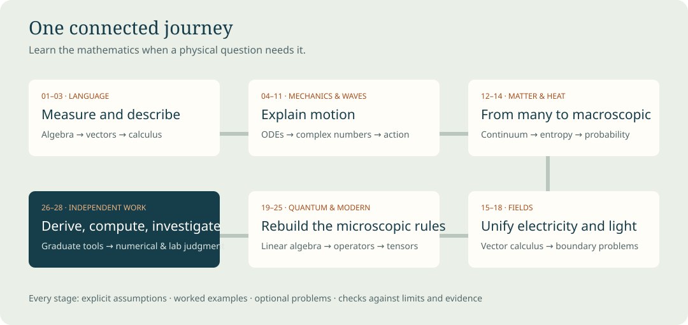

# Welcome to Physics from First Principles

This is a course for someone beginning physics without assuming algebra, trigonometry or calculus. The aim is to understand the relationships well enough to derive them, use them in unfamiliar situations, and recognize their limits. New mathematics appears at the point where a physical question needs it. Early chapters are intentionally concrete; later chapters become more demanding because they build on work already taught.

Start with [Chapter 01](chapters/01-measurement-and-the-language-of-physics.md), then follow the numbered sequence. Each chapter has original explanations, worked examples, optional problems, and separate hints and solutions. Read a small section, redo its calculation, and explain the result in your own words. When a later step is unclear, return to the specific prerequisite rather than concluding that the whole subject is beyond you.

The course uses Feynman's lectures as its conceptual spine and adds explicit beginner mathematics, a conventional undergraduate problem-solving sequence, numerical methods, laboratory analysis and selected graduate bridges. It is an original companion, not a reproduction, official revision, or endorsement of the Feynman lectures. Optional Feynman readings enrich each subject after its prerequisites have been established here.

The [study sequence](curriculum.md) gives a suggested multiyear pace, mathematical milestones, and projects. The [coverage map](coverage.md) distinguishes worked subjects, contextual readings, and graduate extensions. The [source ledger](sources.md) records what was actually inspected, including the limitations of the supplied scanned PDF.

Open **companion/index.html** for the offline chapter reader and experiments. Open **book.html** for a continuous, typeset HTML edition; its equations and fonts are bundled locally. The canonical editable text is **book.md**, with individual chapters in **chapters/**. The offline reader needs no account, network, package installation or running server. Keep the folders together when moving or extracting the course. Optional developer rebuild instructions are in the README.

Use the experiments to ask a question before changing a parameter. Identify what the model assumes, predict a direction of change, then compare the calculation with your reasoning. A plotted ideal trajectory is evidence about a mathematical model; it is not a measurement of an actual object. Several late projects ask you to collect data or write extensions yourself. Those are learner assignments, not claims that the experiment has already been performed.

The main route covers the undergraduate core: mechanics, oscillations and waves, optics, special relativity, continuum physics, thermal and statistical physics, electromagnetism, quantum mechanics, and introductory modern topics. Graduate bridges introduce tools and representative derivations. They do not replace specialist graduate courses, supervised laboratories or research. The practical goal is demonstrated ability, not a promised credential or a claim about how “smart” a reader becomes.

Conventions are SI units, right-handed axes, radians for calculus, wave phase $kx-\omega t$, and quantum inner products conjugating the first entry. Thermodynamics uses positive heat into the system and positive work done by the system, so $dU=\delta Q-\delta W$. A chapter states local alternatives when needed. Constants are exact SI definitions where applicable and explicitly approximate measured values elsewhere. A dimensionless ideal model is labeled as such.

Accuracy rests on visible derivations, unit checks, independent example calculations, numerical tests, rendering checks and review. These reduce error; they cannot certify that a newly authored book contains no mistakes. The [verification report](verification.md) states the checks performed and their limits. If a result seems inconsistent, check conventions and assumptions, redo the derivation, and compare an independent source. That habit is itself part of learning physics.
